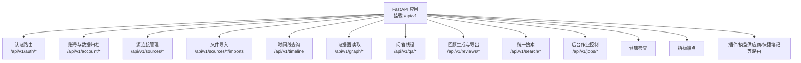
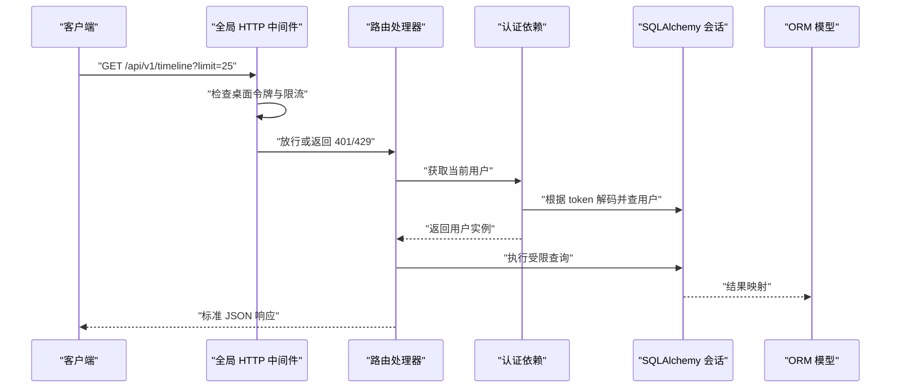
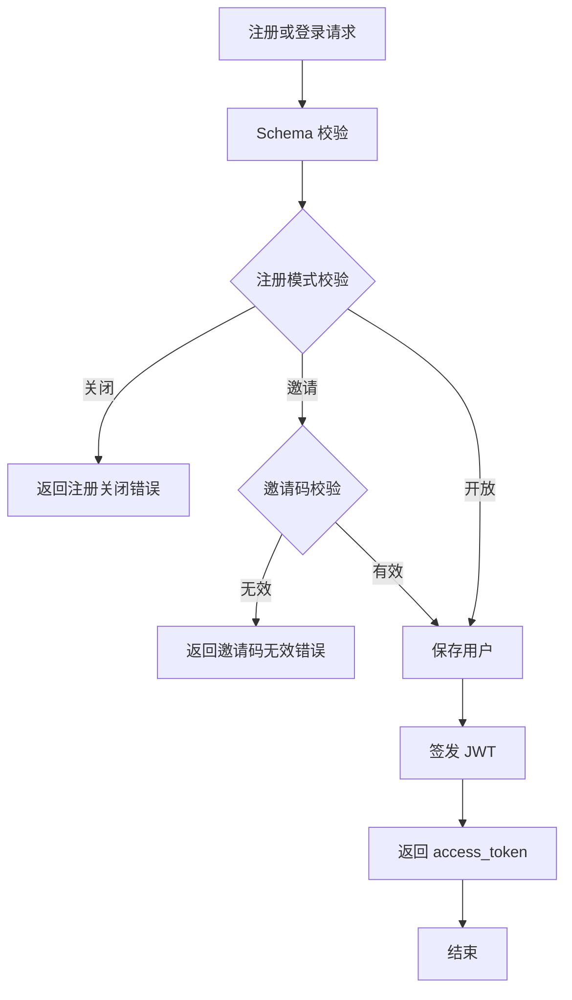
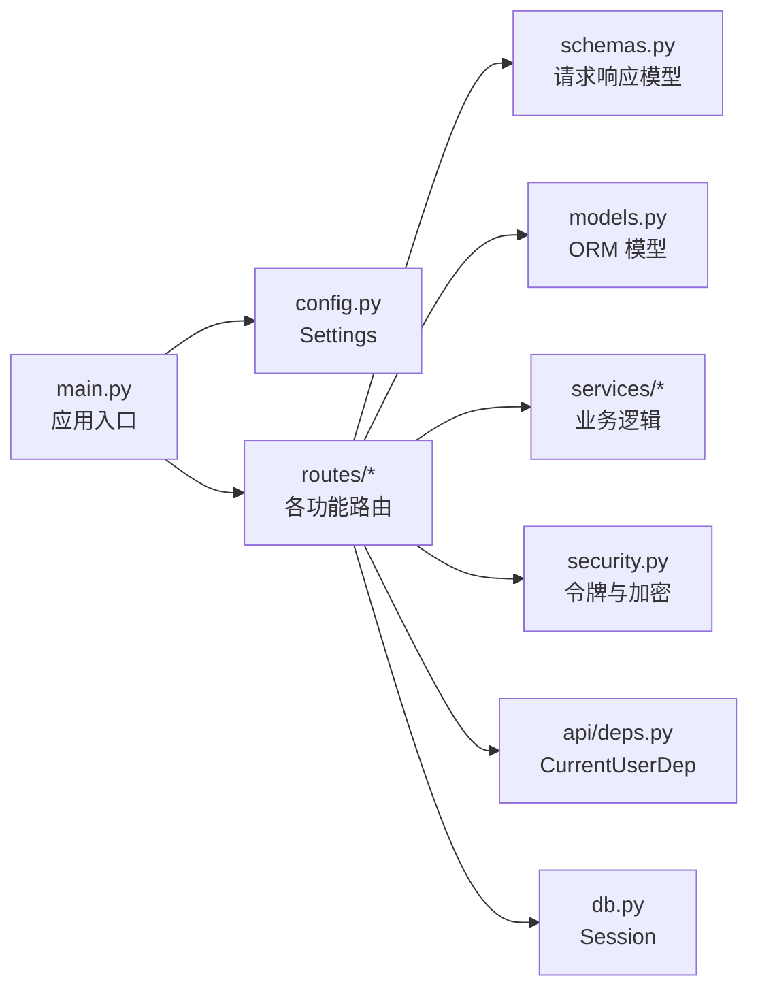
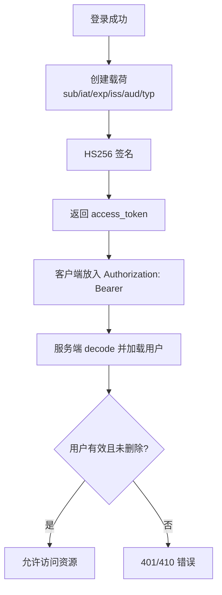

# API 接口参考

<cite>
**本文引用的文件**   
- [main.py](file://src/personal_ai_life_os/main.py)
- [config.py](file://src/personal_ai_life_os/config.py)
- [security.py](file://src/personal_ai_life_os/security.py)
- [deps.py](file://src/personal_ai_life_os/api/deps.py)
- [schemas.py](file://src/personal_ai_life_os/api/schemas.py)
- [auth.py](file://src/personal_ai_life_os/api/routes/auth.py)
- [account.py](file://src/personal_ai_life_os/api/routes/account.py)
- [sources.py](file://src/personal_ai_life_os/api/routes/sources.py)
- [imports.py](file://src/personal_ai_life_os/api/routes/imports.py)
- [items.py](file://src/personal_ai_life_os/api/routes/items.py)
- [graph.py](file://src/personal_ai_life_os/api/routes/graph.py)
- [qa.py](file://src/personal_ai_life_os/api/routes/qa.py)
- [reviews.py](file://src/personal_ai_life_os/api/routes/reviews.py)
- [search.py](file://src/personal_ai_life_os/api/routes/search.py)
- [jobs.py](file://src/personal_ai_life_os/api/routes/jobs.py)
</cite>

## 目录
1. [引言](#引言)
2. [项目结构](#项目结构)
3. [核心组件](#核心组件)
4. [架构总览](#架构总览)
5. [接口分组与详细文档](#接口分组与详细文档)
6. [依赖关系分析](#依赖关系分析)
7. [性能与限制](#性能与限制)
8. [错误码与故障排查](#错误码与故障排查)
9. [结论](#结论)
10. [附录：请求响应模型与客户端示例](#附录请求响应模型与客户端示例)

## 引言
本文件为 Personal-AI-Life-OS 的完整 API 接口参考，面向后端开发者、前端集成方以及外部工具调用者。内容覆盖认证、账号与归档、源连接管理、文件导入、时间线、证据图、问答、回顾生成、搜索、作业管理等功能域。所有端点均遵循版本化前缀 `/api/v1`，默认以 Bearer Token 进行认证；在桌面模式下还受额外的 X-Lifeos-Desktop 令牌保护。

## 项目结构
API 基于 FastAPI 构建，所有路由由 `main.py` 挂载到 `/api/v1`，并通过 `api/deps.py` 提供认证与数据库会话依赖；业务校验集中在 `api/schemas.py` 的 Pydantic 模型中；各模块路由按功能组织在 `api/routes` 下。



**图表来源**
- [main.py:44-176](file://src/personal_ai_life_os/main.py#L44-L176)

**章节来源**
- [main.py:1-200](file://src/personal_ai_life_os/main.py#L1-L200)

## 核心组件
- 配置系统：`Settings` 集中管理环境变量与运行时参数，包括访问令牌密钥、TTL、注册模式、CORS、对象存储和模型供应商设置。
- 安全模块：负责密码哈希、JWT 访问令牌签发与校验，要求子项、发行者、受众、类型和过期时间。
- 认证依赖：解析 Bearer Token，返回当前用户，并对待删除账户做拦截。
- 请求校验：Pydantic Schema 负责邮箱标准化、字段长度、枚举值、区间范围和自定义验证逻辑。
- 版本化 API：入口中间件处理速率限制、桌面模式认证、导入开关、统计采样和通用错误响应包装。

**章节来源**
- [config.py:1-132](file://src/personal_ai_life_os/config.py#L1-L132)
- [security.py:1-54](file://src/personal_ai_life_os/security.py#L1-L54)
- [deps.py:1-65](file://src/personal_ai_life_os/api/deps.py#L1-L65)
- [schemas.py:1-200](file://src/personal_ai_life_os/api/schemas.py#L1-L200)
- [main.py:128-200](file://src/personal_ai_life_os/main.py#L128-L200)

## 架构总览
下图展示一次带认证的列表请求如何从 HTTP 层进入依赖层，再落到具体路由与数据模型。



**图表来源**
- [main.py:128-200](file://src/personal_ai_life_os/main.py#L128-L200)
- [deps.py:15-65](file://src/personal_ai_life_os/api/deps.py#L15-L65)
- [items.py:1-140](file://src/personal_ai_life_os/api/routes/items.py#L1-L140)

## 接口分组与详细文档

### 1. 认证相关

#### 基础说明
- 认证方式：Bearer JWT。
- 令牌格式：HTTP Authorization 头值为 `Bearer <token>`。
- 令牌颁发：登录、注册、桌面档案接口返回 `access_token`，并在响应中包含 `expires_in`。
- 资源保护：除明确开放的健康检查、公开文档端点和公开模型披露外，大多数业务端点通过 `CurrentUserDep` 强制校验。

| 方法 | URL | 说明 | 请求体 | 成功状态码 | 主要错误状态码 |
|---|---|---|---|---|---|
| `POST` | `/api/v1/auth/register` | 注册新用户 | RegisterRequest | `201` | `400`, `403`, `409`, `422` |
| `POST` | `/api/v1/auth/login` | 登录获取访问令牌 | LoginRequest | `200` | `401`, `404`, `422` |
| `GET` | `/api/v1/auth/me` | 获取当前用户信息 | 无 | `200` | `401`, `410` |
| `GET` | `/api/v1/auth/model-disclosure` | 查询 AI 模型披露信息 | 无 | `200` | 无业务错误 |
| `PUT` | `/api/v1/auth/ai-consent` | 更新 AI 使用同意 | AIPreferenceRequest | `200` | `400`, `401`, `409`, `422` |
| `GET` | `/api/v1/auth/desktop-profile` | 桌面模式本地档案 | 无 | `200` | `404` |
| `POST` | `/api/v1/auth/desktop-profile` | 创建桌面本地档案 | DesktopProfileRequest | `200` | `404`, `422` |

请求模型要点：
- RegisterRequest：邮箱必须合法且唯一，密码长度不小于 12，时区使用 IANA 名称，可选邀请码。
- LoginRequest：仅含邮箱和密码；邮箱会被标准化为小写。
- DesktopProfileRequest：timezone 必填，范围不超过 100 字符。
- AIPreferenceRequest：provider_id 可选，enabled 表示是否启用模型隐私披露下的模型使用。

典型错误码语义：
- `registration_closed`：注册被关闭。
- `invalid_invitation`：邀请码无效。
- `account_exists`：邮箱已存在。
- `invalid_timezone`：未识别的时区。
- `invalid_credentials`：邮箱或密码错误。
- `model_consent_provider_invalid`：选择的模型供应商不存在。
- `account_deletion_pending`：账户处于清理期，临时不可访问。

成功响应示例（简化）：
```json
{
  "access_token": "eyJhbGc...",
  "token_type": "bearer",
  "expires_in": 43200,
  "user": {
    "id": "字符串ID",
    "email": "user@example.com",
    "timezone": "Asia/Shanghai",
    "ai_consent_at": null,
    "ai_consent_provider": null,
    "ai_consent_disclosure_version": null,
    "created_at": "ISO-8601 时间戳"
  }
}
```

失败响应示例（简化）：
```json
{
  "code": "invalid_credentials",
  "message": "邮箱或密码不正确。"
}
```

实现细节：
- 登录接口在桌面模式下返回 `404 Not found`，桌面专用流程走 desktop-profile。
- 令牌包含 `sub`、`iat`、`exp`、`iss`、`aud`、`typ` 字段；服务端严格校验 `access` 类型。
- Token 刷新未暴露独立端点；客户端应在使用过期后重新登录。



**图表来源**
- [auth.py:37-168](file://src/personal_ai_life_os/api/routes/auth.py#L37-L168)
- [security.py:20-54](file://src/personal_ai_life_os/security.py#L20-L54)

**章节来源**
- [auth.py:1-200](file://src/personal_ai_life_os/api/routes/auth.py#L1-L200)
- [security.py:1-54](file://src/personal_ai_life_os/security.py#L1-L54)
- [deps.py:15-65](file://src/personal_ai_life_os/api/deps.py#L15-L65)

### 2. 账号与数据归档

| 方法 | URL | 说明 | 成功状态码 |
|---|---|---|---|
| `GET` | `/api/v1/account/archive` | 下载个人数据归档包 | `200` |

归档打包内容包括用户基本信息、源连接、同步运行记录、时间线条目、回顾及版本、模型同意、提醒、模型运行、后台作业、实体图、关系、证据、别名、合并日志、问答线程、洞察取消标记、Agent 动作、插件清单与审计日志、标签、集合、收藏搜索等。

注意：该接口要求有效的 Bearer Token，且账户未处于清理等待状态。

**章节来源**
- [account.py:1-120](file://src/personal_ai_life_os/api/routes/account.py#L1-L120)

### 3. 源连接管理

| 方法 | URL | 说明 | 请求体 | 成功状态码 |
|---|---|---|---|---|
| `POST` | `/api/v1/sources` | 创建源连接 | SourceCreateRequest | `201` |
| `GET` | `/api/v1/sources` | 列出当前用户的活跃与非删除源 | 无 | `200` |
| `GET` | `/api/v1/sources/{source_id}` | 获取单个源 | 无 | `200` |
| `PATCH` | `/api/v1/sources/{source_id}/status` | 切换活跃或暂停 | SourceStatusRequest | `200` |
| `PATCH` | `/api/v1/sources/{source_id}/scope` | 更新选定的数据范围 | SourceScopeRequest | `200` |
| `PATCH` | `/api/v1/sources/{source_id}/cloud-consent` | 更新云端提取隐私同意 | SourceCloudConsentRequest | `200` |

关键行为：
- 内部 Quick Note 源禁止直接管理。
- 暂停源会取消相关任务；恢复后才能更新 scope。
- ChatGPT 源必须在 selected_scope 中提供 conversation_ids。
- 开启 cloud consent 时，consent_version 必须与服务端最新版本一致；版本不匹配需要重新拉取披露文本。

SourceCreateRequest 支持的文件类型包括 memory_markdown、chatgpt_export、chat_export、document、photo、calendar_ics。

**章节来源**
- [sources.py:1-200](file://src/personal_ai_life_os/api/routes/sources.py#L1-L200)

### 4. 文件导入

| 方法 | URL | 说明 |
|---|---|---|
| `POST` | `/api/v1/sources/{source_id}/imports` | 上传文件并启动导入 |

表单字段：
- `file`：二进制文件。
- `conversation_ids`：可选，JSON 字符串数组，用于 ChatGPT 选择对话。
- `captured_at`：可选，ISO-8601 带时区的时间。
- `captured_timezone`：可选，IANA 时区名称。

大小限制：
- 照片和文本分别由配置的 `max_photo_upload_bytes` 和 `max_text_upload_bytes` 决定。
- 超过限制返回 `413 Payload Too Large`，代码为 `upload_too_large`。
- 若服务端的导入被禁用，中间件返回 `503`，代码为 `imports_paused`。

成功响应结构：
```json
{
  "sync_run": {
    "id": "同步运行ID",
    "source_id": "源ID",
    "status": "success | failed | running",
    "parser_version": "解析器版本",
    "items_seen": 数字,
    "items_created": 数字,
    "items_updated": 数字,
    "items_duplicate": 数字,
    "items_removed": 数字,
    "items_skipped": 数字,
    "items_failed": 数字,
    "error_code": null,
    "created_at": "ISO-8601",
    "completed_at": "ISO-8601 或空"
  },
  "items": [SourceItemResponse],
  "job_ids": ["作业ID列表"]
}
```

**章节来源**
- [imports.py:1-134](file://src/personal_ai_life_os/api/routes/imports.py#L1-L134)

### 5. 时间线与来源条目

| 方法 | URL | 说明 |
|---|---|---|
| `GET` | `/api/v1/timeline` | 查询当前用户时间线 |
| `GET` | `/api/v1/sources/{source_id}/items` | 查询某个源的条目时间线 |

通用查询参数：
| 参数 | 类型 | 默认值 | 说明 |
|---|---|---:|---|
| `start` | date | 空 | 起始日期 |
| `end` | date | 空 | 结束日期，不包含 end 当天零点 |
| `source_id` | string | 空 | 按源过滤 |
| `q` | string | 空 | 模糊搜索标题、正文和用户描述 |
| `include_undated` | boolean | `true` | 是否包含未标注时间的条目 |
| `cursor` | string | 空 | 游标分页键 |
| `limit` | integer | `25` | 页大小，最大 `100` |

时间线采用偏移+游标的混合分页：
- cursor 编码的是已扫描的记录偏移量。
- `next_cursor` 非空时还有下一页。
- 排序优先是无日期的项排在最前，然后按 occurrence_time 倒序、ID 升序。
- 如果 start 与 end 同时提供，end 必须早于 start 才会报错。

典型成功响应：
```json
{
  "items": [SourceItemResponse],
  "total": 300,
  "next_cursor": "base64游标"
}
```

**章节来源**
- [items.py:1-160](file://src/personal_ai_life_os/api/routes/items.py#L1-L160)

### 6. 证据图操作

| 方法 | URL | 说明 |
|---|---|---|
| `GET` | `/api/v1/graph/entities` | 列举实体 |
| `GET` | `/api/v1/graph/relations` | 列举关系 |

过滤与分页：
- entities：可按 entity_type 和 q 搜索名称。
- relations：可按 relation_type 过滤。
- 两者都支持 limit（最大 100）。
- 每个实体和关系都会附带最近 20 条证据。

成功响应骨架：
```json
{
  "total": 数值,
  "items": [
    {
      "id": "ID",
      "entity_type": "类型",
      "name": "名称",
      "summary": "摘要",
      "confidence": 数值,
      "status": "active | pending_review",
      "evidence": [GraphEvidenceResponse],
      "created_at": "时间",
      "updated_at": "时间"
    }
  ]
}
```

**章节来源**
- [graph.py:1-135](file://src/personal_ai_life_os/api/routes/graph.py#L1-L135)

### 7. 问答接口

| 方法 | URL | 说明 |
|---|---|---|
| `GET` | `/api/v1/qa/scope` | 查看最近一条线程的上下文 |
| `GET` | `/api/v1/qa/threads` | 列出线程 |
| `POST` | `/api/v1/qa/threads` | 创建线程 |
| `GET` | `/api/v1/qa/threads/{thread_id}` | 获取线程详情 |
| `POST` | `/api/v1/qa/threads/{thread_id}/messages` | 提问并生成回答 |
| `DELETE` | `/api/v1/qa/threads/{thread_id}` | 删除线程 |

交互模型：
- 每次提问会追加 user 角色消息。
- 系统会生成 assistant 消息，包含 summary、answer、citations、confidence。
- 首次提问会自动将 title 更新为用户问题摘要。
- thread.scope 会根据答案动态演进。

典型提问成功响应中的 answer：
```json
{
  "summary": "简洁回答",
  "confidence": 数值,
  "scope": {},
  "citations": ["引用ID列表"]
}
```

错误由服务层 QaError 转为带 code 和 message 的业务错误。

**章节来源**
- [qa.py:1-200](file://src/personal_ai_life_os/api/routes/qa.py#L1-L200)

### 8. 回顾生成与 Markdown 导出

| 方法 | URL | 说明 |
|---|---|---|
| `GET` | `/api/v1/reviews/{review_id}/markdown` | 输出回顾 Markdown |
| `POST` | `/api/v1/reviews/{review_id}/regenerate` | 重新生成草稿 |
| `PUT` | `/api/v1/reviews/{review_id}` | 修改最终文案 |
| `PATCH` | `/api/v1/reviews/{review_id}/version` | 更新某个版本 |
| `DELETE` | `/api/v1/reviews/{review_id}/version` | 删除某个版本 |
| `POST` | `/api/v1/reviews` | 发起回顾生成任务 |

ReviewGenerateRequest：
- period_start 和 period_end 必须满足结束晚于开始，且不超过 31 天。
- use_external_model 决定是否调用外部模型。
- provider_id 和 model 用于指定模型供应商与模型名。

模型调用前需确认：
- 用户启用了模型同意；
- 同意的 provider 和 disclosure_version 与服务端配置一致；
- 涉及图片时，可能触发 OCR 或图像描述工作流；
- 模型输入 token 估算与费用上限会在服务层参与风险控制。

Markdown 导出会把事实与建议映射为带 source 引用的结构化文本，并附加跨周期趋势、承诺、目标与备注区域。

**章节来源**
- [reviews.py:1-200](file://src/personal_ai_life_os/api/routes/reviews.py#L1-L200)

### 9. 搜索查询

| 方法 | URL | 说明 |
|---|---|---|
| `GET` | `/api/v1/search` | 统一搜索时间与回顾、提醒等 |

支持的筛选：
| 字段 | 类型 | 含义 |
|---|---|---|
| `q` | string | 查询关键词 |
| `start` | date | 时间下限 |
| `end` | date | 时间上限 |
| `source_id` | string | 只搜索某源的时间线 |
| `tag_id` | string | 过滤标签 |
| `collection_id` | string | 过滤集合 |
| `status` | string[] | 过滤回顾状态 |

搜索结果分块：
- timeline：带有 snippet 高亮片段。
- reviews：回顾快照，包含 snippet。
- reminders：提醒组，每条提醒带有命中片段。

结果结构：
```json
{
  "timeline": {
    "total": 数值,
    "results": [SearchTimelineResult]
  },
  "reviews": {
    "total": 数值,
    "results": [SearchReviewResult]
  },
  "reminders": {
    "groups": [SearchReminderGroup],
    "total": 数值
  }
}
```

**章节来源**
- [search.py:1-200](file://src/personal_ai_life_os/api/routes/search.py#L1-L200)

### 10. 作业管理

| 方法 | URL | 说明 |
|---|---|---|
| `GET` | `/api/v1/jobs/{job_id}` | 查询作业状态 |
| `POST` | `/api/v1/jobs/{job_id}/retry` | 重试失败的作业 |

重试约束：
- 只有 failed 或 cancelled 状态可重试。
- 若作业关联源，源必须为 active。
- photo_description 和 weekly_review 需要最新模型同意。
- 若是 review 再生任务，review 不能被 invalidated；已 confirmed 的不可通过此接口再生；其关联源必须全部 active。
- 符合条件的 review 状态会切换到 processing。

**章节来源**
- [jobs.py:1-82](file://src/personal_ai_life_os/api/routes/jobs.py#L1-L82)

## 依赖关系分析



- 耦合度：路由层较薄，多数复杂逻辑下沉到 services 层；common 依赖 deps 完成认证与 session 注入。
- 边界清晰：schemas.py 作为稳定契约，防止 ORM 模型直接泄露给 HTTP 层。
- 外部依赖：JWT、S3、OpenAI、HTTPX、Pydantic、SQLAlchemy。

**图表来源**
- [main.py:44-120](file://src/personal_ai_life_os/main.py#L44-L120)
- [schemas.py:1-120](file://src/personal_ai_life_os/api/schemas.py#L1-L120)
- [deps.py:1-65](file://src/personal_ai_life_os/api/deps.py#L1-L65)

**章节来源**
- [main.py:1-200](file://src/personal_ai_life_os/main.py#L1-L200)
- [schemas.py:1-120](file://src/personal_ai_life_os/api/schemas.py#L1-L120)

## 性能与限制
- 文件导入大小受配置限制，照片和文本分别限额；过大直接拒绝，避免内存溢出。
- 时间线、实体、关系列表均提供 limit 上限，防止单次响应过大。
- 中间件为特定路径启用请求频率限制：登录、注册、导入；违规返回 429 并携带 Retry-After。
- Worker 模式下，照片 OCR 等重任务可能延后执行，导入先返回 job_ids，后续由 worker 处理。
- 生产环境要求关闭自动建表、启用 worker 模式、使用 S3 对象存储和独立 deletion journal。
- 模型调用受 per-call 预算、月预算、token 成本配置限制。

建议优化：
- 对热点时间线接口增加只读缓存层。
- 对搜索结果 FTS 索引维护加入离线重建脚本。
- 大文件导入改为分片上传与断点续传。
- 批量列表接口增加排序与选择性字段查询。

**章节来源**
- [config.py:20-132](file://src/personal_ai_life_os/config.py#L20-L132)
- [main.py:128-200](file://src/personal_ai_life_os/main.py#L128-L200)

## 错误码与故障排查

常用错误分类：
| 类别 | 典型状态码 | 含义 | 常见 code |
|---|---:|---|---|
| 未认证 | `401` | 缺少或不合法 Bearer Token | `auth_required`, `invalid_access_token`, `invalid_credentials` |
| 账户状态 | `410` | 账户正在清理 | `account_deletion_pending` |
| 冲突 | `409` | 资源已存在或状态不匹配 | `account_exists`, `internal_source`, `source_cannot_resume`, `model_consent_required`, `job_not_retryable`, `source_not_active`, `review_already_confirmed` |
| 未找到 | `404` | 资源不存在 | `source_not_found`, `qa_thread_not_found`, `job_not_found` |
| 客户端参数错误 | `422` | Schema 或语义校验失败 | `invalid_timezone`, `invalid_date_range`, `invalid_cursor`, `invalid_capture_date`, `invalid_conversation_selection` |
| 负载过大 | `413` | 上传超出限制 | `upload_too_large` |
| 服务暂停 | `503` | 导入暂时不可用 | `imports_paused` |
| 限流 | `429` | 请求过多 | `rate_limited` |

排错步骤：
1. 确认是否提供正确的 Authorization Bearer Token。
2. 检查注册模式是否为 open 或 invitation，且邀请码正确。
3. 确认用户未被标记 deletion_requested，否则会被拦截。
4. 导入失败时查看 sync_run.error_code 和 error_message。
5. 作业重试失败时检查源状态、review 状态和 model consent 配置。
6. 时间线分页异常时检查 cursor 是否来自上一次响应的 next_cursor。
7. 搜索返回为空时确认 FTS 索引是否重建以及时间过滤是否符合预期。

**章节来源**
- [deps.py:23-65](file://src/personal_ai_life_os/api/deps.py#L23-L65)
- [main.py:128-200](file://src/personal_ai_life_os/main.py#L128-L200)
- [auth.py:89-168](file://src/personal_ai_life_os/api/routes/auth.py#L89-L168)
- [imports.py:53-134](file://src/personal_ai_life_os/api/routes/imports.py#L53-L134)
- [jobs.py:14-82](file://src/personal_ai_life_os/api/routes/jobs.py#L14-L82)

## 结论
Personal-AI-Life-OS 的 API 围绕用户域的数据所有权设计，所有关键接口均按 owner_id 隔离，并结合 JWT、可选桌面令牌、速率限制、模型同意和生产配置校验形成闭环。文档级契约集中在 schemas.py，业务复杂性主要由 services 承载，API 层保持可读性。建议在客户端集成时：显式处理 401/409/410/413/422/429/503，缓存 next_cursor 用于分页，谨慎处理模型同意变更对作业重试的影响。

## 附录：请求响应模型与客户端示例

### 重要 Pydantic 模型
| 模型 | 用途 | 关键字段与规则 |
|---|---|---|
| RegisterRequest | 注册请求 | email 正则校验，password ≥12，timezone IANA，invite_code 可选 |
| LoginRequest | 登录请求 | email 标准化，password 明文提交 |
| TokenResponse | 认证响应 | access_token，token_type=bearer，expires_in，user |
| UserResponse | 用户响应 | id, email, timezone, ai_consent 相关字段，created_at |
| SourceCreateRequest | 创建源 | kind 枚举，selected_scope，聊天导出需 conversation_ids |
| SourceStatusRequest | 源状态 | status 仅限 active/paused |
| SourceScopeRequest | 源范围 | 更新选中 conversation_ids |
| ImportResultResponse | 导入结果 | sync_run，items，job_ids |
| TimelineResponse | 时间线响应 | items，total，next_cursor |
| ReviewGenerateRequest | 回顾生成 | period_start/end ≤31 天，use_external_model，provider/model |
| BackgroundJobResponse | 作业响应 | id, kind, status, attempt_count, result_json，时间字段 |
| QaThreadCreateRequest | 问答创建 | title 可选，scope 可为空 |
| QaAskRequest | 问答消息 | question 必填，scope 可选 |
| SearchFilters | 搜索过滤器 | start, end, source_id, tag_id, collection_id, status |

**章节来源**
- [schemas.py:1-1151](file://src/personal_ai_life_os/api/schemas.py#L1-L1151)

### JWT 认证机制概览
- 算法：HS256。
- 子项 sub 即用户 ID。
- issuer 固定 personal-ai-life-os。
- audience 固定 personal-ai-life-os-api。
- typ 必须为 access。
- exp 由 Settings.access_token_ttl_hours 计算。



**图表来源**
- [security.py:20-54](file://src/personal_ai_life_os/security.py#L20-L54)
- [deps.py:23-65](file://src/personal_ai_life_os/api/deps.py#L23-L65)

### 客户端集成示例

Python 伪示例：
```text
import requests

BASE = "http://127.0.0.1:8000/api/v1"

# 登录
res = requests.post(f"{BASE}/auth/login", json={
    "email": "user@example.com",
    "password": "strong-password-here"
})
token = res.json()["access_token"]

headers = {"Authorization": f"Bearer {token}"}

# 获取时间线
timeline = requests.get(
    f"{BASE}/timeline?limit=25",
    headers=headers
).json()
for item in timeline["items"]:
    print(item["title"], item["occurred_at"])
```

JavaScript 伪示例：
```text
const BASE = "https://your-server.example/api/v1";

async function login(email, password) {
  const res = await fetch(`${BASE}/auth/login`, {
    method: "POST",
    headers: { "Content-Type": "application/json" },
    body: JSON.stringify({ email, password })
  });
  if (!res.ok) throw new Error("登录失败");
  return (await res.json()).access_token;
}

async function getTimeline(token) {
  const resp = await fetch(`${BASE}/timeline?limit=25`, {
    headers: { Authorization: `Bearer ${token}` }
  });
  return await resp.json();
}

(async () => {
  const token = await login("user@example.com", "your-password");
  console.log(await getTimeline(token));
})();
```

注意事项：
- 所有认证敏感接口都应发送 Authorization: Bearer。
- 桌面模式额外要求头部 x-lifeos-desktop 与服务器启动时的 secret 匹配。
- 导入文件时使用 multipart/form-data。
- 遇到 429 时应参考 Retry-After 头延迟重试。
- 遇到 410 应提示用户账户已被删除且数据清理中。

**章节来源**
- [main.py:128-200](file://src/personal_ai_life_os/main.py#L128-L200)
- [auth.py:37-168](file://src/personal_ai_life_os/api/routes/auth.py#L37-L168)
- [imports.py:14-134](file://src/personal_ai_life_os/api/routes/imports.py#L14-L134)