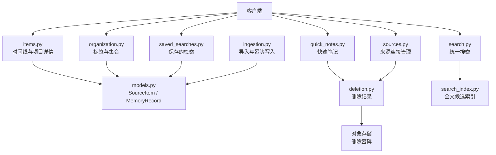
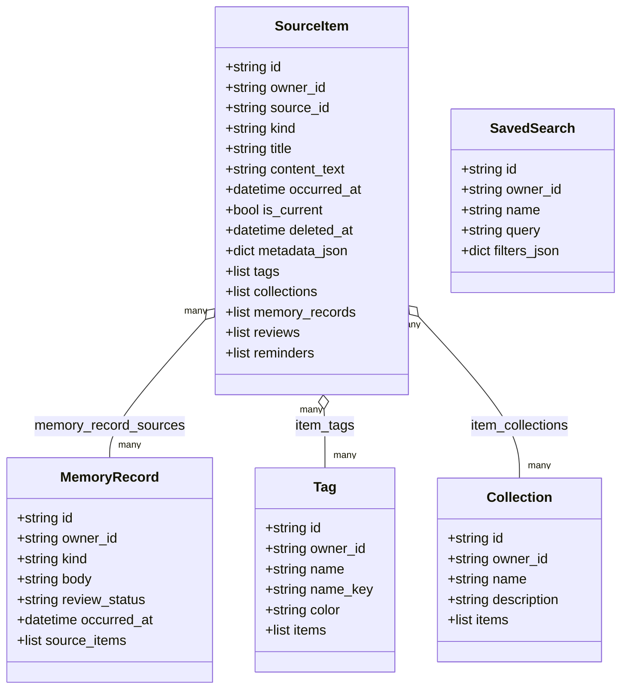
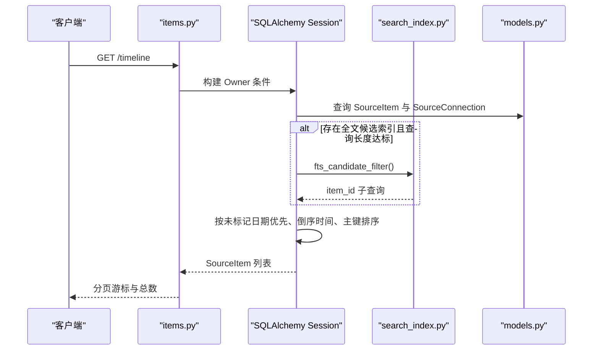
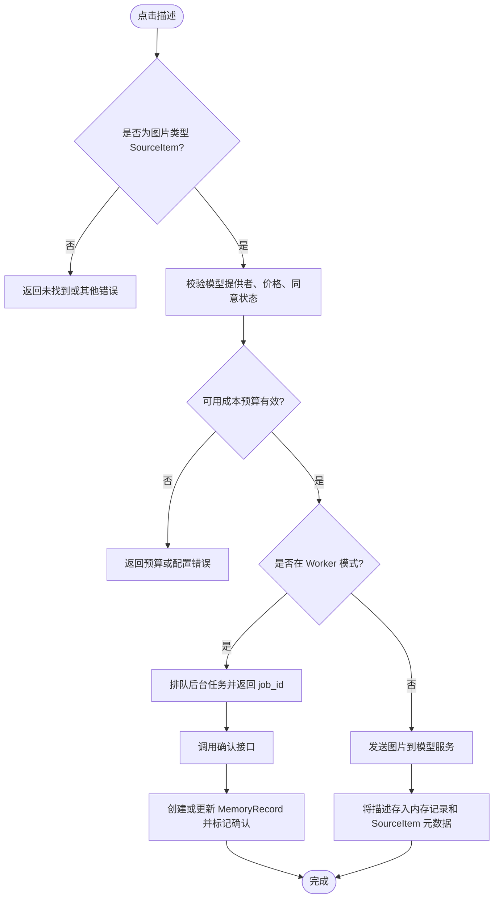
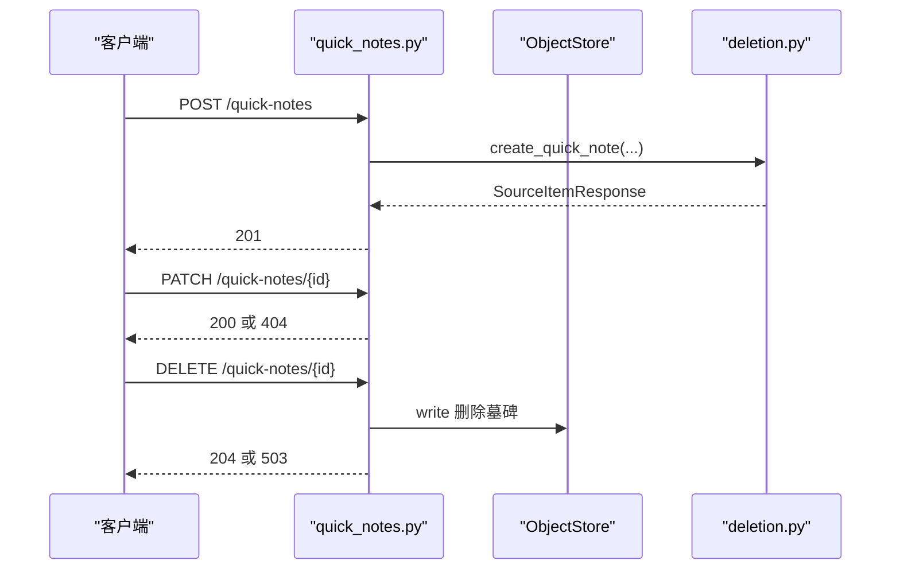
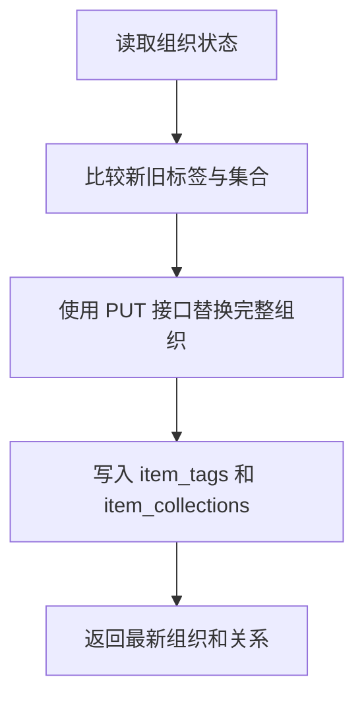
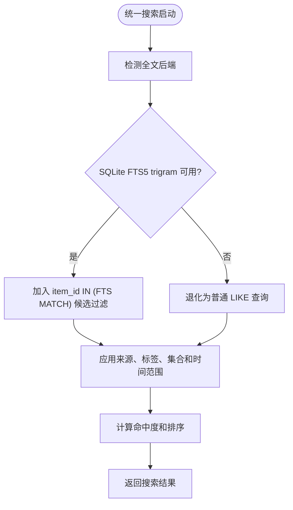
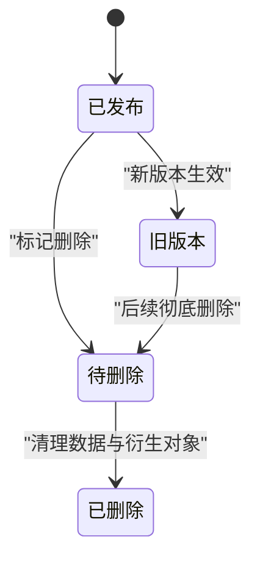
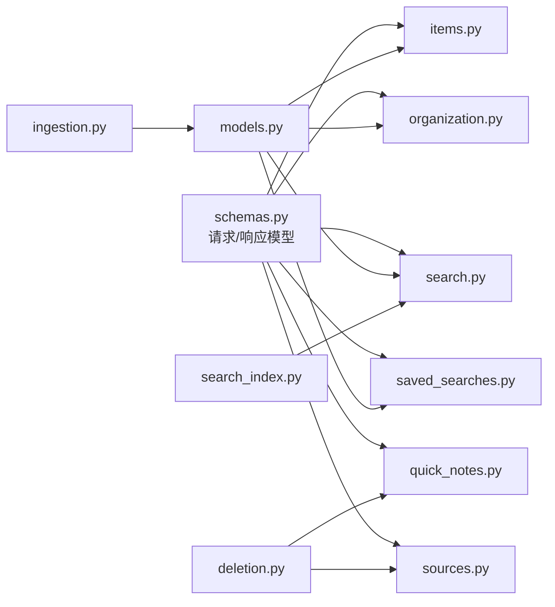

# 内容管理 API

<cite>
**本文引用的文件 **
- [items.py](file://src/personal_ai_life_os/api/routes/items.py)
- [quick_notes.py](file://src/personal_ai_life_os/api/routes/quick_notes.py)
- [organization.py](file://src/personal_ai_life_os/api/routes/organization.py)
- [sources.py](file://src/personal_ai_life_os/api/routes/sources.py)
- [saved_searches.py](file://src/personal_ai_life_os/api/routes/saved_searches.py)
- [search.py](file://src/personal_ai_life_os/api/routes/search.py)
- [schemas.py](file://src/personal_ai_life_os/api/schemas.py)
- [models.py](file://src/personal_ai_life_os/models.py)
- [deletion.py](file://src/personal_ai_life_os/services/deletion.py)
- [ingestion.py](file://src/personal_ai_life_os/services/ingestion.py)
- [test_quick_notes.py](file://tests/test_quick_notes.py)
</cite>

## 目录
1. [简介](#简介)
2. [项目结构与职责边界](#项目结构与职责边界)
3. [核心领域对象](#核心领域对象)
4. [体系结构总览](#体系结构总览)
5. [时间线与源数据项接口](#时间线与源数据项接口)
6. [快速笔记接口](#快速笔记接口)
7. [标签与集合组织接口](#标签与集合组织接口)
8. [保存的检索接口](#保存的检索接口)
9. [统一搜索与全文索引同步](#统一搜索与全文索引同步)
10. [版本控制、软删除与恢复](#版本控制软删除与恢复)
11. [常用 API 使用场景](#常用-api-使用场景)
12. [依赖关系分析](#依赖关系分析)
13. [性能与批量操作建议](#性能与批量操作建议)
14. [故障排查指南](#故障排查指南)
15. [结论](#结论)

## 简介
本文件面向“内容管理”相关 API，重点覆盖以下内容：
- 时间线项目的读取、过滤与排序。
- SourceItem 的详细读能力、描述生成与确认。
- QuickNote 快速笔记的创建、更新、删除及其简化界面。
- Tag 和 Collection 标签与集合管理体系。
- SourceItem 与 MemoryRecord 的多对多关联模型，以及其聚合路径。
- SavedSearch 保存的检索条件的创建、更新和删除。
- 统一搜索中的全文检索、时间范围、来源、标签、集合过滤。
- 软删除机制、内容版本控制、恢复策略和删除回滚重放。
- 批量操作的约束、错误处理及最佳实践。

为降低阅读门槛，文档先提供高层结构和概念说明，再逐步深入到具体端点、数据模型和算法行为。所有示例均以路径形式标注实现位置，避免直接粘贴代码正文。

## 项目结构与职责边界
内容管理涉及三层：API 路由层负责 HTTP 请求校验、租户隔离和响应建模；服务层实现幂等导入、索引重建、对象存储访问、软删除和后台任务调度；数据库模型层定义表结构与多对多关系。

**图表来源**
- [items.py:1-100](file://src/personal_ai_life_os/api/routes/items.py#L1-L100)
- [quick_notes.py:1-76](file://src/personal_ai_life_os/api/routes/quick_notes.py#L1-L76)
- [organization.py:1-120](file://src/personal_ai_life_os/api/routes/organization.py#L1-L120)
- [sources.py:1-60](file://src/personal_ai_life_os/api/routes/sources.py#L1-L60)
- [saved_searches.py:1-50](file://src/personal_ai_life_os/api/routes/saved_searches.py#L1-L50)
- [search.py:1-60](file://src/personal_ai_life_os/api/routes/search.py#L1-L60)
- [models.py:213-375](file://src/personal_ai_life_os/models.py#L213-L375)
- [deletion.py:1-80](file://src/personal_ai_life_os/services/deletion.py#L1-L80)
- [ingestion.py:1-60](file://src/personal_ai_life_os/services/ingestion.py#L1-L60)

**章节来源**
- [items.py:1-40](file://src/personal_ai_life_os/api/routes/items.py#L1-L40)
- [quick_notes.py:1-30](file://src/personal_ai_life_os/api/routes/quick_notes.py#L1-L30)
- [organization.py:1-30](file://src/personal_ai_life_os/api/routes/organization.py#L1-L30)
- [saved_searches.py:1-30](file://src/personal_ai_life_os/api/routes/saved_searches.py#L1-L30)

## 核心领域对象
系统中与内容管理最核心的对象是 SourceItem，它表示一个已解析或用户直接写入的时间线条目；MemoryRecord 用于聚合语义化记忆结果，如照片描述和用户确认的记忆块。Tag、Collection 通过中间表与 SourceItem 形成多对多标签与集合关系。SavedSearch 保存用户复用的检索条件和过滤器；SearchFilters 用于统一搜索输入。

**图表来源**
- [models.py:213-375](file://src/personal_ai_life_os/models.py#L213-L375)

**章节来源**
- [models.py:213-375](file://src/personal_ai_life_os/models.py#L213-L375)
- [schemas.py:1-200](file://src/personal_ai_life_os/api/schemas.py#L1-L200)

## 体系结构总览
内容管理流程大体分为：
1. 前端调用时间线查询、统一搜索、保存的检索或快速笔记接口。
2. API 路由使用当前用户身份做资源隔离，并基于 ORM 查询 SourceItem、MemoryRecord、Tag、Collection。
3. 搜索结果可通过全文候选索引做早期过滤；Timeline 和搜索分别有不同的排序策略。
4. 快速笔记通过独立路由创建普通 SourceItem；时间线读取时自动排除已删除和非最新版本的 SourceItem。
5. 删除走“软删除 + 墓碑记录”机制，后续可撤销、恢复或删除衍生内容。

**图表来源**
- [items.py:1-100](file://src/personal_ai_life_os/api/routes/items.py#L1-L100)
- [search.py:1-60](file://src/personal_ai_life_os/api/routes/search.py#L1-L60)
- [search_index.py:130-162](file://src/personal_ai_life_os/services/search_index.py#L130-L162)

**章节来源**
- [items.py:1-100](file://src/personal_ai_life_os/api/routes/items.py#L1-L100)
- [models.py:213-375](file://src/personal_ai_life_os/models.py#L213-L375)

## 时间线与源数据项接口

### 时间线读取
`GET /timeline` 返回所有者可见的 SourceItem 列表，默认排除已删除 (`deleted_at IS NOT NULL`)、非最新版本 (`is_current = False`) 和处于 `deleting` 状态的来源连接。

关键参数：
- `start`、`end`：按发生时间的闭开区间，最终转为 UTC。
- `source_id`：限定某个来源。
- `q`：标题、正文或用户描述的用户关键词搜索。
- `include_undated`：是否包含未标记日期的 SourceItem。
- `cursor`、`limit`：游标分页。

响应中 `total` 用于计数，`next_cursor` 仅在还有剩余条目时返回。

内部查询顺序为：
1. 先判定是否有未知日期。
2. 再按 `occurred_at` 降序。
3. 最后按 `id` 保证稳定分页。

时间范围校验逻辑不允许 `end <= start`，无效游标会返回明确的 422 错误码和消息。

**章节来源**
- [items.py:1-180](file://src/personal_ai_life_os/api/routes/items.py#L1-L180)
- [items.py:181-200](file://src/personal_ai_life_os/api/routes/items.py#L181-L200)

### 指定来源的时间线
`GET /sources/{source_id}/items` 在列出 SourceItem 前会检查来源是否存在且不属于删除中状态；若来源不存在则返回 404。参数与全局时间线相同。

**章节来源**
- [items.py:120-180](file://src/personal_ai_life_os/api/routes/items.py#L120-L180)

### 单条 SourceItem 读取
`GET /items/{item_id}` 需要满足：
- `owner_id` 与当前用户一致。
- `deleted_at IS NULL`。
- `is_current = True`。
- 所属 `SourceConnection.status != "deleting"`。

任一条件不匹配都会返回 404。这是通用内容读取入口；MemoryRecord 不是单独的内容读取实体，而是通过关联关系参与聚合。

**章节来源**
- [items.py:211-230](file://src/personal_ai_life_os/api/routes/items.py#L211-L230)

### 图片说明工作流
图片类 SourceItem 支持两个阶段接口：
- `POST /items/{item_id}/describe`：发起图片或 AI 模型描述。
- `POST /items/{item_id}/description`：确认后创建或更新 MemoryRecord，并把描述文本持久化为 SourceItem 的元数据字段 `user_description`。

前者可能触发后台任务（Worker 模式），也可能直接调用外部模型服务；后者要求模型权限、成本配置和使用者同意都满足，否则返回 409。

**图表来源**
- [items.py:232-418](file://src/personal_ai_life_os/api/routes/items.py#L232-L418)
- [items.py:419-467](file://src/personal_ai_life_os/api/routes/items.py#L419-L467)

**章节来源**
- [items.py:232-467](file://src/personal_ai_life_os/api/routes/items.py#L232-L467)

### 时间线查询限制
- 分页上限 `limit` 最大为 100，最小为 1。
- `q` 最大长度 200。
- `cursor` 最大长度 64。
- 时间范围需满足 `end` 严格晚于 `start`。
- 时间线不直接暴露 MemoryRecord、Tag、Collection 的编辑接口，这些由组织管理接口统一管理。

**章节来源**
- [items.py:1-100](file://src/personal_ai_life_os/api/routes/items.py#L1-L100)
- [items.py:101-180](file://src/personal_ai_life_os/api/routes/items.py#L101-L180)

## 快速笔记接口
QuickNote 是简化版内容创作界面，后端把它落地为一条 `kind = quick_note` 的 SourceItem，不需要客户端手动管理来源连接。

### 创建笔记
- 端点：`POST /quick-notes`
- 响应码：201
- 响应模型：SourceItemResponse

请求体 `QuickNoteCreateRequest` 允许可选 `title`，但 `content_text` 必填且会被去空白清洗，空内容拒绝。时间字段必须带时区；`occurred_at` 和 `source_timezone` 可任选其一。

如果快速笔记服务不可用，抛出 `ValueError`，API 会转换为 409 业务错误。

**章节来源**
- [quick_notes.py:1-40](file://src/personal_ai_life_os/api/routes/quick_notes.py#L1-L40)
- [schemas.py:240-330](file://src/personal_ai_life_os/api/schemas.py#L240-L330)

### 更新笔记
- 端点：`PATCH /quick-notes/{item_id}`
- 支持部分字段更新：`title`、`content_text`、`occurred_at`、`source_timezone`，以及 `clear_occurred_at` 和 `clear_source_timezone`。
- 防全空更新：如果所有可变字段为 None 且未请求清空任何字段，会返回 422。
- 冲突清除标志与赋值字段互斥：不能同时设置 `occurred_at` 和 `clear_occurred_at`。

成功更新返回 SourceItemResponse；找不到或跨所有者修改返回 404。

**章节来源**
- [quick_notes.py:41-60](file://src/personal_ai_life_os/api/routes/quick_notes.py#L41-L60)
- [schemas.py:331-430](file://src/personal_ai_life_os/api/schemas.py#L331-L430)

### 删除笔记
- 端点：`DELETE /quick-notes/{item_id}`
- 响应码：204
- 失败映射：
  - 404：QuickNote 不存在或跨所有者。
  - 503：对象存储删除或日志写入失败，建议使用更短时间重试。

测试验证了删除后不再出现在时间线，并可被恢复后再次重新删除。

**图表来源**
- [quick_notes.py:1-76](file://src/personal_ai_life_os/api/routes/quick_notes.py#L1-L76)
- [deletion.py:1-80](file://src/personal_ai_life_os/services/deletion.py#L1-L80)

**章节来源**
- [quick_notes.py:1-76](file://src/personal_ai_life_os/api/routes/quick_notes.py#L1-L76)
- [test_quick_notes.py:20-180](file://tests/test_quick_notes.py#L20-L180)

## 标签与集合组织接口

### 标签管理
- 列表：`GET /tags`，按 `name_key` 和主键排序。
- 创建：`POST /tags`，唯一性由 `(owner_id, name_key)` 保障，重复创建返回 409。
- 更新：`PATCH /tags/{tag_id}`，可更新名称、颜色，或通过 `clear_color` 清空颜色。
- 删除：`DELETE /tags/{tag_id}`，返回 204。

每个 Tag 拥有 `owner_id`，跨所有者不可见。

**章节来源**
- [organization.py:20-108](file://src/personal_ai_life_os/api/routes/organization.py#L20-L108)
- [models.py:275-295](file://src/personal_ai_life_os/models.py#L275-L295)

### 集合管理
- 列表：`GET /collections`。
- 创建：`POST /collections`，同样具备 `(owner_id, name_key)` 唯一约束。
- 更新：`PATCH /collections/{collection_id}`，可更新名称、描述，或使用 `clear_description`。
- 删除：`DELETE /collections/{collection_id}`。

**章节来源**
- [organization.py:110-180](file://src/personal_ai_life_os/api/routes/organization.py#L110-L180)
- [models.py:296-315](file://src/personal_ai_life_os/models.py#L296-L315)

### 内容绑定标签和集合
- 查看内容组织信息：`GET /items/{item_id}/organization`
- 替换内容组织信息：`PUT /items/{item_id}/organization`

该接口以目标集合作为权威状态写入，把当前项的所有标签和集合替换为新值。它需要先通过 `_item_or_404`，因此仅对有效的、未删除、最新版的 SourceItem 开放。

`ItemOrganizationUpdateRequest` 通常包含新的标签列表与集合列表，服务端会按对应 ID 重新建立 `item_tags` 和 `item_collections` 的关系。

**图表来源**
- [organization.py:182-228](file://src/personal_ai_life_os/api/routes/organization.py#L182-L228)
- [models.py:316-375](file://src/personal_ai_life_os/models.py#L316-L375)

**章节来源**
- [organization.py:182-228](file://src/personal_ai_life_os/api/routes/organization.py#L182-L228)

## 保存的检索接口
SavedSearch 让用户保存一次复杂的查询条件，包括关键词、日期范围、来源、标签、集合等。

### CRUD 行为
- 列表：`GET /saved-searches`，按创建时间和主键倒序。
- 创建：`POST /saved-searches`，返回 201。名称重复时抛 IntegrityError，捕获后返回 409，提示名称已存在。
- 更新：`PATCH /saved-searches/{entry_id}`，允许更新名称或过滤器；名称更新也会刷新 `name_key`。
- 删除：`DELETE /saved-searches/{entry_id}`，返回 204。

内部响应会把 JSON 形式的过滤器反序列化为 `SearchFilters`，便于前端复用。

**章节来源**
- [saved_searches.py:1-109](file://src/personal_ai_life_os/api/routes/saved_searches.py#L1-L109)
- [models.py:316-342](file://src/personal_ai_life_os/models.py#L316-L342)
- [schemas.py:1-200](file://src/personal_ai_life_os/api/schemas.py#L1-L200)

## 统一搜索与全文索引同步
统一搜索同时查时间线项目、审查结果和提醒；其中时间线搜索结果可结合 FTS5 或 PostgreSQL `pg_trgm` 作为候选集优化。

### 时间线搜索关键字段
统一搜索中的 SourceItem 筛选包括：
- 所有者隔离。
- 排除已删除与非最新版 SourceItem。
- 来源连接不为 `deleting`。
- 标题、正文、用户描述包含查询词。
- 可按起止时间过滤。
- 可按 `source_id`、`tag_id`、`collection_id` 过滤。

命中度排序优先展示标题完全包含关键词的结果，其次优先展示有日期的内容，再按时间与主键稳定排序。

**章节来源**
- [search.py:60-170](file://src/personal_ai_life_os/api/routes/search.py#L60-L170)

### 全文索引候选过滤
`search_index.py` 提供了三种后备模式：
- SQLite：尝试使用 FTS5 trigram，失败退化为 LIKE。
- PostgreSQL：尝试安装并启用 `pg_trgm`，失败退化为 LIKE。
- 其他数据库：直接使用 LIKE。

`fts_candidate_filter` 仅在 SQLite FTS5 trigram 可用且查询长度至少为 3 时返回候选子查询。

**图表来源**
- [search.py:1-60](file://src/personal_ai_life_os/api/routes/search.py#L1-L60)
- [search_index.py:130-162](file://src/personal_ai_life_os/services/search_index.py#L130-L162)

**章节来源**
- [search.py:1-200](file://src/personal_ai_life_os/api/routes/search.py#L1-L200)
- [search_index.py:1-162](file://src/personal_ai_life_os/services/search_index.py#L1-L162)

## 版本控制、软删除与恢复

### SourceItem 版本控制
SourceItem 的主版本字段设计为：
- `external_id` + `source_sha256` 等构成幂等身份，导入时可忽略重复。
- `is_current` 表示当前活跃版本。
- `deleted_at` 表示软删除时间。
- 时间线和通用读取只返回 `is_current = True` 且 `deleted_at IS NULL` 的记录。

导入层通过 SQLAlchemy 方言专用的 upsert 语法执行 “无冲突即忽略”，从而保证同一来源、同一外部标识、同一快照内容不会重复写入。

**图表来源**
- [models.py:213-275](file://src/personal_ai_life_os/models.py#L213-L275)
- [ingestion.py:160-200](file://src/personal_ai_life_os/services/ingestion.py#L160-L200)
- [deletion.py:80-160](file://src/personal_ai_life_os/services/deletion.py#L80-L160)

**章节来源**
- [models.py:213-275](file://src/personal_ai_life_os/models.py#L213-L275)
- [ingestion.py:160-200](file://src/personal_ai_life_os/services/ingestion.py#L160-L200)

### 软删除与删除墓碑
删除操作并非立即物理销毁数据，而是分阶段：
1. 调用删除服务创建墓碑记录，记录 `owner_id`、`item_ids`、`requested_at` 等信息。
2. 标记 SourceItem：`is_current = False`、`deleted_at` 填充、正文清空、关联对象摘要清空。
3. 关联的 Review 和 MemoryRecord 被影响：审查状态设为 `invalidated`，引用来源被移除。
4. 对象存储中的桌面文件对象会在确认共享不被其他 SourceItem 引用后删除。

这样设计支持备份恢复后重放删除墓碑，防止恢复数据库后误删数据再次出现。

**章节来源**
- [deletion.py:1-200](file://src/personal_ai_life_os/services/deletion.py#L1-L200)
- [deletion.py:200-352](file://src/personal_ai_life_os/services/deletion.py#L200-L352)
- [test_quick_notes.py:100-180](file://tests/test_quick_notes.py#L100-L180)

### MemoryRecord 的更新与关联
- Photo description 确认后，系统会在已有 `MemoryRecord` 的情况下更新 `body` 和 `review_status`，否则会新建一条 Kind 为 `photo_description` 的记忆。
- SourceItem 与 MemoryRecord 通过 `memory_record_sources` 中间表关联，属于多对多关系。
- 删除 SourceItem 会影响 MemoryRecord：关联中被删除的来源项会移出，其余部分尽量保留但状态标记为失效。

**章节来源**
- [items.py:419-467](file://src/personal_ai_life_os/api/routes/items.py#L419-L467)
- [models.py:213-275](file://src/personal_ai_life_os/models.py#L213-L275)
- [models.py:343-375](file://src/personal_ai_life_os/models.py#L343-L375)
- [deletion.py:140-220](file://src/personal_ai_life_os/services/deletion.py#L140-L220)

## 常用 API 使用场景

### 场景一：为用户快速添加笔记
推荐路径：
- 调用 `POST /quick-notes`，传入内容和必要的时间信息。
- 如需调整，再调用 `PATCH /quick-notes/{item_id}`。
- 若无需保留，调用 `DELETE /quick-notes/{item_id}`。

注意：
- 快速笔记不需要客户端自行创建来源连接。
- 时间字段需要携带时区。
- 快速笔记的 ID 可直接用于时间线查看和搜索，因为后端将其作为 SourceItem 存储。

**章节来源**
- [quick_notes.py:1-76](file://src/personal_ai_life_os/api/routes/quick_notes.py#L1-L76)
- [schemas.py:240-430](file://src/personal_ai_life_os/api/schemas.py#L240-L430)

### 场景二：给 SourceItem 绑定多个标签和集合
步骤：
1. 通过 `POST /tags` 和 `POST /collections` 创建需要的分类实体。
2. 获取 SourceItem 的组织状态：`GET /items/{item_id}/organization`。
3. 使用 `PUT /items/{item_id}/organization` 一次性提交新的标签列表与集合列表。

注意事项：
- 新增标签和集合时需要确保 ID 正确，且当前用户具有所有权。
- 绑定接口采用全量替换策略，而不是增量追加；前端应在本地维护最新组织状态。
- 标签名和集合名在同一所有者下必须唯一。

**章节来源**
- [organization.py:60-180](file://src/personal_ai_life_os/api/routes/organization.py#L60-L180)
- [organization.py:182-228](file://src/personal_ai_life_os/api/routes/organization.py#L182-L228)
- [models.py:316-375](file://src/personal_ai_life_os/models.py#L316-L375)

### 场景三：基于时间与内容的细粒度时间线过滤
适合浏览某段时间内的所有有效 SourceItem。

建议方式：
- 使用 `GET /timeline`。
- 设置 `start` 和 `end` 作为边界。
- 使用 `include_undated=false` 忽略无日期条目。
- 使用 `source_id` 限定数据来源。
- 使用 `q` 进行轻量关键词筛选。
- 使用 `limit=100` 和 `cursor` 做分页。

如果要更复杂条件，可改用统一搜索。

**章节来源**
- [items.py:1-180](file://src/personal_ai_life_os/api/routes/items.py#L1-L180)

### 场景四：使用标签、集合和来源联合搜索
统一搜索支持：
- `filters.tag_id`：精确按标签过滤。
- `filters.collection_id`：精确按集合过滤。
- `filters.source_id`：按来源过滤。
- `filters.start`、`filters.end`：时间范围。
- 关键词：匹配标题、正文或用户描述。

对于大库场景，请配合保存的检索缓存结果，或在前端对 SavedSearch 进行预构建。

**章节来源**
- [search.py:1-200](file://src/personal_ai_life_os/api/routes/search.py#L1-L200)
- [schemas.py:1-200](file://src/personal_ai_life_os/api/schemas.py#L1-L200)

### 场景五：使用 SavedSearch 复用常见查询
流程：
1. 构造一次完整的搜索条件。
2. 调用 `POST /saved-searches` 保存名称和过滤器。
3. 前端渲染 SavedSearch 列表，用户点击后直接把 `query` 和 `filters` 传给统一搜索接口。
4. 后续通过 `PATCH /saved-searches/{entry_id}` 和 `DELETE /saved-searches/{entry_id}` 管理别名。

**章节来源**
- [saved_searches.py:1-109](file://src/personal_ai_life_os/api/routes/saved_searches.py#L1-L109)
- [schemas.py:1-200](file://src/personal_ai_life_os/api/schemas.py#L1-L200)

## 依赖关系分析

**图表来源**
- [schemas.py:1-200](file://src/personal_ai_life_os/api/schemas.py#L1-L200)
- [items.py:1-60](file://src/personal_ai_life_os/api/routes/items.py#L1-L60)
- [quick_notes.py:1-30](file://src/personal_ai_life_os/api/routes/quick_notes.py#L1-L30)
- [organization.py:1-30](file://src/personal_ai_life_os/api/routes/organization.py#L1-L30)
- [sources.py:1-40](file://src/personal_ai_life_os/api/routes/sources.py#L1-L40)
- [saved_searches.py:1-30](file://src/personal_ai_life_os/api/routes/saved_searches.py#L1-L30)
- [search.py:1-30](file://src/personal_ai_life_os/api/routes/search.py#L1-L30)
- [models.py:213-375](file://src/personal_ai_life_os/models.py#L213-L375)
- [deletion.py:1-80](file://src/personal_ai_life_os/services/deletion.py#L1-L80)
- [ingestion.py:1-60](file://src/personal_ai_life_os/services/ingestion.py#L1-L60)
- [search_index.py:130-162](file://src/personal_ai_life_os/services/search_index.py#L130-L162)

**章节来源**
- [schemas.py:1-200](file://src/personal_ai_life_os/api/schemas.py#L1-L200)
- [models.py:213-375](file://src/personal_ai_life_os/models.py#L213-L375)

## 性能与批量操作建议

### 分页与游标
- 时间线和来源明细均采用游标分页，避免深翻页开销。
- 建议前端保持下一页 cursor，直到返回为 None。
- `limit` 上限为 100，不要试图一次性拉取整个历史。

### 全文搜索优化
- FTS5 trigram 只在 SQLite 开启且查询字符串长度至少为 3 时生效。
- 短查询、模糊匹配的 LIKE 回退可能较慢，建议在前端组合关键词，避免过于宽泛。
- PostgreSQL 上应优先启用 `pg_trgm`；脚本层提供了重建索引的方法。

**章节来源**
- [search_index.py:1-162](file://src/personal_ai_life_os/services/search_index.py#L1-L162)

### 导入与幂等写入
- 导入流程通过唯一键避免重复写入。
- 大数据导入应分批，避免单次事务过大。
- 关注 SyncRun 统计字段，例如创建数、更新数、重复数、跳过数和失败数，便于评估导入质量。

**章节来源**
- [ingestion.py:160-200](file://src/personal_ai_life_os/services/ingestion.py#L160-L200)
- [models.py:213-275](file://src/personal_ai_life_os/models.py#L213-L275)

### 批量组织的最佳实践
- 标签与集合绑定使用“全量替换”接口，适合一次性从 UI 提交完整集合。
- 大量新增 SourceItem 之后，再统一做一次批量组织更新，减少多次网络往返。
- 删除标签和集合前先解除绑定，避免残留间接引用造成查询复杂性。

**章节来源**
- [organization.py:182-228](file://src/personal_ai_life_os/api/routes/organization.py#L182-L228)

### 删除与恢复的注意事项
- 快速笔记删除会通过对象存储写入删除墓碑，可能短暂返回 503，应使用指数退避重试。
- 恢复数据库后可通过删除服务重放墓碑，使软删除状态保持一致。
- 删除 SourceItem 会使依赖它的 MemoryRecord 和 Review 受影响，不应期望它们能原样继续使用。

**章节来源**
- [quick_notes.py:41-76](file://src/personal_ai_life_os/api/routes/quick_notes.py#L41-L76)
- [deletion.py:1-200](file://src/personal_ai_life_os/services/deletion.py#L1-L200)
- [test_quick_notes.py:100-180](file://tests/test_quick_notes.py#L100-L180)

## 故障排查指南

### 时间线返回为空
可能原因：
- 时间范围设置错误。
- `include_undated=false` 导致无日期条目被过滤。
- 所有 SourceItem 已被软删除或非最新版本。
- 来源连接状态为 `deleting`。
- 查询词 `q` 过严或大小写处理不符合预期。

建议核查：
- 放宽时间范围。
- 暂时允许无日期条目。
- 直接查 `GET /items/{item_id}`，确认单条数据是否存在。

**章节来源**
- [items.py:1-120](file://src/personal_ai_life_os/api/routes/items.py#L1-L120)

### 404 项不存在
统一发生在：
- 单条 SourceItem 读取。
- 快速笔记更新或删除。
- 标签、集合、保存的检索查找。

排查要点：
- 检查 `item_id`、`tag_id`、`collection_id`、`entry_id` 是否属于当前用户。
- 检查 SourceItem 是否仍处于活跃最新版本。
- 检查是否是内部来源（quick_note）被当作普通来源管理而被拒绝。

**章节来源**
- [items.py:211-230](file://src/personal_ai_life_os/api/routes/items.py#L211-L230)
- [quick_notes.py:41-76](file://src/personal_ai_life_os/api/routes/quick_notes.py#L41-L76)
- [organization.py:20-60](file://src/personal_ai_life_os/api/routes/organization.py#L20-L60)
- [saved_searches.py:20-40](file://src/personal_ai_life_os/api/routes/saved_searches.py#L20-L40)
- [sources.py:20-60](file://src/personal_ai_life_os/api/routes/sources.py#L20-L60)

### 409 冲突
常见含义：
- 标签或集合名称重复。
- 保存的检索名称重复。
- 快速笔记服务不可用。
- 图片描述缺少授权或成本配置。
- 来源操作被内部来源保护拒绝。

**章节来源**
- [organization.py:60-108](file://src/personal_ai_life_os/api/routes/organization.py#L60-L108)
- [saved_searches.py:60-90](file://src/personal_ai_life_os/api/routes/saved_searches.py#L60-L90)
- [quick_notes.py:16-40](file://src/personal_ai_life_os/api/routes/quick_notes.py#L16-L40)
- [items.py:250-340](file://src/personal_ai_life_os/api/routes/items.py#L250-L340)
- [sources.py:40-80](file://src/personal_ai_life_os/api/routes/sources.py#L40-L80)

### 422 参数校验失败
常见问题：
- 时间字段没有时区。
- IANA 时区名称无效。
- `end` 早于或等于 `start`。
- 快速笔记内容为空白。
- 全部可选字段为空且没有触发清空标志。
- ChatGPT 导出的对话 ID 不在白名单中。

**章节来源**
- [items.py:40-100](file://src/personal_ai_life_os/api/routes/items.py#L40-L100)
- [schemas.py:240-430](file://src/personal_ai_life_os/api/schemas.py#L240-L430)
- [sources.py:100-160](file://src/personal_ai_life_os/api/routes/sources.py#L100-L160)

### 503 删除重试
快速笔记删除返回 503 时，表示对象存储写入未完成或正在等待下游清理。建议客户端：
- 不认为删除一定失败，但仍需记录 tombstone。
- 延迟较短时间后重试。
- 超时或连续失败时应提示用户稍后再试。

**章节来源**
- [quick_notes.py:61-76](file://src/personal_ai_life_os/api/routes/quick_notes.py#L61-L76)
- [deletion.py:1-80](file://src/personal_ai_life_os/services/deletion.py#L1-L80)

## 结论
内容管理 API 围绕 SourceItem 这一统一事实基元展开，兼顾用户直接输入的 QuickNote 和通过导入、模型生成的各类来源数据。系统通过：
- 时间线查询提供稳定的基础内容视图；
- 标签与集合提供灵活的结构化组织；
- 保存的检索提升重复查询的可重用性；
- 软删除和删除墓碑保证安全的数据生命周期；
- FTS 候选过滤和 LIKE 回退适配不同数据库环境；
- MemoryRecord 承载高级聚合后的记忆片段，并与 SourceItem 双向关联。

在实践中，开发者应当优先使用 `/timeline` 和 `/search` 作为内容消费入口，使用组织接口统一维护内容与结构的关联，并通过 SavedSearch 沉淀高频查询，再通过软删除机制可靠地处理删除流程。