# 后台作业系统 API

<cite>
**本文引用的文件**   
- [src/personal_ai_life_os/api/routes/jobs.py](file://src/personal_ai_life_os/api/routes/jobs.py)
- [src/personal_ai_life_os/services/jobs.py](file://src/personal_ai_life_os/services/jobs.py)
- [src/personal_ai_life_os/models.py](file://src/personal_ai_life_os/models.py)
- [migrations/versions/c101bc66b1a3_add_durable_background_jobs.py](file://migrations/versions/c101bc66b1a3_add_durable_background_jobs.py)
- [src/personal_ai_life_os/main.py](file://src/personal_ai_life_os/main.py)
- [src/personal_ai_life_os/config.py](file://src/personal_ai_life_os/config.py)
- [tests/test_worker_claim.py](file://tests/test_worker_claim.py)
</cite>

## 目录

1. [引言](#引言)
2. [项目范围与整体架构](#项目范围与整体架构)
3. [作业数据结构与迁移模型](#作业数据结构与迁移模型)
4. [作业生命周期总览](#作业生命周期总览)
5. [任务提交接口](#任务提交接口)
6. [作业查询与重试接口](#作业查询与重试接口)
7. [工作进程与租约分发机制](#工作进程与租约分发机制)
8. [已实现作业类型与处理逻辑](#已实现作业类型与处理逻辑)
9. [错误、重试与最终失败](#错误重试与最终失败)
10. [优先级、超时、取消与幂等设计](#优先级超时取消与幂等设计)
11. [作业审计、指标与运维视图](#作业审计指标与运维视图)
12. [开发测试与调试模式](#开发测试与调试模式)
13. [分布式扩展性与可靠性约束](#分布式扩展性与可靠性约束)
14. [故障排查指南](#故障排查指南)
15. [结论](#结论)

## 引言

本项目的“后台作业系统”是基于数据库的持久化任务调度层。它不依赖外部消息队列，而是使用 SQLAlchemy、Alembic、可选的 PostgreSQL `SELECT FOR UPDATE SKIP LOCKED`，以及对象存储完成“可恢复、可重试、可观测”的作业执行。

其核心能力包括：

- 通过 `enqueue_background_job` 提交去重、可重试的作业。
- 通过 `_claim` / `run_background_job_once` 在多个 worker 进程中安全抓取并执行作业。
- 通过 `worker_loop` 将作业轮询嵌入 FastAPI 应用生命周期。
- 通过 `/api/v1/jobs/{job_id}` 和 `/api/v1/jobs/{job_id}/retry` 暴露作业查询与受限重试操作。
- 针对图片 OCR、图片描述、每周复盘、桌面分析等具体业务封装执行器。

需要注意的是：**当前代码没有通用的“按业务优先级队列”的排序字段**。当前 worker 按照数据库中“最旧创建时间 + job id”的顺序取任务；也没有通用的“死信队列表”。最终失败的作业会保留为 `failed` 状态，同时部分模型相关作业会通过 `ModelRun` 记录成本和失败信息。

## 项目范围与整体架构

### 组件角色

| 组件 | 职责 | 主要源码位置 |
|---|---|---|
| FastAPI 应用入口 | 创建引擎、会话工厂、对象存储，并在 worker 模式下启动后台轮询线程 | `src/personal_ai_life_os/main.py` |
| 配置模型 | `processing_mode`、`worker_poll_interval_seconds`、`worker_lease_seconds` 等运行参数 | `src/personal_ai_life_os/config.py` |
| 数据模型 | `BackgroundJob`、`ModelRun`、`SyncRun`、`Review`、`SourceConnection`、`SourceItem`、`User` | `src/personal_ai_life_os/models.py` |
| 数据库迁移 | 创建 `background_jobs` 表、索引、唯一约束及外键 | `migrations/.../c101bc66b1a3_add_durable_background_jobs.py` |
| 作业服务 | 入队、取消、重试、认领、重试策略、各类作业执行器、worker 循环 | `src/personal_ai_life_os/services/jobs.py` |
| 作业路由 | 按 owner 过滤查看作业，以及受限制的批量重试 | `src/personal_ai_life_os/api/routes/jobs.py` |
| 测试用例 | 覆盖 lease 过期抢占、资源中断、进程重启、成本只记一次 | `tests/test_worker_claim.py` |

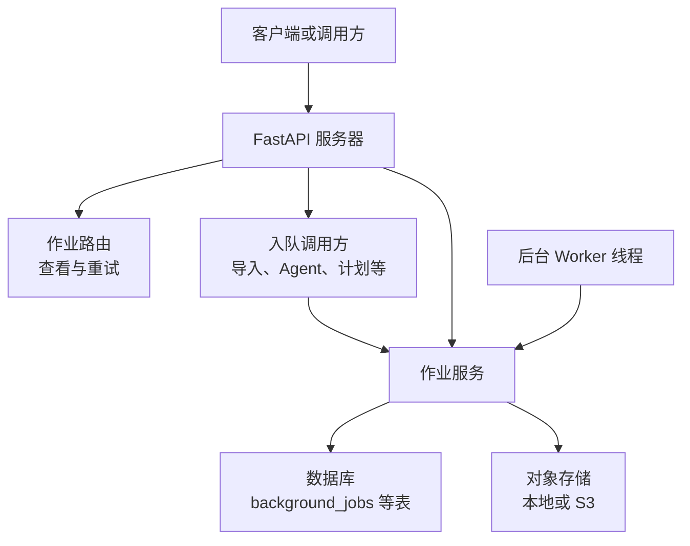

**图表来源**

- [main.py:95-149](file://src/personal_ai_life_os/main.py#L95-L149)
- [services/jobs.py:273-355](file://src/personal_ai_life_os/services/jobs.py#L273-L355)
- [api/routes/jobs.py:1-82](file://src/personal_ai_life_os/api/routes/jobs.py#L1-L82)

**小节来源**

- [main.py:1-149](file://src/personal_ai_life_os/main.py#L1-L149)
- [config.py:10-41](file://src/personal_ai_life_os/config.py#L10-L41)

## 作业数据结构与迁移模型

### BackgroundJob 字段语义

`BackgroundJob` 是一个“租户隔离的持久化工作项”，其 payload 仅包含标识和控制信息，不包含用户照片原文等敏感内容。

| 字段 | 类型 | 含义 |
|---|---|---|
| `id` | 字符串型 UUID | 作业主键 |
| `owner_id` | 字符串型 UUID | 任务所属用户 |
| `source_id` | 可为空 UUID | 关联的数据源 |
| `source_item_id` | 可为空 UUID | 关联的来源条目 |
| `sync_run_id` | 可为空 UUID | 关联的同步批次 |
| `review_id` | 可为空 UUID | 关联的每周复盘 |
| `kind` | 最长 40 位字符串 | 作业业务类型，如 `photo_ocr`、`photo_description`、`weekly_review`、`desktop_analysis` |
| `status` | 最长 24 位字符串 | 当前状态：`queued`、`running`、`completed`、`failed`、`cancelled` |
| `dedupe_key` | 最长 300 位字符串 | 同一 owner 下的幂等键 |
| `payload_json` | JSON | 最小必要负载：ID、上下文、控制参数 |
| `result_json` | 可为空 JSON | 成功时的结构化结果 |
| `attempt_count` | 整数 | 已尝试次数 |
| `max_attempts` | 整数 | 最大允许尝试次数 |
| `available_at` | UTC 时间 | 任务可从该时间起被调度 |
| `lease_expires_at` | 可为空 UTC 时间 | 租约过期时间 |
| `worker_id` | 可为空字符串 | 拥有当前租约的 worker 标识 |
| `error_code` | 可为空字符串 | 错误或终止原因码 |
| `created_at`、`updated_at`、`completed_at` | UTC 时间 | 生命周期时间戳 |

迁移还定义了：

- `uq_background_job_owner_dedupe`：同一 owner 下 `dedupe_key` 唯一。
- 针对 `status`、`kind`、`available_at`、`owner_id`、`source_id`、`source_item_id`、`sync_run_id`、`review_id`、`owner_id+created_at`、`status+available_at` 等的查询索引。

### 关联模型

| 模型 | 作用 |
|---|---|
| `User` | 租户隔离边界；AI 模型同意与删除请求均与此绑定 |
| `SourceConnection` | 数据源连接；其 `active/paused/deleted` 影响作业取消与重试 |
| `SourceItem` | 单条数据来源实体；OCR/描述状态存在其 `metadata_json` |
| `SyncRun` | 同步批次统计；可能转为 `completed`、`cancelled` 或 `partially_failed` |
| `Review` | 每周复盘；可能退回 `draft`，或在失败时写入 fallback 文本 |
| `ModelRun` | 模型调用级别的成本、延迟、令牌数和状态记录 |
| `BackgroundJob` | 本系统的核心作业持久化表 |

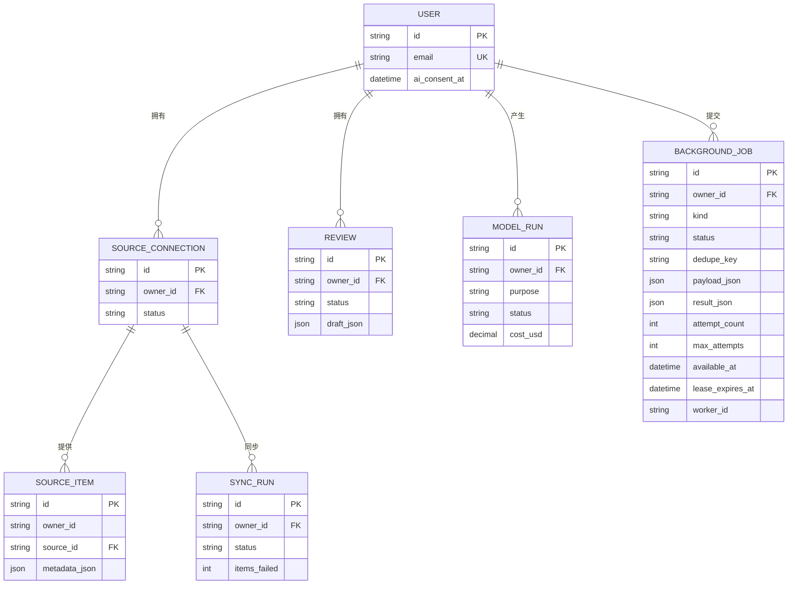

**图表来源**

- [models.py:30-41](file://src/personal_ai_life_os/models.py#L30-L41)
- [models.py:112-163](file://src/personal_ai_life_os/models.py#L112-L163)
- [models.py:168-210](file://src/personal_ai_life_os/models.py#L168-L210)
- [models.py:806-866](file://src/personal_ai_life_os/models.py#L806-L866)
- [models.py:782-799](file://src/personal_ai_life_os/models.py#L782-L799)

**小节来源**

- [models.py:806-866](file://src/personal_ai_life_os/models.py#L806-L866)
- [migrations/versions/c101bc66b1a3_add_durable_background_jobs.py:25-58](file://migrations/versions/c101bc66b1a3_add_durable_background_jobs.py#L25-L58)

## 作业生命周期总览

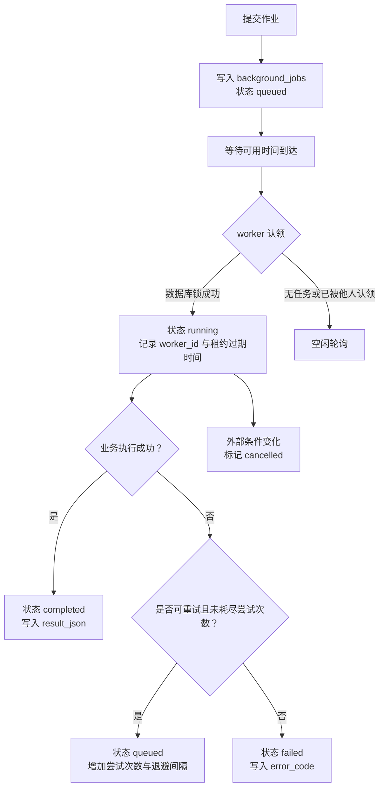

**图表来源**

- [services/jobs.py:60-111](file://src/personal_ai_life_os/services/jobs.py#L60-L111)
- [services/jobs.py:273-316](file://src/personal_ai_life_os/services/jobs.py#L273-L316)
- [services/jobs.py:317-396](file://src/personal_ai_life_os/services/jobs.py#L317-L396)
- [services/jobs.py:795-864](file://src/personal_ai_life_os/services/jobs.py#L795-L864)

### 关键状态说明

| 状态 | 进入时机 | 典型下游行为 |
|---|---|---|
| `queued` | 初次入队；重试；手动重试 | worker 可见并被认领 |
| `running` | worker 认领成功 | 不允许其他 worker 以相同 claim 再次持有 |
| `completed` | 执行成功 | 返回 `result_json`，可用于展示最终结果 |
| `failed` | 超过最大尝试次数或触发不可恢复错误 | 可手动重试（路由层会做额外权限校验） |
| `cancelled` | 来源暂停/撤销/删除，消费者主动取消，审批撤回，模型同意撤销 | 不再被执行 |

**小节来源**

- [services/jobs.py:60-111](file://src/personal_ai_life_os/services/jobs.py#L60-L111)
- [services/jobs.py:795-864](file://src/personal_ai_life_os/services/jobs.py#L795-L864)

## 任务提交接口

### 内部入队 API：`enqueue_background_job`

这不是公共 HTTP 接口，而是由导入、Agent 动作、计划服务等模块调用的服务方法。

#### 方法契约

| 项目 | 值 |
|---|---|
| 名称 | `enqueue_background_job` |
| 输入 | `session`、`owner_id`、`kind`、`dedupe_key`、`payload`，可选 `source_id`、`source_item_id`、`sync_run_id`、`review_id`、`max_attempts` |
| 返回值 | `BackgroundJob` |
| 并发特性 | 基于数据库唯一约束避免重复提交 |
| 默认尝试次数 | 3 |
| 初始状态 | `queued` |
| 幂等键 | `owner_id + dedupe_key` |

#### 幂等行为

当同一 owner 使用相同 `dedupe_key` 多次入队时：

| 已有作业状态 | 行为 |
|---|---|
| `failed` | 重置为 `queued`，清空重试计数，刷新 payload 和关联引用 |
| `cancelled` | 同上 |
| `completed` | 同上 |
| 其他状态 | 不会直接覆盖已有行，但依赖上层调用者保证正确的 key 语义 |

这保证了“相同业务事件”不会无限堆积新任务，同时对可重试的最终态进行重启。

#### 典型调用场景

| 场景 | 说明 |
|---|---|
| 图片 OCR | 导入图片后入队 `photo_ocr` |
| 图片描述 | 后续异步生成图片描述，入队 `photo_description` |
| 每周复盘 | 计划服务或用户手动生成时入队 `weekly_review` |
| Agent 动作 | Agent 产生的需要后台处理的动作可复用此接口 |

**小节来源**

- [services/jobs.py:10-23](file://src/personal_ai_life_os/services/jobs.py#L10-L23)
- [services/jobs.py:60-111](file://src/personal_ai_life_os/services/jobs.py#L60-L111)

## 作业查询与重试接口

当前作业相关的公开路由位于 `/jobs`，并由 FastAPI 统一挂载到应用。

### GET `/api/v1/jobs/{job_id}`

| 项目 | 说明 |
|---|---|
| 功能 | 获取属于当前登录用户的单个作业 |
| 路径参数 | `job_id` |
| 认证 | 必须通过当前会话/令牌 |
| 鉴权 | 强 owner 校验：只能读取自己的作业 |
| 成功响应 | 返回 `BackgroundJobResponse` |
| 作业不存在 | 抛出 404，`code` 为 `job_not_found` |

该接口不暴露敏感 `payload_json`，仅返回响应 Schema 定义的字段。实际响应结构由 Pydantic `BackgroundJobResponse` 决定；由于当前文档聚焦作业系统设计，应谨慎对外部字段契约变更做兼容性保护。

### POST `/api/v1/jobs/{job_id}/retry`

| 项目 | 说明 |
|---|---|
| 功能 | 将处于 `failed` 或 `cancelled` 的作业重新放入队列 |
| 路径参数 | `job_id` |
| 认证 | 必须通过当前会话/令牌 |
| 鉴权 | 强 owner 校验 |
| 前置校验失败时 | 通常返回 409，`code` 表达具体拒绝原因 |
| 成功处理后 | 状态恢复为 `queued`，并刷新数据库状态 |

#### 重试前置检查

| 条件 | 校验规则 |
|---|---|
| 状态限制 | 仅允许 `failed` 或 `cancelled` |
| 数据源关联 | 若作业关联 `source_id`，该源必须存在且状态为 `active` |
| AI 模型类作业 | 对 `photo_description` 或 `weekly_review`，用户必须接受当前模型的披露版本 |
| 周复盘关联 | 对应 Review 必须可用；已确认保存的 Review 不允许再生成 |
| 周复盘来源 | 所有未被物理删除且仍存在的 Source Item 必须来自 `active` 源 |
| Review 状态更新 | 重试前将 Review 设为 `processing`，防止并发 |
| 成功后 | 设置 `status=queued`、`attempt_count=0`、清空上次失败信息，并把关联 SyncRun 重置为 `processing` |

#### 重试错误码示例

| code | 含义 |
|---|---|
| `job_not_found` | 作业不存在 |
| `job_not_retryable` | 作业不是 `failed` 或 `cancelled` |
| `source_not_active` | 源不可用或无效 |
| `model_consent_required` | 缺少当前模型使用授权 |
| `review_unavailable` | 复盘不存在或已失效 |
| `review_already_confirmed` | 已保存的复盘不允许重新生成 |

**小节来源**

- [api/routes/jobs.py:1-82](file://src/personal_ai_life_os/api/routes/jobs.py#L1-L82)

## 工作进程与租约分发机制

### worker 启动流程

当配置的 `processing_mode` 为 `worker` 时，应用启动阶段会：

1. 创建数据库引擎与会话工厂。
2. 自动创建 schema（开发时可启用）。
3. 初始化对象存储。
4. 启动桌面备份或文件夹同步线程（如果开启）。
5. 启动后台 worker 线程。
6. 启动定时调度线程。
7. 在应用关闭时依次停止这些线程，并释放资源。

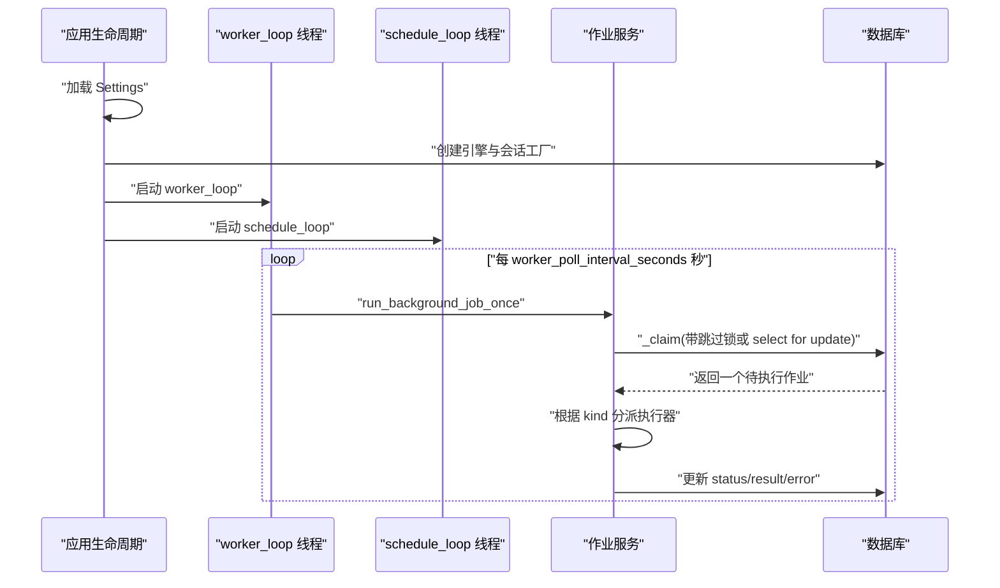

**图表来源**

- [main.py:95-149](file://src/personal_ai_life_os/main.py#L95-L149)
- [services/jobs.py:865-882](file://src/personal_ai_life_os/services/jobs.py#L865-L882)
- [services/jobs.py:795-864](file://src/personal_ai_life_os/services/jobs.py#L795-L864)

**小节来源**

- [main.py:95-149](file://src/personal_ai_life_os/main.py#L95-L149)
- [services/jobs.py:865-882](file://src/personal_ai_life_os/services/jobs.py#L865-L882)
- [config.py:10-41](file://src/personal_ai_life_os/config.py#L10-L41)

### 租约（Lease）机制

#### 认领流程 `_claim`

worker 通过 `_claim` 从数据库中选取一个作业：

1. 查询 `queued` 且 `available_at <= now` 的任务。
2. 或查询 `running` 且 `lease_expires_at <= now` 的任务。
3. 按 `created_at, id` 排序，确保按提交顺序稳定取值。
4. 如果是 PostgreSQL，使用 `SELECT ... FOR UPDATE SKIP LOCKED` 避免锁定竞争。
5. 如果 `attempt_count >= max_attempts`，直接标记为最终失败。
6. 否则设置为 `running`，增加 `attempt_count`，生成 `claim_id = worker_id:uuid`。
7. 写入 `worker_id` 与 `lease_expires_at = now + worker_lease_seconds`。
8. 提交事务后返回作业信封。

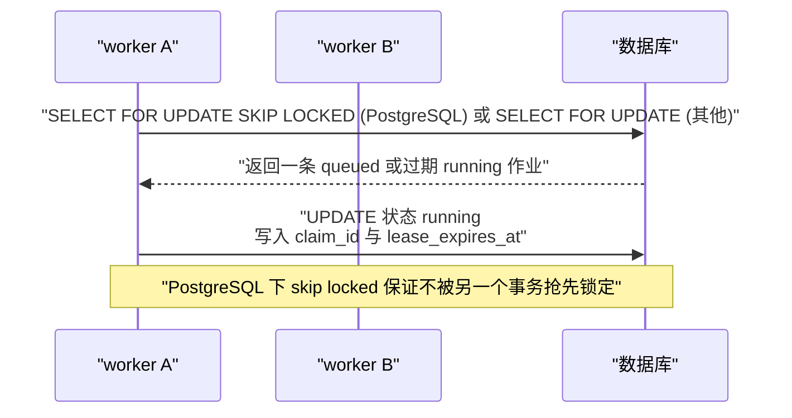

**图表来源**

- [services/jobs.py:273-316](file://src/personal_ai_life_os/services/jobs.py#L273-L316)

#### 当前持有检查 `_current_claim`

执行器每次写回前都要验证：

- 作业仍存在；
- 状态仍为 `running`；
- `worker_id` 等于本次作业的 `claim_id`。

这样可以防止“落后 worker 结果”在另一个 worker 已接管作业时污染数据。

#### 失败后的补偿

如果一个作业长时间保持 `running` 但无有效续租，下一次 `_claim` 会把该状态视为“可能被抢占或崩溃”，让新的 worker 重新接手。测试覆盖了两种关键情形：

- 旧 worker 读到图像并慢返回；新 worker 在 lease 过期后抢占并成功完成。
- 旧结果最终写回时，因 `_current_claim` 不再匹配而忽略。

**小节来源**

- [services/jobs.py:273-316](file://src/personal_ai_life_os/services/jobs.py#L273-L316)
- [services/jobs.py:317-355](file://src/personal_ai_life_os/services/jobs.py#L317-L355)
- [tests/test_worker_claim.py:67-124](file://tests/test_worker_claim.py#L67-L124)

## 已实现作业类型与处理逻辑

### 作业类型总表

| kind | 用途 | 输入来源 | 输出结果 |
|---|---|---|---|
| `photo_ocr` | 对本地图片执行 OCR，提取正文文本 | 对象存储中的图片字节 | OCR 文本与状态 |
| `photo_description` | 调用外部图片描述模型生成中性图片描述 | 对象存储图片和用户授权 | 描述文本、模型信息、是否需要人工确认 |
| `weekly_review` | 基于时间线生成或回填每周复盘草稿 | Review、SourceItem、用户、Provider | Review 草稿、渲染文本、模型状态 |
| `desktop_analysis` | 桌面端分析作业 | 由桌面分析服务定义 | 取决于桌面分析执行器的约定 |

未知 `kind` 会触发 `unsupported_job_type` 错误。

### 图片 OCR：`photo_ocr`

处理流程要点：

1. 检查当前 claim 是否仍然有效。
2. 加载 `source_item_id` 对应的 `SourceItem` 和 `SourceConnection`。
3. 要求 item 未删除且 source 状态为 `active`。
4. 先将 item 的 `ocr_status` 置为 `processing`。
5. 从对象存储读取 object key 对应的字节。
6. 调用 `extract_photo_io_bytes`。
7. 若对象缺失或图片不受支持，抛出 `RetryableJobError("photo_ocr_input_unavailable")`。
8. 最后再次校验 claim，然后写回 `content_text`、`ocr_status`、`completed_at`，并可能把 `SyncRun` 改为 `completed`。

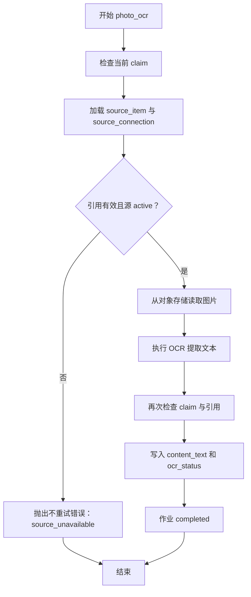

**图表来源**

- [services/jobs.py:397-459](file://src/personal_ai_life_os/services/jobs.py#L397-L459)

### 图片描述：`photo_description`

该作业涉及外部模型调用、预算检查、对象存储、用户同意和结果需确认逻辑。

关键步骤：

1. 校验 claim、user、item、source。
2. 检查用户是否已向当前模型提供商授予同意，且未完成账户删除流程。
3. 校验图片格式是否允许。
4. 计算预估调用成本，并与全局配置比较。
5. 发起 OpenAI 兼容聊天补全请求。
6. 解析响应 token 用量和描述内容。
7. 检查实际调用成本是否在单次预算内。
8. 将 `description` 截断至固定长度，标记 `requires_confirmation=true`。
9. 记录 `ModelRun` 的成本和令牌数。

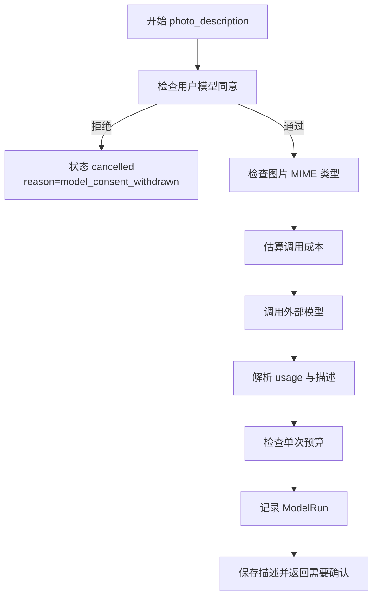

**图表来源**

- [services/jobs.py:459-622](file://src/personal_ai_life_os/services/jobs.py#L459-L622)

**小节来源**

- [services/jobs.py:397-622](file://src/personal_ai_life_os/services/jobs.py#L397-L622)

### 每周复盘：`weekly_review`

这是较复杂的模型驱动作业：

1. 加载 Review 与其 SourceItems，过滤已删除和非活跃来源。
2. 解析 Provider 和 Model，检查同意、密钥、本地 provider、桌面授权等。
3. 计算当月支出与剩余月度预算。
4. 优先尝试真实调用；失败或超预算则回落模板。
5. 渲染 Markdown 文本，保存 `draft_json` 和 `final_text`。
6. 快照 Review 版本。
7. 写入 `ModelRun`，状态可能是 `succeeded`、`fallback`、`budget_fallback`、`budget_exceeded` 或 `consent_withdrawn`。

该作业体现了一个重要设计原则：**外部模型调用失败或超出预算时，系统不应阻塞用户查看可用的模板复盘草稿。**

**小节来源**

- [services/jobs.py:622-793](file://src/personal_ai_life_os/services/jobs.py#L622-L793)

### 桌面分析：`desktop_analysis`

桌面分析由专用执行器处理，并通过 `_current_claim` 与通用作业状态机协同。现有实现中，它在执行结束时还会验证当前 claim 是否存在，从而保证结果不会被其他 worker 的过期结果覆盖。

**小节来源**

- [services/jobs.py:777-793](file://src/personal_ai_life_os/services/jobs.py#L777-L793)

## 错误、重试与最终失败

### 可重试错误体系

作业层通过自定义异常区分正常结果、业务可重试错误、不可恢复异常。

| 层次 | 类型 | 用法 |
|---|---|---|
| 领域层 | `RetryableJobError(code, retryable)` | 表达明确的业务错误码，例如输入不可用、外部模型调用失败 |
| 作业调度层 | 捕获 `Exception` | 兜底异常，包装为 `worker_error` |

对于 `RetryableJobError`：

| 条件 | 行为 |
|---|---|
| `retryable=false` 或已达最大尝试次数 | 最终失败 |
| 可重试且还可继续尝试 | 重新排队，设置 `available_at`，并采用指数退避 |
| 普通异常 | 同样走重试或最终失败逻辑，但日志中隐藏敏感负载 |

#### 重试退避策略

代码使用近似指数退避，并用上限封顶：

| 尝试次数 | 退避时间 | 限制 |
|---|---|---|
| 1 | 2 秒级基数 | 不超过 60 秒 |
| 2 | 4 秒级基数 | 不超过 60 秒 |
| 更大次数 | 接近 60 秒 | 不超过 60 秒 |

#### 最终失败 `_fail_terminal`

当作业达到最终失败时，它不仅是修改状态，还要联动下游：

| 关联实体 | 失败时行为 |
|---|---|
| `SourceItem` | 设置 `ocr_status` 或 `description_status` 为 `failed` |
| `Review` | 回写模板草稿，并标记 fallback |
| `ModelRun` | 写入失败成本、调用目的、提供方、模型 |
| `SyncRun` | 若仍在处理中，改为 `partially_failed` 并记录失败数 |
| `SourceConnection.last_sync_at` | 可能在某些失败路径中被更新时间戳 |

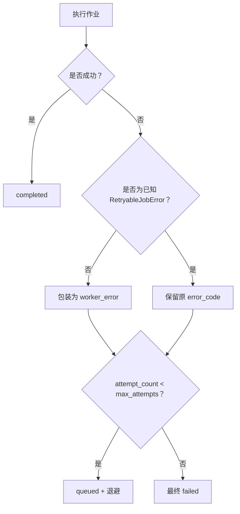

**图表来源**

- [services/jobs.py:355-396](file://src/personal_ai_life_os/services/jobs.py#L355-L396)
- [services/jobs.py:795-864](file://src/personal_ai_life_os/services/jobs.py#L795-L864)

**小节来源**

- [services/jobs.py:10-23](file://src/personal_ai_life_os/services/jobs.py#L10-L23)
- [services/jobs.py:317-396](file://src/personal_ai_life_os/services/jobs.py#L317-L396)
- [services/jobs.py:795-864](file://src/personal_ai_life_os/services/jobs.py#L795-L864)

## 优先级、超时、取消与幂等设计

### 优先级队列

当前实现**没有**显式优先级列或优先级索引。任务的抓取顺序是：

1. 符合条件的任务集合；
2. 按 `created_at`、`id` 排序；
3. 取第一条；
4. 如果使用 PostgreSQL，加锁时使用 `skip_locked`。

因此，这是一种“先入先出 + UUID 打破平局”的简单队列，而不是按业务重要性排序的优先级队列。

如果要引入优先级，合理方案是新增一列（例如 `priority`），并调整 `_claim` 中的 `ORDER BY priority ASC, created_at ASC, id ASC`，同时在 `_claim` 上使用数据库事务级独占选择。

### 超时控制

系统的“超时”语义由两个维度组合构成：

| 维度 | 含义 |
|---|---|
| `worker_lease_seconds` | 一个 worker 对某个 running 作业的“排他租期” |
| `available_at` | 重试任务的最早可调度时间 |

租约过期不代表业务逻辑一定失败；它只是让别的 worker 可以重新认领这个作业。真正的业务超时应由外层对象存储、HTTP 客户端或 OCR 模型调用负责（例如图片描述使用了固定的 httpx timeout）。

需要注意：当前 worker 没有在运行中定期续租；所以超长作业如果卡住，只能靠租约过期后被其它 worker 抢占。这种设计适用于“短时间批处理”，不适用于需要长期心跳的长任务。

### 取消机制

取消不仅改作业状态，还会同步清理：

| 触发面 | 受影响范围 |
|---|---|
| 源连接暂停 | 该 source 下 queued/running 作业，以及其 review 的作业 |
| 提供者撤消 | 模型相关作业会被取消 |
| 账户删除 | 所有 queue/running 作业最终取消 |
| 源删除/撤销 | 后续重试会被阻止 |
| 模型同意撤消 | `photo_description` 和 `weekly_review` 可被提前取消 |
| SyncRun | 若仍 processing，则转 cancelled |
| SourceItem | OCR 或描述状态标记 |
| Review | 草稿恢复为 draft |

#### 主要取消函数

| 函数 | 用途 |
|---|---|
| `cancel_jobs_for_source` | 按 source 或关联 review 取消作业 |
| `cancel_model_jobs_for_owner` | 按 owner 和 model provider 取消模型作业 |
| `cancel_all_jobs_for_owner` | 账户删除或大规模回收时取消全部作业 |
| `retry_background_job` | 将 failed/cancelled 作业恢复为可执行状态 |

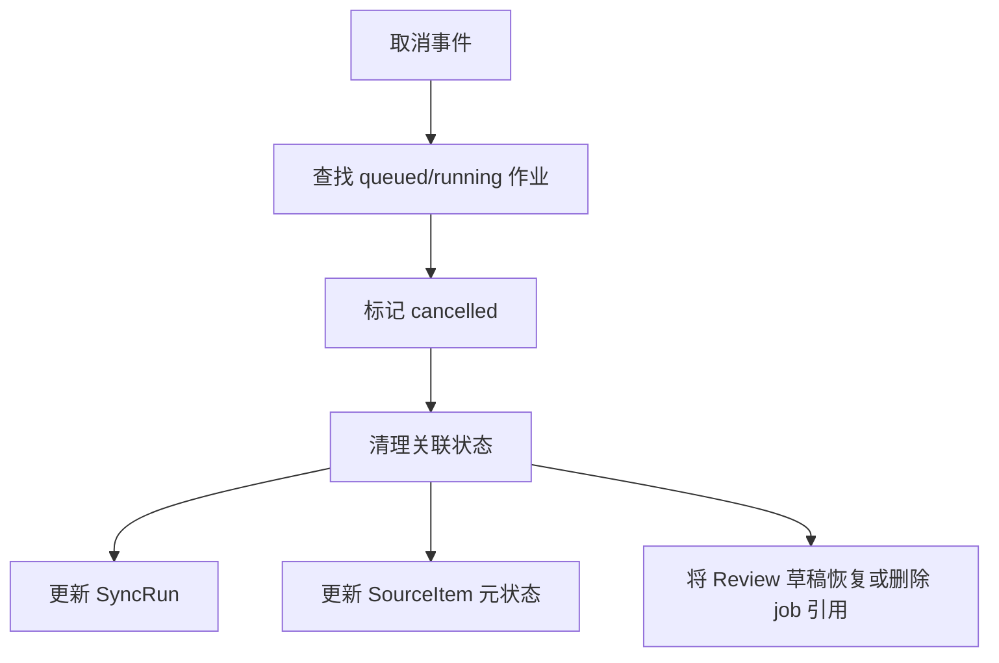

**图表来源**

- [services/jobs.py:113-265](file://src/personal_ai_life_os/services/jobs.py#L113-L265)
- [services/jobs.py:267-271](file://src/personal_ai_life_os/services/jobs.py#L267-L271)

### 幂等性保障

幂等性主要通过 `dedupe_key` 实现。推荐上游把“用户、业务动作、主体 ID、版本号、内容摘要”组合成幂等键。例如：

| 作业类型 | 推荐幂等键思路 |
|---|---|
| 单张图片导入 | `owner_id + photo_file_key_or_hash + import_run_id` |
| 图片描述重建 | `owner_id + source_item_id + description_version` |
| 每周复盘重建 | `owner_id + review_id + period_start + period_end + model_provider` |
| 批量同步恢复 | `owner_id + sync_run_id` |

注意：当已有任务已经是 `completed` 或 `failed` 时，当前实现会把其状态改回 `queued` 并覆盖 payload。这意味着“幂等键语义”应该由业务侧理解为“用最新意图替换同 key 的可重试任务”，而不是严格意义上的“相同输入永远不变的结果”。

**小节来源**

- [services/jobs.py:60-271](file://src/personal_ai_life_os/services/jobs.py#L60-L271)
- [services/jobs.py:273-316](file://src/personal_ai_life_os/services/jobs.py#L273-L316)

## 作业审计、指标与运维视图

### 作业审计字段

作业自身保留以下审计线索：

| 字段 | 用途 |
|---|---|
| `attempt_count` | 已经重试多少次 |
| `error_code` | 最近错误或终态原因 |
| `payload_json` | 上下文信息 |
| `result_json` | 成功结果 |
| `created_at` | 第一次入队时间 |
| `completed_at` | 真正完成或失败时间 |
| `worker_id` | 最后一个拥有租约的 worker |

### 模型调用审计

模型相关作业会在 `ModelRun` 中单独记录：

| 字段 | 含义 |
|---|---|
| `purpose` | 调用目的，例如 `photo_description`、`weekly_review` |
| `provider` | 提供方标识 |
| `model` | 模型名 |
| `prompt_version` | 提示词版本 |
| `latency_ms` | 调用耗时 |
| `input_tokens` / `output_tokens` | token 用量 |
| `cost_usd` | 美元成本 |
| `status` | `succeeded`、`failed`、`fallback`、`budget_fallback` 等 |

这为模型成本监控、失败分析和预算对齐提供了可靠底层表。

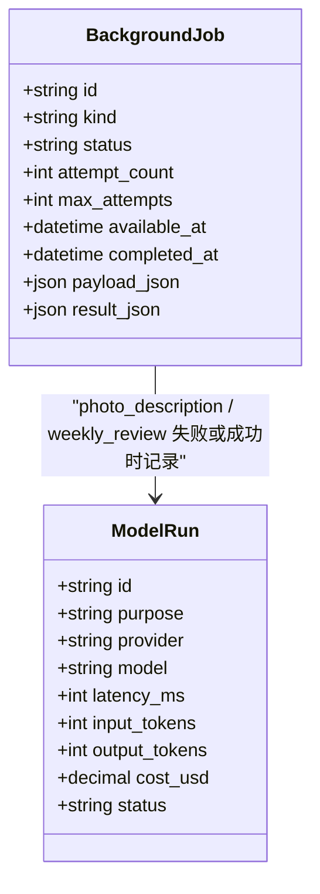

**图表来源**

- [models.py:806-866](file://src/personal_ai_life_os/models.py#L806-L866)
- [models.py:782-799](file://src/personal_ai_life_os/models.py#L782-L799)
- [services/jobs.py:556-793](file://src/personal_ai_life_os/services/jobs.py#L556-L793)

### 监控建议

现有仓库中没有独立的 `GET /metrics` 作业计数器路由，但从模型用量来看，可以通过以下方式构建运维视图：

1. 聚合 `BackgroundJob.status`、`kind`、`error_code` 统计队列积压和失败率。
2. 通过 `completed_at - created_at` 估算任务平均耗时。
3. 统计 `ModelRun.cost_usd` 与 `ModelRun.status` 对比预算执行情况。
4. 观察 `running` 任务数量判断 worker 吞吐是否不足。
5. 通过 `worker_lease_seconds` 检测是否有长期卡在 `running` 的任务。

**小节来源**

- [models.py:782-866](file://src/personal_ai_life_os/models.py#L782-L866)
- [services/jobs.py:755-793](file://src/personal_ai_life_os/services/jobs.py#L755-L793)

## 开发测试与调试模式

### 内置测试工具

测试文件 `tests/test_worker_claim.py` 展示了如何使用该作业系统进行分布式行为调试：

- 模拟 OCR worker 在读图时故意阻塞。
- 模拟竞争 worker 在 lease 过期后抢占任务。
- 修改旧的 lease 过期时间，让另一个进程恢复中断的作业。
- 模拟 OCR 过程中数据源被暂停、撤销或删除。
- 启动新的 Python 子进程，模拟进程退出恢复。

#### 关键测试场景

| 测试 | 验证点 |
|---|---|
| 抢占过期 worker | old worker 被 replacement 抢占，最终结果是 replacement 的结果 |
| 来源变更丢弃在途 OCR | 来源 paused/revoke/delete 时，在途 OCR 不能污染数据 |
| 新进程恢复中断 OCR | 原来 interrupted 的 job 重新变为 running，并成功完成 |
| 过期的模型调用只记录一次成本 | `ModelRun` 只写入一次成本，即使 lease 过期重试 |

#### 工作模式开关

| 配置 | 作用 |
|---|---|
| `processing_mode = "inline"` | 默认本地模式，适合单进程测试和快速验证 |
| `processing_mode = "worker"` | 应用启动 worker 与 scheduler 线程，使用数据库驱动的可恢复队列 |
| `worker_poll_interval_seconds` | worker 在没有任务时的轮询间隔 |
| `worker_lease_seconds` | worker 独占作业租期 |

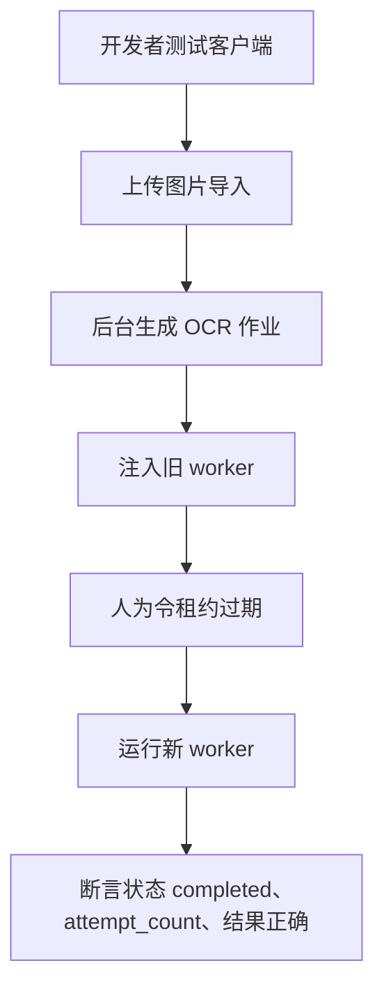

**图表来源**

- [tests/test_worker_claim.py:15-45](file://tests/test_worker_claim.py#L15-L45)
- [tests/test_worker_claim.py:67-124](file://tests/test_worker_claim.py#L67-L124)
- [tests/test_worker_claim.py:126-190](file://tests/test_worker_claim.py#L126-L190)

**小节来源**

- [tests/test_worker_claim.py:15-190](file://tests/test_worker_claim.py#L15-L190)
- [config.py:10-41](file://src/personal_ai_life_os/config.py#L10-L41)

## 分布式扩展性与可靠性约束

### 现有设计

本作业系统是“数据库作为中间件”的设计：

- 入队和状态转换都在关系数据库事务内。
- 并发竞争通过 SQLAlchemy `select(...).with_for_update()` 处理；PostgreSQL 下进一步优化为 `skip_locked=True`。
- worker 以多线程形式附着在 FastAPI 应用上。
- 每个 worker 有独立 identity，但当前没有集群发现、负载均衡或服务发现表。
- 对象存储负责图片等二进制内容，避免大负载进入数据库。

### 优点

- 单库部署成本低，开发和生产可使用相同抽象。
- 任务有完整生命周期状态、重试和错误码。
- 租约能缓解进程崩溃或网络中断造成的任务丢失。
- 与现有来源、同步、复盘、模型成本系统集成紧密。

### 已知限制

| 方面 | 现状 | 风险 |
|---|---|---|
| 跨进程锁 | 仅依赖数据库行锁 | SQLite 不支持行级跳过锁，适合单机或多进程共享同库 |
| 多节点扩展 | 当前未明确支持多实例独立 worker 集群 | 需要确保数据库支持 `FOR UPDATE SKIP LOCKED`，否则可能退化 |
| 优先级 | 没有显式优先级列 | 高优任务会等待低优先进队任务 |
| 重试背压 | 重试任务在可用后即可被取出 | 缺少重试池或隔离队列 |
| 死信队列 | 没有独立死信表 | 失败任务集中在 `failed` 状态，需要后端查询过滤 |
| 限流与配额 | 主要在 HTTP 层 | 后台作业可通过大量并行 worker 绕过前端限速 |
| 作业取消一致性 | 取消与执行并存时有竞态 | 已通过多次 `_current_claim` 校验降低影响 |

### 推荐的增强方向

1. **显式优先级队列**：新增 `priority` 列与复合索引。
2. **延迟队列/死信队列**：分别建立 `delayed_jobs` 和 `dead_letter_jobs`，避免失败任务混在活跃表中。
3. **重试隔离**：为高频重试任务分配有限 worker 数。
4. **多主机 worker**：加入 worker 注册表或心跳表，方便调度器和扩缩容。
5. **进度上报**：复杂作业通过附加表记录步骤进度。
6. **作业取消队列**：在取消高峰时避免 SQL IN 列表过大。
7. **指标管道**：把 `BackgroundJob`、`ModelRun` 推送到监控系统。

[本节为架构设计讨论，不直接解读具体代码片段]

## 故障排查指南

### 常见问题定位矩阵

| 现象 | 首选检查位置 | 可能原因 | 建议修复 |
|---|---|---|---|
| 作业永不执行 | `status=queued` 且 `available_at` 在未来 | 重试退避、错误导致延迟 | 查看 `error_code` 和 `attempt_count` |
| 作业一直 `running` | `lease_expires_at` 已过期但未完成 | worker 崩溃或阻塞 | 等待下一个 `_claim` 周期或手动介入 |
| 图片 OCR 结果为空 | `SourceItem.content_text` | OCR 失败、图片对象缺失、源已删除 | 检查 `ocr_status`、`error_code`、源状态 |
| 图片描述被取消 | `description_status=cancelled` | 用户撤销同意、源无效、对象缺失 | 检查模型同意、`SourceConnection.status` |
| 模型成本暴涨 | `ModelRun.cost_usd` | 模型响应异常、token 异常、预算配置错误 | 核对 provider 配置、`MODEL_*_COST_PER_MILLION_USD` |
| 重试失败反复出现 | `attempt_count` 持续增长 | 可重试错误频繁发生 | 修复上游数据、模型、存储、授权 |
| 重试时报 `source_not_active` | 重试路由 | 源不在 `active` 状态 | 恢复源或重新启用 |
| 重试时报 `model_consent_required` | 重试路由 | 模型披露版本不一致或未授权 | 更新模型同意 |
| 周报无法重写 | 重试路由 | Review 已确认或被移除 | 重新生成新的 Review |

### 诊断步骤

1. 使用 `/api/v1/jobs/{job_id}` 确认任务 state、attempt_count、error_code、completed_at。
2. 若是图片作业，查看 `SourceItem.metadata_json` 中 `ocr_status` 或 `description_status`。
3. 若关联 `SyncRun`，检查 `status` 是 `completed`、`cancelled` 还是 `partially_failed`。
4. 若涉及模型，查 `ModelRun` 中目的、提供方、模型、状态和成本。
5. 若怀疑 worker 不拉取任务，检查 `processing_mode`、`worker_poll_interval_seconds`、数据库连接和 PostgreSQL 能力。
6. 若怀疑并发抢占，检查 `worker_id` 和 `lease_expires_at` 是否与预期 worker 一致。
7. 若需要临时验证某个 worker 行为，可复用测试方式：在 worker 执行前修改 `lease_expires_at`，再让新 worker 接管。

### 恢复策略

| 状态 | 推荐恢复方式 |
|---|---|
| 暂时失败 | 等待自动重试；必要时调用重试接口 |
| 数据源恢复后重试 | 确保源状态变回 `active`，再调用重试接口 |
| 模型授权恢复后重试 | 更新 AI 模型授权后重试 |
| 历史失败但无需自动处理 | 导出 `failed` 任务给离线分析 |
| 长期 stuck 在 `running` | 确认无 worker 仍持有 claim，必要时在管理层面干预 |

**小节来源**

- [api/routes/jobs.py:1-82](file://src/personal_ai_life_os/api/routes/jobs.py#L1-L82)
- [services/jobs.py:355-396](file://src/personal_ai_life_os/services/jobs.py#L355-L396)
- [services/jobs.py:795-864](file://src/personal_ai_life_os/services/jobs.py#L795-L864)

## 结论

本后台作业系统用关系数据库充当持久化任务中间件，实现了可恢复、可重试、可观测的后台执行能力。它的核心价值在于：

- 用 `dedupe_key` 实现任务幂等；
- 用 `worker_id` + `lease_expires_at` 实现基本分布式锁；
- 用 `attempt_count`、`max_attempts`、`available_at` 实现指数退避；
- 用 `error_code`、`result_json`、`ModelRun` 提供可审计的失败与成本轨迹；
- 通过路由层强制 owner 隔离与条件重试，减少误操作。

它目前更适合单机或少量 worker 的场景，并且尚未提供通用的优先级队列、死信队列和多 worker 集群注册机制。对更复杂的分布式调度需求，应在现有 `enqueue_background_job`、`_claim`、`run_background_job_once` 基础上演进，补充优先级、队列分层、worker 集群治理和更丰富的作业指标采集。