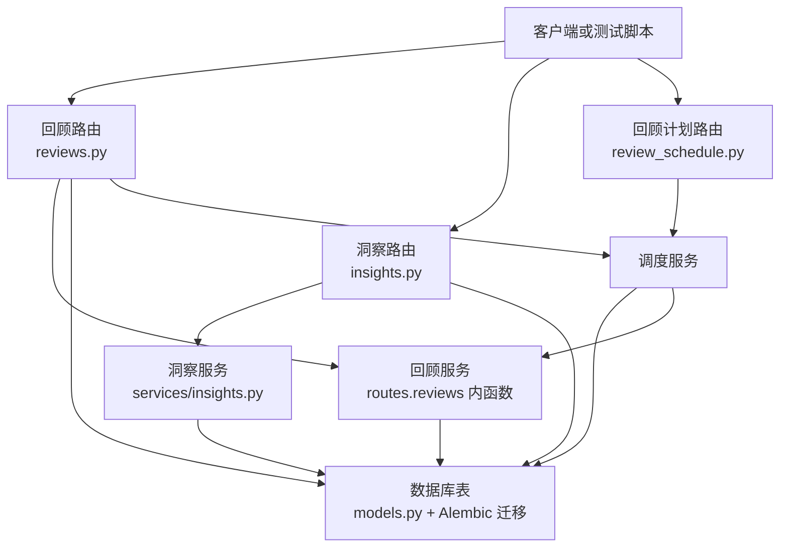
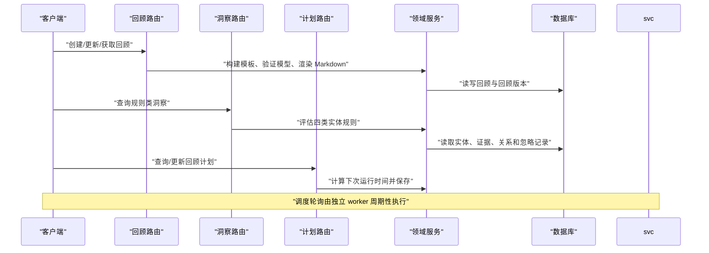
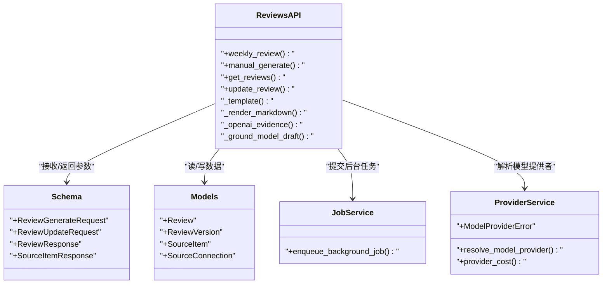
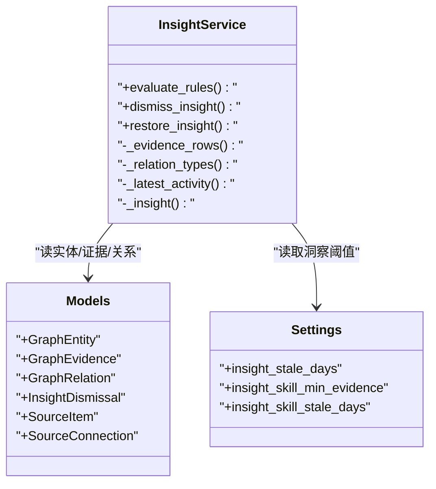
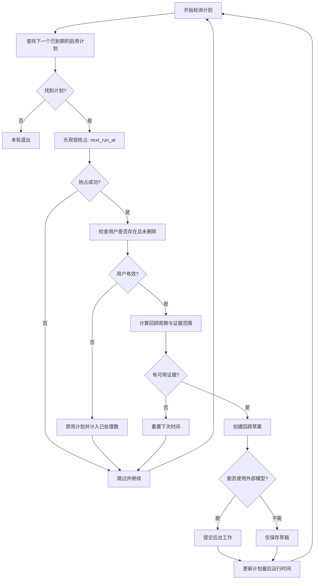
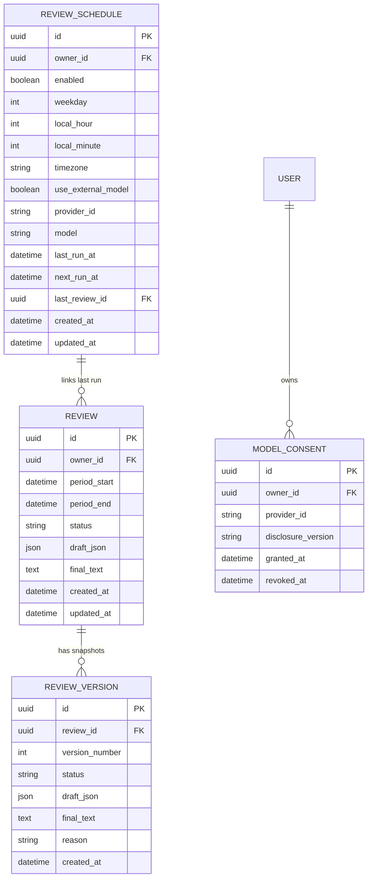
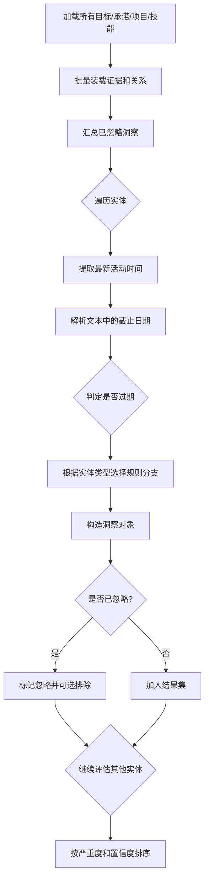
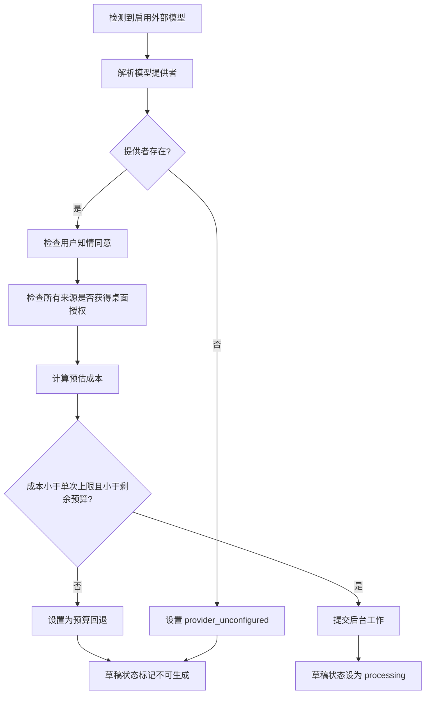

# 回顾、洞察与调度 API

<cite>
**本文件引用的源码文件**  
- [src/personal_ai_life_os/api/routes/reviews.py](file://src/personal_ai_life_os/api/routes/reviews.py)
- [src/personal_ai_life_os/api/routes/insights.py](file://src/personal_ai_life_os/api/routes/insights.py)
- [src/personal_ai_life_os/api/routes/review_schedule.py](file://src/personal_ai_life_os/api/routes/review_schedule.py)
- [src/personal_ai_life_os/api/schemas.py](file://src/personal_ai_life_os/api/schemas.py)
- [src/personal_ai_life_os/models.py](file://src/personal_ai_life_os/models.py)
- [src/personal_ai_life_os/services/insights.py](file://src/personal_ai_life_os/services/insights.py)
- [src/personal_ai_life_os/services/scheduling.py](file://src/personal_ai_life_os/services/scheduling.py)
- [migrations/versions/a1b7c9d3e504_add_provider_consent_and_review_versions.py](file://migrations/versions/a1b7c9d3e504_add_provider_consent_and_review_versions.py)
- [migrations/versions/b7d4f6a1c902_add_review_schedules.py](file://migrations/versions/b7d4f6a1c902_add_review_schedules.py)
- [tests/test_insights.py](file://tests/test_insights.py)
- [tests/test_review_schedule.py](file://tests/test_review_schedule.py)
</cite>

## 目录

1. [简介](#简介)
2. [项目结构](#项目结构)
3. [核心组件](#核心组件)
4. [架构总览](#架构总览)
5. [详细接口设计](#详细接口设计)
6. [依赖关系分析](#依赖关系分析)
7. [数据模型与版本控制](#数据模型与版本控制)
8. [规则驱动洞察系统](#规则驱动洞察系统)
9. [定时调度与工作流](#定时调度与工作流)
10. [性能与可扩展性](#性能与可扩展性)
11. [故障排查指南](#故障排查指南)
12. [总结](#总结)

## 简介

本文档聚焦个人智能生命操作系统中三个紧密协作的能力域：

- **回顾体系**：围绕“回顾”创建、手动编辑、Markdown 导出、历史版本快照、外部大模型生成以及自动周报生成。
- **规则驱动洞察**：基于证据图谱的目标、承诺、项目和技能四类实体，执行可解释、可忽略、可恢复的分类评估规则。
- **回顾计划调度**：按用户时区配置每周触发条件，生成回顾或触发后台任务，提供启用、禁用、下次运行时间管理和运行日志相关能力。

面向的使用者包括：

- 需要查看和编辑自动生成回顾的终端用户。
- 需要理解 AI 产出事实依据的审计人员。
- 希望自动化每周复盘的产品和技术运维人员。
- 需要根据业务目标建立规则引擎扩展的数据分析师。

## 项目结构

与本次文档相关的路由、服务与模型主要分布在以下位置：

**图表来源**
- [src/personal_ai_life_os/api/routes/reviews.py:1-40](file://src/personal_ai_life_os/api/routes/reviews.py#L1-L40)
- [src/personal_ai_life_os/api/routes/insights.py:1-30](file://src/personal_ai_life_os/api/routes/insights.py#L1-L30)
- [src/personal_ai_life_os/api/routes/review_schedule.py:1-30](file://src/personal_ai_life_os/api/routes/review_schedule.py#L1-L30)
- [src/personal_ai_life_os/services/insights.py:1-30](file://src/personal_ai_life_os/services/insights.py#L1-L30)
- [src/personal_ai_life_os/services/scheduling.py:1-30](file://src/personal_ai_life_os/services/scheduling.py#L1-L30)
- [src/personal_ai_life_os/models.py:320-522](file://src/personal_ai_life_os/models.py#L320-L522)

### 关键实现分层

| 层次 | 主要职责 | 对应代码路径 |
|---|---|---|
| 路由层 | FastAPI 路由、请求校验、HTTP 状态码转换 | [reviews.py](file://src/personal_ai_life_os/api/routes/reviews.py), [insights.py](file://src/personal_ai_life_os/api/routes/insights.py), [review_schedule.py](file://src/personal_ai_life_os/api/routes/review_schedule.py) |
| 请求响应模式层 | Pydantic 数据结构、字段验证、错误提示 | [schemas.py](file://src/personal_ai_life_os/api/schemas.py) |
| 领域服务层 | 回溯模板、洞察规则计算、计划轮询和执行 | [routes.reviews](file://src/personal_ai_life_os/api/routes/reviews.py), [services/insights.py](file://src/personal_ai_life_os/services/insights.py), [services/scheduling.py](file://src/personal_ai_life_os/services/scheduling.py) |
| 数据模型层 | SQLAlchemy ORM 表定义、约束、索引、关联关系 | [models.py](file://src/personal_ai_life_os/models.py) |
| 迁移层 | 回顾版本表、计划表、提供者同意表等数据库变更 | [a1b7c9d3e504...py](file://migrations/versions/a1b7c9d3e504_add_provider_consent_and_review_versions.py), [b7d4f6a1c902...py](file://migrations/versions/b7d4f6a1c902_add_review_schedules.py) |
| 行为测试层 | 端到端 API 流程、调度幂等性、洞察忽略恢复 | [test_insights.py](file://tests/test_insights.py), [test_review_schedule.py](file://tests/test_review_schedule.py) |

**章节来源**
- [src/personal_ai_life_os/api/routes/reviews.py:1-40](file://src/personal_ai_life_os/api/routes/reviews.py#L1-L40)
- [src/personal_ai_life_os/api/routes/insights.py:1-30](file://src/personal_ai_life_os/api/routes/insights.py#L1-L30)
- [src/personal_ai_life_os/api/routes/review_schedule.py:1-30](file://src/personal_ai_life_os/api/routes/review_schedule.py#L1-L30)
- [src/personal_ai_life_os/api/schemas.py:120-200](file://src/personal_ai_life_os/api/schemas.py#L120-L200)
- [src/personal_ai_life_os/models.py:320-522](file://src/personal_ai_life_os/models.py#L320-L522)

## 核心组件

### 回顾组件

回顾组件支持三种生成路径：

1. 模板直出：将证据转换为结构化事实和建议，并渲染 Markdown。
2. 外部大模型生成：在满足提供者、知情同意和预算约束时进入后台任务处理。
3. 手动编辑：对最终文本进行用户确认式更新，形成新快照。

重点行为包括：

- 周周期基于本地日期计算，前七天为回顾窗口。
- 大模型输出会做证据支撑检查，无法被来源支持的条目会被过滤。
- 每次成功落库都可能产生 `ReviewVersion`，记录生成、更新等操作原因。

**章节来源**
- [src/personal_ai_life_os/api/routes/reviews.py:1-120](file://src/personal_ai_life_os/api/routes/reviews.py#L1-L120)
- [src/personal_ai_life_os/models.py:358-385](file://src/personal_ai_life_os/models.py#L358-L385)
- [src/personal_ai_life_os/models.py:386-417](file://src/personal_ai_life_os/models.py#L386-L417)
- [src/personal_ai_life_os/api/schemas.py:160-200](file://src/personal_ai_life_os/api/schemas.py#L160-L200)

### 洞察组件

洞察组件通过四类内置规则对证据图谱进行分析：

| 规则键 | 中文含义 | 典型触发条件 |
|---|---|---|
| `goal_delay` | 目标延期或风险 | 目标截止时间已过且无后续进展；长期无证据 |
| `commitment_follow_up` | 承诺到期或未跟进 | 承诺截止后无后续证据；长期未跟进 |
| `project_stalled` | 项目停滞 | 缺少目标或任务关系；长期无证据更新 |
| `skill_evidence_gap` | 技能证据不足 | 证据数量低于阈值；长期无练习成长证据 |

每条洞察包含证据片段、触发原因、严重等级、置信度和建议，并可被用户忽略或恢复显示。

**章节来源**
- [src/personal_ai_life_os/services/insights.py:1-60](file://src/personal_ai_life_os/services/insights.py#L1-L60)
- [src/personal_ai_life_os/services/insights.py:160-236](file://src/personal_ai_life_os/services/insights.py#L160-L236)
- [src/personal_ai_life_os/services/insights.py:238-389](file://src/personal_ai_life_os/services/insights.py#L238-L389)
- [tests/test_insights.py:70-206](file://tests/test_insights.py#L70-L206)

### 调度组件

调度组件负责：

- 按用户本地时间和星期生成下一次触发时间。
- 轮询已到期的计划。
- 判断是否需要直接生成回顾，还是进入后台任务。
- 在失败时重试，并在无效时区下禁用该计划。
- 跳过没有活动数据的周次。

**章节来源**
- [src/personal_ai_life_os/services/scheduling.py:25-70](file://src/personal_ai_life_os/services/scheduling.py#L25-L70)
- [src/personal_ai_life_os/services/scheduling.py:150-324](file://src/personal_ai_life_os/services/scheduling.py#L150-L324)
- [tests/test_review_schedule.py:1-130](file://tests/test_review_schedule.py#L1-L130)

## 架构总览

下图展示了从 API 调用到数据落库的整体链路：

**图表来源**
- [src/personal_ai_life_os/api/routes/reviews.py:1-40](file://src/personal_ai_life_os/api/routes/reviews.py#L1-L40)
- [src/personal_ai_life_os/api/routes/insights.py:1-30](file://src/personal_ai_life_os/api/routes/insights.py#L1-L30)
- [src/personal_ai_life_os/api/routes/review_schedule.py:1-30](file://src/personal_ai_life_os/api/routes/review_schedule.py#L1-L30)
- [src/personal_ai_life_os/services/insights.py:238-325](file://src/personal_ai_life_os/services/insights.py#L238-L325)
- [src/personal_ai_life_os/services/scheduling.py:180-324](file://src/personal_ai_life_os/services/scheduling.py#L180-L324)

## 详细接口设计

### 回顾相关接口

#### 生成回顾

- **方法**：`POST /api/v1/reviews/generate`
- **请求体关键字段**：
  - `period_start`：周期开始日期。
  - `period_end`：周期结束日期。
  - `use_external_model`：是否允许外部大模型参与。
  - `provider_id`：外部模型提供者标识。
  - `model`：模型名称。
- **返回主体要点**：
  - 回顾 ID。
  - 周期起止时间。
  - 当前状态。
  - 草案摘要。
  - 最终文本。
  - 关联来源项。

关键约束来自请求模式验证：

- 结束时间必须严格晚于开始时间。
- 周期不能超过 31 天。

后端还会根据用户设置的提供者、知情同意、源授权和预算情况决定回顾是直接生成草稿、进入后台处理，还是保留待补充状态。

**章节来源**
- [src/personal_ai_life_os/api/schemas.py:160-200](file://src/personal_ai_life_os/api/schemas.py#L160-L200)
- [src/personal_ai_life_os/api/routes/reviews.py:1-120](file://src/personal_ai_life_os/api/routes/reviews.py#L1-L120)
- [src/personal_ai_life_os/services/scheduling.py:90-160](file://src/personal_ai_life_os/services/scheduling.py#L90-L160)

#### 更新回顾文本

- **方法**：`PUT /api/v1/reviews/{review_id}`（由路由前缀和路径组合）
- **用途**：用户编辑最终文本。
- **输入**：`final_text`，最小长度限制，最大长度上限。
- **行为**：通常用于把已人工修正的回顾持久化。新版本会作为回顾版本保存，便于历史对比。

**章节来源**
- [src/personal_ai_life_os/api/schemas.py:188-200](file://src/personal_ai_life_os/api/schemas.py#L188-L200)
- [src/personal_ai_life_os/models.py:386-417](file://src/personal_ai_life_os/models.py#L386-L417)

#### 获取回顾列表与详情

- **方法**：`GET /api/v1/reviews`
- **能力**：
  - 按所有者隔离返回回顾。
  - 返回已生成的最终 Markdown 文本。
  - 暴露模型元信息、耗时、token 用量等统计字段（取决于生成路径）。
  - 附带关联的 `SourceItemResponse`，用于展示引用来源。

**章节来源**
- [src/personal_ai_life_os/api/schemas.py:100-160](file://src/personal_ai_life_os/api/schemas.py#L100-L160)
- [src/personal_ai_life_os/api/routes/reviews.py:1-40](file://src/personal_ai_life_os/api/routes/reviews.py#L1-L40)

#### 获取回顾历史版本

虽然具体路由实现细节分散在多处代码，但数据模型明确定义了版本表：

| 字段 | 含义 |
|---|---|
| `review_id` | 归属回顾 |
| `version_number` | 版本号 |
| `status` | 版本状态，例如“生成”“手动更新”等 |
| `draft_json` | 快照期中的草案结构 |
| `final_text` | 快照期中的最终文本 |
| `reason` | 版本原因 |
| `created_at` | 创建时间 |

结合迁移定义可知，系统会在回顾生成后保存初始版本，并提供按回顾聚合的版本查询与比较能力。

**章节来源**
- [src/personal_ai_life_os/models.py:386-417](file://src/personal_ai_life_os/models.py#L386-L417)
- [migrations/versions/a1b7c9d3e504_add_provider_consent_and_review_versions.py:27-65](file://migrations/versions/a1b7c9d3e504_add_provider_consent_and_review_versions.py#L27-L65)

### 洞察相关接口

#### 获取规则类洞察

- **方法**：`GET /api/v1/insights/rules`
- **查询参数**：
  - `include_dismissed`：是否包含已忽略的记录。
- **返回字段**：
  - `total`：当前返回数量。
  - `dismissed_total`：当前租户已忽略总数。
  - `items`：洞察条目数组，每项包含证据链、严重度、置信度、触发说明和建议。

行为特征：

- 只扫描活跃实体类型：目标、承诺、项目、技能。
- 证据最多返回五条代表性片段，避免结果过大。
- 忽略条目默认隐藏，除非显式开启。

**章节来源**
- [src/personal_ai_life_os/api/routes/insights.py:1-93](file://src/personal_ai_life_os/api/routes/insights.py#L1-L93)
- [src/personal_ai_life_os/services/insights.py:238-325](file://src/personal_ai_life_os/services/insights.py#L238-L325)
- [tests/test_insights.py:70-140](file://tests/test_insights.py#L70-L140)

#### 忽略洞察

- **方法**：`POST /api/v1/insights/rules/dismiss`
- **请求体字段**：
  - `insight_key`：洞察键值。
  - `rule`：规则键。
  - `entity_id`：可选关联实体。
  - `reason`：可选忽略原因。
- **返回体**：确认可视化的忽略记录键。

重复忽略不会报错，而是复用已有忽略记录；若附加了原因，会更新原因文本。

**章节来源**
- [src/personal_ai_life_os/api/routes/insights.py:50-85](file://src/personal_ai_life_os/api/routes/insights.py#L50-L85)
- [src/personal_ai_life_os/services/insights.py:326-371](file://src/personal_ai_life_os/services/insights.py#L326-L371)
- [tests/test_insights.py:140-180](file://tests/test_insights.py#L140-L180)

#### 恢复洞察

- **方法**：`DELETE /api/v1/insights/rules/dismissals/{insight_key}`
- **用途**：撤销某条忽略记录，使洞察重新出现在列表中。
- **状态码**：成功返回 204。

**章节来源**
- [src/personal_ai_life_os/api/routes/insights.py:85-93](file://src/personal_ai_life_os/api/routes/insights.py#L85-L93)
- [src/personal_ai_life_os/services/insights.py:373-389](file://src/personal_ai_life_os/services/insights.py#L373-L389)
- [tests/test_insights.py:180-206](file://tests/test_insights.py#L180-L206)

### 回顾计划相关接口

#### 获取计划

- **方法**：`GET /api/v1/review-schedule`
- **默认返回**：如果不存在计划，则根据登录用户的时区返回默认值。
- **默认配置**：
  - 未启用。
  - 默认星期为周六。
  - 默认本地时间为 18:00。
  - 默认不启用外部模型。
  - `provider_id` 默认为 `"default"`。
  - 无上次运行时间和下次运行时间。

**章节来源**
- [src/personal_ai_life_os/api/routes/review_schedule.py:1-90](file://src/personal_ai_life_os/api/routes/review_schedule.py#L1-L90)
- [tests/test_review_schedule.py:58-110](file://tests/test_review_schedule.py#L58-L110)

#### 更新计划

- **方法**：`PUT /api/v1/review-schedule`
- **请求体字段**：
  - `enabled`：是否启用计划。
  - `weekday`：本地星期。
  - `local_hour`：本地小时。
  - `local_minute`：本地分钟。
  - `timezone`：IANA 时区。
  - `use_external_model`：是否尝试使用外部模型。
  - `provider_id`：模型提供者。
  - `model`：模型名称。
- **返回值**：完整计划响应对象，包括计算后的 `next_run_at`。
- **验证约束**：
  - 非法 weekday、hour、minute、时区会返回 422。

**章节来源**
- [src/personal_ai_life_os/api/routes/review_schedule.py:40-90](file://src/personal_ai_life_os/api/routes/review_schedule.py#L40-L90)
- [src/personal_ai_life_os/services/scheduling.py:34-65](file://src/personal_ai_life_os/services/scheduling.py#L34-L65)
- [tests/test_review_schedule.py:65-110](file://tests/test_review_schedule.py#L65-L110)

#### 执行计划

计划执行不在标准 HTTP 路由中完成，而通过内部调度服务周期轮询。测试中通过注入运行时间点验证幂等性和重复跳过。

**章节来源**
- [src/personal_ai_life_os/services/scheduling.py:180-324](file://src/personal_ai_life_os/services/scheduling.py#L180-L324)
- [tests/test_review_schedule.py:110-200](file://tests/test_review_schedule.py#L110-L200)

## 依赖关系分析

### 回顾路由依赖

回顾路由依赖的服务模块如下：

**图表来源**
- [src/personal_ai_life_os/api/routes/reviews.py:1-120](file://src/personal_ai_life_os/api/routes/reviews.py#L1-L120)
- [src/personal_ai_life_os/api/schemas.py:100-200](file://src/personal_ai_life_os/api/schemas.py#L100-L200)
- [src/personal_ai_life_os/models.py:358-417](file://src/personal_ai_life_os/models.py#L358-L417)

**章节来源**
- [src/personal_ai_life_os/api/routes/reviews.py:1-120](file://src/personal_ai_life_os/api/routes/reviews.py#L1-L120)
- [src/personal_ai_life_os/api/schemas.py:100-200](file://src/personal_ai_life_os/api/schemas.py#L100-L200)
- [src/personal_ai_life_os/models.py:358-417](file://src/personal_ai_life_os/models.py#L358-L417)

### 洞察服务依赖

洞察服务依赖证据图谱相关表和配置，但不直接暴露大量外部接口：

**图表来源**
- [src/personal_ai_life_os/services/insights.py:1-60](file://src/personal_ai_life_os/services/insights.py#L1-L60)
- [src/personal_ai_life_os/services/insights.py:238-389](file://src/personal_ai_life_os/services/insights.py#L238-L389)
- [src/personal_ai_life_os/models.py:433-522](file://src/personal_ai_life_os/models.py#L433-L522)

**章节来源**
- [src/personal_ai_life_os/services/insights.py:1-60](file://src/personal_ai_life_os/services/insights.py#L1-L60)
- [src/personal_ai_life_os/services/insights.py:238-389](file://src/personal_ai_life_os/services/insights.py#L238-L389)
- [src/personal_ai_life_os/models.py:433-522](file://src/personal_ai_life_os/models.py#L433-L522)

### 调度服务依赖

调度服务同时绑定回顾服务和用户生命周期：

**图表来源**
- [src/personal_ai_life_os/services/scheduling.py:150-324](file://src/personal_ai_life_os/services/scheduling.py#L150-L324)

**章节来源**
- [src/personal_ai_life_os/services/scheduling.py:70-160](file://src/personal_ai_life_os/services/scheduling.py#L70-L160)
- [src/personal_ai_life_os/services/scheduling.py:180-324](file://src/personal_ai_life_os/services/scheduling.py#L180-L324)
- [tests/test_review_schedule.py:110-257](file://tests/test_review_schedule.py#L110-L257)

## 数据模型与版本控制

### 回顾相关表

| 表名 | 作用 | 关键字段 |
|---|---|---|
| `reviews` | 存储一次回顾的生命周期数据 | 所有者、周期起止、状态、草案 JSON、最终文本 |
| `review_sources` | 多对多关联回顾和来源项 | `review_id`、`source_item_id` |
| `review_versions` | 记录回顾的历史快照 | 版本号、状态、草案、最终文本、原因、时间戳 |
| `review_schedules` | 每个用户唯一的回顾计划 | 启用状态、本地时间、时区、提供者、模型、下次运行时间 |
| `model_consents` | 按提供者粒度管理用户授权 | 所有者、提供者、披露版本、授予/撤销时间 |

**章节来源**
- [src/personal_ai_life_os/models.py:358-417](file://src/personal_ai_life_os/models.py#L358-L417)
- [src/personal_ai_life_os/models.py:418-480](file://src/personal_ai_life_os/models.py#L418-L480)
- [migrations/versions/a1b7c9d3e504_add_provider_consent_and_review_versions.py:27-65](file://migrations/versions/a1b7c9d3e504_add_provider_consent_and_review_versions.py#L27-L65)

### 视图级数据模型关系

**图表来源**
- [src/personal_ai_life_os/models.py:358-480](file://src/personal_ai_life_os/models.py#L358-L480)

**章节来源**
- [src/personal_ai_life_os/models.py:358-480](file://src/personal_ai_life_os/models.py#L358-L480)
- [migrations/versions/b7d4f6a1c902_add_review_schedules.py:17-47](file://migrations/versions/b7d4f6a1c902_add_review_schedules.py#L17-L47)
- [migrations/versions/a1b7c9d3e504_add_provider_consent_and_review_versions.py:27-65](file://migrations/versions/a1b7c9d3e504_add_provider_consent_and_review_versions.py#L27-L65)

## 规则驱动洞察系统

### 规则集合

当前内置规则映射如下：

| 规则键 | 规则标签 |
|---|---|
| `goal_delay` | 目标延期/风险 |
| `commitment_follow_up` | 承诺到期/未跟进 |
| `project_stalled` | 项目停滞 |
| `skill_evidence_gap` | 技能证据不足 |

这些规则键与标签在服务层集中声明，便于扩展新规则时保持一致性。

**章节来源**
- [src/personal_ai_life_os/services/insights.py:18-40](file://src/personal_ai_life_os/services/insights.py#L18-L40)

### 单条洞察的数据结构

一条洞察包含：

- `insight_key`：规则键加实体 ID，保证唯一性。
- `rule`：规则键。
- `rule_label`：中文规则标签。
- `entity_id`、`entity_type`、`entity_name`：关联实体。
- `severity`：严重等级，高、中、低。
- `confidence`：置信度，通常在 0 到 1 之间。
- `trigger`：触发说明，用中文解释为什么命中规则。
- `evidence`：证据片段列表。
- `suggestion`：建议。
- `dismissed`：是否已被忽略。
- `dismissed_reason`：忽略原因。

**章节来源**
- [src/personal_ai_life_os/services/insights.py:120-158](file://src/personal_ai_life_os/services/insights.py#L120-L158)
- [tests/test_insights.py:70-140](file://tests/test_insights.py#L70-L140)

### 规则评估过程

**图表来源**
- [src/personal_ai_life_os/services/insights.py:100-158](file://src/personal_ai_life_os/services/insights.py#L100-L158)
- [src/personal_ai_life_os/services/insights.py:238-325](file://src/personal_ai_life_os/services/insights.py#L238-L325)

### 自定义规则扩展方式

当前仓库实现了四个固定规则，但如果要扩展规则引擎，推荐遵循以下约定：

1. 新增常量规则键，并在 `RULES` 映射中添加中文标签。
2. 在 `_evaluate_entity` 中增加新的条件分支。
3. 使用现有 `_insight` 工厂构造结果。
4. 使用配置项调整敏感度和阈值，而非硬编码魔法数字。
5. 编写端到端测试，覆盖命中、未命中、忽略和恢复流程。

这种实现方式保证了规则具有可解释性、可忽略性和可测试性，但没有引入通用表达式语言或动态脚本引擎。

**章节来源**
- [src/personal_ai_life_os/services/insights.py:1-40](file://src/personal_ai_life_os/services/insights.py#L1-L40)
- [src/personal_ai_life_os/services/insights.py:238-389](file://src/personal_ai_life_os/services/insights.py#L238-L389)

## 定时调度与工作流

### 调度表达式语义

回顾计划不使用 Cron 表达式，而是使用一组明确的调度字段：

| 字段 | 含义 |
|---|---|
| `weekday` | 本地星期，测试中使用 6 表示周六 |
| `local_hour` | 本地触发小时 |
| `local_minute` | 本地触发分钟 |
| `timezone` | IANA 时区字符串 |
| `enabled` | 是否启用 |

`compute_next_run` 的行为是：

1. 把传入时间转换为用户本地时区。
2. 构造当天指定时分的时间点。
3. 向前推算到目标星期。
4. 如果该时间点已经小于等于当前本地时间，则推迟一周。
5. 最终转换为 UTC 返回。

**章节来源**
- [src/personal_ai_life_os/services/scheduling.py:34-65](file://src/personal_ai_life_os/services/scheduling.py#L34-L65)
- [tests/test_review_schedule.py:58-110](file://tests/test_review_schedule.py#L58-L110)

### 周期边界计算

回顾周期以本地日期的前七天为窗口。服务端会将本地日期转换为 UTC 区间，然后查询该区间内的最新、有效、未被删除的来源项。

**章节来源**
- [src/personal_ai_life_os/services/scheduling.py:60-90](file://src/personal_ai_life_os/services/scheduling.py#L60-L90)

### 外部模型生成流水线

当启用外部模型时，调度流程会增加以下判断：

**图表来源**
- [src/personal_ai_life_os/services/scheduling.py:90-160](file://src/personal_ai_life_os/services/scheduling.py#L90-L160)
- [src/personal_ai_life_os/services/scheduling.py:200-236](file://src/personal_ai_life_os/services/scheduling.py#L200-L236)

**章节来源**
- [src/personal_ai_life_os/services/scheduling.py:90-160](file://src/personal_ai_life_os/services/scheduling.py#L90-L160)
- [src/personal_ai_life_os/services/scheduling.py:200-236](file://src/personal_ai_life_os/services/scheduling.py#L200-L236)
- [tests/test_review_schedule.py:170-257](file://tests/test_review_schedule.py#L170-L257)

### 任务执行日志

调度器暴露了几个可观测状态和指标：

- `last_run_at`：最近一次调度实际尝试时间。
- `next_run_at`：下一次计划触发时间。
- `last_review_id`：最近生成的回顾 ID。
- 轮询失败、无效时区、执行异常都会写入日志。
- 失败时不会永久阻塞，而是回滚本次占位并等待下一轮轮询。

**章节来源**
- [src/personal_ai_life_os/services/scheduling.py:180-324](file://src/personal_ai_life_os/services/scheduling.py#L180-L324)

## 性能与可扩展性

### 回顾生成性能特征

- 模板渲染和 Markdown 构建在路由层完成，适用于轻量生成。
- 外部模型生成可能触发后台任务，避免同步阻塞请求。
- 单次证据最多取 500 条，并给出截断警告，以避免长上下文导致超时或成本过高。
- 输入 token 估算保守地基于系统提示和证据 JSON 长度。

**章节来源**
- [src/personal_ai_life_os/api/routes/reviews.py:60-120](file://src/personal_ai_life_os/api/routes/reviews.py#L60-L120)
- [src/personal_ai_life_os/services/scheduling.py:40-90](file://src/personal_ai_life_os/services/scheduling.py#L40-L90)

### 洞察评估性能特征

- 批量加载实体证据，避免 N+1 查询。
- 通过 entity_id 分组证据行，减少重复检索。
- 证据结果上限为 5 条，降低响应体积。
- 忽略记录通过哈希表快速去重和过滤。

复杂度方面，主要消耗集中在图证据查询和实体遍历。若未来引入更多规则或更大规模实体，应考虑分页扫描和缓存热点实体。

**章节来源**
- [src/personal_ai_life_os/services/insights.py:80-158](file://src/personal_ai_life_os/services/insights.py#L80-L158)
- [src/personal_ai_life_os/services/insights.py:238-325](file://src/personal_ai_life_os/services/insights.py#L238-L325)

### 调度循环性能特征

- 每次轮询最多处理 20 个到期计划。
- 使用乐观锁更新 `next_run_at`，防止同一计划被多个 worker 重复执行。
- 轮询间隔为 30 秒。
- 轮询循环即使数据库出错也不会终止，适合长期守护进程。

**章节来源**
- [src/personal_ai_life_os/services/scheduling.py:25-35](file://src/personal_ai_life_os/services/scheduling.py#L25-L35)
- [src/personal_ai_life_os/services/scheduling.py:180-324](file://src/personal_ai_life_os/services/scheduling.py#L180-L324)

## 故障排查指南

### 回顾相关问题

| 现象 | 可能原因 | 排查建议 |
|---|---|---|
| 生成回顾返回周期无效 | `period_end` 小于等于 `period_start` 或超过 31 天 | 检查请求中的起止日期 |
| 回顾一直停留在草稿 | 没有外部模型权限、未知提供者、成本超限或缺少工作线程 | 查看草案中 `model.status` 字段 |
| 回顾没有证据 | 周期内无活跃且未删除的来源项 | 检查来源同步状态和时间范围 |
| 回顾内容不符合预期 | 模型返回未被证据充分支持 | 查看 `facts` 和 `suggestions` 的 `source_ids` |
| 无法比较历史版本 | 未正确访问 `review_versions` 或通过回顾 ID 聚合查询 | 使用回顾 ID 筛选版本并按创建时间排序 |

**章节来源**
- [src/personal_ai_life_os/api/schemas.py:160-200](file://src/personal_ai_life_os/api/schemas.py#L160-L200)
- [src/personal_ai_life_os/services/scheduling.py:90-160](file://src/personal_ai_life_os/services/scheduling.py#L90-L160)
- [tests/test_review_schedule.py:110-200](file://tests/test_review_schedule.py#L110-L200)

### 洞察相关问题

| 现象 | 可能原因 | 排查建议 |
|---|---|---|
| 列表为空 | 没有符合条件的活跃实体，或证据不存在 | 检查是否有目标、承诺、项目、技能 |
| 某条洞察反复出现 | 尚未忽略该洞察 | 调用忽略接口并保存原因 |
| 忽略后仍出现 | 请求使用了错误键值，或请求头鉴权失败 | 使用精确的 `insight_key` 和同账户令牌 |
| 恢复后仍未出现 | 数据库中确实不存在可匹配的实体或证据 | 重新运行评估逻辑或补全证据 |

**章节来源**
- [src/personal_ai_life_os/services/insights.py:326-389](file://src/personal_ai_life_os/services/insights.py#L326-L389)
- [tests/test_insights.py:70-206](file://tests/test_insights.py#L70-L206)

### 调度相关问题

| 现象 | 可能原因 | 排查建议 |
|---|---|---|
| 计划不触发 | 已禁用、没有下周发生时间或下一个周期无证据 | 启用计划并检查时间设置 |
| 多次触发同一周 | 轮询竞争冲突 | 依赖内置乐观锁；避免重复启动 worker |
| 下次运行时间异常 | 时区无效 | 检查 IANA 时区；调度器会自动禁用无效计划 |
| 没有生成回顾 | 没有活动数据来源，或已存在同周期回顾 | 检查上游来源同步是否完成 |
| 外部模型不执行 | 缺少提供者配置、知情同意撤回或预算不足 | 查看草案中模型状态字段 |

**章节来源**
- [src/personal_ai_life_os/services/scheduling.py:180-324](file://src/personal_ai_life_os/services/scheduling.py#L180-L324)
- [tests/test_review_schedule.py:170-257](file://tests/test_review_schedule.py#L170-L257)

## 总结

本系统的回顾、洞察与调度能力围绕一个共同目标：**把分散的证据转化为可理解的复盘结论，并通过规则和计划机制持续提醒风险**。

- 回顾系统提供模板生成、外部模型增强、手动编辑和历史快照，既能满足自动化需求，又能保留人类编辑痕迹。
- 洞察系统以可配置的规则形式表达业务判断，并以证据、触发说明和建议构成透明决策链。
- 调度系统以本地时间为核心语义，避免复杂 Cron 语法带来的心智负担，同时保障幂等、失败重试和多 worker 安全。

如果需要进一步扩展：

- 可以为洞察规则增加更细粒度的时间窗、关系模式匹配和实体属性条件。
- 可以将回顾模板抽象成可配置的 Markdown 骨架。
- 可以为计划调度增加延迟队列、重试策略、失败回调和可视化仪表盘。
- 可以将背景任务状态统一到统一作业表中，让回顾生成、洞察批处理和调度巡检共享可观测性。