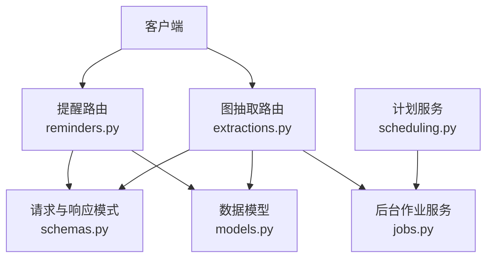
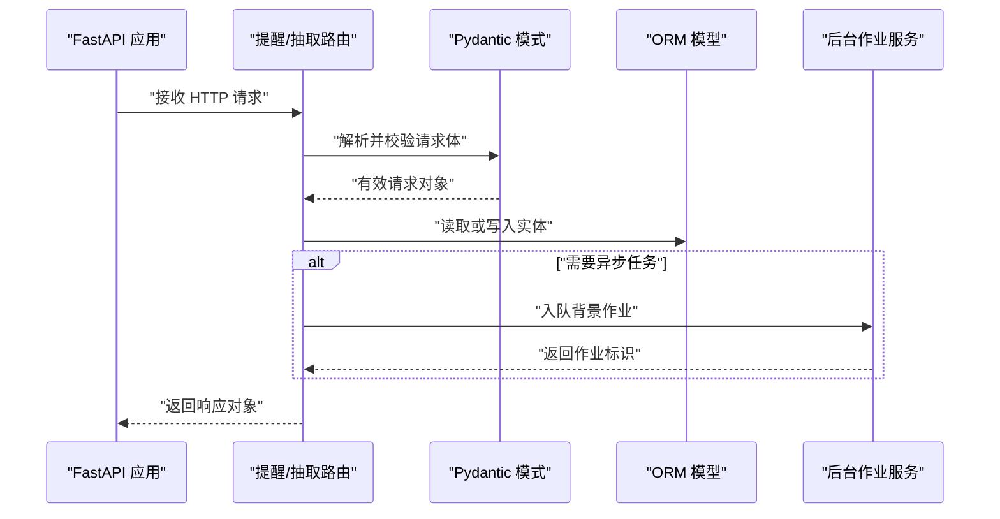
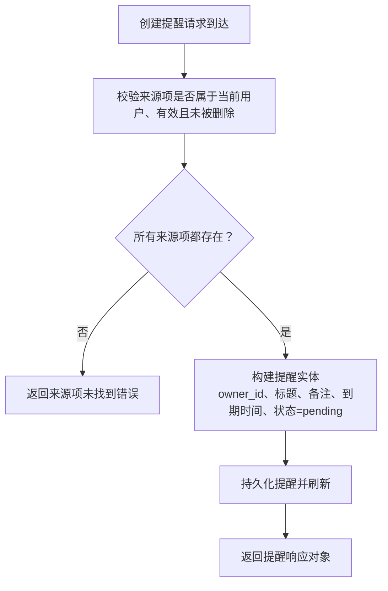
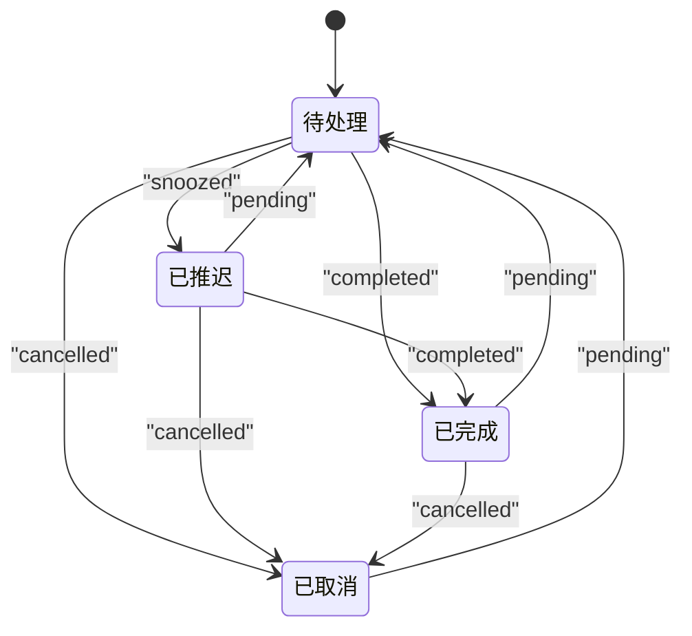
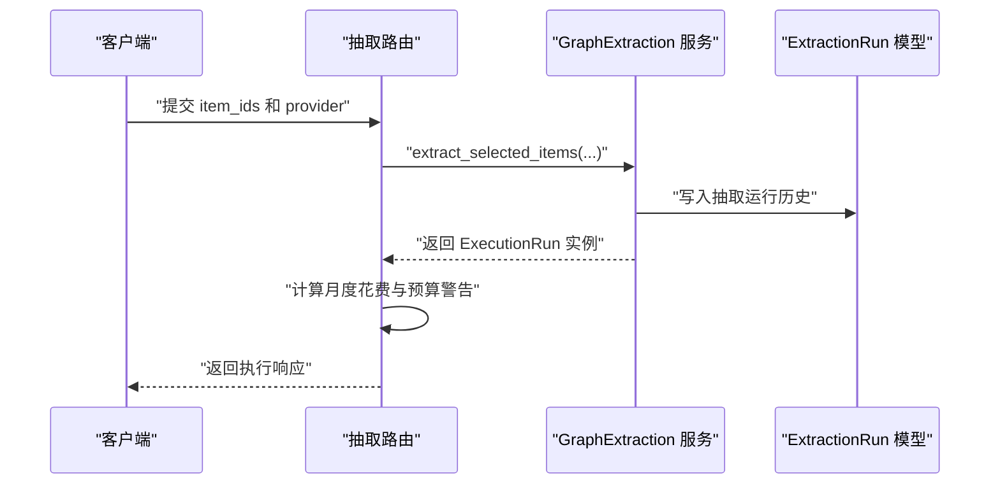
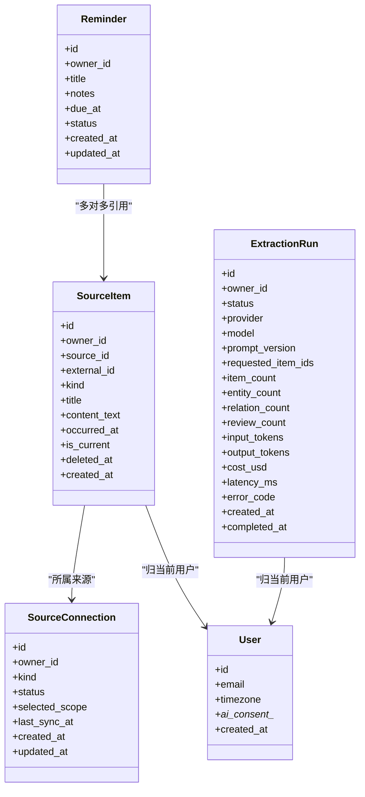
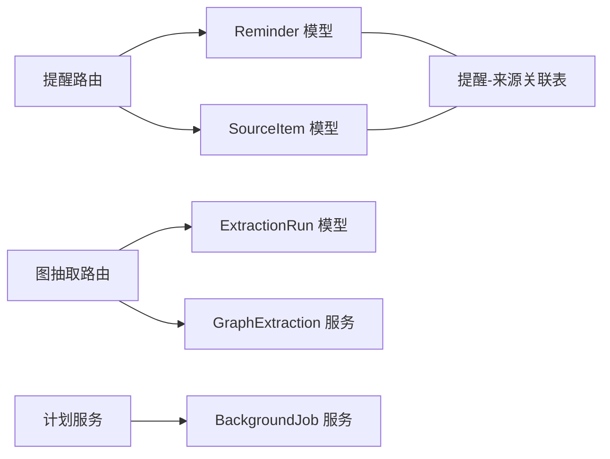

# 提醒与其他功能 API

<cite>
**本文引用的文件**   
- [reminders.py](file://src/personal_ai_life_os/api/routes/reminders.py)
- [extractions.py](file://src/personal_ai_life_os/api/routes/extractions.py)
- [schemas.py](file://src/personal_ai_life_os/api/schemas.py)
- [models.py](file://src/personal_ai_life_os/models.py)
- [jobs.py](file://src/personal_ai_life_os/services/jobs.py)
- [scheduling.py](file://src/personal_ai_life_os/services/scheduling.py)
- [513becf54638_account_deletion_and_reminder_citations.py](file://migrations/versions/513becf54638_account_deletion_and_reminder_citations.py)
</cite>

## 目录
1. [简介](#简介)
2. [项目结构定位](#项目结构定位)
3. [核心组件](#核心组件)
4. [架构总览](#架构总览)
5. [提醒管理接口](#提醒管理接口)
6. [图抽取执行接口](#图抽取执行接口)
7. [背景作业与批处理机制](#背景作业与批处理机制)
8. [提醒场景配置示例](#提醒场景配置示例)
9. [依赖关系分析](#依赖关系分析)
10. [性能与部署特性](#性能与部署特性)
11. [故障排查指南](#故障排查指南)
12. [结论](#结论)

## 简介
本说明文档聚焦两类能力：
- **提醒管理**：创建待办提醒、变更提醒状态、绑定数据来源项，并明确允许的状态迁移。
- **图抽取任务**：提交批量数据抽取运行、查询执行历史、消耗预算和错误信息。

此外，本文还说明后台作业模型、重复去重、超时重试、取消传播等辅助能力，以及它们在部署中的常见实践建议。当前仓库没有实现“到期自动触发提醒”的调度器，也没有统一的 Webhook、通知渠道或事件订阅接口；这些内容在后续扩展时可基于现有后台作业体系集成。

## 项目结构定位
提醒相关接口位于 FastAPI 路由层；数据模型和响应模式分别定义在 ORM 模型文件和 Pydantic 模式中；图抽取运行对外暴露最小集合的查询与控制端点；复杂异步工作通过后台作业模型承载。

**图表来源**
- [reminders.py:1-99](file://src/personal_ai_life_os/api/routes/reminders.py#L1-L99)
- [extractions.py:1-91](file://src/personal_ai_life_os/api/routes/extractions.py#L1-L91)
- [schemas.py:366-451](file://src/personal_ai_life_os/api/schemas.py#L366-L451)
- [models.py:856-875](file://src/personal_ai_life_os/models.py#L856-L875)
- [jobs.py:784-818](file://src/personal_ai_life_os/services/jobs.py#L784-L818)

**部分来源**
- [reminders.py:1-99](file://src/personal_ai_life_os/api/routes/reminders.py#L1-L99)
- [extractions.py:1-91](file://src/personal_ai_life_os/api/routes/extractions.py#L1-L91)

## 核心组件
- **Reminder 模型**：用于存储用户的待办提醒，包括标题、备注、到期时间、状态、生命周期时间戳，以及与消息来源项的多对多关联。
- **ExtractionRun 模型**：记录一次图抽取执行的历史，包含提供者、模型、版本、统计指标、费用、延迟、错误码和时间戳。
- **BackgroundJob 模型**：作为可重试、可幂等的持久化任务单位，支持按 owner_id 和 dedupe_key 去重，并通过 status、attempt_count、result_json 记录执行结果。
- **提醒路由**：提供列表、创建和状态更新接口，限制状态迁移合法性并处理推迟逻辑。
- **图抽取路由**：封装执行入口并返回增强后的执行视图，包括当月费用及预算告警。
- **Pydantic 模式**：校验提醒和抽取任务的请求参数，并对因到期时间缺少时区等信息做输入防御。

**部分来源**
- [models.py:564-590](file://src/personal_ai_life_os/models.py#L564-L590)
- [models.py:784-818](file://src/personal_ai_life_os/models.py#L784-L818)
- [models.py:856-875](file://src/personal_ai_life_os/models.py#L856-L875)
- [schemas.py:366-393](file://src/personal_ai_life_os/api/schemas.py#L366-L393)
- [schemas.py:429-451](file://src/personal_ai_life_os/api/schemas.py#L429-L451)

## 架构总览
提醒与图抽取功能采用分层设计：
- API 路由负责用户边界校验、权限隔离（owner_id）、请求建模和错误映射。
- 数据访问使用 SQLAlchemy ORM，按 owner_id 过滤避免越权。
- 业务复杂性（如批量抽取、周期性审查）通过 service 层封装，必要时借助 BackgroundJob。
- 数据库层保留变更记录，便于审计和恢复。

**图表来源**
- [reminders.py:19-99](file://src/personal_ai_life_os/api/routes/reminders.py#L19-L99)
- [extractions.py:22-91](file://src/personal_ai_life_os/api/routes/extractions.py#L22-L91)
- [jobs.py:96-167](file://src/personal_ai_life_os/services/jobs.py#L96-L167)

**部分来源**
- [reminders.py:19-99](file://src/personal_ai_life_os/api/routes/reminders.py#L19-L99)
- [extractions.py:22-91](file://src/personal_ai_life_os/api/routes/extractions.py#L22-L91)

## 提醒管理接口

### 获取提醒列表
- **路径与方法**：`GET /reminders`
- **鉴权范围**：仅返回当前登录用户的提醒。
- **排序规则**：优先展示无到期时间的提醒，再按到期时间排序，最后按创建时间降序排列。
- **返回字段**：参见 ReminderResponse，包含 id、title、notes、due_at、status、created_at、updated_at。
- **适用场景**：渲染提醒收件箱、筛选未完成项、显示即将到期的提醒。

**部分来源**
- [reminders.py:19-31](file://src/personal_ai_life_os/api/routes/reminders.py#L19-L31)
- [schemas.py:384-393](file://src/personal_ai_life_os/api/schemas.py#L384-L393)

### 创建提醒
- **路径与方法**：`POST /reminders`
- **请求主体**：ReminderCreateRequest，包含 title、可选 notes、可选 due_at 和最多 100 个 source_item_ids。
- **数据来源绑定**：会校验 source_item_ids 对应的 SourceItem 属于当前用户、未删除、是当前版本且源连接状态为 active/paused/revoked；不匹配将返回 `source_item_not_found`。
- **默认状态**：新建提醒状态为 pending。
- **返回体**：ReminderResponse。
- **典型用法**：
  - 单次提醒：设置 due_at，不绑定来源或绑定单个 SourceItem。
  - 带上下文提醒：绑定多个 source_item_ids，形成提示引用。
- **注意**：该接口不直接创建周期性循环；周期性行为可通过调用方定期调用创建接口实现。

**部分来源**
- [reminders.py:33-66](file://src/personal_ai_life_os/api/routes/reminders.py#L33-L66)
- [schemas.py:366-377](file://src/personal_ai_life_os/api/schemas.py#L366-L377)
- [models.py:856-875](file://src/personal_ai_life_os/models.py#L856-L875)

**图表来源**
- [reminders.py:33-66](file://src/personal_ai_life_os/api/routes/reminders.py#L33-L66)
- [models.py:856-875](file://src/personal_ai_life_os/models.py#L856-L875)

### 修改提醒状态
- **路径与方法**：`PATCH /reminders/{reminder_id}/status`
- **状态迁移表**：
  - pending → completed、snoozed、cancelled
  - snoozed → pending、completed、cancelled
  - completed → pending、cancelled
  - cancelled → pending
- **非法迁移**：返回 invalid_reminder_transition。
- **推迟处理**：若新状态为 snoozed 且设置了到期时间，则到期时间顺延一天。
- **失败处理**：提醒不存在时返回 reminder_not_found。
- **适用场景**：完成待办、暂时推迟、取消已过期提醒、重新激活已取消提醒。

**部分来源**
- [reminders.py:68-99](file://src/personal_ai_life_os/api/routes/reminders.py#L68-L99)

#### 提醒状态机

**图表来源**
- [reminders.py:15-17](file://src/personal_ai_life_os/api/routes/reminders.py#L15-L17)
- [reminders.py:75-93](file://src/personal_ai_life_os/api/routes/reminders.py#L75-L93)

### 到期通知与逾期管理的现状
当前代码中没有“定时扫描逾期提醒并自动触发通知”的实现：
- Reminder 有 due_at 字段和索引。
- Reminder 状态机允许从 pending、snoozed 进入 completed/cancelled。
- 外部调度器可以轮询 overdue 提醒，然后调用状态更新接口把提醒标记为已完成或取消，或向其他通知系统发送消息。

因此，“到期自动触发”应放在服务端 Worker 或外部计划任务中实现，而不是当前 REST 接口本身。

**部分来源**
- [models.py:856-869](file://src/personal_ai_life_os/models.py#L856-L869)
- [reminders.py:68-99](file://src/personal_ai_life_os/api/routes/reminders.py#L68-L99)

## 图抽取执行接口

### 提交图抽取任务
- **路径与方法**：`POST /extractions`
- **请求主体**：ExtractionRequest，包含 item_ids 列表和可选 provider。
- **约束**：item_ids 最少 1 条、最多 50 条。
- **行为**：
  - 调用图形抽取服务执行所选数据项。
  - 成功时返回 ExtractionRunResponse。
  - 抽取服务抛出 GraphExtractionError 时，转换为 HTTP 异常，携带 code、message 和对应状态码。
- **返回增强字段**：
  - cost_usd、input_tokens、output_tokens、latency_ms。
  - budget_used_usd、budget_limit_usd、budget_warning。
  - error_code 表示最近抽取运行的错误类别。

**部分来源**
- [extractions.py:33-70](file://src/personal_ai_life_os/api/routes/extractions.py#L33-L70)
- [schemas.py:429-451](file://src/personal_ai_life_os/api/schemas.py#L429-L451)

### 查询抽取执行记录
- **路径与方法**：`GET /extractions/{run_id}`
- **权限**：仅能查看当前用户的抽取运行。
- **返回值**：同 Post 接口的 Enhancement Run Response。
- **未找到**：返回 extraction_not_found。

**部分来源**
- [extractions.py:72-91](file://src/personal_ai_life_os/api/routes/extractions.py#L72-L91)

### 抽取执行流程

**图表来源**
- [extractions.py:22-70](file://src/personal_ai_life_os/api/routes/extractions.py#L22-L70)
- [models.py:564-590](file://src/personal_ai_life_os/models.py#L564-L590)

### 关键实体关系

**图表来源**
- [models.py:564-590](file://src/personal_ai_life_os/models.py#L564-L590)
- [models.py:784-818](file://src/personal_ai_life_os/models.py#L784-L818)
- [models.py:856-875](file://src/personal_ai_life_os/models.py#L856-L875)

**部分来源**
- [models.py:564-590](file://src/personal_ai_life_os/models.py#L564-L590)
- [models.py:856-875](file://src/personal_ai_life_os/models.py#L856-L875)

## 背景作业与批处理机制

### 后台作业模型
BackgroundJob 是可重试、持久化的任务单位，核心字段包括：
- owner_id：租户隔离。
- kind：任务类型，例如图片文字识别、图片描述、每周审查、桌面分析等。
- dedupe_key：按 owner_id+dedupe_key 做幂等去重。
- status：queued、running、completed、failed、cancelled 等状态演进。
- attempt_count / max_attempts：控制重试上限。
- result_json：任务成功时的结构化结果。
- source_id / source_item_id / sync_run_id / review_id：将作业与具体来源、同步运行或审查记录关联。

**部分来源**
- [jobs.py:784-818](file://src/personal_ai_life_os/services/jobs.py#L784-L818)

### 队列与去重
enqueue_background_job 的行为：
- 首先查找是否存在相同的 owner_id 和 dedupe_key。
- 如果存在且状态为 failed、cancelled 或 completed，则将其重置为 queued，清空尝试计数，更新 payload，并重设可用时间和租约。
- 否则创建新的 BackgroundJob。
这实现了：
- 防止相同业务操作被重复排队。
- 支持“失败后重新提交”。
- 支持“取消旧任务后重新入队”。

**部分来源**
- [jobs.py:96-167](file://src/personal_ai_life_os/services/jobs.py#L96-L167)

### 取消传播
当来源暂停或删除、模型授权撤回时，cancel_jobs_for_source 和 cancel_model_jobs_for_owner 会把仍在 queued/running 的作业标记为 cancelled，并回写关联实体状态：
- 清理 SyncRun。
- 清除 SourceItem 的图片 OCR 或描述状态。
- 将 Review 从 processing 降级为 draft，并注入 model.status。

这种机制适合在部署环境中处理资源回收和一致性修复。

**部分来源**
- [jobs.py:169-200](file://src/personal_ai_life_os/services/jobs.py#L169-L200)

### 批次与并发限制的实践建议
虽然提醒路由和抽取路由没有直接内置线程池、信号量或最大并发参数，但可以基于以下机制构建批控策略：
- **分批输入**：ExtractionRequest 限定了最多 50 个 item_ids，可作为一次批量上限。
- **去重键控制**：通过合理构造 dedupe_key，避免同一用户在同一业务上下文中重复提交同类任务。
- **Worker 侧限速**：在读取 BackgroundJob 的 Worker 进程中按 owner_id、provider、模型维度分配工作协程数。
- **预算与成本保护**：抽取响应已暴露 budget_used_usd/budget_limit_usd/budget_warning，可在上层控制器拒绝超限任务。
- **来源级取消**：利用来源暂停或撤销时批量取消背景作业的能力。

[本节为通用部署建议，不涉及特定代码行号]

## 提醒场景配置示例

### 单次提醒
- 设置 due_at 为某个绝对时间。
- due_at 必须包含时区偏移，否则会由请求校验失败。
- 适合会议预约、截止日期、一次性跟进任务。

**部分来源**
- [schemas.py:366-377](file://src/personal_ai_life_os/api/schemas.py#L366-L377)

### 周期性提醒
- 提醒路由未提供 repeat_interval 或 cron 表达式。
- 客户端或服务端 Worker 可按固定节奏周期调用 POST /reminders，并为每次创建不同的标题和到期时间。
- 建议在业务层维护一个 schedule table，避免重复生成。

[本节为概念性示例，不涉及具体实现代码]

### 条件触发提醒
- 当前提醒创建接口不支持“条件表达式字段”。
- 可通过上游业务流程：当业务条件满足时调用提醒接口。
- 也可配合 BackgroundJob 或 scheduling 类服务执行条件扫描后创建提醒。

**部分来源**
- [schemas.py:366-370](file://src/personal_ai_life_os/api/schemas.py#L366-L370)

### 提醒关联数据项
- 通过 source_item_ids 引用消息来源项。
- 可用于在提醒详情中回溯原始聊天、日历条目、照片或记忆片段。
- 来源必须仍然属于当前用户并且没有被逻辑删除。

**部分来源**
- [reminders.py:41-65](file://src/personal_ai_life_os/api/routes/reminders.py#L41-L65)
- [models.py:233-252](file://src/personal_ai_life_os/models.py#L233-L252)
- [513becf54638_account_deletion_and_reminder_citations.py:1-36](file://migrations/versions/513becf54638_account_deletion_and_reminder_citations.py#L1-L36)

## 依赖关系分析

**图表来源**
- [reminders.py:7-17](file://src/personal_ai_life_os/api/routes/reminders.py#L7-L17)
- [extractions.py:11-21](file://src/personal_ai_life_os/api/routes/extractions.py#L11-L21)
- [models.py:58-72](file://src/personal_ai_life_os/models.py#L58-L72)
- [513becf54638_account_deletion_and_reminder_citations.py:13-36](file://migrations/versions/513becf54638_account_deletion_and_reminder_citations.py#L13-L36)

**部分来源**
- [reminders.py:7-17](file://src/personal_ai_life_os/api/routes/reminders.py#L7-L17)
- [extractions.py:11-21](file://src/personal_ai_life_os/api/routes/extractions.py#L11-L21)
- [models.py:58-72](file://src/personal_ai_life_os/models.py#L58-L72)

## 性能与部署特性

### 查询性能
- Reminder 在 owner_id、due_at 上建有索引，有利于按用户筛选和到期排序。
- ExtractionRun 在 owner_id、created_at 上有索引，适合按用户检索近期任务。
- BackgroundJob 在 status/available_at、owner_id/created_at、source_id、source_item_id、sync_run_id、review_id 等列建了索引，有利于 Worker 高效抓取任务。

**部分来源**
- [models.py:856-869](file://src/personal_ai_life_os/models.py#L856-L869)
- [models.py:564-590](file://src/personal_ai_life_os/models.py#L564-L590)
- [models.py:787-795](file://src/personal_ai_life_os/models.py#L787-L795)

### 输入防护
- ReminderCreateRequest 要求 due_at 包含时区信息，避免模糊时间引发跨时区提醒错乱。
- ReminderStatusRequest 强制状态取值范围为 pending、completed、snoozed、cancelled。
- ExtractionRequest 限制 item_ids 数量为 1~50。
- Reminder.create 时对 source_item_ids 数量最多限制为 100。

**部分来源**
- [schemas.py:366-451](file://src/personal_ai_life_os/api/schemas.py#L366-L451)

### 去重与冲突处理
- 背景作业通过 owner_id+dedupe_key 唯一约束实现去重。
- 提醒状态转移由 ALLOWED_TRANSITIONS 严格限制，防止非法状态跳转。
- 抽取路由在执行失败时通过结构化 code 和 message 向上抛出，避免吞掉底层异常。

**部分来源**
- [models.py:789-795](file://src/personal_ai_life_os/models.py#L789-L795)
- [reminders.py:13-17](file://src/personal_ai_life_os/api/routes/reminders.py#L13-L17)
- [extractions.py:42-60](file://src/personal_ai_life_os/api/routes/extractions.py#L42-L60)

### 通知渠道与回调机制的现状
当前 REST API 不暴露 Webhook、通知通道、推送渠道或事件订阅端点。扩展方向可以是：
- 在 Worker 消费 BackgroundJob 成功后调用第三方通知 API。
- 用 background job 统一转发事件到 Slack、邮件、短信、移动端推送或内部订阅总线。
- 对于“到期提醒”，由定时任务扫描 overdue reminders，并通过 background job 触发通知流。

[本节为扩展建议，不涉及现有实现细节]

### 提醒与抽取的协同建议
- 可将图抽取任务的结果作为提醒的数据来源：抽取完成后根据 entity_count、error_code 或 cost_usd 创建提醒，例如“今日知识抽取结果”或“额度即将耗尽提醒”。
- 抽取响应中的预算警告可作为触发高优先级提醒的条件。

[本节为概念性协同方案]

## 故障排查指南

### 创建提醒失败
常见问题：
- source_item_not_found：请求中的某个或多个 source_item_id 无效、不属于当前用户、已被删除、不是最新版本，或其所属来源连接状态不符合预期。
- due_at 缺少时区：Pydantic 校验会在请求阶段报错。
- 标题为空：ReminderCreateRequest 对 title 有最小长度限制。

排查要点：
- 确认 source_item_ids 来自当前用户的 SourceItem 列表。
- 检查 SourceConnection 状态是否为 active/paused/revoked。
- 确保 due_at 带有明确的 UTC 或其他时区偏移。

**部分来源**
- [reminders.py:41-65](file://src/personal_ai_life_os/api/routes/reminders.py#L41-L65)
- [schemas.py:366-377](file://src/personal_ai_life_os/api/schemas.py#L366-L377)

### 修改提醒状态失败
常见问题：
- reminder_not_found：提醒不存在或不属于当前用户。
- invalid_reminder_transition：目标状态不在允许迁移集合中。

处理策略：
- 先 GET /reminders 确认当前状态。
- 只允许使用 ALLOWED_TRANSITIONS 表中的迁移。
- snoozed 会将 due_at 延后一天，如需自定义延期需通过调用方另行计算。

**部分来源**
- [reminders.py:73-93](file://src/personal_ai_life_os/api/routes/reminders.py#L73-L93)

### 抽取执行错误
常见问题：
- extraction_not_found：run_id 不存在或不属于当前用户。
- GraphExtractionError：底层抽取过程出现不可继续错误，包含 code、message 和状态码。
- 预算不足或预算预警：ExtractionRunResponse 会返回 budget_warning 以及本月已用和限额。

排查步骤：
- 先用 GET /extractions/{run_id} 确认执行状态和错误码。
- 检查 Provider 配置、token、额度。
- 关注 budget_warning 并在上层 UI 中引导用户降低抽取范围。

**部分来源**
- [extractions.py:42-70](file://src/personal_ai_life_os/api/routes/extractions.py#L42-L70)
- [extractions.py:72-91](file://src/personal_ai_life_os/api/routes/extractions.py#L72-L91)
- [schemas.py:434-451](file://src/personal_ai_life_os/api/schemas.py#L434-L451)

### 背景作业问题
常见问题：
- 任务重复执行：检查是否多次传入不同 dedupe_key。
- 任务无限重试：检查 max_attempts 和 RetryableJobError 的 retryable 配置。
- 任务无法取消：确认 Worker 是否正确轮询 queued/running 任务并被取消逻辑覆盖。

排查重点：
- 观察 BackgroundJob.status、attempt_count、error_code、result_json。
- 使用 cancel_jobs_for_source 或 cancel_model_jobs_for_owner 回滚受影响的运行和草稿。

**部分来源**
- [jobs.py:96-167](file://src/personal_ai_life_os/services/jobs.py#L96-L167)
- [jobs.py:169-200](file://src/personal_ai_life_os/services/jobs.py#L169-L200)

## 结论
提醒管理和图抽取任务在当前代码库中提供了清晰、安全且可追溯的基础能力：
- 提醒模块支持创建、绑定来源、受限状态流转和基础到期字段。
- 图抽取模块暴露了任务提交和历史查询能力，并在响应中体现费用、耗时和预算状态。
- 后台作业模型提供了去重、重试、取消、溯源等分布式任务基础设施。

未来可扩展方向包括：
- 补充定时扫描与到期提醒触发逻辑。
- 添加 Webhook 和事件订阅接口。
- 统一通知渠道适配器。
- 增加显式的重复频率、超时控制和批并发参数。
- 在更高层编排提醒、抽取和审查之间的业务链路。

[本节为总结性内容，不直接分析特定代码文件]