# 插件系统与模型提供商 API

<cite>
**本文引用的文件**
- [plugins.py](file://src/personal_ai_life_os/api/routes/plugins.py)
- [model_providers.py](file://src/personal_ai_life_os/api/routes/model_providers.py)
- [plugins.py](file://src/personal_ai_life_os/services/plugins.py)
- [model_providers.py](file://src/personal_ai_life_os/services/model_providers.py)
- [schemas.py](file://src/personal_ai_life_os/api/schemas.py)
- [models.py](file://src/personal_ai_life_os/models.py)
- [config.py](file://src/personal_ai_life_os/config.py)
- [test_plugins.py](file://tests/test_plugins.py)
</cite>

## 目录
1. [简介](#简介)
2. [项目结构](#项目结构)
3. [核心组件](#核心组件)
4. [架构总览](#架构总览)
5. [详细组件分析](#详细组件分析)
6. [依赖关系分析](#依赖关系分析)
7. [性能与容量特性](#性能与容量特性)
8. [故障排查与安全指南](#故障排查与安全指南)
9. [结论](#结论)
10. [附录：API 参考与示例](#附录api-参考与示例)

## 简介
本文件系统性地说明“个人 AI 生命操作系统”的插件系统与模型提供商管理实现，重点覆盖以下内容：
- 插件清单结构与内置连接器、Agent 工具插件。
- 插件安装、启用/禁用、卸载、调用、审计与权限控制。
- 模型提供商的配置解析、多供应商管理、同意策略与用量估算。
- Agent 工具的发现、参数校验、权限安全沙箱与错误隔离。
- 企业级能力：动态配置、多供应商切换、按模型选择调用、预算和成本统计边界。

本说明同时包含面向技术读者的架构图表与面向使用者的操作步骤。

## 项目结构
插件系统的代码分布在 API 路由、业务服务层、领域模型、Pydantic 请求响应模式及生产配置文件之间；测试用例覆盖了完整的插件生命周期。

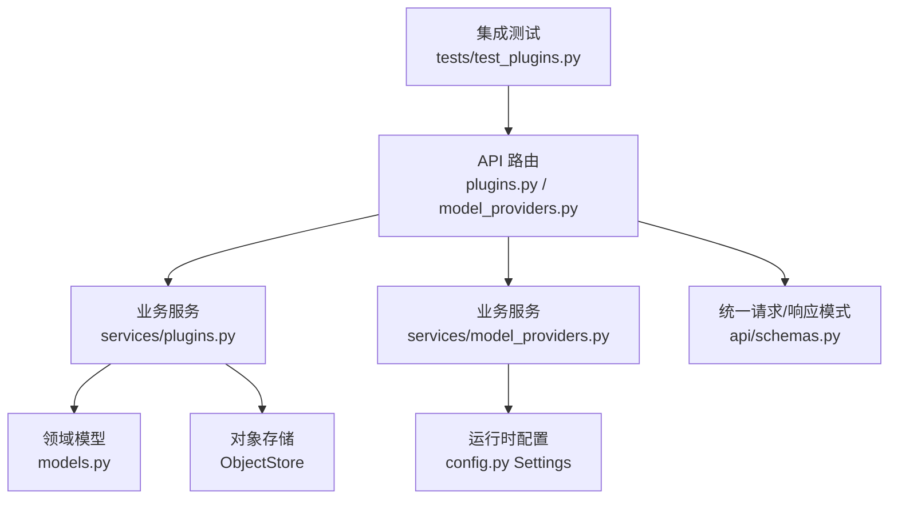

**图表来源**
- [plugins.py:12-48](file://src/personal_ai_life_os/api/routes/plugins.py#L12-L48)
- [model_providers.py:12-30](file://src/personal_ai_life_os/api/routes/model_providers.py#L12-L30)
- [plugins.py:86-111](file://src/personal_ai_life_os/services/plugins.py#L86-L111)
- [model_providers.py:41-121](file://src/personal_ai_life_os/services/model_providers.py#L41-L121)
- [schema 引用在 api/schemas.py](file://src/personal_ai_life_os/api/schemas.py)
- [模型定义在 models.py](file://src/personal_ai_life_os/models.py#L800-L875)
- [测试用例引用入口](file://tests/test_plugins.py)

**章节来源**
- [plugins.py:12-48](file://src/personal_ai_life_os/api/routes/plugins.py#L12-L48)
- [model_providers.py:12-30](file://src/personal_ai_life_os/api/routes/model_providers.py#L12-L30)

## 核心组件
本节列出对插件系统与模型提供商 API 而言最重要的运行实体与职责。

| 类别 | 名称 | 主要职责 | 对应位置 |
|---|---|---|---|
| 插件清单 | `PluginManifest` | 记录已安装插件的所有者、名称、版本、类型、入口点、状态等 | [models.py](file://src/personal_ai_life_os/models.py) |
| 插件权限 | `PluginPermission` | 绑定所有者的某个插件及其已授予权限 | [services/plugins.py](file://src/personal_ai_life_os/services/plugins.py#L90-L111) |
| 插件审计 | `PluginAuditLog` | 记录插件安装、调用成功/拒绝/失败的审计日志 | [services/plugins.py](file://src/personal_ai_life_os/services/plugins.py#L111-L139) |
| 连接器插件 | `generic-json-connector` | 预览、导入、删除本地 JSON/JSONL/Markdown 数据源 | [services/plugins.py](file://src/personal_ai_life_os/services/plugins.py#L123-L138) |
| Agent 工具插件 | `graph-search-agent` | 基于用户私有图谱搜索实体并返回证据摘要 | [services/plugins.py](file://src/personal_ai_life_os/services/plugins.py#L138-L151) |
| 模型提供商实体 | `ModelProvider` | 描述提供商 ID、基础 URL、密钥、默认模型、模型列表、隐私与成本字段 | [model_providers.py](file://src/personal_ai_life_os/services/model_providers.py#L22-L66) |
| 配置对象 | `Settings` | 提供 OpenAI 单供应商配置与多供应商 JSON 配置，以及插件上限等 | [config.py](file://src/personal_ai_life_os/config.py#L48-L118) |
| API 模式 | Schema 类 | 封装插件列表、安装、调用、授权、供应商同意等结构化输入输出 | [schemas.py](file://src/personal_ai_life_os/api/schemas.py) |

**章节来源**
- [plugins.py:86-111](file://src/personal_ai_life_os/services/plugins.py#L86-L111)
- [plugins.py:111-L151](file://src/personal_ai_life_os/services/plugins.py#L111-L151)
- [model_providers.py:22-L66](file://src/personal_ai_life_os/services/model_providers.py#L22-L66)
- [config.py:48-L118](file://src/personal_ai_life_os/config.py#L48-L118)

## 架构总览
整体处理流程从 HTTP 接口进入 FastAPI 路由器，再委托给服务层函数完成数据库访问、权限检查、插件分发和审计写入；模型提供商则围绕环境变量中的多供应商注册表和单个 OpenAI 预设进行解析与管理。

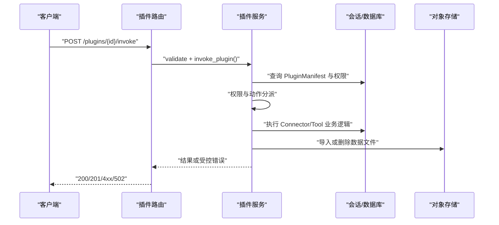

**图表来源**
- [plugins.py:93-L158](file://src/personal_ai_life_os/api/routes/plugins.py#L93-L158)
- [plugins.py:324-L421](file://src/personal_ai_life_os/services/plugins.py#L324-L421)

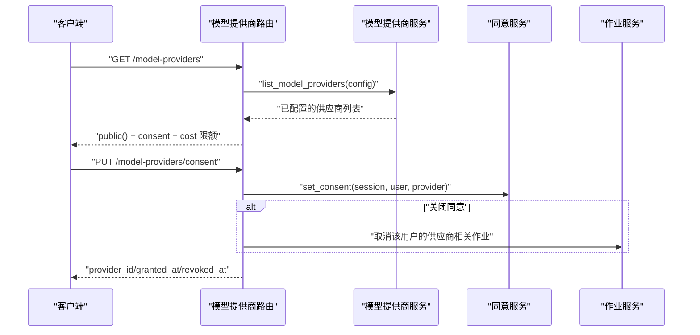

**图表来源**
- [model_providers.py:24-L79](file://src/personal_ai_life_os/api/routes/model_providers.py#L24-L79)
- [model_providers.py:122-L223](file://src/personal_ai_life_os/services/model_providers.py#L122-L223)

## 详细组件分析

### 插件清单与权限模型
插件系统通过 `BUILTIN_PLUGINS` 声明式注册两个内置插件：
- `generic-json-connector`：连接器类型，支持文件预览、导入与删除，并要求 `connector.preview`、`connector.import`、`connector.delete`、`connector.read_selected_path` 等权限。
- `graph-search-agent`：Agent 工具类型，允许搜索所有者范围内的图实体和相关证据，仅要求 `agent.read_graph`。

权限体系通过 `PERMISSION_CATALOG` 白名单控制可声明的权限集合；安装时会将请求权限与插件清单中已声明权限比较，防止未声明或未知权限被绕过。权限在 `PluginPermission` 中以所有者维度的授权记录持久化。

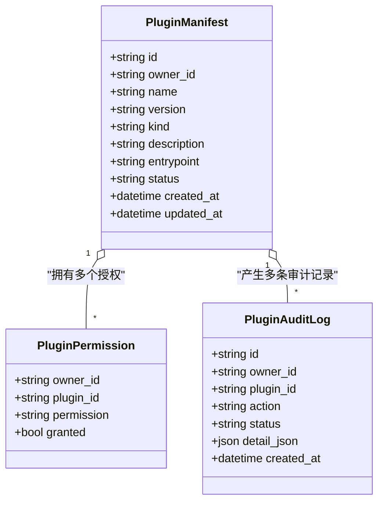

**图表来源**
- [models.py](file://src/personal_ai_life_os/models.py#L800-L875)
- [plugins.py:86-L111](file://src/personal_ai_life_os/services/plugins.py#L86-L111)

**章节来源**
- [plugins.py:31-L63](file://src/personal_ai_life_os/services/plugins.py#L31-L63)
- [plugins.py:86-L111](file://src/personal_ai_life_os/services/plugins.py#L86-L111)
- [plugins.py:111-L151](file://src/personal_ai_life_os/services/plugins.py#L111-L151)

### 连接器插件（Connector）注册与调用接口
连接器插件 `generic-json-connector` 暴露三种标准动作：

| 动作 | 所需权限 | 主要输入 | 主要输出 | 行为 |
|---|---|---|---|---|
| `preview` | `connector.preview`、`connector.read_selected_path` | `filename`、`content` | `preview`、`total` | 解析 JSON、JSONL 或 Markdown，返回最多 20 条预览条目 |
| `import` | `connector.import`、`connector.read_selected_path` | `filename`、`content` | `source_id`、`sync_run_id`、`items_created`、`items_duplicate`、`preview`、`items` | 创建新 `SourceConnection`，写入对象存储并解析为时间线项目 |
| `delete` | `connector.delete` | `source_id` | `source_id`、`deleted` | 标记源删除、清理衍生对象与同步记录、删除对象存储条目 |

连接器调用过程如下。

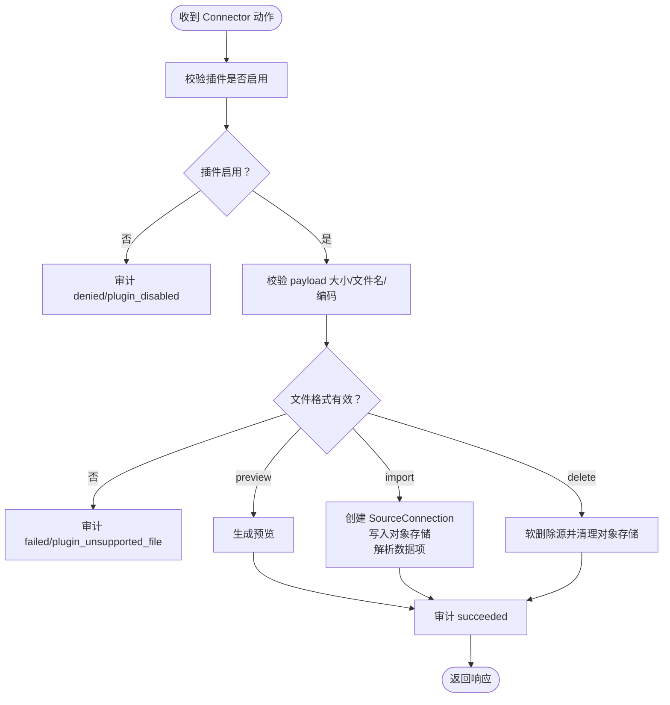

**图表来源**
- [plugins.py:220-L280](file://src/personal_ai_life_os/services/plugins.py#L220-L280)
- [plugins.py:281-L322](file://src/personal_ai_life_os/services/plugins.py#L281-L322)
- [plugins.py:323-L355](file://src/personal_ai_life_os/services/plugins.py#L323-L355)

**章节来源**
- [plugins.py:201-L322](file://src/personal_ai_life_os/services/plugins.py#L201-L322)
- [plugins.py:324-L421](file://src/personal_ai_life_os/services/plugins.py#L324-L421)

### Agent 工具插件（Tool）注册与调用接口
目前内置的 Agent 工具插件是 `graph-search-agent`，它只能执行 `search` 动作，需要 `agent.read_graph` 权限。

| 动作 | 所需权限 | 主要输入 | 主要输出 | 行为 |
|---|---|---|---|---|
| `search` | `agent.read_graph` | `query`、可选 `limit` | `query`、`results` | 在所有者范围内搜索图实体，每项最多附加三个最近证据 |

调用约束包括：
- 只接受已知动作；其他动作返回动作不支持错误。
- 只检索当前所有者数据的图实体与证据，不会跨租户共享。
- 搜索结果按置信度降序并限制最大条目数。

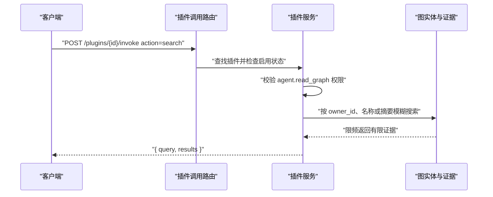

**图表来源**
- [plugins.py:356-L421](file://src/personal_ai_life_os/services/plugins.py#L356-L421)

**章节来源**
- [plugins.py:31-L63](file://src/personal_ai_life_os/services/plugins.py#L31-L63)
- [plugins.py:356-L421](file://src/personal_ai_life_os/services/plugins.py#L356-L421)

### 插件 API 设计
插件路由以 `/plugins` 前缀组织以下能力：

| 方法 | 路径 | 用途 | 关键行为 |
|---|---|---|---|
| GET | `/plugins/catalog` | 查看当前可安装插件清单 | 返回内置插件的名称、版本、类型、入口点和声明权限 |
| GET | `/plugins` | 查看当前用户已安装插件 | 过滤出当前所有者安装的插件并转换响应载荷 |
| POST | `/plugins/install` | 安装插件 | 校验重复安装、权限白名单、声明权限与安装数量上限 |
| POST | `/plugins/{plugin_id}/status` | 启用或禁用插件 | 校验状态并更新审计 |
| DELETE | `/plugins/{plugin_id}` | 卸载插件 | 删除插件记录并记录审计 |
| POST | `/plugins/{plugin_id}/invoke` | 调用插件动作 | 检查启用状态、权限分派并写审计 |
| GET | `/plugins/audit` | 获取审计日志 | 按所有者分页计数并列出最近记录 |

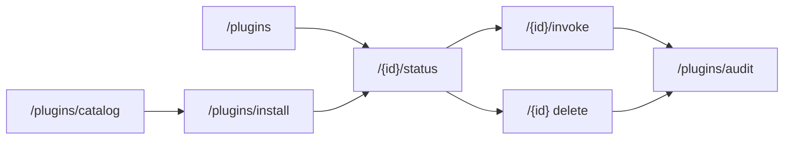

**图表来源**
- [plugins.py:21-L158](file://src/personal_ai_life_os/api/routes/plugins.py#L21-L158)

**章节来源**
- [plugins.py:21-L158](file://src/personal_ai_life_os/api/routes/plugins.py#L21-L158)

### 模型提供商统一接口抽象
模型提供商层将环境变量中的配置转换为统一的 `ModelProvider` 实体，并提供公开只读信息、成本估算与模型选择解析。

`ModelProvider` 的关键属性包括：
- 标识信息：`id`、`model`、`models`、`base_url`。
- 密钥信息：`api_key`。
- 成本与预算：`input_cost_per_million_usd`、`output_cost_per_million_usd`、`max_output_tokens`。
- 隐私披露：`disclosure_version`、`data_sent`、`retention`、`privacy_url`。
- 部署特征：`local`、`builtin`、`trust_env`。
- 便捷方法：`chat_completions_url`、`rates_configured`、`disclosure_ready`、`public()`。

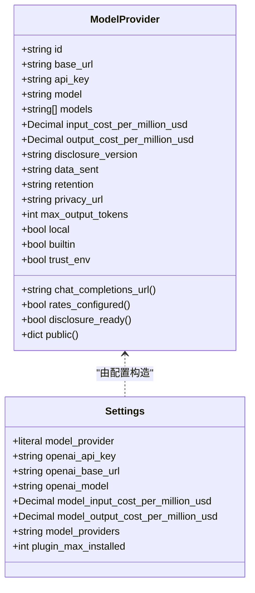

**图表来源**
- [model_providers.py:22-L66](file://src/personal_ai_life_os/services/model_providers.py#L22-L66)
- [config.py:48-L118](file://src/personal_ai_life_os/config.py#L48-L118)

**章节来源**
- [model_providers.py:22-L66](file://src/personal_ai_life_os/services/model_providers.py#L22-L66)
- [config.py:48-L118](file://src/personal_ai_life_os/config.py#L48-L118)

### 多供应商配置、动态解析与模型切换
当前实现对模型提供商的动态管理集中在运行时配置和两个解析函数上：

- 内置默认供应商：当 `Settings.model_provider` 为 `openai` 时，构造一个内置默认供应商；其 `base_url`、`model`、密钥、隐私披露与成本均从 OpenAI 相关配置读取，并自动判断是否本地回环地址。
- 多供应商列表：`model_providers` 是一个 JSON 字符串对象，键为供应商 ID，值包含 `base_url`、`model`、`models`、`api_key`、可选 `local`、`trust_env`、定价与隐私字段。系统会对每个供应商执行严格校验。
- 供应商选择：`resolve_model_provider` 根据传入的 `provider_id` 和 `model` 选择供应商；若未显式指定供应商则使用默认 ID，若模型不在供应商注册模型列表中会报错，若选择了非默认模型则会返回带有替换模型的不可变实体副本。

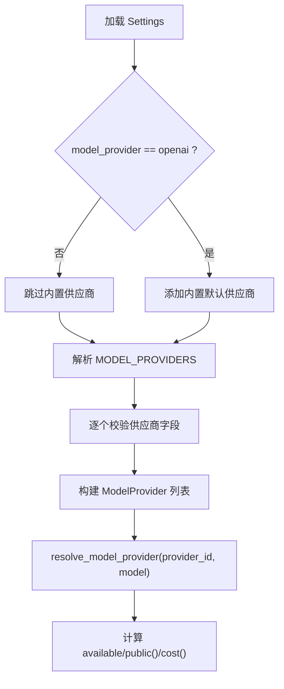

**图表来源**
- [model_providers.py:41-L121](file://src/personal_ai_life_os/services/model_providers.py#L41-L121)
- [model_providers.py:122-L223](file://src/personal_ai_life_os/services/model_providers.py#L122-L223)

#### 多供应商验证要点
- 默认供应商 ID 保留为 `default`，不允许自定义覆盖。
- 供应商 ID 必须是 1–80 个字符的字符串。
- 必填字段：`base_url` 和 `model`。
- 非本地供应商必须提供 `api_key`；本地供应商需使用 loopback 主机名。
- `models` 必须是非空列表，且默认模型必须在列表中。
- `local=true` 与非 loopback 地址不兼容，会抛出配置错误。

#### 供应商可用性判断
一个供应商的公开信息中包含 `available`，其值为真只有同时满足：
- 有 API key 或是本地供应商。
- 输入与输出单价都大于零。
- 隐私披露已就绪：存在披露数据、保留策略足够长，并且是内置或本地供应商，或者提供了隐私 URL。

#### 模型切换与成本估算
- `provider_cost` 接收输入 token 数和输出 token 数，返回美元成本；如果未配置价格则返回空。
- `resolve_model_provider` 会在选到不同模型时返回带新 `model` 字段的供应商实例，供调用方用于后续流式或非流式 Chat Completions。

**章节来源**
- [model_providers.py:41-L121](file://src/personal_ai_life_os/services/model_providers.py#L41-L121)
- [model_providers.py:122-L223](file://src/personal_ai_life_os/services/model_providers.py#L122-L223)

### 供应商同意与企业合规
模型提供商同意由 `/model-providers/consent` 接口驱动，使用 `ModelConsentRequest` 作为请求体，返回值包含 `provider_id`、`disclosure_version`、`granted_at`、`revoked_at`。关闭同意时，会取消该所有者名下与该供应商相关的作业。

数据库层使用 `ModelConsent` 实体保存所有者与供应商之间的关系，并通过联合唯一约束保证同所有者同供应商只有一条同意记录。

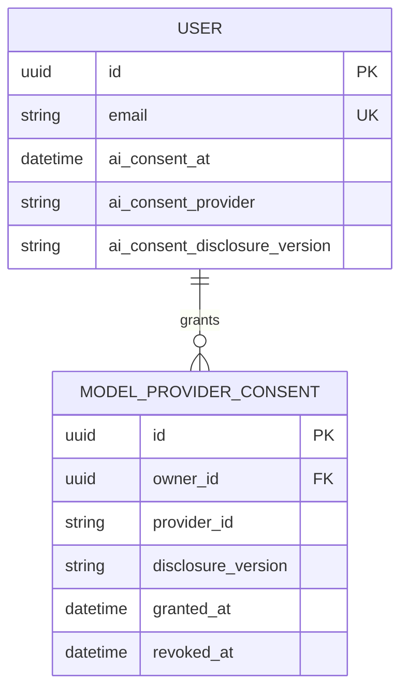

**图表来源**
- [models.py:114-L146](file://src/personal_ai_life_os/models.py#L114-L146)
- [model_providers.py:24-L79](file://src/personal_ai_life_os/api/routes/model_providers.py#L24-L79)

**章节来源**
- [model_providers.py:24-L79](file://src/personal_ai_life_os/api/routes/model_providers.py#L24-L79)
- [models.py:114-L146](file://src/personal_ai_life_os/models.py#L114-L146)

### Agent 工具的安全沙箱与错误隔离
Agent 工具和连接器插件并不运行任意字节码，而是由 `invoke_plugin` 根据 `entrypoint` 做受控分发；外部扩展机制在当前代码库中并未出现，当前“热加载”等价于重启后重新加载配置或安装新的内置插件组合。

安全隔离体现在以下几点：

| 安全维度 | 实现方式 |
|---|---|
| 身份隔离 | 插件查询、图实体查询、源连接操作都以 `owner_id` 严格限定 |
| 权限模型 | 每个动作需要明确声明并授权的权限，未授权返回权限拒绝 |
| 动作白名单 | 仅支持已识别的 `entrypoint` 和 `action` |
| 文件大小限制 | 连接器文本负载不超过固定最大值 |
| 异常隔离 | 插件执行失败不会破坏主应用事务，统一审计为失败，并返回受控错误码 |
| 状态门控 | 未启用的插件无法执行任何动作 |

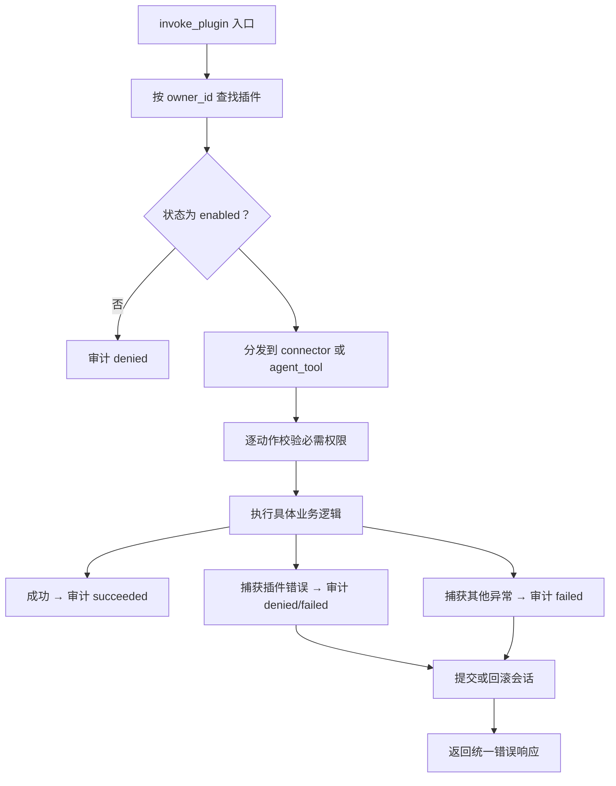

**图表来源**
- [plugins.py:324-L421](file://src/personal_ai_life_os/services/plugins.py#L324-L421)

**章节来源**
- [plugins.py:201-L421](file://src/personal_ai_life_os/services/plugins.py#L201-L421)

### 插件安装、版本管理与权限控制 API
插件安装流程的核心约束如下：

1. 插件必须存在于 `catalog()` 返回的内置清单中。
2. 同一所有者不能重复安装同名插件。
3. 插件数量不能超过 `Settings.plugin_max_installed`。
4. 请求的权限必须在 `PERMISSION_CATALOG` 白名单内。
5. 请求的权限必须在插件清单中已经声明；否则拒绝。
6. 默认使用插件清单中的权限集；也可通过安装请求显式子集授权。

由于当前插件源码由内置入口点映射，版本号来自内置清单；因此“版本管理”在现有实现中体现为对同一插件不可重复安装、通过卸载再安装来重建配置，而不是动态拉取远程版本。若要扩展为远程注册中心，应在 `catalog()` 之上增加远程目录、签名校验、依赖解析与冲突检测。

#### 推荐安装流程
1. 调用 `/plugins/catalog` 确认插件存在并查看声明权限。
2. 调用 `/plugins/install` 安装插件，可选择请求部分授权。
3. 调用 `/{plugin_id}/status` 设置为 `enabled`。
4. 调用 `/{plugin_id}/invoke` 执行目标动作。
5. 调用 `/plugins/audit` 检查安装和调用审计。
6. 如需停用或移除，先禁用再卸载。

#### 权限最小化建议
- 预览与导入需要 `connector.read_selected_path`，但不应授予写文件、支付、删除数据等高敏感权限。
- Agent 工具一般只需 `agent.read_graph`；除非扩展实现新增外部网络、资金操作等权限，否则会失败。

**章节来源**
- [plugins.py:140-L200](file://src/personal_ai_life_os/services/plugins.py#L140-L200)
- [test_plugins.py:17-L64](file://tests/test_plugins.py#L17-L64)
- [test_plugins.py:66-L127](file://tests/test_plugins.py#L66-L127)

## 依赖关系分析

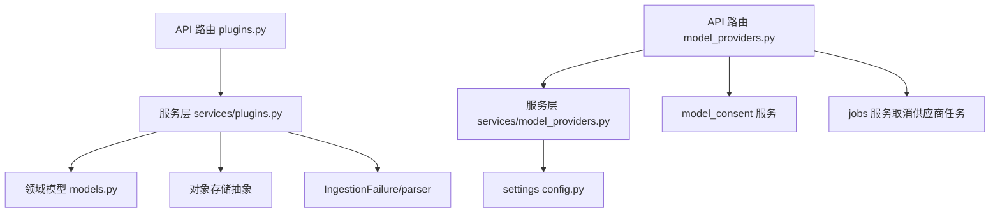

**图表来源**
- [plugins.py:12-L48](file://src/personal_ai_life_os/api/routes/plugins.py#L12-L48)
- [plugins.py:151-L200](file://src/personal_ai_life_os/services/plugins.py#L151-L200)
- [model_providers.py:12-L79](file://src/personal_ai_life_os/api/routes/model_providers.py#L12-L79)
- [model_providers.py:41-L223](file://src/personal_ai_life_os/services/model_providers.py#L41-L223)

耦合性特点：
- 插件路由与服务层解耦良好：路由只负责入参、异常转换、会话提交与响应构造。
- 插件服务直接依赖对象存储和入库流程，体现了数据型连接器插件的业务深度。
- 模型提供商路由依赖供应商解析、同意服务和作业取消，形成一条完整的企业级审批链。
- 当前插件注册为内存常量，尚未与远程仓库或服务端目录扫描形成强耦合，便于先演进权限模型和业务功能。

潜在循环依赖风险较低：API 层不直接调用底层 parser 或对象存储具体实现，而是通过服务层聚合。

**章节来源**
- [plugins.py:12-L48](file://src/personal_ai_life_os/api/routes/plugins.py#L12-L48)
- [plugins.py:324-L421](file://src/personal_ai_life_os/services/plugins.py#L324-L421)
- [model_providers.py:12-L79](file://src/personal_ai_life_os/api/routes/model_providers.py#L12-L79)

## 性能与容量特性
- 插件文本上限：连接器预览和导入时对文本内容做 UTF-8 字节长度限制，默认与 `MAX_PLUGIN_TEXT_BYTES` 一致，测试期望约为 5MB。
- 插件数量上限：通过 `Settings.plugin_max_installed` 控制，避免某用户无界安装插件。
- Agent 搜索限制：图搜索默认 limit 在 1–20 范围内截断，每条实体最多返回 3 条证据，减少一次调用的查询扇出。
- 导入预览限制：连接器预览最多返回 20 条预览项目，避免大量元数据一次性返回。
- 模型成本：只有单价为正时才计算成本；每次调用可用 `provider_cost` 估算成本，前端可做单次调用预算保护。
- 并发特性：插件调用使用 SQLAlchemy Session 同步方法；在高并发场景下需注意数据库连接池与会话粒度，不建议在单一请求中执行长时间外部 I/O。

[本节提供通用指导，不直接分析特定行]

## 故障排查与安全指南

### 常见插件错误
| 错误代码 | HTTP 状态 | 含义 | 建议处理 |
|---|---:|---|---|
| `plugin_unknown` | 404 | 插件不在当前清单 | 检查 `catalog`，确认插件名称是否正确 |
| `plugin_already_installed` | 409 | 所有者已安装同名插件 | 先卸载旧插件，或在安装请求中调整权限后再安装 |
| `plugin_permission_unknown` | 422 | 请求了未在权限目录中声明的权限 | 移除未登记权限 |
| `plugin_permission_undeclared` | 422 | 请求权限不在插件清单声明中 | 只请求插件已声明权限的子集 |
| `plugin_limit_reached` | 409 | 已达到可安装插件数量上限 | 卸载不再使用的插件 |
| `plugin_not_found` | 404 | 插件不存在或不属于当前所有者 | 核对插件 ID 与所有者范围 |
| `plugin_status_invalid` | 422 | 启用/禁用状态不是枚举允许值 | 使用 `enabled` 或 `disabled` |
| `plugin_permission_denied` | 403 | 插件缺少某动作所需权限 | 安装时使用更少权限或升级授权 |
| `plugin_action_unsupported` | 422 | 动作不被该插件支持 | 对照插件入口点文档 |
| `plugin_entrypoint_unsupported` | 422 | 插件入口点不受支持 | 当前仅支持内置连接器与图搜索 |
| `plugin_unsupported_file` | 422 | 连接器不支持的文件类型或解析失败 | 使用 JSON、JSONL 或 Markdown |
| `plugin_invoke_failed` | 502 | 插件执行发生异常，但主系统保持健康 | 检查审计日志、文件和权限 |

**章节来源**
- [plugins.py:324-L421](file://src/personal_ai_life_os/services/plugins.py#L324-L421)

### 模型提供商排错
| 问题 | 可能原因 | 解决方向 |
|---|---|---|
| 返回供应商不可用 | 未配置对应 `provider_id`，或 `MODEL_PROVIDERS` 不是合法 JSON | 检查环境变量或配置文件中的 JSON 结构 |
| 模型不可用 | 请求模型不在 `models` 列表中 | 使用默认模型或将其加入供应商的 `models` 列表 |
| 本地供应商报错 | `base_url` 不是本地地址，却声明 `local=true` | 改用 loopback 地址或移除 `local` |
| 缺失 API key | 非本地供应商没有提供 `api_key` | 配置密钥，或将供应商设为本地 |
| 供应商不可用导致提示无效 | 单价未配置或未披露隐私条款 | 补充单价与隐私信息 |

**章节来源**
- [model_providers.py:41-L121](file://src/personal_ai_life_os/services/model_providers.py#L41-L121)
- [model_providers.py:122-L223](file://src/personal_ai_life_os/services/model_providers.py#L122-L223)

### 安全策略总结
- 插件侧：清单白名单 + 所有者隔离 + 权限最小化 + 审计追踪 + 异常隔离。
- 模型提供商侧：供应商清单校验 + 本地/远端区分 + 隐私披露 + 预算参数 + 同意记录 + 取消未完成作业。
- 配置侧：生产环境强制检查令牌、存储桶、CORS、注册模式、模型定价与隐私 URL。

**章节来源**
- [config.py:73-L132](file://src/personal_ai_life_os/config.py#L73-L132)

## 结论
该系统在当前版本提供了一个结构清晰、边界明确的插件系统和模型提供商管理方案：插件通过内置清单与权限目录受到严格控制，连接器与 Agent 工具分别面向本地数据导入与私有知识检索；模型提供商通过运行时配置提供单供应商和多供应商能力，并使用同意记录和预算参数支撑企业合规与成本控制。

未来可扩展的方向包括：
- 引入远程插件注册中心、签名校验与版本比对。
- 支持第三方插件进程或 WebAssembly 沙箱。
- 引入真正的负载均衡与故障转移的多模型路由。
- 对每个 API 调用记录模型用量、延迟和美元成本，以增强用量统计和预算告警。

[本节为总结陈述，不直接分析具体文件]

## 附录：API 参考与示例

### 插件目录与安装
- `GET /api/v1/plugins/catalog`：返回可安装插件集合。
- `POST /api/v1/plugins/install`：安装插件，请求体应包含插件名称与可选权限列表。
- `POST /api/v1/plugins/{plugin_id}/status`：设置插件启用或禁用。
- `DELETE /api/v1/plugins/{plugin_id}`：卸载插件。
- `POST /api/v1/plugins/{plugin_id}/invoke`：调用插件动作。
- `GET /api/v1/plugins/audit`：获取审计记录。

参考测试调用方式见：

**章节来源**
- [test_plugins.py:10-L64](file://tests/test_plugins.py#L10-L64)

### 模型提供商
- `GET /api/v1/model-providers`：返回所有已配置供应商的公开信息与当前用户同意状态。
- `PUT /api/v1/model-providers/consent`：设置对某供应商的使用同意。

响应中使用公开 API 字段包含供应商 ID、模型、模型列表、单价、披露版本、隐私链接、本地标志与可用性。

**章节来源**
- [model_providers.py:24-L79](file://src/personal_ai_life_os/api/routes/model_providers.py#L24-L79)
- [schemas.py:258-L299](file://src/personal_ai_life_os/api/schemas.py#L258-L299)