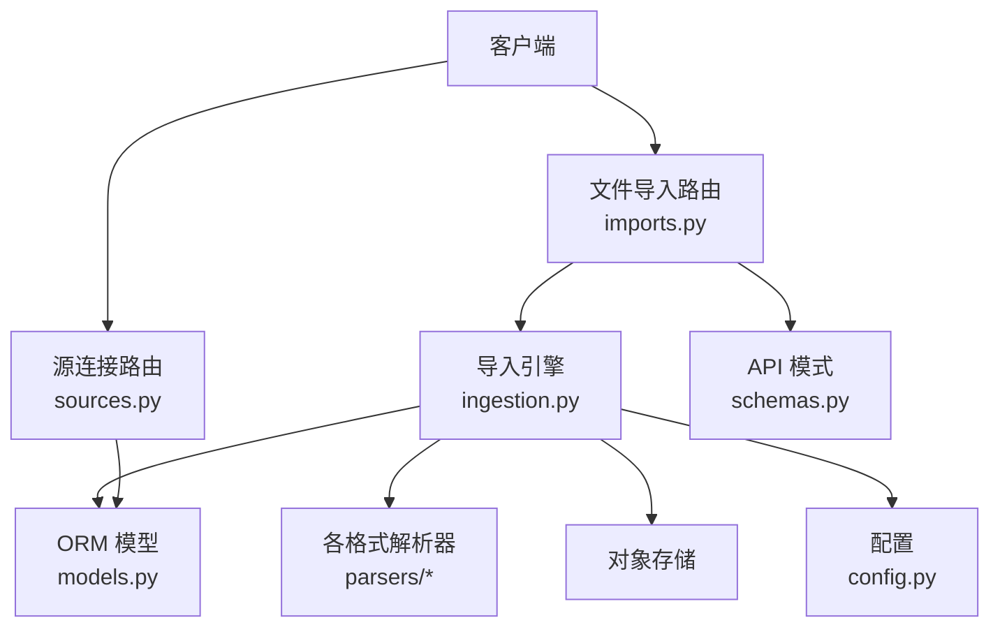
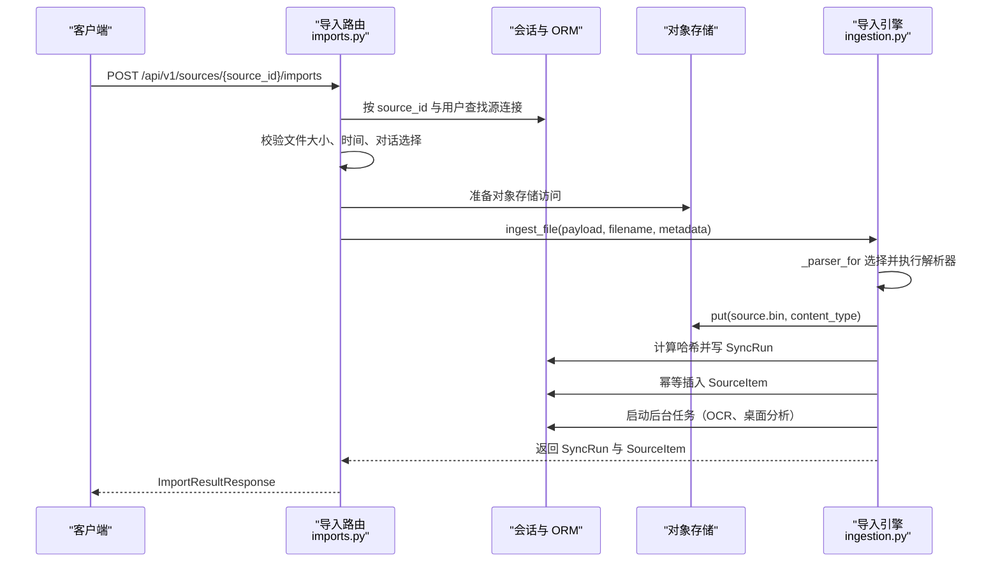
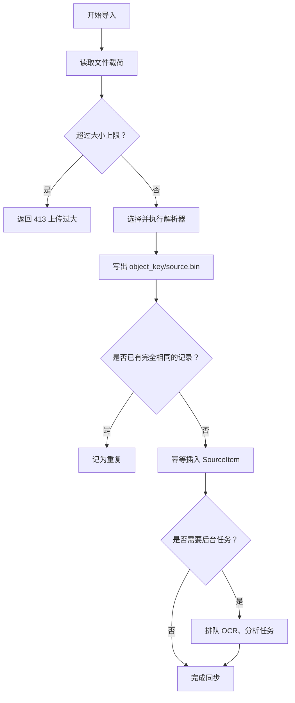
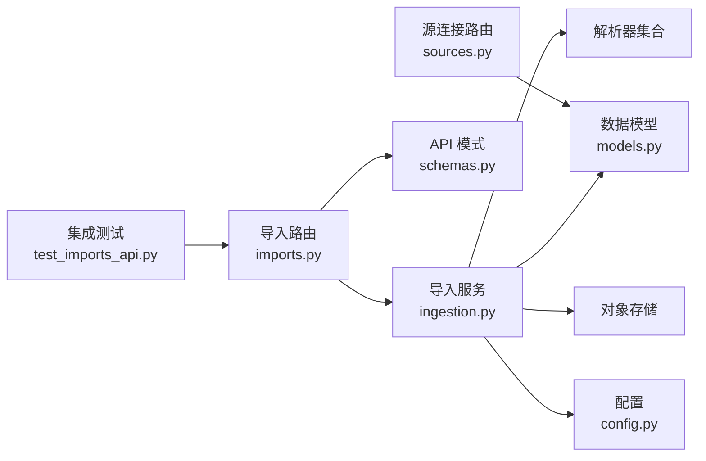

# 源连接与导入 API

<cite>
**本文引用的文件**   
- [sources.py](file://src/personal_ai_life_os/api/routes/sources.py)
- [imports.py](file://src/personal_ai_life_os/api/routes/imports.py)
- [schemas.py](file://src/personal_ai_life_os/api/schemas.py)
- [models.py](file://src/personal_ai_life_os/models.py)
- [ingestion.py](file://src/personal_ai_life_os/services/ingestion.py)
- [config.py](file://src/personal_ai_life_os/config.py)
- [test_imports_api.py](file://tests/test_imports_api.py)
- [README.md](file://README.md)
</cite>

## 目录
1. [简介](#简介)
2. [项目结构](#项目结构)
3. [核心组件](#核心组件)
4. [架构总览](#架构总览)
5. [详细组件分析](#详细组件分析)
6. [依赖关系分析](#依赖关系分析)
7. [性能与容量特性](#性能与容量特性)
8. [故障排查指南](#故障排查指南)
9. [结论](#结论)
10. [附录：API 参考](#附录api-reference)

## 简介

本文件系统梳理 **源连接管理** 与 **文件导入 API**，重点覆盖以下内容：

- **SourceConnection 全生命周期**：创建、列出、查询、切换活跃或暂停状态、修改数据选择范围、云端抽取授权同意、撤销、删除。
- **文件导入流程**：使用 `multipart/form-data` 上传，按来源类型选择解析器，生成结构化 Source Item，可选触发 OCR、桌面分析等异步任务。
- **支持的文件类型**：Markdown 记忆文件、文档（含文本型 PDF 与 DOCX）、ChatGPT 导出、通用聊天导出、iCal 日历快照、照片 JPEG/PNG/WebP。
- **大小限制与安全机制**：按来源区分最大文本和照片字节限制；按所有者隔离读写、下载与删除；重复内容通过 SHA-256 去重。
- **质量、隐私与合规**：日历版本对账、增量更新、取消事件清理、外部模型披露、云端抽取 consent、删除待办事务记录。
- **进度与任务跟踪**：同步运行 `SyncRun` 统计已见、新建、更新、重复、移除、跳过、失败条目；后续 OCR 和分析通过后台任务进行。

该设计既适合前端直接调用，也适合后端服务以受限本地预览+确认的方式调用。

**章节来源**
- [README.md:1-60](file://README.md#L1-L60)
- [README.md:100-118](file://README.md#L100-L118)

## 项目结构

源连接和导入相关代码分布在 FastAPI 路由层、Pydantic 模式层、数据模型层以及导入引擎中：

| 层级 | 主要职责 | 对应文件 |
|---|---|---|
| API 路由层 | HTTP 端点、参数校验、权限校验、HTTP 响应映射 | [sources.py](file://src/personal_ai_life_os/api/routes/sources.py)、[imports.py](file://src/personal_ai_life_os/api/routes/imports.py) |
| API 模式层 | Source、SyncRun、ImportResult 等请求/响应类型定义 | [schemas.py](file://src/personal_ai_life_os/api/schemas.py) |
| 数据模型层 | 源连接、同步运行、源条目、任务等数据库 ORM 模型 | [models.py](file://src/personal_ai_life_os/models.py) |
| 导入服务层 | 文件边界检查、解析器选择、存储写入、幂等插入、日历对账、后台任务调度 | [ingestion.py](file://src/personal_ai_life_os/services/ingestion.py) |
| 配置层 | 文件大小限制、导入开关、处理模式、对象存储与外部模型设置 | [config.py](file://src/personal_ai_life_os/config.py) |
| 测试层 | 认证隔离、导入幂等性、并发重复、暂停控制、资源删除行为验证 | [test_imports_api.py](file://tests/test_imports_api.py) |

**图表来源**
- [sources.py:1-394](file://src/personal_ai_life_os/api/routes/sources.py#L1-L394)
- [imports.py:1-134](file://src/personal_ai_life_os/api/routes/imports.py#L1-L134)
- [ingestion.py:1-589](file://src/personal_ai_life_os/services/ingestion.py#L1-L589)
- [models.py:1-200](file://src/personal_ai_life_os/models.py#L1-L200)
- [schemas.py:1-200](file://src/personal_ai_life_os/api/schemas.py#L1-L200)
- [config.py:1-132](file://src/personal_ai_life_os/config.py#L1-L132)

**章节来源**
- [sources.py:1-394](file://src/personal_ai_life_os/api/routes/sources.py#L1-L394)
- [imports.py:1-134](file://src/personal_ai_life_os/api/routes/imports.py#L1-L134)
- [schemas.py:1-200](file://src/personal_ai_life_os/api/schemas.py#L1-L200)
- [models.py:1-200](file://src/personal_ai_life_os/models.py#L1-L200)
- [ingestion.py:1-589](file://src/personal_ai_life_os/services/ingestion.py#L1-L589)
- [config.py:1-132](file://src/personal_ai_life_os/config.py#L1-L132)

## 核心组件

### SourceConnection（源连接）

`SourceConnection` 代表一个用户拥有的数据来源。它包含来源类型、名称、状态、同意版本、选中的数据范围及时间戳。

| 字段 | 含义 |
|---|---|
| `id` | 源连接的内部标识符 |
| `owner_id` | 所属用户，用于租户级隔离 |
| `kind` | 来源类型，例如 Markdown、ChatGPT 导出、通用聊天导出、文档、照片、iCal 日历 |
| `name` | 用户对源连接的可读名称 |
| `status` | 当前生命周期状态：活跃、暂停、已撤销、正在删除等 |
| `selected_scope` | 选择范围，例如 ChatGPT 导出的对话 ID 列表 |
| `consent_version` | 本次导入的源码同意版本 |
| `cloud_consent_at` / `cloud_consent_version` | 是否允许将内容进行图谱抽取等云端处理的时间戳与版本号 |
| `created_at` / `updated_at` / `last_sync_at` | 创建、更新时间与最近成功同步时间 |

当前实现明确禁止直接操作内部来源，例如快速笔记。

**章节来源**
- [models.py:117-164](file://src/personal_ai_life_os/models.py#L117-L164)
- [sources.py:1-70](file://src/personal_ai_life_os/api/routes/sources.py#L1-L70)

### SyncRun（同步运行）

每次导入都创建一条 `SyncRun`，用于记录一批文件的解析与持久化结果。

| 指标字段 | 说明 |
|---|---|
| `items_seen` | 解析得到的条目数量 |
| `items_created` | 新创建的条目数量 |
| `items_updated` | 因内容变化而更新的旧条目数 |
| `items_duplicate` | 因键值完全相同被识别为重复的条目数 |
| `items_removed` | 因日历对账逻辑被标记移除的事件条目数 |
| `items_skipped` | 因不支持规则、版本落后等原因跳过的条目数 |
| `items_failed` | 整体导入失败计数 |
| `error_code` | 失败原因码 |

`SyncRunResponse` 暴露给 API，便于前端追踪导入批次。

**章节来源**
- [models.py:166-195](file://src/personal_ai_life_os/models.py#L166-L195)
- [schemas.py:100-116](file://src/personal_ai_life_os/api/schemas.py#L100-L116)

### ImportResultResponse（导入结果）

文件导入成功时返回三类信息：

| 字段 | 含义 |
|---|---|
| `sync_run` | 本次导入批次的统计和状态 |
| `items` | 本次持久化的结构化条目列表 |
| `job_ids` | 后续可能触发的后台任务 ID，例如照片 OCR 或桌面分析 |

**章节来源**
- [schemas.py:118-129](file://src/personal_ai_life_os/api/schemas.py#L118-L129)
- [imports.py:54-134](file://src/personal_ai_life_os/api/routes/imports.py#L54-L134)

### IngestionFailure（导入失败）

导入引擎抛出的专用异常携带 `code`、`message` 和 `status_code`，使 HTTP 错误具象化。常见原因包括编码错误、不支持的文档、未选择对话、超出允许范围、文件过大等。

**章节来源**
- [ingestion.py:74-79](file://src/personal_ai_life_os/services/ingestion.py#L74-L79)

## 架构总览

下面的序列图描述一次典型的文件导入调用，从上传到解析、存储、持久化和后台任务发起。

**图表来源**
- [imports.py:20-134](file://src/personal_ai_life_os/api/routes/imports.py#L20-L134)
- [ingestion.py:287-589](file://src/personal_ai_life_os/services/ingestion.py#L287-L589)

## 详细组件分析

### 源连接 CRUD 与生命周期

#### 创建源连接

端点：`POST /api/v1/sources`

关键行为：
- 创建 `SourceConnection`，初始状态为 `active`。
- 记录 `owner_id`、`kind`、`name`、`consent_version`、`selected_scope`。
- `kind` 使用预定义枚举类型校验：`memory_markdown`、`chatgpt_export`、`chat_export`、`document`、`photo`、`calendar_ics`。
- 如果 `kind` 是 `chatgpt_export`，则 `selected_scope.conversation_ids` 必须存在且为非空字符串列表，长度上限 1000。

响应：返回完整源连接信息。

调用示例说明：
- 创建记忆 Markdown 源时可带上 `selected_scope.filename`。
- 创建 ChatGPT 导出源时必须先在前端或预览阶段筛选出有效对话 ID。

**章节来源**
- [schemas.py:54-90](file://src/personal_ai_life_os/api/schemas.py#L54-L90)
- [sources.py:57-70](file://src/personal_ai_life_os/api/routes/sources.py#L57-L70)

#### 列出源连接

端点：`GET /api/v1/sources`

行为：
- 仅返回当前用户的源连接。
- 排除内部来源 `quick_note`。
- 过滤掉状态为 `deleting` 的源。
- 按创建时间倒序后按 ID 排序，使最近创建的源靠前。

**章节来源**
- [sources.py:73-86](file://src/personal_ai_life_os/api/routes/sources.py#L73-L86)

#### 查询单个源连接

端点：`GET /api/v1/sources/{source_id}`

行为：
- 使用所有者 ID 和 ID 精确匹配。
- 找不到或处于 `deleting` 状态时返回 404。

内部辅助方法会将普通不存在的错误包装为统一错误结构，包含 code 和 message。

**章节来源**
- [sources.py:14-37](file://src/personal_ai_life_os/api/routes/sources.py#L14-L37)
- [sources.py:89-101](file://src/personal_ai_life_os/api/routes/sources.py#L89-L101)

#### 切换源状态

端点：`PATCH /api/v1/sources/{source_id}/status`

允许的状态：
- `active`：激活导入。
- `paused`：暂停，不再接受新的导入。

约束：
- 不能直接编辑内部来源。
- 非 `active` 或 `paused` 的源无法恢复，例如 `revoked` 或 `deleting`。
- 设置为 `paused` 时会取消该源下的后台任务，并以 `source_paused` 作为取消原因。

**章节来源**
- [sources.py:104-129](file://src/personal_ai_life_os/api/routes/sources.py#L104-L129)

#### 修改选择范围与同意版本

端点：`PATCH /api/v1/sources/{source_id}/scope`

行为：
- 仅允许 `active` 状态的源修改范围。
- 对 ChatGPT 导出，若存在 `conversation_ids`，会再次校验长度和成员有效性。
- 同时记录 `consent_version`，便于审计不同版本的同意策略。

适用场景：
- 用户在本地预览中选择更多或更少的对话，再保存选择范围。
- 重新显示同意义务文本后，客户端需要提交新的 `consent_version`。

**章节来源**
- [sources.py:132-153](file://src/personal_ai_life_os/api/routes/sources.py#L132-L153)
- [schemas.py:132-149](file://src/personal_ai_life_os/api/schemas.py#L132-L149)

#### 设置云端抽取同意

端点：`PATCH /api/v1/sources/{source_id}/cloud-consent`

作用：
- 启用或关闭该源的云端模型抽取能力。
- 当开启时要求云端抽取同意版本与应用当前配置一致。
- 在桌面环境中，拒绝云端抽取会停止排队中的桌面分析任务。

这与“本地预览 + 选择范围”的隐私策略相辅相成：选择范围和云端抽取是两个独立开关。

**章节来源**
- [sources.py:156-200](file://src/personal_ai_life_os/api/routes/sources.py#L156-L200)

#### 撤销源

端点：`POST /api/v1/sources/{source_id}/revoke`

行为：
- 禁止删除中状态撤销。
- 将源状态设为 `revoked`。
- 标记该源产生的证据不可用。
- 取消相关后台任务。

使用场景：
- 用户主动撤回某个来源的使用授权，未来不应继续使用该来源的数据进行分析。

**章节来源**
- [sources.py:201-220](file://src/personal_ai_life_os/api/routes/sources.py#L201-L220)

#### 删除源连接

端点：`DELETE /api/v1/sources/{source_id}`

行为流程：
1. 检查来源是否存在、不是内部来源且不在删除中。
2. 向对象存储写入删除 tombstone，确保删除可回放和恢复。
3. 标记源为 `deleting`，取消相关任务。
4. 清理由该源衍生出的索引或关联数据。
5. 删除与该源及其同步运行相关的对象存储文件。
6. 完成删除 tombstone。
7. 从数据库中删除源连接。

如果存储层出现异常，会返回可重试的 503，提示清理仍在等待。

**章节来源**
- [sources.py:223-274](file://src/personal_ai_life_os/api/routes/sources.py#L223-L274)

#### 列出同步运行记录

端点：`GET /api/v1/sync-runs`

行为：
- 查询当前用户的所有同步记录。
- 默认最多返回 25 条，最小值为 1，最大值为 100。

用途：
- 前端可据此展示最近导入情况，并在需要时轮询某个 `SyncRun.id` 的状态。

**章节来源**
- [sources.py:277-288](file://src/personal_ai_life_os/api/routes/sources.py#L277-L288)

### 文件导入与批量导入

#### 单文件导入端点

端点：`POST /api/v1/sources/{source_id}/imports`

请求体使用 `multipart/form-data`：

| 参数 | 类型 | 是否必填 | 说明 |
|---|---|---:|---|
| `file` | UploadFile | 是 | 要上传的源文件 |
| `conversation_ids` | JSON 字符串数组 | 否 | 对 ChatGPT 导出的局部选择 |
| `captured_at` | ISO 8601 日期时间 | 否 | 照片或其他来源的捕获时间 |
| `captured_timezone` | IANA 时区名 | 否 | 配合 captured_at 使用的时区 |

前置校验：
- 根据源类型区分大小上限。
- 照片源使用图片上传上限，其他文本类使用文本上传上限。
- 超过大小限返回 413。
- 时间戳必须是带时区的 ISO 8601。
- 自定义时区必须能被系统识别。
- `conversation_ids` 必须是字符串数组。

成功后：
- 返回 `sync_run`、`items`、`job_ids`。
- `job_ids` 可用于查询后续后台任务，比如照片 OCR。

**章节来源**
- [imports.py:20-134](file://src/personal_ai_life_os/api/routes/imports.py#L20-L134)

#### 解析器选择

导入引擎根据 `SourceConnection.kind` 选择合适的解析器：

| 来源类型 | 支持的输入特征 | 解析器 |
|---|---|---|
| `memory_markdown` | `.md` 或 `.markdown`，UTF-8 | Memory Markdown 解析器 |
| `document` | Markdown、TXT、PDF、DOCX | 文档解析器 |
| `chat_export` | `.json` 或 `.jsonl` | 通用聊天导出解析器 |
| `chatgpt_export` | `.json`，需显式选择对话 | ChatGPT 导出解析器 |
| `calendar_ics` | `.ics` | iCal 日历解析器 |
| `photo` | JPEG、PNG、WebP | 照片处理器 |

不支持的类型会抛出 `IngestionFailure`，并映射为明确的错误码。

**章节来源**
- [ingestion.py:82-165](file://src/personal_ai_life_os/services/ingestion.py#L82-L165)

#### 文件大小与编码校验

在路由层读取整个 payload 并与配置的字节上限比较，避免大文件进入解析管线。

随后在导入引擎中对 Markdown 做 UTF-8 BOM 解码；失败时返回 `invalid_encoding`。

**章节来源**
- [imports.py:39-51](file://src/personal_ai_life_os/api/routes/imports.py#L39-L51)
- [ingestion.py:94-112](file://src/personal_ai_life_os/services/ingestion.py#L94-L112)

#### 时间与时区处理

- 对于日历和照片导入，可以使用 `captured_at` 和 `captured_timezone`。
- Markdown 记忆文件中使用“日精度”的 `occurred_at` 时，会以用户时区合并当天午夜为标准化时间。
- ICS 日历条目保留 UID、时区、位置和描述，并通过 sequence 号进行版本控制。

**章节来源**
- [imports.py:53-80](file://src/personal_ai_life_os/api/routes/imports.py#L53-L80)
- [ingestion.py:113-165](file://src/personal_ai_life_os/services/ingestion.py#L113-L165)

#### 批量导入与去重

虽然当前只有一个单文件端点，但该端点天然支持多次调用实现批量导入。

去重机制分为三层：

1. **文件级别**：同一文件在同一对象存储路径下幂等；重复上传会产生相同的 `SyncRun.file_sha256`。
2. **条目级别**：每个条目按 owner、source、external_id 唯一插入；完全重复会记入 `items_duplicate`。
3. **日历级别**：依据 `external_id` 和 `ics_sequence` 更新旧条目，或标记为 `cancelled` 和缺失。

并发上传测试中，并行多次导入仍保证全局新建条目总数正确。

**图表来源**
- [imports.py:20-134](file://src/personal_ai_life_os/api/routes/imports.py#L20-L134)
- [ingestion.py:287-589](file://src/personal_ai_life_os/services/ingestion.py#L287-L589)

**章节来源**
- [ingestion.py:196-200](file://src/personal_ai_life_os/services/ingestion.py#L196-L200)
- [ingestion.py:201-286](file://src/personal_ai_life_os/services/ingestion.py#L201-L286)
- [ingestion.py:287-589](file://src/personal_ai_life_os/services/ingestion.py#L287-L589)
- [test_imports_api.py:121-146](file://tests/test_imports_api.py#L121-L146)

### 高级功能：质量控制、重复检测、隐私处理

#### 日历版本对账

ICS 导入被视为一个完整快照：
- 新增事件创建新条目。
- 已有事件因 content_digest 不变时被标记为重复。
- 更高 sequence 的版本替换旧事件，并记作更新。
- 取消事件或缺失事件会被标记删除或跳过。
- 不支持的重试规则（recurrence）会跳过但保留时间线可见性。

这是“导入质量控制”的典型实现：不把每一次上传视为简单追加，而是视作有版本语义的同步。

**章节来源**
- [ingestion.py:201-286](file://src/personal_ai_life_os/services/ingestion.py#L201-L286)

#### 重复检测与幂等写入

除日历分支外，其他类型使用 `external_id`、`source_sha256` 与 `is_current` 维护稳定主版本。

插入语句针对 PostgreSQL 和 SQLite 分别使用不同方言的去重语法；不支持的方言会立即报错，避免数据不一致。

**章节来源**
- [ingestion.py:196-200](file://src/personal_ai_life_os/services/ingestion.py#L196-L200)
- [ingestion.py:433-489](file://src/personal_ai_life_os/services/ingestion.py#L433-L489)

#### 隐私和敏感数据处理

- 用户上传的照片会在处理后写入对象存储，内容类型从元数据中提取。
- 可在 worker 模式下推迟 OCR，避免同步阻塞。
- 支持可选的外部模型审查或照片描述，但需要额外 consent 和配置。
- 云端抽取需在源上显式开启，并使用当前生效的同意版本号。
- 删除时使用删除 journal/tombstone，便于生产环境回放失败。

**章节来源**
- [ingestion.py:356-375](file://src/personal_ai_life_os/services/ingestion.py#L356-L375)
- [ingestion.py:490-555](file://src/personal_ai_life_os/services/ingestion.py#L490-L555)
- [sources.py:156-200](file://src/personal_ai_life_os/api/routes/sources.py#L156-L200)

### 原文件下载与条目录迹

端点：`GET /api/v1/items/{item_id}/raw`

行为：
- 仅返回属于当前用户且未被删除的条目。
- 如果源连接正处于 `deleting` 状态，不允许访问。
- 快速笔记没有单独原始文件，返回特定错误。
- 若对象存储中没有原文件，返回内容不可用。
- 图片和非图片响应的 Content-Disposition 不同，图片可内联显示。
- 添加私有缓存和无嗅探头。

这是证据溯源的重要能力：用户可以查看导入时的原始文件或截图。

**章节来源**
- [sources.py:291-355](file://src/personal_ai_life_os/api/routes/sources.py#L291-L355)

### 异步导入任务与工作流

#### 任务类型

从现有代码看，异步任务包括：

| 任务 | 触发条件 | 作用 |
|---|---|---|
| `photo_ocr` | 导入照片且 OCR 状态为 pending | 执行图像文字识别 |
| `desktop_analysis` | 桌面应用、源启用云端抽取且内容为文本条目 | 触发本地或受控的分析工作流 |
| 取消的任务 | 源暂停、撤销或删除 | 终止后续处理，防止未经授权的数据处理 |

#### 任务状态跟踪

任务 ID 来自 `enqueue_background_job`，当前导入接口返回 `job_ids`。具体任务查询接口应通过 `BackgroundJobResponse` 对应的 API 获取；这些任务的典型状态包含：
- 队列中
- 运行中
- 已完成
- 失败，附带 error_code 和 result_json

对于需要重试的任务，外层可以通过 job_id 轮询最终完成状态；对于短效的导入结果，可通过 `SyncRun.status` 判断同步阶段完成与否。

**章节来源**
- [schemas.py:131-149](file://src/personal_ai_life_os/api/schemas.py#L131-L149)
- [ingestion.py:524-555](file://src/personal_ai_life_os/services/ingestion.py#L524-L555)
- [sources.py:119-129](file://src/personal_ai_life_os/api/routes/sources.py#L119-L129)

## 依赖关系分析

源连接和导入流程中，API 层并不直接解析文件，而是委托服务层处理；这样可以把业务规则、幂等逻辑和存储细节与 HTTP 层解耦。

**图表来源**
- [sources.py:1-394](file://src/personal_ai_life_os/api/routes/sources.py#L1-L394)
- [imports.py:1-134](file://src/personal_ai_life_os/api/routes/imports.py#L1-L134)
- [ingestion.py:1-589](file://src/personal_ai_life_os/services/ingestion.py#L1-L589)
- [schemas.py:1-200](file://src/personal_ai_life_os/api/schemas.py#L1-L200)
- [models.py:1-200](file://src/personal_ai_life_os/models.py#L1-L200)
- [test_imports_api.py:1-236](file://tests/test_imports_api.py#L1-L236)

耦合度方面：
- 路由层与模型层的耦合较直接，主要用于查询、创建、更新和删除。
- 导入路由只关心参数校验和上传边界；复杂逻辑集中在导入服务。
- 导入服务与数据库、对象存储、配置模块解耦良好，适合单元测试。
- 测试覆盖了多租户隔离、幂等性、并发安全、暂停/撤销/删除语义。

## 性能与容量特性

| 特性 | 默认行为或实现 |
|---|---|
| 最大文本上传大小 | `max_text_upload_bytes`，默认约 5 MB |
| 最大图片上传大小 | `max_photo_upload_bytes`，默认约 20 MB |
| 导入开关 | `imports_enabled` 控制是否允许导入；关闭时返回 503 |
| 处理模式 | `inline` 同步处理；`worker` 可把 OCR 等工作移走 |
| 并发导入 | 数据库幂等插入保证重复条目不会重复创建 |
| 大型聊天记录 | 需要先在前端或预览界面筛选 `conversation_ids` |
| 对象存储 | 开发默认为本地；生产要求 S3 兼容存储 |

### 导入速率与保护

当导入功能被关闭或受到速率限制影响时，测试会验证：
- 导入失败响应使用 503。
- 原始条目仍可正常读取。
- 指标接口能采样该错误。
- 恢复后导入可以继续使用。

### 注意事项

- 长导入过程应放在 worker 模式。
- 大图片或大图 OCR 应延迟处理。
- ChatGPT 导出应先在本地预览中选出对话，避免上传全部聊天记录。
- ICS 是对整份日历快照进行版本对齐，不适合作为频繁增量日志。

**章节来源**
- [config.py:12-47](file://src/personal_ai_life_os/config.py#L12-L47)
- [test_imports_api.py:31-73](file://tests/test_imports_api.py#L31-L73)
- [imports.py:39-51](file://src/personal_ai_life_os/api/routes/imports.py#L39-L51)
- [ingestion.py:524-555](file://src/personal_ai_life_os/services/ingestion.py#L524-L555)

## 故障排查指南

### 常见错误码与原因

| 场景 | HTTP 状态码 | 可能原因 | 处理方式 |
|---|---:|---|---|
| 上传文件过大 | 413 | 超过当前源类型的字节上限 | 压缩图片、缩小聊天记录选择范围或调大配置 |
| 捕获时间无效 | 422 | 非 ISO 8601 或缺少时区偏移 | 发送带时区的标准时间戳 |
| 时区名称无效 | 422 | IANA 时区不存在 | 使用系统支持的时区名称 |
| 对话选择格式错误 | 422 | `conversation_ids` 不是字符串数组 | 在前端序列化并验证 |
| 源不存在 | 404 | source_id 错误或无访问权限 | 使用正确的用户 token 和目标源 |
| 源不可恢复 | 409 | 已撤销、已删除或内部来源受限 | 改为创建新源或恢复前先重建选择 |
| 源未激活 | 409 | 暂停或撤销后再导入 | 先切换到 `active` 并重新选择 |
| 文件类型不匹配 | 422 或 409 | Markdown 不是 .md、JSON 不是 chat export、ICS 不是 .ics | 严格按来源类型上传 |
| 原始内容不可用 | 410 | 对象存储中已被清理 | 重新导入原文件或恢复备份 |
| 删除存储清理失败 | 503 | 删除 tombstone 或对象存储失败 | 稍后重试删除操作 |

**章节来源**
- [imports.py:39-114](file://src/personal_ai_life_os/api/routes/imports.py#L39-L114)
- [ingestion.py:82-165](file://src/personal_ai_life_os/services/ingestion.py#L82-L165)
- [sources.py:104-274](file://src/personal_ai_life_os/api/routes/sources.py#L104-L274)
- [sources.py:291-394](file://src/personal_ai_life_os/api/routes/sources.py#L291-L394)

### 调试步骤建议

1. **确认源存在且属于当前用户**。
2. **检查源状态**，如果不是 `active`，先切换回活跃。
3. **确认文件扩展名和内容类型与来源类型匹配**。
4. **确认文件大小**不超过配置上限。
5. **检查聊天导出是否选择了有效的对话 ID**。
6. **查看返回的 `sync_run.error_code`**，定位解析或入库问题。
7. **查看 `items` 中的 source_locator 和 metadata**，确认条目是否真正创建。
8. 如果需要原始数据，使用 `/api/v1/items/{item_id}/raw` 获取。
9. 对于照片，检查是否有 OCR 相关 job_id，并轮询后台任务状态。
10. 删除前应先暂停或撤销源，避免清理过程中仍有后台任务写入。

## 结论

这套源连接与导入 API 的核心价值在于：

- 以明确的源类型为入口，把 ChatGPT、Claude/Gemini 导出、iCal、文档和照片统一进同一个可追溯流水线。
- 通过本地选择范围、文件大小上限、哈希去重、源状态控制，减少未经授权的敏感数据暴露。
- 以 `SyncRun` 和后台任务拆分“短期导入结果”与“长期处理结果”，让前端能够区分导入成功和处理中。
- 在日历、照片、聊天导出等不同格式上，实现面向数据的幂等性而非简单的增删改查。

对于集成方来说，推荐的工作流程是：**本地预览 → 选择范围 → 创建或更新源 → 分块上传 → 查询同步运行 → 轮询后台任务**。这样可以兼顾数据安全、用户体验和数据质量。

## 附录：API 参考

本节列出与源连接和导入直接相关的主要端点，并提供调用说明。为避免复制实现细节，所有参数说明均基于源码结构与测试用例归纳。

### 源连接管理

| 方法 | 路径 | 权限 | 请求体 | 响应或状态码 | 说明 |
|---|---|---|---|---|---|
| `POST` | `/api/v1/sources` | 已登录用户 | `kind`、`name`、`selected_scope`、`consent_version` | 201 返回 `SourceResponse` | 创建新源连接 |
| `GET` | `/api/v1/sources` | 已登录用户 | 无 | 200 返回 `list[SourceResponse]` | 列出当前用户的可用源 |
| `GET` | `/api/v1/sources/{source_id}` | 拥有者 | 无 | 200 返回 `SourceResponse` | 查询源详情 |
| `PATCH` | `/api/v1/sources/{source_id}/status` | 拥有者 | `status`=`active` 或 `paused` | 200 返回 `SourceResponse` | 切换激活或暂停 |
| `PATCH` | `/api/v1/sources/{source_id}/scope` | 拥有者 | `selected_scope`、`consent_version` | 200 返回 `SourceResponse` | 更新本地选择范围 |
| `PATCH` | `/api/v1/sources/{source_id}/cloud-consent` | 拥有者 | `enabled`、`consent_version` | 200 返回 `SourceResponse` | 启用或禁用云端抽取 |
| `POST` | `/api/v1/sources/{source_id}/revoke` | 拥有者 | 无 | 200 返回 `SourceResponse` | 撤销来源授权 |
| `DELETE` | `/api/v1/sources/{source_id}` | 拥有者 | 无 | 204 或 503 | 删除源及其原始文件 |
| `GET` | `/api/v1/sync-runs` | 拥有者 | limit=1..100 | 200 返回 `list[SyncRunResponse]` | 查看最近导入记录 |

### 文件导入与原文件访问

| 方法 | 路径 | 权限 | 表单字段 | 响应或状态码 | 说明 |
|---|---|---|---|---|---|
| `POST` | `/api/v1/sources/{source_id}/imports` | 拥有者 | `file`、可选 `conversation_ids`、`captured_at`、`captured_timezone` | 201 返回 `ImportResultResponse` | 上传并解析源文件 |
| `GET` | `/api/v1/items/{item_id}/raw` | 拥有者 | 无 | 200 文件流或 410/404 | 下载原始源文件 |
| `DELETE` | `/api/v1/items/{item_id}` | 拥有者 | 无 | 204 或 410/404/503 | 删除条目；通常连带删除其原始文件 |

### 调用示例说明

#### 创建 Markdown 记忆源

1. 注册并登录获取令牌。
2. 调用 `POST /api/v1/sources`，body 中指定 `kind: memory_markdown`，`selected_scope` 中包含 `filename`。
3. 使用返回的 `source_id` 上传 .md 文件。
4. 使用返回的 `sync_run.items_created` 判断是否产生新条目。

#### 上传 ChatGPT 导出

1. 在前端使用 ChatGPT 导出的 JSON 构建本地预览。
2. 在预览界面选择 1 到 1000 个对话 ID。
3. 调用 `PATCH /api/v1/sources/{source_id}/scope` 保存选择范围。
4. 上传同一 ChatGPT 导出 JSON，并同时传入 `conversation_ids`。
5. 服务端会校验所选对话是否为子集，并仅解析选择的对话。

#### 上传 iCal 日历

1. 创建一个 `calendar_ics` 类型的源。
2. 上传 `.ics` 文件。
3. 服务端会根据 UID、sequence、status 对历史事件进行更新或移除。
4. 可通过同步运行记录查看 `items_created`、`items_updated`、`items_removed`、`items_skipped`。

#### 上传照片

1. 使用 `photo` 类型源。
2. 上传 JPEG、PNG 或 WebP。
3. 如需时间戳，可同时传递 `captured_at` 和 `captured_timezone`。
4. 如果 OCR 被延迟，检查返回的 `job_ids`，轮询后台任务完成状态。

#### 进度查询与失败重试

- 短时间查看：直接使用导入响应中的 `sync_run`。
- 长时间查看：根据返回的 `job_ids` 查询后台任务。
- 失败重试：如果是源状态或文件过大，先修正错误再重试；如果是 503 的删除或清理错误，按错误提示稍后重试。

### 支持的格式总览

| 类别 | 支持格式 | 重要限制 |
|---|---|---|
| 记忆文件 | `.md`、`.markdown` | 必须是 UTF-8 |
| 文档 | 文本型 PDF、DOCX、TXT、Markdown | 扫描型 PDF 尚未支持全文提取 |
| 聊天导出 | JSON、JSONL | ChatGPT 导出必须是 `.json` 且已选择对话 |
| 日历 | `.ics` | 不支持的重试规则会被跳过 |
| 照片 | JPEG、PNG、WebP | 支持 OCR；可异步处理 |
| 聊天模型导出 | Claude、Gemini、ZCode、DeepSeek harness、WorkBuddy | 通过通用聊天解析器与文档解析器间接支持 |

**章节来源**
- [sources.py:1-394](file://src/personal_ai_life_os/api/routes/sources.py#L1-L394)
- [imports.py:1-134](file://src/personal_ai_life_os/api/routes/imports.py#L1-L134)
- [schemas.py:54-149](file://src/personal_ai_life_os/api/schemas.py#L54-L149)
- [ingestion.py:82-165](file://src/personal_ai_life_os/services/ingestion.py#L82-L165)
- [README.md:31-86](file://README.md#L31-L86)
- [test_imports_api.py:1-236](file://tests/test_imports_api.py#L1-L236)