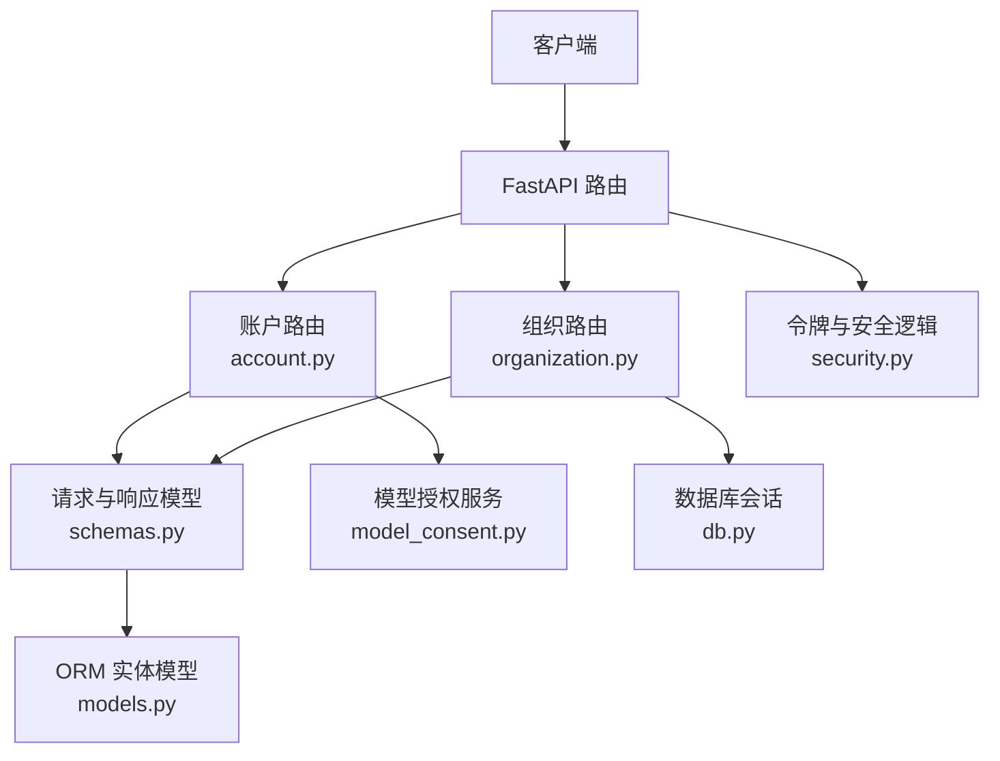
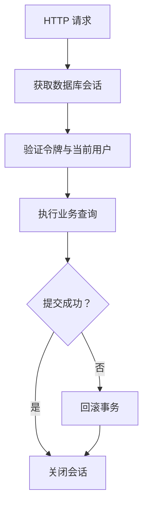
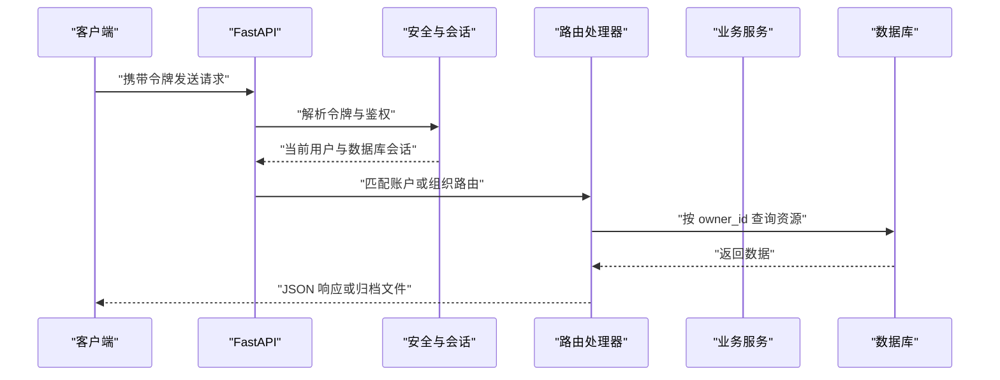
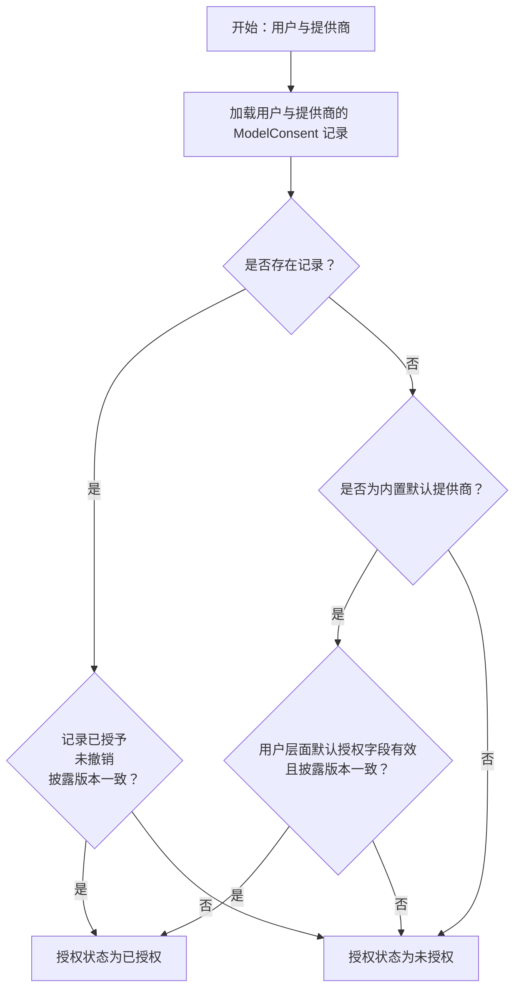
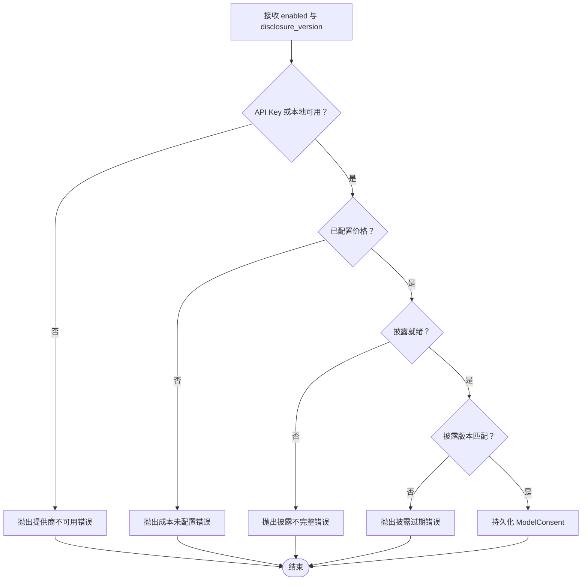
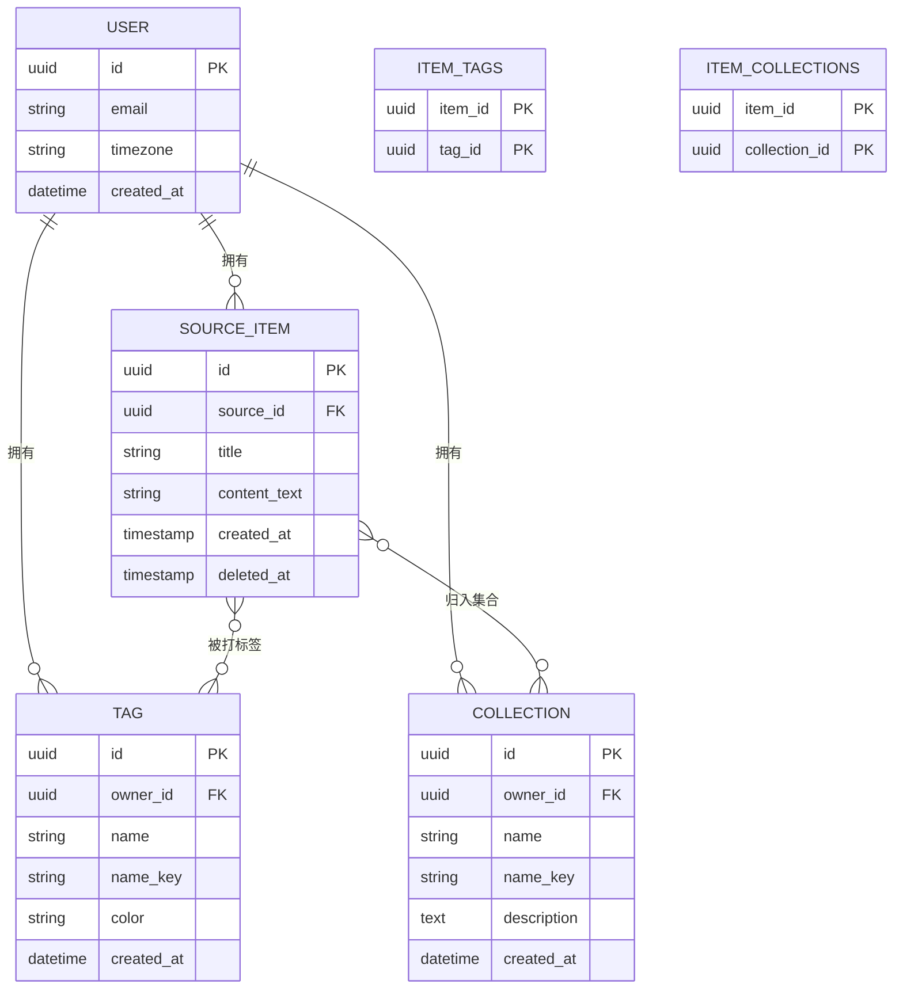
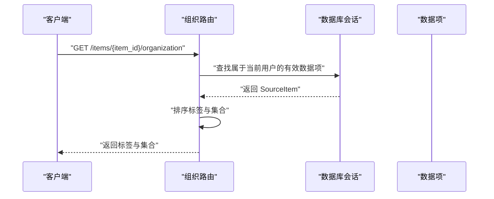
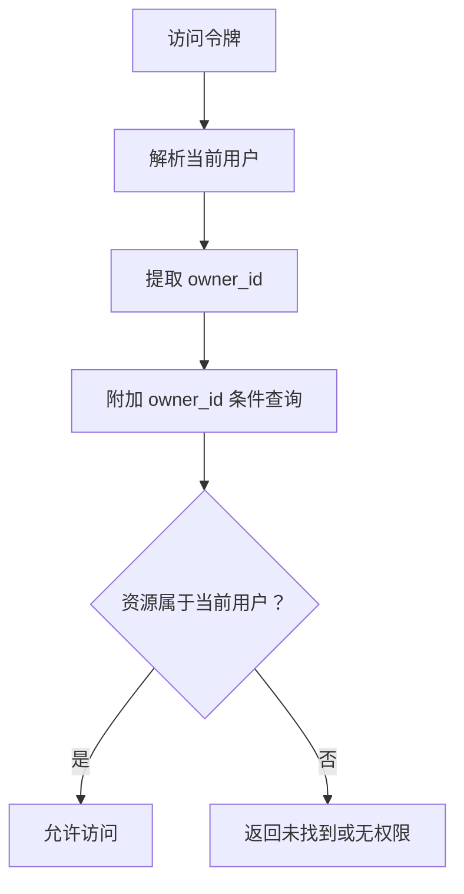
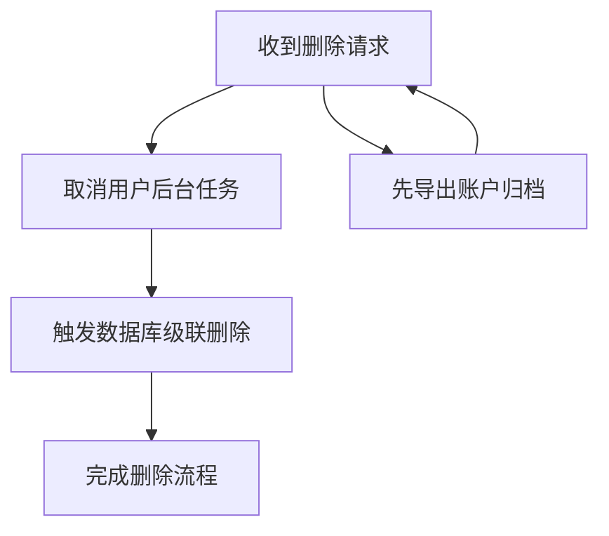
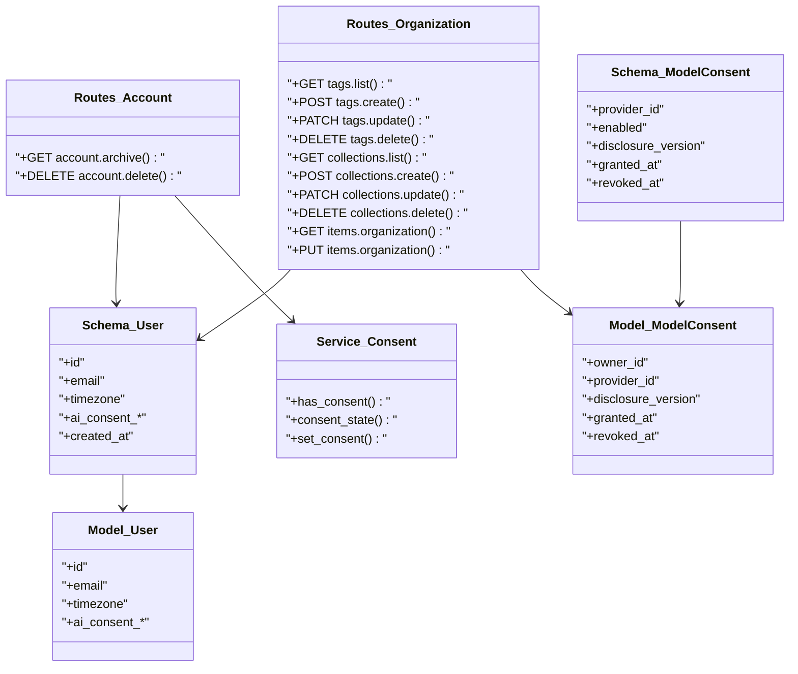

# 用户与组织管理 API

<cite>
**本文引用的文件**
- [account.py](file://src/personal_ai_life_os/api/routes/account.py)
- [organization.py](file://src/personal_ai_life_os/api/routes/organization.py)
- [schemas.py](file://src/personal_ai_life_os/api/schemas.py)
- [models.py](file://src/personal_ai_life_os/models.py)
- [model_consent.py](file://src/personal_ai_life_os/services/model_consent.py)
- [security.py](file://src/personal_ai_life_os/security.py)
- [db.py](file://src/personal_ai_life_os/db.py)
- [f9a1c4d8e702_add_search_indexes_and_organization.py](file://migrations/versions/f9a1c4d8e702_add_search_indexes_and_organization.py)
- [test_reviews_account.py](file://tests/test_reviews_account.py)
- [test_search_organization.py](file://tests/test_search_organization.py)
</cite>

## 目录

1. [引言](#引言)
2. [项目结构与入口](#项目结构与入口)
3. [核心组件](#核心组件)
4. [架构总览](#架构总览)
5. [账户接口规范](#账户接口规范)
6. [模型授权与偏好](#模型授权与偏好)
7. [组织实体与管理接口](#组织实体与管理接口)
8. [租户隔离与数据权限](#租户隔离与数据权限)
9. [账户删除与级联清理策略](#账户删除与级联清理策略)
10. [依赖分析与错误处理](#依赖分析与错误处理)
11. [性能与最佳实践](#性能与最佳实践)
12. [故障排查指南](#故障排查指南)
13. [结论](#结论)

## 引言

本文件说明本项目中与**用户账户**和**组织相关数据**相关的后端 API、数据模型以及权限隔离机制。文档重点包括：

- 当前用户信息的读取方式与响应结构，尤其是 `UserResponse`、时区、AI 授权状态等字段。
- **模型授权**（`ModelConsent`）的语义、校验规则与禁用/启用流程。
- 系统中“组织”概念的实际实现：以 `owner_id` 表示的**用户级租户隔离**，以及标签、集合、收藏搜索等资源的归属关系。
- 标签、集合与数据项组织的增删改查接口。
- 账户导出与账户删除时的数据清理范围及约束。
- 典型请求/响应示例描述、错误状态码与部署/集成建议。

需要特别注意：**代码中并未暴露 `/api/v1/account` 上的 GET 或 PUT 路径**。当前版本的主要账户操作是：

| 路径 | 方法 | 用途 |
|---|---:|---|
| `/api/v1/account/archive` | GET | 下载用户完整数据归档，包含元信息、源数据、组织标签、集合、模型授权、模型使用记录、图实体、后台任务等。 |
| `/api/v1/account` | DELETE | 发起可重试的用户删除流程，并通过依赖注入支持取消该用户的后台任务。 |

若调用方希望获取当前用户信息，应使用身份验证相关接口返回的令牌，再结合业务侧缓存；目前没有单独的 `/api/v1/account` 查询接口，也没有独立的头像上传或独立偏好设置接口。

**章节来源**
- [account.py:1-57](file://src/personal_ai_life_os/api/routes/account.py#L1-L57)
- [account.py:595-653](file://src/personal_ai_life_os/api/routes/account.py#L595-L653)

## 项目结构与入口

用户与组织管理的代码主要分布在以下模块：

| 模块 | 职责 |
|---|---|
| `api/routes/account.py` | 账户导出、账户删除、资源范围扫描等账户级操作。 |
| `api/routes/organization.py` | 标签、集合与数据项的组织信息管理，体现系统“按所有者隔离”的组织能力。 |
| `api/schemas.py` | HTTP 层使用的 Pydantic 请求与响应模型，包括用户、来源、同步运行、标签、集合、模型授权等结构。 |
| `models.py` | 基于 SQLAlchemy 的 ORM 模型定义，所有业务表均通过 `owner_id` 进行用户级划分。 |
| `services/model_consent.py` | 面向外部模型服务商的同意记录判断、状态查询与变更记录。 |
| `security.py` | 密码哈希、访问令牌生成与解码。 |
| `db.py` | 数据库引擎、UTC 时间装饰器与请求级会话生命周期。 |
| `migrations/...organization.py` | 标签、集合、收藏搜索、数据项关联表的数据库迁移定义。 |
| 测试用例 | 验证按用户隔离、模型授权检查、标签集合访问控制等行为。 |

**图表来源**
- [account.py:1-57](file://src/personal_ai_life_os/api/routes/account.py#L1-L57)
- [organization.py:1-42](file://src/personal_ai_life_os/api/routes/organization.py#L1-L42)
- [schemas.py:44-59](file://src/personal_ai_life_os/api/schemas.py#L44-L59)
- [models.py:86-122](file://src/personal_ai_life_os/models.py#L86-L122)
- [model_consent.py:1-47](file://src/personal_ai_life_os/services/model_consent.py#L1-L47)
- [security.py:1-24](file://src/personal_ai_life_os/security.py#L1-L24)
- [db.py:12-75](file://src/personal_ai_life_os/db.py#L12-L75)

**章节来源**
- [account.py:1-57](file://src/personal_ai_life_os/api/routes/account.py#L1-L57)
- [organization.py:1-42](file://src/personal_ai_life_os/api/routes/organization.py#L1-L42)
- [schemas.py:1-59](file://src/personal_ai_life_os/api/schemas.py#L1-L59)
- [db.py:12-75](file://src/personal_ai_life_os/db.py#L12-L75)

## 核心组件

### 用户模型与基本信息

用户核心字段包括：

| 字段 | 类型 / 含义 | 行为 |
|---|---|---|
| `id` | UUID | 主键，默认自动生成。 |
| `email` | 最大 320 字符 | 唯一且索引。 |
| `password_hash` | 字符串 | 安全密码哈希值。 |
| `timezone` | 最大 64 字符 | 默认 UTC。 |
| `ai_consent_at` | 可选时间戳 | 内置默认模型授权同意的授予时间。 |
| `ai_consent_provider` | 可选字符串 | 默认保留为内部实现标识。 |
| `ai_consent_disclosure_version` | 可选字符串 | 默认披露版本。 |
| `deletion_requested_at` | 可选时间戳 | 标记删除请求时间。 |
| `created_at` | UTC 时间 | 创建时间。 |

用户与其他资源的关系采用 `user.id` 作为拥有者键，并通过外键和级联规则保证数据一致性。

**章节来源**
- [models.py:86-112](file://src/personal_ai_life_os/models.py#L86-L112)

### API 用户响应模型

HTTP 层中的 `UserResponse` 表示当前用户信息快照：

| 字段 | 含义 |
|---|---|
| `id` | 用户 ID。 |
| `email` | 邮箱地址。 |
| `timezone` | 用户时区。 |
| `ai_consent_at` | 默认 AI 授权授予时间，可为空。 |
| `ai_consent_provider` | 默认 AI 授权提供商字段。 |
| `ai_consent_disclosure_version` | 默认 AI 披露版本。 |
| `created_at` | 账户创建时间。 |

该模型通过 Pydantic 的 `from_attributes=True` 直接从 ORM 对象映射，不额外转换业务数据。

**章节来源**
- [schemas.py:44-53](file://src/personal_ai_life_os/api/schemas.py#L44-L53)

### 模型授权模型

`ModelConsent` 是每个用户对特定模型提供商的同意义务记录：

| 字段 | 含义 |
|---|---|
| `id` | 主键。 |
| `owner_id` | 所属用户。 |
| `provider_id` | 模型服务提供商 ID。 |
| `disclosure_version` | 隐私披露版本。 |
| `granted_at` | 授权授予时间。 |
| `revoked_at` | 撤销时间。 |

关键约束：

- `(owner_id, provider_id)` 有唯一索引。
- 存在复合索引 `(owner_id, provider_id)` 提高按用户和提供商查询性能。
- 外键到 `users.id` 并使用 `ondelete=“CASCADE”`。

**章节来源**
- [models.py:112-122](file://src/personal_ai_life_os/models.py#L112-L122)

### 会话与数据库

会话在请求生命周期内管理，并启用 SQLite 外键约束与 WAL 模式。这保证了组织关系表和账户级联删除在执行层面的正确性。

**图表来源**
- [db.py:44-75](file://src/personal_ai_life_os/db.py#L44-L75)
- [security.py:34-54](file://src/personal_ai_life_os/security.py#L34-L54)

**章节来源**
- [db.py:12-75](file://src/personal_ai_life_os/db.py#L12-L75)
- [security.py:34-54](file://src/personal_ai_life_os/security.py#L34-L54)

## 架构总览

[此图为概念流程图，不直接绑定具体源码文件]

## 账户接口规范

### GET `/api/v1/account/archive`

| 项目 | 说明 |
|---|---|
| 方法 | GET |
| 认证要求 | 需要有效访问令牌。 |
| 返回类型 | `application/zip` 压缩包。 |
| 主要用途 | 导出当前用户的账户数据、来源同步记录、数据项、标签、集合、搜索历史、模型授权、模型使用情况、图实体、插件审计与原始对象引用。 |

压缩包中包含的重要清单：

| 文件 | 内容 |
|---|---|
| `account.json` | 邮箱、时区、创建时间。 |
| `sources.json` | 来源连接基本状态。 |
| `sync-runs.json` | 同步运行统计和错误状态。 |
| `timeline.json` | 时间线数据项。 |
| `tags.json` | 用户标签。 |
| `collections.json` | 用户集合。 |
| `item-organization.json` | 每个数据项对应的标签与集合关系。 |
| `saved-searches.json` | 保存的搜索条件。 |
| `reviews.json` 与 `review-versions.json` | 审查摘要及其版本历史。 |
| `model-consents.json` | 用户模型提供商授权记录。 |
| `reminders.json` | 提醒事项。 |
| `model-usage.json` | 模型运行成本与用量统计。 |
| `background-jobs.json` | 后台任务运行结果。 |
| `graph-*.json` | 知识图谱实体、关系、证据、别名、合并日志。 |
| `plugin-manifests.json` | 插件清单。 |
| `plugin-audit.json` | 插件审计日志。 |
| `originals/*.bin` | 所选原始对象二进制副本。 |
| `archive-manifest.json` | 缺失对象文件清单。 |
| `README.txt` | 归档使用说明。 |

异常或完整性问题：

- 如果对象存储中没有对应文件，归档会记录缺失对象名称，而不是立即失败。
- 这是“可恢复的归档”，不是强一致导出工具；适合备份、迁移与合规导出。

**章节来源**
- [account.py:1-57](file://src/personal_ai_life_os/api/routes/account.py#L1-L57)
- [account.py:200-588](file://src/personal_ai_life_os/api/routes/account.py#L200-L588)
- [account.py:595-653](file://src/personal_ai_life_os/api/routes/account.py#L595-L653)

### POST/PUT/GET `/api/v1/account`

根据当前路由定义：

- **GET `/api/v1/account` 不存在。**
- **PUT `/api/v1/account` 不存在。**
- **POST `/api/v1/account` 不存在。**
- **DELETE `/api/v1/account` 存在。**

因此，文档中对 GET/PUT `/api/v1/account` 的假设不能直接成立。调用方应在现有接口基础上调整：

| 需求 | 现有可用方案 |
|---|---|
| 查看当前用户信息 | 使用登录或注册接口获取的令牌缓存；如需最新信息，可在前端本地维护。 |
| 修改时区或基本信息 | 当前代码未提供账号信息更新路由。 |
| 上传头像 | 当前代码未提供头像上传路由。 |
| 修改偏好设置 | 当前代码未提供独立偏好设置路由。 |
| 删除账户 | 使用 `DELETE /api/v1/account`。 |

若后续版本新增这些端点，其请求结构应优先复用现有 schema，例如：

| 字段 | 类型 | 建议用途 |
|---|---|---|
| `timezone` | 字符串 | 账户时区。 |
| `display_name` | 字符串 | 扩展用户展示名称。 |
| `avatar_url` | 字符串 | 头像 URL（新增）。 |
| `preferences` | JSON | 偏好配置块（新增）。 |

但上述字段仅用于未来接口设计的占位说明，不代表当前仓库已实现这些账户更新端点。

**章节来源**
- [schemas.py:22-59](file://src/personal_ai_life_os/api/schemas.py#L22-L59)

## 模型授权与偏好

### `ModelConsentRequest` 与 `ModelConsentResponse`

| 字段 | 请求 | 响应 | 含义 |
|---:|---:|---:|---|
| `provider_id` | 必填 | 必填 | 模型服务提供商 ID。 |
| `enabled` | 必填 | — | 是否启用外部模型授权。 |
| `disclosure_version` | 可选 | 可选 | 隐私披露版本。 |
| `disclosure_version` | — | 响应 | 最终记录的披露版本。 |
| `granted_at` | — | 响应 | 授权授予时间。 |
| `revoked_at` | — | 响应 | 授权撤销时间。 |

### 授权判定逻辑

模型授权服务的核心逻辑如下：

**图表来源**
- [model_consent.py:29-47](file://src/personal_ai_life_os/services/model_consent.py#L29-L47)

### 开启授权的约束

启用外部模型授权前，必须满足以下条件：

1. 提供商必须配置 API Key 或为本地可用提供商。
2. 必须配置价格。
3. 隐私披露必须就绪。
4. 请求提供的披露版本必须与服务配置的披露版本一致。
5. 对于默认内置提供商，还会同步更新用户级别的默认 AI 授权字段。

这些约束使得授权不仅是布尔开关，而是包含**提供者可用性、成本配置、披露版本一致性**的完整决策。

**图表来源**
- [model_consent.py:49-110](file://src/personal_ai_life_os/services/model_consent.py#L49-L110)

### 偏好设置说明

当前仓库没有独立的偏好设置接口。`UserResponse.timezone` 字段可作为“全局用户偏好”的一个例子，但它只由注册或后续可能新增的账户更新接口写入。测试用例展示了登录后时区会出现在令牌响应和用户结构中。

**章节来源**
- [schemas.py:246-263](file://src/personal_ai_life_os/api/schemas.py#L246-L263)
- [model_consent.py:29-110](file://src/personal_ai_life_os/services/model_consent.py#L29-L110)
- [test_reviews_account.py:15-35](file://tests/test_reviews_account.py#L15-L35)

## 组织实体与管理接口

系统中的“组织”概念并非传统意义上的多用户企业组织，而是指**以单个用户为边界的资源组织和分类体系**。所有权边界通过 `owner_id` 实现，所有资源都归属于某个用户。

### 组织相关的数据模型

| 模型 | 关键字段 | 作用 |
|---|---|---|
| `Tag` | `id, owner_id, name, name_key, color` | 数据项分类标签。 |
| `Collection` | `id, owner_id, name, name_key, description` | 数据项集合。 |
| `SourceItem` | `id, source_id, title, content_text, created_at, deleted_at, metadata_json` | 时间线数据项，可被标签与集合标记。 |
| 中间表 | `item_tags`, `item_collections` | 多项对多关系。 |

关键设计要点：

- `name_key` 是小写后的标准化名称，用于去重和排序。
- `tags` 和 `collections` 对同一个 `owner_id` 具有唯一性约束。
- `SourceItem.deleted_at` 用于软删除，而非直接物理删除。
- 中间表使用级联删除，保证删除标签或集合时可以清理关联关系。

**图表来源**
- [models.py:86-122](file://src/personal_ai_life_os/models.py#L86-L122)
- [models.py:218-250](file://src/personal_ai_life_os/models.py#L218-L250)
- [models.py:250-307](file://src/personal_ai_life_os/models.py#L250-L307)
- [f9a1c4d8e702_add_search_indexes_and_organization.py:65-156](file://migrations/versions/f9a1c4d8e702_add_search_indexes_and_organization.py#L65-L156)

**章节来源**
- [models.py:218-307](file://src/personal_ai_life_os/models.py#L218-L307)
- [f9a1c4d8e702_add_search_indexes_and_organization.py:65-156](file://migrations/versions/f9a1c4d8e702_add_search_indexes_and_organization.py#L65-L156)

### 标签接口

| 路径 | 方法 | 行为 |
|---|---:|---|
| `/api/v1/tags` | GET | 返回当前用户的所有标签。 |
| `/api/v1/tags` | POST | 创建标签，返回 201。 |
| `/api/v1/tags/{tag_id}` | PATCH | 更新标签名、颜色或清空颜色。 |
| `/api/v1/tags/{tag_id}` | DELETE | 删除标签，返回 204。 |

标签命名冲突处理：

- 同一用户下 `name_key` 唯一，重复创建返回 409。
- 名称比较使用小写形式以避免大小写冲突。
- `clear_color=true` 与传入 `color` 互斥。

**章节来源**
- [organization.py:13-121](file://src/personal_ai_life_os/api/routes/organization.py#L13-L121)
- [schemas.py:879-937](file://src/personal_ai_life_os/api/schemas.py#L879-L937)

### 集合接口

| 路径 | 方法 | 行为 |
|---|---:|--- |
| `/api/v1/collections` | GET | 返回当前用户的所有集合。 |
| `/api/v1/collections` | POST | 创建集合，返回 201。 |
| `/api/v1/collections/{collection_id}` | PATCH | 更新名称、描述或清空描述。 |
| `/api/v1/collections/{collection_id}` | DELETE | 删除集合，返回 204。 |

**章节来源**
- [organization.py:123-200](file://src/personal_ai_life_os/api/routes/organization.py#L123-L200)
- [schemas.py:960-1000](file://src/personal_ai_life_os/api/schemas.py#L960-L1000)

### 数据项组织接口

| 路径 | 方法 | 行为 |
|---|---:|--- |
| `/api/v1/items/{item_id}/organization` | GET | 获取某数据项的标签与集合。 |
| `/api/v1/items/{item_id}/organization` | PUT | 为该数据项设置标签与集合。 |

获取接口返回 `item_id`、有序标签列表与有序集合列表。更新接口接受一组待设置的 `tag_ids` 和 `collection_ids`。

**图表来源**
- [organization.py:202-228](file://src/personal_ai_life_os/api/routes/organization.py#L202-L228)

**章节来源**
- [organization.py:200-228](file://src/personal_ai_life_os/api/routes/organization.py#L200-L228)
- [schemas.py:1002-1022](file://src/personal_ai_life_os/api/schemas.py#L1002-L1022)

## 租户隔离与数据权限

系统的租户隔离不是多租户企业架构，而是**单用户作为最小隔离单元**：

1. 所有资源表均有 `owner_id` 字段。
2. 接口通过 `CurrentUserDep` 获得当前用户 ID。
3. 所有资源查询都显式加上 `owner_id == user.id`。
4. 组织类接口通过辅助函数确保资源存在且不跨用户访问。
5. 数据库外键约束在删除用户时级联删除相关记录。

**图表来源**
- [organization.py:44-86](file://src/personal_ai_life_os/api/routes/organization.py#L44-L86)
- [models.py:86-122](file://src/personal_ai_life_os/models.py#L86-L122)

典型隔离规则：

| 场景 | 规则 |
|---|---|
| 标签查询 | 只返回当前用户的标签。 |
| 标签创建 | 同一用户不能有相同 `name_key`。 |
| 集合查询 | 只返回当前用户的集合。 |
| 数据项组织查询 | 只返回当前用户拥有的有效数据项。 |
| 跨用户访问 | 另一个用户尝试访问他人资源时返回 404 或验证错误。 |

**章节来源**
- [organization.py:13-86](file://src/personal_ai_life_os/api/routes/organization.py#L13-L86)
- [test_search_organization.py:157-200](file://tests/test_search_organization.py#L157-L200)

## 账户删除与级联清理策略

### 删除账户接口

| 项目 | 说明 |
|---|---|
| 路径 | `DELETE /api/v1/account` |
| 状态码 | 204（成功删除） |
| 前置动作 | 取消当前用户的所有后台任务。 |
| 后置动作 | 依赖数据库外键级联删除或应用级删除流程。 |

删除账户不是简单删除用户表一行。它通常涉及：

- 取消与该用户相关的后台任务。
- 借助 `owner_id` 与外键 `ondelete=“CASCADE”` 清理数据来源、同步记录、数据项、标签、集合、模型授权、图实体等。
- 通过 `deletion_requested_at` 等字段支持可审计或删除状态追踪。
- 可通过 `/api/v1/account/archive` 在删除前导出完整数据。

**图表来源**
- [account.py:1-20](file://src/personal_ai_life_os/api/routes/account.py#L1-L20)
- [account.py:595-653](file://src/personal_ai_life_os/api/routes/account.py#L595-L653)
- [models.py:86-122](file://src/personal_ai_life_os/models.py#L86-L122)

### 级联删除范围

| 父表 | 子资源 | 删除行为 |
|---|---|---|
| `users` | `model_consents` | 级联删除 |
| `users` | `sources` | 级联删除或孤儿清理 |
| `source_connections` | `items`, `sync_runs` | 级联删除 |
| `tags` | `item_tags` | 级联删除 |
| `collections` | `item_collections` | 级联删除 |
| `source_items` | 其他依赖表 | 多处使用级联删除或软删除 |

注意：`SourceItem` 大量使用 `deleted_at` 软删除，并不是所有业务数据都直接物理删除。

**章节来源**
- [account.py:595-653](file://src/personal_ai_life_os/api/routes/account.py#L595-L653)
- [models.py:86-122](file://src/personal_ai_life_os/models.py#L86-L122)
- [models.py:218-307](file://src/personal_ai_life_os/models.py#L218-L307)

## 依赖分析与错误处理

### 组件依赖关系

**图表来源**
- [account.py:1-57](file://src/personal_ai_life_os/api/routes/account.py#L1-L57)
- [organization.py:1-42](file://src/personal_ai_life_os/api/routes/organization.py#L1-L42)
- [schemas.py:44-59](file://src/personal_ai_life_os/api/schemas.py#L44-L59)
- [schemas.py:252-263](file://src/personal_ai_life_os/api/schemas.py#L252-L263)
- [models.py:86-122](file://src/personal_ai_life_os/models.py#L86-L122)
- [model_consent.py:1-110](file://src/personal_ai_life_os/services/model_consent.py#L1-L110)

### 常见错误与处理

| 错误场景 | 预期状态码 | 行为说明 |
|---|---:|---|
| 资源不属于当前用户 | 404 | 标签、集合或数据项不存在。 |
| 创建重复标签 | 409 | `tag_exists`。 |
| 创建重复集合 | 409 | `collection_exists`。 |
| 标签更新同时传颜色和清空颜色标志 | 422 | 请求校验失败。 |
| 模型外部能力未授权 | 409 | `model_consent_required`。 |
| 提供商配置不完整 | 409 | 提供商不可用、成本未配置或披露不完整。 |
| 令牌无效或过期 | 鉴权失败 | 由 JWT 解码和安全逻辑拒绝请求。 |

测试用例验证的关键行为：

- 外部模型生成需要先授权，否则返回 409。
- 可以撤销授权后再重新启用。
- 不同用户的标签和集合相互隔离。
- 非属主的资源访问应返回 404。

**章节来源**
- [organization.py:44-86](file://src/personal_ai_life_os/api/routes/organization.py#L44-L86)
- [organization.py:87-121](file://src/personal_ai_life_os/api/routes/organization.py#L87-L121)
- [model_consent.py:29-110](file://src/personal_ai_life_os/services/model_consent.py#L29-L110)
- [test_reviews_account.py:69-102](file://tests/test_reviews_account.py#L69-L102)
- [test_search_organization.py:157-200](file://tests/test_search_organization.py#L157-L200)

## 性能与最佳实践

### 性能特点

- 所有资源查询均按 `owner_id` 过滤，有利于分用户缓存和索引优化。
- 大量使用 SQLAlchemy `select` + `scalars` 拉取数据集，适合中等规模数据批量导出。
- 账户归档会遍历多个大表，因此不适合高频调用。
- SQLite 外键约束与 WAL 模式有助于本地开发环境的一致性，但在高并发写入场景需考虑连接池与锁竞争。

### 最佳实践建议

1. **不要假定 `/api/v1/account` 存在 GET/PUT 接口。**  
   当前实现只提供导出和删除。

2. **将用户信息变更集中在一个账户管理入口。**  
   未来若增加头像、名称、偏好，应将邮箱格式、时区合法性、偏好结构放入同一组 schema。

3. **头像上传应单独建立接口。**  
   推荐包含文件大小限制、文件格式校验、存储路径规范与公开/私有访问控制；当前仓库没有该接口。

4. **把偏好设置为可扩展 JSON。**  
   例如显示语言、主题、默认模型、隐私选项、通知开关等。

5. **避免一次性导出过多大型资源。**  
   如果档案较大，可增加分页或异步任务下载链接。

6. **在调用外部模型前统一校验授权。**  
   复用 `has_consent` 与 `consent_state`，而不是在路由里重复实现权限逻辑。

7. **始终使用 `owner_id` 进行资源边界校验。**  
   不应信任客户端传来的资源 ID 直接访问数据库。

8. **删除账户前先引导用户下载归档。**  
   利用 `/api/v1/account/archive` 让用户保留历史数据。

[本节提供通用指导，不直接分析具体源码行]

## 故障排查指南

| 症状 | 可能原因 | 排查步骤 |
|---|---|---|
| 调用 `/api/v1/account` 返回 404 | 路由不存在 | 检查 FastAPI 路由挂载，确认是否为 `/account` 前缀下的端点。 |
| 头像上传返回 404 | 未实现头像接口 | 查看当前路由，确认是否遗漏头像上传端点。 |
| 模型生成返回 409 | 用户未同意外部模型 | 检查 `/api/v1/auth/ai-consent` 相关流程与模型披露版本。 |
| 标签创建返回 409 | 名称冲突 | 检查 `name_key` 是否已由同一用户占用。 |
| 组织接口访问他人数据返回 404 | 权限隔离生效 | 确认请求令牌是否属于资源拥有者。 |
| 归档缺失原始文件 | 对象存储对象丢失 | 查看 `archive-manifest.json` 中的缺失对象列表。 |
| 删除账户后仍有数据残留 | 可能存在未关联或软删除字段 | 检查依赖关系、外键级联与软删除字段。 |

**章节来源**
- [organization.py:44-86](file://src/personal_ai_life_os/api/routes/organization.py#L44-L86)
- [account.py:528-588](file://src/personal_ai_life_os/api/routes/account.py#L528-L588)
- [test_reviews_account.py:102-136](file://tests/test_reviews_account.py#L102-L136)

## 结论

本项目对用户与组织的管理采用**以用户为边界的数据隔离模型**，而不是复杂的多租户组织树。核心结论如下：

1. 当前账户 API 的重点是**归档导出**和**账户删除**，不提供通用的 `/api/v1/account` 信息读取或更新端点。
2. 用户信息通过 `UserResponse` 暴露基础属性，包括时区与默认 AI 授权状态。
3. 模型授权通过 `ModelConsent` 明确区分用户级授权、披露版本、提供商配置与撤销语义。
4. “组织”在代码中的真实含义是**用户拥有的标签、集合与数据项分类体系**，全部受 `owner_id` 约束。
5. 删除账户时应先导出归档，再通过级联删除和软删除清理业务数据。
6. 任何涉及外部模型的流程都应复用 `model_consent` 服务，避免在各路由重复实现权限逻辑。

如需实现 GET/PUT `/api/v1/account` 的账号信息管理、头像上传与偏好设置，建议在现有 schema 与路由风格基础上扩展，并继承同样的所有者隔离、枚举/ID 校验、唯一性约束与错误处理约定。