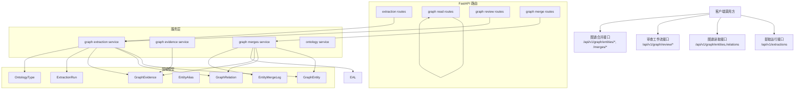
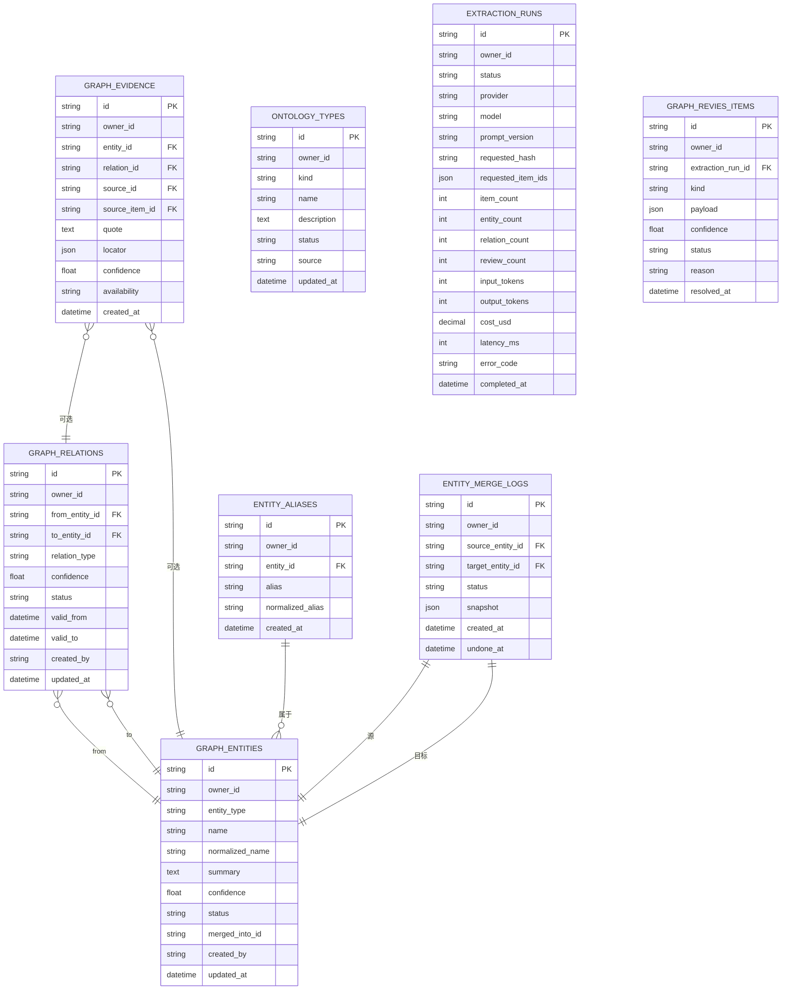
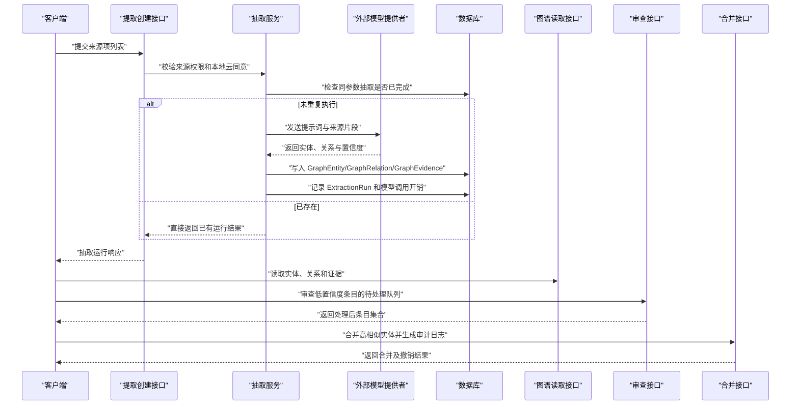
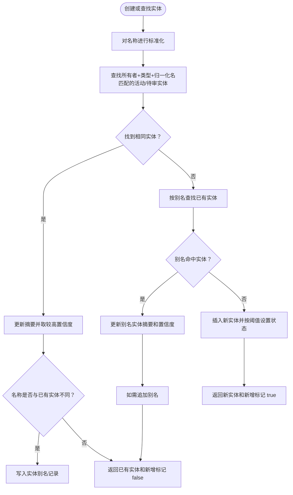
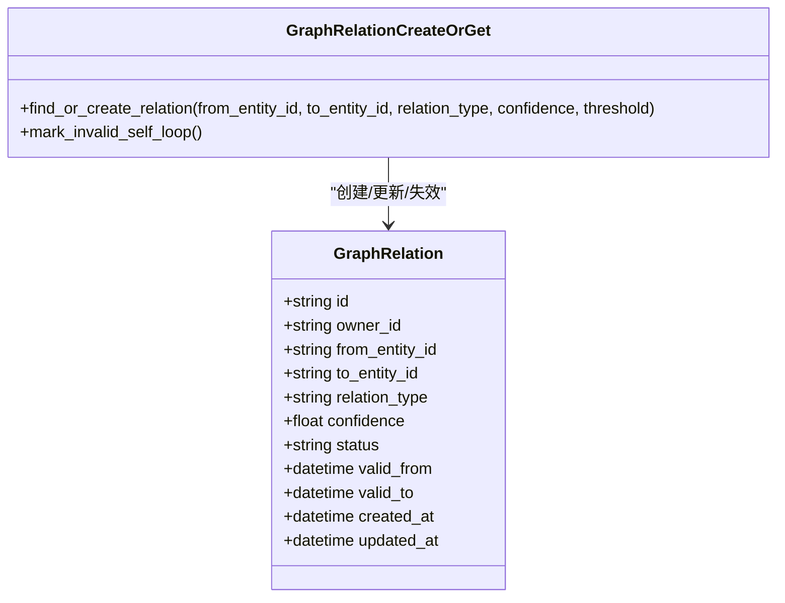
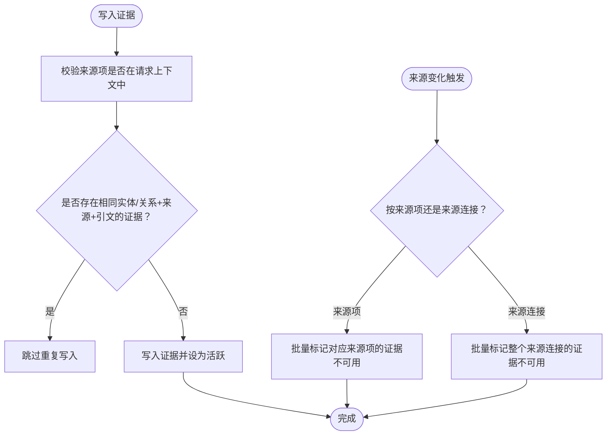
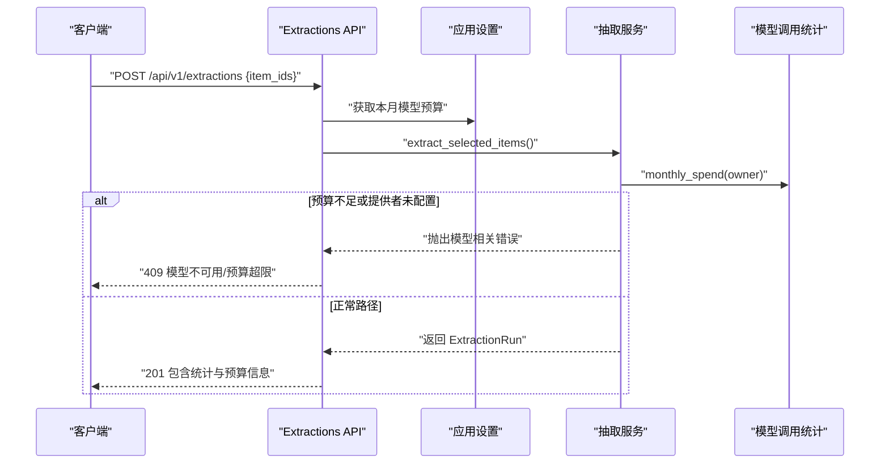
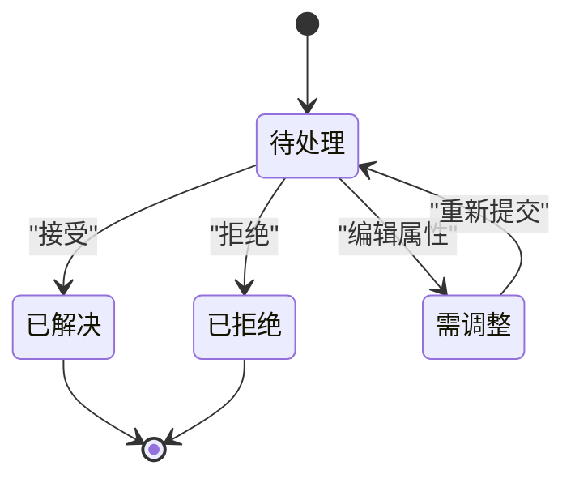
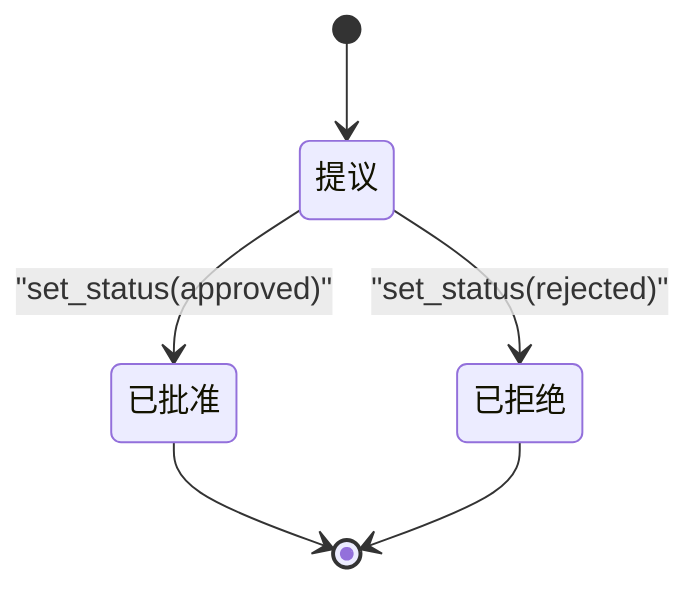
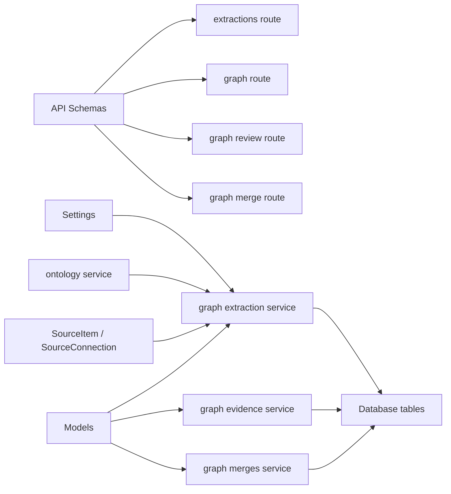

# 证据图与抽取 API

<cite>
**本文引用的文件**   
- [models.py](file://src/personal_ai_life_os/models.py)
- [schemas.py](file://src/personal_ai_life_os/api/schemas.py)
- [graph.py](file://src/personal_ai_life_os/api/routes/graph.py)
- [extractions.py](file://src/personal_ai_life_os/api/routes/extractions.py)
- [graph_review.py](file://src/personal_ai_life_os/api/routes/graph_review.py)
- [graph_merge.py](file://src/personal_ai_life_os/api/routes/graph_merge.py)
- [graph_extraction.py](file://src/personal_ai_life_os/services/graph_extraction.py)
- [graph_evidence.py](file://src/personal_ai_life_os/services/graph_evidence.py)
- [graph_merges.py](file://src/personal_ai_life_os/services/graph_merges.py)
- [ontology.py](file://src/personal_ai_life_os/services/ontology.py)
- [d2f5a8c14e73_add_evidence_graph_tables.py](file://migrations/versions/d2f5a8c14e73_add_evidence_graph_tables.py)
- [test_graph_model.py](file://tests/test_graph_model.py)
- [test_graph_extraction.py](file://tests/test_graph_extraction.py)
</cite>

## 目录
1. [简介](#简介)
2. [项目结构](#项目结构)
3. [核心数据结构](#核心数据结构)
4. [架构总览](#架构总览)
5. [详细组件分析](#详细组件分析)
6. [依赖关系分析](#依赖关系分析)
7. [性能与成本模型](#性能与成本模型)
8. [质量保障与可审计性](#质量保障与可审计性)
9. [故障排查指南](#故障排查指南)
10. [结论与使用建议](#结论与使用建议)
11. [附录：API 操作清单](#附录api-操作清单)

## 简介
本项目的证据图子系统将用户的来源内容自动抽取为实体、关系和证据，并通过审核工作流控制低置信度变更。系统同时提供图谱合并、版本记录、本体类型扩展、预算控制和可撤销操作等能力。它围绕三个核心对象组织：实体用于表示项目、目标、人物、事件等概念；关系描述实体之间的语义连接；证据则将每个结论锚定到具体来源项和引文片段。整体流程从“选择来源项”开始，经过模型抽取、置信度判断、审查队列、人工调整或批量决策，最终进入稳定的活动图谱数据。

## 项目结构
证据图相关代码按“领域服务 + FastAPI 路由 + SQL Alchemy 模型 + Alembic 迁移”的方式组织：

**图表来源**
- [graph.py:1-135](file://src/personal_ai_life_os/api/routes/graph.py#L1-L135)
- [extractions.py:1-91](file://src/personal_ai_life_os/api/routes/extractions.py#L1-L91)
- [graph_review.py:1-129](file://src/personal_ai_life_os/api/routes/graph_review.py#L1-L129)
- [graph_merge.py:1-86](file://src/personal_ai_life_os/api/routes/graph_merge.py#L1-L86)
- [graph_extraction.py:1-200](file://src/personal_ai_life_os/services/graph_extraction.py#L1-L200)
- [graph_evidence.py:1-45](file://src/personal_ai_life_os/services/graph_evidence.py#L1-L45)
- [graph_merges.py:1-200](file://src/personal_ai_life_os/services/graph_merges.py#L1-L200)
- [ontology.py:1-136](file://src/personal_ai_life_os/services/ontology.py#L1-L136)
- [models.py:330-430](file://src/personal_ai_life_os/models.py#L330-L430)

**章节来源**
- [graph.py:1-135](file://src/personal_ai_life_os/api/routes/graph.py#L1-L135)
- [extractions.py:1-91](file://src/personal_ai_life_os/api/routes/extractions.py#L1-L91)
- [graph_review.py:1-129](file://src/personal_ai_life_os/api/routes/graph_review.py#L1-L129)
- [graph_merge.py:1-86](file://src/personal_ai_life_os/api/routes/graph_merge.py#L1-L86)
- [models.py:180-430](file://src/personal_ai_life_os/models.py#L180-L430)

## 核心数据结构
证据图的数据库模型由以下表组成：实体表、关系表、证据表、别名表、合并日志表、抽取运行表和审查项表。它们以租户/所有者 `owner_id` 作为主隔离维度，并提供多个复合索引以支撑按所有者、类型、状态、时间和归一化名称的高效查询。

| 实体 | 字段要点 | 业务含义 |
|---|---|---|
| `graph_entities` | `id`,`owner_id`,`entity_type`,`name`,`normalized_name`,`summary`,`confidence`,`status`,`merged_into_id`,`created_by`,`updated_at` | 图中顶点；支持重复合并、活动或待审状态。 |
| `graph_relations` | `id`,`owner_id`,`from_entity_id`,`to_entity_id`,`relation_type`,`confidence`,`status`,`valid_from`,`valid_to`,`created_by`,`updated_at` | 有向边；支持时间有效性字段和无效状态。 |
| `graph_evidence` | `id`,`owner_id`,`entity_id`,`relation_id`,`source_id`,`source_item_id`,`quote`,`locator`,`confidence`,`availability`,`created_at` | 每条结论的来源证据；约束至少关联实体或关系之一。 |
| `entity_aliases` | `id`,`owner_id`,`entity_id`,`alias`,`normalized_alias`,`created_at` | 实体的别名，用于不同命名指向同一实体。 |
| `entity_merge_logs` | `id`,`owner_id`,`source_entity_id`,`target_entity_id`,`status`,`snapshot`,`created_at`,`undone_at` | 可撤销合并的审计快照。 |
| `ontology_types` | `id`,`owner_id`,`kind`,`name`,`description`,`status`,`source`,`updated_at` | 本体类型提案与审批记录。 |
| `extraction_runs` | `id`,`owner_id`,`status`,`provider`,`model`,`prompt_version`,`requested_hash`,`requested_item_ids`,`item_count`,`entity_count`,`relation_count`,`review_count`,`input_tokens`,`output_tokens`,`cost_usd`,`latency_ms`,`error_code`,`completed_at` | 每次抽取任务的状态和成本计量。 |
| `graph_review_items` | `id`,`owner_id`,`extraction_run_id`,`kind`,`payload`,`confidence`,`status`,`reason`,`resolved_at` | 低置信度变更的审查队列条目。 |

**图表来源**
- [d2f5a8c14e73_add_evidence_graph_tables.py:18-260](file://migrations/versions/d2f5a8c14e73_add_evidence_graph_tables.py#L18-L260)

**章节来源**
- [models.py:330-430](file://src/personal_ai_life_os/models.py#L330-L430)
- [d2f5a8c14e73_add_evidence_graph_tables.py:18-260](file://migrations/versions/d2f5a8c14e73_add_evidence_graph_tables.py#L18-L260)
- [test_graph_model.py:1-189](file://tests/test_graph_model.py#L1-L189)

## 架构总览
证据图的数据流可以分为四个阶段：来源选择与验证、模型抽取、图谱持久化，以及可读展示、审查与合并。

**图表来源**
- [extractions.py:17-91](file://src/personal_ai_life_os/api/routes/extractions.py#L17-L91)
- [graph_extraction.py:200-500](file://src/personal_ai_life_os/services/graph_extraction.py#L200-L500)
- [graph.py:1-135](file://src/personal_ai_life_os/api/routes/graph.py#L1-L135)
- [graph_review.py:21-129](file://src/personal_ai_life_os/api/routes/graph_review.py#L21-L129)
- [graph_merge.py:18-86](file://src/personal_ai_life_os/api/routes/graph_merge.py#L18-L86)

## 详细组件分析

### GraphEntity：实体模型、查找逻辑与别名机制
GraphEntity 代表图中的主题、项目、目标、任务、技能、成长记录、人物、事件、决策和承诺等类别。实现中采用归一化名称进行去重和等价匹配，并在首次创建时根据置信度决定活动或待审状态。当同名但命名不同的值出现时，系统会记录别名映射，避免产生多个物理实体。

关键行为包括：
- 按所有者、实体类型和归一化名查找已有活动或待审实体。
- 更新摘要并提升已有记录的置信度。
- 将变体名称转化为别名。
- 当没有命中实体和别名时，创建新实体。
- 低于阈值的实体进入待审队列，供后续审查处理。

**图表来源**
- [graph_extraction.py:300-500](file://src/personal_ai_life_os/services/graph_extraction.py#L300-L500)

**章节来源**
- [models.py:330-430](file://src/personal_ai_life_os/models.py#L330-L430)
- [graph_extraction.py:300-500](file://src/personal_ai_life_os/services/graph_extraction.py#L300-L500)
- [test_graph_model.py:20-100](file://tests/test_graph_model.py#L20-L100)

### GraphRelation：关系模型与自环保护
GraphRelation 定义两个实体之间的方向性关系。系统在重复检测时比较起点、终点和关系类型；如果重复出现，则合并为一个关系并保留最高置信度。合并逻辑还包含防止自环的保护：当某个合并操作使起点和终点指向同一实体时，该关系会被标记为无效。

**图表来源**
- [d2f5a8c14e73_add_evidence_graph_tables.py:74-110](file://migrations/versions/d2f5a8c14e73_add_evidence_graph_tables.py#L74-L110)
- [graph_merges.py:1-200](file://src/personal_ai_life_os/services/graph_merges.py#L1-L200)
- [graph_extraction.py:400-500](file://src/personal_ai_life_os/services/graph_extraction.py#L400-L500)

**章节来源**
- [d2f5a8c14e73_add_evidence_graph_tables.py:74-110](file://migrations/versions/d2f5a8c14e73_add_evidence_graph_tables.py#L74-L110)
- [graph_extraction.py:400-500](file://src/personal_ai_life_os/services/graph_extraction.py#L400-L500)
- [graph_merges.py:80-200](file://src/personal_ai_life_os/services/graph_merges.py#L80-L200)

### GraphEvidence：证据链与可用性控制
GraphEvidence 把每个实体或关系与具体的来源项、引用内容和定位信息连接起来。证据既可关联实体，也可关联关系，且必须至少满足其一。服务层提供了依据来源生命周期批量更新证据可用性的能力，以便在来源下线后继续保留历史数据而不影响后续抽取和质量评估。

核心职责包括：
- 写入证据并限制引文长度。
- 基于所有者、实体、关系和来源项做幂等写入。
- 依据来源项或来源连接批量将活跃证据切换为不可用。
- 在图谱读取接口中按上限截断返回证据数量。

**图表来源**
- [d2f5a8c14e73_add_evidence_graph_tables.py:111-149](file://migrations/versions/d2f5a8c14e73_add_evidence_graph_tables.py#L111-L149)
- [graph_extraction.py:470-540](file://src/personal_ai_life_os/services/graph_extraction.py#L470-L540)
- [graph_evidence.py:1-45](file://src/personal_ai_life_os/services/graph_evidence.py#L1-L45)

**章节来源**
- [d2f5a8c14e73_add_evidence_graph_tables.py:111-149](file://migrations/versions/d2f5a8c14e73_add_evidence_graph_tables.py#L111-L149)
- [graph_extraction.py:470-540](file://src/personal_ai_life_os/services/graph_extraction.py#L470-L540)
- [graph_evidence.py:1-45](file://src/personal_ai_life_os/services/graph_evidence.py#L1-L45)
- [graph.py:9-60](file://src/personal_ai_life_os/api/routes/graph.py#L9-L60)

### 抽取任务：接口、身份验证、幂等性与预算
提取接口允许用户为明确选择的来源项自动生成证据图。请求需要携带来源项标识，服务端会校验来源连接是否允许被云端模型访问，同时检查当前月度的模型支出是否超过预算。成功时创建或复用 `ExtractionRun`，并根据外部模型返回的结构持久化实体、关系和证据。

关键点：
- 通过本地 `Settings` 注入配置。
- 将 `GraphExtractionError` 转为统一错误格式。
- 计算月度花费并以占预算 80% 作为警告阈值。
- 根据外部模型返回的 token 数和单价估算美元成本。
- 对完全相同的抽取请求做幂等返回，避免重复计费。

**图表来源**
- [extractions.py:17-91](file://src/personal_ai_life_os/api/routes/extractions.py#L17-L91)
- [graph_extraction.py:200-280](file://src/personal_ai_life_os/services/graph_extraction.py#L200-L280)

**章节来源**
- [extractions.py:1-91](file://src/personal_ai_life_os/api/routes/extractions.py#L1-L91)
- [graph_extraction.py:120-280](file://src/personal_ai_life_os/services/graph_extraction.py#L120-L280)
- [test_graph_extraction.py:1-200](file://tests/test_graph_extraction.py#L1-L200)

### 图谱读取：实体列表、关系列表与证据挂载
只读图谱接口根据所有者筛选结果，并对实体列出支持类型过滤和名称模糊匹配。关系的读取默认排除无效状态。每个实体和关系都附带少量证据摘要，方便在前端直接看到支持依据。

| 接口 | 方法 | 主要参数 | 返回值 |
|---|---|---|---|
| `/api/v1/graph/entities` | GET | `entity_type`,`q`,`limit` | 实体总数与实体详情，每项含部分证据 |
| `/api/v1/graph/relations` | GET | `relation_type`,`limit` | 关系总数与关系详情，每项含部分证据 |

**章节来源**
- [graph.py:9-135](file://src/personal_ai_life_os/api/routes/graph.py#L9-L135)

### 图谱审查：待处理、编辑与批量决议
低置信度实体或关系不会直接进入活动图谱，而是先进入 `graph_review_items` 队列。用户可通过审查接口查看待处理项、编辑属性（例如修正名称、类型、摘要、置信度），或者执行“接受/拒绝/修改”等动作。批量决议接口允许一次处理多条审查项。

**图表来源**
- [graph_review.py:21-129](file://src/personal_ai_life_os/api/routes/graph_review.py#L21-L129)

**章节来源**
- [graph_review.py:1-129](file://src/personal_ai_life_os/api/routes/graph_review.py#L1-L129)

### 图谱合并：冲突检测、撤销策略与审计
图谱合并接口接收一个源实体和一个目标实体。服务层会校验两者都属于允许合并的状态，并为所有相关别名、证据、关系和待审项建立快照记录。合并后，源实体标记为已合并并指向目标实体；若合并导致关系两端变为同一实体，则该关系被标记为无效。合并记录支持撤销，恢复原始实体、别名、证据和目标关系指针。

| 接口 | 方法 | 路径参数 | 输入 | 行为 |
|---|---|---|---|---|
| 合并实体 | POST | `/api/v1/graph/entities/{entity_id}/merge` | `{target_entity_id}` | 合并源实体到目标实体 |
| 合并历史 | GET | `/api/v1/graph/merges` | 无 | 返回近期合并记录 |
| 撤销合并 | POST | `/api/v1/graph/merges/{merge_id}/undo` | 无 | 撤销最近一次成功的合并 |

**章节来源**
- [graph_merge.py:18-86](file://src/personal_ai_life_os/api/routes/graph_merge.py#L18-L86)
- [graph_merges.py:80-312](file://src/personal_ai_life_os/services/graph_merges.py#L80-L312)
- [test_graph_model.py:100-189](file://tests/test_graph_model.py#L100-L189)

### OntologyType：本体类型系统与自定义扩展
本体系统允许用户管理实体的种类和关系的种类。类型可以是“实体”或“关系”，名称必须满足字母数字加下划线的小写标识符规则。类型初始状态为“提议”，经批准后成为合法类型；被拒绝后不能再次批准。抽取过程如果遇到未知类型，不会立即报错，而是创建一条来自模型的提议类型记录，从而引导治理流程。

**图表来源**
- [ontology.py:20-136](file://src/personal_ai_life_os/services/ontology.py#L20-L136)

**章节来源**
- [ontology.py:1-136](file://src/personal_ai_life_os/services/ontology.py#L1-L136)
- [graph_extraction.py:320-400](file://src/personal_ai_life_os/services/graph_extraction.py#L320-L400)

### 从多个源项目自动生成证据图
虽然当前提取接口明确要求前端显式传递来源项标识，但服务实现已经把所有输入来源集中为结构化证据载荷，再调用统一的模型抽取入口。这意味着系统可以在调用层聚合多个“来源连接”下的多个来源项，组合成一次抽取请求，从而实现对多个源项目的批量抽取。

支持的端到端过程如下：
1. 聚合多个来源连接的来源项。
2. 校验所有者范围和云访问同意。
3. 预估提示词长度并计算 token。
4. 调用 OpenAI 兼容模型的 `/chat/completions`。
5. 解析 JSON 输出中的实体、关系和证据。
6. 将置信度裁剪到 `[0,1]`。
7. 去重并持久化图谱数据。
8. 记录抽取运行结果和成本。

**章节来源**
- [graph_extraction.py:200-540](file://src/personal_ai_life_os/services/graph_extraction.py#L200-L540)

### 可视化数据导出与图谱分析
当前仓库未提供专用的图谱拓扑导出接口；但从现有模型和查询接口可以合成多种分析视图：
- 实体分类统计：按 `entity_type` 分组计数。
- 关系类型分布：按 `relation_type` 分组计数。
- 低置信度报告：筛选 `status = pending_review` 的实体与关系。
- 证据覆盖率：统计拥有 `active` 证据的实体和关系比例。
- 来源贡献分析：按 `source_id` 或 `source_item_id` 聚合证据数量。

这些分析可基于 `GraphEntity`、`GraphRelation`、`GraphEvidence`、`SourceConnection` 和 `SourceItem` 表组合查询，并使用现有的实体、关系和证据列表接口拼装前端可视化所需数据。

[本节为通用说明，不直接分析特定文件]

### 性能优化实践
- 索引设计：按 `owner_id`、实体/关系类型、状态、归一化名、来源和时间构建多类索引，减少全局扫描。
- 分页与限制：实体和关系查询限制最大返回条数，证据查询默认最多返回少量最近证据。
- 重复防御：抽取任务基于请求哈希避免重复调用模型。
- 批量更新：证据可用性变更使用批量 `UPDATE`，降低多次单行更新的代价。
- 去重写入：实体、关系和证据均实现幂等合并，降低并发抽取时的写入放大。

[本节为通用说明，不直接分析特定文件]

## 依赖关系分析
证据图模块的核心依赖如下：

**图表来源**
- [schemas.py:120-160](file://src/personal_ai_life_os/api/schemas.py#L120-L160)
- [graph_extraction.py:1-120](file://src/personal_ai_life_os/services/graph_extraction.py#L1-L120)
- [graph_evidence.py:1-45](file://src/personal_ai_life_os/services/graph_evidence.py#L1-L45)
- [graph_merges.py:1-100](file://src/personal_ai_life_os/services/graph_merges.py#L1-L100)
- [ontology.py:1-60](file://src/personal_ai_life_os/services/ontology.py#L1-L60)

**章节来源**
- [graph_extraction.py:1-120](file://src/personal_ai_life_os/services/graph_extraction.py#L1-L120)
- [graph_evidence.py:1-45](file://src/personal_ai_life_os/services/graph_evidence.py#L1-L45)
- [graph_merges.py:1-100](file://src/personal_ai_life_os/services/graph_merges.py#L1-L100)

## 性能与成本模型
抽取调用使用带超时控制的 HTTP 客户端对外部模型接口发起 JSON 请求。延迟以毫秒计，token 用量分别统计 prompt 和 completion。美元成本计算公式来源于输入与输出 token 单价的总和，并按百万 token 单位折算。

| 指标 | 含义 | 注意事项 |
|---|---|---|
| `latency_ms` | 单次模型调用的内部计时 | 不包含前端等待和网络往返的整体体验时长 |
| `input_tokens` | 模型收到的消息 token 量 | 与提示词、源标题和内容截取文本有关 |
| `output_tokens` | 模型返回的实体关系 JSON token 量 | 受输出大小和模型限制影响 |
| `cost_usd` | 按模型定价计算的美元成本 | 缺少单价时会返回空值 |
| `budget_used_usd` | 当月模型调用累计成本 | 包含图谱抽取及其他用途的模型使用 |
| `budget_limit_usd` | 本月模型预算上限 | 达到或超过时可阻止抽取 |
| `budget_warning` | 预算使用率达到 80% 时生效 | 用于提示而非阻断 |

**章节来源**
- [graph_extraction.py:200-280](file://src/personal_ai_life_os/services/graph_extraction.py#L200-L280)
- [extractions.py:17-91](file://src/personal_ai_life_os/api/routes/extractions.py#L17-L91)
- [test_graph_extraction.py:100-200](file://tests/test_graph_extraction.py#L100-L200)

## 质量保障与可审计性
质量保障措施贯穿抽取、审查、合并和证据生命周期：

| 措施 | 实现方式 | 目的 |
|---|---|---|
| 所有者隔离 | 所有图谱记录和会话查询都限制 `owner_id` | 防止跨租户数据泄露 |
| 数据来源约束 | 证据必须链接有效来源项，且引用非空 | 保证结论可回溯 |
| 证据可用性标记 | 来源删除或撤回同意后标记为不可用 | 区分历史数据和活跃推理 |
| 置信度阈值 | 低置信度结果进入待审状态 | 控制自动化污染 |
| 审查队列 | 独立的审查项表和接口 | 允许人工干预和批量决议 |
| 实体别名 | 不同名称映射到同一实体 | 减少重复建模 |
| 合并快照 | 记录实体、别名、证据、关系和审查项状态 | 支持撤销和审计 |
| 抽取幂等 | 相同来源集合复用已有运行 | 避免重复模型调用与重复图谱节点 |
| 约束校验 | 证据必须绑定实体或关系之一 | 防止孤立证据 |

**章节来源**
- [graph_extraction.py:300-540](file://src/personal_ai_life_os/services/graph_extraction.py#L300-L540)
- [graph_merges.py:100-312](file://src/personal_ai_life_os/services/graph_merges.py#L100-L312)
- [graph_evidence.py:1-45](file://src/personal_ai_life_os/services/graph_evidence.py#L1-L45)
- [d2f5a8c14e73_add_evidence_graph_tables.py:111-260](file://migrations/versions/d2f5a8c14e73_add_evidence_graph_tables.py#L111-L260)
- [test_graph_model.py:60-189](file://tests/test_graph_model.py#L60-L189)

## 故障排查指南
常见问题与定位方式：

| 现象 | 可能原因 | 排查建议 |
|---|---|---|
| 创建抽取任务返回模型提供者不可用 | 未配置外部提供者或必填字段缺失 | 检查 `GRAPH_MODEL_PROVIDERS` 或默认的 OpenAI 兼容配置 |
| 创建抽取任务返回预算超限 | 当月模型成本已超过预算 | 查看预算设置和历史模型调用记录 |
| 抽取接口返回来源项未找到 | 来源项不属于当前用户或缺少云访问同意 | 确认 `source_id` 和同意状态 |
| 实体查询为空 | 实体处于非活动状态或被合并 | 检查 `status`、`merged_into_id` 和合并日志 |
| 关系不存在或为无效 | 被合并为自环或被人工置为无效 | 检查关系两端实体状态和相关合并记录 |
| 证据无法用于 QA 但历史记录仍存在 | 证据来源已被取消或删除 | 查看证据 `availability` 字段 |
| 撤销合并失败 | 合并记录不存在、已被撤销或源实体已丢失 | 先查询合并历史并核对所有者 |
| 创建本体类型失败 | 名称不符合规范、类型已存在或状态已决议 | 检查小写字母数字下划线规则和当前状态 |
| 测试中断言证据缺少实体或关系 | 建表约束要求必须绑定其一 | 确保写入 `entity_id` 或 `relation_id` |

**章节来源**
- [graph_extraction.py:120-280](file://src/personal_ai_life_os/services/graph_extraction.py#L120-L280)
- [graph_merges.py:200-312](file://src/personal_ai_life_os/services/graph_merges.py#L200-L312)
- [ontology.py:20-136](file://src/personal_ai_life_os/services/ontology.py#L20-L136)
- [test_graph_extraction.py:120-200](file://tests/test_graph_extraction.py#L120-L200)
- [test_graph_model.py:60-189](file://tests/test_graph_model.py#L60-L189)

## 结论与使用建议
证据图系统把“来源材料 → AI 抽取 → 图谱对象 → 审查治理 → 稳定知识”打通，适合需要强可解释性和可追溯性的个人智能体场景。推荐的使用顺序是：

1. 准备并授权要参与抽取的来源项。
2. 提交抽取任务，观察是否命中预算限制。
3. 通过实体和关系列表查看自动生成的图谱，并检查证据是否完整。
4. 打开审查队列，处理低置信度条目。
5. 对疑似重复实体执行合并，并在必要时撤销误操作。
6. 对本体类型系统维护自定义实体和关系分类。
7. 基于模型提供的 ID 引用构建前端图谱可视化。

对于未来扩展，可优先考虑增加可视化的拓扑导出接口、证据链接追踪视图、更细粒度的版本对比接口，以及对高吞吐抽取任务的异步作业封装。

[本节为总结性内容，不直接分析特定文件]

## 附录：API 操作清单

| 场景 | 方法 | 路径 | 输入 | 输出 |
|---|---|---|---|---|
| 提交抽取任务 | POST | `/api/v1/extractions` | `{item_ids[, provider]}` | 抽取运行结果、费用与预算信息 |
| 查询抽取任务 | GET | `/api/v1/extractions/{run_id}` | 无 | 抽取运行结果 |
| 列举实体 | GET | `/api/v1/graph/entities` | `entity_type`,`q`,`limit` | 实体列表与证据 |
| 列举关系 | GET | `/api/v1/graph/relations` | `relation_type`,`limit` | 关系列表与证据 |
| 查看审查队列 | GET | `/api/v1/graph/review` | `status`,`kind`,`limit` | 审查项集合 |
| 批量处理审查 | POST | `/api/v1/graph/review/bulk` | `{item_ids,action}` | 处理后审查项集合 |
| 编辑审查项 | PATCH | `/api/v1/graph/review/{item_id}` | `{name,entity_type,relation_type,summary,confidence}` | 单个审查项 |
| 对审查项做出决定 | POST | `/api/v1/graph/review/{item_id}/decision` | `{action}` | 单个审查项 |
| 合并实体 | POST | `/api/v1/graph/entities/{entity_id}/merge` | `{target_entity_id}` | 合并日志 |
| 查看合并历史 | GET | `/api/v1/graph/merges` | 无 | 合并日志列表 |
| 撤销合并 | POST | `/api/v1/graph/merges/{merge_id}/undo` | 无 | 撤销后的合并日志 |

调用示例参考：
- 新建抽取任务：向 `/api/v1/extractions` 发送包含来源项 ID 数组的请求，并可选择指定模型提供者。
- 查看图谱实体：GET `/api/v1/graph/entities?entity_type=project&q=Life&limit=20`。
- 查看图谱关系：GET `/api/v1/graph/relations?relation_type=has_goal&limit=50`。
- 批量接受审查：POST `/api/v1/graph/review/bulk`，传入审查项 ID 和接受动作。
- 合并两个实体：POST `/api/v1/graph/entities/{源实体ID}/merge`，传入目标实体 ID。
- 查看并撤销某次合并：GET `/api/v1/graph/merges` 和 POST `/api/v1/graph/merges/{合并ID}/undo`。

**章节来源**
- [extractions.py:17-91](file://src/personal_ai_life_os/api/routes/extractions.py#L17-L91)
- [graph.py:40-135](file://src/personal_ai_life_os/api/routes/graph.py#L40-L135)
- [graph_review.py:40-129](file://src/personal_ai_life_os/api/routes/graph_review.py#L40-L129)
- [graph_merge.py:28-86](file://src/personal_ai_life_os/api/routes/graph_merge.py#L28-L86)
- [test_graph_extraction.py:80-160](file://tests/test_graph_extraction.py#L80-L160)