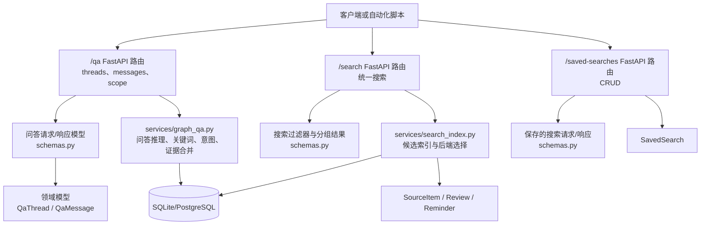
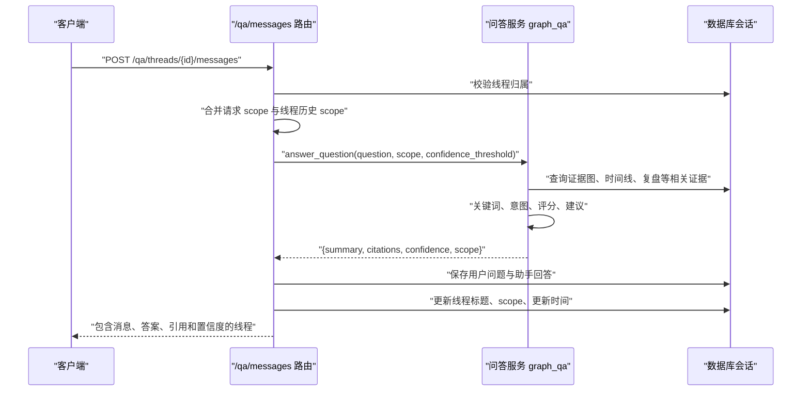
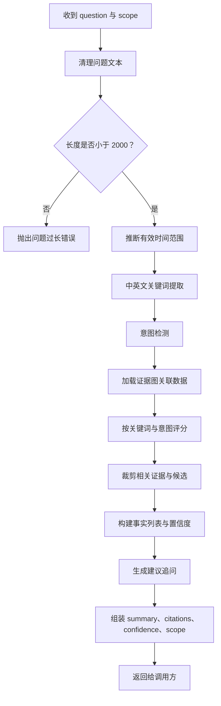
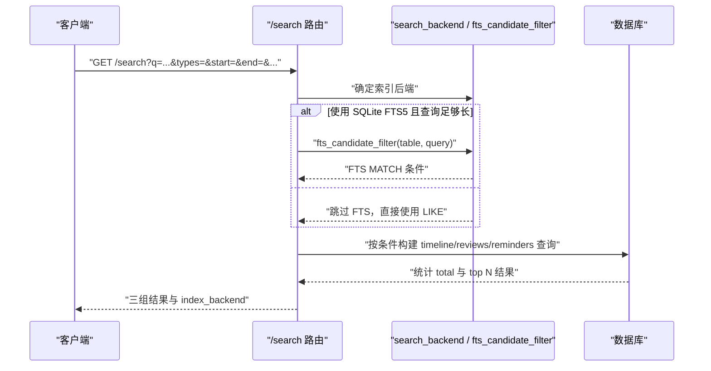
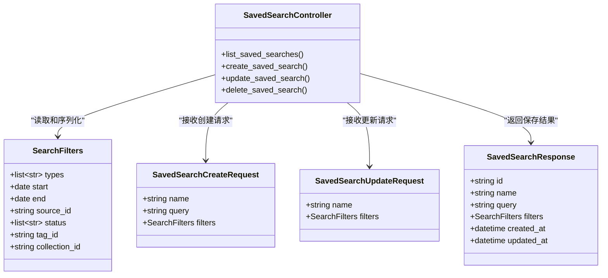
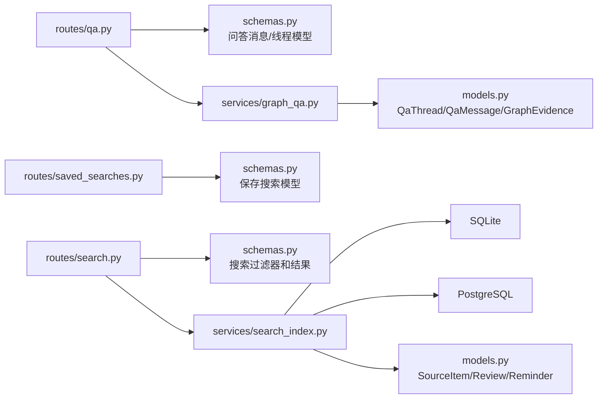

# 问答与搜索 API

<cite>
**本文引用的文件**
- [api/routes/qa.py](file://src/personal_ai_life_os/api/routes/qa.py)
- [api/routes/search.py](file://src/personal_ai_life_os/api/routes/search.py)
- [api/routes/saved_searches.py](file://src/personal_ai_life_os/api/routes/saved_searches.py)
- [services/graph_qa.py](file://src/personal_ai_life_os/services/graph_qa.py)
- [services/search_index.py](file://src/personal_ai_life_os/services/search_index.py)
- [api/schemas.py](file://src/personal_ai_life_os/api/schemas.py)
- [models.py](file://src/personal_ai_life_os/models.py)
- [README.md](file://README.md)
</cite>

## 目录
1. [简介](#简介)
2. [项目结构](#项目结构)
3. [核心接口](#核心接口)
4. [架构总览](#架构总览)
5. [详细组件分析](#详细组件分析)
6. [依赖关系分析](#依赖关系分析)
7. [性能与索引策略](#性能与索引策略)
8. [运维与排错指南](#运维与排错指南)
9. [结论](#结论)
10. [附录：请求与响应模型对照](#附录请求与响应模型对照)

## 简介

本 API 提供两套能力：

1. **交互式证据型问答系统**  
   基于本地抽取的证据图、时间线、复盘和提醒，对用户自然语言问题生成带来源引用、置信度评分、事实类型标注和建议追问的结构化答案。它支持范围限定、多轮对话中的上下文继承、意图推断以及中文关键词提取，但当前未实现外部大模型调用；实际推理由本地服务完成。

2. **统一全文搜索 RESTful 接口**  
   在同一 `/search` 端点中聚合三类数据：时间线条目、复盘记录、提醒事项。搜索同时利用 SQLite FTS5 trigram 与 PostgreSQL `pg_trgm` GIN 作为候选检索器，再对返回结果执行严格的审计级重过滤（按拥有者、删除状态、来源状态等）。查询支持分页、排序、多字段高亮摘要，以及按日期范围、来源、标签、集合、状态等条件过滤。

此外还提供 **保存的搜索** 能力，允许用户以可复用的名称存储一组查询和筛选参数，便于在客户端快速重用复杂组合。

## 项目结构

**图表来源**
- [api/routes/qa.py:1-200](file://src/personal_ai_life_os/api/routes/qa.py#L1-L200)
- [api/routes/search.py:1-299](file://src/personal_ai_life_os/api/routes/search.py#L1-L299)
- [api/routes/saved_searches.py:1-109](file://src/personal_ai_life_os/api/routes/saved_searches.py#L1-L109)
- [services/graph_qa.py:1-200](file://src/personal_ai_life_os/services/graph_qa.py#L1-L200)
- [services/search_index.py:1-162](file://src/personal_ai_life_os/services/search_index.py#L1-L162)
- [api/schemas.py:780-1151](file://src/personal_ai_life_os/api/schemas.py#L780-L1151)

**章节来源**
- [api/routes/qa.py:1-200](file://src/personal_ai_life_os/api/routes/qa.py#L1-L200)
- [api/routes/search.py:1-299](file://src/personal_ai_life_os/api/routes/search.py#L1-L299)
- [api/routes/saved_searches.py:1-109](file://src/personal_ai_life_os/api/routes/saved_searches.py#L1-L109)
- [README.md:1-118](file://README.md#L1-L118)

## 核心接口

### 问答接口

| 方法 | 路径 | 功能 | 关键行为 |
|---|---|---|---|
| GET | `/qa/scope` | 获取最近一条会话的作用域 | 若无历史则返回空作用域；否则返回最新线程及其 scope |
| GET | `/qa/threads` | 列出拥有者最近的提问线程 | 默认最多 50 条，不含完整消息 |
| POST | `/qa/threads` | 创建新提问线程 | 标题长度受限，scope 持久化 |
| GET | `/qa/threads/{thread_id}` | 获取线程及全部消息 | 每条助手消息携带结构化 answer |
| POST | `/qa/threads/{thread_id}/messages` | 发送问题并生成证据型回答 | 写入用户问题、助手回答、citation、confidence、updated scope |
| DELETE | `/qa/threads/{thread_id}` | 删除线程 | 204 无内容响应 |

#### 创建线程

- **路径：** `POST /qa/threads`
- **请求体关键字段：**
  - `title`：可选，截断为 240 字符；为空时采用默认标题
  - `scope`：可选起始范围，包括 `source_ids`、`entity_ids`、`start`、`end`
- **成功响应：** 201，返回不含消息列表的线程对象

#### 查询线程列表与详情

- **GET `/qa/threads`**  
  返回拥有者所有线程总数及前 50 条概览，不包含每条消息。
- **GET `/qa/threads/{thread_id}`**  
  若线程不存在或属于其他拥有者，返回 404。
- **响应中包含：** 标题、作用域、创建时间、更新时间、按时间顺序排列的消息。

#### 发送问题并获取回答

- **路径：** `POST /qa/threads/{thread_id}/messages`
- **请求体关键字段：**
  - `question`：自然语言问题
  - `scope`：可选覆盖；若省略则使用上次保存的线程 scope
- **处理流程要点：**
  1. 校验线程存在且属于当前用户
  2. 解析并验证 scope
  3. 调用问答服务生成 `summary`、`citations`、`confidence`、`scope`
  4. 持久化用户问题和助手回答
  5. 如果线程使用默认标题，则用前 60 个字符的问题文本作为主题
  6. 更新线程 scope 和时间戳

#### 获取最近的作用域

- **路径：** `GET /qa/scope`
- **用途：** 客户端可以在加载“再次提问”界面时显示上次使用的来源、实体和时间范围

**章节来源**
- [api/routes/qa.py:1-200](file://src/personal_ai_life_os/api/routes/qa.py#L1-L200)

### 搜索接口

| 方法 | 路径 | 功能 |
|---|---|---|
| GET | `/search` | 统一多源全文搜索，支持 timeline、reviews、reminders |
| GET | `/saved-searches` | 列出保存的搜索 |
| POST | `/saved-searches` | 创建保存的搜索 |
| PATCH | `/saved-searches/{entry_id}` | 修改保存的搜索名称或筛选 |
| DELETE | `/saved-searches/{entry_id}` | 删除保存的搜索 |

#### 统一搜索查询

- **路径：** `GET /search`
- **关键查询参数：**
  - `q`：必填搜索词，1–200 字符
  - `limit`：每分组最大结果数，1–20，默认 10
  - `types`：逗号分隔的类型，可选值 `timeline`、`reviews`、`reminders`
  - `start`、`end`：按业务日期进行闭开边界过滤
  - `source_id`：时间线来源 ID
  - `status`：按逗号分隔的状态列表过滤复盘或提醒
  - `tag_id`、`collection_id`：时间线组织分类过滤
- **返回响应：**
  - `query`：原始清洗后的搜索词
  - `index_backend`：当前候选检索后端，如 `sqlite-fts5-trigram`、`postgresql-pg_trgm` 或 `like`
  - `timeline`、`reviews`、`reminders`：各自包含 `total` 和 `results`
- **分组内的默认排序：**
  - 时间线：优先匹配 title，其次按发生时间倒序
  - 复盘：按周期结束时间倒序
  - 提醒：先 null due_at，再按到期日升序，更新时间降序，最终按 ID 稳定排序

#### 片段高亮逻辑

搜索结果不使用 HTML 高亮标记；每个结果提供一个 `snippet`：

- 时间线优先从 `content_text` 或 `user_description` 中匹配
- 匹配位置附近截取片段
- 超过 200 字符时使用省略号包裹
- 没有直接匹配时退回标题或其他后备字段

**章节来源**
- [api/routes/search.py:1-299](file://src/personal_ai_life_os/api/routes/search.py#L1-L299)
- [api/schemas.py:906-1151](file://src/personal_ai_life_os/api/schemas.py#L906-L1151)

### 保存的搜索接口

| 方法 | 路径 | 说明 |
|---|---|---|
| GET | `/saved-searches` | 按创建时间倒序列出当前用户的保存项 |
| POST | `/saved-searches` | 创建保存项；同一 `name` 冲突时返回 409 |
| PATCH | `/saved-searches/{entry_id}` | 仅允许修改 name 或 filters |
| DELETE | `/saved-searches/{entry_id}` | 删除保存项 |

保存项包含：

- `name`：用于识别的可显示名称
- `query`：保留的原搜索词
- `filters`：完整的 `SearchFilters`
- `created_at`、`updated_at`

当插入或更新时因唯一名称冲突，API 返回 409，错误码为 `saved_search_exists`。

**章节来源**
- [api/routes/saved_searches.py:1-109](file://src/personal_ai_life_os/api/routes/saved_searches.py#L1-L109)
- [api/schemas.py:906-1151](file://src/personal_ai_life_os/api/schemas.py#L906-L1151)

## 架构总览

**图表来源**
- [api/routes/qa.py:103-180](file://src/personal_ai_life_os/api/routes/qa.py#L103-L180)
- [services/graph_qa.py:520-699](file://src/personal_ai_life_os/services/graph_qa.py#L520-L699)

## 详细组件分析

### 问答服务组件

#### 设计要点

- **中文优先的语言处理**  
  通过正则分离中文字符与英文单词：中文分字元及二元组，英文提取字母单词，过滤停止词后保留最多 12 个有效关键词。这使中文短词也能被参与评分，而不是仅依赖英文空格切分。

- **意图检测**  
  内置多种意图类别，包括决策类、项目类、成长类和时间线性索类。不同意图允许放宽相关证据的选择规则，例如针对“上周”“最近”“timeline”这类表达自动缩短时间范围。

- **范围推断**  
  如果没有显式传入时间范围，问答会根据意图和用户表述推断一个合理的时间窗口，从而提升自然语言语义下的相关性。

- **证据评分与建议**  
  证据行根据标题、证据引用、实体名称和摘要中出现关键词的次数打分；实体类型与意图匹配会额外加分。最终产出结构化事实、引用清单、置信度、是否推断或不确定标签，以及最多 4 条建议追问。

- **不直接调用外部模型**  
  问答接口当前是本地规则引擎：它不向 OpenAI 或其他 LLM 发请求，因此不涉及 token 消耗，也不产生外部 AI 成本。

#### 问答数据流

**图表来源**
- [services/graph_qa.py:143-200](file://src/personal_ai_life_os/services/graph_qa.py#L143-L200)
- [services/graph_qa.py:237-265](file://src/personal_ai_life_os/services/graph_qa.py#L237-L265)
- [services/graph_qa.py:432-515](file://src/personal_ai_life_os/services/graph_qa.py#L432-L515)
- [services/graph_qa.py:520-699](file://src/personal_ai_life_os/services/graph_qa.py#L520-L699)

#### 关键数据结构与方法

| 名称 | 作用 | 重要约束 |
|---|---|---|
| `QaScope` | 问答作用域，限制来源、实体和时间范围 | `source_ids`、`entity_ids` 最多各 50；`end` 必须在 `start` 之后 |
| `keywords_for` | 从问题中提取中英文关键词 | 中文二元组过滤停止词，英文最小长度 2，上限约 12 个 |
| `detect_intent` | 判断问题意图类别 | 匹配预置的中英文意图词汇 |
| `_inferred_range` | 将自然语言时间转换为时间范围 | 区分“上周”“上个月”和普通时间线性索 |
| `_evidence_rows` | 获取 owner 隔离、有效的证据行 | 排除已删除、停用来源和无效复盘 |
| `_score_row` | 对证据行打分 | 标题、证据引用、实体信息参与匹配，意图额外加权 |
| `_suggestions` | 根据事实和实体类型生成建议 | 最多 4 条，避免重复 |
| `answer_question` | 主入口组装完整回答 | 含错误检查、裁剪、建议和范围输出 |

**章节来源**
- [services/graph_qa.py:1-200](file://src/personal_ai_life_os/services/graph_qa.py#L1-L200)
- [services/graph_qa.py:237-265](file://src/personal_ai_life_os/services/graph_qa.py#L237-L265)
- [services/graph_qa.py:432-699](file://src/personal_ai_life_os/services/graph_qa.py#L432-L699)

### 搜索索引与统一搜索组件

#### 双后端候选检索

| 数据库 | 候选检索技术 | 触发条件 | 回退策略 |
|---|---|---|---|
| SQLite | FTS5 + trigram token | 虚拟表 `timeline_fts`、`review_fts`、`reminder_fts` 存在 | LIKE 模糊匹配 |
| PostgreSQL | `pg_trgm` GIN 索引 | `pg_trgm` 扩展启用 | LIKE 模糊匹配 |
| 其他后端 | 不适用 | — | LIKE 模糊匹配 |

- `ensure_sqlite_search_index`：创建 FTS5 虚拟表和同步触发器
- `ensure_postgres_search_indexes`：安装扩展并创建 `lower(title/content/final_text/notes)` 的 GIN 索引
- `rebuild_search_index`：清空 FTS5 表并按数据快照重建
- `search_backend`：运行时决定当前使用的是哪个后端字符串
- `fts_candidate_filter`：生成候选 ID 子句，仅当后端为 SQLite FTS5 trigram 且查询长度至少 3 时生效

#### 审计级重过滤

所有候选结果都会进入 SQL 层重新过滤，保证：

- 结果属于当前 `owner_id`
- 时间线未删除、是当前版本、来源未处于 `deleting`
- 复盘不是 `invalidated`
- 提醒满足日期范围和状态过滤
- 时间线支持 `source_id`、`tag_id`、`collection_id`

这弥补了 FTS5 只负责快速候选而不对业务权限做严格鉴权的局限性。

#### 搜索时序

**图表来源**
- [api/routes/search.py:149-299](file://src/personal_ai_life_os/api/routes/search.py#L149-L299)
- [services/search_index.py:1-162](file://src/personal_ai_life_os/services/search_index.py#L1-L162)

#### 保存搜索的数据模型与状态

保存的搜索并不直接执行搜索；它只是存储一组“可重复执行的查询条件”。实际搜索结果仍通过统一的 `/search` 接口计算，确保缓存、性能和审计行为保持一致。

**图表来源**
- [api/routes/saved_searches.py:1-109](file://src/personal_ai_life_os/api/routes/saved_searches.py#L1-L109)
- [api/schemas.py:906-1066](file://src/personal_ai_life_os/api/schemas.py#L906-L1066)

**章节来源**
- [services/search_index.py:1-162](file://src/personal_ai_life_os/services/search_index.py#L1-L162)
- [api/routes/search.py:1-299](file://src/personal_ai_life_os/api/routes/search.py#L1-L299)
- [api/routes/saved_searches.py:1-109](file://src/personal_ai_life_os/api/routes/saved_searches.py#L1-L109)
- [api/schemas.py:906-1151](file://src/personal_ai_life_os/api/schemas.py#L906-L1151)

## 依赖关系分析

**图表来源**
- [api/routes/qa.py:1-50](file://src/personal_ai_life_os/api/routes/qa.py#L1-L50)
- [api/routes/search.py:1-40](file://src/personal_ai_life_os/api/routes/search.py#L1-L40)
- [api/routes/saved_searches.py:1-30](file://src/personal_ai_life_os/api/routes/saved_searches.py#L1-L30)
- [services/graph_qa.py:15-40](file://src/personal_ai_life_os/services/graph_qa.py#L15-L40)
- [services/search_index.py:1-30](file://src/personal_ai_life_os/services/search_index.py#L1-L30)
- [api/schemas.py:1-60](file://src/personal_ai_life_os/api/schemas.py#L1-L60)

**章节来源**
- [api/routes/qa.py:1-200](file://src/personal_ai_life_os/api/routes/qa.py#L1-L200)
- [api/routes/search.py:1-299](file://src/personal_ai_life_os/api/routes/search.py#L1-L299)
- [api/routes/saved_searches.py:1-109](file://src/personal_ai_life_os/api/routes/saved_searches.py#L1-L109)
- [services/graph_qa.py:1-200](file://src/personal_ai_life_os/services/graph_qa.py#L1-L200)
- [services/search_index.py:1-162](file://src/personal_ai_life_os/services/search_index.py#L1-L162)

## 性能与索引策略

### 当前能力

- **SQLite 环境**：使用 FTS5 虚拟表和 trigram token；INSERT/UPDATE/DELETE 触发器维护索引；`rebuild_search_index` 可以清空并批量回填。
- **PostgreSQL 环境**：尝试安装 `pg_trgm`，并使用 GIN 索引索引小写化的 `title`、`content_text`、`final_text` 和 `notes`。
- **降级模式**：如果 FTS5/trigram 不可用，搜索会回退到 `LIKE`；此时 `index_backend` 返回 `like`。
- **候选限制**：FTS 只在查询长度至少为 3 时激活。
- **强一致性过滤**：无论使用哪种检索后端，最终结果都由严格 SQL 条件再次筛选，不会暴露已删除、非当前版本或无权访问的数据。
- **无向量或语义搜索**：README 明确说明目前不提供语义/向量索引；这是性能与 MVP 阶段权衡的结果。

### 索引建议

| 场景 | 建议 |
|---|---|
| SQLite 初次部署 | 首次运行 `rebuild_search_index`，确保 FTS5 trigram 已创建 |
| 迁移到新环境 | 显式调用索引重建脚本，避免 LIKE 回退 |
| 大量导入数据后 | 在导入完成后重建索引，减少增量触发器的压力 |
| PostgreSQL | 确保数据库用户具备安装扩展和创建 GIN 索引的权限，否则服务会记录日志并降级 |
| 频繁短查询 | 注意长度小于 3 的词会回退到 LIKE，必要时在前端增加最小输入长度 |

### 性能影响

- FTS5 和 pg_trgm 主要降低的是“候选集”规模，真正的所有权、时间范围和来源过滤仍会在 SQL 层执行。
- `search_backend` 每次调用均会探测后端类型；在生产环境中，此探测成本很低，但若极端高频可考虑在应用启动时缓存后端类型。
- 搜索结果每组最多 20 条，`limit` 默认 10，适合单页展示和渐进加载。

**章节来源**
- [services/search_index.py:1-162](file://src/personal_ai_life_os/services/search_index.py#L1-L162)
- [api/routes/search.py:1-150](file://src/personal_ai_life_os/api/routes/search.py#L1-L150)
- [README.md:65-118](file://README.md#L65-L118)

## 运维与排错指南

### 常见错误

| 错误场景 | HTTP 状态码 | 错误代码 | 修复建议 |
|---|---:|---|---|
| 问答线程不存在或属于其他用户 | 404 | `qa_thread_not_found` | 确认 `thread_id` 是否正确，或换用当前用户创建的线程 |
| scope 中的日期格式非法 | 422 | `invalid_scope_date` | 使用 ISO 8601 日期时间字符串 |
| scope 的来源或实体太多 | 413 | `scope_too_large` | 最多每项 50 个 ID |
| scope 开始时间晚于结束时间 | 422 | `invalid_scope_range` | 调整时间顺序 |
| 保存搜索名称重复 | 409 | `saved_search_exists` | 更换名称或在客户端处理冲突 |
| 搜索词为空或不符合过滤器约束 | 422 | `invalid_search_query` 或 `invalid_search_filters` | 检查 `q`、`types`、`start/end/status` |

### 索引重建与管理

- **检测后端：** 调用 `/search`，查看响应中的 `index_backend`：
  - `sqlite-fts5-trigram`：SQLite FTS5 trigram
  - `postgresql-pg_trgm`：PostgreSQL trigram
  - `like`：回退到模糊匹配
- **重建 SQLite 索引：** 使用仓库提供的索引重建脚本；该脚本会初始化虚拟表、触发器并回填三类数据的 FTS5 内容。
- **重建 PostgreSQL 索引：** 脚本会尝试安装 `pg_trgm` 并创建 GIN 索引；失败时会记录日志并降级。
- **监控建议：**
  - 定期检查 `/search` 返回的 `index_backend`，确认未长期回退到 `like`
  - 监控 SQLite 体积增长和触发器延迟
  - 对于 PG，关注 GIN 索引大小、`pg_stat_user_indexes` 命中情况
  - 对问答服务关注 scope 校验失败率和长问题数量

### 排查思路

1. **搜索结果为空但确信存在内容：**
   - 查看 `index_backend` 是否为 `like`
   - 检查是否有 `deleted_at`、非当前版本或停用来源
   - 缩小 `types`、`source_id`、`tag_id`、`collection_id` 测试具体路径
2. **问答始终没有证据：**
   - 确认是否存在已生效的证据图抽取任务
   - 检查数据来源连接状态是否为 active 或 paused
   - 校验 scope 时间范围是否过窄
3. **保存搜索无法新增：**
   - 检查是否已有同名保存项
   - 检查 filters 中的 UUID 和日期是否合法

**章节来源**
- [api/routes/qa.py:27-60](file://src/personal_ai_life_os/api/routes/qa.py#L27-L60)
- [api/routes/search.py:135-224](file://src/personal_ai_life_os/api/routes/search.py#L135-L224)
- [api/routes/saved_searches.py:31-109](file://src/personal_ai_life_os/api/routes/saved_searches.py#L31-L109)
- [services/search_index.py:48-162](file://src/personal_ai_life_os/services/search_index.py#L48-L162)
- [README.md:88-118](file://README.md#L88-L118)

## 结论

当前系统的 API 以“轻量本地、强一致、证据可追溯”为核心原则：

- 问答接口提供结构化证据回答，而非简单返回一段摘要。它将用户问题分解为关键词、意图、作用域，并在本地证据图上评估置信度和不确定性。
- 搜索接口统一时间线、复盘和提醒三种资源，使用 SQLite FTS5 trigram 或 PostgreSQL `pg_trgm` 作为候选检索器，再用审计级 SQL 条件保证数据安全和权限正确。
- 保存的搜索为上层客户端提供可复用查询模板的能力，避免前端拼装复杂 URL 的参数丢失风险。
- 未来如需进一步扩展智能搜索特性，应首先明确向量语义检索、同义词词典、拼写纠错与缓存策略的技术成本和治理机制。

**章节来源**
- [api/routes/qa.py:1-200](file://src/personal_ai_life_os/api/routes/qa.py#L1-L200)
- [api/routes/search.py:1-299](file://src/personal_ai_life_os/api/routes/search.py#L1-L299)
- [api/routes/saved_searches.py:1-109](file://src/personal_ai_life_os/api/routes/saved_searches.py#L1-L109)
- [services/graph_qa.py:237-699](file://src/personal_ai_life_os/services/graph_qa.py#L237-L699)
- [services/search_index.py:1-162](file://src/personal_ai_life_os/services/search_index.py#L1-L162)
- [README.md:1-118](file://README.md#L1-L118)

## 附录：请求与响应模型对照

### 问答相关模型

| 模型 | 关键字段 | 用途 |
|---|---|---|
| `QaAskRequest` | `question`、`scope` | 向线程追加问题 |
| `QaMessageResponse` | `id`、`role`、`content`、`answer`、`created_at` | 单条消息表示 |
| `QaAnswerResponse` | `summary`、`citations`、`confidence`、`scope` 等 | 助手生成的结构化答案 |
| `QaScopeRequest` | `source_ids`、`entity_ids`、`start`、`end` | 问答范围限定 |
| `QaScopeResponse` | `thread_id`、`scope` | 最近作用域查询响应 |
| `QaThreadCreateRequest` | `title`、`scope` | 创建线程 |
| `QaThreadResponse` | `id`、`title`、`scope`、`messages`、时间戳 | 线程与完整问答流 |
| `QaThreadListResponse` | `total`、`items` | 线程列表 |

### 搜索相关模型

| 模型 | 关键字段 | 用途 |
|---|---|---|
| `SearchFilters` | `types`、`start`、`end`、`source_id`、`status`、`tag_id`、`collection_id` | 统一筛选条件 |
| `SearchTimelineGroup` | `total`、`results` | 时间线搜索组 |
| `SearchReviewGroup` | `total`、`results` | 复盘搜索组 |
| `SearchReminderGroup` | `total`、`results` | 提醒搜索组 |
| `SearchTimelineResult` | `id`、`source_name`、`title`、`snippet`、`occurred_at`、`kind` | 时间线结果项 |
| `SearchReviewResult` | `id`、`period_start`、`period_end`、`status`、`snippet`、`updated_at` | 复盘结果项 |
| `SearchReminderResult` | `id`、`title`、`snippet`、`due_at`、`status` | 提醒结果项 |
| `SearchResponse` | `query`、`index_backend`、`timeline`、`reviews`、`reminders` | 统一搜索结果 |

### 保存搜索相关模型

| 模型 | 关键字段 | 用途 |
|---|---|---|
| `SavedSearchCreateRequest` | `name`、`query`、`filters` | 创建保存搜索 |
| `SavedSearchUpdateRequest` | `name`、`filters` | 部分更新保存搜索 |
| `SavedSearchResponse` | `id`、`name`、`query`、`filters`、时间戳 | 保存搜索实体 |

**章节来源**
- [api/schemas.py:780-1151](file://src/personal_ai_life_os/api/schemas.py#L780-L1151)
- [api/routes/qa.py:10-32](file://src/personal_ai_life_os/api/routes/qa.py#L10-L32)
- [api/routes/search.py:21-37](file://src/personal_ai_life_os/api/routes/search.py#L21-L37)
- [api/routes/saved_searches.py:8-15](file://src/personal_ai_life_os/api/routes/saved_searches.py#L8-L15)