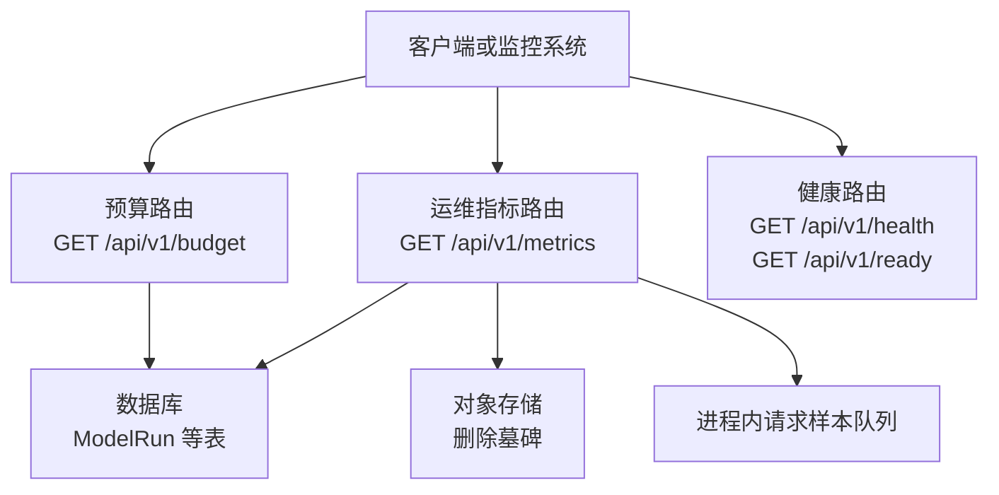
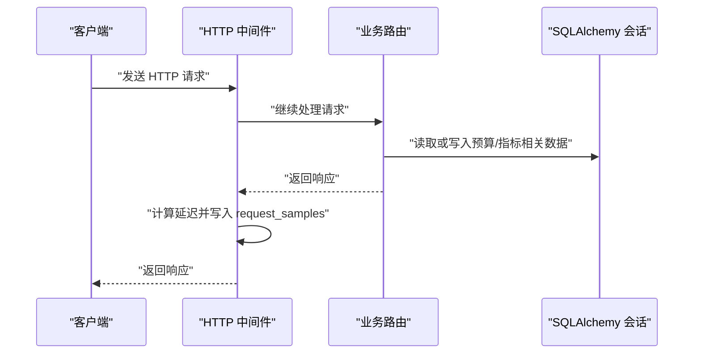
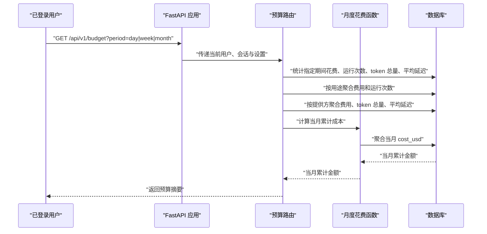
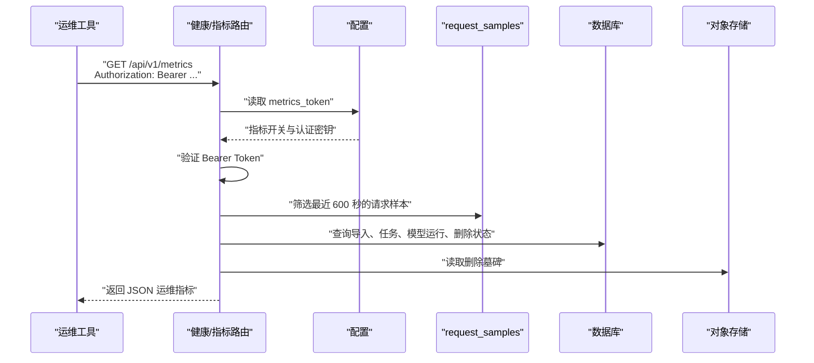
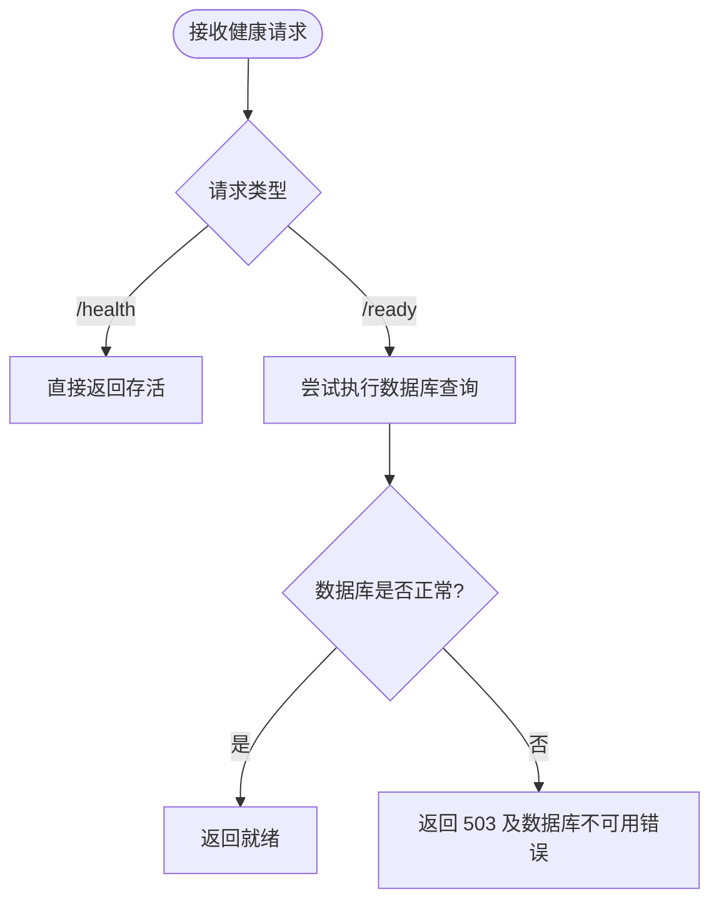
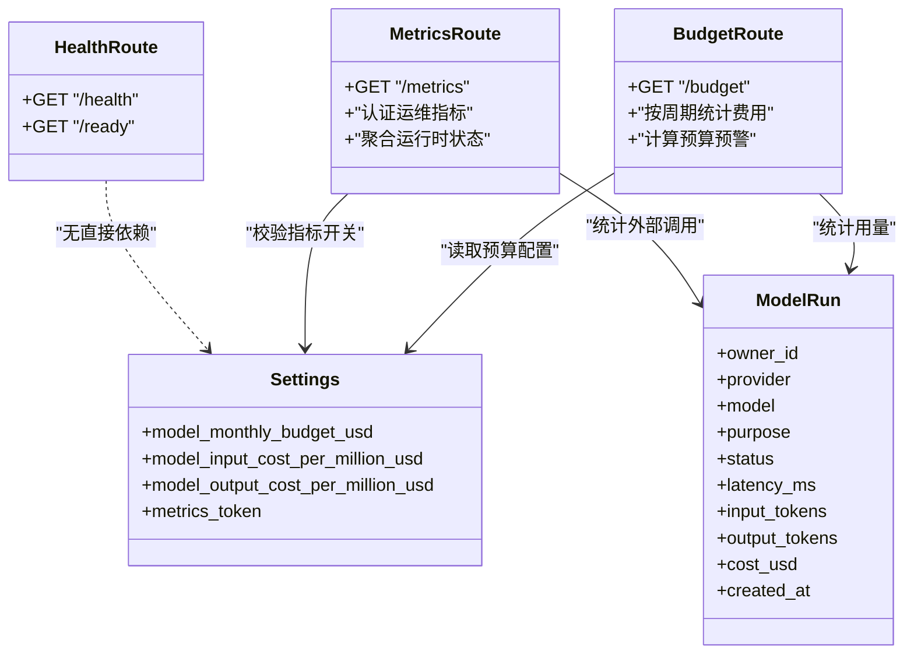

# 预算、指标与监控 API

<cite>
**本文引用的文件**   
- [main.py](file://src/personal_ai_life_os/main.py)
- [budget.py](file://src/personal_ai_life_os/api/routes/budget.py)
- [metrics.py](file://src/personal_ai_life_os/api/routes/metrics.py)
- [health.py](file://src/personal_ai_life_os/api/routes/health.py)
- [schemas.py](file://src/personal_ai_life_os/api/schemas.py)
- [model_usage.py](file://src/personal_ai_life_os/services/model_usage.py)
- [models.py](file://src/personal_ai_life_os/models.py)
- [config.py](file://src/personal_ai_life_os/config.py)
- [graph_extraction.py](file://src/personal_ai_life_os/services/graph_extraction.py)
- [test_budget.py](file://tests/test_budget.py)
- [test_health.py](file://tests/test_health.py)
</cite>

## 目录
1. [引言](#引言)
2. [项目结构定位](#项目结构定位)
3. [核心组件总览](#核心组件总览)
4. [架构与调用流程](#架构与调用流程)
5. [详细组件分析](#详细组件分析)
6. [依赖关系与数据模型](#依赖关系与数据模型)
7. [成本估算、预算阈值与强制执行](#成本估算预算阈值与强制执行)
8. [系统指标与健康检查 API](#系统指标与健康检查-api)
9. [查询与分析示例](#查询与分析示例)
10. [性能特征与容量规划](#性能特征与容量规划)
11. [故障诊断指南](#故障诊断指南)
12. [监控数据保留策略与企业能力说明](#监控数据保留策略与企业能力说明)
13. [结论](#结论)

## 引言
本文面向平台运维人员、后端开发者以及具备一定技术背景的业务用户，系统化说明本系统中的三类能力：

- **预算监控**：基于 ModelUsage 语义的 `ModelRun` 用量追踪，按月统计成本、按用途和提供方拆分、触发预算警告或阻断。
- **系统指标**：暴露当前进程内的请求延迟、吞吐量、导入与后台任务状态、外部模型调用次数与成本估计等运行健康信号。
- **健康检查**：提供轻量存活探测与数据库可达性就绪探测，作为容器编排和服务网格入口的基本健康判断。

需要特别说明的是：**当前实现没有直接暴露 Prometheus 文本格式 `/metrics` 端点**。`/api/v1/metrics` 是一个受认证的 JSON 运维接口，可通过鉴权访问；若需要 Prometheus 输出，应通过采集该接口并在上游网关中转换，或由平台方自行扩展中间件指标采集管道。

## 项目结构定位
预算、指标与健康检查分别由独立的 FastAPI Router 管理，再统一注册到应用主模块中：

| 能力 | 路由前缀 | 主要入口文件 | 主要职责 |
|---|---|---|---|
| 预算 | `/api/v1/budget` | `budget.py` | 按日、周、月统计费用、令牌量、失败预留成本、用途与提供方分布 |
| 运维指标 | `/api/v1/metrics` | `metrics.py` | 在启用并认证后返回进程内运行时健康指标 |
| 健康检查 | `/api/v1/health` 与 `/api/v1/ready` | `health.py` | Liveness 与 Readiness 检查 |
| 配置 | 环境加载 | `config.py` | 控制是否启用指标、每月预算、每 token 成本、每调用最大成本等 |
| 数据存储 | SQLAlchemy ORM | `models.py` | 记录 `ModelRun`、`BackgroundJob`、`SyncRun`、`SourceConnection`、`User` 等实体 |

图表来源
- [budget.py:18-118](file://src/personal_ai_life_os/api/routes/budget.py#L18-L118)
- [metrics.py:12-129](file://src/personal_ai_life_os/api/routes/metrics.py#L12-L129)
- [health.py:9-27](file://src/personal_ai_life_os/api/routes/health.py#L9-L27)
- [main.py:229-249](file://src/personal_ai_life_os/main.py#L229-L249)

**章节来源**
- [main.py:158-249](file://src/personal_ai_life_os/main.py#L158-L249)

## 核心组件总览

### ModelUsage 语义与 `ModelRun`
项目中虽然没有独立名为 `ModelUsage` 的服务类，但用量追踪通过以下机制实现：

- 每次调用外部模型时，最终会落库一条 `ModelRun` 记录，包含提供方、模型名称、用途、状态、延迟、输入 token、输出 token 和美元成本。
- 预算服务按用户隔离，聚合这些记录形成按期间、按用途、按提供方的汇总视图。
- `monthly_spend` 计算当月累计成本，用于预算预警和配额阻断。
- `model_cost_usd` 使用配置的输入和输出每百万 token 价格估算单条调用的成本。

**章节来源**
- [models.py:764-781](file://src/personal_ai_life_os/models.py#L764-L781)
- [model_usage.py:1-20](file://src/personal_ai_life_os/services/model_usage.py#L1-L20)
- [graph_extraction.py:235-244](file://src/personal_ai_life_os/services/graph_extraction.py#L235-L244)
- [graph_extraction.py:737-744](file://src/personal_ai_life_os/services/graph_extraction.py#L737-L744)

### 三个关键路由
- **预算接口**：受用户认证保护，不暴露内部标识，只按当前用户统计消费。
- **指标接口**：当配置了 `METRICS_TOKEN` 时启用；请求必须携带有效 Bearer Token。
- **健康接口**：完全公开，`/ready` 额外校验数据库连接。

**章节来源**
- [budget.py:10-118](file://src/personal_ai_life_os/api/routes/budget.py#L10-L118)
- [metrics.py:12-129](file://src/personal_ai_life_os/api/routes/metrics.py#L12-L129)
- [health.py:9-27](file://src/personal_ai_life_os/api/routes/health.py#L9-L27)

## 架构与调用流程

### 全局中间件对请求指标的贡献
应用启动时在 `app.state.request_samples` 中维护一个最多保存 1000 条记录的请求延迟采样队列。每条记录包含时间戳、毫秒延迟和 HTTP 状态码。这是 `/api/v1/metrics` 中 P95 延迟、5xx 采样总数的基础。

图表来源
- [main.py:158-164](file://src/personal_ai_life_os/main.py#L158-L164)
- [main.py:208-217](file://src/personal_ai_life_os/main.py#L208-L217)

**章节来源**
- [main.py:158-217](file://src/personal_ai_life_os/main.py#L158-L217)

### 预算查询端到端流程

图表来源
- [budget.py:18-118](file://src/personal_ai_life_os/api/routes/budget.py#L18-L118)
- [graph_extraction.py:235-244](file://src/personal_ai_life_os/services/graph_extraction.py#L235-L244)

**章节来源**
- [budget.py:18-118](file://src/personal_ai_life_os/api/routes/budget.py#L18-L118)
- [test_budget.py:11-64](file://tests/test_budget.py#L11-L64)

### 指标采集与认证流程

图表来源
- [metrics.py:12-129](file://src/personal_ai_life_os/api/routes/metrics.py#L12-L129)
- [config.py:16-132](file://src/personal_ai_life_os/config.py#L16-L132)
- [main.py:158-217](file://src/personal_ai_life_os/main.py#L158-L217)

**章节来源**
- [metrics.py:12-129](file://src/personal_ai_life_os/api/routes/metrics.py#L12-L129)

## 详细组件分析

### 预算路由
#### 主要行为
- 支持 `period=day|week|month` 三种统计范围。
- 仅统计当前 `owner_id` 的记录。
- 将 `fallback`、`budget_fallback`、`budget_exceeded`、`consent_withdrawn` 视为失败状态，统计其成本为“失败预留金额”。
- 计算当月总额，得出剩余预算、预警标志和超预算标志。
- 返回按用途和按提供方的维度分组结果。

#### 输入输出要点
- 输入参数：`period`，默认 `month`。
- 主要返回字段：
  - `month`：以 `%Y-%m` 表示的当月。
  - `period`：查询周期。
  - `spent_usd`：期间消耗。
  - `limit_usd`：每月预算上限。
  - `remaining_usd`：剩余预算，最小为零。
  - `warning`：当月累计超过 80% 时开启。
  - `over_budget`：当月累计超过预算上限时开启。
  - `runs`：期间运行次数。
  - `input_tokens`、`output_tokens`：输入输出 token 合计。
  - `avg_latency_ms`：期间平均延迟。
  - `failure_reserve_usd`：失败状态的备用成本。
  - `by_purpose`：按用途分组。
  - `by_provider`：按提供方分组。

#### 错误处理
- 未认证请求不会命中业务逻辑；认证通过后，结果按用户隔离。
- 若不存在符合条件的记录，聚合结果使用安全默认值。

**章节来源**
- [budget.py:10-118](file://src/personal_ai_life_os/api/routes/budget.py#L10-L118)
- [schemas.py:852-881](file://src/personal_ai_life_os/api/schemas.py#L852-L881)
- [test_budget.py:11-64](file://tests/test_budget.py#L11-L64)

### 运维指标路由
#### 鉴权与启用
- 如果未配置 `metrics_token`，直接返回 404，提示指标未启用。
- 否则要求 `Authorization` 头部是有效的 `Bearer <token>`，并使用恒定时间比较防时序侧信道攻击。
- 在生产环境中，`metrics_token` 必须是长度至少为 32 的唯一值；否则会在校验阶段拒绝启动。

#### 指标含义
| 指标字段 | 含义 |
|---|---|
| `window_seconds` | 当前延迟窗口，固定 600 秒 |
| `imports_enabled` | 导入功能是否启用 |
| `requests_sampled` | 采样范围内的请求总数 |
| `http_5xx_sampled` | 采样范围内状态码大于等于 500 的请求数 |
| `request_latency_p95_ms` | 样本 P95 延迟 |
| `imports_failed_24h` | 过去 24 小时失败的同步运行数量 |
| `imports_processing` | 正在处理的同步运行数量 |
| `jobs_queued` | 排队中的后台作业数 |
| `jobs_running` | 运行中的后台作业数 |
| `jobs_failed_24h` | 过去 24 小时失败的后台作业数 |
| `job_queue_oldest_seconds` | 最早可取用的排队作业的等待秒数 |
| `deletions_pending` | 未完成删除的对象墓碑数量 |
| `deletion_oldest_pending_seconds` | 最久的待完成删除请求年龄 |
| `deletion_sources_blocked` | 处于删除中的源连接数 |
| `deletion_accounts_blocked` | 已申请删除的账户数 |
| `deletion_duration_p95_seconds` | 已完成删除操作持续时间的 P95 |
| `external_model_calls` | 所有外部模型调用记录数 |
| `external_review_calls` | 用途为每周审查的外部调用数 |
| `external_photo_description_calls` | 用途为图片描述的外部调用数 |
| `external_model_failures` | 外部调用失败或回退次数 |
| `external_model_budget_fallbacks` | 因预算触发的回退次数 |
| `external_model_budget_exceeded` | 达到预算上限标记的次数 |
| `external_model_input_tokens` | 全部外部调用的输入 token 合计 |
| `external_model_output_tokens` | 全部外部调用的输出 token 合计 |
| `external_model_estimated_cost_usd` | 全部外部调用估计成本 |
| `external_review_estimated_cost_usd` | 每周审查外部调用估计成本 |
| `external_photo_description_estimated_cost_usd` | 图片描述外部调用估计成本 |

#### 数据源
- HTTP 请求延迟来自中间件的内存采样队列。
- 导入、后台作业、用户、源连接等信息来自数据库。
- 删除相关信息部分来自对象存储中的删除墓碑列表。

**章节来源**
- [metrics.py:12-129](file://src/personal_ai_life_os/api/routes/metrics.py#L12-L129)
- [config.py:50-132](file://src/personal_ai_life_os/config.py#L50-L132)
- [main.py:158-217](file://src/personal_ai_life_os/main.py#L158-L217)

### 健康检查路由
#### `/api/v1/health`
- 轻量存活探针。
- 成功返回 `"status": "ok"`。
- 无需数据库连接，适合快速判断进程是否存活。

#### `/api/v1/ready`
- 就绪探针。
- 执行简单 SQL 查询确认数据库可用。
- 数据库不可用时返回 503，错误码为 `database_unavailable`。
- 适用于负载均衡器或服务网格的上游健康判定。

图表来源
- [health.py:9-27](file://src/personal_ai_life_os/api/routes/health.py#L9-L27)

**章节来源**
- [health.py:9-27](file://src/personal_ai_life_os/api/routes/health.py#L9-L27)
- [test_health.py:1-22](file://tests/test_health.py#L1-L22)

## 依赖关系与数据模型

### `ModelRun` 数据模型
| 字段 | 类型 | 作用 |
|---|---|---|
| `id` | UUID 字符串 | 记录主键 |
| `owner_id` | UUID 字符串 | 租户和用户隔离 |
| `provider` | 字符串 | 模型提供方标识 |
| `model` | 字符串 | 模型名称 |
| `purpose` | 字符串 | 用途分类，如图抽取、每周审查、图片描述 |
| `status` | 字符串 | 执行状态，包括成功、失败、回退、预算超限、同意撤回等 |
| `prompt_version` | 字符串 | 提示词版本 |
| `latency_ms` | 整数 | 调用耗时毫秒 |
| `input_tokens` | 整数 | 输入 token 数 |
| `output_tokens` | 整数 | 输出 token 数 |
| `cost_usd` | Decimal | 估算成本 |
| `created_at` | UTC 时间 | 创建时间，用于期间统计 |

索引方面，`ModelRun` 针对 `(owner_id, created_at)` 建立索引，有利于按月聚合和本用户过滤。

**章节来源**
- [models.py:764-781](file://src/personal_ai_life_os/models.py#L764-L781)

### 预算相关响应模式
| 模式 | 关键字段 | 说明 |
|---|---|---|
| `BudgetPurposeResponse` | `purpose`、`cost_usd`、`runs` | 按用途的成本与运行次数 |
| `BudgetProviderResponse` | `provider`、`cost_usd`、`runs`、`input_tokens`、`output_tokens`、`avg_latency_ms` | 按提供方的多维度统计 |
| `BudgetResponse` | `month`、`period`、`spent_usd`、`limit_usd`、`remaining_usd`、`warning`、`over_budget` 等 | 完整预算摘要 |

**章节来源**
- [schemas.py:852-881](file://src/personal_ai_life_os/api/schemas.py#L852-L881)

### 对象与模块依赖关系

图表来源
- [budget.py:10-118](file://src/personal_ai_life_os/api/routes/budget.py#L10-L118)
- [metrics.py:12-129](file://src/personal_ai_life_os/api/routes/metrics.py#L12-L129)
- [health.py:9-27](file://src/personal_ai_life_os/api/routes/health.py#L9-L27)
- [models.py:764-781](file://src/personal_ai_life_os/models.py#L764-L781)
- [config.py:50-132](file://src/personal_ai_life_os/config.py#L50-L132)

## 成本估算、预算阈值与强制执行

### 成本估算
- 成本估算函数读取配置的输入价格和输出价格，单位为每百万 token。
- 只有两个价格都大于零时才会返回估算值；否则返回空值。
- 计算公式为 `(输入 token × 输入单价 + 输出 token × 输出单价) ÷ 一百万`。

实际落库的 `ModelRun.cost_usd` 可能为空；预算聚合时采用 `coalesce(..., 0)` 方式避免空值导致聚合异常。

**章节来源**
- [model_usage.py:1-20](file://src/personal_ai_life_os/services/model_usage.py#L1-L20)
- [budget.py:34-48](file://src/personal_ai_life_os/api/routes/budget.py#L34-L48)

### 月度预算与阈值策略
| 阈值 | 条件 | 行为 |
|---|---|---|
| 预算上限 | `limit > 0` 且当月累计大于上限 | `over_budget=True`，并可能产生预算超额记录 |
| 预算预警线 | `limit > 0` 且当月累计大于等于上限的 80% | `warning=True` |
| 执行阻断 | 本次调用预估后会超出月度预算 | 抛出预算超标错误，阻止图抽取等操作 |
| 桌面模式 | 特殊部署模式 | 预算校验条件略有差异，但依然尊重预算逻辑 |

其中预算阻断发生在具体的图抽取流程中：若当月已花费加上当前预留成本会超过 `model_monthly_budget_usd`，则抛出业务错误，错误码包含 `model_budget_exceeded`。

**章节来源**
- [budget.py:34-48](file://src/personal_ai_life_os/api/routes/budget.py#L34-L48)
- [graph_extraction.py:737-744](file://src/personal_ai_life_os/services/graph_extraction.py#L737-L744)
- [config.py:96-132](file://src/personal_ai_life_os/config.py#L96-L132)

### 预算失败状态的用途
预算相关的失败状态不仅影响成本统计，也进入 `failure_reserve_usd` 与运维指标中的预算回退计数，有助于分析成本是否被预算策略主动吸收。

- `budget_fallback`：因预算回退而改用其他路径。
- `budget_exceeded`：明确标记预算超限场景。
- `fallback`：通用回退状态。
- `consent_withdrawn`：用户撤销模型使用同意。

**章节来源**
- [budget.py:14-34](file://src/personal_ai_life_os/api/routes/budget.py#L14-L34)
- [metrics.py:72-94](file://src/personal_ai_life_os/api/routes/metrics.py#L72-L94)

## 系统指标与健康检查 API

### API 总览
| 端点 | 方法 | 鉴权 | 返回值类型 | 主要用途 |
|---|---|---|---|---|
| `/api/v1/budget` | GET | 用户访问令牌 | `BudgetResponse` | 查看个人月度预算、用途拆分、提供方拆分 |
| `/api/v1/metrics` | GET | 运维 Bearer Token | JSON 文档 | 查询延迟、错误采样、导入状态、作业队列、删除进度、外部模型使用情况 |
| `/api/v1/health` | GET | 无 | JSON | 存活探测 |
| `/api/v1/ready` | GET | 无 | JSON | 数据库就绪探测 |

**章节来源**
- [budget.py:10-118](file://src/personal_ai_life_os/api/routes/budget.py#L10-L118)
- [metrics.py:12-129](file://src/personal_ai_life_os/api/routes/metrics.py#L12-L129)
- [health.py:9-27](file://src/personal_ai_life_os/api/routes/health.py#L9-L27)

### 指标字段分类
- **Web 性能**：`request_latency_p95_ms`、`http_5xx_sampled`、`requests_sampled`。
- **数据导入**：`imports_failed_24h`、`imports_processing`、`imports_enabled`。
- **后台任务**：`jobs_queued`、`jobs_running`、`jobs_failed_24h`、`job_queue_oldest_seconds`。
- **数据删除**：`deletions_pending`、`deletion_oldest_pending_seconds`、`deletion_duration_p95_seconds`、`deletion_sources_blocked`、`deletion_accounts_blocked`。
- **外部模型**：调用次数、失败次数、预算相关状态、token 量和估算成本。

**章节来源**
- [metrics.py:30-129](file://src/personal_ai_life_os/api/routes/metrics.py#L30-L129)

### 是否需要 Prometheus 格式？
- 当前代码未实现标准的 Prometheus 文本协议处理器。
- `/api/v1/metrics` 输出的是 JSON，便于结构化消费。
- 如需 Prometheus 生态集成，可在现有指标 JSON 基础上增加一层适配：定期拉取本接口并按指标名映射生成 Prometheus 指标格式。

[本节为通用指导，不直接分析具体代码行]

## 查询与分析示例

### 成本报告
推荐组合使用预算接口与指标接口：

| 目标 | 建议查询 | 数据来源 |
|---|---|---|
| 当月整体花费 | `GET /api/v1/budget?period=month` | `BudgetResponse.spent_usd` |
| 超预算告警 | 查看 `BudgetResponse.warning` 和 `BudgetResponse.over_budget` | 预算路由 |
| 按提供方分析 | 遍历 `BudgetResponse.by_provider` | 预算路由 |
| 按用途分析 | 遍历 `BudgetResponse.by_purpose` | 预算路由 |
| 历史趋势 | 定时拉取不同日期的预算快照并保存 | 预算路由历史聚合 |
| 外部成本汇总 | 使用 `external_model_estimated_cost_usd` | 指标路由 |

**章节来源**
- [budget.py:34-118](file://src/personal_ai_life_os/api/routes/budget.py#L34-L118)
- [metrics.py:96-129](file://src/personal_ai_life_os/api/routes/metrics.py#L96-L129)

### 性能趋势
- 使用 `/api/v1/metrics` 周期性采集 P95 延迟。
- 同时观察 `http_5xx_sampled` 判断 5xx 错误比例。
- 若长期出现高延迟或高失败率，应结合后台任务队列积压情况一起排查。

[本节为概念性使用说明]

### 容量规划
- 根据 `external_model_input_tokens` 与 `external_model_output_tokens` 的趋势估算未来 token 用量。
- 结合 `model_input_cost_per_million_usd` 和 `model_output_cost_per_million_usd` 估算未来成本。
- 关注 `job_queue_oldest_seconds`，队列变长通常代表处理能力不足。
- 关注 `deletions_pending` 和 `deletion_duration_p95_seconds`，评估对象存储删除清理能力。

**章节来源**
- [metrics.py:30-129](file://src/personal_ai_life_os/api/routes/metrics.py#L30-L129)
- [config.py:50-110](file://src/personal_ai_life_os/config.py#L50-L110)

## 性能特征与容量规划

### 预算查询复杂度
预算查询主要通过 SQL 聚合完成：
- 一次聚合获取总花费、运行次数、token 总和、平均延迟和失败储备成本。
- 一次按用途分组聚合。
- 一次按提供方分组聚合。
- 一次按月聚合获取当月总花费。

数据库层承担主要计算压力，Python 层只做格式化与阈值计算。对于高频次、超大表的长期趋势分析，建议在平台层追加物化视图、时间分区或使用专用分析数据库。

**章节来源**
- [budget.py:34-118](file://src/personal_ai_life_os/api/routes/budget.py#L34-L118)
- [graph_extraction.py:235-244](file://src/personal_ai_life_os/services/graph_extraction.py#L235-L244)

### 指标采集的性能影响
- 每个 HTTP 请求都会记录延迟和状态码。
- 队列最大长度为 1000，使用双端队列，插入和截断都是常数时间操作。
- 指标查询会对样本排序计算 P95，因此在高吞吐环境下，频繁采集可能带来少量 CPU 开销。
- 指标路由还会扫描全部 `ModelRun` 以统计多种状态，因此在极大表规模下应考虑限制返回粒度或增加缓存层。

**章节来源**
- [main.py:158-217](file://src/personal_ai_life_os/main.py#L158-L217)
- [metrics.py:36-110](file://src/personal_ai_life_os/api/routes/metrics.py#L36-L110)

## 故障诊断指南

### 预算相关故障
| 现象 | 可能原因 | 定位方式 |
|---|---|---|
| 预算始终显示 0 | 没有对应的 `ModelRun` 记录 | 检查图抽取或外部模型调用链路是否落库 |
| 经常出现预算超占 | 当月累计接近或超过 `model_monthly_budget_usd` | 查看 `warning` 和 `over_budget` |
| 调用被拒绝 | 图抽取流程检测到预算超标 | 检查上层报错中是否包含 `model_budget_exceeded` |
| 费用不为零但缺少 token | `cost_usd` 存在但 token 记录缺失 | 检查外部调用记录写入逻辑 |
| 失败储备成本高 | 大量失败、回退或同意撤回记录 | 检查 `failure_reserve_usd` 和相应状态 |

**章节来源**
- [budget.py:14-118](file://src/personal_ai_life_os/api/routes/budget.py#L14-L118)
- [graph_extraction.py:737-744](file://src/personal_ai_life_os/services/graph_extraction.py#L737-L744)

### 指标不可用
| 现象 | 可能原因 | 解决方案 |
|---|---|---|
| 404 且提示指标未启用 | 未配置 `metrics_token` | 设置有效 `METRICS_TOKEN` |
| 401 | `Authorization` 头缺失、不是 Bearer 或 Token 不正确 | 使用正确运维令牌 |
| P95 延迟始终为 0 | 几乎没有请求经过中间件或未产生样本 | 确认服务有正常流量 |

**章节来源**
- [metrics.py:18-45](file://src/personal_ai_life_os/api/routes/metrics.py#L18-L45)

### 健康检查问题
| 现象 | 含义 | 处理方式 |
|---|---|---|
| `/api/v1/health` 正常但 `/api/v1/ready` 返回 503 | 服务进程存活但数据库不可用 | 检查数据库连接、迁移、权限和网络 |
| `/api/v1/ready` 返回数据库不可用错误 | 数据库查询失败 | 查看底层数据库日志和连接池状态 |

**章节来源**
- [health.py:9-27](file://src/personal_ai_life_os/api/routes/health.py#L9-L27)
- [test_health.py:13-22](file://tests/test_health.py#L13-L22)

## 监控数据保留策略与企业能力说明

### 现有保留策略
- **进程内请求延迟采样**：默认保留最近 1000 条，时间戳位于最近约 600 秒窗口内，超过容量会被队尾淘汰。
- **`ModelRun` 历史记录**：持久保存在数据库中，可用于长期报表、审计和历史分析；当前预算路由本身只按 period 计算，不自动实施历史归档策略。
- **删除墓碑**：存储在对象存储中，用于追踪删除生命周期；指标接口会从中计算待处理和最长等待删除的信息。
- **指标缓存**：`/api/v1/metrics` 未做跨请求缓存，每次调用实时计算。

### 企业能力现状与建议
| 能力 | 当前实现 | 建议扩展方向 |
|---|---|---|
| 实时监控 | 指标 JSON 接口 | 对接企业监控平台或添加采集代理 |
| Prometheus 输出 | 未内置 | 通过采集适配器转换 `/api/v1/metrics` |
| 长期指标保留 | 未内置时间序列数据库 | 引入时序数据库或对象存储归档 |
| 批量导出 | 可按用户预算快照与运维指标周期性导出 | 增加导出端点或离线脚本 |
| 多维历史聚合 | 依赖外部存储原始数据后进行二次分析 | 使用分析数据库或数据仓库 |
| 多级预算组织 | 按用户隔离 | 可叠加组织级预算视图 |
| 历史预算查询 | 当前只返回当前月汇总 | 可扩展期间参数或新增历史报告接口 |
| 容量规划建议 | 需人工解读 | 可结合趋势引擎自动产出容量建议 |

**章节来源**
- [main.py:158-164](file://src/personal_ai_life_os/main.py#L158-L164)
- [metrics.py:30-129](file://src/personal_ai_life_os/api/routes/metrics.py#L30-L129)
- [models.py:764-781](file://src/personal_ai_life_os/models.py#L764-L781)

## 结论
本项目的预算、指标与健康检查体系围绕以下三条主线构建：

1. **预算主线**：通过 `ModelRun` 记录外部模型调用成本，由预算路由提供用户级月度消费视图，并通过月度花费函数在业务流程中执行强预算拦截。
2. **指标主线**：利用内存采样、数据库和对象存储共同组成一套轻量运维指标集，适合 Kubernetes、Prometheus 采集器和企业内部监控面板。
3. **健康主线**：对外暴露 liveness 和 readiness 探针，保障调度层可靠判断服务状态。

若企业需求进一步提升，建议优先补齐如下能力：
- 将 `/api/v1/metrics` 封装为 Prometheus 可读输出。
- 对 `ModelRun`、作业队列和删除流程进行长期历史归档。
- 提供预算、成本和性能趋势的批量导出接口。
- 在生产环境严格配置 `METRICS_TOKEN`、月度预算、每 token 定价和每调用最大成本，使预算预警和阻断真正生效。