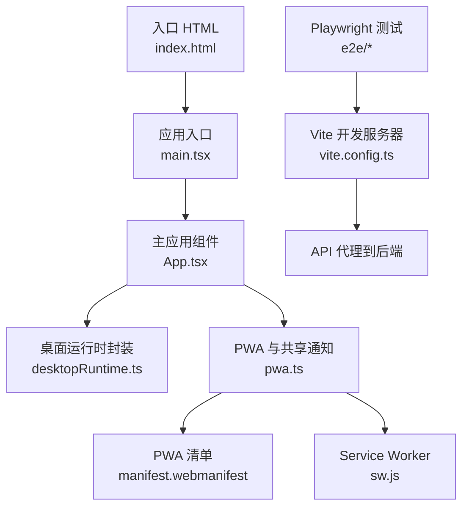
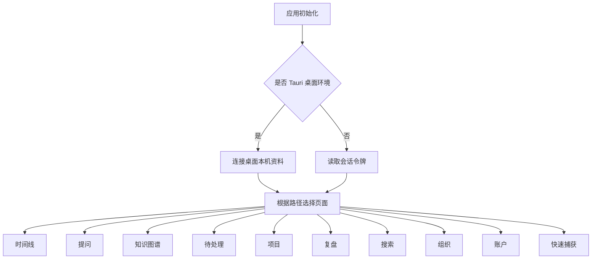
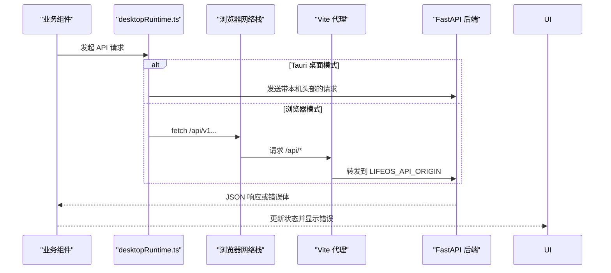
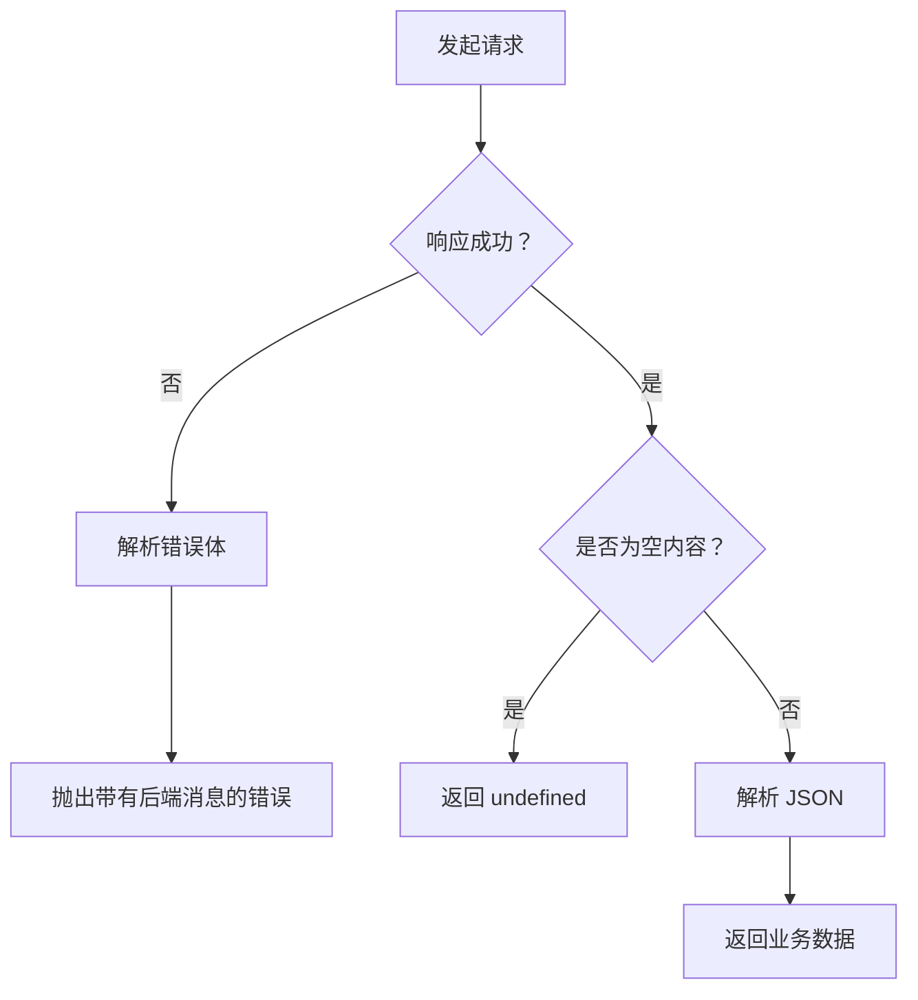
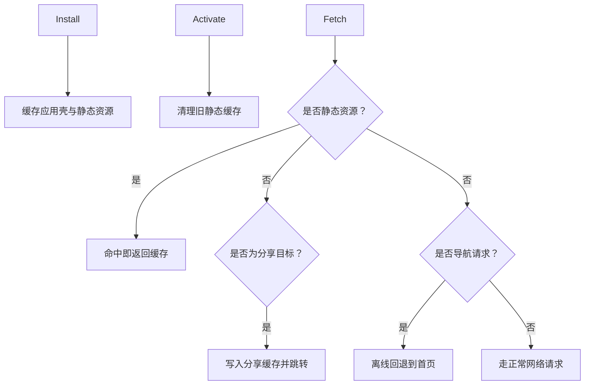
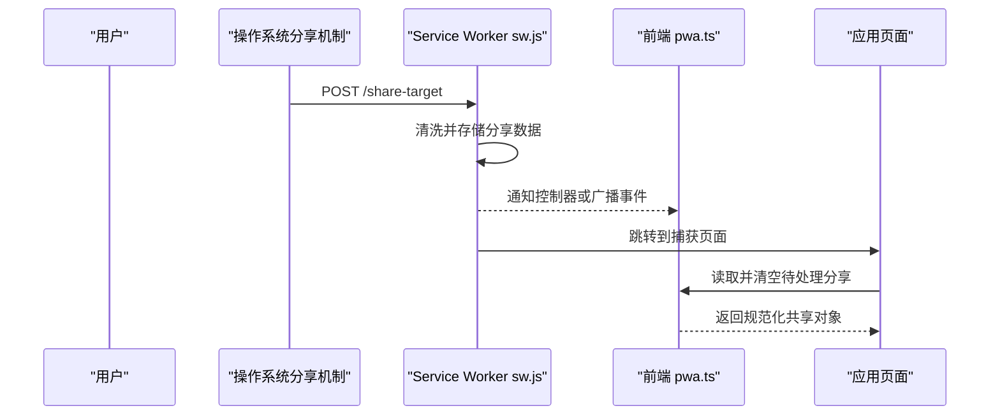
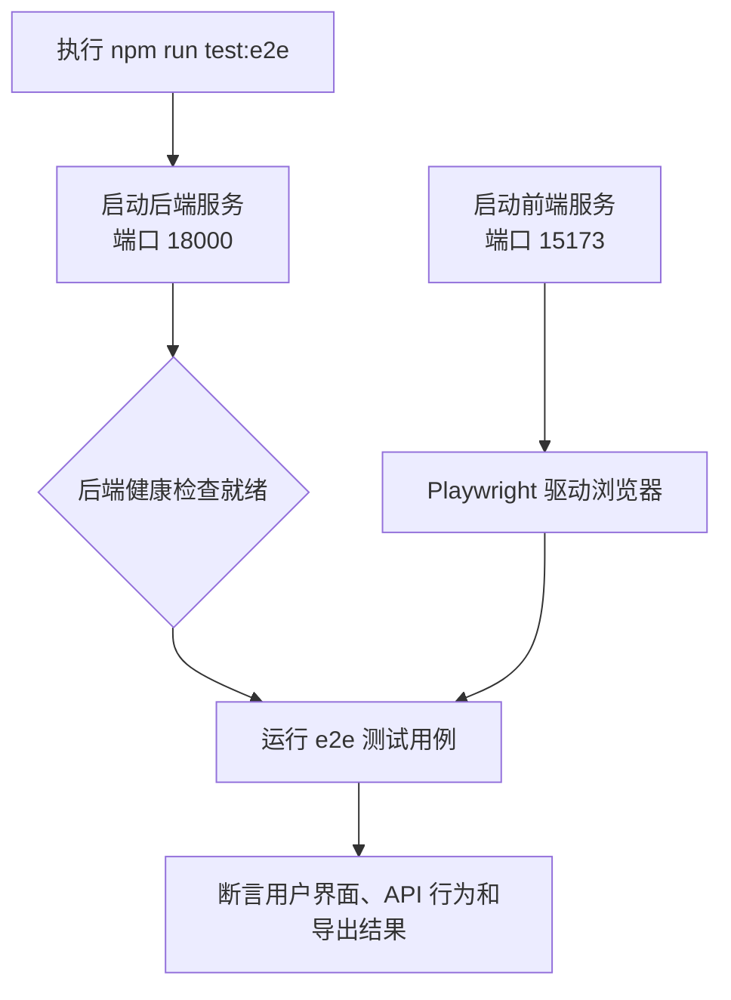

# 前端应用

<cite>
**本文引用的文件 **
- [package.json](file://web/package.json)
- [README.md](file://web/README.md)
- [vite.config.ts](file://web/vite.config.ts)
- [tsconfig.app.json](file://web/tsconfig.app.json)
- [index.html](file://web/index.html)
- [main.tsx](file://web/src/main.tsx)
- [App.tsx](file://web/src/App.tsx)
- [App.css](file://web/src/App.css)
- [desktopRuntime.ts](file://web/src/desktopRuntime.ts)
- [pwa.ts](file://web/src/pwa.ts)
- [manifest.webmanifest](file://web/public/manifest.webmanifest)
- [sw.js](file://web/public/sw.js)
- [playwright.config.ts](file://web/playwright.config.ts)
- [.oxlintrc.json](file://web/.oxlintrc.json)
- [e2e/workflow.spec.ts](file://web/e2e/workflow.spec.ts)
- [e2e/m10.spec.ts](file://web/e2e/m10.spec.ts)
</cite>

## 目录

1. [引言](#引言)
2. [项目结构](#项目结构)
3. [构建、运行时与依赖](#构建运行时与依赖)
4. [组件架构与状态模型](#组件架构与状态模型)
5. [后端通信与错误处理](#后端通信与错误处理)
6. [渐进式 Web 应用支持](#渐进式-web-应用支持)
7. [端到端测试流程](#端到端测试流程)
8. [样式、主题、无障碍与跨浏览器兼容](#样式主题无障碍与跨浏览器兼容)
9. [代码质量与构建管道](#代码质量与构建管道)
10. [性能优化建议](#性能优化建议)
11. [组件复用与样式组织指南](#组件复用与样式组织指南)
12. [故障排查](#故障排查)
13. [结论](#结论)

## 引言

Personal-AI-Life-OS 的前端位于 `web` 目录，是一个基于 React 19 和 TypeScript 7 的单页应用，使用 Vite 8 进行开发与生产构建。应用通过 `/api/v1` 与后端的 FastAPI 服务通信，支持桌面端 Tauri 环境下的本地通道运行，同时提供浏览器端的 PWA 能力，包括 Service Worker、离线应用壳缓存、移动端共享目标和本地通知触发。

该文档从架构、组件层次、状态管理、PWA 行为、E2E 测试、样式与主题、代码质量以及性能优化等角度，系统化说明前端的设计和使用方式。它适合希望理解整体前端结构的开发者、需要调试问题的维护者，以及想要扩展功能的新贡献者阅读。

## 项目结构

`web` 目录是独立的前端包：

- `src`：React 源码，包含应用入口、主页面逻辑、桌面运行时封装、PWA 共享与通知支持、样式和导出工具。
- `public`：静态资源，包括 PWA manifest、Service Worker、图标和 favicon。
- `e2e`：Playwright 端到端测试用例。
- 根级配置文件：Vite、TypeScript、Oxlint、Docker 和 Playwright 配置。

**图表来源**
- [index.html:1-17](file://web/index.html#L1-L17)
- [main.tsx:1-17](file://web/src/main.tsx#L1-L17)
- [App.tsx:156-210](file://web/src/App.tsx#L156-L210)
- [desktopRuntime.ts:1-45](file://web/src/desktopRuntime.ts#L1-L45)
- [pwa.ts:1-108](file://web/src/pwa.ts#L1-L108)
- [manifest.webmanifest:1-38](file://web/public/manifest.webmanifest#L1-L38)
- [sw.js:1-129](file://web/public/sw.js#L1-L129)
- [vite.config.ts:1-17](file://web/vite.config.ts#L1-L17)
- [playwright.config.ts:1-53](file://web/playwright.config.ts#L1-L53)

**章节来源**
- [index.html:1-17](file://web/index.html#L1-L17)
- [vite.config.ts:1-17](file://web/vite.config.ts#L1-L17)

## 构建、运行时与依赖

### 依赖版本

| 类别 | 包名 | 用途 |
|---|---|---|
| 运行时依赖 | `react`、`react-dom` | React 19 UI 框架和 DOM 渲染 |
| 运行时依赖 | `@tauri-apps/api` | 在 Tauri 环境中调用本地能力 |
| 开发依赖 | `vite` | Vite 8 构建与开发服务器 |
| 开发依赖 | `@vitejs/plugin-react` | React JSX 支持 |
| 开发依赖 | `typescript` | TypeScript 7 类型检查 |
| 开发依赖 | `@playwright/test` | 端到端浏览器测试 |
| 开发依赖 | `@tauri-apps/cli` | Tauri 桌面工具链 |
| 开发依赖 | `oxlint` | Oxlint 快速语法与规则检查 |

### 脚本命令

| 命令 | 行为 |
|---|---|
| `npm run dev` | 启动 Vite 开发服务器 |
| `npm run build` | 先执行 TypeScript 类型检查，再构建产物 |
| `npm run preview` | 预览构建后的静态产物 |
| `npm run lint` | 使用 Oxlint 检查代码 |
| `npm run test:e2e` | 执行 Playwright 端到端测试 |

### TypeScript 编译选项要点

- 目标为 ES2023，模块系统采用 bundler 模式。
- 启用 `noUnusedLocals`、`noUnusedParameters`、`erasableSyntaxOnly` 和严格 switch 分支检查。
- JSX 使用 `react-jsx`，并跳过库类型检查以提升开发效率。
- 允许导入 `.tsx` 拓展名并强制模块检测。

**章节来源**
- [package.json:1-29](file://web/package.json#L1-L29)
- [tsconfig.app.json:1-26](file://web/tsconfig.app.json#L1-L26)
- [README.md:1-32](file://web/README.md#L1-L32)

## 组件架构与状态模型

### 单文件主应用

当前前端以 `src/App.tsx` 作为主应用入口，集中管理页面路由、认证态、时间线、复盘、提醒、搜索、标签、集合、模型提供方、待办任务、后台作业、共享捕获和桌面集成等状态。虽然仓库中没有拆分为多个细粒度组件文件，但从代码组织可以看出一个明确的页面级结构。

| 页面或领域 | 主要职责 |
|---|---|
| 时间线 | 加载条目、分页、过滤、上传导入、删除来源 |
| 提问与问答 | 调用问答接口、展示证据和引用、管理线程 |
| 知识图谱审查 | 列出实体、关系、合并任务和自动审查建议 |
| 待办与计划 | 加载提醒、生成周复盘草稿、保存提醒计划 |
| 搜索 | 按时间线、复盘和提醒检索，支持保存查询 |
| 组织管理 | 标签、集合、已选条目的标签与分类关联 |
| 账户与设置 | 登录注册、模型披露、模型提供方选择 |
| 快速捕获 | 显示标题、正文和来源 URL，支持移动端分享入口 |
| 桌面数据与文件夹 | 扫描桌面文件夹、同步状态和本机数据处理 |
| 聊天导入 | 解析 ChatGPT 对话和通用聊天记录 |

### 页面导航模型

**图表来源**
- [App.tsx:1-155](file://web/src/App.tsx#L1-L155)
- [App.tsx:156-210](file://web/src/App.tsx#L156-L210)

### 核心状态字段

主组件中的关键状态可按生命周期分层：

| 状态范围 | 示例字段 | 作用 |
|---|---|---|
| 认证与运行环境 | `token`、`desktop`、`desktopStatus` | 区分浏览器和 Tauri，持有请求凭证 |
| 用户与披露 | `user`、`disclosure` | 账号信息和模型隐私披露 |
| 工作区数据 | `sources`、`items`、`timelineTotal`、`reviews`、`reminders` | 时间线和业务结果 |
| 查询与筛选 | `query`、`dateStart`、`sourceFilter`、`tags`、`collections` | 时间线过滤和分类目录 |
| 搜索 | `searchQuery`、`searchResults`、`searchLoading`、`savedSearches` | 全局检索与保存的查询 |
| 任务与后台 | `extractSelected`、`extracting`、`notice`、`busy` | 导入、模型处理和异步提示 |
| 文件与导入 | `file`、`photoFiles`、`conversations`、`calendarPreview` | 多种导入源和预览 |
| 模型提供方 | `providers`、`reviewProviderId`、`reviewModel` | 控制复盘使用的模型 |
| UI 反馈 | `error`、`notice` | 统一错误与成功信息 |

这种状态管理模式属于**集中式页面状态**：没有引入独立的 state 库（如 Zustand、Redux 或 Jotai），而是由单个大组件协调所有页面数据和副作用。优点是依赖链路简单；缺点是组件体积大，后续应逐步抽取子组件和自定义 Hook。

**章节来源**
- [App.tsx:156-400](file://web/src/App.tsx#L156-L400)

## 后端通信与错误处理

前端后端通信存在两种通道：

### 浏览器模式

普通浏览器模式下，`desktopRuntime.ts` 会组合环境变量前缀，向 `/api/v1{path}` 发起 fetch 请求。开发阶段由 Vite 将 `/api` 代理到后端地址，默认是本地 8000 端口，也可通过 `LIFEOS_API_ORIGIN` 覆盖。

### Tauri 桌面模式

Tauri 环境下，前端通过 `invoke('desktop_runtime')` 获取本地后端 origin 和加密密钥，随后请求带上 `X-LifeOS-Desktop` 头部，禁用缓存和重定向，并使用 `omit` 凭据策略直接访问本机服务。这种方式避免把敏感凭据泄露给网页层，同时绕过浏览器的同源限制。

**图表来源**
- [desktopRuntime.ts:1-45](file://web/src/desktopRuntime.ts#L1-L45)
- [vite.config.ts:6-17](file://web/vite.config.ts#L6-L17)

### 错误处理约定

后端统一使用 `{ error: { message } }` 结构返回失败信息。前端通过以下几层处理错误：

1. 页面内 `api` 函数将非 2xx 响应转换为错误对象，优先使用后端消息，否则使用状态码构造中文提示。
2. `desktopRuntime.ts` 中桌面请求也解析 `error.message`。
3. 超时场景使用 `AbortSignal.timeout` 避免长时间卡住。
4. 后台任务轮询达到上限后会抛出明确错误。
5. E2E 测试中模拟 500 响应并验证提示可见，保证前端不崩溃且能保留用户输入。

**图表来源**
- [App.tsx:1-155](file://web/src/App.tsx#L1-L155)
- [desktopRuntime.ts:16-45](file://web/src/desktopRuntime.ts#L16-L45)
- [e2e/workflow.spec.ts:1-200](file://web/e2e/workflow.spec.ts#L1-L200)

**章节来源**
- [desktopRuntime.ts:1-45](file://web/src/desktopRuntime.ts#L1-L45)
- [App.tsx:1-155](file://web/src/App.tsx#L1-L155)
- [e2e/workflow.spec.ts:100-200](file://web/e2e/workflow.spec.ts#L100-L200)

## 渐进式 Web 应用支持

PWA 能力由三个部分协作：

### PWA 清单

`manifest.webmanifest` 定义了名称、描述、启动地址、独立显示模式、语言方向、主题色和应用图标。它还声明了一个“快速捕获”快捷方式，并提供 Share Target 支持，使移动设备可以通过系统分享菜单直接把标题、文本和 URL 投递到前端。

关键点：

| 字段 | 值 | 含义 |
|---|---|---|
| `display` | `standalone` | 应用模式类似原生应用 |
| `lang` | `zh-CN` | 语言 |
| `start_url` | `/` | 启动地址 |
| `theme_color` | `#863bff` | 主题色 |
| `share_target.action` | `/share-target` | 系统分享的接收端点 |
| `icons` | 192 和 512 PNG | 应用图标 |

### Service Worker 行为

`public/sw.js` 负责：

- 安装时缓存静态应用壳和主页面中的资源链接。
- 激活时清理旧命名空间下的静态缓存。
- 拦截静态资源 GET 请求，命中缓存则返回缓存，未命中则拉取并缓存。
- 拦截 SPA 导航请求，离线时将回退到缓存中的应用壳。
- 处理 `/share-target` POST，把分享内容写入缓存并跳转到捕获页面。
- 维护最近焦点的客户端 ID，用于点击通知后打开对应窗口。

**图表来源**
- [sw.js:1-129](file://web/public/sw.js#L1-L129)

### 前端 PWA 集成

`pwa.ts` 提供：

- SharedCapture 数据结构，规范化来自分享通道的标题、正文、URL 和过期时间。
- 分享入库、清理和通知增强函数。
- Service Worker 注册逻辑。
- 客户端聚焦跟踪，以便 Service Worker 知道哪个窗口最近可用。
- 到期提醒通知的权限检查和推送。

`main.tsx` 在非桌面环境下注册 Service Worker，并开始跟踪客户端聚焦。

**图表来源**
- [pwa.ts:1-108](file://web/src/pwa.ts#L1-L108)
- [sw.js:60-129](file://web/public/sw.js#L60-L129)
- [main.tsx:7-17](file://web/src/main.tsx#L7-L17)

**章节来源**
- [manifest.webmanifest:1-38](file://web/public/manifest.webmanifest#L1-L38)
- [sw.js:1-129](file://web/public/sw.js#L1-L129)
- [pwa.ts:1-108](file://web/src/pwa.ts#L1-L108)
- [main.tsx:7-17](file://web/src/main.tsx#L7-L17)

## 端到端测试流程

### 测试工具

- Playwright Test 用于编写浏览器自动化测试。
- 配置定义测试目录 `e2e`，基础地址为 `http://127.0.0.1:15173`。
- 通过 `webServer` 并行启动两个服务：
  - 后端服务：uvicorn 运行 FastAPI，端口 18000。
  - 前端服务：Vite 开发服务器，端口 15173，指向后端代理。

### 测试数据与环境

测试为后端注入合成环境变量，包括 SQLite 临时数据库、开放注册、本地对象存储、合成 OpenAI 模型地址与密钥等。这样可以在无需真实 AI 提供商的情况下验证完整流程。

**图表来源**
- [playwright.config.ts:1-53](file://web/playwright.config.ts#L1-L53)

### 测试覆盖范围

| 测试文件 | 核心场景 |
|---|---|
| `workflow.spec.ts` | 账号创建、聊天导入、分页、复盘编辑、提醒管理、搜索结果、错误提示、设置开关、删除来源、中文问答、问答历史删除、低置信度实体批准 |
| `m10.spec.ts` | Markdown 元数据稳定性、Obsidian Vault 冲突策略、文件名安全化、移动端分享捕获、Service Worker 分享通道、权限拒绝时的可下载文件降级 |

这些用例还直接调用了业务导出与 Vault 工具，不仅测试浏览器交互，也间接验证了前端导出逻辑的行为一致性。

**章节来源**
- [playwright.config.ts:1-53](file://web/playwright.config.ts#L1-L53)
- [e2e/workflow.spec.ts:1-200](file://web/e2e/workflow.spec.ts#L1-L200)
- [e2e/m10.spec.ts:1-200](file://web/e2e/m10.spec.ts#L1-L200)

## 样式、主题、无障碍与跨浏览器兼容

### 样式组织

样式主要集中在两个 CSS 文件中：

- `index.css`：基础布局入口，由 `main.tsx` 加载。
- `App.css`：应用主体样式，包括侧边栏、主区域、时间线、导入面板、搜索、组织管理、表单按钮、状态标记和移动端捕获布局。

风格上使用了自然偏绿的配色、圆角面板、紧凑排版和无阴影或淡阴影卡片，整体偏向笔记、知识库和证据审阅界面。

### 主题定制

主题色来源于两处：

- HTML `<meta name="theme-color">` 设置为 `#863bff`。
- PWA manifest 的 `theme_color` 也设为 `#863bff`，背景色为浅紫色调。

如需调整品牌色，建议同时修改这两个位置，并确保深色模式（如果后续扩展）有对称方案。

### 无障碍支持

现有无障碍实践包括：

- HTML 语言设置为 `zh-CN`。
- 图标 SVG 使用 `aria-hidden="true"`，避免被屏幕阅读器重复朗读。
- 按钮普遍配有可读文字或中文名称，便于 Playwright 和用户操作识别。
- 焦点相关交互（例如 Tab、Enter、搜索快捷键）在 E2E 中被显式断言。

未来改进建议：

- 为图片加载错误添加替代描述。
- 增加更完整的 ARIA 角色和状态属性，尤其是动态时间线和问答线程。
- 确保键盘导航顺序符合视觉顺序。
- 为所有状态变化区域添加合适的公告或说明。

### 跨浏览器兼容性

| 场景 | 现有策略 |
|---|---|
| Service Worker | 非生产环境不注册 Service Worker，避免开发期不稳定问题 |
| 浏览器通知 | 不支持时降级为应用内提醒 |
| 共享目标 | 通过 `manifest.share_target` 声明，移动端分享后进入捕获页面 |
| Tauri 桌面 | 使用本机通道避免跨域，浏览器路径仍可独立运行 |
| 现代 JavaScript | 目标 ES2023，适合现代桌面和移动浏览器 |
| 可选 API | 通过特性检测判断 `Notification`、`serviceWorker`、`caches` 是否存在 |

**章节来源**
- [App.css:1-166](file://web/src/App.css#L1-L166)
- [index.html:1-17](file://web/index.html#L1-L17)
- [manifest.webmanifest:1-38](file://web/public/manifest.webmanifest#L1-L38)

## 代码质量与构建管道

### Oxlint

Oxlint 被用作轻量级 Linter，规则启用 React、TypeScript 和 Oxc 插件，重点包括：

- React Hooks 规则必须满足。
- 只允许导出的组件标记为警告级别，允许常量导出。

模板 README 建议在构建生产应用时考虑开启类型感知规则，并安装 `oxlint-tsgolint`。

### TypeScript 构建

`npm run build` 的执行顺序是先执行 `tsc -b`，再进行 Vite 构建。这可以确保在打包前先进行类型检查，提前暴露类型错误。

### Docker 与部署

前端目录下存在 `Dockerfile`、`Dockerfile.dev`、`nginx.conf` 和 `.dockerignore`，说明前端既可以独立构建并由 Nginx 托管，也可以整合进更大的部署流程。但具体的镜像构建细节在此文档中无法展开。

### 性能注意事项

- `react/jsx-runtime` 由 Vite 插件提供，不在业务代码中直接 import。
- 开发模式中启用了 HMR。
- 构建前会进行类型校验，有助于减少部署后发现的问题。
- README 提到 React Compiler 在该模板中未启用，以避免对开发和构建性能造成影响。

**章节来源**
- [.oxlintrc.json:1-8](file://web/.oxlintrc.json#L1-L8)
- [README.md:1-32](file://web/README.md#L1-L32)
- [package.json:1-29](file://web/package.json#L1-L29)

## 性能优化建议

以下建议基于当前实现和一般前端最佳实践，并非已有配置的强制要求：

1. **拆分主应用组件**  
   `App.tsx` 承担了过多职责。建议拆分为路由容器、认证视图、时间线页面、复盘页面、搜索页面、设置页面和捕获页面，并抽取公共表单、列表和面板组件。

2. **使用 useMemo 和 useCallback 控制重渲染**  
   当前已出现部分回调和派生状态。对复杂的数据转换结果、大列表排序和昂贵的计算建议使用 `useMemo`；作为稳定依赖的回调应使用 `useCallback`，避免不必要的 effect 重复执行。

3. **分批加载后台数据**  
   `refresh` 一次性并发请求大量资源。对于高频刷新场景，可按视图优先级分批加载，避免首次渲染时阻塞。

4. **延迟加载大型页面**  
   搜索、知识图谱、复盘和数据管理模块可改为懒加载，降低初始包体。

5. **Service Worker 缓存策略细化**  
   当前主要缓存应用壳和静态资产。对于动态内容可采用过期策略或版本号控制，避免误用旧数据。

6. **避免长轮询带来的内存累积**  
   后台任务轮询需要结合 `backgroundPolls` 集合清理。后续可增加任务最大数量和重试限制，防止极端情况下定时器泄漏。

7. **静态资源优化**  
   在生产构建中可利用 Vite 的资源哈希、Tree Shaking、压缩和图片优化。后续可按需接入图片压缩、字体裁剪和预加载指令。

[本节为通用性能建议，不直接分析特定文件]

## 组件复用与样式组织指南

### 推荐的组件分层

建议按职责逐步拆分：

| 层级 | 示例 |
|---|---|
| 容器组件 | 时间线容器、复盘容器、搜索容器 |
| 页面组件 | 时间线页面、问答页面、知识图谱页面、设置页面 |
| 功能组件 | 导入面板、提醒表单、分享捕获表单 |
| 展示组件 | 时间线条目、标签、集合、统计卡片 |
| 基础组件 | 按钮、输入框、下拉框、空状态、进度提示 |
| 自定义 Hook | 认证钩子、定时刷新钩子、后台任务钩子、搜索钩子 |

### 状态与副作用边界

- 认证和 token 管理应放入专用 Hook 或轻量 store。
- 时间线分页、过滤和刷新逻辑应集中在时间线 Hook 中。
- Service Worker 与共享通道逻辑应由 `pwa.ts` 对外暴露稳定 API，不耦合在 UI 组件中。
- Tauri 与浏览器网络差异由 `desktopRuntime.ts` 封装，UI 只消费统一函数。

### 样式组织规范

- 组件相关样式可使用 CSS Modules、类名前缀或设计令牌，避免全局 CSS 无限扩张。
- 语义化类名配合无障碍名称，确保机器可读性和可维护性。
- 响应式布局应在移动设备上测试，尤其关注共享捕获和快速笔记。
- 颜色、间距、圆角和字体族应尽量抽象为主题变量，方便后期切换主题。

### 错误和加载状态

建议统一错误和加载模型：

- 加载状态：`idle` → `loading` → `success` → `error`。
- 网络错误、鉴权过期、后端异常分别映射到不同用户提示。
- 长时间后台任务使用明确的状态进度，而不是隐藏加载中。
- 异步结果应避免“幽灵更新”，继续使用活跃 token 或信号取消无效状态更新。

**本节为设计与规范指导，不直接分析特定文件**

## 故障排查

### 常见问题清单

| 现象 | 可能原因 | 排查建议 |
|---|---|---|
| 登录后无数据 | 后端未启动、Vite 代理失效、token 过期 | 检查 `LIFEOS_API_ORIGIN`、后端健康端点、浏览器代理日志 |
| Tauri 模式请求失败 | 本机服务未就绪或 Secret 不可用 | 确认 `connectDesktop` 成功，检查本机服务和进程状态 |
| PWA 不生效 | 非生产环境或未正确配置 HTTPS/可信来源 | 检查 production 构建和服务端分发 |
| 分享后未显示内容 | 分享目标未注册、缓存 key 已清理 | 查看 `/share-target` 是否到达，确认 Service Worker 处于控制中 |
| E2E 测试失败 | 后端或前端未准备就绪 | 先手动启动后端和前端，再单独运行某个测试文件 |
| 搜索返回错误 | 后端搜索服务不可用 | 复现请求路径，确认错误体格式一致 |
| 图标或清单报错 | 静态资源缺失 | 检查 `/manifest.webmanifest`、`/icons/pwa-192.png`、`/favicon.svg` |

### 推荐调试方式

1. 在浏览器网络面板查看 `/api/v1/*` 的真实请求和响应。
2. 在开发模式关闭 Service Worker，先验证纯前端逻辑。
3. 使用 `localhost` 访问前端，并通过环境变量切换后端地址。
4. 若使用 Tauri，先确认桌面服务可用，再检查前端传走的 X-LifeOS-Desktop 头。
5. 对于 E2E，优先运行最小化用例，逐步扩展场景。

**章节来源**
- [vite.config.ts:6-17](file://web/vite.config.ts#L6-L17)
- [desktopRuntime.ts:1-45](file://web/src/desktopRuntime.ts#L1-L45)
- [pwa.ts:60-108](file://web/src/pwa.ts#L60-L108)
- [sw.js:1-129](file://web/public/sw.js#L1-L129)
- [playwright.config.ts:1-53](file://web/playwright.config.ts#L1-L53)

## 结论

Personal-AI-Life-OS 前端是一个结构清晰但尚未完全组件化的 React 19 单页应用。它的优势在于：

- 开发体验简单，Vite + TypeScript + Oxlint 组合提供了快速迭代能力。
- 前后端通信统一抽象，既能运行在浏览器，也能嵌入 Tauri 桌面环境。
- PWA 能力覆盖了清单、Service Worker、离线应用壳和移动端分享目标。
- 端到端测试覆盖从数据导入、问答、搜索、复盘到可移植导出的关键业务流程。

后续最重要的演进方向应是：

1. 拆分主应用与页面组件。
2. 建立统一状态管理与错误边界。
3. 完善主题系统与深色模式支持。
4. 强化 Service Worker 的缓存策略与版本控制。
5. 继续提升无障碍体验和可访问性测试覆盖率。

这些改进会让当前已经可用的前端变得更容易维护、更安全，也更接近现代企业级单页应用的工程标准。

[本节为总结性内容，不直接分析特定文件]