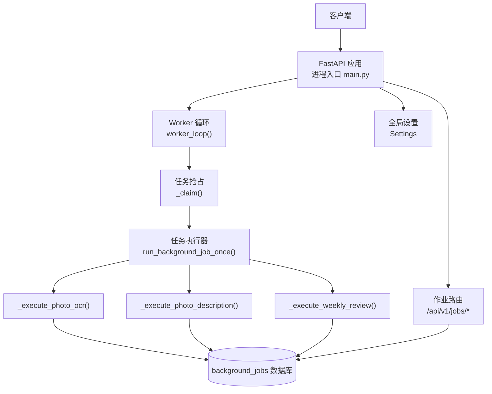
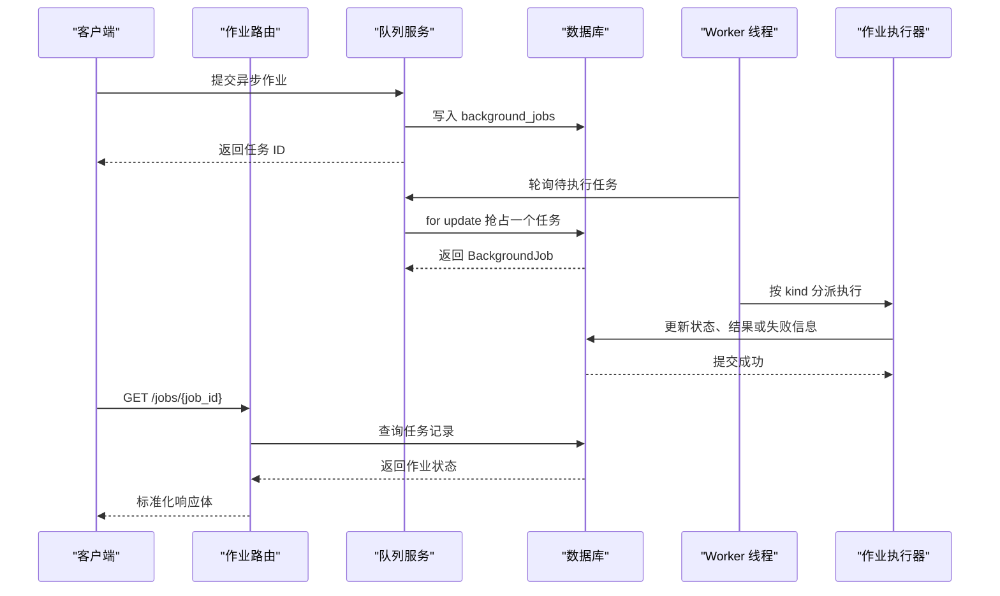
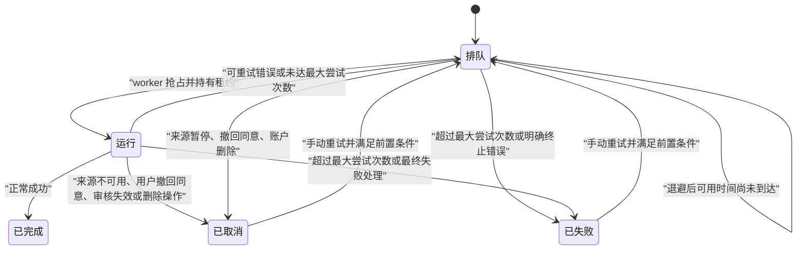
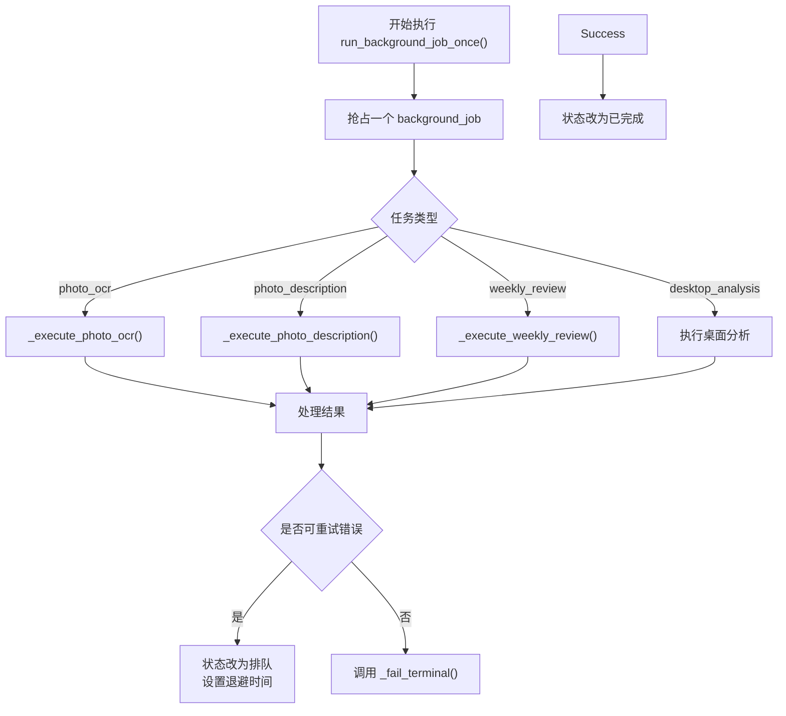
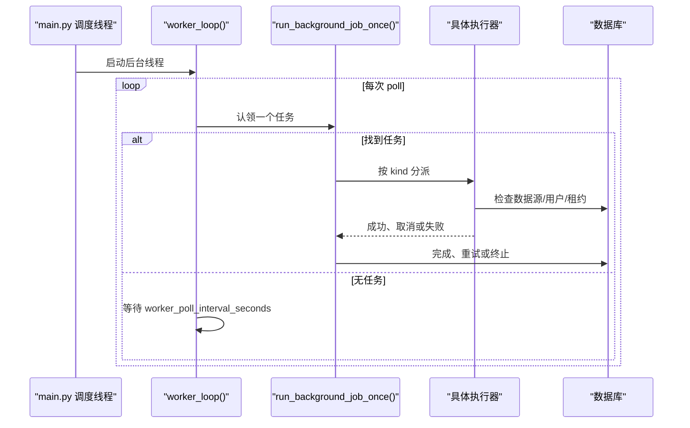
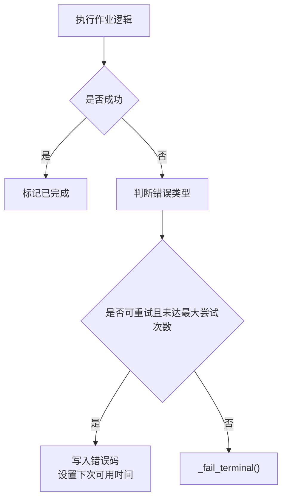
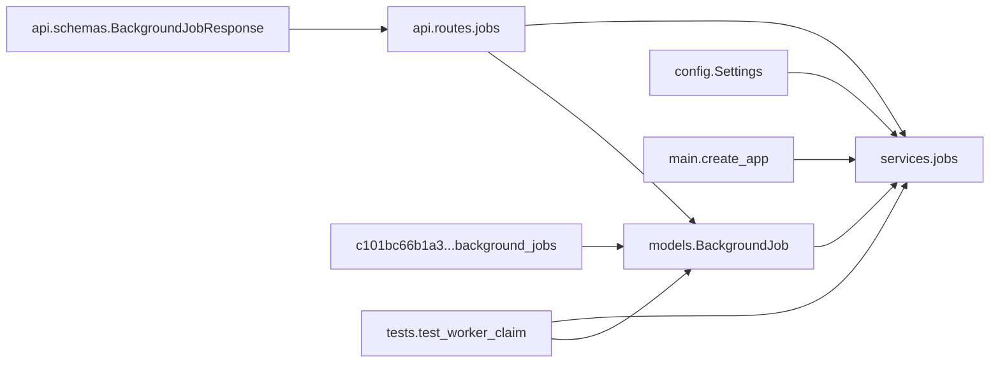

# 后台作业系统

<cite>
**本文引用的文件**   
- [models.py](file://src/personal_ai_life_os/models.py)
- [db.py](file://src/personal_ai_life_os/db.py)
- [config.py](file://src/personal_ai_life_os/config.py)
- [jobs.py](file://src/personal_ai_life_os/services/jobs.py)
- [jobs_route.py](file://src/personal_ai_life_os/api/routes/jobs.py)
- [schemas.py](file://src/personal_ai_life_os/api/schemas.py)
- [main.py](file://src/personal_ai_life_os/main.py)
- [c101bc66b1a3_add_durable_background_jobs.py](file://migrations/versions/c101bc66b1a3_add_durable_background_jobs.py)
- [test_worker_claim.py](file://tests/test_worker_claim.py)
- [deployment.md](file://docs/operations/deployment.md)
</cite>

## 目录
1. [介绍](#介绍)
2. [项目结构](#项目结构)
3. [核心组件](#核心组件)
4. [架构总览](#架构总览)
5. [关键组件详细分析](#关键组件详细分析)
6. [依赖关系分析](#依赖关系分析)
7. [性能与资源限制](#性能与资源限制)
8. [故障恢复与最佳实践](#故障恢复与最佳实践)
9. [后台作业 API 规范](#后台作业-api-规范)
10. [结论](#结论)

## 介绍
Personal-AI-Life-OS 的后台作业系统采用“数据库持久化 + 锁租约”的设计，把 OCR、图片描述、每周综述、桌面分析等异步任务从请求路径中解耦出来。队列数据保存在 `background_jobs` 表，worker 进程通过带 `for update` 的行级锁领取任务；如果 worker 崩溃或处理超时，到期任务可被其他 worker 重新领取。系统还提供幂等去重键、有限重试、最大尝试次数、失败终止状态、手动重试接口、模型调用成本上限以及月度预算控制。该机制支持 inline（内置）和 worker（后台 worker）两种运行模式，生产环境强制使用 worker 模式以增强可靠性。

## 项目结构
后台作业相关代码主要分布以下位置：
- 模型与持久化：`models.py`、`db.py`
- 调度与工作执行：`services/jobs.py`
- HTTP API：`api/routes/jobs.py`
- 响应模型：`api/schemas.py`
- 进程编排与线程启动：`main.py`
- 配置与健康检查约束：`config.py`
- 数据库迁移定义：`migrations/versions/c101bc66b1a3_add_durable_background_jobs.py`
- worker 行为测试：`tests/test_worker_claim.py`
- 部署说明：`docs/operations/deployment.md`

**图表来源**
- [main.py:118-132](file://src/personal_ai_life_os/main.py#L118-L132)
- [jobs_route.py:1-82](file://src/personal_ai_life_os/api/routes/jobs.py#L1-L82)
- [jobs.py:795-881](file://src/personal_ai_life_os/services/jobs.py#L795-L881)

**章节来源**
- [models.py:794-833](file://src/personal_ai_life_os/models.py#L794-L833)
- [c101bc66b1a3_add_durable_background_jobs.py:23-64](file://migrations/versions/c101bc66b1a3_add_durable_background_jobs.py#L23-L64)
- [main.py:101-132](file://src/personal_ai_life_os/main.py#L101-L132)
- [deployment.md:1-153](file://docs/operations/deployment.md#L1-L153)

## 核心组件
1. **BackgroundJob 模型**：记录任务的唯一标识、所属用户、业务关联对象、类型、状态、去重键、负载、结果、尝试次数、最大尝试次数、可用时间、租约过期时间、当前 worker、错误码、创建/更新/完成时间。
2. **作业服务层**：提供排队、取消、重启失败、抢占、执行、终端失败、工作循环等能力。
3. **HTTP 路由层**：暴露作业状态查询和重试接口，并验证数据来源、审核状态和用户 AI 授权。
4. **进程编排层**：在 `processing_mode == "worker"` 时启动 worker 线程和调度线程，并在退出时释放锁租约窗口。
5. **配置层**：定义 worker 轮询间隔、租约时长、在线程停止时的超时退出等运行时安全参数。

**章节来源**
- [models.py:794-833](file://src/personal_ai_life_os/models.py#L794-L833)
- [jobs.py:36-71](file://src/personal_ai_life_os/services/jobs.py#L36-L71)
- [jobs.py:300-310](file://src/personal_ai_life_os/services/jobs.py#L300-L310)
- [jobs_route.py:17-82](file://src/personal_ai_life_os/api/routes/jobs.py#L17-L82)
- [main.py:118-147](file://src/personal_ai_life_os/main.py#L118-L147)
- [config.py:28-31](file://src/personal_ai_life_os/config.py#L28-L31)

## 架构总览
后台作业系统的整体职责可分为四层：

| 层次 | 主要职责 | 实现位置 |
|---|---|---|
| 数据层 | 持久化任务、索引加速查找、外键关联到用户、数据源、数据项、同步运行和审核 | `models.py`、迁移脚本、`db.py` |
| 队列层 | 幂等入队、状态机更新、行级抢占、重试与终止 | `services/jobs.py` |
| 运行层 | 单任务抢占执行、多任务类型分发、异常分类、工作循环轮询 | `services/jobs.py`、`main.py` |
| API 层 | 查询作业状态、对失败或已取消作业进行受控重试 | `api/routes/jobs.py`、`api/schemas.py` |

**图表来源**
- [jobs.py:36-71](file://src/personal_ai_life_os/services/jobs.py#L36-L71)
- [jobs.py:246-310](file://src/personal_ai_life_os/services/jobs.py#L246-L310)
- [jobs.py:795-881](file://src/personal_ai_life_os/services/jobs.py#L795-L881)
- [jobs_route.py:38-82](file://src/personal_ai_life_os/api/routes/jobs.py#L38-L82)
- [c101bc66b1a3_add_durable_background_jobs.py:23-64](file://migrations/versions/c101bc66b1a3_add_durable_background_jobs.py#L23-L64)

## 关键组件详细分析

### BackgroundJob 模型与设计
BackgroundJob 是一个跨租户的用户级作业实体，其设计目标是避免在服务端保存大对象内容，而只保存业务 ID、元数据和轻量 payload。关键字段包括：
- `owner_id`：作业属于哪个用户，便于权限隔离、取消和用户级统计。
- `kind`：任务类型，如图片 OCR、图片描述、每周综述、桌面分析。
- `status`：状态机核心字段，初始值为“queued”。
- `dedupe_key`：幂等键，同用户同 key 不会重复生成并行任务；对已结束任务可进行重置式重入。
- `payload_json`：任务上下文，不包含完整业务内容。
- `attempt_count` 与 `max_attempts`：控制重试上限。
- `available_at`：延迟任务调度点；用于延迟和退避。
- `lease_expires_at` 与 `worker_id`：租约信息，防止多 worker 并发写同一任务。
- `error_code` 与 `result_json`：统一记录失败原因或成功结果。
- 与 `users`、`source_connections`、`source_items`、`sync_runs`、`reviews` 的外键关系，使删除、暂停、撤回同意等操作能联动影响作业。

该表还包含多个常用复合索引，例如按 `(status, available_at)`、`(owner_id, created_at)`、`source_id`、`review_id` 等优化查询。

**章节来源**
- [models.py:794-833](file://src/personal_ai_life_os/models.py#L794-L833)
- [c101bc66b1a3_add_durable_background_jobs.py:23-64](file://migrations/versions/c101bc66b1a3_add_durable_background_jobs.py#L23-L64)

### 状态机与流转规则
BackgroundJob 的状态机如下：

关键转换语义：
- **排队 → 运行**：由 `_claim()` 根据 `available_at` 和租约过期时间选择下一个任务，并使用 PostgreSQL 的 `FOR UPDATE SKIP LOCKED` 或其他引擎兼容方式保证互斥。
- **运行 → 已完成**：各执行器校验当前 claim 未失效后写入结果并提交。
- **运行/排队 → 排队**：发生 `RetryableJobError` 且未达到最大尝试次数时，将状态重置为排队，并写入 `available_at = now + exponential_backoff`。
- **任何状态 → 已取消**：当数据源停用、撤销、删除，用户撤回 AI 同意，或审核不可用时，立即标记取消并清理相关附属对象。
- **任意状态 → 已失败**：达到最大尝试次数或终止性错误，如 `worker_error`、`photo_description_failed`、`model_cost_budget_exceeded`、`model_cost_unconfigured`。

**图表来源**
- [jobs.py:795-881](file://src/personal_ai_life_os/services/jobs.py#L795-L881)
- [jobs.py:246-310](file://src/personal_ai_life_os/services/jobs.py#L246-L310)

**章节来源**
- [jobs.py:246-310](file://src/personal_ai_life_os/services/jobs.py#L246-L310)
- [jobs.py:316-356](file://src/personal_ai_life_os/services/jobs.py#L316-L356)
- [jobs.py:795-881](file://src/personal_ai_life_os/services/jobs.py#L795-L881)

### 作业调度器与任务类型
当前仓库直接实现的作业类型分布在 `_execute_*` 方法中：
- `photo_ocr`：读取对象存储中的图片，提取文本，写入 `SourceItem.content_text`。
- `photo_description`：调用外部模型提供商生成图片描述，先做价格估算和成本限额检查。
- `weekly_review`：基于活跃数据源生成周期性个人综述草稿，支持预算回退到模板。
- `desktop_analysis`：由 `execute_desktop_analysis` 处理桌面分析任务。

调度入口是 `worker_loop()`，它不断调用 `run_background_job_once()`，当没有任务时等待 `worker_poll_interval_seconds`，遇到数据库层异常也保留循环并继续重试。调度器的定时周期由 worker 轮询控制；对于需要预定的任务，系统还会结合 scheduling 服务和 UI 设置触发 `weekly_review` 等 job。

**图表来源**
- [main.py:118-132](file://src/personal_ai_life_os/main.py#L118-L132)
- [jobs.py:865-881](file://src/personal_ai_life_os/services/jobs.py#L865-L881)
- [jobs.py:795-881](file://src/personal_ai_life_os/services/jobs.py#L795-L881)

**章节来源**
- [jobs.py:316-555](file://src/personal_ai_life_os/services/jobs.py#L316-L555)
- [jobs.py:556-794](file://src/personal_ai_life_os/services/jobs.py#L556-L794)
- [jobs.py:865-881](file://src/personal_ai_life_os/services/jobs.py#L865-L881)
- [main.py:118-132](file://src/personal_ai_life_os/main.py#L118-L132)

### 重试、超时与失败补偿
- **超时与租约**：抢占成功后，worker 写入 `lease_expires_at = now + worker_lease_seconds`。如果 worker 在运行期间停止，另一个 worker 会把仍在 `running` 但租约过期的任务重新认领。
- **显式重试**：所有捕获到的非预期异常和 `RetryableJobError` 都进入相同分支；若未达到 `max_attempts`，则把任务回退为 `queued`，并把 `available_at` 设置为 `now + min(60, 2^attempt_count)` 秒，形成指数退避上限。
- **不可重试或超次重试**：调用 `_fail_terminal()`，记录 `failed`、错误码和完成时间，同时维护 `ModelRun`、`SyncRun`、`SourceItem.metadata`、`Review.draft_json` 等业务补偿状态。
- **特定失败语义**：
  - 图片来源不可用：标记为可重试。
  - 图片描述失败或预算超支：可能变为永久失败或受限重试。
  - 用户撤回 AI 同意：任务被取消，而不是无限重试。
  - 资源暂停/撤销/删除：进行中任务也会检测到目标无效并取消。

**图表来源**
- [jobs.py:795-881](file://src/personal_ai_life_os/services/jobs.py#L795-L881)
- [jobs.py:246-356](file://src/personal_ai_life_os/services/jobs.py#L246-L356)

**章节来源**
- [jobs.py:246-356](file://src/personal_ai_life_os/services/jobs.py#L246-L356)
- [jobs.py:795-881](file://src/personal_ai_life_os/services/jobs.py#L795-L881)

### Worker 集群模式：任务分配、负载均衡与健康监控
当前实现本质上是基于数据库行级锁的 worker 竞争模型，而非消息队列。它具备以下特性：
- **任务分配**：每个 worker 调用 `_claim()` 从数据库中选取下一条可用或租约过期的任务。PostgreSQL 分支使用 `SELECT FOR UPDATE SKIP LOCKED` 避免死锁，其他引擎退回普通事务加锁语义。
- **负载均衡**：多 worker 之间是公平竞争关系；SQL 语句按 `created_at` 然后 `id` 排序，优先执行更早创建的任务。单个 worker 每次只能抢占一个任务。
- **健康监控**：worker 循环外层 catch 数据库轮询异常，避免 worker 因为偶发连接问题退出；停止时通过事件标志通知 worker 退出。生产部署文档要求 `PROCESSING_MODE=worker`，并指出如果未来增加多个 API 进程，PostgreSQL 租约可以协调多个 worker。
- **优雅关闭**：进程退出时会发出停止信号，并按 `worker_lease_seconds + 5` 等待正在执行的任务退出，从而让租约过期前的长期任务有合理退出窗口。

需要注意：当前代码中没有独立的“心跳”表或主动健康注册中心，worker 可用性主要通过数据库可读性和 API 健康端点间接反映。

**章节来源**
- [jobs.py:246-310](file://src/personal_ai_life_os/services/jobs.py#L246-L310)
- [jobs.py:865-881](file://src/personal_ai_life_os/services/jobs.py#L865-L881)
- [main.py:118-147](file://src/personal_ai_life_os/main.py#L118-L147)
- [deployment.md:1-153](file://docs/operations/deployment.md#L1-L153)

### 与数据库事务和幂等性的集成
- **会话管理**：Engine 和 session_factory 在 `db.py` 中创建；SQLite 场景启用外键并设置 WAL 日志，PostgreSQL 使用池探测。
- **幂等入队**：`enqueue_background_job()` 首先按 `owner_id + dedupe_key` 查找；如果存在且处于终态，则把状态改回 `queued` 并清零尝试次数，从而实现“重复提交等同再次执行”。
- **状态一致性**：所有状态修改、结果写入、附属对象修正都发生在同一个会话提交之后；抢占时使用事务内行锁，确保同一时刻只有一个 worker 拿到运行中的任务。
- **幂等验证**：执行器在最终写回前调用 `_current_claim()`，确认 job 仍然由当前 claim 持有并且状态仍为 running；否则视为被抢占、取消或中断。

**章节来源**
- [db.py:1-75](file://src/personal_ai_life_os/db.py#L1-L75)
- [jobs.py:36-71](file://src/personal_ai_life_os/services/jobs.py#L36-L71)
- [jobs.py:246-310](file://src/personal_ai_life_os/services/jobs.py#L246-L310)

### API 设计与响应模型
`BackgroundJobResponse` 公开了任务的基础可观测字段：
- `id`、`kind`、`status`、`attempt_count`、`max_attempts`
- `error_code`、`result_json`
- `created_at`、`updated_at`、`completed_at`

`GET /jobs/{job_id}` 会按当前用户的 `user.id` 校验 `owner_id`，找不到则返回 404。  
`POST /jobs/{job_id}/retry` 不仅将任务置为 `queued`，还进行业务校验：
- 只有失败或已取消状态才允许重试。
- 如果作业关联数据源，该数据源必须仍处于 active。
- `photo_description` 和 `weekly_review` 必须存在当前版本的 AI 同意。
- 如果作业关联审核，审核不能已被撤销或无效；已确认的审核不允许再生成。
- 成功校验后会临时把相关 Review 改为 processing，再提交。

这些约束体现了“API 只负责受控干预，真正状态变化仍由 worker 提交”。

**章节来源**
- [jobs_route.py:17-82](file://src/personal_ai_life_os/api/routes/jobs.py#L17-L82)
- [schemas.py:148-157](file://src/personal_ai_life_os/api/schemas.py#L148-L157)

## 依赖关系分析

**图表来源**
- [models.py:794-833](file://src/personal_ai_life_os/models.py#L794-L833)
- [jobs.py:1-35](file://src/personal_ai_life_os/services/jobs.py#L1-L35)
- [jobs_route.py:1-20](file://src/personal_ai_life_os/api/routes/jobs.py#L1-L20)
- [schemas.py:148-157](file://src/personal_ai_life_os/api/schemas.py#L148-L157)
- [main.py:46-132](file://src/personal_ai_life_os/main.py#L46-L132)
- [c101bc66b1a3_add_durable_background_jobs.py:23-64](file://migrations/versions/c101bc66b1a3_add_durable_background_jobs.py#L23-L64)
- [test_worker_claim.py:1-40](file://tests/test_worker_claim.py#L1-L40)

耦合特征：
- services/jobs 直接依赖 models、config、storage 及若干可选业务模块，属于最核心的基础设施层。
- api/routes/jobs 非常薄，主要负责鉴权、校验与复用 `retry_background_job()`。
- main.py 组合 engine、session_factory、object_store、settings 和 worker 线程，是运行时装配点。
- tests 直接调用内部函数，验证抢占、补偿、中断恢复和成本记录。

**章节来源**
- [jobs.py:1-35](file://src/personal_ai_life_os/services/jobs.py#L1-L35)
- [jobs_route.py:1-20](file://src/personal_ai_life_os/api/routes/jobs.py#L1-L20)
- [main.py:46-132](file://src/personal_ai_life_os/main.py#L46-L132)

## 性能与资源限制
- **轮询开销**：`worker_poll_interval_seconds` 默认 0.5 秒。若无任务，worker 仅等待这个间隔；长时间空闲不持续 busy-poll。
- **租约窗口**：`worker_lease_seconds` 默认 60 秒。长耗时外部调用应在此窗口内完成，或者依赖取消检测和 `_current_claim()` 双重保护。
- **内存和对象传输**：图片描述会读取图片字节并通过 HTTPX 发送到模型提供者；图片大小受 upload 配置和外接存储后端限制。
- **模型成本限制**：
  - `model_max_cost_per_call_usd`：单次调用成本上限。
  - `model_monthly_budget_usd`：月度预算；系统按月支出扣除剩余预算，超出则回退为模板草案。
  - `model_input_cost_per_million_usd` 与 `model_output_cost_per_million_usd`：实际 token 用量按配置换算成本。
- **最大尝试次数**：默认 `max_attempts=3`，可通过入队参数调整；重试延迟使用 `min(60, 2^attempt_count)` 指数退避。
- **数据库 I/O**：生产部署建议 PostgreSQL；迁移脚本和索引设计偏向关系型队列访问模式。

**章节来源**
- [config.py:28-31](file://src/personal_ai_life_os/config.py#L28-L31)
- [config.py:94-132](file://src/personal_ai_life_os/config.py#L94-L132)
- [jobs.py:795-881](file://src/personal_ai_life_os/services/jobs.py#L795-L881)
- [jobs.py:556-794](file://src/personal_ai_life_os/services/jobs.py#L556-L794)
- [c101bc66b1a3_add_durable_background_jobs.py:52-64](file://migrations/versions/c101bc66b1a3_add_durable_background_jobs.py#L52-L64)

## 故障恢复与最佳实践
1. **worker 进程崩溃恢复**：由于 `lease_expires_at` 存在，崩溃后另一 worker 会重新认领仍在 `running` 的任务。测试覆盖了旧 worker 缓慢返回但仍被替换 worker 覆盖的场景。
2. **任务中断恢复**：新进程可以重新 `_claim()` 原作业；如果新的 attempt 成功，`attempt_count` 递增并最终写入 `completed` 状态。
3. **数据源变更中断**：如果在 OCR 过程中暂停、撤销或删除来源，执行器会检查目标来源状态，将任务设为 `cancelled` 并丢弃后续写入。
4. **失败补偿**：失败时会根据 job kind 更新：
   - `SourceItem` 的 `ocr_status`、`description_status`。
   - `SyncRun` 的部分失败计数与最后同步时间。
   - `Review` 的草稿状态、最终文本和审计快照。
   - `ModelRun` 的成本、延迟和用途记录。
5. **生产部署要点**：
   - 使用 `processing_mode=worker`。
   - 使用 PostgreSQL。
   - 使用私有 S3 兼容对象存储和删除日记桶。
   - 正确配置外部模型密钥、隐私链接、披露版本和定价。
   - 备份数据库与对象存储卷；恢复后再回放删除墓碑。
   - 多进程部署时应保证数据库层锁协调能力；文档提到 PostgreSQL lease claim 可以协调多个 API 进程。

**章节来源**
- [test_worker_claim.py:69-260](file://tests/test_worker_claim.py#L69-L260)
- [jobs.py:200-356](file://src/personal_ai_life_os/services/jobs.py#L200-L356)
- [deployment.md:1-153](file://docs/operations/deployment.md#L1-L153)

## 后台作业 API 规范

### GET /api/v1/jobs/{job_id}
- **用途**：查询当前用户可见的作业状态。
- **权限**：需登录，并匹配作业 `owner_id`。
- **路径参数**：
  - `job_id`：作业的字符串 UUID。
- **成功响应**：`BackgroundJobResponse`。
- **失败响应**：
  - 404：任务不存在或不属于当前用户。

### POST /api/v1/jobs/{job_id}/retry
- **用途**：对失败或已取消作业发起人工重试。
- **权限**：需登录，并匹配作业 `owner_id`。
- **前置校验**：
  - 仅失败或已取消状态允许重试。
  - 如果作业关联数据源，数据源必须处于 active。
  - 如果是图片描述或每周综述，当前用户必须已有最新 AI 同意。
  - 如果作业关联审核：
    - 审核不能为 null 或 invalidated。
    - 已确认审核不能再通过此接口生成。
    - 审核所关联的活跃数据源都必须处于 active。
  - 校验通过后，将关联 Review 转为 processing，再提交。
- **成功响应**：返回任务记录，状态应为 queued。
- **失败响应**：
  - 409 `job_not_retryable`：状态不允许重试。
  - 409 `source_not_active`：关联数据源不是 active。
  - 409 `model_consent_required`：缺少当前模型授权。
  - 409 `review_unavailable`：审核不可再生成。
  - 409 `review_already_confirmed`：审核已保存确认。

### BackgroundJobResponse
| 字段 | 类型 | 含义 |
|---|---|---|
| `id` | 字符串 | 作业标识 |
| `kind` | 字符串 | 作业类型，如 `photo_ocr`、`photo_description`、`weekly_review`、`desktop_analysis` |
| `status` | 字符串 | `queued`、`running`、`completed`、`cancelled`、`failed` |
| `attempt_count` | 整数 | 已尝试次数 |
| `max_attempts` | 整数 | 最大尝试次数 |
| `error_code` | 字符串或空值 | 最近一次失败原因 |
| `result_json` | 字典或空值 | 成功时返回的结构化结果 |
| `created_at` | 时间戳 | 作业创建时间 |
| `updated_at` | 时间戳 | 上次更新时间 |
| `completed_at` | 时间戳或空值 | 结束时间 |

### 常见 error_code 语义
| error_code | 含义 | 是否可能重试 |
|---|---|---|
| `source_unavailable` | 图片或数据源暂时不可用 | 通常可重试 |
| `photo_ocr_input_unavailable` | OCR 输入失败 | 通常可重试 |
| `photo_type_unsupported` | 不支持的图片类型 | 通常不可重试，但由重试策略决定 |
| `photo_unavailable` | 对象存储不可用 | 通常可重试 |
| `model_cost_unconfigured` | 未配置模型定价或每调用预算 | 取决于配置修复后的重试 |
| `model_cost_budget_exceeded` | 单次调用超过预算 | 更倾向最终失败 |
| `photo_description_failed` | 图片描述调用失败 | 可能重试也可能终止 |
| `worker_error` | 非预期异常 | 可能重试也可能终止 |
| `model_consent_withdrawn` | 用户撤回模型授权 | 取消，不应自动重试 |

**章节来源**
- [jobs_route.py:17-82](file://src/personal_ai_life_os/api/routes/jobs.py#L17-L82)
- [schemas.py:148-157](file://src/personal_ai_life_os/api/schemas.py#L148-L157)
- [jobs.py:246-356](file://src/personal_ai_life_os/services/jobs.py#L246-L356)
- [jobs.py:795-881](file://src/personal_ai_life_os/services/jobs.py#L795-L881)

## 结论
Personal-AI-Life-OS 的后台作业系统以 `BackgroundJob` 为中心，构建了一个面向生产的分布式友好队列：它不需要独立消息中间件即可实现排队、抢占、重试、失败终止和业务补偿，并通过 SQL 行锁提供多 worker 协调能力。对于日常异步任务如 OCR 和图片描述，它提供了明确的幂等保障和可观察状态；对于需要外部模型的每周综述，它还集成了授权、定价预算、月度预算和失败回退策略。生产部署时应保持 `processing_mode=worker`，使用可靠数据库和对象存储，并配合部署文档中的备份、恢复与安全配置进行检查清单式的上线。