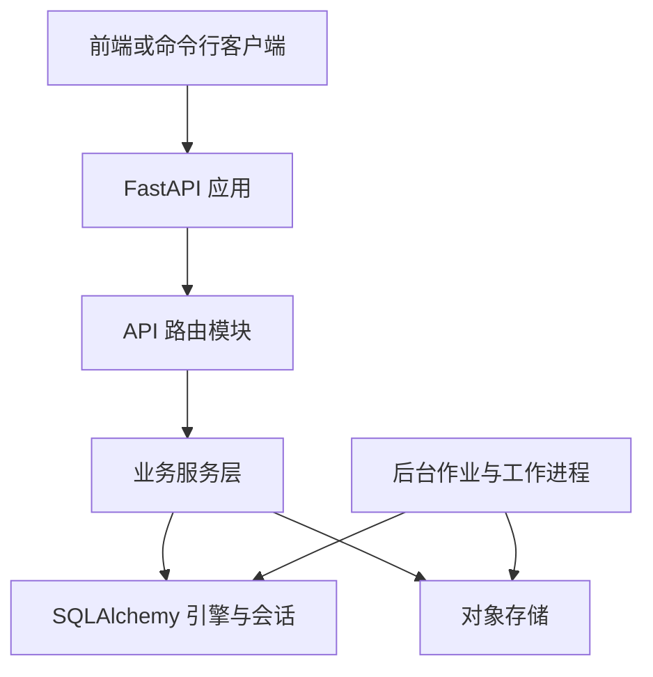
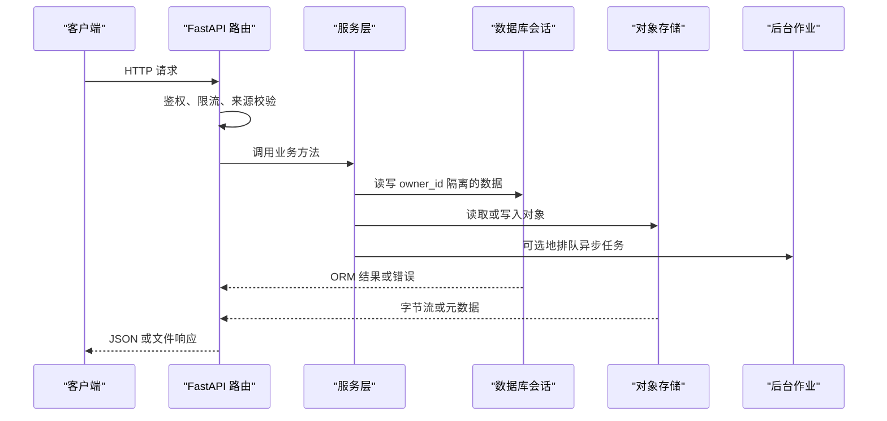
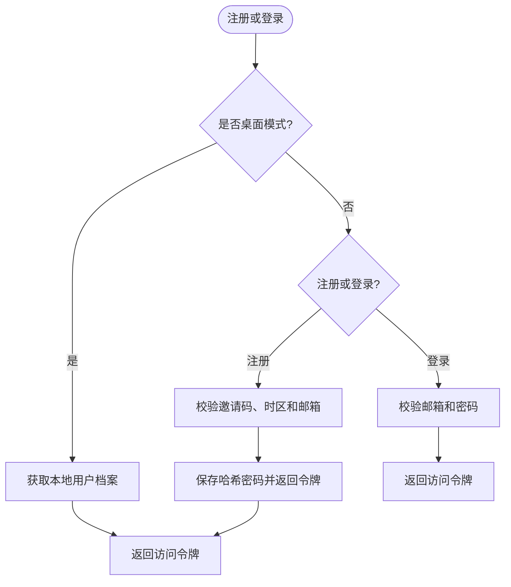
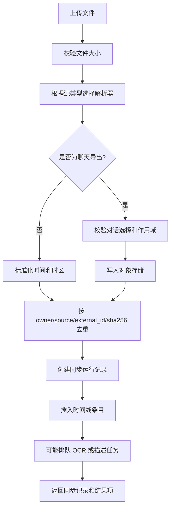
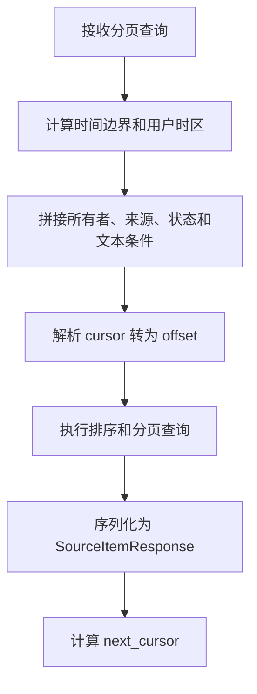
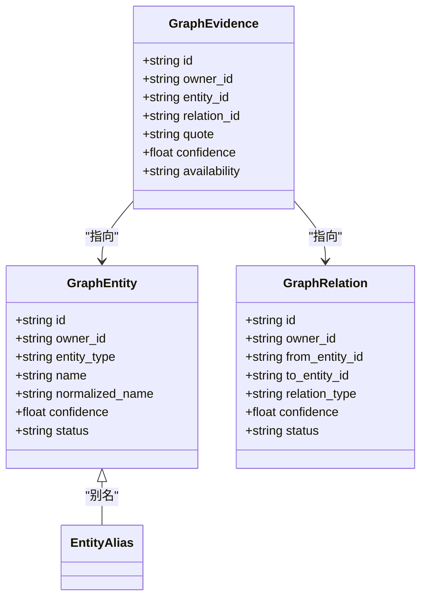
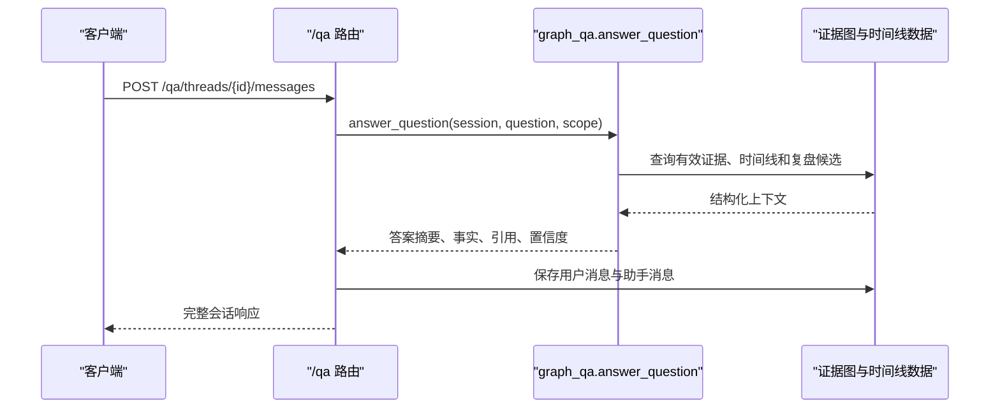
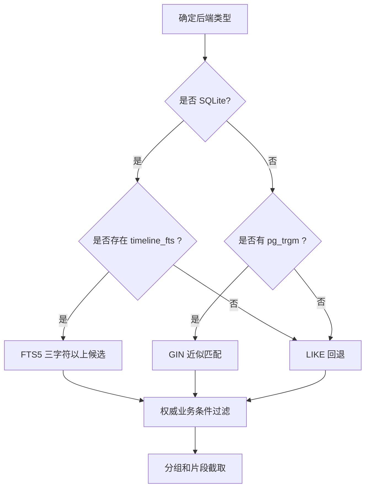
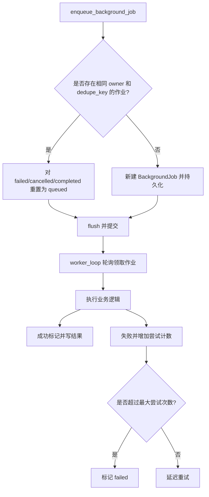
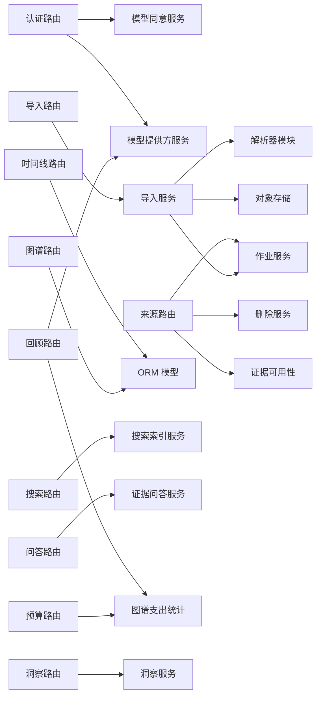

# 后端功能模块

<cite>
**本文引用的文件**
- [main.py](file://src/personal_ai_life_os/main.py)
- [config.py](file://src/personal_ai_life_os/config.py)
- [models.py](file://src/personal_ai_life_os/models.py)
- [db.py](file://src/personal_ai_life_os/db.py)
- [account.py](file://src/personal_ai_life_os/api/routes/account.py)
- [auth.py](file://src/personal_ai_life_os/api/routes/auth.py)
- [items.py](file://src/personal_ai_life_os/api/routes/items.py)
- [sources.py](file://src/personal_ai_life_os/api/routes/sources.py)
- [imports.py](file://src/personal_ai_life_os/api/routes/imports.py)
- [search.py](file://src/personal_ai_life_os/api/routes/search.py)
- [graph.py](file://src/personal_ai_life_os/api/routes/graph.py)
- [qa.py](file://src/personal_ai_life_os/api/routes/qa.py)
- [reviews.py](file://src/personal_ai_life_os/api/routes/reviews.py)
- [insights.py](file://src/personal_ai_life_os/api/routes/insights.py)
- [jobs.py](file://src/personal_ai_life_os/api/routes/jobs.py)
- [plugins.py](file://src/personal_ai_life_os/api/routes/plugins.py)
- [budget.py](file://src/personal_ai_life_os/api/routes/budget.py)
- [ingestion.py](file://src/personal_ai_life_os/services/ingestion.py)
- [graph_qa.py](file://src/personal_ai_life_os/services/graph_qa.py)
- [search_index.py](file://src/personal_ai_life_os/services/search_index.py)
- [jobs_service.py](file://src/personal_ai_life_os/services/jobs.py)
</cite>

## 目录
1. [引言](#引言)
2. [项目结构](#项目结构)
3. [核心组件](#核心组件)
4. [架构总览](#架构总览)
5. [详细模块分析](#详细模块分析)
6. [依赖关系分析](#依赖关系分析)
7. [性能考虑](#性能考虑)
8. [故障排查指南](#故障排查指南)
9. [结论](#结论)
10. [附录：API 路由边界](#附录api-路由边界)

## 引言
Personal-AI-Life-OS 是一个面向个人的本地优先记忆与回顾系统。它支持导入聊天导出、日历快照、照片和文档，形成可追溯的时间线；在此基础上抽取带证据的实体和关系图谱，构建证据图；并提供中文优先的问答、回顾生成、规则洞察、统一搜索、后台作业、插件扩展以及预算成本管理。后端以 FastAPI 为 HTTP 入口，SQLAlchemy 管理 SQLite 或 PostgreSQL 数据，通过服务层实现业务抽象和数据访问隔离，并以 Pydantic Settings 提供环境驱动的配置。该文档按业务领域组织，说明每个模块的职责、接口规范、错误处理、典型使用场景，以及它们之间的依赖关系。

## 项目结构
后端代码位于 `src/personal_ai_life_os`，整体采用分层组织：

- API 路由层：将 HTTP 请求解析为领域调用，负责参数校验、权限控制、资源归属检查和响应构造。
- 服务层：封装业务逻辑，如导入、证据图、问答、搜索索引、调度器、后台作业、模型提供者、预算统计等。
- 数据层：基于 SQLAlchemy 声明租户隔离（owner_id）的持久化模型，并由 `db.py` 初始化引擎、会话和 UTC 时区类型。
- 应用入口：`main.py` 组装路由、中间件、对象存储、后台线程和桌面集成。

**图示来源**
- [main.py:1-180](file://src/personal_ai_life_os/main.py#L1-L180)
- [db.py:1-75](file://src/personal_ai_life_os/db.py#L1-L75)

**节内来源**
- [main.py:1-200](file://src/personal_ai_life_os/main.py#L1-L200)
- [README.md:1-118](file://README.md#L1-L118)

## 核心组件
本节聚焦系统中最关键的基础设施组件。

### 配置与环境
- 配置类使用 `Settings` 集中加载环境变量，覆盖运行环境、数据库、对象存储、模型提供方、安全令牌、注册模式、上传大小、CORS、预算和插件限制等。
- 生产环境启用严格校验：至少 32 位 secret、禁止自动建库、必须使用 worker 模式、禁止开放注册、CORS 不能使用 localhost、必须配置 S3 对象存储与删除日志桶、外部模型需披露隐私条款和价格。

**节内来源**
- [config.py:1-132](file://src/personal_ai_life_os/config.py#L1-L132)

### 数据建模与时区
- 所有持久化实体继承 `Base`，主键统一为字符串 UUID，创建和更新时间包含时间戳。
- 数据围绕用户（`User`）展开，并广泛使用 `owner_id` 做租户隔离。
- 源连接（`SourceConnection`）、同步记录（`SyncRun`）、时间线条目（`SourceItem`）、标签（`Tag`）、集合（`Collection`）、证据图（`GraphEntity`、`GraphRelation`、`GraphEvidence`）、复盘（`Review`、`ReviewVersion`）、提醒（`Reminder`）、任务表（`BackgroundJob`）等均属于这一体系。
- `UTCDateTime` 装饰器确保 SQLite 读取时也还原 UTC 信息。

**节内来源**
- [db.py:1-75](file://src/personal_ai_life_os/db.py#L1-L75)
- [models.py:1-200](file://src/personal_ai_life_os/models.py#L1-L200)

### 应用生命周期
- `create_app` 负责注册路由、挂载状态、设置速率限制、桌面认证、健康检查、对象存储、数据库引擎、会话工厂、SQLite/PostgreSQL FTS 索引、删除恢复、桌面备份、文件夹同步、worker 和定时调度线程。
- 非 worker 模式下为 inline 处理；worker 模式下会启动后台作业循环和调度循环。

**节内来源**
- [main.py:1-200](file://src/personal_ai_life_os/main.py#L1-L200)

## 架构总览
下图展示从 HTTP 请求到数据与服务的关键路径：

**图示来源**
- [main.py:1-200](file://src/personal_ai_life_os/main.py#L1-L200)
- [items.py:1-200](file://src/personal_ai_life_os/api/routes/items.py#L1-L200)
- [imports.py:1-134](file://src/personal_ai_life_os/api/routes/imports.py#L1-L134)
- [ingestion.py:1-200](file://src/personal_ai_life_os/services/ingestion.py#L1-L200)
- [jobs_service.py:1-200](file://src/personal_ai_life_os/services/jobs.py#L1-L200)

## 详细模块分析

### 用户认证与管理
#### 职责与边界
- 负责账户注册、登录、桌面本地档案、当前用户查询、模型使用披露和同意设置。
- 在桌面模式下暴露专用本地档案接口；在普通模式下提供 REST 风格的 register/login/me。
- 对邀请码、时区合法性、邮箱唯一性、密码哈希、JWT 生命周期进行校验。
- 对外部模型提供方能力使用 `resolve_model_provider` 和 `set_consent` 进行管理，并在拒绝时返回结构化错误。

#### 关键接口
- `GET /auth/desktop-profile`：桌面模式本地身份。
- `POST /auth/desktop-profile`：创建或获取桌面本地用户。
- `POST /auth/register`：注册新用户，受 `registration_mode` 和邀请码限制。
- `POST /auth/login`：校验凭据并返回访问令牌。
- `GET /auth/me`：返回当前用户。
- `GET /auth/model-disclosure`：返回模型提供方可用性、隐私版本、成本和使用披露。
- `PUT /auth/ai-consent`：更新用户对特定模型提供方的 AI 使用同意。

#### 数据模型关系
- 用户与模型同意一对一映射；后续模块根据用户的 `ai_consent_at` 和披露版本决定是否允许外部模型调用。

**节内来源**
- [auth.py:1-210](file://src/personal_ai_life_os/api/routes/auth.py#L1-L210)
- [config.py:1-132](file://src/personal_ai_life_os/config.py#L1-L132)

#### 错误策略
- 未注册环境关闭：返回 403 并带 `registration_closed`。
- 邀请码无效：返回 403 并带 `invalid_invitation`。
- 邮箱已存在：返回 409 并带 `account_exists`。
- 时区非法：返回 422。
- 凭据错误：返回 401 和 `invalid_credentials`。
- 模型提供方不存在：由服务层抛出结构化错误，被路由转换为 HTTP 异常。

#### 典型使用场景
- 新用户通过邀请码注册后，首次发起需要外部模型的调用前，先读取 `/auth/model-disclosure`，再提交 `/auth/ai-consent` 启用指定提供商。

**图示来源**
- [auth.py:1-210](file://src/personal_ai_life_os/api/routes/auth.py#L1-L210)

### 源连接与导入
#### 职责与边界
- 源连接模块负责用户创建的各类来源：聊天记录、文档、日历、照片、快速笔记的内部来源标记、云提取许可、暂停/恢复、作用域配置、删除流程。
- 导入模块接收文件，按 source kind 选择解析器，完成去重、对象存储写入、同步记录、时间线条目创建，并在需要时触发后台 OCR 或描述任务。
- 两者共同保障“源 → 同步任务 → 内容项”的可审计链路，并保留外部分布式标识和摘要。

#### 关键接口
- 源连接：
  - `POST /sources`：创建来源。
  - `GET /sources`：列出用户活跃来源。
  - `GET /sources/{source_id}`：查看来源详情。
  - `PATCH /sources/{source_id}/status`：暂停或恢复来源；暂停时会取消相关作业。
  - `PATCH /sources/{source_id}/scope`：更新选择范围，聊天导出需确认 conversation_ids。
  - `PATCH /sources/{source_id}/cloud-consent`：允许或撤销云侧实体抽取许可。
- 导入：
  - `POST /sources/{source_id}/imports`：上传文件，返回同步记录、新项、相关作业 ID。

#### 导入数据处理流程

**图示来源**
- [imports.py:1-134](file://src/personal_ai_life_os/api/routes/imports.py#L1-L134)
- [ingestion.py:1-200](file://src/personal_ai_life_os/services/ingestion.py#L1-L200)

#### 错误策略
- 超出上限：413 `upload_too_large`。
- 日期或时区非法：422 `invalid_capture_date` / `invalid_capture_timezone`。
- 对话 ID 非法或超范围：422/403。
- 不支持的文件格式或导出：422。
- 来源不存在：404。
- 内部来源不可直接管理：409 `internal_source`。
- 来源不在可用状态：409 `source_cannot_resume` / `source_not_active`。

**节内来源**
- [sources.py:1-200](file://src/personal_ai_life_os/api/routes/sources.py#L1-L200)
- [imports.py:1-134](file://src/personal_ai_life_os/api/routes/imports.py#L1-L134)
- [ingestion.py:1-200](file://src/personal_ai_life_os/services/ingestion.py#L1-L200)

#### 典型使用场景
- 用户上传本地聊天记录预览并勾选对话后导入，服务端仅最小化所选对话并生成 `SyncRun`；若处于 worker 模式且为照片，则 OCR 走后台作业队列。

### 时间线与内容管理
#### 职责与边界
- 时间线接口负责分页、过滤、按时间排序和轻量全文检索。
- 支持按时间范围、来源、标题/正文/用户描述模糊匹配、是否包含无日期项。
- 使用 base64 cursor 翻页，防止深度偏移造成 SQL 性能退化。
- 同时提供某来源下的子集列表，并对该来源做归属校验。

#### 关键接口
- `GET /timeline`：浏览全局时间线。
- `GET /sources/{source_id}/items`：浏览某个来源下的时间线条目。

#### 设计要点
- 所有查询默认排除已删除、非当前版本、正在删除的来源。
- 时间范围按用户时区换算到 UTC。
- cursor 超过 1,000,000 被视为非法，避免大偏移扫描。

**图示来源**
- [items.py:1-200](file://src/personal_ai_life_os/api/routes/items.py#L1-L200)

**节内来源**
- [items.py:1-200](file://src/personal_ai_life_os/api/routes/items.py#L1-L200)

### 证据图系统
#### 职责与边界
- 证据图由实体、关系和引用证据组成。
- 读接口暴露实体系列、关系序列及其证据摘录。
- 实体可按类型和名称模糊匹配；关系可按类型筛选；证据每条附带引文、定位信息和置信度。
- 证据与时间线、来源和模型抽取过程关联，便于审查和回溯。

**图示来源**
- [models.py:200-520](file://src/personal_ai_life_os/models.py#L200-L520)

#### 关键接口
- `GET /graph/entities`：列出实体并附带最近证据。
- `GET /graph/relations`：列出关系并附带最近证据。

#### 使用约束
- 实体只返回 `active` 或 `pending_review`。
- 关系排除 `invalid`。
- 证据最多返回 20 条最近记录，用于 UI 折叠展示。

**节内来源**
- [graph.py:1-135](file://src/personal_ai_life_os/api/routes/graph.py#L1-L135)
- [models.py:200-520](file://src/personal_ai_life_os/models.py#L200-L520)

### 问答系统
#### 职责与边界
- 基于现有证据图和时间线、复盘内容的可引用问答。
- 会话保持最近的 scope，支持重新提问、删除会话。
- 回答结构包含总结、事实、推断、不确定性、缺失信息、行动建议及引用来源。
- scope 支持来源过滤、实体过滤和时间范围。

#### 关键接口
- `GET /qa/scope`：获取最近问答 scope。
- `GET /qa/threads`：列出用户问题会话。
- `POST /qa/threads`：创建会话。
- `GET /qa/threads/{thread_id}`：查看会话及消息。
- `POST /qa/threads/{thread_id}/messages`：发送问题并返回结构化答案。
- `DELETE /qa/threads/{thread_id}`：删除会话。

#### 处理序列

**图示来源**
- [qa.py:1-200](file://src/personal_ai_life_os/api/routes/qa.py#L1-L200)
- [graph_qa.py:1-200](file://src/personal_ai_life_os/services/graph_qa.py#L1-L200)

#### 错误策略
- 无效的 scope 字段或时间：返回 422 错误，携带结构化 code 和 message。
- 会话不存在：404 `qa_thread_not_found`。

**节内来源**
- [qa.py:1-200](file://src/personal_ai_life_os/api/routes/qa.py#L1-L200)
- [graph_qa.py:1-200](file://src/personal_ai_life_os/services/graph_qa.py#L1-L200)

### 回顾与洞察
#### 职责与边界
- 回顾模块按时间区间生成可编辑草稿，支持模板生成或模型增强，生成 Markdown 并维护版本对比。
- 洞察模块提供四条规则驱动的分析：过期目标、无跟进的承诺、停滞项目、证据薄弱技能，并可忽略误报。

#### 关键接口
- 回顾：
  - `POST /reviews/generate`：生成或再生成周期回顾。
  - `PUT /reviews/{review_id}`：更新草稿或终稿。
  - 其他版本、导出和提示接口存在于同一路由模块中。
- 洞察：
  - `GET /insights/rules`：列出规则洞察，可选择是否包含已忽略条目。
  - `POST /insights/rules/dismiss`：忽略一条洞察。
  - `DELETE /insights/rules/dismissals/{insight_key}`：恢复被忽略的洞察。

#### 设计重点
- 回顾模型输出需要经过“基于证据的落地检查”，不支持来源的事实会被过滤。
- Markdown 渲染保留事实、建议、跨周期趋势、承诺到期日和目标链接。
- 回调查询会关联 `SourceItem`，并以引用方式标注来源。

**节内来源**
- [reviews.py:1-200](file://src/personal_ai_life_os/api/routes/reviews.py#L1-L200)
- [insights.py:1-93](file://src/personal_ai_life_os/api/routes/insights.py#L1-L93)

### 搜索引擎
#### 职责与边界
- 提供统一搜索，横跨时间线条目、周回顾和提醒。
- 候选召回优先使用 SQLite FTS5 trigram 或 PostgreSQL `pg_trgm` GIN；不可用时降级到 LIKE 搜索。
- 每次命中仍需用 owner_id、删除标记、当前版本、来源状态和业务过滤器做权威校验，避免索引误判。

#### 关键接口
- `GET /search`：综合检索，支持时间范围、来源、标签、集合、结果类型、状态和分组。

#### 索引策略

**图示来源**
- [search_index.py:1-162](file://src/personal_ai_life_os/services/search_index.py#L1-L162)
- [search.py:1-200](file://src/personal_ai_life_os/api/routes/search.py#L1-L200)

**节内来源**
- [search.py:1-200](file://src/personal_ai_life_os/api/routes/search.py#L1-L200)
- [search_index.py:1-162](file://src/personal_ai_life_os/services/search_index.py#L1-L162)

### 后台作业系统
#### 职责与边界
- 基于 `BackgroundJob` 表实现可恢复的异步工作：OCR、照片描述、定期复盘、桌面分析、通用导入后任务等。
- 支持重试、去重键、租约过期、来源关联、审阅关联、最大尝试次数、成功/失败/取消状态。
- 在 worker 模式下，应用启动后会起一个后台线程持续消费作业；同步调用可立即排入作业。

#### 关键接口
- `GET /jobs/{job_id}`：查看作业状态。
- `POST /jobs/{job_id}/retry`：重试失败的作业，并检查来源活跃、模型同意、回顾状态等业务前置条件。

#### 作业队列逻辑

**图示来源**
- [jobs_service.py:1-200](file://src/personal_ai_life_os/services/jobs.py#L1-L200)
- [jobs.py:1-82](file://src/personal_ai_life_os/api/routes/jobs.py#L1-L82)

**节内来源**
- [jobs_service.py:1-200](file://src/personal_ai_life_os/services/jobs.py#L1-L200)
- [jobs.py:1-82](file://src/personal_ai_life_os/api/routes/jobs.py#L1-L82)

### 插件系统
#### 职责与边界
- 支持安装、禁用、卸载和调用本地插件，插件以清单和权限声明为核心。
- 插件调用失败时不影响宿主进程，并写入审计日志。
- 公开目录插件、已安装插件、审计记录接口，并限制插件数量。

#### 关键接口
- `GET /plugins/catalog`：查看所有可发现插件清单。
- `GET /plugins`：查看当前用户已安装插件。
- `POST /plugins/install`：安装插件并声明权限。
- `POST /plugins/{plugin_id}/status`：启用或禁用插件。
- `DELETE /plugins/{plugin_id}`：卸载插件。
- `POST /plugins/{plugin_id}/invoke`：调用插件动作。
- `GET /plugins/audit`：查看插件审计日志。

**节内来源**
- [plugins.py:1-158](file://src/personal_ai_life_os/api/routes/plugins.py#L1-L158)

### 预算与成本管理
#### 职责与边界
- 汇总用户在日、周、月维度的模型调用成本、token 数、平均延迟和失败预留成本。
- 结合配置中的月度预算判断告警和超支状态。
- 使用 `ModelRun` 和 `monthly_spend` 统计实际消耗，并返回按用途和提供方的细分。

#### 关键接口
- `GET /budget?period=day|week|month`：预算与用量总览。

#### 使用场景
- 前端展示本月剩余预算、告警阈值、各提供方成本分布。
- 当模型调用即将或已经超预算时，结合后端模型提供方调用链进行降配或拒绝。

**节内来源**
- [budget.py:1-118](file://src/personal_ai_life_os/api/routes/budget.py#L1-L118)

### 账户归档与删除
#### 职责与边界
- 将用户相关的所有结构化数据打包为 ZIP 归档，包括来源、同步记录、时间线、复盘及版本、模型同意、提醒、模型运行、作业、图谱实体/关系/证据、实体别名、实体合并日志、问答线程、洞察忽略记录、Agent 行为、插件清单与审计、标签、集合、保存搜索等。
- 提供可重试的账户删除流程，并在清理过程中联动对象存储、来源衍生数据和图谱可用性标记。

#### 关键接口
- `GET /account/archive`：下载个人档案。
- 删除流程由账户模块及相关服务协同完成（参考引用中的模型和服务）。

**节内来源**
- [account.py:1-200](file://src/personal_ai_life_os/api/routes/account.py#L1-L200)

## 依赖关系分析
API 路由到服务和数据的依赖如下：

**图示来源**
- [auth.py:1-210](file://src/personal_ai_life_os/api/routes/auth.py#L1-L200)
- [sources.py:1-200](file://src/personal_ai_life_os/api/routes/sources.py#L1-L200)
- [imports.py:1-134](file://src/personal_ai_life_os/api/routes/imports.py#L1-L134)
- [ingestion.py:1-200](file://src/personal_ai_life_os/services/ingestion.py#L1-L200)
- [search.py:1-200](file://src/personal_ai_life_os/api/routes/search.py#L1-L200)
- [search_index.py:1-162](file://src/personal_ai_life_os/services/search_index.py#L1-L162)
- [graph.py:1-135](file://src/personal_ai_life_os/api/routes/graph.py#L1-L135)
- [qa.py:1-200](file://src/personal_ai_life_os/api/routes/qa.py#L1-L200)
- [reviews.py:1-200](file://src/personal_ai_life_os/api/routes/reviews.py#L1-L200)
- [insights.py:1-93](file://src/personal_ai_life_os/api/routes/insights.py#L1-L93)
- [budget.py:1-118](file://src/personal_ai_life_os/api/routes/budget.py#L1-L118)

## 性能考虑
- 时间线和搜索结果都采用有限范围的分页或 candidate 索引，避免全表深度偏移和语义向量扫描。
- SQLite 启用 WAL、外键和 UTC 处理；PostgreSQL 可使用 `pg_trgm` GIN 加速模糊匹配。
- 大文件上传受 `max_text_upload_bytes` / `max_photo_upload_bytes` 限制，图片在导入阶段脱敏并重编码。
- 异步任务通过去重键和最大尝试次数控制重复工作和无限重试风险。
- 模型调用通过月度预算、单次调用上限和代价估算避免成本失控。

[本节为通用指导，不直接分析具体源码行]

## 故障排查指南
- **注册被拒**：检查是否关闭注册或使用邀请模式但未提供正确邀请码；生产环境中不允许开放注册。
- **登录 401**：检查邮箱和密码是否正确，注意桌面模式不提供常规登录接口。
- **导入过大**：确认文件类型和配置大小限制；照片和文本分别有独立上限。
- **聊天记录导入失败**：确认选择了有效的 conversation IDs，且未超出已授权的范围。
- **来源状态错误**：正在删除或断开的来源不能直接恢复，需创建新的选择。
- **搜索无结果**：检查是否需要重建索引；在 SQLite 下若 FTS5 不可用则退化为 LIKE。
- **模型调用被拒**：检查当前用户是否对指定提供方接受过最新披露版本的同意。
- **作业重试失败**：检查关联来源是否 active、回顾状态是否可用、用户是否具备模型使用同意。
- **预算告警**：检查模型 provider 是否配置了输入/输出单价和每月预算；查看失败预留成本分布。

**节内来源**
- [config.py:1-132](file://src/personal_ai_life_os/config.py#L1-L132)
- [auth.py:1-210](file://src/personal_ai_life_os/api/routes/auth.py#L1-L210)
- [imports.py:1-134](file://src/personal_ai_life_os/api/routes/imports.py#L1-L134)
- [sources.py:1-200](file://src/personal_ai_life_os/api/routes/sources.py#L1-L200)
- [search_index.py:1-162](file://src/personal_ai_life_os/services/search_index.py#L1-L162)
- [jobs.py:1-82](file://src/personal_ai_life_os/api/routes/jobs.py#L1-L82)
- [budget.py:1-118](file://src/personal_ai_life_os/api/routes/budget.py#L1-L118)

## 结论
Personal-AI-Life-OS 的后端以 API 路由为入口，以 services 为业务核心，以 SQLAlchemy 模型为可迁移的数据边界，形成了清晰的职责划分。它从文件导入开始，沿“源连接—同步记录—时间线条目”建立所有权隔离和可追溯链条；在时间线和证据图上叠加回顾、问答、规则和搜索；并通过后台作业系统承担重任务和外部模型调用；最终由预算模块对模型使用进行可视化和限额管理。对于初学者，可以从用户注册、上传一个文件或预览来源、查看时间线和搜索逐步上手；对于高级开发者，应重点关注 `ingestion` 的去重和对象存储耦合、`graph_qa` 的证据引用契约、搜索后权威过滤、worker 去重键和重试策略，以及 production configuration 的安全校验。

[本节为总结，不包含源码引用]

## 附录：API 路由边界

| 领域 | 主要路由前缀 | 职责边界 |
|---|---|---|
| 账户 | `/account/*` | 个人档案下载、数据归档和删除协作 |
| 认证 | `/auth/*` | 注册、登录、桌面档案、模型披露与同意 |
| 时间线 | `/timeline`、`/sources/{id}/items` | 分页、过滤、时间范围、来源子集 |
| 来源 | `/sources/*` | 创建、列出、查看、暂停/恢复、作用域、云许可、删除 |
| 导入 | `/sources/{id}/imports` | 文件上传、解析、去重、同步记录、对象存储 |
| 搜索 | `/search` | 统一搜索时间线、回顾、提醒，附带 FTS/GIN 候选索引 |
| 图谱 | `/graph/entities`、`/graph/relations` | 可读实体和关系，附带证据摘要 |
| 问答 | `/qa/*` | 会话 CRUD、最后 scope、结构化问答响应 |
| 回顾 | `/reviews/*` | 生成回顾、更新草稿、Markdown 导出、版本追踪 |
| 洞察 | `/insights/rules*` | 规则洞察列举、忽略和恢复 |
| 作业 | `/jobs/*` | 查看作业状态、重试失败作业 |
| 插件 | `/plugins/*` | 插件目录、安装/卸载/状态、调用、审计 |
| 预算 | `/budget` | 按月/周/日汇总模型成本和失败预留 |

**节内来源**
- [account.py:1-200](file://src/personal_ai_life_os/api/routes/account.py#L1-L200)
- [auth.py:1-210](file://src/personal_ai_life_os/api/routes/auth.py#L1-L210)
- [items.py:1-200](file://src/personal_ai_life_os/api/routes/items.py#L1-L200)
- [sources.py:1-200](file://src/personal_ai_life_os/api/routes/sources.py#L1-L200)
- [imports.py:1-134](file://src/personal_ai_life_os/api/routes/imports.py#L1-L134)
- [search.py:1-200](file://src/personal_ai_life_os/api/routes/search.py#L1-L200)
- [graph.py:1-135](file://src/personal_ai_life_os/api/routes/graph.py#L1-L135)
- [qa.py:1-200](file://src/personal_ai_life_os/api/routes/qa.py#L1-L200)
- [reviews.py:1-200](file://src/personal_ai_life_os/api/routes/reviews.py#L1-L200)
- [insights.py:1-93](file://src/personal_ai_life_os/api/routes/insights.py#L1-L93)
- [jobs.py:1-82](file://src/personal_ai_life_os/api/routes/jobs.py#L1-L82)
- [plugins.py:1-158](file://src/personal_ai_life_os/api/routes/plugins.py#L1-L158)
- [budget.py:1-118](file://src/personal_ai_life_os/api/routes/budget.py#L1-L118)