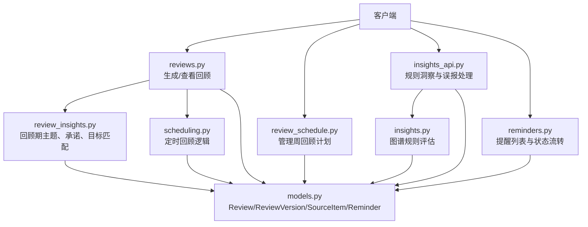
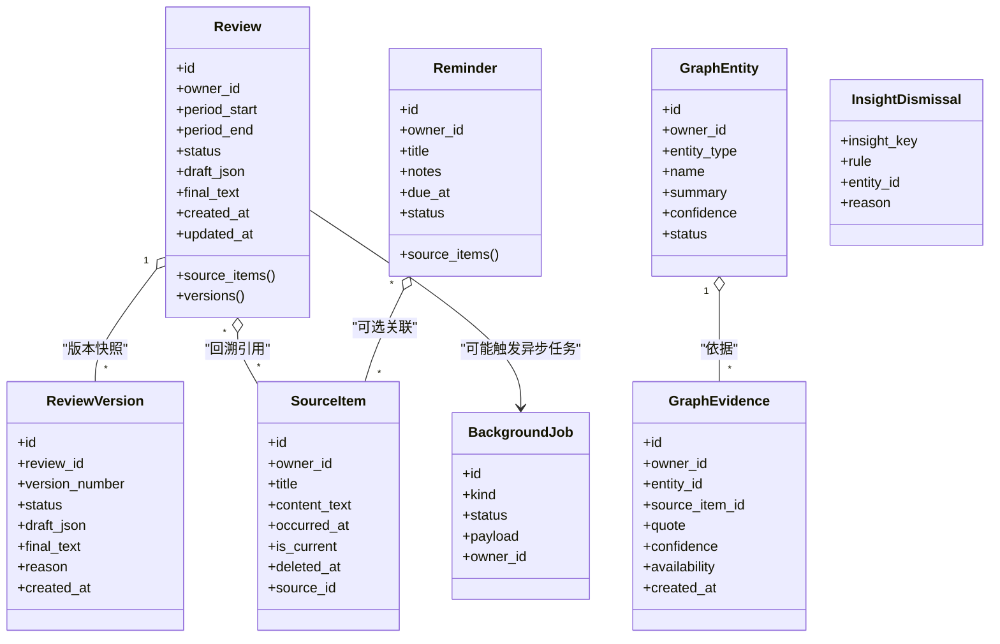
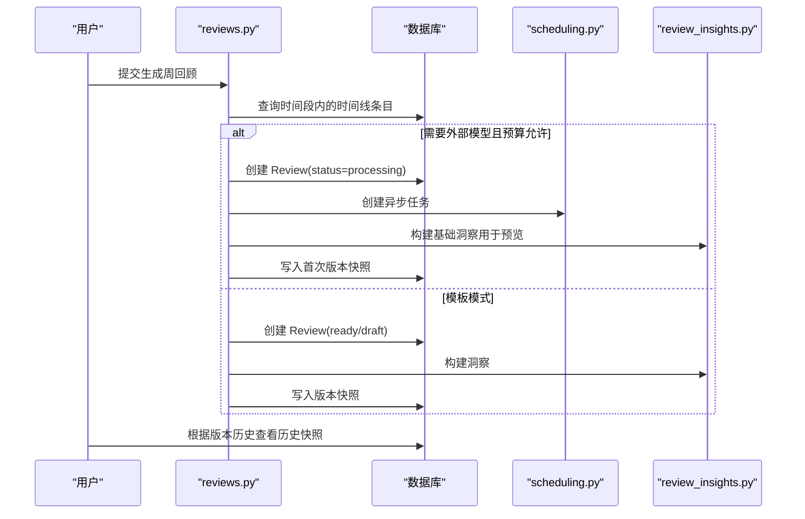
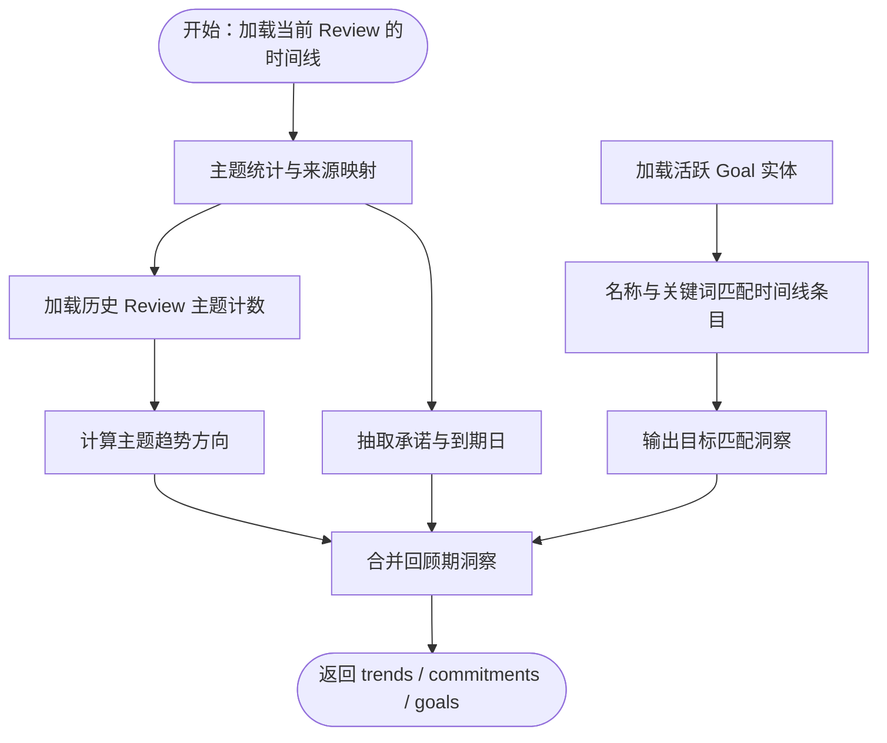
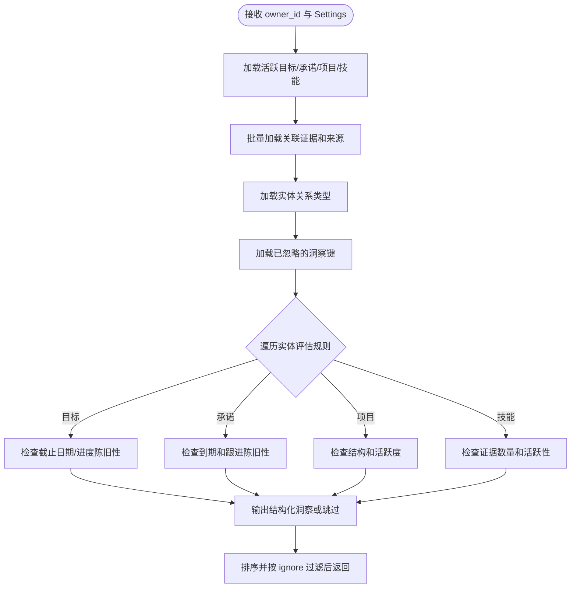
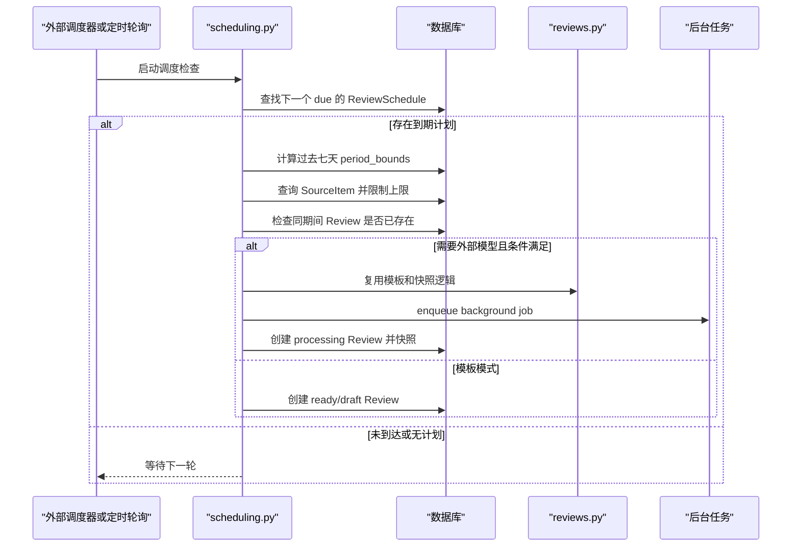
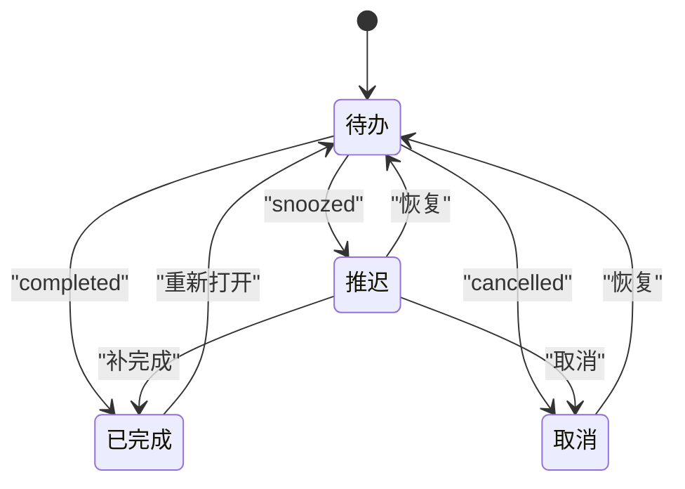
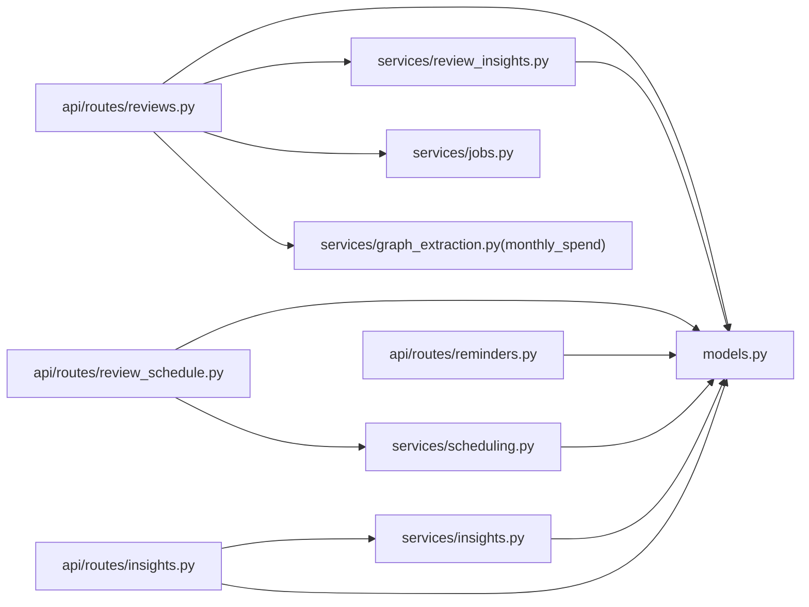

# 回顾与洞察系统

<cite>
**本文引用的文件**   
- [models.py](file://src/personal_ai_life_os/models.py)
- [review_insights.py](file://src/personal_ai_life_os/services/review_insights.py)
- [insights.py](file://src/personal_ai_life_os/services/insights.py)
- [reviews.py](file://src/personal_ai_life_os/api/routes/reviews.py)
- [insights_api.py](file://src/personal_ai_life_os/api/routes/insights.py)
- [review_schedule.py](file://src/personal_ai_life_os/api/routes/review_schedule.py)
- [scheduling.py](file://src/personal_ai_life_os/services/scheduling.py)
- [reminders.py](file://src/personal_ai_life_os/api/routes/reminders.py)
- [schemas.py](file://src/personal_ai_life_os/api/schemas.py)
- [data-model.md](file://docs/architecture/data-model.md)
- [a1b7c9d3e504_add_provider_consent_and_review_versions.py](file://migrations/versions/a1b7c9d3e504_add_provider_consent_and_review_versions.py)
- [b7d4f6a1c902_add_review_schedules.py](file://migrations/versions/b7d4f6a1c902_add_review_schedules.py)
</cite>

## 目录
1. [引言](#引言)
2. [项目结构](#项目结构)
3. [核心组件](#核心组件)
4. [架构总览](#架构总览)
5. [详细组件分析](#详细组件分析)
6. [依赖关系分析](#依赖关系分析)
7. [性能与大数据处理](#性能与大数据处理)
8. [故障排查指南](#故障排查指南)
9. [结论](#结论)

## 引言
本文件系统化梳理 Personal-AI-Life-OS 的回顾与洞察子系统，重点覆盖以下目标：
- Review 与 ReviewVersion 的版本控制机制、变更追踪和历史对比方式。
- 规则驱动的洞察生成算法，如何从时间线数据和知识图谱中提取趋势、承诺、目标匹配等可审计见解。
- 周回顾自动化流程：定时任务触发、内容聚合、草稿渲染、外部模型工作队列和报告生成。
- 计划调度系统：按本地时区的周期触发、下次运行时间计算、已生成审查的重入保护。
- 提醒系统与其在回顾和洞察中的关联使用。
- 回顾模板定制、洞察规则配置、通知与预算相关策略的实现现状与建议。
- 性能优化、增量更新和大规模数据集处理策略。

## 项目结构
回顾与洞察系统围绕 API 路由、领域服务、数据模型以及数据库迁移组织，关键代码分布如下：
- API 层：`/reviews`、`/review-schedule`、`/insights/rules`、`/reminders`。
- 服务层：`services/review_insights.py`（回顾期洞察）、`services/insights.py`（图谱规则洞察）、`services/scheduling.py`（周回顾调度）。
- 模型层：`Review`、`ReviewVersion`、`Reminder`、`GraphEntity`、`GraphEvidence`、`InsightDismissal`、`SourceItem` 等。
- 模式定义：Pydantic 请求/响应 Schema，包括 Review、ReviewVersion、ReviewSchedule 与提醒对象。
- 数据库迁移：ReviewVersion 表及 ReviewSchedule 表定义。

图表来源
- [reviews.py:200-450](file://src/personal_ai_life_os/api/routes/reviews.py#L200-L450)
- [review_schedule.py:1-90](file://src/personal_ai_life_os/api/routes/review_schedule.py#L1-L90)
- [insights_api.py:1-93](file://src/personal_ai_life_os/api/routes/insights.py#L1-L93)
- [reminders.py:1-99](file://src/personal_ai_life_os/api/routes/reminders.py#L1-L99)
- [review_insights.py:1-156](file://src/personal_ai_life_os/services/review_insights.py#L1-L156)
- [insights.py:1-389](file://src/personal_ai_life_os/services/insights.py#L1-L389)
- [models.py:150-320](file://src/personal_ai_life_os/models.py#L150-L320)

章节来源
- [data-model.md:1-26](file://docs/architecture/data-model.md#L1-L26)

## 核心组件
- 回顾模型与版本历史
  - `Review` 表示一个半开区间的时间段回顾草案和最终文本；`ReviewVersion` 快照其状态、结构化草稿和理由。
  - 每个 `Review` 可以关联多个 `SourceItem`，并通过多对多关系保留引用来源。
- 回顾洞察引擎
  - 基于时间线 `SourceItem` 的主题统计、历史对比、承诺识别和目标实体匹配。
- 图谱规则洞察引擎
  - 基于 `GraphEntity`、`GraphEvidence`、`GraphRelation` 的目标延迟、承诺跟进、项目停滞和技能证据不足等规则。
- 周回顾调度器
  - 按用户本地时区计算下次执行时间，聚合过去 7 天活跃项并创建待处理的 `Review`，必要时进入异步任务。
- 提醒系统
  - 支持创建、查询、状态流转（待办、推迟、完成、取消），并可绑定到时间线条目。

章节来源
- [models.py:150-320](file://src/personal_ai_life_os/models.py#L150-L320)
- [a1b7c9d3e504_add_provider_consent_and_review_versions.py:16-48](file://migrations/versions/a1b7c9d3e504_add_provider_consent_and_review_versions.py#L16-L48)
- [review_insights.py:1-156](file://src/personal_ai_life_os/services/review_insights.py#L1-L156)
- [insights.py:1-389](file://src/personal_ai_life_os/services/insights.py#L1-L389)
- [scheduling.py:1-200](file://src/personal_ai_life_os/services/scheduling.py#L1-L200)
- [reminders.py:1-99](file://src/personal_ai_life_os/api/routes/reminders.py#L1-L99)

## 架构总览

图表来源
- [models.py:150-320](file://src/personal_ai_life_os/models.py#L150-L320)
- [a1b7c9d3e504_add_provider_consent_and_review_versions.py:16-48](file://migrations/versions/a1b7c9d3e504_add_provider_consent_and_review_versions.py#L16-L48)
- [insights.py:1-120](file://src/personal_ai_life_os/services/insights.py#L1-L120)
- [scheduling.py:100-200](file://src/personal_ai_life_os/services/scheduling.py#L100-L200)

## 详细组件分析

### Review 与 ReviewVersion 版本控制机制

#### 概念
- `Review` 是某个时间段的可变回顾文档。它保存结构化 `draft_json` 和可选 `final_text`，状态可跟踪为处理中、草稿或已确认。
- `ReviewVersion` 每次对 Review 进行有语义意义的写操作时都会写入一版快照，记录版本号、状态、草稿、最终文本和变更原因。
- 版本约束由迁移保证：同一 Review 的 version_number 唯一递增。

#### 版本生成位置
- API 返回 Review 时，通过已关联的 ReviewVersion 列表确定当前显示版本；内部快照函数会为 Review 新增更高编号版本，包含状态、草稿和最终文本。
- 周回顾调度器和手动生成流程都调用同一个快照实现，保证手动编辑和自动生成的一致性。

图表来源
- [reviews.py:260-450](file://src/personal_ai_life_os/api/routes/reviews.py#L260-L450)
- [scheduling.py:130-200](file://src/personal_ai_life_os/services/scheduling.py#L130-L200)
- [review_insights.py:100-156](file://src/personal_ai_life_os/services/review_insights.py#L100-L156)
- [a1b7c9d3e504_add_provider_consent_and_review_versions.py:16-48](file://migrations/versions/a1b7c9d3e504_add_provider_consent_and_review_versions.py#L16-L48)

#### 历史对比方法
- ReviewResponse 暴露 `version_number`，该值来自 Review 的所有 ReviewVersion 中的最大值。
- 当前 API 未直接提供两个版本差异对比接口，但可通过以下方式实现对比：
  - 读取 Review 的多条 ReviewVersion 快照。
  - 比较 `status`、`draft_json.facts`、`draft_json.suggestions` 和 `final_text`。
  - 结合 `reason` 字段解释版本变更意图。
  - 借助 `SourceItemResponse` 引用源数据重建带引用的事实文本用于前后对比。

章节来源
- [a1b7c9d3e504_add_provider_consent_and_review_versions.py:16-48](file://migrations/versions/a1b7c9d3e504_add_provider_consent_and_review_versions.py#L16-L48)
- [reviews.py:200-340](file://src/personal_ai_life_os/api/routes/reviews.py#L200-L340)
- [schemas.py:180-260](file://src/personal_ai_life_os/api/schemas.py#L180-L260)

### 规则驱动的洞察生成算法

#### 回顾期洞察：review_insights
- 输入：当前 Review 关联的时间线条目。
- 行为：
  - 提取中英文关键词并去除停用词，统计当前周期主题频次，同时记录主题对应的源项集合。
  - 获取最近若干个已确认或草稿的历史 Review，累计历史主题计数。
  - 计算热门主题的趋势方向：上升、下降或平稳，并返回当前和过去计数。
  - 扫描内容文本中的承诺表达，解析截止日期或使用相对日期推导到期日。
  - 将活跃 Goal 实体与当前时间线条目做名称和关键词匹配，输出置信度和可追溯 source_ids。
- 输出结构：趋势、承诺、目标链接三类洞察摘要，均带有来源条目标识。

图表来源
- [review_insights.py:1-156](file://src/personal_ai_life_os/services/review_insights.py#L1-L156)

章节来源
- [review_insights.py:1-156](file://src/personal_ai_life_os/services/review_insights.py#L1-L156)

#### 图谱规则洞察：insights
- 支持的规则：
  - 目标延迟：目标有截止日期且已过期，或较长时间无新进展。
  - 承诺跟进：承诺已到期且无后续证据，或长期没有跟进。
  - 项目停滞：项目缺乏目标或任务关系，或长期无更新。
  - 技能证据不足：技能证据数量低于配置阈值，或长期无练习证据。
- 输入来源：
  - `GraphEntity`：主体实体，如目标、承诺、项目、技能。
  - `GraphEvidence`：实体相关的引用证据，进一步连接到 `SourceItem` 和 `SourceConnection`。
  - `GraphRelation`：实体之间的关系类型，帮助判断项目结构。
  - `InsightDismissal`：用户对错误洞察的“忽略”状态，影响是否展示结果。
- 行为：
  - 批量查询激活实体、证据和关系。
  - 对于每个实体，构造最新活动时间点、计算逾期或陈旧天数。
  - 根据实体类型应用不同阈值和提示语。
  - 过滤被忽略的规则洞察；返回包含证据片段、严重级别、置信度和建议的结构化洞察。

图表来源
- [insights.py:1-389](file://src/personal_ai_life_os/services/insights.py#L1-L389)

章节来源
- [insights.py:1-389](file://src/personal_ai_life_os/services/insights.py#L1-L389)

### 周回顾自动化流程

周回顾的核心路径分为两条：手动触发和计划触发，二者共享部分内容聚合、模板生成、外部模型选择、预算检查和异步任务创建逻辑。

- 手动流程入口：`POST /reviews/generate`。
- 计划流程入口：由 `compute_next_run` 计算本地周期时刻后，调度服务聚合前七天活跃数据并生成 Review。

图表来源
- [scheduling.py:1-200](file://src/personal_ai_life_os/services/scheduling.py#L1-L200)
- [reviews.py:300-450](file://src/personal_ai_life_os/api/routes/reviews.py#L300-L450)
- [a1b7c9d3e504_add_provider_consent_and_review_versions.py:16-48](file://migrations/versions/a1b7c9d3e504_add_provider_consent_and_review_versions.py#L16-L48)

关键点：
- 重复保护：如果指定期间的 Review 已经存在，则不会再次生成，避免重复成本。
- 大小限制：单周期最多 500 条时间线条目，超过会拒绝或警告截断。
- 预算校验：估算外部模型输入 token，并根据月度预算和单次调用上限决定是否允许处理。
- 模型披露与授权：需验证外部模型提供者凭据、披露就绪和用户同意。
- 报告渲染：即使外部模型尚未完成，也会先渲染 Markdown 草稿作为初步报告。

章节来源
- [scheduling.py:1-200](file://src/personal_ai_life_os/services/scheduling.py#L1-L200)
- [reviews.py:300-450](file://src/personal_ai_life_os/api/routes/reviews.py#L300-L450)

### 计划调度系统：提醒关联、到期提醒与逾期管理

#### ReviewSchedule 字段含义
- enabled：是否启用自动周回顾。
- weekday、local_hour、local_minute：本地日历时间的周几与小时分钟。
- timezone：用户 IANA 时区。
- use_external_model、provider_id、model：自动生成本地还是走外部模型。
- last_run_at、next_run_at、last_review_id：运行记录和结果归属。
- created_at、updated_at：变更记录。

#### 下次运行计算
- `compute_next_run` 以当前时间为基准，计算下一次严格晚于当前的本地时间；若未到当日目标时间，则顺延一周。
- `update_review_schedule` 更新时会立即重算 next_run_at，仅在启用时设置。

#### 提醒系统关联
- Reminder 本身不是周回顾的直接驱动字段，但它与 SourceItem 多对多关联，可用于回顾内容来源和待办事项展示。
- 提醒状态机允许 pending → completed/snoozed/cancelled， snoozed → pending/snoozed/completed/cancelled 等。
- 当设为 snoozed 时，默认将 due_at 向后推移一天，便于短期延期。
- 提醒不直接产生通知渠道；如需通知，可在现有状态变化钩子扩展对外推送，例如邮件、平台消息或桌面弹窗。

图表来源
- [reminders.py:1-99](file://src/personal_ai_life_os/api/routes/reminders.py#L1-L99)

章节来源
- [b7d4f6a1c902_add_review_schedules.py:16-47](file://migrations/versions/b7d4f6a1c902_add_review_schedules.py#L16-L47)
- [review_schedule.py:1-90](file://src/personal_ai_life_os/api/routes/review_schedule.py#L1-L90)
- [scheduling.py:1-120](file://src/personal_ai_life_os/services/scheduling.py#L1-L120)
- [reminders.py:1-99](file://src/personal_ai_life_os/api/routes/reminders.py#L1-L99)

## 依赖关系分析

图表来源
- [reviews.py:1-80](file://src/personal_ai_life_os/api/routes/reviews.py#L1-L80)
- [review_schedule.py:1-90](file://src/personal_ai_life_os/api/routes/review_schedule.py#L1-L90)
- [insights_api.py:1-93](file://src/personal_ai_life_os/api/routes/insights.py#L1-L93)
- [reminders.py:1-99](file://src/personal_ai_life_os/api/routes/reminders.py#L1-L99)
- [review_insights.py:1-30](file://src/personal_ai_life_os/services/review_insights.py#L1-L30)
- [insights.py:1-50](file://src/personal_ai_life_os/services/insights.py#L1-L50)
- [scheduling.py:1-60](file://src/personal_ai_life_os/services/scheduling.py#L1-L60)
- [models.py:150-320](file://src/personal_ai_life_os/models.py#L150-L320)

耦合与内聚观察：
- reviews 路由高度依赖 review_insights 和 scheduling；这是合理的功能分层，但 reviews 也包含 Prompt 常量、Markdown 渲染和外部模型 HTTP 调用细节，未来可继续拆分服务。
- insights 服务和 API 解耦良好，规则逻辑集中在服务层，API 只做请求封装和错误转换。
- 模型层清晰体现所有权隔离和对象引用关系，适合支撑多租户和引用一致性。

章节来源
- [reviews.py:1-120](file://src/personal_ai_life_os/api/routes/reviews.py#L1-L120)
- [insights_api.py:1-93](file://src/personal_ai_life_os/api/routes/insights.py#L1-L93)
- [scheduling.py:1-60](file://src/personal_ai_life_os/services/scheduling.py#L1-L60)

## 性能与大数据处理

### 回看与洞察系统的性能特征
- 时间线聚合限制：API 和调度器查询 SourceItem 时使用 `.limit(501)`，对外返回最多约 500 条数据，防止单周期超大结果集。
- 外部模型输入估算：reviews.py 估算 token 数，并据此计算预留成本，再与月度预算和单次调用上限比对，降低大模型费用风险。
- 洞察预聚合：review_insights 仅取当前 Review 的活跃项并限定历史 Review 数量为 8 条，降低历史查询压力。
- 规则洞察批量加载：insights.py 批量查询实体、证据、关系和忽略记录，再在 Python 侧分组评估，减少多次往返。
- 背景任务去重：外部模型处理使用 dedupe_key，避免同一 Review 重复执行。
- 索引设计：
  - SourceItem 拥有 owner_id + occurred_at 组合索引。
  - SyncRun 有 owner_id + created_at 索引。
  - ReviewSchedule 有 enabled + next_run_at 复合索引，便于定时任务快速定位即将执行的计划。

### 增量更新建议
- ReviewSnapshot：可在 Review 上增加 last_processed_source_order 或 last_occurred_at，记录上次生成覆盖到的最大事件顺序；下次生成仅扫描新增部分。
- 增量洞察：对 review_insights 的主题 Counter 建立基线版本，只计算新增或变更 SourceItem 带来的增量。
- 规则洞察缓存：对 GraphEntity 的最新活动时间或证据量加轻量缓存列，避免全量重算。
- SourceItem 更新传播：当 SourceItem.is_current 状态改变时，记录更新时间并使用变更日志表参与增量回顾。

### 大数据集处理策略
- 分段回顾：将较长时期拆分成多个较短 Review，避免超 31 天的 schema 限制和单次 500 条限制。
- 分批推理：若未来引入更大上下文的外部模型推理，应对时间线切块并发调用模型，并在服务侧合并草稿。
- 流式渲染：当前 Markdown 渲染已在内存中拼接，若最终文本很大，应考虑前端分页或流式导出。
- 数据归档：对非活跃的 SourceConnection、MemoryRecord、历史 Review 设置归档策略，降低主库压力。

[本节为通用性能建议，不直接分析具体源码行]

## 故障排查指南

### Review 生成失败
常见错误码与含义：
- `review_processing`：同区间 Review 已处于处理中，等待完成后再操作。
- `review_already_confirmed`：Review 已确认，需编辑或另选周期。
- `review_period_too_large`：周期过长或时间线过多，超过 500 条。
- `source_consent_required`：外部模型要求所有来源均获得授权。
- `model_consent_required`：未配置或未同意外部模型披露。
- `model_provider_unavailable`：模型提供者缺少凭据。
- `model_cost_unconfigured`：模型计费或月预算配置不完整。
- `model_disclosure_incomplete`：模型披露信息未完成。

排查建议：
- 检查用户时区与 period_start、period_end 是否合理。
- 检查所选 SourceConnection 状态是否为 active 或 paused。
- 如果使用外部模型，检查 provider_id、model、disclosure 和 ModelConsent。
- 检查预算配置和 monthly_spend 返回值是否符合预期。

章节来源
- [reviews.py:300-450](file://src/personal_ai_life_os/api/routes/reviews.py#L300-L450)

### 周回顾没有自动生成
可能原因：
- ReviewSchedule.enabled 为 False。
- next_run_at 尚未到达。
- 该周内没有符合条件的 SourceItem。
- 外部模型可用性、预算或披露不满足自动触发条件，从而退回纯模板模式。

排查步骤：
- 查看 `/review-schedule` 返回的 enabled、weekday、local_hour、local_minute、timezone 和 next_run_at。
- 确认 compute_next_run 的结果是否与期望本地时间一致。
- 确认调度器是否实际轮询到 scheduled review；当前代码提供了 compute_next_run 与 `_create_scheduled_review`，生产环境应配套外部轮询进程。
- 检查是否存在重复 Review，导致 `_create_scheduled_review` 返回已有 Review ID。

章节来源
- [review_schedule.py:1-90](file://src/personal_ai_life_os/api/routes/review_schedule.py#L1-L90)
- [scheduling.py:1-200](file://src/personal_ai_life_os/services/scheduling.py#L1-L200)
- [b7d4f6a1c902_add_review_schedules.py:16-47](file://migrations/versions/b7d4f6a1c902_add_review_schedules.py#L16-L47)

### 规则洞察不准确或被误忽略
可能原因：
- InsightDismissal 已将 insight_key 标记为忽略。
- 置信度阈值较低时出现低严重级别洞察。
- GraphEvidence 缺少、过时或 availability 不为 active。
- entity.summary、quote、occurred_at 中解析出的到期日期与实际不符。

排查建议：
- 访问 `/insights/rules?include_dismissed=true` 查看被忽略总数和全部结果。
- 核对 InsightEvidenceResponse 中的 evidence、source_name、item_title 是否正确指向时间线内容。
- 若希望移除忽略，调用删除忽略项接口恢复该洞察。
- 调整 Rules 分支中的 stale_days、threshold 或配置项 insight_stale_days、insight_skill_min_evidence、insight_skill_stale_days。

章节来源
- [insights_api.py:1-93](file://src/personal_ai_life_os/api/routes/insights.py#L1-L93)
- [insights.py:200-389](file://src/personal_ai_life_os/services/insights.py#L200-L389)

### 提醒状态异常
可能原因：
- 请求的状态不属于当前状态允许的转换集合。
- 关联的 SourceItem 不存在、已删除、非当前版本或来源已被吊销。

排查建议：
- 使用 GET `/reminders` 列出所有提醒及其状态、到期时间和关联源项。
- PATCH `/reminders/{reminder_id}/status` 时确保 status 合法，特别是 snoozed 会延后一天到期。
- 新建提醒时确认 source_item_ids 对应有效 SourceItem。

章节来源
- [reminders.py:1-99](file://src/personal_ai_life_os/api/routes/reminders.py#L1-L99)

## 结论

Personal-AI-Life-OS 的回顾与洞察系统通过 Review/ReviewVersion 提供明确的文档级版本历史；通过 review_insights 从时间线中提取趋势、承诺和目标匹配；通过 services/insights.py 从知识图谱中生成目标延迟、承诺跟进、项目停滞和技能证据不足等规则洞察；通过 scheduling.py 和本地时区计划支持周回顾自动化；通过 Reminder 提供灵活的个人提醒与到期管理。

系统设计强调可审计性和数据来源可追溯，无论是 Review 的草稿终稿、ReviewVersion 的历史快照，还是洞察的证据链和 source_ids，都尽量保持事实与引用之间的可验证关系。对外部模型的使用设置了预算、披露、授权和多重重保护，以降低误用和大额消费风险。

若要在未来进一步增强系统能力，建议补充版本差异对比接口、改进增量回顾算法、扩展通知渠道集成，并完善生产端定期触发外部调度器的编排逻辑。整体而言，该子系统在数据结构、服务分层、错误防护与可观测性方面具备清晰的工程基础，能够支撑个人 AI 生命操作系统的持续回顾、反思和改进循环。