# 插件系统

<cite>
**本文引用的文件**   
- [services/plugins.py](file://src/personal_ai_life_os/services/plugins.py)
- [api/routes/plugins.py](file://src/personal_ai_life_os/api/routes/plugins.py)
- [api/schemas.py](file://src/personal_ai_life_os/api/schemas.py)
- [models.py](file://src/personal_ai_life_os/models.py)
- [d7f1a3b5c902_add_insights_agent_and_plugins.py](file://migrations/versions/d7f1a3b5c902_add_insights_agent_and_plugins.py)
- [generic_chat.py](file://src/personal_ai_life_os/parsers/generic_chat.py)
- [memory_markdown.py](file://src/personal_ai_life_os/parsers/memory_markdown.py)
- [test_plugins.py](file://tests/test_plugins.py)
- [pyproject.toml](file://pyproject.toml)
</cite>

## 目录
1. [引言](#引言)
2. [项目结构](#项目结构)
3. [核心概念与权限模型](#核心概念与权限模型)
4. [架构总览](#架构总览)
5. [连接器插件](#连接器插件)
6. [Agent 工具插件](#agent-工具插件)
7. [插件生命周期 API](#插件生命周期-api)
8. [依赖关系分析](#依赖关系分析)
9. [安全与隔离](#安全与隔离)
10. [性能与边界](#性能与边界)
11. [开发与调试](#开发与调试)
12. [故障排查](#故障排查)
13. [结论](#结论)
14. [附录：数据模型与字段说明](#附录数据模型与字段说明)

## 引言
本文件系统整理 Personal-AI-Life-OS 的当前插件能力。项目并未实现动态加载外部插件包；所有插件由服务层中的固定目录描述，并由路由层暴露 REST API。现有实现提供两类插件：

- **连接器插件**：将用户选择的文件（JSON、JSONL、Markdown）预览、导入或删除，映射到系统的 SourceConnection、SyncRun 和 SourceItem。
- **Agent 工具插件**：围绕 Agent 工作流提供的受权限控制的数据访问动作，如搜索图谱实体。

同时，系统为每个插件维护已安装清单、授权过的权限集合、运行审计日志，并通过入口点字符串调度对应逻辑。由于当前没有远程仓库，文档会明确区分“已有能力”与“未来可扩展能力”。

## 项目结构
插件相关代码分布在以下位置：

| 层次 | 文件 | 职责 |
|---|---|---|
| 路由层 | `api/routes/plugins.py` | 注册 `/plugins/*` FastAPI 路由，把请求转给服务层。 |
| 服务层 | `services/plugins.py` | 插件目录、权限校验、连接器解析、图搜索、审计、安装启用卸载等核心流程。 |
| 请求/响应模型 | `api/schemas.py` | API 字段的 Pydantic Schema。 |
| ORM 模型 | `models.py` | `PluginManifest`、`PluginPermission`、`PluginAuditLog`、`SourceConnection` 等持久化模型。 |
| 数据库迁移 | `migrations/.../d7f1a3b5c902_add_insights_agent_and_plugins.py` | 建表插件清单、权限和审计表。 |
| 连接器解析器 | `parsers/generic_chat.py`、`parsers/memory_markdown.py` | 通用聊天导出、内存 Markdown 文件的解析。 |
| 测试 | `tests/test_plugins.py` | 安装、预览、导入、删除、状态切换、权限拒绝、调用异常等端到端用例。 |
| 环境 | `pyproject.toml` | Python ≥ 3.11、FastAPI、SQLAlchemy、Pydantic 等依赖与测试配置。 |

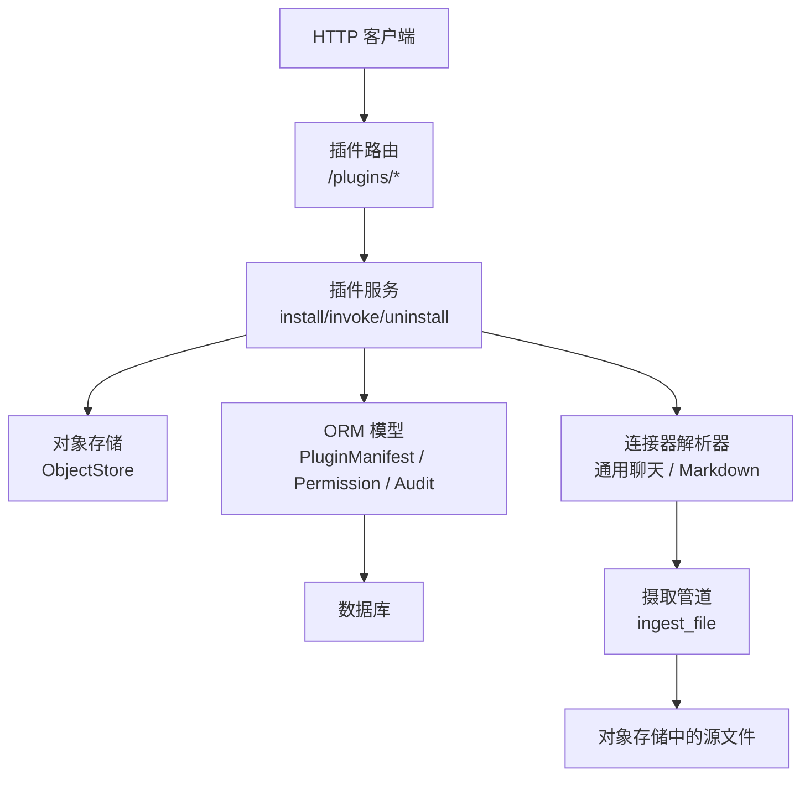

**图示来源**
- [api/routes/plugins.py:1-L158](file://src/personal_ai_life_os/api/routes/plugins.py#L1-L158)
- [services/plugins.py:1-L551](file://src/personal_ai_life_os/services/plugins.py#L1-L551)

**章节来源**
- [api/routes/plugins.py:1-L158](file://src/personal_ai_life_os/api/routes/plugins.py#L1-L158)
- [services/plugins.py:1-L551](file://src/personal_ai_life_os/services/plugins.py#L1-L551)

## 核心概念与权限模型

### 插件清单规范
一个本地插件由服务层的内置目录决定。当前每个条目包含：

| 元数据字段 | 含义 | 示例值 |
|---|---|---|
| `name` | 插件唯一标识 | `generic-json-connector`、`graph-search-agent` |
| `version` | 版本字符串 | `1.0.0` |
| `kind` | 插件类型 | `connector`、`agent_tool` |
| `entrypoint` | 入口点标识 | `builtin:generic_json`、`builtin:graph_search` |
| `description` | 人类可读说明 | “预览或导入 JSON/Markdown” |
| `permissions` | 插件可声明的权限列表 | `connector.import`、`agent.read_graph` |

当前内置目录定义了两个插件：

- `generic-json-connector`：连接器插件，支持预览、导入、删除，需要四类连接器权限。
- `graph-search-agent`：Agent 工具插件，支持 `search` 动作，需要 `agent.read_graph`。

清单不包含远程仓库地址、哈希签名、依赖声明或安装脚本。这表示当前扩展不是通过上传独立包完成的。

**章节来源**
- [services/plugins.py:56-L99](file://src/personal_ai_life_os/services/plugins.py#L56-L99)

### 权限种类
服务层定义了权限目录，用于判断请求权限是否已知、是否在插件清单中声明、以及是否已授权。

| 权限键 | 适用类别 | 含义 |
|---|---|---|
| `connector.preview` | 连接器 | 预览用户选择但未落盘的文本。 |
| `connector.import` | 连接器 | 创建新的来源并导入内容。 |
| `connector.read_selected_path` | 连接器 | 读取用户显式选择的文件路径或文件名。 |
| `connector.delete` | 连接器 | 请求删除某个已导入来源。 |
| `agent.read_graph` | Agent 工具 | 读取属主范围的图谱实体和证据。 |
| `agent.read_timeline` | Agent 工具 | 读取时间线。 |
| `agent.read_files` | Agent 工具 | 经审批后读取用户选择文件。 |
| `agent.write_files` | Agent 工具 | 经审批后写入文件。 |
| `agent.external_send` | Agent 工具 | 经审批后把内容发送到应用外。 |
| `agent.payment` | Agent 工具 | 经审批后执行支付类操作。 |
| `agent.delete_data` | Agent 工具 | 经审批后删除数据。 |
| `agent.change_goal` | Agent 工具 | 经审批后修改目标。 |

这些是完整的权限命名空间，但只有部分已被当前两个内置插件使用。新增插件应通过权限目录扩展，而不是随意引入任意权限名。

**章节来源**
- [services/plugins.py:24-L54](file://src/personal_ai_life_os/services/plugins.py#L24-L54)

### 安装时的权限检查顺序
安装阶段按以下顺序验证权限：

1. 从名称查找内置插件；不存在返回未知插件错误。
2. 检查同租户下是否已安装同名插件；存在则返回冲突。
3. 检查已安装插件数量是否超过配置上限。
4. 对请求权限去重。
5. 检查权限是否在权限目录中存在。
6. 检查权限是否被该插件在目录清单中声明。
7. 写入清单和已授予权限。

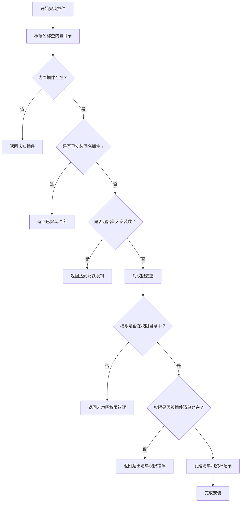

**图示来源**
- [services/plugins.py:115-L200](file://src/personal_ai_life_os/services/plugins.py#L115-L200)

**章节来源**
- [services/plugins.py:115-L200](file://src/personal_ai_life_os/services/plugins.py#L115-L200)

## 架构总览
插件请求的典型处理链如下：

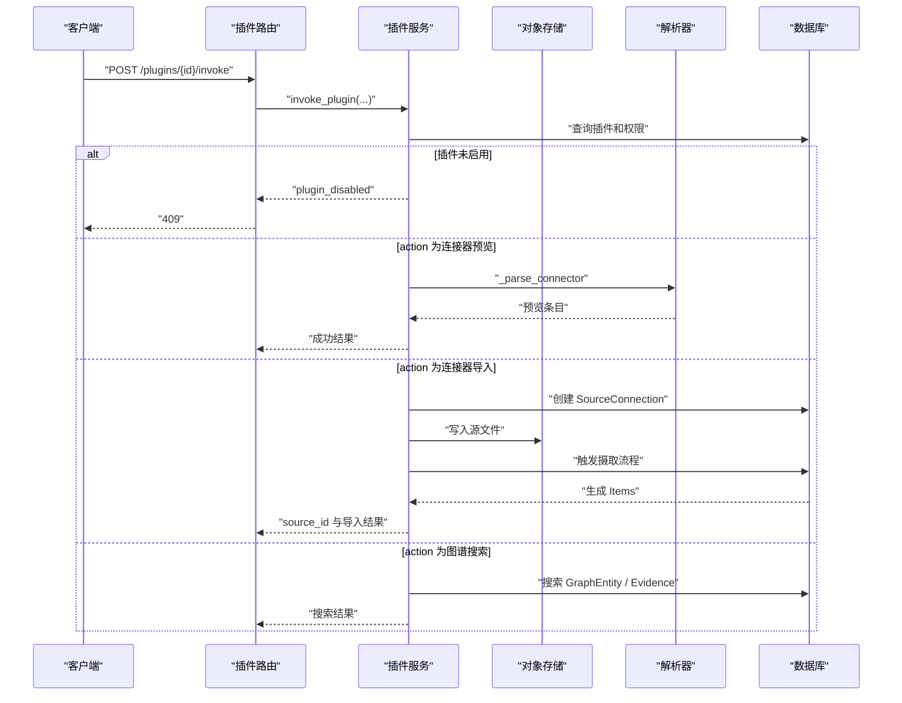

**图示来源**
- [api/routes/plugins.py:99-L158](file://src/personal_ai_life_os/api/routes/plugins.py#L99-L158)
- [services/plugins.py:321-L551](file://src/personal_ai_life_os/services/plugins.py#L321-L551)

**章节来源**
- [api/routes/plugins.py:1-L158](file://src/personal_ai_life_os/api/routes/plugins.py#L1-L158)
- [services/plugins.py:321-L551](file://src/personal_ai_life_os/services/plugins.py#L321-L551)

## 连接器插件

### 支持的输入
参考连接器 `generic-json-connector` 接受：

| 格式 | 扩展名 | 处理方式 |
|---|---|---|
| 通用聊天导出 JSON | `.json` | 调用通用聊天解析器，尝试识别多份对话、消息体和时间戳。 |
| JSONL | `.jsonl` | 逐行解析 JSON 对象。 |
| 内存型 Markdown | `.md`、`.markdown` | 按标题切分段落，保留行号区间，可选提取日期。 |

当前不接受 HTML、图片、PDF 等格式；传入不支持的文件会返回“不受支持的文件”错误。

**章节来源**
- [services/plugins.py:225-L272](file://src/personal_ai_life_os/services/plugins.py#L225-L272)
- [generic_chat.py:1-L226](file://src/personal_ai_life_os/parsers/generic_chat.py#L1-L226)
- [memory_markdown.py:1-L86](file://src/personal_ai_life_os/parsers/memory_markdown.py#L1-L86)

### 预览模式
预览不会创建来源，也不会把文件写入对象存储。它只做输入校验、大小检查和解析，然后最多返回前 20 条预览条目。每条预览条目包括：

- 标题
- 事件类型
- 发生时间
- 来源定位信息

预览还需要同时授予 `connector.preview` 和 `connector.read_selected_path` 权限。

**章节来源**
- [services/plugins.py:225-L272](file://src/personal_ai_life_os/services/plugins.py#L225-L272)

### 导入模式
导入模式的处理流程更重：

1. 先运行与预览相同的解析逻辑。
2. 校验 `filename` 和 `content`，并把内容编码为 UTF-8。
3. 如果文本超过 5 MiB，拒绝请求。
4. 创建 `SourceConnection`，设置类型为聊天导出或内存 Markdown。
5. 提交事务，确定来源 ID。
6. 调用摄取管道 `ingest_file`，根据文件类型决定内容类型。
7. 返回来源 ID、同步运行 ID、新增项数、重复项数和前 20 条条目。

这意味着 Connector 并不是直接插入最终知识条目，而是委托已有的 ingestion 系统完成规范化、去重和下游索引。

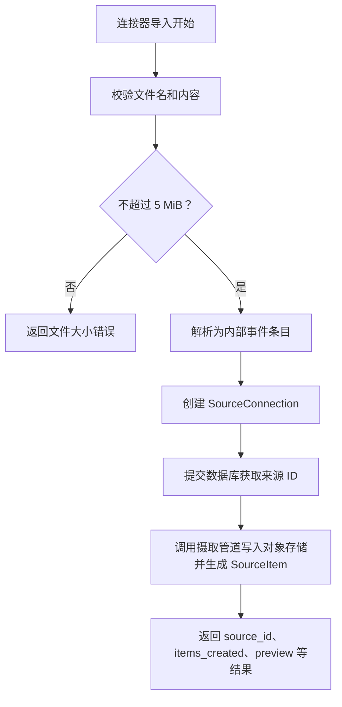

**图示来源**
- [services/plugins.py:274-L319](file://src/personal_ai_life_os/services/plugins.py#L274-L319)

**章节来源**
- [services/plugins.py:274-L319](file://src/personal_ai_life_os/services/plugins.py#L274-L319)

### 删除模式
连接器删除的是“某个已导入来源”，而不是单纯删除数据库行：

1. 校验 `source_id` 是否为有效属主的来源。
2. 通过删除服务申请删除并写删除墓碑。
3. 将来源状态标记为 `deleting`。
4. 扫描与该来源相关的衍生物和 SyncRun object_key。
5. 调用对象存储删除这些对象键。
6. 完成来源清理并提交删除。
7. 从数据库删除来源记录。

这是一种软删除加物理清理的组合策略，适合对象存储恢复。

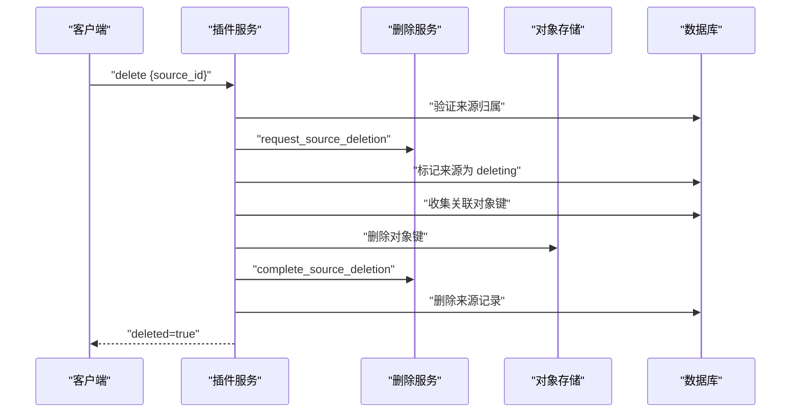

**图示来源**
- [services/plugins.py:321-L370](file://src/personal_ai_life_os/services/plugins.py#L321-L370)

**章节来源**
- [services/plugins.py:321-L370](file://src/personal_ai_life_os/services/plugins.py#L321-L370)

### 连接器开发指南
虽然当前没有动态插件加载接口，但若在未来扩展连接器，应遵循以下契约：

1. 使用统一解析输出模型。当前解析器返回 `ParsedItem` 类型的事件对象，其中包含标题、内容、发生时间、来源定位器和元数据。
2. 新连接器应实现健壮的容错解析：跳过缺失角色或缺失消息体的无效条目，而不是一次性失败。
3. 对不可信输入进行长度、编码和结构限制，避免解析器成为内存耗尽攻击面。
4. 对连接器产生的 `source_locator` 给出可回跳的定位信息，例如文件、行号或对话编号。
5. 对导入语义保持幂等预期：相同文件或已出现事件不应无限膨胀业务对象。
6. 使用明确的 `kind` 标注数据来源类型，以便下游聚合和历史检索。

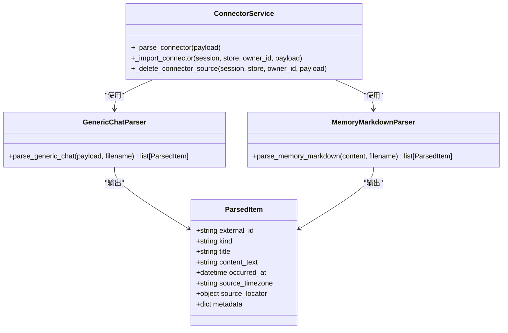

**图示来源**
- [generic_chat.py:1-L226](file://src/personal_ai_life_os/parsers/generic_chat.py#L1-L226)
- [memory_markdown.py:1-L86](file://src/personal_ai_life_os/parsers/memory_markdown.py#L1-L86)
- [services/plugins.py:225-L370](file://src/personal_ai_life_os/services/plugins.py#L225-L370)

**章节来源**
- [services/plugins.py:225-L370](file://src/personal_ai_life_os/services/plugins.py#L225-L370)
- [generic_chat.py:1-L226](file://src/personal_ai_life_os/parsers/generic_chat.py#L1-L226)
- [memory_markdown.py:1-L86](file://src/personal_ai_life_os/parsers/memory_markdown.py#L1-L86)

## Agent 工具插件

### 当前行为
内置 `graph-search-agent` 只支持一个 `search` 动作。其输入校验和行为如下：

- `query` 必须是非空字符串。
- `limit` 默认 10，最小 1，最大 20。
- 仅搜索属主范围且状态为 `active` 的实体。
- 模糊匹配实体名称或摘要。
- 按置信度降序和更新时间降序排序。
- 为每个实体再追加最多 3 条相关证据。

它不会写入、删除或改变业务数据，因此不需要 `agent.write_files`、`agent.delete_data` 等写入类权限。

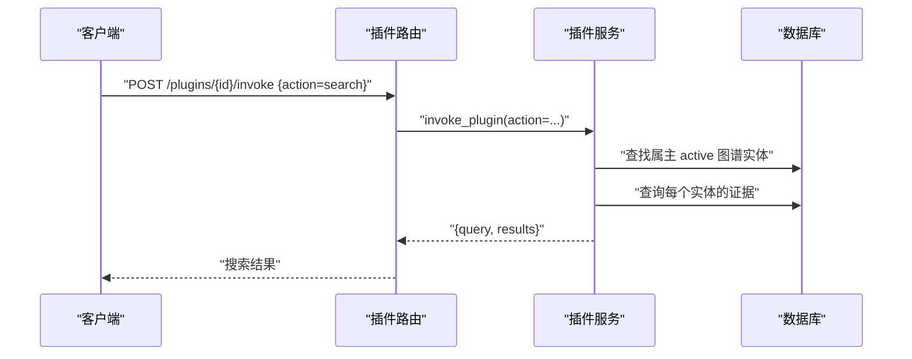

**图示来源**
- [services/plugins.py:372-L450](file://src/personal_ai_life_os/services/plugins.py#L372-L450)
- [api/routes/plugins.py:99-L158](file://src/personal_ai_life_os/api/routes/plugins.py#L99-L158)

**章节来源**
- [services/plugins.py:372-L450](file://src/personal_ai_life_os/services/plugins.py#L372-L450)

### Agent 副作用控制
对于读写文件、付款、删除数据、发送外部内容等行为，当前权限目录已预留相应权限键，但尚未实现通用运行时执行器。若未来实现 Agent 工具平台，建议按下列设计原则：

- 所有非幂等操作必须进入审批工作流。
- 执行前应捕获 `before_json`，执行后捕获 `after_json`。
- 副作用应有撤销操作，并与现有 Agent 行动审计模型对齐。
- 敏感动作需显示人类可读意图，而不是只传机器参数。
- 调用方必须显式授权每个副作用权限。
- 失败时只记录审计日志，不泄露内部栈跟踪给用户。

此部分是推荐扩展方向，不代表当前已有通用的 Agent 副作用引擎。

## 插件生命周期 API

| 方法 | 路径 | 作用 | 主要错误码 |
|---|---|---|---|
| `GET` | `/api/v1/plugins/catalog` | 列出内置插件目录 | 无 |
| `GET` | `/api/v1/plugins` | 列出当前用户已安装的插件 | 无 |
| `POST` | `/api/v1/plugins/install` | 安装插件并可裁剪权限 | 404、409、422 |
| `POST` | `/api/v1/plugins/{id}/status` | 启用或禁用插件 | 422 |
| `DELETE` | `/api/v1/plugins/{id}` | 卸载插件 | 404 |
| `POST` | `/api/v1/plugins/{id}/invoke` | 调用插件 action | 403、409、422、502 |
| `GET` | `/api/v1/plugins/audit` | 获取审计日志列表 | 无 |

### 安装
请求体使用 `PluginInstallRequest`：

| 字段 | 必填 | 约束 | 说明 |
|---|---:|---|---|
| `name` | 是 | 1~120 字符 | 内置插件名称。 |
| `permissions` | 否 | 字符串数组 | 显式声明期望权限；省略则继承内置目录默认权限。 |

成功返回 201，包含插件 ID、版本、类型、权限、状态和时间戳。

### 状态切换
`PluginStatusRequest` 只接受 `enabled` 或 `disabled`。禁用状态下所有 invoke 均会被拒绝，错误码为 409，审计状态记为 `denied`。

### 卸载
卸载会删除清单记录并记录审计日志。它不会单独清理该插件历史上创建的 SourceConnection——来源生命周期通常由其自身的 Connector 删除动作管理。

### 调用
调用请求使用 `PluginInvokeRequest`：

| 字段 | 必填 | 约束 | 说明 |
|---|---:|---|---|
| `action` | 是 | 1~40 字符 | 例如 `preview`、`import`、`delete`、`search`。 |
| `payload` | 否 | 对象 | 按 action 类型决定字段。 |

服务层会根据入口点和动作分发到具体实现。

### 审计
每次安装、状态切换、成功调用、权限拒绝或调用失败都会记录审计日志。审计日志可按拥有者查询，并提供 action、status、detail 和时间。

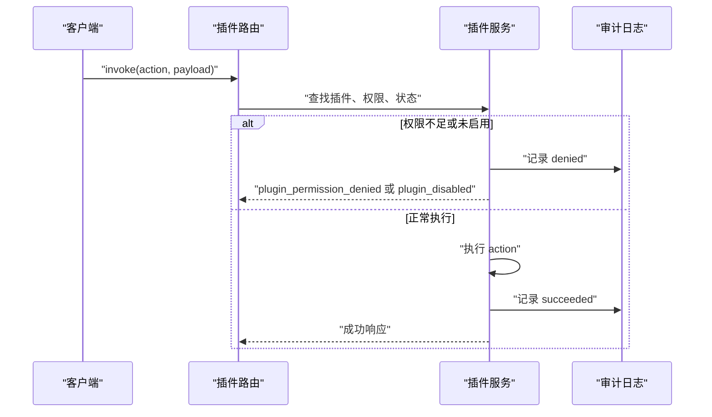

**图示来源**
- [api/routes/plugins.py:21-L158](file://src/personal_ai_life_os/api/routes/plugins.py#L21-L158)
- [services/plugins.py:452-L551](file://src/personal_ai_life_os/services/plugins.py#L452-L551)

**章节来源**
- [api/routes/plugins.py:1-L158](file://src/personal_ai_life_os/api/routes/plugins.py#L1-L158)
- [api/schemas.py:792-L849](file://src/personal_ai_life_os/api/schemas.py#L792-L849)
- [services/plugins.py:452-L551](file://src/personal_ai_life_os/services/plugins.py#L452-L551)

## 依赖关系分析

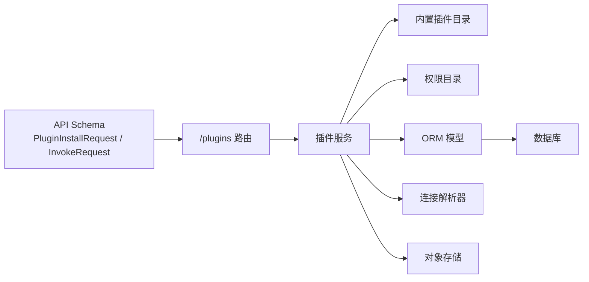

**图示来源**
- [api/schemas.py:792-L849](file://src/personal_ai_life_os/api/schemas.py#L792-L849)
- [api/routes/plugins.py:1-L158](file://src/personal_ai_life_os/api/routes/plugins.py#L1-L158)
- [services/plugins.py:1-L200](file://src/personal_ai_life_os/services/plugins.py#L1-L200)

**章节来源**
- [services/plugins.py:1-L200](file://src/personal_ai_life_os/services/plugins.py#L1-L200)
- [api/routes/plugins.py:1-L158](file://src/personal_ai_life_os/api/routes/plugins.py#L1-L158)

## 安全与隔离

### 权限隔离
- 每个插件以租户为维度安装：`owner_id` 是强制筛选条件。
- 每个插件可以授权多个权限，权限通过 `PluginPermission` 表维护。
- 调用前检查插件状态和每个 action 所需权限。
- 未授权调用返回 403，错误码为 `plugin_permission_denied`。
- 未启用插件调用返回 409，错误码为 `plugin_disabled`。

### 沙箱与进程隔离
当前没有在独立的进程、虚拟机或 WebAssembly 环境中运行插件。插件逻辑以 Python 函数形式在服务进程中调用。因此，“沙箱”更多是逻辑层面的隔离，而非操作系统级隔离：

- 权限模型限制了业务资源范围。
- 内置插件只能走有限 action 分支。
- 输入经过白名单校验、大小限制和类型校验。
- 未知 entrypoint 或未知 action 会被拒绝。
- 未被业务逻辑捕获的异常会被转换为通用失败错误，并记录审计。

如果未来要支持第三方插件，应将“当前逻辑沙箱”升级为真正的执行隔离，并结合沙箱许可策略拒绝危险系统调用。

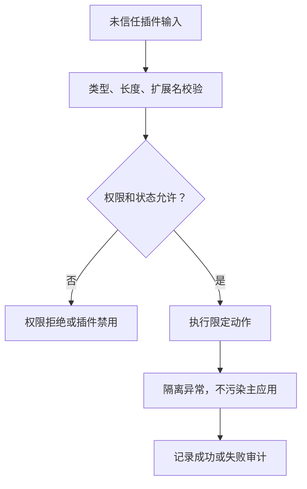

**图示来源**
- [services/plugins.py:225-L551](file://src/personal_ai_life_os/services/plugins.py#L225-L551)

**章节来源**
- [services/plugins.py:225-L551](file://src/personal_ai_life_os/services/plugins.py#L225-L551)

### 依赖管理与版本兼容性
当前插件目录没有字段描述外部库依赖、Python 版本要求或插件间依赖。现有依赖集中在应用包级别：

- Python ≥ 3.11。
- FastAPI、SQLAlchemy、Pydantic、Alembic、Tesseract、Pillow 等。
- 开发和测试依赖 pytest、pytest-cov、ruff。

如需扩展到动态插件仓库，应增加：

- `dependencies`：插件所需的库或 Python 版本约束。
- `compatibility`：应用 API 版本或插件协议版本。
- `sha256`：二进制或源码完整性校验。
- `signature`：发行方签名。
- 安装前的兼容检查与灰度升级流程。

目前这些内容不存在于代码中，不应误以为已实现。

**章节来源**
- [pyproject.toml:1-L58](file://pyproject.toml#L1-L58)

## 性能与边界

| 边界 | 当前规则 | 建议 |
|---|---|---|
| 连接器输入大小 | 最多 5 MiB 字节 | 对大文件考虑分片导入或异步任务。 |
| 连接器预览返回 | 最多 20 条 | 分页展示可减少前端渲染压力。 |
| 图搜索 limit | 1~20 | 后台批量查询场景可能需要更高上限和游标。 |
| 每用户已安装插件数 | 默认 20 | 可通过配置调整，但仍应按租户预算评估。 |
| 审计查询页大小 | 默认最多 50 条 | 审计历史可能增长，需要考虑归档。 |
| 解析复杂度 | 聊天 JSON 为线性遍历 | 对超大 JSON 建议流式解析或使用惰性迭代器。 |
| 搜索复杂度 | 单次 SQL 查询实体和多次子查询证据 | 可为高频 query 加入缓存，但需注意租户隔离。 |

连接器预览和导入都限制在前 20 条条目上，这是面向交互体验的优化，但也意味着调用方不应把它当作完整数据集统计接口。

**章节来源**
- [services/plugins.py:225-L319](file://src/personal_ai_life_os/services/plugins.py#L225-L319)
- [services/plugins.py:372-L450](file://src/personal_ai_life_os/services/plugins.py#L372-L450)

## 开发与调试

### 开发环境搭建
当前项目的 Python 环境与插件模块依赖由 `pyproject.toml` 管理，测试框架为 pytest。

- Python 最低版本：3.11。
- 测试路径：`tests`。
- pytest 配置选项：使用 `-ra` 收集测试结果。
- 开发依赖包括 pytest、pytest-cov、ruff。

要调试插件功能，最直接的方式是运行集成测试，因为插件涉及 FastAPI 路由、数据库会话、对象存储和权限逻辑。

### 调试要点
1. 确认插件目录中包含所需插件。
2. 确认请求使用的是已安装插件的真实 ID。
3. 确认插件状态为 `enabled`。
4. 确认动作名称正确。
5. 确认所需权限已在安装时授予。
6. 查看 `/plugins/audit` 获取 denied 和 failed 上下文。
7. 连接器导入失败时应检查对象存储和摄取流水线，而不是只看插件返回。

### 测试覆盖
现有测试覆盖了以下关键场景：

- 内置插件目录包含连接器与 Agent 工具。
- 连接器可安装、预览、导入、删除、禁用、卸载。
- 权限不足时返回 403。
- 文件格式错误时返回 422。
- 调用失败不影响主应用可用性。
- 审计日志至少包含 succeeded 和 denied。
- Agent 工具搜索能返回图实体和相关证据。
- 其他租户无法访问不属于它的插件安装或调用结果。

**章节来源**
- [pyproject.toml:34-L58](file://pyproject.toml#L34-L58)
- [test_plugins.py:1-L188](file://tests/test_plugins.py#L1-L188)

## 故障排查

### 常见错误码与含义

| 错误码 | HTTP 状态 | 含义 | 排查方向 |
|---:|---:|---|---|
| `plugin_unknown` | 404 | 插件名称不在目录中 | 检查 `name` 拼写。 |
| `plugin_already_installed` | 409 | 同用户已安装同名插件 | 先卸载或改插件名。 |
| `plugin_limit_reached` | 409 | 达到安装上限 | 清理未用插件或调大配置。 |
| `plugin_permission_unknown` | 422 | 权限不在权限目录 | 修正权限键或使用内置权限。 |
| `plugin_permission_undeclared` | 422 | 权限未在插件清单中声明 | 修改插件目录或移除多余权限。 |
| `plugin_not_found` | 404 | 插件 ID 不存在或不属于当前用户 | 确认 ID 和用户身份。 |
| `plugin_status_invalid` | 422 | 状态必须是 enabled 或 disabled | 检查状态字段。 |
| `plugin_permission_denied` | 403 | 缺少必要权限 | 重新安装并授权。 |
| `plugin_disabled` | 409 | 插件处于禁用状态 | 切换到 enabled。 |
| `plugin_action_unsupported` | 422 | action 不被 entrypoint 支持 | 核对 action 名称。 |
| `plugin_entrypoint_unsupported` | 422 | 插件不能调用 | 检查 entrypoint 分支。 |
| `plugin_parse_failed` | 422 | 解析器解析失败 | 检查文件格式、编码和内容结构。 |
| `plugin_unsupported_file` | 422 | 文件扩展名不受支持 | 使用 .json、.jsonl 或 .md。 |
| `plugin_invalid_payload` | 422 | 载荷缺失或字段错误 | 补充 filename、content、query 等。 |
| `plugin_file_too_large` | 413 | 文本内容过大 | 拆分文件或降低大小。 |
| `plugin_invoke_failed` | 502 | 插件执行失败 | 查看审计 detail 与上游异常。 |

**章节来源**
- [services/plugins.py:28-L200](file://src/personal_ai_life_os/services/plugins.py#L28-L200)
- [services/plugins.py:225-L551](file://src/personal_ai_life_os/services/plugins.py#L225-L551)

## 结论
当前 Personal-AI-Life-OS 的插件系统是一个轻量、租户隔离、权限控制的入口机制。它通过固定目录声明插件，通过 FastAPI 暴露稳定 API，并通过数据库维护清单、授权和审计。连接器插件重点解决本地文件的预览与导入，Agent 工具插件则专注于受限数据访问。

需要注意的关键限制是：插件并非动态可下载的外部程序，也没有进程级沙箱、远程仓库、依赖声明、版本签名或离线更新机制。若要走向企业级插件市场，下一步应优先完善安全边界、依赖隔离、兼容性矩阵和可观测性，同时保持现有权限审计作为基线。

## 附录：数据模型与字段说明

### 插件相关数据模型关系

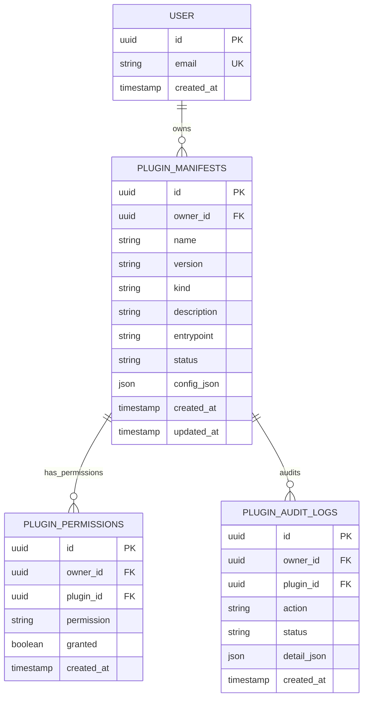

**图示来源**
- [models.py:703-L761](file://src/personal_ai_life_os/models.py#L703-L761)
- [d7f1a3b5c902_add_insights_agent_and_plugins.py:66-L152](file://migrations/versions/d7f1a3b5c902_add_insights_agent_and_plugins.py#L66-L152)

### 模型关键字段说明

| 模型 | 字段 | 类型/约束 | 说明 |
|---|---|---|---|
| `PluginManifest` | `id` | UUID | 插件记录主键。 |
| `PluginManifest` | `owner_id` | UUID 外键 | 所属用户。 |
| `PluginManifest` | `name` | 120 字符 | 插件名称，具有租户内唯一性。 |
| `PluginManifest` | `version` | 40 字符 | 插件版本号。 |
| `PluginManifest` | `kind` | 24 字符 | 插件类型，例如 `connector` 或 `agent_tool`。 |
| `PluginManifest` | `entrypoint` | 200 字符 | 服务层用来分派动作的标识。 |
| `PluginManifest` | `status` | 24 字符 | `installed`、`enabled`、`disabled` 等。 |
| `PluginManifest` | `config_json` | JSON | 预留插件配置。 |
| `PluginPermission` | `permission` | 80 字符 | 权限键，例如 `connector.import`。 |
| `PluginPermission` | `granted` | Boolean | 是否已授予该权限。 |
| `PluginAuditLog` | `action` | 40 字符 | 操作类型，例如 install、enabled、uninstall。 |
| `PluginAuditLog` | `status` | 24 字符 | `succeeded`、`denied`、`failed`。 |
| `PluginAuditLog` | `detail_json` | JSON | 附加审计详情。 |

**章节来源**
- [models.py:703-L761](file://src/personal_ai_life_os/models.py#L703-L761)
- [d7f1a3b5c902_add_insights_agent_and_plugins.py:66-L152](file://migrations/versions/d7f1a3b5c902_add_insights_agent_and_plugins.py#L66-L152)