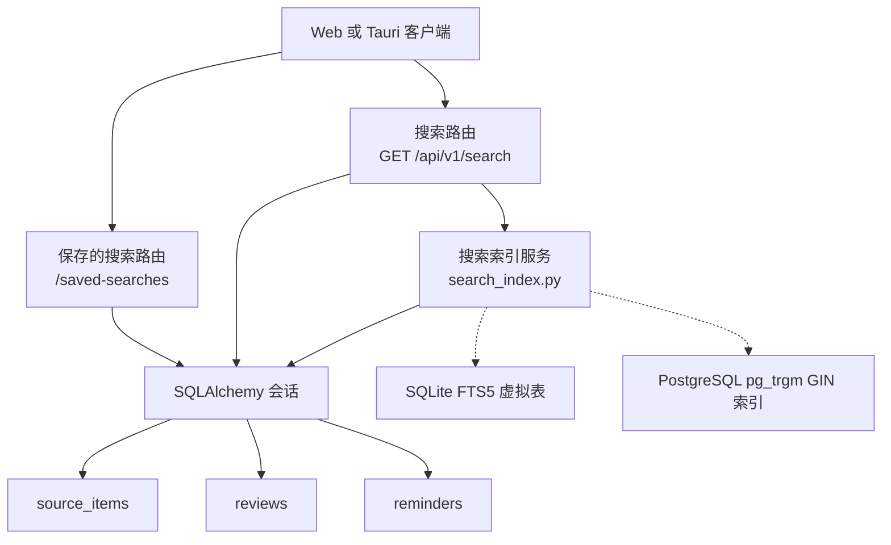
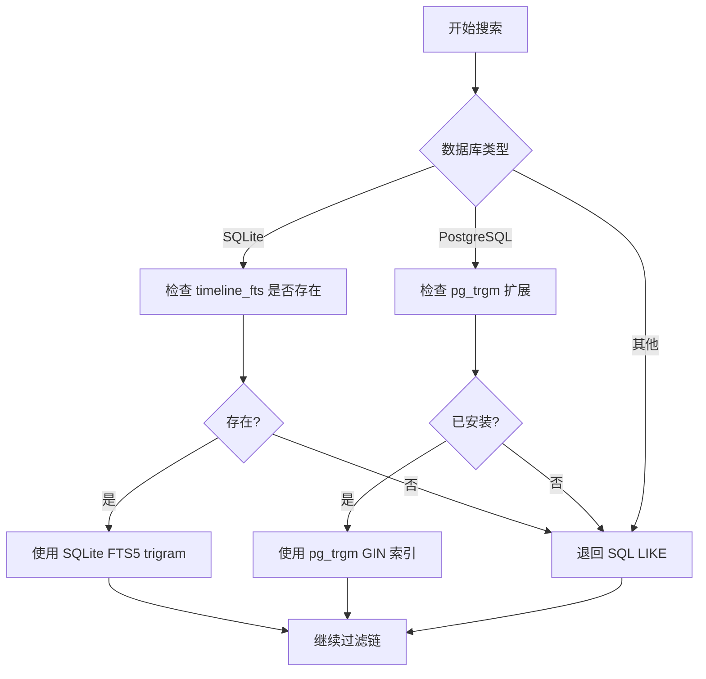
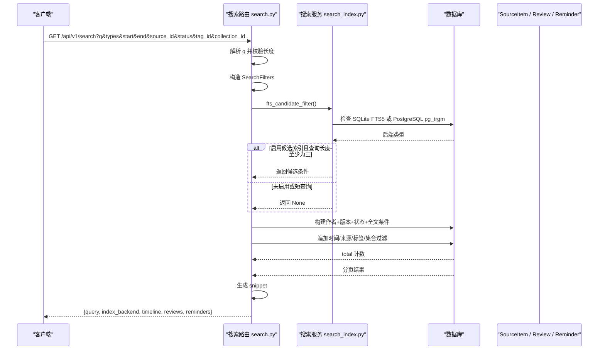
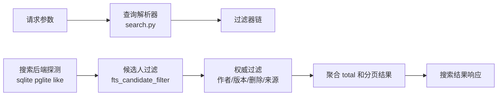
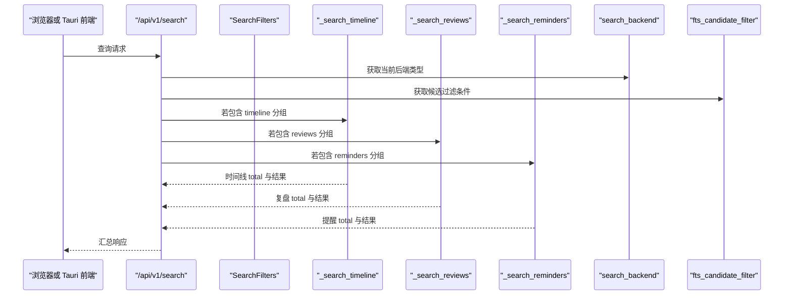
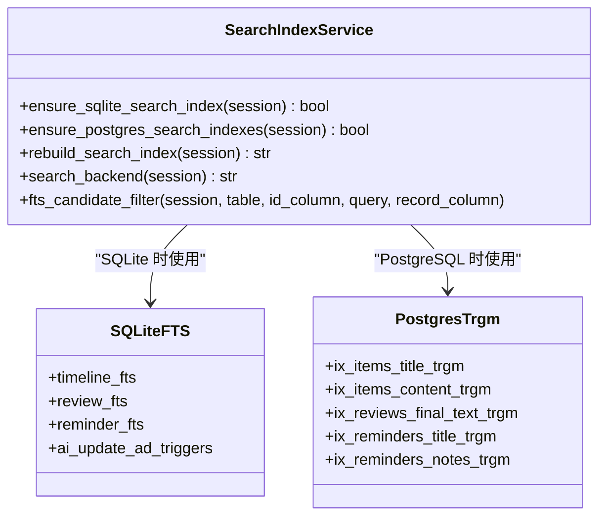
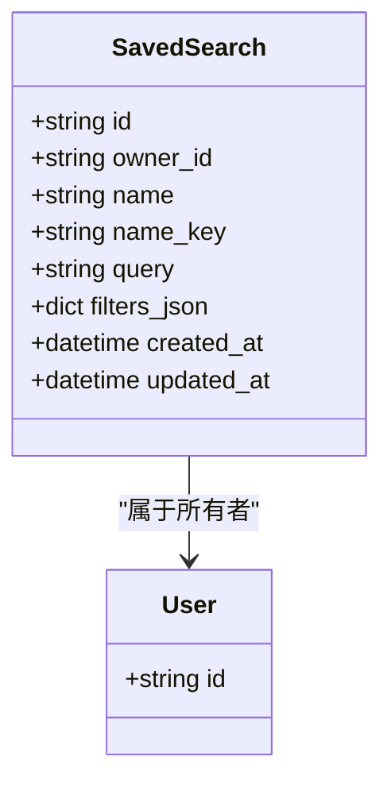
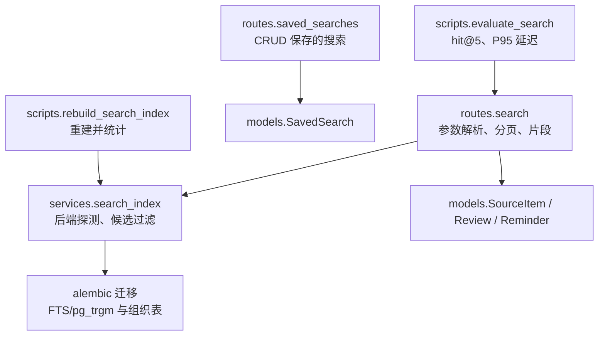
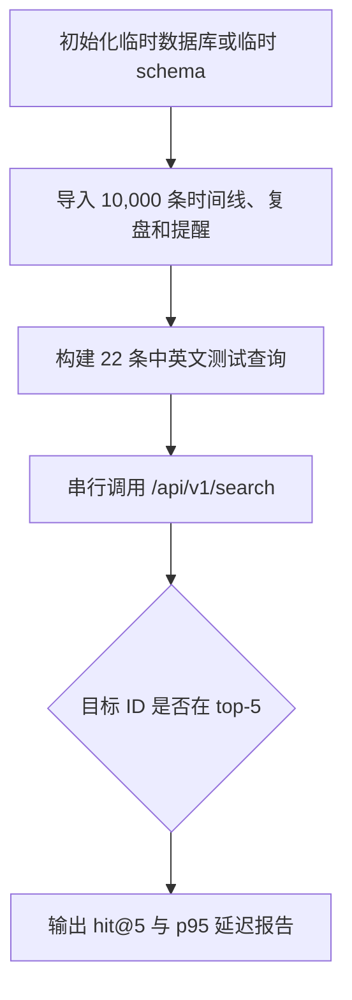
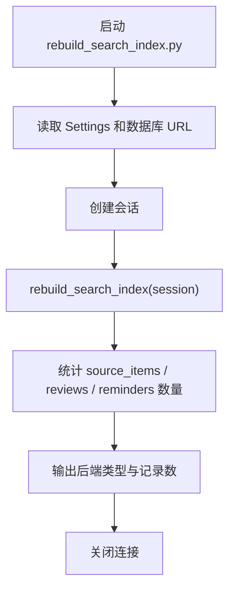

# 搜索引擎

<cite>
**本文引用的文件 **
- [search_index.py](file://src/personal_ai_life_os/services/search_index.py)
- [search.py](file://src/personal_ai_life_os/api/routes/search.py)
- [saved_searches.py](file://src/personal_ai_life_os/api/routes/saved_searches.py)
- [models.py](file://src/personal_ai_life_os/models.py)
- [f9a1c4d8e702_add_search_indexes_and_organization.py](file://migrations/versions/f9a1c4d8e702_add_search_indexes_and_organization.py)
- [evaluate_search.py](file://scripts/evaluate_search.py)
- [rebuild_search_index.py](file://scripts/rebuild_search_index.py)
- [test_search.py](file://tests/test_search.py)
- [test_search_organization.py](file://tests/test_search_organization.py)
- [README.md](file://README.md)
</cite>

## 目录
1. [引言](#引言)
2. [项目结构](#项目结构)
3. [核心组件](#核心组件)
4. [架构总览](#架构总览)
5. [详细组件分析](#详细组件分析)
6. [依赖关系分析](#依赖关系分析)
7. [性能考虑与基准](#性能考虑与基准)
8. [索引重建与大规模数据处理](#索引重建与大规模数据处理)
9. [监控、慢查询分析与优化建议](#监控慢查询分析与优化建议)
10. [故障排查指南](#故障排查指南)
11. [结论](#结论)
12. [附录：查询语法与API参考](#附录查询语法与api参考)

## 引言
Personal-AI-Life-OS 的搜索引擎提供统一检索能力，将时间线条目、周复盘记录和提醒三类数据纳入一次查询。它并不实现语义向量搜索，而是采用候选索引加权威过滤的两阶段设计：先用 FTS5 或 pg_trgm 快速缩小候选集，再用用户、版本、删除状态、来源状态及多维过滤器进行最终校验。这种设计对 SQLite 和 PostgreSQL 都可用；当底层全文能力不可用时，会自动回退到大小写不敏感的全表 LIKE 匹配。

该方案适合本地桌面 MVP 和个人知识库规模，兼顾跨语言混合文本、模糊片段、多列组织元数据（标签、集合）、时间和来源筛选。搜索结果返回分组总数、截断片段和排序结果，并在客户端展示“使用的搜索后端”，便于运维观察。

**章节来源**
- [README.md:1-LINE_END](file://README.md#L1-L118)

## 项目结构
搜索引擎相关代码按层组织：

| 层次 | 主要文件 | 职责 |
|---|---|---|
| API 路由层 | `src/personal_ai_life_os/api/routes/search.py` | 参数解析、分组查询、片段生成、权限过滤 |
| 保存的搜索 API | `src/personal_ai_life_os/api/routes/saved_searches.py` | 创建、更新、删除、列出保存的搜索条件 |
| 搜索服务层 | `src/personal_ai_life_os/services/search_index.py` | 后端检测、FTS/pg_trgm 触发器/索引、候选人过滤、全量重建 |
| 数据模型层 | `src/personal_ai_life_os/models.py` | SavedSearch 模型、时间线/复盘/提醒主表定义 |
| 数据库迁移层 | `migrations/.../f9a1c4d8e702_add_search_indexes_and_organization.py` | SQLite FTS5、pg_trgm GIN 索引、SavedSearch/tags/collections 等表 |
| 测试层 | `tests/test_search.py`、`tests/test_search_organization.py` | 基本搜索、所有者隔离、FTS 过滤器、保存的搜索、标签/集合组织 |
| 脚本层 | `scripts/evaluate_search.py`、`scripts/rebuild_search_index.py` | 合成数据基准、索引重建报告 |



**图示来源**
- [search.py:1-LINE_END](file://src/personal_ai_life_os/api/routes/search.py#L1-L299)
- [saved_searches.py:1-LINE_END](file://src/personal_ai_life_os/api/routes/saved_searches.py#L1-L109)
- [search_index.py:1-LINE_END](file://src/personal_ai_life_os/services/search_index.py#L1-L162)
- [models.py:299-L315](file://src/personal_ai_life_os/models.py#L299-L315)

**章节来源**
- [search.py:1-LINE_END](file://src/personal_ai_life_os/api/routes/search.py#L1-L299)
- [saved_searches.py:1-LINE_END](file://src/personal_ai_life_os/api/routes/saved_searches.py#L1-L109)
- [search_index.py:1-LINE_END](file://src/personal_ai_life_os/services/search_index.py#L1-L162)
- [models.py:299-L315](file://src/personal_ai_life_os/models.py#L299-L315)
- [f9a1c4d8e702_add_search_indexes_and_organization.py:1-LINE_END](file://migrations/versions/f9a1c4d8e702_add_search_indexes_and_organization.py#L1-L211)

## 核心组件

### FTS5 与 pg_trgm 双后端
系统按数据库方言选择候选索引策略：

| 后端 | 索引方式 | 适用场景 | 自动回退 |
|---|---|---|---|
| SQLite + FTS5 + trigram tokenizer | `timeline_fts`、`review_fts`、`reminder_fts` 三个虚拟表 | 轻量本地部署、无外部扩展依赖 | 虚拟表不存在时回退到 SQL LIKE |
| PostgreSQL + pg_trgm | source_items 标题和内容、reviews 正文、reminders 标题和备注的 GIN 索引 | 高性能多行文本模糊检索 | 未安装 pg_trgm 扩展时回退到 SQL LIKE |
| 其他数据库 | 无专用全文扩展 | 兼容模式 | 使用 LIKE 全文近似匹配 |

运行时后端通过 `search_backend()` 返回字符串值，用于接口响应中的 `index_backend` 字段。`ensure_sqlite_search_index()` 和 `ensure_postgres_search_indexes()` 在连接时尝试创建 FTS 虚拟表或 pg_trgm GIN 索引；若因权限或其他原因失败，则记录日志并允许降级。



**图示来源**
- [search_index.py:39-L72](file://src/personal_ai_life_os/services/search_index.py#L39-L72)
- [search_index.py:74-L117](file://src/personal_ai_life_os/services/search_index.py#L74-L117)
- [search_index.py:119-L162](file://src/personal_ai_life_os/services/search_index.py#L119-L162)

**章节来源**
- [search_index.py:1-L72](file://src/personal_ai_life_os/services/search_index.py#L1-L72)
- [search_index.py:74-L117](file://src/personal_ai_life_os/services/search_index.py#L74-L117)
- [search_index.py:119-L162](file://src/personal_ai_life_os/services/search_index.py#L119-L162)

### 查询解析器与过滤链
API 入口 `/api/v1/search` 接收统一查询参数，将其解析为 `SearchFilters`，然后分别调用时间线、复盘、提醒三个子搜索函数。每个子搜索都遵循相同流程：

1. 验证并归一化查询词。
2. 将请求参数转为结构化过滤对象。
3. 构建基础权限条件：所有者 ID、删除标记、当前版本、来源状态。
4. 应用全文候选过滤：FTS MATCH 或 pg_trgm 候选再转成 SQLAlchemy IN 子句。
5. 添加时间范围、来源 ID、状态、标签 ID、集合 ID 等附加条件。
6. 执行计数查询获取 group total。
7. 执行分页结果查询，并生成最多 200 字符的搜索片段。



**图示来源**
- [search.py:227-L299](file://src/personal_ai_life_os/api/routes/search.py#L227-L299)
- [search.py:81-L177](file://src/personal_ai_life_os/api/routes/search.py#L81-L177)
- [search_index.py:149-L162](file://src/personal_ai_life_os/services/search_index.py#L149-L162)

**章节来源**
- [search.py:1-L80](file://src/personal_ai_life_os/api/routes/search.py#L1-L80)
- [search.py:81-L226](file://src/personal_ai_life_os/api/routes/search.py#L81-L226)
- [search.py:227-L299](file://src/personal_ai_life_os/api/routes/search.py#L227-L299)

### 多维度过滤设计
查询支持以下维度组合：

| 过滤维度 | 作用域 | 说明 |
|---|---|---|
| `types` | 全局 | 控制是否计算 `timeline`、`reviews`、`reminders` 三个分组；默认全部打开 |
| `q` | 全局 | 全文关键词，SQLite FTS5 要求最少三字符才启用 MATCH |
| `start` / `end` | 分组内时间语义不同 | 时间线用 `occurred_at`；复盘用区间交叉；提醒用 `due_at` |
| `source_id` | 时间线 | 限定来源 |
| `status` | 复盘/提醒 | 过滤复盘状态或提醒状态列表 |
| `tag_id` | 时间线 | 通过关联标签表筛选 |
| `collection_id` | 时间线 | 通过集合关联表筛选 |
| 作者权限 | 所有组 | 结果必须属于当前登录用户 |
| 有效性 | 所有组 | 排除软删除、无效版本、失效来源、被撤销的复盘等 |

时间范围计算会读取当前用户的 `timezone`，把用户传入的日期转换为 UTC 后再参与比较，避免跨时区误判。

**章节来源**
- [search.py:62-L80](file://src/personal_ai_life_os/api/routes/search.py#L62-L80)
- [search.py:96-L151](file://src/personal_ai_life_os/api/routes/search.py#L96-L151)
- [search.py:153-L199](file://src/personal_ai_life_os/api/routes/search.py#L153-L199)
- [search.py:201-L226](file://src/personal_ai_life_os/api/routes/search.py#L201-L226)
- [search.py:227-L299](file://src/personal_ai_life_os/api/routes/search.py#L227-L299)

## 架构总览
下图展示一次统一搜索的生命周期：请求先经过 FastAPI 参数校验，再根据后端能力决定使用 FTS5、pg_trgm 或 LIKE 作为候选检索；真正命中前仍会重新施加所有权与业务状态过滤。



**图示来源**
- [search.py:227-L299](file://src/personal_ai_life_os/api/routes/search.py#L227-L299)
- [search_index.py:119-L162](file://src/personal_ai_life_os/services/search_index.py#L119-L162)

## 详细组件分析

### 搜索路由层
`search.py` 暴露单一统一搜索端点，内部再拆分为 `_search_timeline`、`_search_reviews`、`_search_reminders` 三个处理函数，最后由路由函数拼装成 `SearchResponse`。关键特点如下：

- 统一路径：`GET /api/v1/search`。
- 单查询多分组：同一关键词同时查时间线、复盘、提醒。
- 分组限制独立生效：`limit` 控制每组分页数量。
- 分组总数独立计数：即使分页只返回五条，total 仍然表示符合条件总数。
- 分片摘要上限 200 字符，围绕匹配位置尽量对称截取，必要时显示省略号。
- 时间线优先标题匹配结果，其次是最近发生时间和主键。
- 复盘按结束时间倒序排列；提醒按到期时间升序、更新时间倒序排列。

#### 时序图：统一搜索请求



**图示来源**
- [search.py:227-L299](file://src/personal_ai_life_os/api/routes/search.py#L227-L299)
- [search.py:96-L151](file://src/personal_ai_life_os/api/routes/search.py#L96-L151)
- [search.py:153-L199](file://src/personal_ai_life_os/api/routes/search.py#L153-L199)
- [search.py:201-L226](file://src/personal_ai_life_os/api/routes/search.py#L201-L226)

**章节来源**
- [search.py:1-L80](file://src/personal_ai_life_os/api/routes/search.py#L1-L80)
- [search.py:96-L299](file://src/personal_ai_life_os/api/routes/search.py#L96-L299)

### FTS5 与 pg_trgm 索引层
`search_index.py` 的职责是隐藏数据库差异，向上层提供统一的 `fts_candidate_filter()` 和 `rebuild_search_index()`。

#### SQLite FTS5 策略
- 创建三个 FTS5 虚拟表：
  - `timeline_fts`：使用 `item_id UNINDEXED`，索引 `title` 和 `content`。
  - `review_fts`：使用 `record_id UNINDEXED`，索引 `final_text`。
  - `reminder_fts`：使用 `record_id UNINDEXED`，索引 `title` 和 `notes`。
- 触发器维护同步：
  - 插入后写入 FTS。
  - 标题或内容更新后删除旧行再插入新行。
  - 删除后移除 FTS 行。
- 回退逻辑：若 FTS 不可用，`search_backend` 返回 `like`。

#### PostgreSQL pg_trgm 策略
- 动态启用 `pg_trgm` 扩展。
- 对 `source_items.title`、`source_items.content_text`、`reviews.final_text`、`reminders.title`、`reminders.notes` 建立 GIN 索引，并使用 `lower(...)` 和 `gin_trgm_ops` 支持大小写不敏感模糊搜索。
- 如果扩展不可用，忽略错误并保留 LIKE 回退。

#### 类关系图：搜索索引核心函数


**图示来源**
- [search_index.py:5-L37](file://src/personal_ai_life_os/services/search_index.py#L5-L37)
- [search_index.py:39-L72](file://src/personal_ai_life_os/services/search_index.py#L39-L72)
- [search_index.py:74-L117](file://src/personal_ai_life_os/services/search_index.py#L74-L117)
- [f9a1c4d8e702_add_search_indexes_and_organization.py:23-L143](file://migrations/versions/f9a1c4d8e702_add_search_indexes_and_organization.py#L23-L143)

**章节来源**
- [search_index.py:1-L37](file://src/personal_ai_life_os/services/search_index.py#L1-L37)
- [search_index.py:39-L117](file://src/personal_ai_life_os/services/search_index.py#L39-L117)
- [f9a1c4d8e702_add_search_indexes_and_organization.py:23-L143](file://migrations/versions/f9a1c4d8e702_add_search_indexes_and_organization.py#L23-L143)

### SavedSearch 模型与保存的搜索功能
`SavedSearch` 存储的是“可复用的搜索条件”，不是搜索结果快照。它包含：

- `owner_id`：所有者隔离。
- `name` / `name_key`：人类可读名称和去重关键字。
- `query`：保存的关键词。
- `filters_json`：保存的分组、时间、来源、状态、标签、集合等过滤条件。
- `created_at` / `updated_at`：审计和排序依据。

API 支持：

| 方法 | 路径 | 行为 |
|---|---|---|
| `POST` | `/api/v1/saved-searches` | 创建命名唯一、所有者隔离的保存搜索 |
| `PATCH` | `/api/v1/saved-searches/{entry_id}` | 更新名称或过滤器 |
| `DELETE` | `/api/v1/saved-searches/{entry_id}` | 删除保存的搜索 |
| `GET` | `/api/v1/saved-searches` | 获取当前用户的所有保存搜索 |

响应中的 `filters` 字段会通过 `SearchFilters.model_validate()` 恢复为结构化过滤对象，方便 UI 直接渲染。

#### 类图：SavedSearch


**图示来源**
- [models.py:299-L315](file://src/personal_ai_life_os/models.py#L299-L315)
- [saved_searches.py:1-L109](file://src/personal_ai_life_os/api/routes/saved_searches.py#L1-L109)
- [f9a1c4d8e702_add_search_indexes_and_organization.py:89-L119](file://migrations/versions/f9a1c4d8e702_add_search_indexes_and_organization.py#L89-L119)

#### 重要约束
- 同名且同用户名称冲突时返回 409。
- 新建和更新时，名称会被转换为小写的 `name_key`。
- 查询保存的搜索时使用 `owner_id` 精确限制，防止跨用户访问。
- 当前实现没有内置分享链接、共享密钥、组织级可见性、复制复用模板等云端协作特性；若要支持分享，应在现有 `owner_id` + `filters_json` 基础上增加共享范围和有效期机制。

**章节来源**
- [saved_searches.py:1-L109](file://src/personal_ai_life_os/api/routes/saved_searches.py#L1-L109)
- [models.py:299-L315](file://src/personal_ai_life_os/models.py#L299-L315)
- [test_search_organization.py:1-L150](file://tests/test_search_organization.py#L1-L150)

### 多列索引与组织元数据
搜索不仅依赖全文索引，还依赖多个组织维度的索引：

| 实体 | 关键索引 | 目的 |
|---|---|---|
| tags | `ix_tags_owner_id`、`ix_tags_owner_name` | 按所有者和名称查询标签 |
| collections | `ix_collections_owner_id`、`ix_collections_owner_name` | 按所有者和名称查询集合 |
| item_tags | `ix_item_tags_tag_item` | 支持 `tags.any(id=...)` 高效判断 |
| item_collections | `ix_item_collections_collection_item` | 支持 `collections.any(id=...)` 高效判断 |
| saved_searches | `ix_saved_searches_owner_id`、`ix_saved_searches_owner_created` | 按用户列出和排序保存的搜索 |
| source_items | pg_trgm GIN 索引、业务主键、is_current、deleted_at | 时间线全文与身份过滤 |
| reviews | pg_trgm GIN 索引、业务状态 | 复盘正文模糊匹配 |
| reminders | pg_trgm GIN 索引、业务状态、过期时间 | 提醒标题和备注匹配 |

这些索引共同支撑“按时间、来源、状态、标签、集合、全文”的组合查询，而不是单纯依赖单一全文索引。

**章节来源**
- [f9a1c4d8e702_add_search_indexes_and_organization.py:44-L87](file://migrations/versions/f9a1c4d8e702_add_search_indexes_and_organization.py#L44-L87)
- [f9a1c4d8e702_add_search_indexes_and_organization.py:89-L143](file://migrations/versions/f9a1c4d8e702_add_search_indexes_and_organization.py#L89-L143)
- [search.py:96-L151](file://src/personal_ai_life_os/api/routes/search.py#L96-L151)

## 依赖关系分析
搜索系统的核心依赖如下：



**图示来源**
- [search.py:1-L299](file://src/personal_ai_life_os/api/routes/search.py#L1-L299)
- [saved_searches.py:1-L109](file://src/personal_ai_life_os/api/routes/saved_searches.py#L1-L109)
- [search_index.py:1-L162](file://src/personal_ai_life_os/services/search_index.py#L1-L162)
- [evaluate_search.py:1-L100](file://scripts/evaluate_search.py#L1-L100)
- [rebuild_search_index.py:1-L41](file://scripts/rebuild_search_index.py#L1-L41)

**章节来源**
- [search.py:1-L299](file://src/personal_ai_life_os/api/routes/search.py#L1-L299)
- [saved_searches.py:1-L109](file://src/personal_ai_life_os/api/routes/saved_searches.py#L1-L109)
- [search_index.py:1-L162](file://src/personal_ai_life_os/services/search_index.py#L1-L162)
- [evaluate_search.py:1-L100](file://scripts/evaluate_search.py#L1-L100)
- [rebuild_search_index.py:1-L41](file://scripts/rebuild_search_index.py#L1-L41)

## 性能考虑与基准
### 候选索引优势
- FTS5 或 pg_trgm 负责“从大表中筛出可能匹配的行”，减少后续 WHERE 和 JOIN 成本。
- 真正的作者、版本、删除和来源状态检查仍在数据库层执行，保证安全正确。
- 短于三字符的查询不会使用 FTS MATCH，避免 FTS 引擎的低质量或低效匹配。

### 已知限制
- 当前 README 明确说明没有语义或向量索引；搜索基于文本匹配，不支持 embedding、BM25 语义相似度、主题检索。
- 片段是在 Python 层计算，而不是依赖 SQL 的片段函数；这有利于可控输出格式，但会增加 CPU 开销。
- 时间线 snippet 会优先尝试 `user_description`，否则回退到 `content_text`，若两者都不含关键词则回退到 `title`。
- 时间线搜索结果按照标题匹配优先级、是否为空发生时间、发生时间倒序和 ID 排序，因此不能把它等同于评分式相关性排序。

### 基准测试
`scripts/evaluate_search.py` 是官方提供的统一搜索性能与召回基线脚本：

| 指标 | 含义 |
|---|---|
| hit@5 | 目标记录是否出现在所属分组的前五条结果中 |
| p95_ms | 95% 的查询耗时不超过多少毫秒 |
| 目标 | P95 延迟目标为 500 毫秒以内 |
| 数据规模 | 默认约 10,000 条时间线条目，加上少量复盘和提醒 |
| 查询数量 | 22 条中英混合固定查询 |
| 后端支持 | SQLite 默认可运行；设置 `LIFEOS_BENCHMARK_POSTGRES_URL` 后可测试 PostgreSQL |

基准脚本的关键流程：



**图示来源**
- [evaluate_search.py:1-L200](file://scripts/evaluate_search.py#L1-L200)
- [evaluate_search.py:201-L514](file://scripts/evaluate_search.py#L201-L514)

**章节来源**
- [README.md:1-L118](file://README.md#L1-L118)
- [search.py:96-L151](file://src/personal_ai_life_os/api/routes/search.py#L96-L151)
- [search_index.py:149-L162](file://src/personal_ai_life_os/services/search_index.py#L149-L162)
- [evaluate_search.py:1-L100](file://scripts/evaluate_search.py#L1-L100)
- [evaluate_search.py:201-L514](file://scripts/evaluate_search.py#L201-L514)

## 索引重建与大规模数据处理
### 重建逻辑
`rebuild_search_index()` 的行为依后端而定：

| 后端 | 重建过程 |
|---|---|
| PostgreSQL | 确保 pg_trgm 扩展和 GIN 索引存在，然后交给通用搜索后端路径；实际效果主要是确保索引存在，不做逐行清空重建 |
| SQLite | 先尝试创建 FTS 虚拟表；若失败则返回 `like`；若成功则清空三个 FTS 表并按权威行重建 |
| 其他 | 不重建 FTS/pg_trgm，直接走通用路径 |

SQLite 重建会：
1. 清空 `timeline_fts`、`review_fts`、`reminder_fts`。
2. 从 `source_items` 写入 `is_current = 1 AND deleted_at IS NULL` 的行。
3. 从 `reviews` 写入非失效且有正文字段的行。
4. 从 `reminders` 写入标题和笔记。
5. 提交事务并返回后端类型。

### 脚本式重建
CLI 脚本 `scripts/rebuild_search_index.py` 提供幂等重建能力：

- 加载应用配置。
- 创建引擎和会话工厂。
- 调用 `rebuild_search_index(session)`。
- 统计当前有效时间线条目数、复盘数和提醒数。
- 输出 JSON 报告，例如后端类型、各表记录数。



**图示来源**
- [rebuild_search_index.py:1-L41](file://scripts/rebuild_search_index.py#L1-L41)
- [search_index.py:119-L147](file://src/personal_ai_life_os/services/search_index.py#L119-L147)

### 大规模数据集建议
对于大量时间线或重复重建：

1. 在生产 PostgreSQL 上确认 `pg_trgm` 已成功安装，GIN 索引已创建。
2. 首次部署或 Schema 变更时运行 Alembic 迁移，确保 FTS/pg_trgm 与组织表结构一致。
3. 批量导入数据后显式执行重建脚本，尤其针对 SQLite。
4. 若频繁增量写入导致 SQLite FTS 碎片较多，定期重建能避免索引状态异常。
5. 监控 `index_backend` 返回值，若意外回退到 `like`，需检查权限、扩展、虚拟表是否存在。
6. 对超大数据集，未来可在保留候选索引的同时引入批量化增量 FTS 更新和异步任务，以减少长事务锁。

**章节来源**
- [search_index.py:74-L147](file://src/personal_ai_life_os/services/search_index.py#L74-L147)
- [rebuild_search_index.py:1-L41](file://scripts/rebuild_search_index.py#L1-L41)
- [f9a1c4d8e702_add_search_indexes_and_organization.py:145-L211](file://migrations/versions/f9a1c4d8e702_add_search_indexes_and_organization.py#L145-L211)

## 监控、慢查询分析与优化建议
### 监控指标
推荐关注以下指标：

| 指标 | 含义 | 健康方向 |
|---|---|---|
| `index_backend` | 客户端收到的后端类型 | 生产应稳定返回 `sqlite-fts5-trigram` 或 `postgresql-pg_trgm` |
| `hit@5` | 基准命中率 | 回归测试不应显著下降 |
| `p95_ms` | P95 查询延迟 | 应低于目标阈值，SQLite 通常较低，PostgreSQL 更依赖索引 |
| 查询失败率 | 422 或上游错误比例 | 越低越好 |
| 平均 total | 平均符合过滤条件的行数 | 明显上涨可能说明过滤器不够精确 |
| FTS/pg_trgm 缺失次数 | 重建失败或扩展缺失告警 | 应为零 |

### 慢查询定位
建议在数据库中开启慢查询日志并结合以下 SQL 关注项：

1. 检查 pg_trgm 是否已安装：
   - 查询扩展表确认 `pg_trgm`。
2. 检查 FTS 虚拟表是否存在：
   - SQLite 查询 `sqlite_master` 中的 `timeline_fts`。
3. 检查 GIN 索引是否存在：
   - PostgreSQL 查询 `pg_indexes` 或元数据表确认 `ix_items_*_trgm`、`ix_reviews_*_trgm`、`ix_reminders_*_trgm`。
4. 查看全表扫描：
   - 若出现大量 `LIKE '%xxx%'` 且无 trigram 索引，可能是回退路径，需要修复 pg_trgm 或重建 FTS。
5. 检查作者过滤和状态过滤：
   - 时间线查询包含作者、当前版本、删除标记、来源状态等多条件，确认没有绕过这些条件。
6. 评估标签/集合 JOIN 成本：
   - 若 `tag_id` 或 `collection_id` 成为热点，应确认 `item_tags`、`item_collections` 索引正常。

### 优化建议
- **优先使用 PostgreSQL 并启用 pg_trgm**：多列 GIN 索引对长文段和小样本模糊匹配更高效。
- **避免过大 limit**：接口最大 20，但仍应结合客户端分页或下游缓存降低负载。
- **合理组合过滤器**：尽量带上时间范围、来源 ID、标签或集合，减少候选集。
- **避免极短查询单独依赖 LIKE**：虽然代码有最小三字符保护，但在 LIKE 路径下短词更容易产生大结果集。
- **定期重建 SQLite 索引**：批量变更后跑 `scripts/rebuild_search_index.py`。
- **为未来语义检索预留扩展点**：目前无向量索引，可将 SavedSearch.filters 扩展为包含嵌入向量查询的可选结构，但不影响现有全文兼容路径。

[本节为通用指导，不直接分析特定代码片段]

## 故障排查指南

| 现象 | 可能原因 | 处理方法 |
|---|---|---|
| 搜索始终返回 `like` | SQLite FTS5 虚拟表不存在或未创建 | 调用重建逻辑或检查 `sqlite_master` |
| PostgreSQL 未使用 pg_trgm | 扩展无权限或未安装 | 以具备权限账号创建扩展，或确认 Alembic 迁移成功 |
| 搜索结果突然为空 | 作者隔离、删除或失效状态 | 检查 `owner_id`、`deleted_at`、`is_current`、复盘状态 |
| 时间线搜索结果不含期望条目 | 触发器未更新或 FTS 未重建 | 检查触发器，执行重建脚本 |
| 保存的搜索名称冲突 | `owner_id + name_key` 唯一约束 | 更改名称或使用 PATCH 覆盖 |
| 保存的搜索跨用户可见 | 查询未限制 `owner_id` | 检查路由和 ORM 查询，确认按作者过滤 |
| 时间范围过滤不符合预期 | 时区或边界处理问题 | 确认前端传入 UTC 日期与后端 `user.timezone` |
| 分页结果数量少于 total | 正常分页限制 | 调整 limit 或使用游标分页 |

### 常用验证命令
- 运行统一搜索基准：
  ```powershell
  uv run python scripts/evaluate_search.py
  ```
- 重建搜索索引并打印报告：
  ```powershell
  uv run python scripts/rebuild_search_index.py
  ```
- 常规测试套件包含搜索与组织元数据用例：
  - `tests/test_search.py`
  - `tests/test_search_organization.py`

**章节来源**
- [search_index.py:39-L72](file://src/personal_ai_life_os/services/search_index.py#L39-L72)
- [search_index.py:74-L117](file://src/personal_ai_life_os/services/search_index.py#L74-L117)
- [search_index.py:119-L162](file://src/personal_ai_life_os/services/search_index.py#L119-L162)
- [rebuild_search_index.py:1-L41](file://scripts/rebuild_search_index.py#L1-L41)
- [test_search.py:1-L213](file://tests/test_search.py#L1-L213)
- [test_search_organization.py:1-L150](file://tests/test_search_organization.py#L1-L150)

## 结论
Personal-AI-Life-OS 的搜索引擎是一个面向个人知识的统一全文检索系统。它以候选索引加权威过滤的方式，平衡了简单性、安全性与性能；既能在 SQLite 环境下工作，也能利用 PostgreSQL 的 pg_trgm GIN 索引提高多列模糊匹配效率。SavedSearch 为可复用的搜索条件提供了基础，支持按查询词与多维过滤条件持久化。当前实现不包含语义向量搜索、分享链接或组织级共享机制，但这些可以作为 SavedSearch 和过滤器结构的自然演进方向。

在生产中，应重点关注后端类型稳定性、索引可用性与基准命中率的回归，并通过时间、来源、标签和集合等维度降低整体查询成本。

[本节为总结性内容，不引用具体文件]

## 附录：查询语法与API参考

### 统一搜索 API
| 项目 | 描述 |
|---|---|
| 方法 | GET |
| 路径 | `/api/v1/search` |
| 认证 | Bearer Token |
| 参数 | `q`、`limit`、`types`、`start`、`end`、`source_id`、`status`、`tag_id`、`collection_id` |

#### 参数定义
| 参数 | 类型 | 是否必填 | 说明 |
|---|---|---:|---|
| `q` | 字符串 | 是 | 搜索关键词，1 到 200 字符；去除首尾空格 |
| `limit` | 整数 | 否 | 每组分页上限，1 到 20；默认通常为 10 |
| `types` | 逗号分隔字符串 | 否 | 可取 `timeline`、`reviews`、`reminders`，默认三者 |
| `start` | 日期字符串 | 否 | 开始日期；时间线按 `occurred_at`，复盘按区间交叉，提醒按 `due_at` |
| `end` | 日期字符串 | 否 | 结束日期；闭包或开包取决于后端模型字段 |
| `source_id` | UUID 字符串 | 否 | 仅时间线有效 |
| `status` | 逗号分隔状态列表 | 否 | 复盘或提醒的状态过滤 |
| `tag_id` | UUID 字符串 | 否 | 通过标签筛选时间线 |
| `collection_id` | UUID 字符串 | 否 | 通过集合筛选时间线 |

#### 响应主体
| 字段 | 类型 | 说明 |
|---|---|---|
| `query` | 字符串 | 标准化后的查询词 |
| `index_backend` | 字符串 | 使用的后端类型 |
| `timeline` | 对象 | 时间线分组 |
| `reviews` | 对象 | 复盘分组 |
| `reminders` | 对象 | 提醒分组 |

各组对象通常包含：
- `total`：符合过滤条件的总数。
- `results`：最多 `limit` 条结果。

时间线结果包含：
- `id`、`source_id`、`source_name`、`title`、`snippet`、`occurred_at`、`kind`。

复盘结果包含：
- `id`、`period_start`、`period_end`、`status`、`snippet`、`updated_at`。

提醒结果包含：
- `id`、`title`、`snippet`、`due_at`、`status`。

**章节来源**
- [search.py:227-L299](file://src/personal_ai_life_os/api/routes/search.py#L227-L299)
- [test_search.py:1-L80](file://tests/test_search.py#L1-L80)
- [test_search.py:141-L188](file://tests/test_search.py#L141-L188)

### 保存的搜索 API
| 方法 | 路径 | 入参 | 出参或状态码 |
|---|---|---|---|
| `GET` | `/api/v1/saved-searches` | 无额外 Body | 返回数组；每项含 `id`、`name`、`query`、`filters`、时间戳 |
| `POST` | `/api/v1/saved-searches` | `name`、`query`、`filters` | 201 新建成功；409 名称重复 |
| `PATCH` | `/api/v1/saved-searches/{entry_id}` | 可选 `name`、`filters` | 200 更新成功；409 名称重复 |
| `DELETE` | `/api/v1/saved-searches/{entry_id}` | 无 Body | 204 删除成功；404 未找到 |

`filters` 的结构与 `SearchFilters` 一致，包含：
- `types`
- `start`
- `end`
- `source_id`
- `status`
- `tag_id`
- `collection_id`

#### 保存的搜索复用策略
当前系统保存的是“条件 + 关键词”，每次使用都会实时执行完整搜索，而不是缓存历史结果。因此：
- 保存的搜索适用于常见过滤模板，例如“近一周回顾”“某来源待办”“按标签和时间范围的检索”。
- 如果要实现“分享”，可以在现有 API 之上增加公开分享端点，用共享 ID 而非 `owner_id` 解密查询。
- 如果要实现“复制复用”，可以对前端新增一个 Copy Saved Search 动作，将名称改为副本，复用原 filters。
- 如果不希望名称重复，可使用后缀或时间戳；数据库唯一键已保证同级用户不会覆盖。

**章节来源**
- [saved_searches.py:1-L109](file://src/personal_ai_life_os/api/routes/saved_searches.py#L1-L109)
- [test_search_organization.py:1-L150](file://tests/test_search_organization.py#L1-L150)