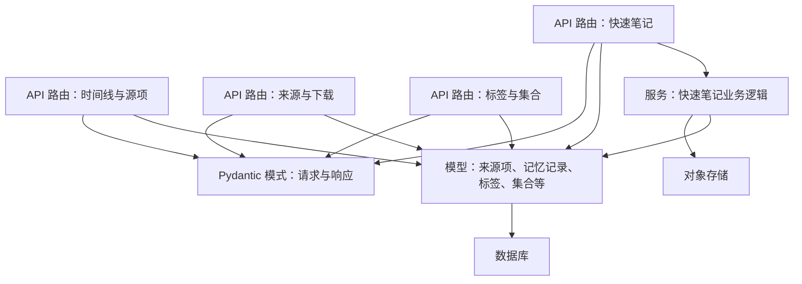
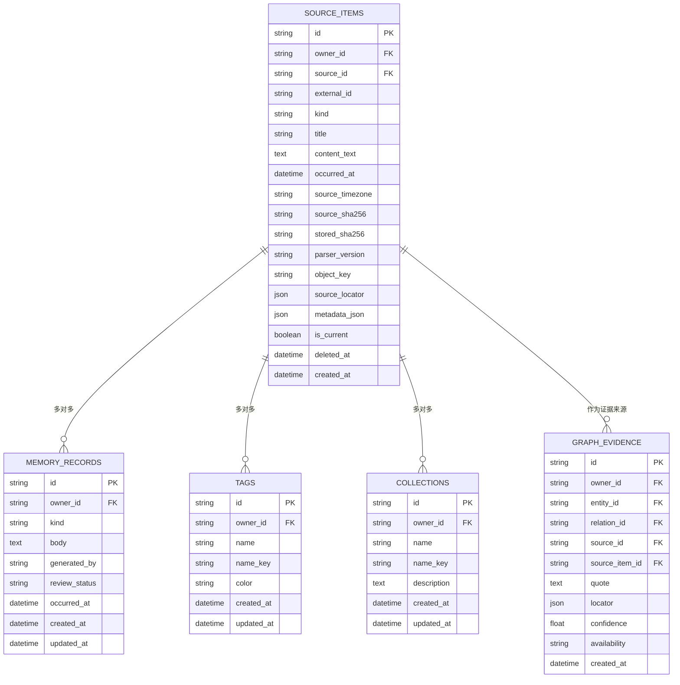
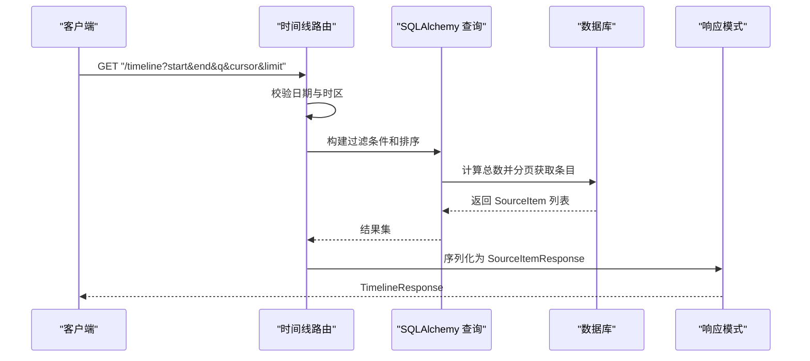
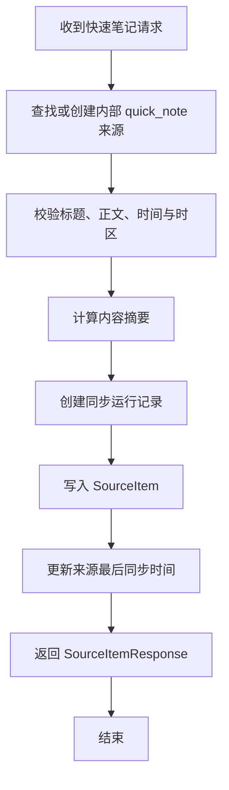
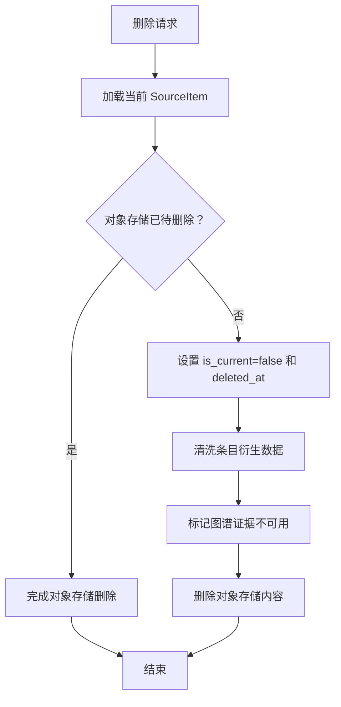
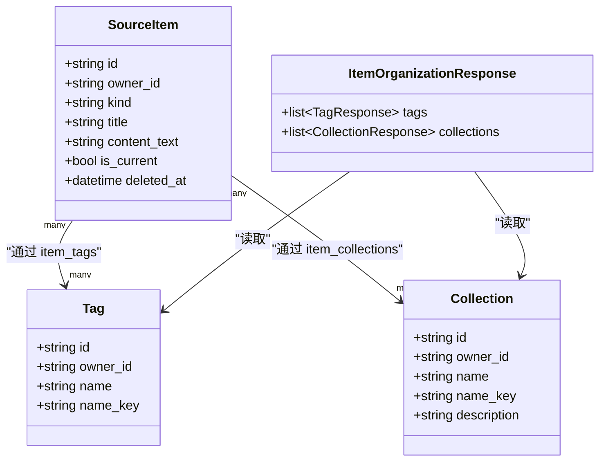
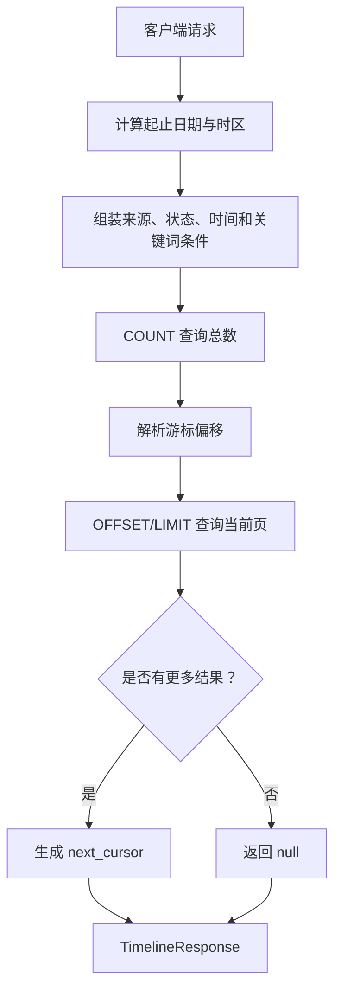
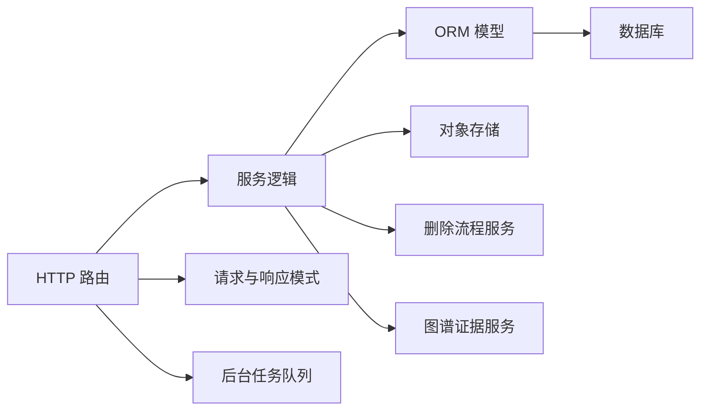
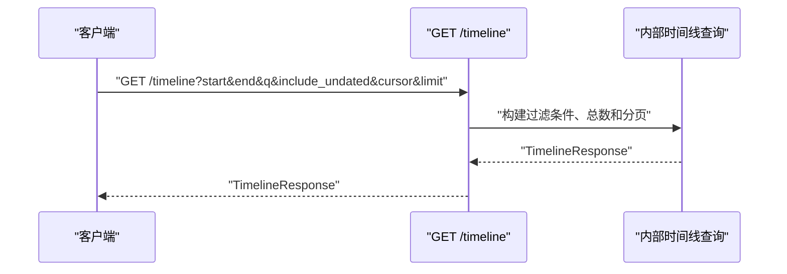

# 时间线与内容管理

<cite>
**本文引用的文件**   
- [models.py](file://src/personal_ai_life_os/models.py)
- [schemas.py](file://src/personal_ai_life_os/api/schemas.py)
- [items.py](file://src/personal_ai_life_os/api/routes/items.py)
- [quick_notes.py](file://src/personal_ai_life_os/api/routes/quick_notes.py)
- [quick_notes_service.py](file://src/personal_ai_life_os/services/quick_notes.py)
- [sources.py](file://src/personal_ai_life_os/api/routes/sources.py)
- [organization.py](file://src/personal_ai_life_os/api/routes/organization.py)
</cite>

## 目录
1. [介绍](#介绍)
2. [项目结构](#项目结构)
3. [核心模型与关系](#核心模型与关系)
4. [架构总览](#架构总览)
5. [详细组件分析](#详细组件分析)
6. [依赖关系分析](#依赖关系分析)
7. [性能考虑](#性能考虑)
8. [故障排查指南](#故障排查指南)
9. [结论](#结论)
10. [附录：API 端点参考](#附录api-endpoint参考)

## 介绍

Personal-AI-Life-OS 的时间线系统以“来源项”为核心，把从外部来源同步的条目、用户快速笔记和其他结构化数据统一纳入可查询、可分页、可扩展的内容视图。`MemoryRecord` 表示经过提炼或生成的记忆片段，它通过多对多表与 `SourceItem` 关联；`SourceItem` 则是时间线的最小可展示单元，承载标题、文本、发生时间、来源标识和元数据。

快速笔记功能为用户直接创建、编辑和删除内部类型的 `SourceItem`，支持 Markdown 文本、基于内容的自动标题、带时区的时间戳、摘要式版本指纹，并通过隐式内部来源接入统一时间线查询。标签与集合为 `SourceItem` 提供可复用、可维护的分类体系，配合保存的搜索与全文关键词过滤，形成内容组织与检索能力的基础。

本文将重点解释：

- `MemoryRecord` 与 `SourceItem` 的模型关系及在时间线中的呈现方式。
- 快速笔记的生命周期、Markdown 支持与版本指纹机制。
- 标签系统和集合分组的实体定义、CRUD 边界与关系映射。
- 时间线查询参数、游标分页、日期范围和内容过滤。
- 完整 API 端点参考与错误语义。
- 内容编辑历史、逻辑删除、证据一致性以及扩展的搜索与性能建议。

## 项目结构

与时间线和内容管理相关的关键文件分布如下：

- 领域模型与关系集中在领域模型文件中，定义用户、来源、同步运行、来源项、标签、集合、记忆记录等表结构和外键关系。
- 应用层路由提供 HTTP 接口：时间线与源项查询、快速笔记 CRUD、来源管理、标签与集合管理、搜索和保存搜索。
- 服务层实现快速笔记的创建、更新、删除等跨存储和数据库一致性的业务逻辑。
- Pydantic 模式稳定请求/响应契约，如快速笔记输入、来源响应、时间线响应。

**图表来源**   
- [items.py:147-180](file://src/personal_ai_life_os/api/routes/items.py#L147-L180)
- [quick_notes.py:15-76](file://src/personal_ai_life_os/api/routes/quick_notes.py#L15-L76)
- [quick_notes_service.py:10-110](file://src/personal_ai_life_os/services/quick_notes.py#L10-L110)
- [models.py:201-280](file://src/personal_ai_life_os/models.py#L201-L280)
- [schemas.py:200-345](file://src/personal_ai_life_os/api/schemas.py#L200-L345)

**章节来源**   
- [models.py:1-875](file://src/personal_ai_life_os/models.py#L1-L875)
- [items.py:1-467](file://src/personal_ai_life_os/api/routes/items.py#L1-L467)
- [quick_notes.py:1-76](file://src/personal_ai_life_os/api/routes/quick_notes.py#L1-L76)
- [quick_notes_service.py:1-218](file://src/personal_ai_life_os/services/quick_notes.py#L1-L218)
- [schemas.py:1-1151](file://src/personal_ai_life_os/api/schemas.py#L1-L1151)

## 核心模型与关系

### `SourceItem`：时间线的基本单元

`SourceItem` 是来源数据解析后进入系统的最小持久化单元，具有如下关键属性：

| 字段 | 含义 |
|---|---|
| `owner_id` | 所属用户，用于十进制 UUID 的主键隔离 |
| `source_id` | 所属来源连接，如 Markdown 导入、聊天记录、照片等 |
| `sync_run_id` | 同步批次，记录是哪一次同步生成或更新的条目 |
| `external_id` | 外部来源的唯一标识 |
| `kind` | 条目类型，例如快速笔记、照片、文档等 |
| `title` | 标题，可由用户指定或由内容推导 |
| `content_text` | 正文文本，可用于时间线列表展示与本地关键词过滤 |
| `occurred_at` | 发生时间，决定时间轴排序 |
| `source_timezone` | 原始来源时区信息 |
| `source_sha256` | 来源内容或快照的摘要，辅助重复检测 |
| `stored_sha256` | 实际存储对象的摘要 |
| `parser_version` | 解析器或写入器版本 |
| `object_key` | 对象存储中的二进制或原文件键 |
| `source_locator` | 来源定位器，例如文件名、聊天会话位置等 |
| `metadata_json` | 扩展元数据，包括内容类型、描述状态等 |
| `is_current` | 是否当前版本，支持多条历史 |
| `deleted_at` | 软删除时间 |
| `created_at` | 创建时间 |

索引包括：

- `(owner_id, occurred_at)` 优化时间线按时间排序。
- `(owner_id, source_id)` 加速来源筛选。
- `is_current` 和 `source_sha256` 等字段也建有索引，便于活跃项查询和去重约束。

主约束确保同一来源、相同外部 ID 和相同来源摘要下只存在一个唯一记录，从而配合版本机制避免脏写与重复。

### `MemoryRecord`：提炼后的记忆片段

`MemoryRecord` 是一个高层的记忆抽象，通常由用户或系统处理后产生，具备以下特征：

| 字段 | 含义 |
|---|---|
| `kind` | 记忆类型，默认为“笔记” |
| `body` | 记忆正文 |
| `generated_by` | 来源标记，默认为“user” |
| `review_status` | 审核状态 |
| `occurred_at` | 记忆发生时间 |
| `created_at / updated_at` | 生命周期时间 |

它与 `SourceItem` 的关系不是直接的多列外键，而是通过 `memory_record_sources` 中间表建立多对多关系。这意味着一条 `SourceItem` 可以支撑多条 `MemoryRecord`，反之亦然；例如多个低层来源条目的要点可合并成一条记忆，也可以被不同视角的记忆引用。

### 标签与集合：内容分组体系

标签和集合都绑定到用户和组织维度：

- 标签有名称、规范化名称、颜色和创建更新时间。
- 集合有名称、规范化名称、描述和时间戳。
- `item_tags` 表映射 `SourceItem` 与标签。
- `item_collections` 表映射 `SourceItem` 与集合。

这些表还包含复合唯一约束，保证同一用户在同一个规范名称下不会重复创建标签或集合。

### 与其他实体的关系

除记忆、标签、集合外，`SourceItem` 还与以下实体有关联：

- `Review`：时间段审阅结果与其来源项。
- `Reminder`：提醒事项与其来源项。
- `GraphEvidence`：图谱证据指向某个来源项，用于可追溯的证据链。

**图表来源**   
- [models.py:201-280](file://src/personal_ai_life_os/models.py#L201-L280)
- [models.py:300-380](file://src/personal_ai_life_os/models.py#L300-L380)
- [models.py:380-522](file://src/personal_ai_life_os/models.py#L380-L522)

**章节来源**   
- [models.py:201-522](file://src/personal_ai_life_os/models.py#L201-L522)

## 架构总览

时间线查询的核心路径是：

1. 客户端向 `/timeline` 或来源内接口的 `/sources/{source_id}/items` 发起请求。
2. 路由验证参数，构建过滤条件。
3. 计算总量与偏移。
4. 查询当前、未删除、属于有效来源的 `SourceItem`。
5. 按无日期先于有日期、发生后早前顺序、再按 ID 排序。
6. 将 ORM 对象转换为 `SourceItemResponse` 返回，并附带游标。

**图表来源**   
- [items.py:60-145](file://src/personal_ai_life_os/api/routes/items.py#L60-L145)
- [items.py:147-180](file://src/personal_ai_life_os/api/routes/items.py#L147-L180)
- [schemas.py:135-160](file://src/personal_ai_life_os/api/schemas.py#L135-L160)

## 详细组件分析

### 快速笔记功能

快速笔记由独立的路由和服务封装，面向用户直接创建自己的内容，并最终落盘为一种特殊的 `SourceItem`。其职责包括：

- 自动发现或创建内部来源连接 `quick_note`。
- 根据内容推导标题，最多保留首行一级 Markdown 标题后的文字片段。
- 将标题、内容和时间戳标准化后进行摘要，得到固定长度的 `digest`。
- 每个创建或更新操作都产生一条 `SyncRun`，记录解析器版本和变化统计。
- 将当前版本写入 `SourceItem`，并在元数据中保留更新事件。
- 支持可选的 `occurred_at` 和 `source_timezone`，并强制检查 IANA 时区。
- 删除时使用服务层的待删除日志策略，清理衍生数据和图谱证据可用性标记。

**图表来源**   
- [quick_notes_service.py:25-110](file://src/personal_ai_life_os/services/quick_notes.py#L25-L110)
- [quick_notes.py:20-76](file://src/personal_ai_life_os/api/routes/quick_notes.py#L20-L76)

#### 创建流程

快速笔记创建接收一个包含标题、正文、发生时区和发生时间的请求：

- 如果未显式提供标题，则从正文中抽取第一行非空且去掉顶层 Markdown 标题符号的文字。
- 标题最大长度会限制，正文会被去除空白。
- `occurred_at` 必须有完整的时区信息。
- `source_timezone` 会通过 IANA 时区库校验。
- 最终生成统一的摘要，并把摘要同时放入 `source_sha256` 和 `stored_sha256`。
- 对象键在当前快速笔记实现中为空字符串，因为内容本身已持久化到数据库中。
- 元数据记录内容类型为 `text/markdown`。

#### 更新流程

快速笔记更新是一个部分更新接口：

- 只有请求体中存在的字段才会替换。
- 若传入新内容，标题会重新推导。
- 支持使用 `clear_occurred_at` 和 `clear_source_timezone` 清空字段。
- 每次更新都创建新的 `SyncRun`，并更新当前版本的摘要和元数据时间。

#### 删除流程

快速笔记删除会执行多阶段清理：

1. 在对象存储中尝试完成已待删除项目的删除操作。
2. 否则标记该条 `SourceItem` 不再为当前版本，设置 `deleted_at`。
3. 清洗该条目衍生的图谱证据。
4. 将该条目对应的图谱证据状态标记为不可用。
5. 真正完成对象存储中的删除动作。

这与通用删除接口 `/items/{item_id}` 共享逻辑：对快速笔记使用内部服务，对其他类型可能触发原始来源文件删除。

**图表来源**   
- [quick_notes_service.py:180-218](file://src/personal_ai_life_os/services/quick_notes.py#L180-L218)
- [sources.py:350-394](file://src/personal_ai_life_os/api/routes/sources.py#L350-L394)

**章节来源**   
- [quick_notes.py:1-76](file://src/personal_ai_life_os/api/routes/quick_notes.py#L1-L76)
- [quick_notes_service.py:1-218](file://src/personal_ai_life_os/services/quick_notes.py#L1-L218)
- [schemas.py:250-345](file://src/personal_ai_life_os/api/schemas.py#L250-L345)

### Markdown 支持

快速笔记的正文使用 `text/markdown` 类型，路由与服务不对其进行二次 HTML 渲染或转换。这意味着：

- 前端或编辑器应负责 Markdown 解析和渲染。
- 后端保持内容的可读性、可搜索性和可导出性。
- 标题推导仅做轻量提取，不做完整 Markdown 语法树处理。
- 时间线和详情接口返回原始 `content_text`，适合再次渲染。

因此，系统在语义上支持 Markdown 内容，但在代码实现中不做 Markdown 解析，也不暴露专门的“渲染为 HTML”端点。

### 版本控制机制

快速笔记并未实现传统意义的多版本分支或版本号字段，而是采用“当前版本 + 同步运行批次数”的历史追踪机制：

- 每次创建或更新都会创建一个 `SyncRun`。
- `SourceItem` 保留 `sync_run_id`，便于定位是哪一批次写入的结果。
- `source_sha256` 和 `stored_sha256` 充当内容快照指纹。
- `is_current` 标记当前可见版本，删除时旧条目变为历史。
- 时间线查询默认只选择 `is_current=True` 且未删除的记录。

如需完全的历史恢复，需要结合 `sync_runs` 列表、摘要字段以及对象存储中是否另有存档。目前快速笔记的内容主体保存在 `content_text` 中，因此主要可通过时间线和历史条目浏览恢复。对象存储中没有独立的原始文件键，删除也不会影响正文文本的归档。

### 标签系统与集合分组

#### 标签

标签模型由名称和规范化名称组成，规范化名称允许按大小写不变、空格归一等方式进行查询与聚合。关系映射定义如下：

- 标签可关联零个或多个 `SourceItem`。
- `SourceItem` 可拥有多个标签。
- 同一用户对同一名称只能有一个标签。

标签的管理接口位于组织路由中，包括：

| 操作 | 路径 | 说明 |
|---|---|---|
| 列出标签 | `GET /organizations/tags` | 返回用户的所有标签 |
| 创建标签 | `POST /organizations/tags` | 创建新标签 |
| 更新标签 | `PATCH /organizations/tags/{tag_id}` | 修改标签属性 |
| 删除标签 | `DELETE /organizations/tags/{tag_id}` | 删除标签及其关系 |

#### 集合

集合包含名称、规范化名称、描述和时间戳，作用是把来源项归类进业务主题或知识库分组。关系映射同样为多对多。

集合的管理接口包括：

| 操作 | 路径 | 说明 |
|---|---|---|
| 列出集合 | `GET /organizations/collections` | 返回用户所有集合 |
| 创建集合 | `POST /organizations/collections` | 新建集合 |
| 更新集合 | `PATCH /organizations/collections/{collection_id}` | 修改集合 |
| 删除集合 | `DELETE /organizations/collections/{collection_id}` | 删除集合 |
| 获取条目组织信息 | `GET /organizations/items/{item_id}/organization` | 查看某来源项的标签与集合 |
| 更新条目组织关系 | `PUT /organizations/items/{item_id}/organization` | 设置标签和集合 |

#### 关系映射

**图表来源**   
- [models.py:227-280](file://src/personal_ai_life_os/models.py#L227-L280)
- [models.py:280-340](file://src/personal_ai_life_os/models.py#L280-L340)
- [organization.py:178-191](file://src/personal_ai_life_os/api/routes/organization.py#L178-L191)

**章节来源**   
- [models.py:227-340](file://src/personal_ai_life_os/models.py#L227-L340)
- [organization.py:59-191](file://src/personal_ai_life_os/api/routes/organization.py#L59-L191)
- [schemas.py:1-L1151](file://src/personal_ai_life_os/api/schemas.py#L1-L1151)

### 时间线查询与分页机制

时间线查询端点 `/timeline` 和来源项列表端点共享查询构建逻辑，核心行为如下：

- 默认只返回 `owner_id` 匹配的条目。
- 忽略已删除条目。
- 只返回当前版本条目。
- 排除正在删除状态的来源连接。
- 可按来源 ID 过滤。
- 可按起止日期过滤发生时间，且支持包含无日期条目。
- 可按关键词匹配标题、正文和用户描述。
- 按 `occurred_at IS NULL` 排在前面，然后按发生时间倒序，再按 ID 排序。

#### 查询参数

| 参数 | 类型 | 是否必填 | 默认值 | 说明 |
|---|---|---:|---:|---|
| `start` | date | 否 | 无 | 开始日期，左闭右开 |
| `end` | date | 否 | 无 | 结束日期，不包含 end 当天 |
| `source_id` | string | 否 | 无 | 限定来源 |
| `q` | string | 否 | 无 | 关键词，最长 200 |
| `include_undated` | boolean | 否 | true | 是否包含没有时间戳的条目 |
| `cursor` | string | 否 | 无 | Base64 偏移游标 |
| `limit` | integer | 否 | 25 | 每页数量，1 至 100 |

#### 分页机制

后端不使用传统的 `page`/`offset` 数字分页，而是使用字符串游标：

- `cursor` 解码为一个整数偏移量。
- 非法游标会返回 422。
- 超过上限的偏移量也会被拒绝，防止大偏移扫描。
- `next_cursor` 仅在还有后续数据时返回。
- `total` 返回符合条件但不受分页限制的总数，便于前端显示总体规模。

**图表来源**   
- [items.py:20-59](file://src/personal_ai_life_os/api/routes/items.py#L20-L59)
- [items.py:60-145](file://src/personal_ai_life_os/api/routes/items.py#L60-L145)
- [items.py:147-180](file://src/personal_ai_life_os/api/routes/items.py#L147-L180)

**章节来源**   
- [items.py:20-180](file://src/personal_ai_life_os/api/routes/items.py#L20-L180)
- [schemas.py:142-160](file://src/personal_ai_life_os/api/schemas.py#L142-L160)

### `MemoryRecord` 与 `SourceItem` 在时间线上的呈现

时间线查询直接返回 `SourceItem`，而不是 `MemoryRecord`。因此：

- 时间线上看到的是“来源项”，不是“记忆记录”。
- 一条记忆可关联多个来源项，但它本身不参与 `timeline` SQL。
- 如果需要呈现记忆摘要，应使用记忆相关的其他接口，或在现有来源项之上叠加上层聚合逻辑。
- `MemoryRecord` 更适合用作高层知识、总结、审查输出或人工整理后的结构化记忆。

这使时间线保持一致的低层事实粒度，而记忆层承担更高阶的表达和审核用途。

**章节来源**   
- [models.py:227-280](file://src/personal_ai_life_os/models.py#L227-L280)
- [models.py:330-360](file://src/personal_ai_life_os/models.py#L330-L360)
- [items.py:60-145](file://src/personal_ai_life_os/api/routes/items.py#L60-L145)

## 依赖关系分析

时间线和内容管理的依赖可分为四层：

- **HTTP 层**：FastAPI 路由处理认证、参数校验与响应格式化。
- **服务层**：快速笔记等复杂业务封装事务、删除流程和跨模块调用。
- **领域层**：SQLAlchemy ORM 模型定义表结构与关系。
- **基础设施层**：数据库、对象存储、后台任务和外部模型调用（照片描述）。

**图表来源**   
- [items.py:1-40](file://src/personal_ai_life_os/api/routes/items.py#L1-L40)
- [quick_notes_service.py:1-35](file://src/personal_ai_life_os/services/quick_notes.py#L1-L35)
- [sources.py:1-40](file://src/personal_ai_life_os/api/routes/sources.py#L1-L40)

需要注意的耦合点：

- 路由直接引用模型和 schema，适合小型 REST 服务。
- 快速笔记服务依赖删除服务和图谱证据服务，形成跨子系统一致性。
- 时间线查询依赖来源连接状态，从而避免返回无效来源的数据。
- 对象删除和图谱证据失效通过服务层协调，避免数据不一致。

**章节来源**   
- [items.py:1-467](file://src/personal_ai_life_os/api/routes/items.py#L1-L467)
- [quick_notes_service.py:1-218](file://src/personal_ai_life_os/services/quick_notes.py#L1-L218)
- [sources.py:1-394](file://src/personal_ai_life_os/api/routes/sources.py#L1-L394)

## 性能考虑

### 当前优化措施

1. **时间排序索引**  
   `(owner_id, occurred_at)` 有助于按用户维度按时间高效扫描。

2. **来源过滤索引**  
   `(owner_id, source_id)` 能提升按来源过滤的效率。

3. **活跃条目索引**  
   `is_current` 上索引可以减少历史条目的干扰面。

4. **分页上限限制**  
   `limit` 最大值为 100，防止单次响应过大。

5. **游标校验与偏移上限**  
   非法游标和超大偏移直接拒绝，避免极端慢查询。

6. **时间线只查活跃项**  
   默认不返回已删除或历史版本，减轻查询负载。

7. **来源状态过滤**  
   排除状态为 `deleting` 的来源，避免返回即将消失的数据。

### 可扩展优化建议

1. **关键词索引升级**  
   当前时间线关键词搜索使用 `icontains`，可能全表扫描。若数据集增长，可引入全文索引或专用搜索引擎，并结合 saved searches 或独立 search 端点。

2. **缓存热点时间线**  
   对于频繁访问的用户主页或近期时间线，可在应用层或 Redis 层缓存最近几分钟的摘要视图。

3. **分页游标优化**  
   游标仍基于 `OFFSET`，在大数据集上可能退化为全表扫描偏移。可考虑基于 `(occurred_at, id)` 的键集分页。

4. **批量序列化**  
   当单个页面数量接近上限时，减少 ORM 延迟加载带来的 N+1 问题，可在查询侧预加载标签、集合或来源信息。

5. **对象存储热读分层**  
   频繁访问的原图或文档可配置就近缓存或 CDN，减少数据库侧的原始附件压力。

6. **删除流程异步化**  
   快速笔记删除涉及对象存储、衍生数据清理和图谱证据失效，可在高并发场景下引入后台任务进一步解耦。

**章节来源**   
- [items.py:20-59](file://src/personal_ai_life_os/api/routes/items.py#L20-L59)
- [items.py:60-145](file://src/personal_ai_life_os/api/routes/items.py#L60-L145)
- [models.py:227-280](file://src/personal_ai_life_os/models.py#L227-L280)

## 故障排查指南

### 常见错误码与处理

| 场景 | 状态码 | 错误含义 | 排查建议 |
|---|---:|---|---|
| 无效时间线游标 | 422 | 游标格式错误或超出范围 | 检查前端是否正确传递服务端返回的 `next_cursor` |
| 结束日期不晚于开始日期 | 422 | 日期区间无效 | 确保 end 严格大于 start |
| 来源不存在 | 404 | 请求的 `source_id` 不属于当前用户或已被删除 | 检查来源列表和使用权限 |
| 来源项不存在 | 404 | 来源项已删除或不可见 | 确认是否为当前活跃版本 |
| 快速笔记不存在 | 404 | 更新或删除快速笔记时找不到对应条目 | 检查是否在正确的时间线视图中删除 |
| 快速笔记不可用 | 409 | 内部来源状态异常 | 检查内部 `quick_note` 来源是否处于非删除、激活状态 |
| 图片不可用 | 410 | 已清洗或不可用的原始图片 | 检查对象存储中文件是否仍然存在 |
| 删除准备失败 | 503 | 删除记账或对象存储清理重试 | 稍后重试删除请求 |

### 时间线相关问题

- 若时间线为空但确认创建了快速笔记，请检查是否传入了 `deleted_at`，或是否误查询了历史版本。
- 如果包含无日期时间线数据不符合预期，可关闭 `include_undated`。
- 如果分页没有进展，请确认每次使用上一次响应的 `next_cursor`，不要手动拼接页号。

### 删除一致性

快速笔记和普通来源项的删除差异较大：

- 快速笔记：删除时逻辑标记 `is_current=False`、设置 `deleted_at`，并清理对象存储中与所有者相关的数据。
- 普通来源项：走更通用的删除流程，可能连带删除原始文件及相关对象存储键。

删除成功后，若图谱或下游消费者仍可看到数据，应检查图谱证据标记是否已设为不可用。

**章节来源**   
- [items.py:60-145](file://src/personal_ai_life_os/api/routes/items.py#L60-L145)
- [items.py:200-231](file://src/personal_ai_life_os/api/routes/items.py#L200-L231)
- [quick_notes.py:20-76](file://src/personal_ai_life_os/api/routes/quick_notes.py#L20-L76)
- [quick_notes_service.py:180-218](file://src/personal_ai_life_os/services/quick_notes.py#L180-L218)
- [sources.py:300-394](file://src/personal_ai_life_os/api/routes/sources.py#L300-L394)

## 结论

Personal-AI-Life-OS 的时间线系统围绕 `SourceItem` 构建统一的事实视图，`MemoryRecord` 则面向更高层的记忆组织和审核流程。快速笔记作为一种特殊的来源项，为用户提供简单稳定的 Markdown 内容编辑入口，并通过内部来源、同步批次数和摘要指纹融入整体数据管线。

标签与集合为该系统的知识分类提供了可扩展基础，而时间线查询通过灵活的日期过滤、来源过滤、关键词搜索和游标分页满足大多数浏览需求。在未来扩容过程中，建议优先关注关键词索引、键集分页、批量化预览加载与删除流程的异步化，以提升大规模数据下的性能和稳定性。

## 附录：API 端点参考

### 时间线与来源项

#### `GET /timeline`

- 功能：获取当前用户的时间线。
- 响应：`TimelineResponse`，包含 `items`、`total`、`next_cursor`。
- 可用查询参数：`start`、`end`、`source_id`、`q`、`include_undated`、`cursor`、`limit`。

**图表来源**   
- [items.py:147-180](file://src/personal_ai_life_os/api/routes/items.py#L147-L180)

#### `GET /sources/{source_id}/items`

- 功能：获取指定来源的时间线子集。
- 响应：`TimelineResponse`。
- 参数与 `/timeline` 基本相同，额外增加来源存在性校验。

#### `GET /items/{item_id}`

- 功能：获取单个来源项。
- 响应：`SourceItemResponse`。
- 条件：必须是当前版本、未删除、属于当前用户、来源未被删除。

#### `GET /sources/{source_id}/items/download` 的等价入口

仓库中实际提供的原文件下载端口为：

- `GET /sources/items/{item_id}/raw`
- 返回二进制内容，包含 `Content-Type` 和 `Content-Disposition`。
- 快速笔记不允许直接下载原始文件，返回 410。
- 若对象存储缺失，返回 410。

**章节来源**   
- [items.py:147-231](file://src/personal_ai_life_os/api/routes/items.py#L147-L231)
- [sources.py:330-394](file://src/personal_ai_life_os/api/routes/sources.py#L330-L394)
- [schemas.py:130-160](file://src/personal_ai_life_os/api/schemas.py#L130-L160)

### 快速笔记

#### `POST /quick-notes`

- 功能：创建快速笔记。
- 请求体：`QuickNoteCreateRequest`。
- 成功响应：`SourceItemResponse`，状态码 201。
- 可能错误：
  - 409：快速笔记暂时不可用，内部来源未激活。
  - 校验错误：正文为空、标题过长、缺少时区或时区无效。

#### `PATCH /quick-notes/{item_id}`

- 功能：更新快速笔记。
- 请求体：`QuickNoteUpdateRequest`。
- 支持部分更新。
- 可用布尔标志：`clear_occurred_at`、`clear_source_timezone`。
- 可能错误：
  - 404：快速笔记不存在。

#### `DELETE /quick-notes/{item_id}`

- 功能：删除快速笔记。
- 成功响应：204。
- 可能错误：
  - 404：笔记不存在。
  - 503：删除记账或对象存储清理尚未准备好，应稍后重试。

**章节来源**   
- [quick_notes.py:15-76](file://src/personal_ai_life_os/api/routes/quick_notes.py#L15-L76)
- [quick_notes_service.py:25-218](file://src/personal_ai_life_os/services/quick_notes.py#L25-L218)
- [schemas.py:250-345](file://src/personal_ai_life_os/api/schemas.py#L250-L345)

### 来源管理

| 方法 | 路径 | 功能 | 关键约束 |
|---|---|---|---|
| `POST` | `/sources` | 创建来源 | `chatgpt_export` 必须提供有效对话 ID 列表 |
| `GET` | `/sources` | 列出用户来源 | 排除内部 `quick_note` 来源 |
| `GET` | `/sources/{source_id}` | 获取来源详情 | 删除中的来源视为不存在 |
| `PATCH` | `/sources/{source_id}/status` | 更新启用或暂停 | 内部来源不可直接管理 |
| `PATCH` | `/sources/{source_id}/scope` | 更新来源选择范围 | 暂停中的来源不可更改 |
| `PATCH` | `/sources/{source_id}/cloud-consent` | 更新云端抽取授权 | 需匹配披露版本 |
| `POST` | `/sources/{source_id}/revoke` | 撤销来源授权 | 标记证据不可用并取消任务 |
| `DELETE` | `/sources/{source_id}` | 删除来源 | 启动对象存储清理并删除资源 |
| `GET` | `/sync-runs` | 列出同步运行 | 返回最近若干条 |
| `GET` | `/sources/items/{item_id}/raw` | 下载来源原始文件 | 快速笔记不支持此接口 |
| `DELETE` | `/sources/items/{item_id}` | 删除来源项及可能相关文件 | 快速笔记走内部删除流程 |

**章节来源**   
- [sources.py:63-394](file://src/personal_ai_life_os/api/routes/sources.py#L63-L394)
- [schemas.py:40-130](file://src/personal_ai_life_os/api/schemas.py#L40-L130)

### 组织：标签与集合

| 方法 | 路径 | 功能 |
|---|---|---|
| `GET` | `/organizations/tags` | 列出标签 |
| `POST` | `/organizations/tags` | 创建标签 |
| `PATCH` | `/organizations/tags/{tag_id}` | 更新标签 |
| `DELETE` | `/organizations/tags/{tag_id}` | 删除标签 |
| `GET` | `/organizations/collections` | 列出集合 |
| `POST` | `/organizations/collections` | 创建集合 |
| `PATCH` | `/organizations/collections/{collection_id}` | 更新集合 |
| `DELETE` | `/organizations/collections/{collection_id}` | 删除集合 |
| `GET` | `/organizations/items/{item_id}/organization` | 查询来源项的组织关系 |
| `PUT` | `/organizations/items/{item_id}/organization` | 设置来源项的标签和集合 |

**章节来源**   
- [organization.py:59-191](file://src/personal_ai_life_os/api/routes/organization.py#L59-L191)