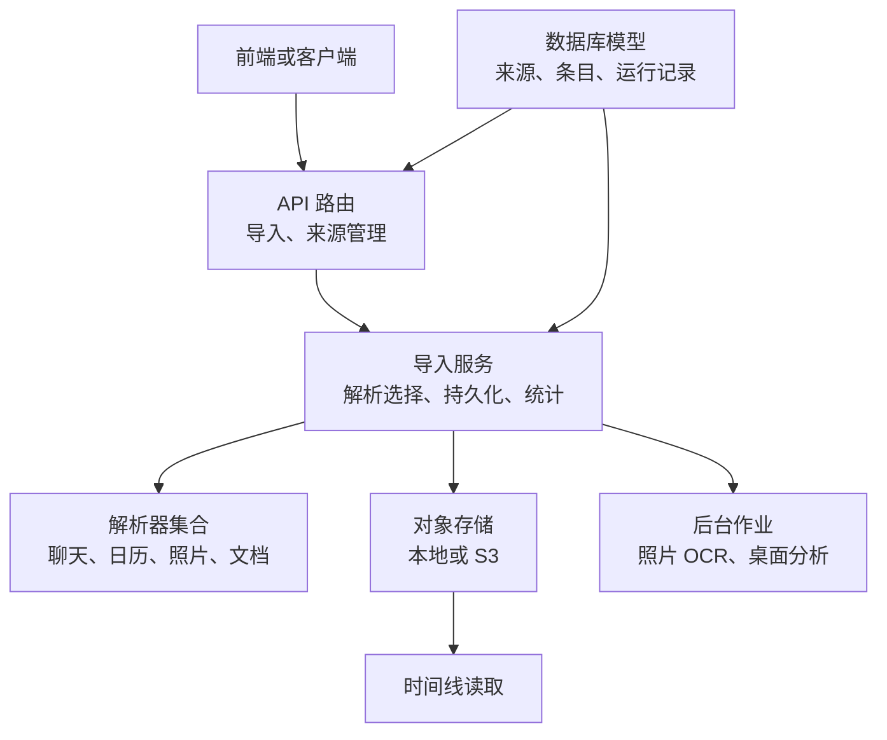
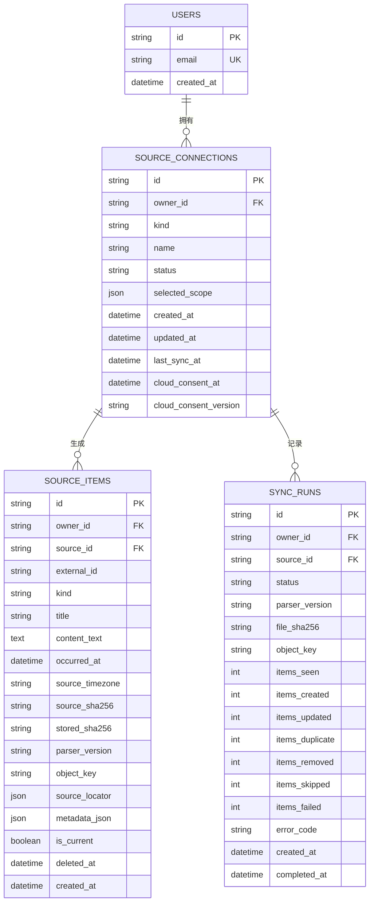
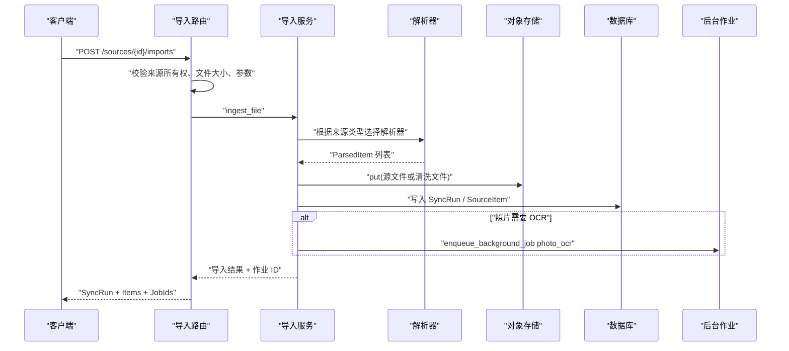
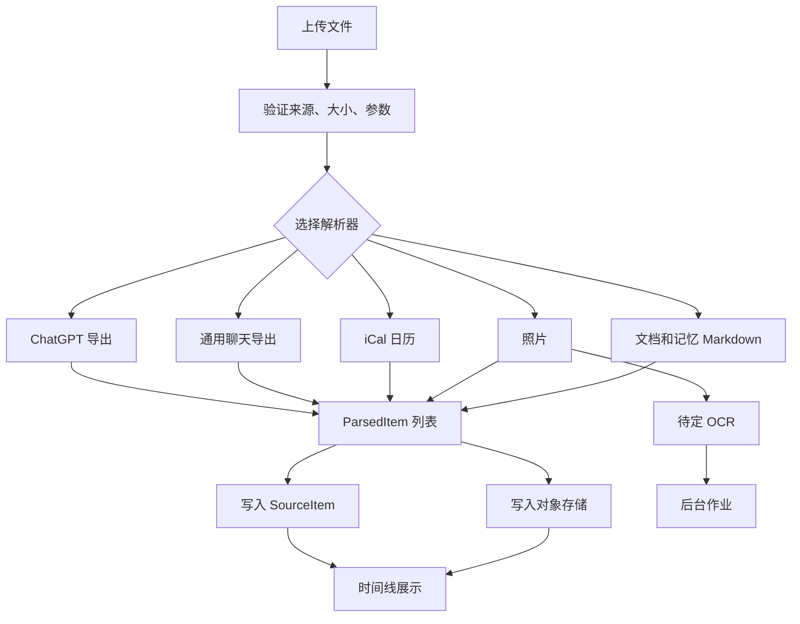
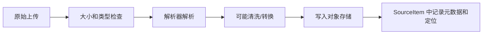
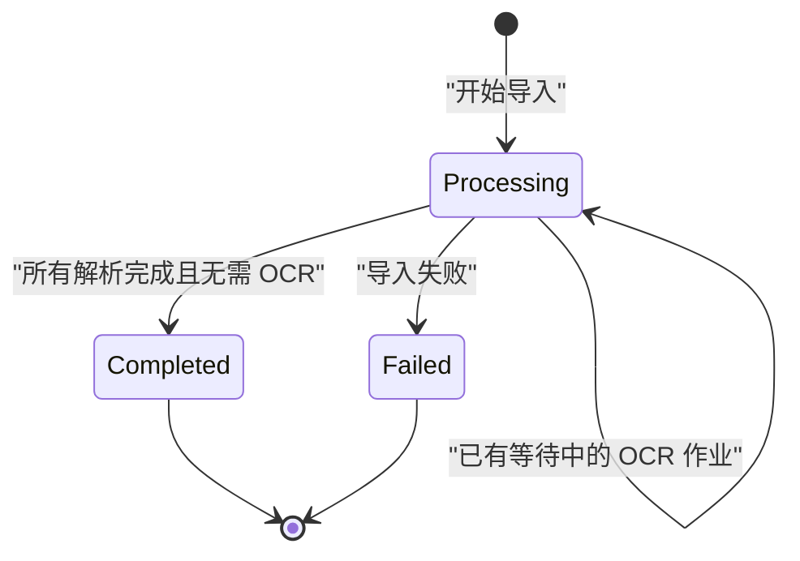
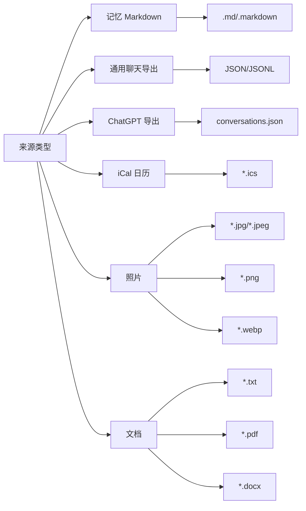
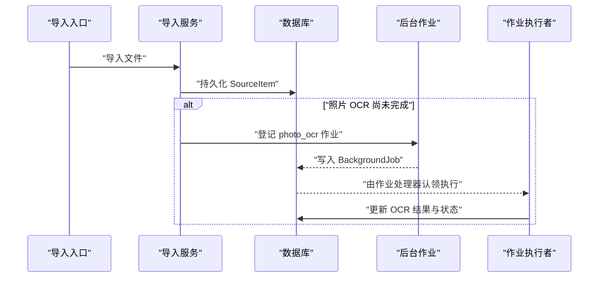

# 源连接与导入

<cite>
**本文引用的文件**   
- [models.py](file://src/personal_ai_life_os/models.py)
- [imports.py](file://src/personal_ai_life_os/api/routes/imports.py)
- [sources.py](file://src/personal_ai_life_os/api/routes/sources.py)
- [ingestion.py](file://src/personal_ai_life_os/services/ingestion.py)
- [storage.py](file://src/personal_ai_life_os/storage.py)
- [jobs.py](file://src/personal_ai_life_os/services/jobs.py)
- [schemas.py](file://src/personal_ai_life_os/api/schemas.py)
- [base.py](file://src/personal_ai_life_os/parsers/base.py)
- [chatgpt_export.py](file://src/personal_ai_life_os/parsers/chatgpt_export.py)
- [generic_chat.py](file://src/personal_ai_life_os/parsers/generic_chat.py)
- [calendar_ics.py](file://src/personal_ai_life_os/parsers/calendar_ics.py)
- [photo.py](file://src/personal_ai_life_os/parsers/photo.py)
- [document.py](file://src/personal_ai_life_os/parsers/document.py)
- [memory_markdown.py](file://src/personal_ai_life_os/parsers/memory_markdown.py)
</cite>

## 目录

1. [引言](#引言)
2. [项目结构定位](#项目结构定位)
3. [核心概念与数据模型](#核心概念与数据模型)
4. [整体架构总览](#整体架构总览)
5. [源连接设计](#源连接设计)
6. [选择性导入的数据流](#选择性导入的数据流)
7. [解析器架构](#解析器架构)
8. [对象存储与内容预览机制](#对象存储与内容预览机制)
9. [导入状态、错误处理与重试](#导入状态错误处理与重试)
10. [批量处理策略](#批量处理策略)
11. [格式支持矩阵](#格式支持矩阵)
12. [性能优化建议](#性能优化建议)
13. [故障排查指南](#故障排查指南)
14. [异步集成说明](#异步集成说明)
15. [结论](#结论)

## 引言

Personal-AI-Life-OS 的源连接与导入系统负责三类事情：

1. **管理外部来源**：通过 `SourceConnection` 记录用户的来源类型、选择范围、同步状态及云端提取授权。
2. **安全导入本地文件**：通过上传接口接收受限大小的文本、JSON 聊天导出、iCal 日历、照片和文档，并交给对应解析器。
3. **生成可追踪的对象**：将解析结果映射为 `ParsedItem`，持久化为 `SourceItem`，原始或清洗后的二进制文件写入对象存储，并通过时间线查询展示。

该系统的核心设计目标是**可控、可审计、可重复、幂等、可删除**。每一次导入都会生成 `SyncRun`，记录解析器版本、文件大小摘要、已见条目数和最终状态；所有来源都按用户维度隔离，删除时通过对象级“删除墓碑”实现可恢复审计。

## 项目结构定位

源连接与导入涉及以下层次：

| 层次 | 主要文件 | 职责 |
|---|---|---|
| API 路由层 | [imports.py](file://src/personal_ai_life_os/api/routes/imports.py)、[sources.py](file://src/personal_ai_life_os/api/routes/sources.py) | 验证请求、创建来源、校验上传大小、返回导入结果 |
| 导入服务层 | [ingestion.py](file://src/personal_ai_life_os/services/ingestion.py) | 选择解析器、保存对象、更新数据库、调度后台作业 |
| 解析器层 | [base.py](file://src/personal_ai_life_os/parsers/base.py) 及各具体解析器 | 把原始字节转换为结构化 `ParsedItem` |
| 存储层 | [storage.py](file://src/personal_ai_life_os/storage.py) | 统一本地文件和 S3 兼容对象存取 |
| 后台作业层 | [jobs.py](file://src/personal_ai_life_os/services/jobs.py) | 照片 OCR、桌面分析等异步任务 |
| 数据模型层 | [models.py](file://src/personal_ai_life_os/models.py) | `SourceConnection`、`SourceItem`、`SyncRun` 等核心表 |
| API 模式层 | [schemas.py](file://src/personal_ai_life_os/api/schemas.py) | 请求/响应结构和限制校验 |

图示直接反映实际模块调用关系，但为了保持可读性不添加额外链接字段。

## 核心概念与数据模型

### SourceConnection：来源连接

`SourceConnection` 是导入系统的核心控制面。它不直接保存聊天内容或图片数据，而是描述**一个来源的逻辑连接及其授权边界**。

| 字段 | 含义 | 行为说明 |
|---|---|---|
| `id` | 来源主键 | 用于时间线、对象前缀、删除作用域 |
| `owner_id` | 所属用户 | 所有数据来源必须属于同一用户 |
| `kind` | 来源类型 | 包括记忆 Markdown、ChatGPT 导出、通用聊天导出、文档、照片、iCal 日历 |
| `name` | 人类可读名称 | 最多 240 字符 |
| `status` | 运行状态 | `active` 表示允许导入，`paused` 会取消相关后台任务，其他状态禁止导入 |
| `consent_version` | 来源同意版本 | 标记用户确认的来源选择协议版本 |
| `selected_scope` | 选择范围 | JSON 字段；ChatGPT 使用 `conversation_ids` 指定允许导出的对话列表 |
| `created_at / updated_at` | 生命周期时间 | 自动设置 |
| `last_sync_at` | 最近一次成功导入时间 | 全部完成后更新 |
| `cloud_consent_at / cloud_consent_version` | 云端提取授权 | 用于启用云端分析或抽取时的合规记录 |

此外，`SourceConnection` 与 `User`、`SourceItem`、`SyncRun`、`DesktopFolder` 建立关系，确保删除用户时可级联清理。

**图示来源**  
- [models.py:126-187](file://src/personal_ai_life_os/models.py#L126-L187)  
- [models.py:206-338](file://src/personal_ai_life_os/models.py#L206-L338)

#### SourceConnection 的主要业务含义

- **来源类型约束**：`create_source` 接受枚举式 `kind`，包括 `memory_markdown`、`chatgpt_export`、`chat_export`、`document`、`photo`、`calendar_ics`。
- **范围选择**：ChatGPT 来源要求 `selected_scope.conversation_ids` 非空且数量不超过 1000。
- **云提取授权**：`cloud_consent_at` 和 `cloud_consent_version` 在桌面环境或云端分析场景中使用，防止未经授权的模型交互。

**本节来源**  
- [models.py:126-187](file://src/personal_ai_life_os/models.py#L126-L187)  
- [sources.py:52-85](file://src/personal_ai_life_os/api/routes/sources.py#L52-L85)  
- [schemas.py:103-171](file://src/personal_ai_life_os/api/schemas.py#L103-L171)

### SyncRun：导入运行记录

`SyncRun` 是对单次文件导入的生命周期快照。它回答的问题是：**这次导入做了什么、成功了多少、失败原因是什么**。

| 字段 | 用途 |
|---|---|
| `file_sha256` | 原始上传文件的 SHA-256 |
| `parser_version` | 使用的解析器版本，便于回溯和重放 |
| `object_key` | 对象存储中保存的源文件或清洗后文件路径 |
| `items_seen` | 解析器产出的逻辑条目总数 |
| `items_created / updated / duplicate / removed / skipped / failed` | 各阶段结果计数 |
| `error_code` | 结构性错误码，如 `unsupported_file_type`、`unsupported_photo`、`invalid_encoding` |
| `completed_at` | 完成或失败时间 |

注意：如果仍有待处理的照片 OCR，导入运行时状态可能保持 `processing`，直到后台作业完成。

**本节来源**  
- [models.py:189-205](file://src/personal_ai_life_os/models.py#L189-L205)  
- [ingestion.py:360-598](file://src/personal_ai_life_os/services/ingestion.py#L360-L598)

### SourceItem：源条目

`SourceItem` 是可展示、可搜索、可与知识图谱证据关联的最小语义单元。它不是“原始文件”，而是**从文件中提取的一个实体**，比如一条聊天记录、一页 PDF、一张照片或一个记忆章节。

关键字段含义：

| 字段 | 含义 |
|---|---|
| `external_id` | 解析器指定的外部 ID；用于去重 |
| `kind` | 条目类型，如 `chat_message`、`photo`、`document_page`、`markdown_section` |
| `title` | 标题，最长 500 字符 |
| `content_text` | 可搜索正文；照片默认可能是空字符串，直到 OCR 产出文本 |
| `occurred_at` | 发生时间，来源于 EXIF、iCal、聊天消息或导入参数 |
| `source_timezone` | 原文所在时区 |
| `source_sha256` | 内容哈希；同一 `external_id` 不同内容视为新版本 |
| `stored_sha256` | 对象存储中保存内容的哈希 |
| `parser_version` | 解析器版本，用于追踪格式变化 |
| `object_key` | 对象存储路径；客户端不能看到此键 |
| `metadata_json` | 扩展元数据，包括 OCR 状态、媒体类型、时间精度等 |
| `is_current` | 是否当前有效版本 |
| `deleted_at` | 软删除时间 |

**本节来源**  
- [models.py:206-271](file://src/personal_ai_life_os/models.py#L206-L271)  
- [ingestion.py:200-279](file://src/personal_ai_life_os/services/ingestion.py#L200-L279)

## 整体架构总览

系统采用清晰的分层模式：

这个流程保证：

- 入口只接收有限大小和受控来源。
- 解析器的错误被封装成 `IngestionFailure`，不会泄露原始堆栈。
- 成功对象先落盘，失败时回滚数据库并删除临时对象。
- 耗时任务进入后台队列，不影响导入主流程。

**图示来源**  
- [imports.py:17-134](file://src/personal_ai_life_os/api/routes/imports.py#L17-L134)  
- [ingestion.py:360-598](file://src/personal_ai_life_os/services/ingestion.py#L360-L598)  
- [jobs.py:57-113](file://src/personal_ai_life_os/services/jobs.py#L57-L113)

## 源连接设计

### 创建来源

`POST /sources` 创建来源时会设置：

- `owner_id`
- `kind`
- `name`
- `status = active`
- `consent_version`
- `selected_scope`

ChatGPT 来源必须在 `selected_scope.conversation_ids` 中提供 1～1000 个有效的字符串 ID。

### 更新范围

`PATCH /sources/{id}/scope` 允许用户重新选择要导入的对话，但来源必须处于 `active`。ChatGPT 来源修改范围时也要求包含 `conversation_ids`。

### 更新状态

`PATCH /sources/{id}/status`：

- `active`：恢复正常导入。
- `paused`：取消来源相关的排队或运行中的后台任务，并把关联的导入任务标记为取消。

### 云端提取授权

`PATCH /sources/{id}/cloud-consent`：

- 需要来源处于 `active` 或 `paused`。
- 启用时需要匹配配置的 `graph_cloud_consent_version`。
- 桌面环境下禁用还会取消相关的 `desktop_analysis` 任务。

**本节来源**  
- [sources.py:52-200](file://src/personal_ai_life_os/api/routes/sources.py#L52-L200)  
- [schemas.py:103-171](file://src/personal_ai_life_os/api/schemas.py#L103-L171)

## 选择性导入的数据流

这是导入系统的核心路径：

### 上传校验

导入接口会从配置读取大小上限：

- 照片来源使用 `max_photo_upload_bytes`
- 其他来源使用 `max_text_upload_bytes`

超出上限会返回 413 错误；缺少来源或来源不属于用户会返回 404。

可选参数包括：

| 参数 | 含义 |
|---|---|
| `captured_at` | ISO 8601 时间戳，必须带时区偏移 |
| `captured_timezone` | IANA 时区名，例如 Asia/Shanghai |
| `conversation_ids` | 要选择的对话 ID 数组 |

**本节来源**  
- [imports.py:17-134](file://src/personal_ai_life_os/api/routes/imports.py#L17-L134)  
- [schemas.py:103-171](file://src/personal_ai_life_os/api/schemas.py#L103-L171)

### 解析到持久化

导入服务首先计算文件哈希、创建 `SyncRun`，再调用 `_parser_for` 选择具体解析器。之后：

1. 将内容存入对象存储；
2. 对 iCal 日历进行特殊持久化处理；
3. 对其他类型执行幂等插入；
4. 复制旧条目的标签和分组到新版本；
5. 为需要 OCR 的照片调度后台作业；
6. 在满足条件时标记运行完成并更新时间线。

**本节来源**  
- [ingestion.py:360-598](file://src/personal_ai_life_os/services/ingestion.py#L360-L598)

## 解析器架构

所有解析器共同输出 `ParsedItem`，从而屏蔽底层文件格式差异。

### ParsedItem 基模型

`ParsedItem` 是不可变数据类，包含：

| 字段 | 含义 |
|---|---|
| `external_id` | 唯一外部 ID；决定幂等性 |
| `kind` | 语义类型，例如聊天消息、照片、文档 |
| `title` | 展示标题 |
| `content_text` | 可搜索正文 |
| `occurred_at` | 发生时间 |
| `source_timezone` | 原文时区 |
| `source_locator` | 原始定位信息，例如文件名、页码、段落范围 |
| `metadata` | 扩展元数据，例如 OCR 状态、时间精度、媒体类型 |

**本节来源**  
- [base.py:1-17](file://src/personal_ai_life_os/parsers/base.py#L1-L17)

### ChatGPT 导出解析

该解析器专门处理官方 `conversations.json` 形状，支持两种消息结构：

- `mapping`：节点映射结构。
- `messages`：直接消息数组。

它的核心逻辑是：

1. 解码 UTF-8 并加载 JSON。
2. 遍历对话；若传入 `selected_conversation_ids`，则过滤对话。
3. 从消息节点提取 `user` 或 `assistant` 角色。
4. 从多种时间字段推导 UTC 时间。
5. 忽略无正文的消息。
6. 构建具有上下文信息的 `ParsedItem`。

它还提供两个辅助能力：

- `select_chatgpt_export`：根据已选对话生成本地最小化导出。
- `list_chatgpt_conversations`：仅列出对话元数据，不包含消息正文，适合本地预览。

**本节来源**  
- [chatgpt_export.py:1-200](file://src/personal_ai_life_os/parsers/chatgpt_export.py#L1-L200)

### 通用聊天导出解析

通用聊天解析器面向多种聊天导出格式，而不是绑定某一家厂商。它支持：

- 多个可能的对话根键，如 `conversations`、`chats`、`threads`、`data`。
- 多可能的消息键，如 `messages`、`chat_messages`、`turns`、`dialogue`。
- 角色映射，包括 `user`、`human`、`me`、`customer`、`assistant`、`ai`、`bot`、`model`、`claude`、`gemini`。
- JSON 和 JSONL 两种输入形式。
- 多字段时间解析，包括秒级和毫秒级 Unix 时间戳。

这种方式降低了外部聊天工具迁移成本，但它仍然是尽力而为型解析；结构化较差的文件可能跳过消息或无法识别角色。

**本节来源**  
- [generic_chat.py:1-200](file://src/personal_ai_life_os/parsers/generic_chat.py#L1-L200)

### iCal 日历解析

iCal 解析器强调安全性和边界保护：

- 最大日历体积为 5MB。
- 最多 1000 个事件。
- 每个事件最多 200 个属性。
- 属性值最大 20000 字符。
- 文本字段最大 50000 字符。
- 不支持 RRULE、RDATE、EXDATE、RECURRENCE-ID 等复杂循环规则。
- 每事件必须有 UID；不允许重复 UID。
- DTEND 不得早于 DTSTART。
- 浮动时间和 DST 重叠时间会被检测并记录元数据。

解析结果还维护：

- `ics_status`
- `ics_sequence`
- `ics_unsupported_recurrence`
- 原始 TZID
- 全日或非全日标记
- 去重 UID

**本节来源**  
- [calendar_ics.py:1-200](file://src/personal_ai_life_os/parsers/calendar_ics.py#L1-L200)

### 照片解析与 OCR

照片解析不只是提取文字，更重要的是**图像清洗和安全化**：

1. 检查后缀是否为 JPEG、PNG、WebP。
2. 使用 PIL 打开文件。
3. 限制像素乘积不超过 4000 万。
4. 应用 EXIF 方向校正。
5. 根据格式输出安全的 PNG、WebP 或 JPEG。
6. 保留原始文件 SHA-256 作为 `external_id` 基础。
7. 从 EXIF 提取拍摄时间和时区。
8. 元数据标注“位置元数据已移除”。

OCR 行为分为两种：

- **同步 OCR**：上传后立即尝试 OCR。
- **延迟 OCR**：当图片来源为照片且处理模式为 worker 时，先标记 `ocr_status=pending`，再由后台作业执行 OCR。

Tesseract 不可用时，OCR 状态为 `unavailable`；提取失败时为 `failed`；没有文字时为 `no_text`；成功时清理相邻中文标点空格，提升关键词匹配质量。

**本节来源**  
- [photo.py:1-145](file://src/personal_ai_life_os/parsers/photo.py#L1-L145)

### 文档解析

文档解析支持：

| 格式 | 处理方式 |
|---|---|
| `.md`、`.markdown` | 使用记忆 Markdown 解析器 |
| `.txt` | UTF-8 文本直出 |
| `.pdf` | pypdf 逐页提取纯文本 |
| `.docx` | python-docx 提取段落 |

PDF 加密、扫描型 PDF（无可见文本）、空的 DOCX 段落都会返回明确的错误。文档解析以页或段落为单位输出，避免一次性吞掉大文件。

**本节来源**  
- [document.py:1-119](file://src/personal_ai_life_os/parsers/document.py#L1-L119)

### 记忆 Markdown 解析

记忆 Markdown 会把文档按二级及以上标题拆分为部分，并为每一节保留行号范围。如果标题包含日期，会推导出当天时间。它主要用于结构化个人记忆、日记或笔记。

**本节来源**  
- [memory_markdown.py:1-86](file://src/personal_ai_life_os/parsers/memory_markdown.py#L1-L86)

## 对象存储与内容预览机制

### ObjectStore 抽象

对象存储定义统一的读写契约：

| 方法 | 职责 |
|---|---|
| `put(key, content, content_type)` | 写入对象 |
| `get(key)` | 读取完整对象 |
| `delete(key)` | 删除对象 |
| `write_deletion_tombstone(...)` | 写入账户删除日志 |
| `write_source_deletion_tombstone(...)` | 写入来源删除日志 |
| `write_item_deletion_tombstone(...)` | 写入门条目删除日志 |
| `list_deletion_tombstones()` | 扫描删除日志供后续清理 |
| `delete_owner_objects(...)` | 删除用户主体数据 |
| `delete_source_objects(...)` | 删除来源对象 |

关键点：

- 对象键永远不会返回给客户端。
- 键必须经过合法性校验，禁止绝对路径和相对路径逃逸。
- S3 实现使用 AES256 服务端加密。

**本节来源**  
- [storage.py:1-200](file://src/personal_ai_life_os/storage.py#L1-L200)

### 导入中存储的内容

对于大多数来源，`ingest_file` 会：

1. 计算存储内容 SHA-256。
2. 生成对象键 `owners/{owner_id}/sources/{source_id}/{hash}/source.bin`。
3. 写入对象存储。
4. 将 `object_key` 和 `stored_sha256` 写入 `SourceItem`。

对照片而言，对象存储的是**清洗后的安全图像**，而非原始上传文件。

### 内容预览机制

本系统的“预览”并不等价于直接下载完整源文件：

- ChatGPT 导出支持本地列表对话和最小化导出，用于在前端选择要导入的对话。
- 上传之前会读取字节并按来源类型校验大小。
- iCal、PDF、DOCX 等解析过程会做限幅、超限抛出错误。
- 照片在解析时可能被压缩或转换格式。
- 删除相关操作不是单纯删库，而是通过对象存储的删除事务日志记录。

因此，“内容预览”更准确地说是一个**受控的内容抽样和选择过程**，而不是通用文件浏览器。

**图示来源**  
- [imports.py:17-134](file://src/personal_ai_life_os/api/routes/imports.py#L17-L134)  
- [ingestion.py:400-460](file://src/personal_ai_life_os/services/ingestion.py#L400-L460)  
- [storage.py:1-140](file://src/personal_ai_life_os/storage.py#L1-L140)

## 导入状态、错误处理与重试

### 导入状态机

导入状态主要集中在 `SyncRun`，同时配合后台作业状态：

- `processing`：正在解析、存储或等待后台作业。
- `completed`：导入成功完成。
- `failed`：校验或解析阶段抛出异常。
- 在暂停来源时，运行可能变为 `cancelled`。

**本节来源**  
- [models.py:189-205](file://src/personal_ai_life_os/models.py#L189-L205)  
- [jobs.py:134-219](file://src/personal_ai_life_os/services/jobs.py#L134-L219)  
- [ingestion.py:520-598](file://src/personal_ai_life_os/services/ingestion.py#L520-L598)

### 错误分类

导入错误主要分为两类：

| 类别 | 说明 |
|---|---|
| `IngestionFailure` | 业务校验失败，如编码不正确、文件类型不受支持、会话未选择、源不活跃 |
| 普通异常 | 意外错误，例如对象存储异常或未知解析错误 |

`IngestionFailure` 包含错误码、消息和 HTTP 状态码，由导入路由转换为 `HTTPException`。

典型错误码包括：

| 错误码 | 触发场景 |
|---|---|
| `source_not_found` | 来源不存在 |
| `upload_too_large` | 上传超出配置上限 |
| `invalid_capture_date` | 捕获时间非法 |
| `invalid_capture_timezone` | IANA 时区非法 |
| `invalid_conversation_selection` | 对话选择 JSON 非法 |
| `conversation_selection_required` | ChatGPT 未选择对话 |
| `conversation_scope_exceeded` | 导出了未授权对话 |
| `unsupported_file_type` | 文件扩展名与来源类型不匹配 |
| `unsupported_document` | PDF 加密、无文本、DOCX 无内容等 |
| `unsupported_calendar` | iCal 不合法或超限 |
| `unsupported_photo` | 非受支持图片或损坏 |

**本节来源**  
- [imports.py:17-134](file://src/personal_ai_life_os/api/routes/imports.py#L17-L134)  
- [ingestion.py:31-92](file://src/personal_ai_life_os/services/ingestion.py#L31-L92)  
- [ingestion.py:460-598](file://src/personal_ai_life_os/services/ingestion.py#L460-L598)

### 幂等性与重复导入

幂等性主要通过两层实现：

1. **`SourceItem` 的唯一约束**：`(owner_id, source_id, external_id, source_sha256)`。相同内容和来源不会产生重复条目。
2. **`_insert_source_item` 使用 `ON CONFLICT DO NOTHING`**：PostgreSQL 和 SQLite 都走这个分支，避免重复写入。

当检测到已存在且完全相同的条目时：

- 常规来源会增加 `items_duplicate`。
- 桌面文件场景中，如果已存在未被删除的条目，会将其恢复为当前版本。

**本节来源**  
- [models.py:206-218](file://src/personal_ai_life_os/models.py#L206-L218)  
- [ingestion.py:200-233](file://src/personal_ai_life_os/services/ingestion.py#L200-L233)  
- [ingestion.py:480-552](file://src/personal_ai_life_os/services/ingestion.py#L480-L552)

## 批量处理策略

### 常规来源的批处理

常规来源对每条 `ParsedItem` 执行：

1. 查找现有当前版本。
2. 将同名但内容不同的旧版本标记为非当前。
3. 尝试幂等插入。
4. 复制标签和分组。
5. 累计 `items_created` 或 `items_duplicate`。

这种方式适合聊天记录、文档章节等“新增为主、少量更新”的数据。

**本节来源**  
- [ingestion.py:460-552](file://src/personal_ai_life_os/services/ingestion.py#L460-L552)

### iCal 日历的版本语义

iCal 使用的是“快照比较”模型：

- 当前来源下的所有 `SourceItem` 被视为一次快照。
- 新的导入会与现有条目比对 UID 和 sequence。
- 低序列号事件被跳过。
- 取消事件会作废旧事件。
- 新增事件会新建条目。
- 不再出现在新快照中的活动事件会被软删除。

同时，它会记录 `items_removed`、`items_duplicate`、`items_skipped` 等统计。

**本节来源**  
- [ingestion.py:235-358](file://src/personal_ai_life_os/services/ingestion.py#L235-L358)

### 后台作业的重试

后台作业基于 `BackgroundJob` 提供：

- 去重键 `dedupe_key`。
- 尝试次数 `attempt_count`。
- 最大次数 `max_attempts`。
- 作业认领租约过期机制。
- 重启后可重新获取仍可用的作业。

当来源被暂停时，系统会取消来源相关作业；如果是照片 OCR 或照片描述作业，会更新对应条目的状态。

**本节来源**  
- [jobs.py:1-200](file://src/personal_ai_life_os/services/jobs.py#L1-L200)

## 格式支持矩阵

| 来源类型 | 输入格式 | 主要能力 | 注意事项 |
|---|---|---|---|
| 记忆 Markdown | `.md`、`.markdown` | 按标题切分、保留行号、日期推导 | 必须是 UTF-8 |
| ChatGPT 导出 | `conversations.json` | 多消息结构、UTC 时间、局部裁剪、本地预览 | 必须选择已授权对话 |
| 通用聊天导出 | JSON、JSONL | 适配多种消息树结构 | 角色和字段不标准化可能导致跳过的消息 |
| iCal 日历 | `.ics` | 单事件快照、时区转换、取消/更新、UID 去重 | 不支持复杂循环规则 |
| 照片 | `.jpg`、`.jpeg`、`.png`、`.webp` | 方向校正、像素限制、OCR、安全转换 | 超大图、损坏图片或无 Tesseract 会影响 OCR |
| 文档 | `.txt`、`.pdf`、`.docx` | 文本提取、PDF 分页、Word 段落 | PDF 加密和无文本扫描版不可用 |

**图示来源**  
- [imports.py:17-134](file://src/personal_ai_life_os/api/routes/imports.py#L17-L134)  
- [schemas.py:103-171](file://src/personal_ai_life_os/api/schemas.py#L103-L171)  
- [document.py:1-119](file://src/personal_ai_life_os/parsers/document.py#L1-L119)  
- [photo.py:1-40](file://src/personal_ai_life_os/parsers/photo.py#L1-L40)  
- [calendar_ics.py:1-28](file://src/personal_ai_life_os/parsers/calendar_ics.py#L1-L28)

## 性能优化建议

### 前端与 API 层面

1. **尽量使用本地预览选择 ChatGPT 对话**：`select_chatgpt_export` 会构造更小负载，减少网络传输和解析成本。
2. **限制上传大小**：利用配置中的照片和文本大小上限，避免内存峰值过大。
3. **分批选择对话**：虽然框架允许最多 1000 个对话 ID，但从可用性角度建议用户每次选择合理数量的对话。

### 解析器层面

1. **优先使用轻量解析器**：TXT 和简单 JSON 比 PDF、DOCX、OCR 快得多。
2. **避免扫描型 PDF**：当前 PDF 解析依赖文本提取，扫描件会失败，需要 OCR 管道。
3. **不要一次性上传超大 iCal**：超过 5MB 或事件过多会直接被拒绝。
4. **避免超大图片**：超过 4000 万像素的图片会被拒绝；建议在上传前先调整尺寸。

### 后端与数据库层面

1. **幂等写入**：依赖 `(owner_id, source_id, external_id, source_sha256)` 避免重复导入放大数据量。
2. **索引使用**：`owner_id`、`source_id`、`occurred_at`、`status` 等索引帮助时间线查询和统计。
3. **对象存储优先**：正文较小的附件和清洗后资源放在对象存储，避免数据库膨胀。
4. **后台拆分耗时任务**：使用照片 OCR 和桌面分析作业降低导入响应时间。

### 对象存储层面

1. **使用 S3 或兼容后端**：生产环境建议使用配置好的 S3 bucket，支持服务端加密。
2. **监控对象键增长**：对象键包含存储内容 SHA-256，避免同名重复内容浪费空间。
3. **清理未完成导入对象**：导入失败时应删除已写入对象，防止孤立项。

## 故障排查指南

### 常见问题

| 现象 | 可能原因 | 解决建议 |
|---|---|---|
| 404：来源未找到 | 来源不存在或被删除 | 检查来源 ID 和用户所有权 |
| 413：上传过大 | 文件大小超过 `max_photo_upload_bytes` 或 `max_text_upload_bytes` | 缩小图片或分割文档 |
| 422：捕获时间无效 | `captured_at` 不是合法 ISO 8601，或缺少时区 | 补全时区偏移或使用合法 IANA 时区 |
| 422：会话选择无效 | `conversation_ids` 不是 JSON 数组或含非字符串元素 | 使用标准 JSON 数组并去除空值 |
| ChatGPT 导入失败 | 未选择对话或导出了未授权对话 | 使用本地预览确认对话集合 |
| 文档解析失败 | PDF 加密、无文本或 DOCX 无段落 | 使用可提取文本的 PDF 或修复文档结构 |
| iCal 解析失败 | UID 缺失、重复 UID、DTEND 早于 DTSTART、循环规则不受支持 | 检查 iCal 有效性并简化循环 |
| 照片 OCR 未完成 | Tesseract 未安装、模型超时、图片格式异常 | 检查 OCR 环境和图片健康度 |
| 导入状态一直为 processing | 有待处理照片 OCR 作业 | 查看后台作业和 OCR 状态 |
| 来源暂停后仍有任务 | 任务尚未被取消或未消费 | 检查来源状态、作业状态和后台工作进程 |

### 状态定位方法

1. 查看导入结果中的 `sync_run.status`、`items_failed`、`error_code`。
2. 查看来源状态是否为 `active`。
3. 检查 `SourceItem.metadata_json` 中的 OCR 或描述状态。
4. 检查后台作业是否存在 pending 或 failed 的任务。
5. 如果是 iCal，检查是否有事件因不受支持的循环规则被跳过。

### 调试路径

- 上传入口：[imports.py](file://src/personal_ai_life_os/api/routes/imports.py)
- 解析与持久化：[ingestion.py](file://src/personal_ai_life_os/services/ingestion.py)
- 解析器具体错误：各 `parsers/*` 文件
- 对象存储：[storage.py](file://src/personal_ai_life_os/storage.py)
- 作业取消与重试：[jobs.py](file://src/personal_ai_life_os/services/jobs.py)

**本节来源**  
- [imports.py:17-134](file://src/personal_ai_life_os/api/routes/imports.py#L17-L134)  
- [ingestion.py:31-598](file://src/personal_ai_life_os/services/ingestion.py#L31-L598)  
- [jobs.py:134-219](file://src/personal_ai_life_os/services/jobs.py#L134-L219)

## 异步集成说明

系统明确区分了**同步导入流程**和**异步增强流程**：

| 阶段 | 同步 | 异步 |
|---|---|---|
| 文件上传和解析 | 是 | 否 |
| 写入 SourceItem | 是 | 否 |
| 写入对象存储 | 是 | 否 |
| 照片 OCR | 可按 worker 模式推迟 | 是 |
| 桌面分析 | 可能立即调度 | 是 |
| 导入响应 | 返回 `SyncRun` 和 `job_ids` | 后续由作业消费者更新状态 |

### 作业调度

照片 OCR 作业的调度位于导入完成后：

**图示来源**  
- [ingestion.py:552-598](file://src/personal_ai_life_os/services/ingestion.py#L552-L598)  
- [jobs.py:57-113](file://src/personal_ai_life_os/services/jobs.py#L57-L113)

### 作业特性

- `enqueue_background_job` 会检查 `dedupe_key`，避免重复入队。
- 已失败、取消或完成的作业可以重新激活并重置尝试次数。
- 暂停来源时，相关作业会被取消，`SyncRun` 状态也会更新。
- OCR 取消后，对应 `SourceItem` 的 OCR 状态会被标记为 `cancelled`。
- 作业拥有完整的 owner、source、item、sync_run 上下文，便于审计。

**本节来源**  
- [jobs.py:57-219](file://src/personal_ai_life_os/services/jobs.py#L57-L219)  
- [ingestion.py:552-598](file://src/personal_ai_life_os/services/ingestion.py#L552-L598)

## 结论

Personal-AI-Life-OS 的源连接与导入系统是一个**围绕来源、条目和运行记录构建的可审计导入管道**。它不追求无限通用，而是在有限的受支持格式内做到：

- 输入有界、解析健壮。
- 结果幂等、可追溯。
- 原始和衍生内容分离。
- 可选 OCR 和桌面分析异步化。
- 删除和撤销具备对象级日志支撑。
- 时间线可以基于来源、时间和语义内容稳定展示。

对于集成方或扩展方来说，最关键的边界是：

- 新增来源类型需同时考虑 API、模型字段、解析器和导入服务的分发逻辑。
- 新增解析器应继承一致的 `ParsedItem` 语义，明确外部 ID、时间、时区和定位信息。
- 新增后台作业应通过去重键和重试边界保证可恢复性。
- 任何敏感内容都应通过对象存储和删除事务处理，而不是仅依赖数据库删除。