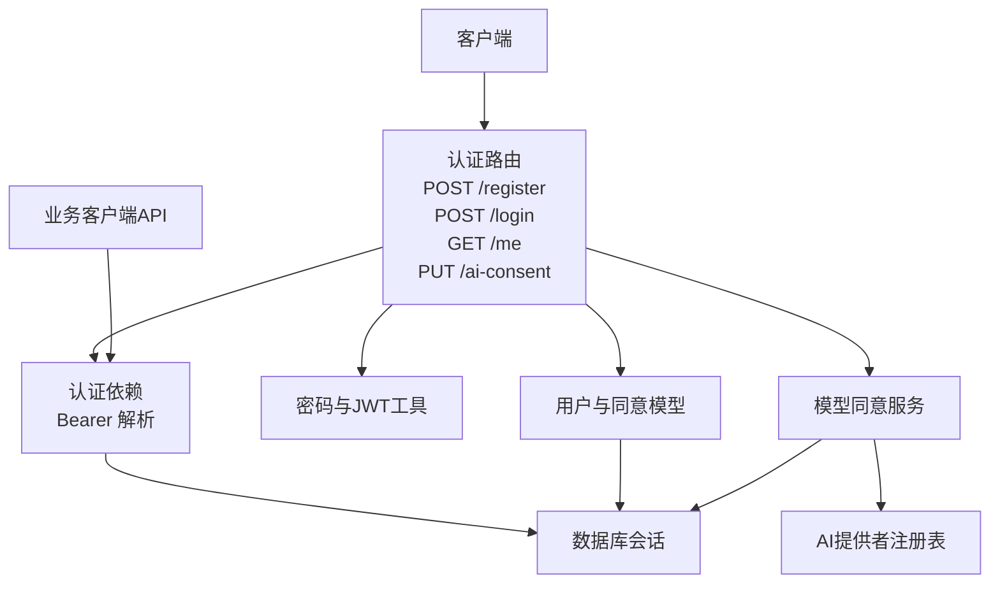
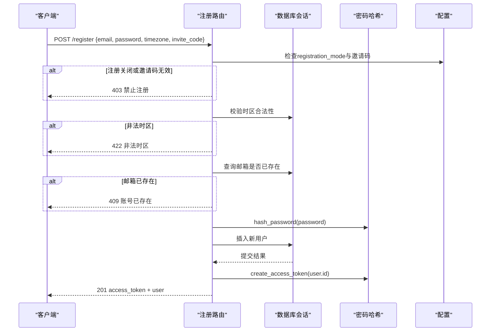
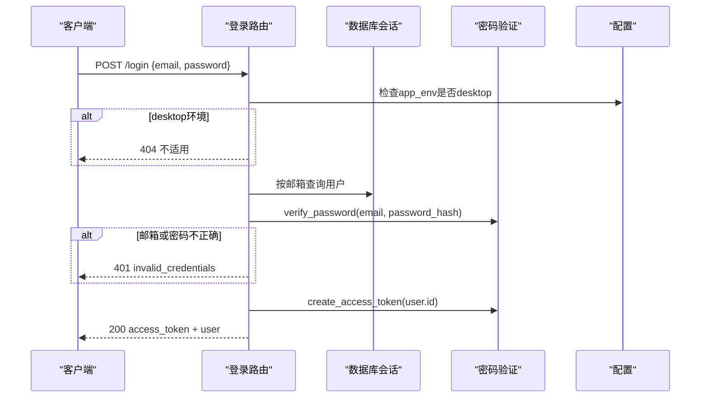
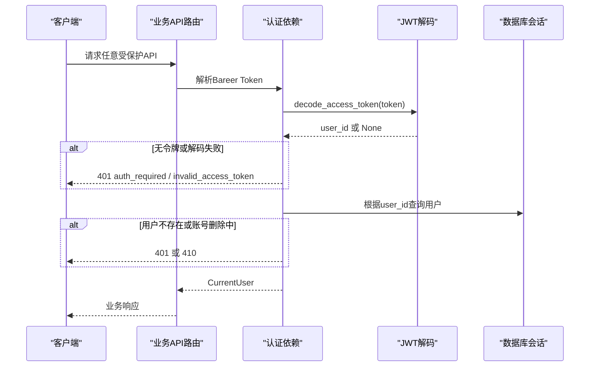
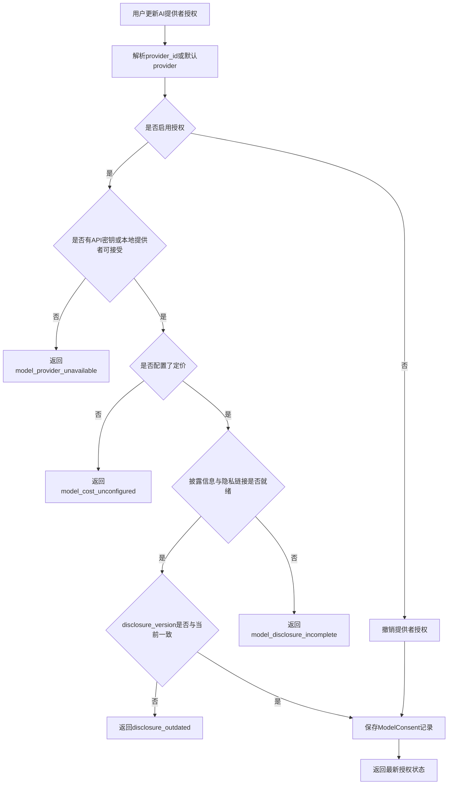
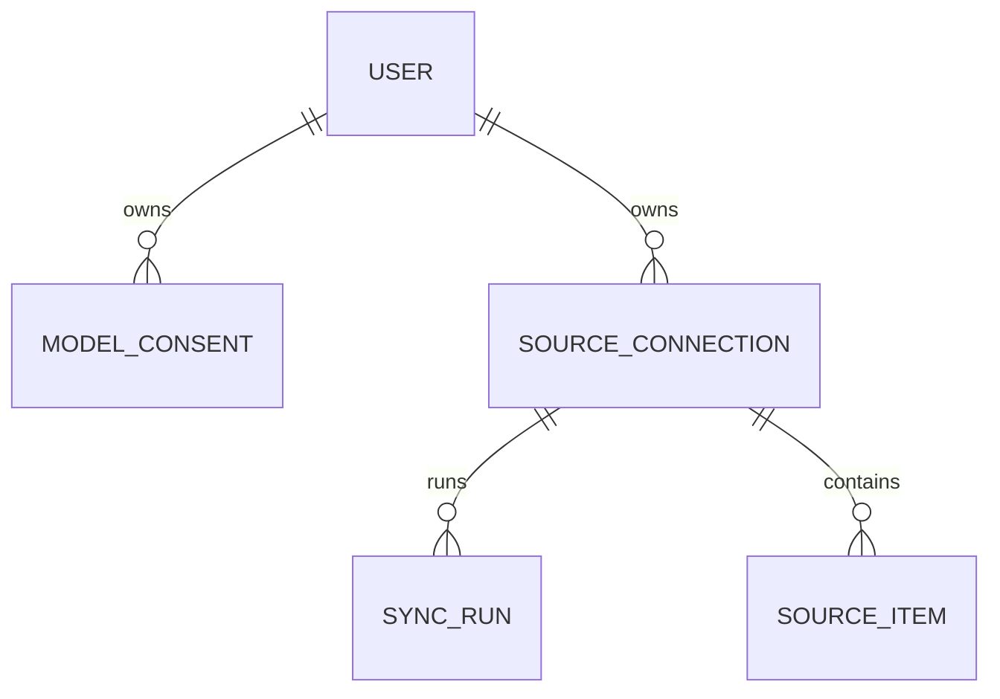
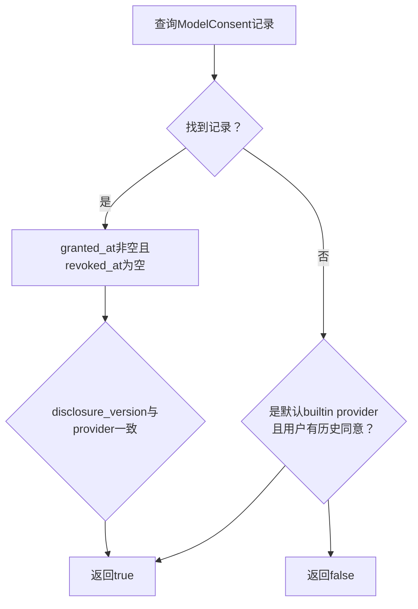
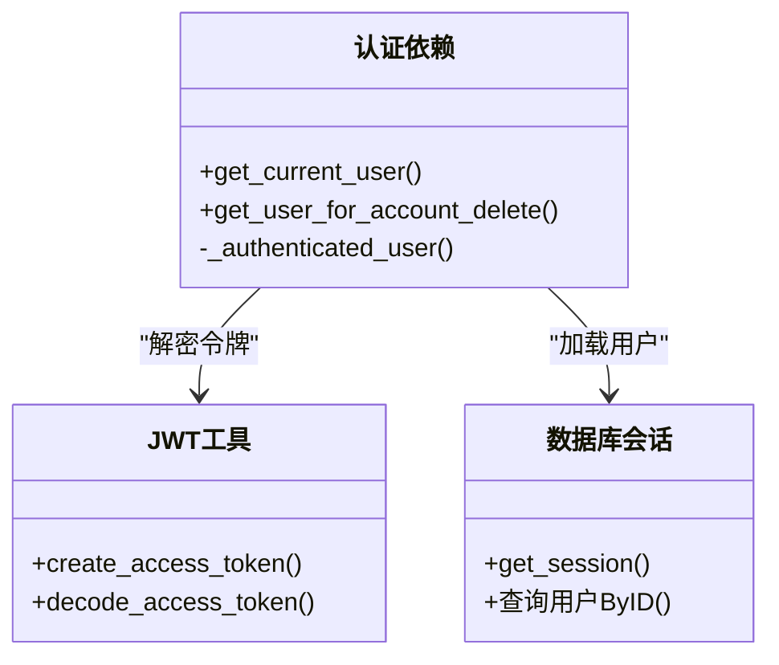
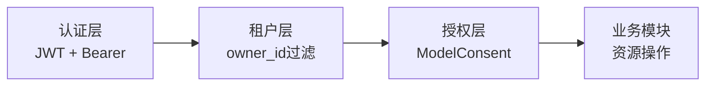

# 用户认证与授权

<cite>
**本文引用的文件**   
- [auth.py](file://src/personal_ai_life_os/api/routes/auth.py)
- [deps.py](file://src/personal_ai_life_os/api/deps.py)
- [schemas.py](file://src/personal_ai_life_os/api/schemas.py)
- [security.py](file://src/personal_ai_life_os/security.py)
- [models.py](file://src/personal_ai_life_os/models.py)
- [model_consent.py](file://src/personal_ai_life_os/services/model_consent.py)
- [model_providers.py](file://src/personal_ai_life_os/services/model_providers.py)
- [config.py](file://src/personal_ai_life_os/config.py)
- [a1b7c9d3e504_add_provider_consent_and_review_versions.py](file://migrations/versions/a1b7c9d3e504_add_provider_consent_and_review_versions.py)
</cite>

## 目录

1. [简介](#简介)
2. [项目结构与职责边界](#项目结构与职责边界)
3. [核心组件总览](#核心组件总览)
4. [系统架构与时序流程](#系统架构与时序流程)
5. [API端点规范](#api端点规范)
6. [密码哈希与JWT令牌机制](#密码哈希与jwt令牌机制)
7. [租户隔离与数据所有权](#租户隔离与数据所有权)
8. [ModelConsent模型与AI服务授权](#modelconsent模型与ai服务授权)
9. [权限检查中间件与依赖注入](#权限检查中间件与依赖注入)
10. [错误码定义与异常处理](#错误码定义与异常处理)
11. [与后端其他模块的集成方式](#与后端其他模块的集成方式)
12. [性能与安全注意事项](#性能与安全注意事项)
13. [故障排查指南](#故障排查指南)
14. [结论](#结论)

## 简介

Personal-AI-Life-OS 的用户认证与授权体系围绕以下目标构建：

- **注册与登录接口**：提供安全的账号创建、验证与访问令牌发放。
- **会话式鉴权**：使用无状态 JWT Bearer Token 进行请求认证。
- **提供者级授权**：为每个用户和 AI 模型提供者建立独立的同意记录，控制是否允许向外部模型发送数据。
- **租户隔离**：所有业务资源通过 `owner_id` 严格隔离不同用户的私有数据。
- **安全基线**：生产环境强制配置强密钥、最小化开放注册、严格的 CORS 和对象存储配置。

该文档聚焦认证层、授权层、ModelConsent 模型以及这些能力如何被 API 路由和其他业务模块使用。

## 项目结构与职责边界

从认证与授权角度看，相关代码分布在五个主要位置：

| 文件路径 | 职责 |
|---|---|
| `src/personal_ai_life_os/api/routes/auth.py` | 认证路由：注册、登录、桌面本地档案、获取当前用户、AI 同意设置。 |
| `src/personal_ai_life_os/api/deps.py` | 认证依赖：解析 Bearer Token、校验用户、阻止待删除账户。 |
| `src/personal_ai_life_os/security.py` | 密码哈希、JWT 签发与解码。 |
| `src/personal_ai_life_os/models.py` | 数据库模型，包括 `User`、`ModelConsent` 等。 |
| `src/personal_ai_life_os/services/model_consent.py` | ModelConsent 查询、计算、设置及与默认内置提供者的兼容逻辑。 |
| `src/personal_ai_life_os/services/model_providers.py` | AI 提供者配置、错误类型、披露版本和业务可用能力判断。 |
| `src/personal_ai_life_os/config.py` | 运行配置，包括令牌密钥、TTL、注册模式和 AI 提供者开关。 |



**图表来源**

- [auth.py:1-210](file://src/personal_ai_life_os/api/routes/auth.py#L1-L210)
- [deps.py:1-65](file://src/personal_ai_life_os/api/deps.py#L1-L65)
- [security.py:1-54](file://src/personal_ai_life_os/security.py#L1-L54)
- [models.py:74-136](file://src/personal_ai_life_os/models.py#L74-L136)
- [model_consent.py:1-110](file://src/personal_ai_life_os/services/model_consent.py#L1-L110)
- [model_providers.py:1-223](file://src/personal_ai_life_os/services/model_providers.py#L1-L223)
- [config.py:1-132](file://src/personal_ai_life_os/config.py#L1-L132)

**章节来源**

- [auth.py:1-210](file://src/personal_ai_life_os/api/routes/auth.py#L1-L210)
- [deps.py:1-65](file://src/personal_ai_life_os/api/deps.py#L1-L65)
- [models.py:74-136](file://src/personal_ai_life_os/models.py#L74-L136)
- [model_consent.py:1-110](file://src/personal_ai_life_os/services/model_consent.py#L1-L110)
- [model_providers.py:1-223](file://src/personal_ai_life_os/services/model_providers.py#L1-L223)
- [config.py:1-132](file://src/personal_ai_life_os/config.py#L1-L132)

## 核心组件总览

### 认证入口：认证路由

认证路由负责以下功能：

1. **Desktop Profile**：仅在 `desktop` 环境下提供本地档案令牌，用于桌面场景下的本地用户自动签名。
2. **注册**：校验邀请模式、时区合法性、邮箱唯一性、密码强度，然后生成用户与访问令牌。
3. **登录**：排除 desktop 直接登录，校验邮箱和密码，成功则签发 JWT。
4. **当前用户信息**：需要已认证的 Bearer Token。
5. **AI提供者披露状态**：暴露当前 Provider 的可用性、隐私条款、成本上限等信息。
6. **AI同意设置**：按 provider 级别启用或撤销外部模型处理；关闭时会取消与该 provider 相关的后台任务。

**章节来源**

- [auth.py:17-210](file://src/personal_ai_life_os/api/routes/auth.py#L17-L210)

### 会话与令牌工具

`security.py` 集中处理两个关键问题：

- 密码哈希：使用推荐算法生成并验证不可逆哈希值。
- JWT访问令牌：签发带 issuer、audience、subject、类型和时间戳的请求令牌。

**章节来源**

- [security.py:1-54](file://src/personal_ai_life_os/security.py#L1-L54)

### 身份解析依赖

`deps.py` 定义全局认证依赖：

- 支持可选 Bearer Token（auto_error=False），由具体业务决定是否强制要求。
- 解析后根据 subject 加载用户。
- 拒绝已请求删除且清理尚未完成的账户正常访问。
- 提供通用 `CurrentUserDep` 与专用删除账户依赖。

**章节来源**

- [deps.py:1-65](file://src/personal_ai_life_os/api/deps.py#L1-L65)

### 数据模型

`models.py` 中：

- `User` 表示用户主账户，包含邮箱、密码哈希、时区和内置AI同意字段。
- `ModelConsent` 表达用户对某个 AI provider 的提供者级授权快照，具有 granted/revoked 时间戳和披露版本快照。

**章节来源**

- [models.py:74-136](file://src/personal_ai_life_os/models.py#L74-L136)

### 模型提供者

`model_providers.py` 定义：

- `ModelProviderError`，携带人类可读错误信息、错误码和 HTTP 状态码。
- `ModelProvider`，封装 base_url、模型名称、价格、披露版本、是否本地、是否内置等。
- 默认 OpenAI 提供者构造与外部 JSON providers 解析。
- 按 provider id 选择模型的 resolve 方法。

**章节来源**

- [model_providers.py:1-223](file://src/personal_ai_life_os/services/model_providers.py#L1-L223)

### 模型同意服务

`model_consent.py` 是授权判定中心：

- 查询用户某 provider 的 consent 记录。
- 判断是否存在有效授权。
- 同时保留 legacy 行为：对 default builtin provider 回落到 User 字段。
- `set_consent` 实现开启/关闭 provider 的外部数据处理能力。

**章节来源**

- [model_consent.py:1-110](file://src/personal_ai_life_os/services/model_consent.py#L1-L110)

## 系统架构与时序流程

### 用户注册流程

注册是一个有状态验证过程，涉及配置检查、输入验证、邮箱唯一性约束和 JWT 返回。



**图表来源**

- [auth.py:59-136](file://src/personal_ai_life_os/api/routes/auth.py#L59-L136)
- [security.py:31-54](file://src/personal_ai_life_os/security.py#L31-L54)
- [config.py:35-66](file://src/personal_ai_life_os/config.py#L35-L66)

**章节来源**

- [auth.py:59-155](file://src/personal_ai_life_os/api/routes/auth.py#L59-L155)

### 用户登录流程

登录后返回 Bearer 令牌；在 desktop 模式下主动拒绝 `/login` 调用，避免将登录端口暴露给桌面端。



**图表来源**

- [auth.py:138-167](file://src/personal_ai_life_os/api/routes/auth.py#L138-L167)
- [security.py:12-30](file://src/personal_ai_life_os/security.py#L12-L30)

**章节来源**

- [auth.py:138-171](file://src/personal_ai_life_os/api/routes/auth.py#L138-L171)

### 受保护API调用流程

普通业务接口通过 `CurrentUserDep` 获得当前用户对象；若缺少令牌或令牌无效，会被统一拒绝。



**图表来源**

- [deps.py:15-65](file://src/personal_ai_life_os/api/deps.py#L15-L65)
- [security.py:39-54](file://src/personal_ai_life_os/security.py#L39-L54)

**章节来源**

- [deps.py:15-65](file://src/personal_ai_life_os/api/deps.py#L15-L65)

### AI提供者授权流程

用户可通过 `/auth/ai-consent` 为某个 provider 打开或关闭外部处理能力；授权检查由 `model_consent.has_consent` 完成。



**图表来源**

- [auth.py:169-210](file://src/personal_ai_life_os/api/routes/auth.py#L169-L210)
- [model_consent.py:49-110](file://src/personal_ai_life_os/services/model_consent.py#L49-L110)
- [model_providers.py:17-47](file://src/personal_ai_life_os/services/model_providers.py#L17-L47)

**章节来源**

- [auth.py:169-210](file://src/personal_ai_life_os/api/routes/auth.py#L169-L210)
- [model_consent.py:1-110](file://src/personal_ai_life_os/services/model_consent.py#L1-L110)
- [model_providers.py:1-168](file://src/personal_ai_life_os/services/model_providers.py#L1-L168)

## API端点规范

认证相关路由前缀为 `/api/v1/auth`，但代码中 router prefix 为 `/auth`。下面以仓库实际定义的端点为准。

### GET `/auth/me`

- **用途**：返回当前已通过 Bearer 认证的用户信息。
- **认证**：必需的 Bearer Token。
- **成功响应**：返回 `UserResponse`。
- **失败响应**：缺少令牌为 `401`；令牌无效或过期为 `401`；账户处于删除清理期为 `410`。

**章节来源**

- [auth.py:169-171](file://src/personal_ai_life_os/api/routes/auth.py#L169-L171)
- [deps.py:15-65](file://src/personal_ai_life_os/api/deps.py#L15-L65)

### POST `/auth/register`

- **用途**：创建用户并返回访问令牌。
- **请求体**：`RegisterRequest`，包含 `email`、`password`、`timezone`、可选 `invite_code`。
- **成功响应**：HTTP 201，返回 `TokenResponse`。
- **典型失败码**：

  | HTTP状态码 | 错误码 | 含义 |
  |---|---|---|
  | 403 | `registration_closed` | 注册被关闭 |
  | 403 | `invalid_invitation` | 邀请模式但邀请码无效或缺失 |
  | 422 | `invalid_timezone` | IANA 时区名无效 |
  | 409 | `account_exists` | 邮箱已经注册 |

**章节来源**

- [auth.py:59-155](file://src/personal_ai_life_os/api/routes/auth.py#L59-L155)
- [schemas.py:21-54](file://src/personal_ai_life_os/api/schemas.py#L21-L54)
- [config.py:35-66](file://src/personal_ai_life_os/config.py#L35-L66)

#### 请求示例

```json
{
  "email": "alice@example.com",
  "password": "correct horse battery staple",
  "timezone": "UTC",
  "invite_code": null
}
```

#### 响应示例

```json
{
  "access_token": "eyJhbGciOiJIUzI1NiIs...",
  "token_type": "bearer",
  "expires_in": 43200,
  "user": {
    "id": "a1b2c3d4-...",
    "email": "alice@example.com",
    "timezone": "UTC",
    "ai_consent_at": null,
    "ai_consent_provider": null,
    "ai_consent_disclosure_version": null,
    "created_at": "2026-01-01T00:00:00+00:00"
  }
}
```

### POST `/auth/login`

- **用途**：使用 email/password 换取 Bearer 令牌。
- **请求体**：`LoginRequest`，包含 `email`、`password`。
- **成功响应**：返回 `TokenResponse`。
- **失败响应**：

  | HTTP状态码 | 错误码 | 含义 |
  |---|---|---|
  | 404 | 无标准 code字段 | desktop 环境下不使用此端点 |
  | 401 | `invalid_credentials` | 邮箱或密码不正确 |

**章节来源**

- [auth.py:138-171](file://src/personal_ai_life_os/api/routes/auth.py#L138-L171)
- [schemas.py:41-50](file://src/personal_ai_life_os/api/schemas.py#L41-L50)

#### 请求示例

```json
{
  "email": "alice@example.com",
  "password": "correct horse battery staple"
}
```

#### 响应示例

同上 `TokenResponse`。

### PUT `/auth/ai-consent`

- **用途**：设置某 provider 的 AI 外部处理同意。
- **请求体**：`AIPreferenceRequest`，包含 `enabled` 与可选 `provider_id`、`disclosure_version`。
- **成功响应**：返回当前 `UserResponse`。
- **失败响应**：可能返回 provider 不可用、定价未配置、披露未完成或披露版本过期的错误。

**章节来源**

- [auth.py:169-210](file://src/personal_ai_life_os/api/routes/auth.py#L169-L210)
- [model_consent.py:49-110](file://src/personal_ai_life_os/services/model_consent.py#L49-L110)
- [model_providers.py:17-47](file://src/personal_ai_life_os/services/model_providers.py#L17-L47)

## 密码哈希与JWT令牌机制

### 密码哈希策略

密码不会以明文存储：

- `hash_password` 使用推荐的密码哈希库生成不可逆哈希。
- `verify_password` 在验证失败时捕获未知哈希和验证异常，统一返回 `False`，避免泄露内部哈希格式信息。

这一设计有助于迁移更强哈希算法而无需修改大量验证逻辑。

**章节来源**

- [security.py:12-30](file://src/personal_ai_life_os/security.py#L12-L30)

### JWT访问令牌结构

生成的访问令牌具有以下特性：

| 字段 | 值 | 作用 |
|---|---|---|
| `sub` | 用户ID字符串 | 表示资源所有者 |
| `iat` | UTC 时间 | 签发时间 |
| `exp` | 签发时间加 `access_token_ttl_hours` | 过期时间 |
| `iss` | `"personal-ai-life-os"` | 签发者 |
| `aud` | `"personal-ai-life-os-api"` | 接收方范围 |
| `typ` | `"access"` | 令牌类型 |

验证解码时：

- 使用 HS256 对称算法。
- 校验 `iss` 和 `aud`。
- 强制要求 `sub`、`exp`、`iat`、`iss`、`aud`。
- 必须满足 `typ == "access"`。
- 解码失败或字段不合法返回 `None`。

**章节来源**

- [security.py:31-54](file://src/personal_ai_life_os/security.py#L31-L54)

### 令牌过期与刷新策略

当前实现是**无状态会话**：

- 服务端不持久化 JWT 黑名单或刷新令牌。
- 用户在令牌有效期内可以继续使用同一 token 访问所有依赖 `CurrentUserDep` 的资源。
- 令牌过期后，JWT 解码会失败，后续请求会返回 `invalid_access_token`。
- 前端通常需要重新触发 `/auth/login`，或通过桌面 profile 机制刷新本地会话。

如需支持刷新令牌，应引入刷新令牌表或短期刷新令牌策略，并注意不在日志中输出完整凭证。

**章节来源**

- [security.py:39-54](file://src/personal_ai_life_os/security.py#L39-L54)
- [deps.py:29-65](file://src/personal_ai_life_os/api/deps.py#L29-L65)
- [auth.py:45-57](file://src/personal_ai_life_os/api/routes/auth.py#L45-L57)

## 租户隔离与数据所有权

本项目采用**基于用户ID的租户隔离**。每个拥有独立邮箱的用户就是一个“tenant”，业务表普遍持有 `owner_id`。

### 模型层隔离

- `ModelConsent.owner_id`：指向 `users.id`，并通过外键级联删除。
- `SourceConnection.owner_id`：绑定数据来源的所有人。
- `SyncRun.owner_id`：绑定每次同步任务的归属。
- `SourceItem` 同样使用 `owner_id`，并在查询中加入 `owner_id == user.id` 条件。



**图表来源**

- [models.py:74-196](file://src/personal_ai_life_os/models.py#L74-L196)
- [a1b7c9d3e504_add_provider_consent_and_review_versions.py:21-65](file://migrations/versions/a1b7c9d3e504_add_provider_consent_and_review_versions.py#L21-L65)

### API层隔离

所有受保护路由通过依赖注入获得的 `user` 对象，作为 `owner_id` 过滤条件：

- 新建源时使用 `owner_id=user.id`。
- 查询源、同步执行、源项数据时用 `SourceConnection.owner_id == user.id` 或等价条件。
- 账户删除时扫描 `owner_id` 对应的对象并写入删除墓碑。

因此，即使攻击者伪造请求参数试图跨用户访问数据，也不会绕过 SQL 层的 owner 过滤条件。

**章节来源**

- [auth.py:16-39](file://src/personal_ai_life_os/api/routes/auth.py#L16-L39)
- [deps.py:29-65](file://src/personal_ai_life_os/api/deps.py#L29-L65)
- [sources.py片段](file://src/personal_ai_life_os/api/routes/sources.py#L67-L366)

## ModelConsent模型与AI服务授权

### ModelConsent字段语义

`ModelConsent` 是每个用户针对某个 AI provider 的明确授权快照：

| 字段 | 类型 | 说明 |
|---|---|---|
| `id` | UUID字符串 | 主键 |
| `owner_id` | UUID字符串 | 用户ID |
| `provider_id` | 字符串 | AI模型提供者标识 |
| `disclosure_version` | 字符串 | 同意时的隐私披露版本 |
| `granted_at` | 可空时间戳 | 授予外部处理的时间 |
| `revoked_at` | 可空时间戳 | 撤销外部处理的时间 |
| `owner` | User关系 | 所属用户 |

唯一约束确保每个用户最多有一条给定 provider 的授权记录。索引优化了按用户和 provider 的查询。

**章节来源**

- [models.py:107-136](file://src/personal_ai_life_os/models.py#L107-L136)
- [a1b7c9d3e504_add_provider_consent_and_review_versions.py:21-40](file://migrations/versions/a1b7c9d3e504_add_provider_consent_and_review_versions.py#L21-L40)

### 授权判定逻辑

`has_consent` 先查找 `ModelConsent` 记录，再判断：

1. `granted_at` 必须存在。
2. `revoked_at` 必须为空。
3. 记录的 `disclosure_version` 必须与当前 provider 的披露版本一致。

如果不存在记录，则退回到 legacy 行为：仅对默认 provider 且 provider 标记为 `builtin`，并且用户有有效的 `ai_consent_at`、`ai_consent_provider` 和匹配披露版本时才视为已授权。



**图表来源**

- [model_consent.py:30-47](file://src/personal_ai_life_os/services/model_consent.py#L30-L47)

### provider级权限管理

Provider 的配置来自两部分：

1. **内置 OpenAI Provider**：当 `config.model_provider == "openai"` 时自动创建。
2. **外部 Provider JSON**：通过 `MODEL_PROVIDERS` 配置多个 OpenAI 兼容 endpoint。

授权不能越过 provider 配置：

- 若无 API Key 且非本地 provider，启用会报 `model_provider_unavailable`。
- 若未配置价格，启用会报 `model_cost_unconfigured`。
- 若披露不完整，启用会报 `model_disclosure_incomplete`。
- 若传入的 `disclosure_version` 与 provider 当前版本不一致，会报 `disclosure_outdated`。

**章节来源**

- [model_consent.py:49-110](file://src/personal_ai_life_os/services/model_consent.py#L49-L110)
- [model_providers.py:17-168](file://src/personal_ai_life_os/services/model_providers.py#L17-L168)
- [model_providers.py:170-223](file://src/personal_ai_life_os/services/model_providers.py#L170-L223)

### 同意状态查询

`consent_state` 用于对外返回授权状态，包括：

- `provider_id`
- `disclosure_version`
- `consented`
- `granted_at`
- `revoked_at`

它使前端能显示哪个 provider 已获准使用、何时授权、何时撤销，以及是否需要重新阅读新版本的披露协议。

**章节来源**

- [model_consent.py:49-67](file://src/personal_ai_life_os/services/model_consent.py#L49-L67)

## 权限检查中间件与依赖注入

FastAPI 并未使用传统意义上的服务器端全局中间件做鉴权；而是通过 FastAPI 的依赖注入机制实现统一的权限校验。

### 认证依赖链

1. 请求进入业务路由。
2. FastAPI 调用 `get_current_user`。
3. 读取 `request.app.state.settings` 中的配置。
4. 使用可选 Bearer 头解析凭据。
5. 调用 `decode_access_token` 取出 `user_id`。
6. 从数据库加载 `User`。
7. 若用户不存在或正在被删除，返回错误。
8. 否则把当前用户注入到路由函数参数中。



**图表来源**

- [deps.py:1-65](file://src/personal_ai_life_os/api/deps.py#L1-L65)
- [security.py:31-54](file://src/personal_ai_life_os/security.py#L31-L54)

### 待删除账户的保护

当用户请求删除后：

- 对象存储会写入删除墓碑。
- `deletion_requested_at` 被设置。
- 除删除相关操作外，所有需要 `CurrentUserDep` 的路径均返回 `410 Gone`，错误码为 `account_deletion_pending`。
- 这是防止竞态条件下重复删除或数据不一致的重要防护。

**章节来源**

- [deps.py:29-65](file://src/personal_ai_life_os/api/deps.py#L29-L65)

### 与业务模块的集成

几乎所有受保护模块都会这样使用：

```python
def some_api(user: CurrentUserDep, session: SessionDep) -> Response:
    # 此时user已经是经过JWT校验的实例
    return {"owner_id": user.id}
```

由于 `user.id` 是唯一真实的资源所有者，业务模块只需以 `owner_id` 过滤查询即可保证租户隔离。

**章节来源**

- [deps.py:59-65](file://src/personal_ai_life_os/api/deps.py#L59-L65)

## 错误码定义与异常处理

认证与授权相关错误主要出现在三个层次：API路由层、认证依赖层、Provider授权层。

### 认证相关错误码

| HTTP状态码 | error_code | 出现位置 | 描述 |
|---|---|---|---|
| 401 | `invalid_credentials` | 登录路由 | 邮箱或密码错误 |
| 401 | `auth_required` | 认证依赖 | 缺少Bearer令牌 |
| 401 | `invalid_access_token` | 认证依赖 | 令牌无效、过期或载荷不合法 |
| 403 | `registration_closed` | 注册路由 | 注册被关闭 |
| 403 | `invalid_invitation` | 注册路由 | 邀请模式缺少有效邀请码 |
| 404 | 无标准code | 登录/桌面档案 | desktop 环境禁用某些云端端点 |
| 409 | `account_exists` | 注册路由 | 邮箱已存在 |
| 409 | `model_provider_unavailable` | AI同意路由 | Provider缺少API密钥 |
| 409 | `model_cost_unconfigured` | AI同意路由 | Provider定价未配置 |
| 409 | `model_disclosure_incomplete` | AI同意路由 | Provider隐私与披露不完整 |
| 409 | `disclosure_outdated` | AI同意路由 | 同意版本与当前provider版本不一致 |
| 410 | `account_deletion_pending` | 认证依赖 | 账户处于删除清理期 |
| 422 | `invalid_timezone` | 注册路由 | IANA时区无效 |

### 统一错误结构

多数结构化错误使用如下形式：

```json
{
  "code": "some_error_code",
  "message": "人类可读的错误描述"
}
```

部分 JWT 相关错误会在响应头中添加：

```text
WWW-Authenticate: Bearer
```

这符合 RFC 4013 对 Bearer 认证挑战的基本约定，有助于支持浏览器或客户端自动识别 Bearer 认证方案。

**章节来源**

- [auth.py:59-171](file://src/personal_ai_life_os/api/routes/auth.py#L59-L171)
- [deps.py:33-65](file://src/personal_ai_life_os/api/deps.py#L33-L65)
- [model_providers.py:17-25](file://src/personal_ai_life_os/services/model_providers.py#L17-L25)

### Provider错误映射

`ModelProviderError` 是一个运行时异常子类，除了 message 外还包含 `code` 和 `status_code`。认证路由捕获它并转换为 HTTP 异常，使得配置错误也能以结构化 JSON 返回。

**章节来源**

- [auth.py:191-200](file://src/personal_ai_life_os/api/routes/auth.py#L191-L200)
- [model_providers.py:17-25](file://src/personal_ai_life_os/services/model_providers.py#L17-L25)

## 与后端其他模块的集成方式

### 与账号与资源模块集成

虽然本文聚焦认证授权，但与 `account` 和 `sources` 等模块的关系很紧密：

- **账号删除**：通过专门依赖 `DeletionUserDep` 获取当前用户，写入删除墓碑，取消所有后台任务，并将来源标记为 deleting。
- **资源读写**：如 `sources.py` 中，所有源、同步任务、源项数据都通过 `owner_id=user.id` 限定。
- **AI同意关闭**：当用户撤销某个 provider 的同意后，认证路由会调用 `cancel_model_jobs_for_owner` 取消关联任务，避免继续发送数据。

这种集成体现了三层保护：

1. **认证层**：只有持有效令牌才能访问。
2. **鉴权层**：只有账户不是待删除状态才允许正常访问。
3. **数据层**：所有查询按 `owner_id` 限制。



**图表来源**

- [auth.py:138-210](file://src/personal_ai_life_os/api/routes/auth.py#L138-L210)
- [accounts.py片段参考](file://src/personal_ai_life_os/api/routes/account.py#L595-L653)
- [sources.py片段参考](file://src/personal_ai_life_os/api/routes/sources.py#L67-L366)

**章节来源**

- [auth.py:169-210](file://src/personal_ai_life_os/api/routes/auth.py#L169-L210)
- [account.py片段](file://src/personal_ai_life_os/api/routes/account.py#L595-L653)
- [sources.py片段](file://src/personal_ai_life_os/api/routes/sources.py#L67-L366)

## 性能与安全注意事项

### 令牌性能

- JWT 是无状态的，不需要在请求鉴权时查询用户表以外的会话缓存。
- 依赖依赖仍会查询一次 `User` 表，属于常量开销。
- 若高频访问受限 API，可在前端合理复用令牌生命周期，减少频繁刷新。

### 密码哈希性能

- `PasswordHash.recommended()` 会选择合适的慢速哈希策略，适合防止暴力破解。
- 不建议在生产环境中关闭或减弱哈希强度。
- 批量导入用户时应考虑并发与延迟影响。

### 密钥与部署安全

生产环境强制要求：

- `ACCESS_TOKEN_SECRET` 长度至少 32 字符，且不能是开发默认值。
- `AUTO_CREATE_SCHEMA` 在生产环境必须关闭。
- `PROCESSING_MODE` 必须使用 `worker`。
- 不允许 `registration_mode=open`。
- 若启用邀请注册，必须设置 `SIGNUP_INVITE_CODE`。
- CORS 白名单不得包含 localhost。
- 外部对象存储与删除事务桶必须分开。
- 指标令牌也需强随机值和最小长度。
- OpenAI 模式必须提供 API Key、隐私链接、披露文本和正向单价预算。

这些生产校验集中在 Settings 的 model validator 中，启动时即失败，从而降低部署风险。

**章节来源**

- [config.py:96-132](file://src/personal_ai_life_os/config.py#L96-L132)
- [security.py:31-54](file://src/personal_ai_life_os/security.py#L31-L54)

## 故障排查指南

### 注册失败

**症状**：POST `/auth/register` 返回 403、409 或 422。

**排查步骤**：

1. 检查 `REGISTRATION_MODE` 是否为 open 或 invitation。
2. 如果是 invitation，核对 `SIGNUP_INVITE_CODE` 是否与请求中的 `invite_code` 一致。
3. 检查邮箱是否符合基本格式和唯一约束。
4. 确认时区为合法的 IANA 名称。
5. 注意幂等重试：注册失败后再次提交可能导致 409 `account_exists`。

**章节来源**

- [auth.py:59-155](file://src/personal_ai_life_os/api/routes/auth.py#L59-L155)

### 登录失败

**症状**：POST `/auth/login` 返回 401 `invalid_credentials`。

**排查步骤**：

1. 确认邮箱大小写规范化后确实存在于 users 表。
2. 确认密码不是空串且符合最低长度。
3. 确认未在 desktop 环境下直接调用 `/login`。
4. 若怀疑数据库中旧哈希不兼容，检查 `pwdlib` 异常处理是否仍返回 False。
5. 注意不要将完整密码或 JWT 写入常规应用日志。

**章节来源**

- [auth.py:138-171](file://src/personal_ai_life_os/api/routes/auth.py#L138-L171)
- [security.py:12-30](file://src/personal_ai_life_os/security.py#L12-L30)

### 调用受保护API提示认证失败

**症状**：调用任意业务API返回 `auth_required` 或 `invalid_access_token`。

**排查步骤**：

1. 是否在请求头中包含 `Authorization: Bearer <token>`。
2. 令牌是否为 `/auth/login` 或 `/auth/register` 返回的 `access_token`。
3. 是否超过 `access_token_ttl_hours`。
4. 令牌是否被前端重复复用；JWT本身没有黑名单，所以失效只取决于过期。
5. 用户是否发起了账户删除；若已设置 `deletion_requested_at`，非删除接口将返回 410。

**章节来源**

- [deps.py:29-65](file://src/personal_ai_life_os/api/deps.py#L29-L65)
- [security.py:39-54](file://src/personal_ai_life_os/security.py#L39-L54)

### AI提供者授权不可用

**症状**：PUT `/auth/ai-consent` 返回 provider unconfigured、cost未配置、disclosure incomplete 或 disclosure outdated。

**排查步骤**：

1. 检查 `MODEL_PROVIDER` 是否开启。
2. 检查 `OPENAI_API_KEY`、隐私链接、披露文本、单价是否正确。
3. 如果使用自定义 PROVIDERS JSON，检查 base_url、model、models、pricing 和 privacy 配置。
4. 确认 `DISCLOSURE_VERSION` 与前端传回的 `disclosure_version` 一致。
5. 若关闭授权，确认相关后台任务已经被取消。

**章节来源**

- [auth.py:169-210](file://src/personal_ai_life_os/api/routes/auth.py#L169-L210)
- [model_providers.py:134-223](file://src/personal_ai_life_os/services/model_providers.py#L134-L223)

### 数据跨租户泄漏风险验证

**排查思路**：

1. 创建两个不同邮箱的用户 A 与 B。
2. 分别登录后只访问各自的 source、item、sync run。
3. 确保所有查询都带有 `owner_id == user.id`。
4. 不应能从 B 看到 A 的数据。
5. 特别检查导入、搜索、图谱等复杂业务模块是否直接使用请求参数中的资源ID而非当前用户上下文。

**章节来源**

- [deps.py:29-65](file://src/personal_ai_life_os/api/deps.py#L29-L65)
- [sources.py片段](file://src/personal_ai_life_os/api/routes/sources.py#L67-L366)

## 结论

Personal-AI-Life-OS 的用户认证与授权体系以简单、明确的边界为核心：

- **认证层**使用 FastAPI 依赖注入解析 Bearer Token，并把 `User` 注入业务代码。
- **授权层**通过 `ModelConsent` 实现 per-user、per-provider 的 AI 外部处理许可。
- **租户层**通过 `owner_id` 把所有用户数据与查询条件绑定。
- **安全层**通过密码哈希、JWT 校验和生产环境配置校验形成多层防线。

对于运维与开发者而言，最关键的安全实践包括：

1. 永远在生产环境更换强 `ACCESS_TOKEN_SECRET`。
2. 禁止开放注册。
3. 始终使用 HTTPS 与受信 CORS 源。
4. 不为任意用户提供数据库直连或管理员后台。
5. 不要在日志中记录密码、JWT、API Key 或敏感用户数据。
6. 对所有外部 AI provider 保留披露版本与定价审计。
7. 在启用或禁用外部模型使用时，确保相关后台任务被正确取消。