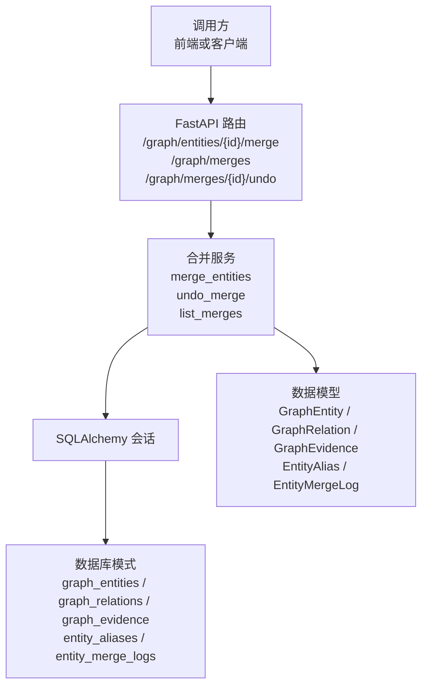
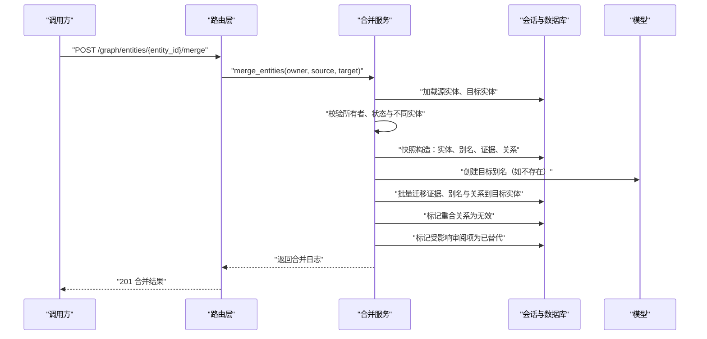
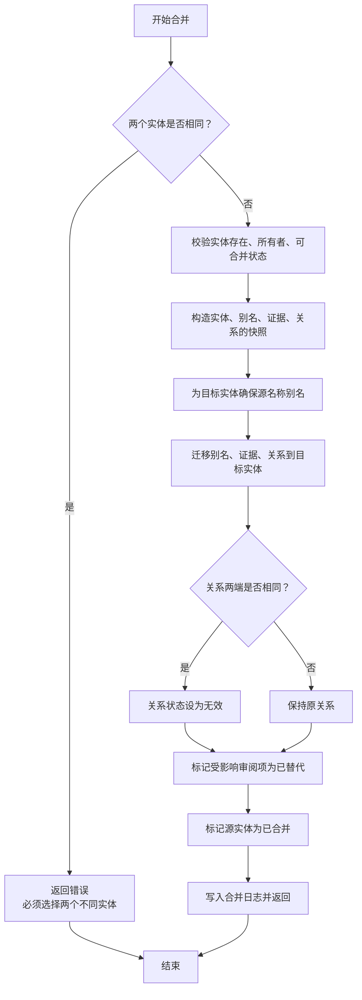
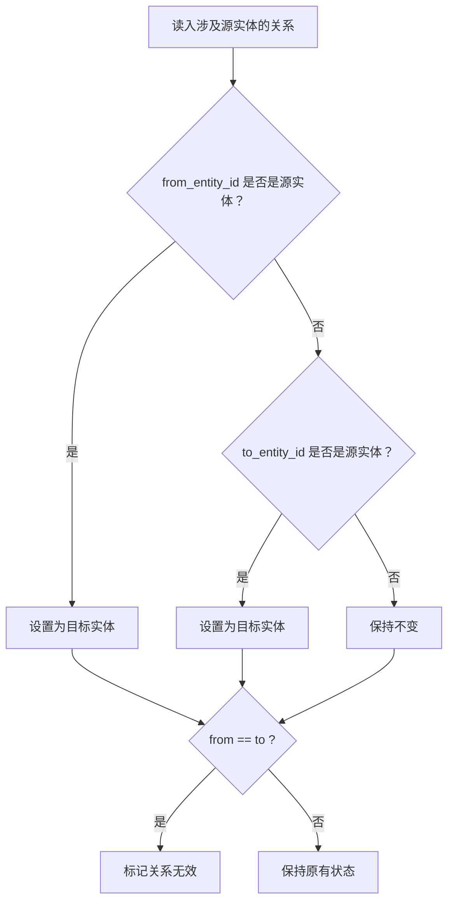
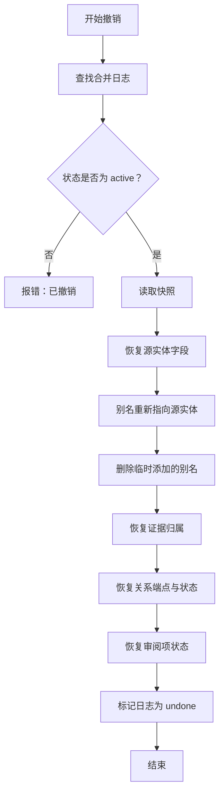
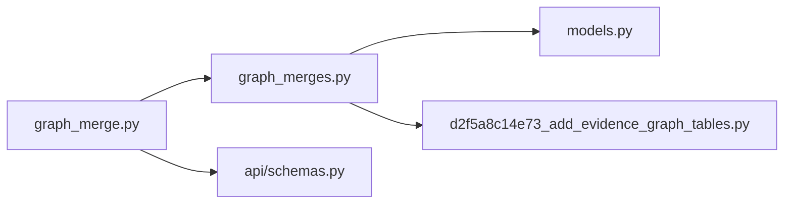

# 合并系统

<cite>
**本文引用的文件**   
- [graph_merge.py](file://src/personal_ai_life_os/api/routes/graph_merge.py)
- [graph_merges.py](file://src/personal_ai_life_os/services/graph_merges.py)
- [models.py](file://src/personal_ai_life_os/models.py)
- [schemas.py](file://src/personal_ai_life_os/api/schemas.py)
- [d2f5a8c14e73_add_evidence_graph_tables.py](file://migrations/versions/d2f5a8c14e73_add_evidence_graph_tables.py)
- [data-model.md](file://docs/architecture/data-model.md)
- [test_graph_model.py](file://tests/test_graph_model.py)
</cite>

## 目录
1. [简介](#简介)
2. [项目结构](#项目结构)
3. [核心组件](#核心组件)
4. [架构总览](#架构总览)
5. [详细组件分析](#详细组件分析)
6. [依赖分析](#依赖分析)
7. [性能考虑](#性能考虑)
8. [故障排查指南](#故障排查指南)
9. [结论](#结论)
10. [附录：API 行为清单](#附录api-行为清单)

## 简介
本文件说明证据图实体合并功能的技术设计、数据流、约束与运维建议。合并系统的核心能力是：把低置信度的重复实体收拢到一个目标实体中，同时保留可审计、可回滚的变更记录；在关系层面迁移引用，并维护别名、证据项和待审项目的可见性一致性。

重要边界：仓库中的代码没有内置基于相似性的自动候选发现、冲突检测评分、多策略权重分配或复杂循环检测逻辑。当前实现是“用户指定源实体和目标实体的显式合并”，并附带快照式回滚机制。

## 项目结构
合并相关代码分布在三个层次：
- API 路由层：提供合并、查看历史和撤销接口。
- 服务层：实现合并语义、回滚、快照构建、别名处理和分页查询。
- 持久化层：通过 SQLAlchemy 模型与数据库表定义实体、关系、证据、别名及合并日志的结构。

**图表来源**
- [graph_merge.py:1-86](file://src/personal_ai_life_os/api/routes/graph_merge.py#L1-L86)
- [graph_merges.py:1-312](file://src/personal_ai_life_os/services/graph_merges.py#L1-L312)
- [models.py:409-551](file://src/personal_ai_life_os/models.py#L409-L551)
- [d2f5a8c14e73_add_evidence_graph_tables.py:25-180](file://migrations/versions/d2f5a8c14e73_add_evidence_graph_tables.py#L25-L180)

**章节来源**
- [graph_merge.py:1-86](file://src/personal_ai_life_os/api/routes/graph_merge.py#L1-L86)
- [models.py:409-551](file://src/personal_ai_life_os/models.py#L409-L551)
- [d2f5a8c14e73_add_evidence_graph_tables.py:25-180](file://migrations/versions/d2f5a8c14e73_add_evidence_graph_tables.py#L25-L180)

## 核心组件
- 合并路由：接收用户发起的合并请求，捕获服务层错误并返回结构化异常。
- 合并服务：执行校验、快照构造、归属隔离检查、别名迁移、证据迁移、关系重定向、审阅项状态更新、写入合并日志。
- 撤销服务：读取上次活跃合并的快照，恢复源实体字段、别名指向、证据归属、关系边和审阅项状态。
- 数据模型：定义图谱实体、关系、证据、别名、合并日志等表格及其约束。
- API 模式：使用 Pydantic Schema 序列化合并响应。

**章节来源**
- [graph_merge.py:1-86](file://src/personal_ai_life_os/api/routes/graph_merge.py#L1-L86)
- [graph_merges.py:1-312](file://src/personal_ai_life_os/services/graph_merges.py#L1-L312)
- [models.py:409-551](file://src/personal_ai_life_os/models.py#L409-L551)
- [schemas.py:1-120](file://src/personal_ai_life_os/api/schemas.py#L1-L120)

## 架构总览
合并操作是单事务的有副作用写操作，重点保护以下不变量：
- 每个实体属于单一租户，所有查询都按 owner_id 过滤。
- 被合并源实体状态标记为已合并，目标实体保持活跃状态。
- 源实体上的证据、关系、别名被转移到目标实体上。
- 当关系两端都指向同一实体时，该关系被标记为无效，以避免自环语义污染。
- 每次合并写入不可变快照，支持后续撤销。

**图表来源**
- [graph_merge.py:21-60](file://src/personal_ai_life_os/api/routes/graph_merge.py#L21-L60)
- [graph_merges.py:56-200](file://src/personal_ai_life_os/services/graph_merges.py#L56-L200)

**章节来源**
- [graph_merge.py:21-60](file://src/personal_ai_life_os/api/routes/graph_merge.py#L21-L60)
- [graph_merges.py:56-200](file://src/personal_ai_life_os/services/graph_merges.py#L56-L200)

## 详细组件分析

### 实体合并算法
#### 输入与前置校验
- 不允许源实体和目标实体相同。
- 源实体和目标实体都必须存在且属于当前用户。
- 只有处于“active”或“pending_review”状态的实体才允许参与合并。
- 若任一实体不符合上述条件，抛出带业务码的服务错误。

#### 快照与影响面收集
在改变任何数据前，服务层收集以下内容作为回滚依据：
- 源实体快照：ID、名称、类型、标准化名称、摘要、置信度、状态和被合并指向。
- 源实体上的全部别名列表及其规范化别名。
- 源实体关联的证据 ID 列表。
- 涉及源实体两端的关系列表快照。
- 引用源实体的“pending”审阅项列表。

#### 影响变更
- 将源实体名称追加为目标实体别名，防止旧别名无法再解析。
- 将源实体的别名全部重新指向目标实体。
- 将证据的 entity_id 从源实体转移到目标实体。
- 将所有关系中从或指向源实体的端重定向到目标实体；若两端重合则把关系状态标记为无效。
- 将引用该源实体的待定审阅项标记为“superseded”，并设置 resolved_at 时间戳。
- 最终把源实体状态置为“merged”，并设置 merged_into_id。

**图表来源**
- [graph_merges.py:61-200](file://src/personal_ai_life_os/services/graph_merges.py#L61-L200)
- [d2f5a8c14e73_add_evidence_graph_tables.py:25-120](file://migrations/versions/d2f5a8c14e73_add_evidence_graph_tables.py#L25-L120)

**章节来源**
- [graph_merges.py:61-200](file://src/personal_ai_life_os/services/graph_merges.py#L61-L200)
- [d2f5a8c14e73_add_evidence_graph_tables.py:25-120](file://migrations/versions/d2f5a8c14e73_add_evidence_graph_tables.py#L25-L120)

#### 相似性计算与自动推荐
当前服务层并未实现基于文本相似度、实体类型匹配或证据聚合的自动候选发现。自动相似度计算、打分与排序应作为外部流程或独立服务在 UI 层调用，而不是由当前合并服务内部计算。

- 现有可用字段可用于构建外部相似性算法，例如实体类型、名称、标准化名称、摘要、置信度。
- 由于标准化名称已对空白字符折叠和大小写归一，可作为快速去重辅助键。

[本节为概念扩展，不直接分析具体源码文件]

#### 冲突检测与权重分配
- 当前实现没有通用的“冲突检测器”或“权重分配器”。
- 已有最小冲突处理：
  - 禁止自我合并。
  - 要求实体属于同一所有者。
  - 只允许合并“活跃”或“待审查”实体。
  - 将可能形成自环的关系标记为无效，避免破坏图谱语义。
- 如果需要更复杂的冲突解决（例如名称差异、属性合并策略），建议在服务层增加明确的 conflict_resolver 或 merge_policy 参数，并对每种冲突类型枚举策略。

**章节来源**
- [graph_merges.py:61-120](file://src/personal_ai_life_os/services/graph_merges.py#L61-L120)
- [models.py:409-465](file://src/personal_ai_life_os/models.py#L409-L465)

### 关系合并机制
#### 引用完整性
- 关系使用 from_entity_id 和 to_entity_id 外键指向实体，删除实体时级联删除。
- 合并时，只要一方或双方是源实体，就把对应端重定向到目标实体。
- 当两端都被重定向到同一实体时，关系被标记为“invalid”，从而阻止无意义的自环。

#### 循环依赖检测
- 当前实现没有深度循环检测。它只保证不会创建自环关系。
- 若未来支持“把多个节点收敛到一个根实体”的批量合并，应在批量开始前做闭环检测，并在批量阶段限制链式合并顺序。

**图表来源**
- [graph_merges.py:120-170](file://src/personal_ai_life_os/services/graph_merges.py#L120-L170)
- [models.py:438-465](file://src/personal_ai_life_os/models.py#L438-L465)

**章节来源**
- [graph_merges.py:120-170](file://src/personal_ai_life_os/services/graph_merges.py#L120-L170)
- [models.py:438-465](file://src/personal_ai_life_os/models.py#L438-L465)

### 冲突解决策略
#### 自动合并规则
当前实现未暴露“自动接受策略配置”。实际行为是：
- 合法但需要手动决策时：用户选择源和目标后直接执行合并。
- 非法情况直接失败：包括实体缺失、状态不可合并、重复实体选择。

#### 手动干预点
- 合并前的预览应通过历史、待审项、影响范围查询来展示，当前路由仅提供历史列表，不提供预演接口。
- 审阅系统会因实体被合并而把相关待定审阅项标记为“superseded”，便于人类确认这些内容不再有效。

#### 回滚机制
撤销功能以最近一次“active”合并记录为依据：
1. 定位当前租户下的合并日志。
2. 若状态不是“active”，返回“已撤销”错误。
3. 从快照恢复源实体字段。
4. 把别名指回源实体。
5. 删除合并时额外为目标实体创建的别名。
6. 批量把证据 entity_id 恢复到源实体。
7. 逐一恢复关系两端的实体 ID 与状态。
8. 恢复受影响的审阅项状态。
9. 把日志状态更新为“undone”。

**图表来源**
- [graph_merges.py:201-295](file://src/personal_ai_life_os/services/graph_merges.py#L201-L295)

**章节来源**
- [graph_merges.py:201-295](file://src/personal_ai_life_os/services/graph_merges.py#L201-L295)

### 合并预览能力
当前实现没有专门的“合并预演 API”。用户在执行合并前可以通过以下方式获得上下文信息：
- 查看实体元数据：名称、类型、标准化名称、摘要、置信度。
- 查询关联证据与关系，判断引用影响面。
- 查询历史合并记录，了解实体是否已经合并过或被撤销。

如果需要在 API 层新增预演能力，建议：
- 新增 GET `/graph/entities/{entity_id}/merge-preview?target_entity_id=...`。
- 在不写库的前提下统计证据计数、关系计数、别名数量和受审阅项数量。
- 返回潜在的 invalid 关系数和将被标记为 superseded 的审阅项数。

[本节为建议设计，不直接分析具体源码文件]

### 合并审计日志
每次合法合并都会创建一个合并日志，包含：
- 所属租户 ID。
- 源实体 ID 和目标实体 ID。
- 日志状态：active、undone。
- JSON 快照，包含：
  - 被合并的实体快照。
  - 目标实体名称。
  - 旧别名列表。
  - 合并时创建的别名 ID。
  - 被迁移的证据 ID 列表。
  - 受影响关系快照。
  - 受影响审阅项快照。

合并历史接口按租户分页列出最近合并，默认 limit 为 50，可按时间倒序查看。

**章节来源**
- [graph_merges.py:160-200](file://src/personal_ai_life_os/services/graph_merges.py#L160-L200)
- [graph_merges.py:296-312](file://src/personal_ai_life_os/services/graph_merges.py#L296-L312)
- [models.py:520-539](file://src/personal_ai_life_os/models.py#L520-L539)
- [d2f5a8c14e73_add_evidence_graph_tables.py:146-168](file://migrations/versions/d2f5a8c14e73_add_evidence_graph_tables.py#L146-L168)

## 依赖分析
合并模块耦合到以下基础设施：
- FastAPI：用于定义 REST 路由、HTTP 错误映射、认证依赖和数据会话依赖。
- SQLAlchemy：ORM 模型、查询构造、批量更新和事务边界。
- 数据库模式：Alembic 迁移文件定义了证据图表和约束。
- 审阅系统：合并会影响 pending 审阅项的状态。

**图表来源**
- [graph_merge.py:1-86](file://src/personal_ai_life_os/api/routes/graph_merge.py#L1-L86)
- [graph_merges.py:1-312](file://src/personal_ai_life_os/services/graph_merges.py#L1-L312)
- [models.py:409-551](file://src/personal_ai_life_os/models.py#L409-L551)
- [d2f5a8c14e73_add_evidence_graph_tables.py:25-180](file://migrations/versions/d2f5a8c14e73_add_evidence_graph_tables.py#L25-L180)

**章节来源**
- [graph_merge.py:1-86](file://src/personal_ai_life_os/api/routes/graph_merge.py#L1-L86)
- [graph_merges.py:1-312](file://src/personal_ai_life_os/services/graph_merges.py#L1-L312)
- [d2f5a8c14e73_add_evidence_graph_tables.py:25-180](file://migrations/versions/d2f5a8c14e73_add_evidence_graph_tables.py#L25-L180)

## 性能考虑
当前实现的主要性能特征如下：
- 单次合并遍历源实体的别名、证据和相关关系。整体复杂度近似 O(A + E + R)，其中 A、E、R 分别是别名数、证据数和关系数。
- 证据转移使用批量 UPDATE IN 列表，减少多次单行更新的开销。
- 合并日志快照是 JSON，适合快速写入和回滚还原，但大快照会占用更多列存储空间。
- 数据库已在多处建立索引，有助于按所有者、类型、名称、状态和外键快速查找。

优化建议：
- 针对大规模图谱，优先确保以下索引存在并按需调整复合索引：
  - 实体：owner_id、entity_type、normalized_name、status、merged_into_id。
  - 关系：owner_id、relation_type、status、from_entity_id、to_entity_id。
  - 证据：owner_id、entity_id、source_id、availability。
  - 别名：entity_id、normalized_alias。
  - 合并日志：owner_id、created_at。
- 控制批量 IN 列表长度，避免超大 SQL IN 子句导致数据库内存或解析压力。
- 快照中的 relation_snapshots 会保存每条关系的完整结构；对于极大型图谱，可以考虑只记录 ID 和部分关键字段，以减少 JSON 体积。
- 合并前后可以开启慢查询日志，观察证据批量更新和关系扫描成本。
- 如果将来引入候选实体推荐，应使用异步任务或后台队列避免阻塞请求线程。

[本节提供通用优化建议，不直接分析具体源码文件]

## 故障排查指南
常见错误和处理方式：

| 场景 | 可能原因 | 处理方法 |
| --- | --- | --- |
| 找不到实体 | entity_id 不属于当前用户或不存在 | 检查认证主体、实体所有权过滤、URL 参数是否拼错 |
| 不能自合并 | source_entity_id 等于 target_entity_id | 前端禁用相同下拉选项并提示 |
| 实体不可合并 | 实体状态不是 active 或 pending_review | 检查实体生命周期，避免合并已合并或拒绝的实体 |
| 撤销找不到记录 | merge_id 不存在或已被撤销 | 再次拉取合并历史，确认 merge_id 和状态 |
| 撤销后发现源实体不存在 | 合并后源实体可能被删除或其他清理流程移除 | 无法精确恢复；需通过备份恢复或手工重建 |
| 证据或关系丢失 | 实体被级联删除，或合并后查询方向错误 | 先确认 merged_into_id 是否正确，再从目标实体查询引用 |
| 大量合并卡顿 | 证据、关系数量很大，单次 UPDATE 过大 | 分批合并或降低单次 IN 列表大小，并监控数据库负载 |

技术细节参考：
- 合并错误在服务层封装为带 code、message 和 HTTP 状态的自定义异常，并由路由统一转为 HTTP 响应。
- 所有合并、撤销操作均基于当前会话提交后再刷新对象，确保返回的日志状态与实际写入一致。
- 数据模型中的证据表带有“必须关联实体或关系”的检查约束，违反约束会导致数据写入失败。

**章节来源**
- [graph_merge.py:12-33](file://src/personal_ai_life_os/api/routes/graph_merge.py#L12-L33)
- [graph_merge.py:36-60](file://src/personal_ai_life_os/api/routes/graph_merge.py#L36-L60)
- [graph_merge.py:71-86](file://src/personal_ai_life_os/api/routes/graph_merge.py#L71-L86)
- [graph_merges.py:20-30](file://src/personal_ai_life_os/services/graph_merges.py#L20-L30)
- [models.py:466-500](file://src/personal_ai_life_os/models.py#L466-L500)

## 结论
证据图合并系统当前是一个安全、可审计、可撤销的显式合并工具。它避免了重复实体导致的查询歧义，并通过快照机制保障合并后的撤销能力。其重点在一致性而非自动化：不需要自动判断哪些实体相似，而是由上游抽取器或用户在 UI 中做出决定，再由合并服务可靠地落盘、追踪和回滚。

下一步改进应优先考虑三件事：
1. 增加合并预览 API，用于评估影响面和潜在问题。
2. 补充候选实体推荐与简单冲突评分，但仍保留人工确认步骤。
3. 优化大批量合并时的批量分片与快照压缩，提升大规模图谱可用性。

[本节为总结性内容，不直接分析具体源码文件]

## 附录：API 行为清单

### 合并实体
- 方法路径：`POST /graph/entities/{entity_id}/merge`
- 作用：将一个活跃或待审查实体合并到另一个目标实体。
- 成功响应：返回合并日志摘要，包含源实体 ID、目标实体 ID、名称、状态、证据数量、关系数量和创建时间。
- 失败场景：
  - 实体不存在。
  - 两个实体相同。
  - 源实体或目标实体不可合并。

### 查看合并历史
- 方法路径：`GET /graph/merges`
- 作用：列出当前租户最新的合并记录。
- 行为：先获取总数，再返回最多 50 条合并条目，默认按时间倒序。

### 撤销合并
- 方法路径：`POST /graph/merges/{merge_id}/undo`
- 作用：撤销上一次状态为 active 的合并。
- 效果：恢复源实体字段、别名、证据归属、关系端点和审阅项状态。
- 失败场景：
  - 合并记录不存在。
  - 合并记录已经撤销。
  - 被合并的源实体已不存在。

**章节来源**
- [graph_merge.py:19-86](file://src/personal_ai_life_os/api/routes/graph_merge.py#L19-L86)
- [graph_merges.py:201-312](file://src/personal_ai_life_os/services/graph_merges.py#L201-L312)
- [schemas.py:1-120](file://src/personal_ai_life_os/api/schemas.py#L1-L120)
- [test_graph_model.py:1-189](file://tests/test_graph_model.py#L1-L189)