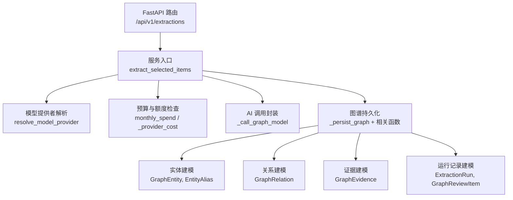
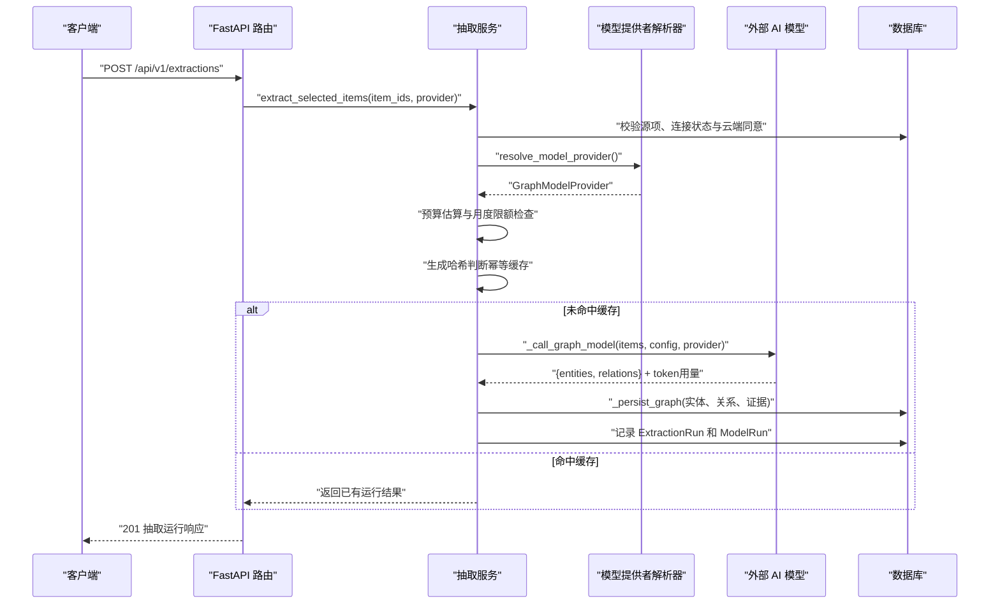
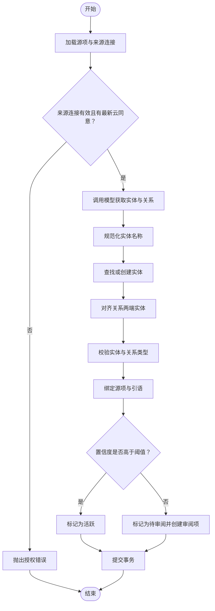
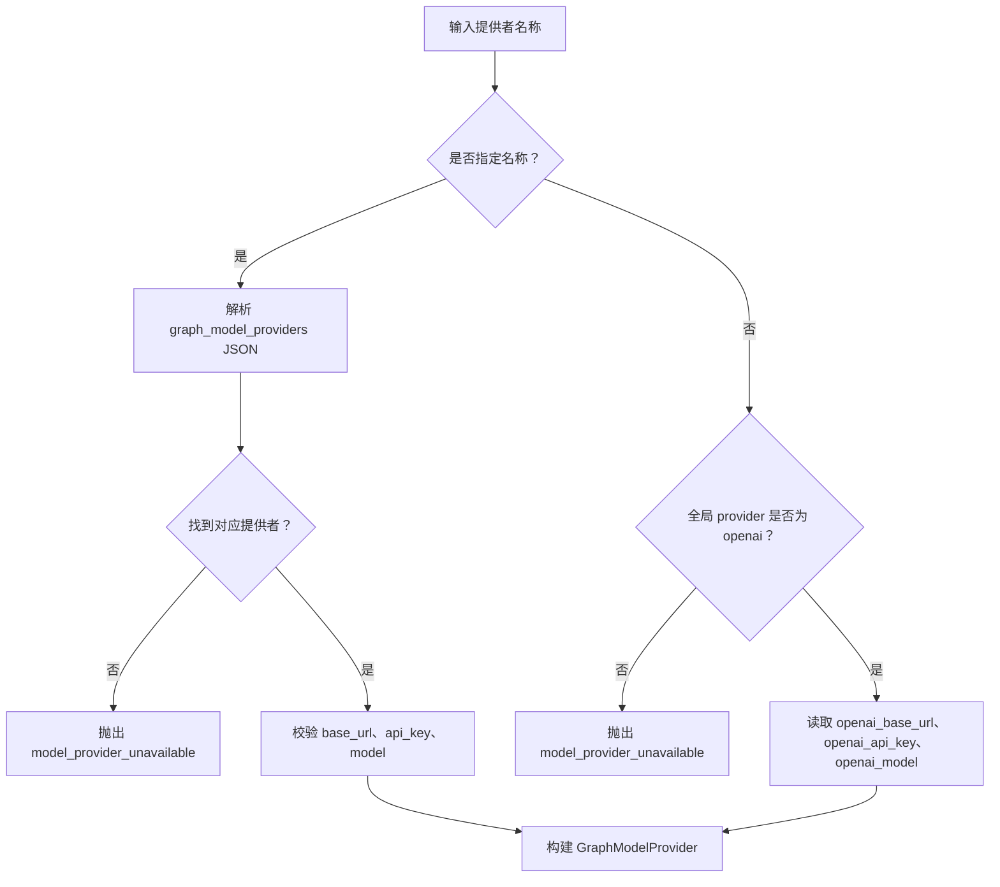
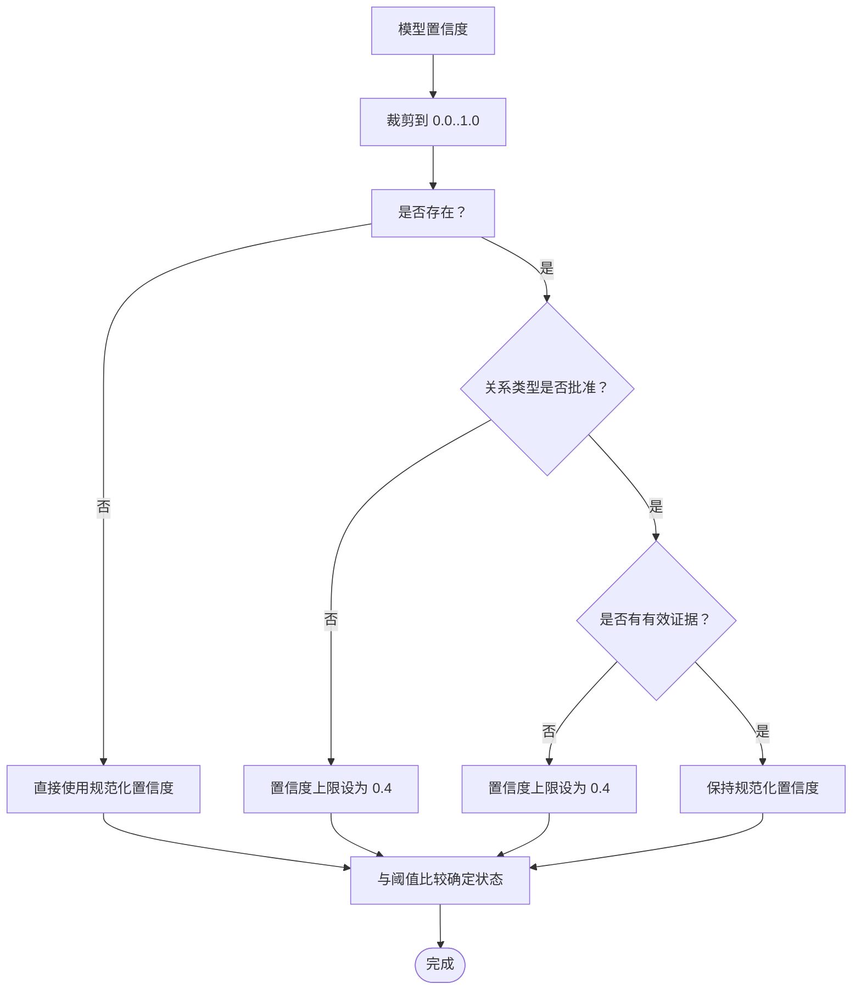
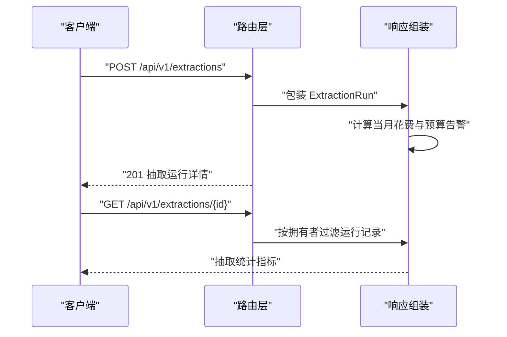
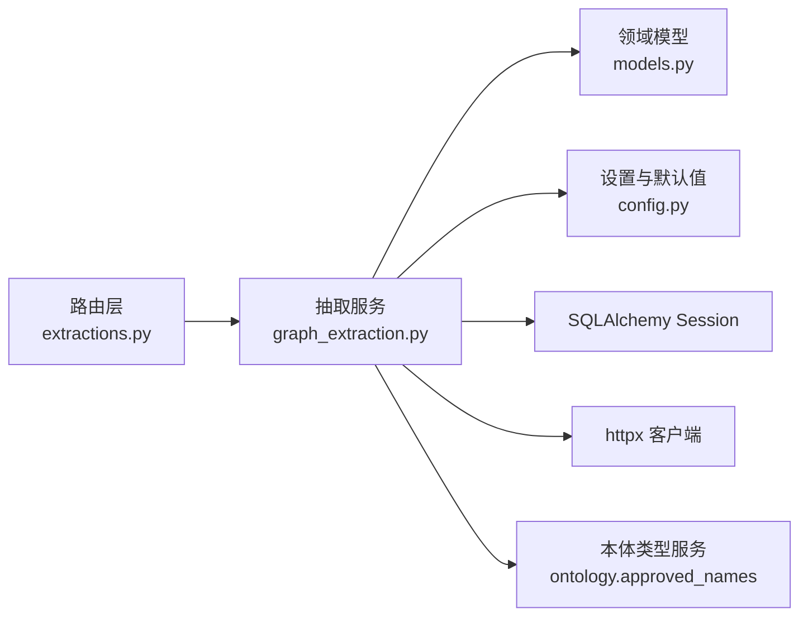

# 实体抽取管道

<cite>
**本文引用的文件**   
- [graph_extraction.py](file://src/personal_ai_life_os/services/graph_extraction.py)
- [models.py](file://src/personal_ai_life_os/models.py)
- [extractions.py](file://src/personal_ai_life_os/api/routes/extractions.py)
- [config.py](file://src/personal_ai_life_os/config.py)
- [test_graph_extraction.py](file://tests/test_graph_extraction.py)
</cite>

## 目录
1. [引言](#引言)
2. [项目结构](#项目结构)
3. [核心组件](#核心组件)
4. [体系结构总览](#体系结构总览)
5. [详细组件分析](#详细组件分析)
6. [依赖关系分析](#依赖关系分析)
7. [性能与可靠性](#性能与可靠性)
8. [故障排查指南](#故障排查指南)
9. [结论](#结论)
10. [附录：配置与实践](#附录配置与实践)

## 引言
本文件针对证据图谱实体抽取子系统，提供一份面向实现者的完整技术文档。该系统负责从用户选择的“源项”中提取结构化知识，构造 `GraphEntity`（实体）和 `GraphRelation`（关系），并把证据、置信度、审阅任务、成本与元数据持久化到数据库。

需要特别说明的是，当前仓库中的实现并不采用传统意义上的向量相似度计算或在线批处理调度；它通过提示词工程限制输出结构，并使用运行时规范化匹配、类型校验、置信度截断、去重合并和预算控制等方式完成高质量抽取。

## 项目结构
与实体抽取直接相关的代码主要位于 `services`、`api` 和 `models` 三个层次中：



**图表来源**
- [extractions.py:20-91](file://src/personal_ai_life_os/api/routes/extractions.py#L20-L91)
- [graph_extraction.py:648-844](file://src/personal_ai_life_os/services/graph_extraction.py#L648-L844)

**章节来源**
- [extractions.py:1-91](file://src/personal_ai_life_os/api/routes/extractions.py#L1-L91)
- [graph_extraction.py:1-200](file://src/personal_ai_life_os/services/graph_extraction.py#L1-L200)
- [models.py:390-620](file://src/personal_ai_life_os/models.py#L390-L620)

## 核心组件
| 组件 | 职责 | 关键行为 |
|---|---|---|
| `extract_selected_items` | 抽取主流程 | 参数校验、鉴权与安全约束、去重缓存、预算检查、执行抽取、持久化、错误回滚 |
| `_call_graph_model` | 调用外部大模型 | 拼装系统与用户提示词，向兼容 OpenAI `/chat/completions` 接口发送请求，解析 JSON 结果与使用量 |
| `_persist_graph` | 图节点与边写入 | 遍历实体与关系，标准化键名，校验类型，关联证据，写入置信度与审阅任务 |
| `_entity_type_valid` / `_relation_type_valid` | 本体类型校验 | 允许内置类型、已批准自定义类型，未知类型降级为待定并追加记录 |
| `_find_or_create_entity` | 实体去重合并 | 按所有者、实体类型、归一化名称查找或创建实体，维护别名表 |
| `_find_or_create_relation` | 关系去重合并 | 按起点、终点、关系类型避免重复关系，更新最高置信度 |
| `resolve_model_provider` | 模型提供者选择 | 优先取可选配置映射，否则回退到全局 OpenAI 兼容配置 |
| API 路由层 | 对外 HTTP 接口 | 接收 `item_ids`，包装业务异常为 HTTP 响应，返回抽取进度摘要 |

**章节来源**
- [graph_extraction.py:170-250](file://src/personal_ai_life_os/services/graph_extraction.py#L170-L250)
- [graph_extraction.py:250-540](file://src/personal_ai_life_os/services/graph_extraction.py#L250-L540)
- [graph_extraction.py:648-844](file://src/personal_ai_life_os/services/graph_extraction.py#L648-L844)
- [extractions.py:20-91](file://src/personal_ai_life_os/api/routes/extractions.py#L20-L91)

## 体系结构总览
下面序列图展示了从前端发起抽取请求到结果落库的端到端流程：



**图表来源**
- [extractions.py:43-91](file://src/personal_ai_life_os/api/routes/extractions.py#L43-L91)
- [graph_extraction.py:648-844](file://src/personal_ai_life_os/services/graph_extraction.py#L648-L844)
- [graph_extraction.py:170-250](file://src/personal_ai_life_os/services/graph_extraction.py#L170-L250)

## 详细组件分析

### 实体与关系的构建过程
抽取结果的图结构由两类对象组成：

- **实体**
  - 属性包含所有者、实体类型、原始名称、归一化名称、摘要、置信度、状态、别名关联、创建者及时间戳。
  - 若新发现实体的置信度低于阈值，状态设为待审阅，否则设为活跃。
- **关系**
  - 属性包含起点实体、终点实体、关系类型、置信度、有效起止时间、状态、创建者与时间戳。
- **证据**
  - 将抽取出的证据条目映射到源项、来源连接和引用片段，并以 JSON 定位器扩展字段保存额外上下文。

```mermaid
classDiagram
    class GraphEntity {
        +字符串 id
        +字符串 owner_id
        +字符串 entity_type
        +字符串 name
        +字符串 normalized_name
        +字符串 summary
        +浮点数 confidence
        +字符串 status
        +字符串 merged_into_id
        +字符串 created_by
        +时间戳 created_at
        +时间戳 updated_at
    }

    class EntityAlias {
        +字符串 id
        +字符串 owner_id
        +字符串 entity_id
        +字符串 alias
        +字符串 normalized_alias
        +时间戳 created_at
    }

    class GraphRelation {
        +字符串 id
        +字符串 owner_id
        +字符串 from_entity_id
        +字符串 to_entity_id
        +字符串 relation_type
        +浮点数 confidence
        +字符串 status
        +时间戳 valid_from
        +时间戳 valid_to
        +字符串 created_by
        +时间戳 created_at
        +时间戳 updated_at
    }

    class GraphEvidence {
        +字符串 id
        +字符串 owner_id
        +字符串 entity_id
        +字符串 relation_id
        +字符串 source_id
        +字符串 source_item_id
        +字符串 quote
        +对象 locator
        +浮点数 confidence
        +字符串 availability
        +时间戳 created_at
    }

    GraphEntity "1" o-- "*" EntityAlias : "别名关联"
    GraphRelation "--o GraphEvidence : "可被证据描述"
    GraphEntity --o GraphEvidence : "可由证据佐证"
```

**图表来源**
- [models.py:409-438](file://src/personal_ai_life_os/models.py#L409-L438)
- [models.py:438-465](file://src/personal_ai_life_os/models.py#L438-L465)
- [models.py:465-514](file://src/personal_ai_life_os/models.py#L465-L514)
- [models.py:517-564](file://src/personal_ai_life_os/models.py#L517-L564)

#### 从源项到图谱实体的转换步骤
1. **加载源项**  
   查询所有已选 `SourceItem`，同时加载所属 `SourceConnection`，确认源连接处于活跃状态且当前版本的云抽取同意有效。
2. **建立证据映射**  
   以源项 ID 为键建立映射，用于快速把模型输出的 `item_id` 和文本片段转换为可信证据。
3. **实体规范化**  
   将实体名称去除多余空格并转小写，作为 `normalized_name` 参与去重。
4. **存在性判断**  
   先在相同所有者、实体类型、归一化名称下搜索活跃或待审阅实体；不存在时再尝试通过别名表反向匹配已有活跃实体。
5. **状态判定**  
   新建实体的状态由置信度与配置阈值共同决定：不低于阈值为“活跃”，否则为“待审阅”。
6. **关系对齐**  
   关系必须指向两个不同实体，且至少一端必须已存在于图中。
7. **证据绑定**  
   每个实体和关系都通过 `GraphEvidence` 记录来源项和精确引语。



**图表来源**
- [graph_extraction.py:648-740](file://src/personal_ai_life_os/services/graph_extraction.py#L648-L740)
- [graph_extraction.py:340-540](file://src/personal_ai_life_os/services/graph_extraction.py#L340-L540)
- [graph_extraction.py:250-320](file://src/personal_ai_life_os/services/graph_extraction.py#L250-L320)

**章节来源**
- [graph_extraction.py:250-540](file://src/personal_ai_life_os/services/graph_extraction.py#L250-L540)
- [models.py:409-564](file://src/personal_ai_life_os/models.py#L409-L564)

### AI 模型配置与提示词工程

#### 模型提供者解析逻辑
系统支持两种提供者来源：

| 场景 | 行为 |
|---|---|
| 显式指定提供者名称 | 从 `GRAPH_MODEL_PROVIDERS` 对应的 JSON 映射中查找，要求 `base_url`、`api_key`、`model` 均非空 |
| 未指定提供者 | 回退到全局 OpenAI 兼容配置，要求 `model_provider == "openai"` 且存在 `openai_api_key` |
| 配置缺失或格式无效 | 抛出 `GraphExtractionError`，包含具体错误码 |



**图表来源**
- [graph_extraction.py:75-158](file://src/personal_ai_life_os/services/graph_extraction.py#L75-L158)
- [config.py:53-112](file://src/personal_ai_life_os/config.py#L53-L112)

#### 提示词设计
系统提示词强调以下约束：

- 仅输出标准 JSON 结构，包含 `entities` 与 `relations`。
- 每个实体需包含类型、名称、摘要、置信度和证据列表。
- 每条关系需包含起点、终点、类型、置信度和证据。
- 使用真实存在的源项 ID，不得虚构事实或日期。
- 当启用自定义本体类型时，提示词会附加“已批准实体类型”和“已批准关系类型”。

该设计属于强格式化提示工程：通过限定输出 schema 并结合 `response_format: json_object`，让外部模型返回可直接解析的结构化内容，而不是自由文本。

**章节来源**
- [graph_extraction.py:170-250](file://src/personal_ai_life_os/services/graph_extraction.py#L170-L250)
- [config.py:53-112](file://src/personal_ai_life_os/config.py#L53-L112)

### 结果解析与置信度算法

#### 置信度计算规则
这里的置信度不是基于向量相似度，而是对模型输出进行“保守收敛”后的结果：

| 条件 | 处理方式 |
|---|---|
| 字段不是数值型数值 | 重置为默认值 0.5 |
| 数值小于 0 | 裁剪为 0.0 |
| 数值大于 1 | 裁剪为 1.0 |
| 实体类型不在内置集合且不在批准清单 | 置信度上限降低至 0.4 |
| 关系缺少有效证据 | 置信度上限降低至 0.4 |
| 关系类型不被批准 | 置信度上限降低至 0.4 |
| 同命名实体出现多次 | 保留历史最高置信度 |
| 同起点、终点、关系类型的重复关系 | 保留历史最高置信度 |

因此，实际置信度 = min(规范化后模型置信度, 安全上界)。质量阈值来自配置项，决定实体初始是“活跃”还是“待审阅”。



**图表来源**
- [graph_extraction.py:283-320](file://src/personal_ai_life_os/services/graph_extraction.py#L283-L320)
- [graph_extraction.py:570-648](file://src/personal_ai_life_os/services/graph_extraction.py#L570-L648)

**章节来源**
- [graph_extraction.py:283-320](file://src/personal_ai_life_os/services/graph_extraction.py#L283-L320)
- [graph_extraction.py:540-648](file://src/personal_ai_life_os/services/graph_extraction.py#L540-L648)

### 批量处理策略：并发、重试与资源管理

| 维度 | 当前实现 |
|---|---|
| 批大小 | 由 `graph_extraction_max_items` 限制一次提取最多源项数量 |
| 并发 | 同步顺序处理，无内部并发池 |
| 重试 | 没有自动重试；失败时记录运行状态并将错误原因写入 `error_code` |
| 超时 | HTTP 客户端使用整体 45 秒、连接 5 秒超时 |
| 幂等 | 使用 `requested_hash` 对同一组源项、模型、提示词版本进行缓存，重复请求直接返回已有结果 |
| 成本预算 | 单次调用成本和累计月度预算双重检查 |

因此，该管道的“批量处理能力”主要体现在：在一个事务内一次性构造多个实体和关系，并通过数据库索引与规范化键减少重复写入；而不是多线程或异步并发。

**章节来源**
- [graph_extraction.py:648-844](file://src/personal_ai_life_os/services/graph_extraction.py#L648-L844)

### 抽取缓存、增量抽取与去重策略

#### 抽取运行级缓存
系统通过哈希值屏蔽完全相同的重复调用：

- 哈希输入包括：`item_ids`、提供者名称、模型名称、提示词版本。
- 若数据库中已存在对应哈希且状态为已完成，则直接返回已有 `ExtractionRun`。
- 这一机制使同一请求不会多次触发外部模型调用，也避免重复写入相同图数据。

#### 实体和关系去重
- 实体去重基于所有者、实体类型、归一化名称。
- 若名称不完全一致，但归一化形式相同，则新增别名记录，而不是拆分实体。
- 关系去重基于起点实体、终点实体、关系类型。
- 重复写入只更新最高置信度，不创建多份副本。

#### 类增量处理
虽然系统没有传统意义上的增量同步，但它具备“选择性源项抽取”能力：每次只对选中的源项集合执行一次抽取，并由运行哈希保证幂等。这在实践中常用于对新增或重点源项做定向图谱强化。

**章节来源**
- [graph_extraction.py:170-250](file://src/personal_ai_life_os/services/graph_extraction.py#L170-L250)
- [graph_extraction.py:648-720](file://src/personal_ai_life_os/services/graph_extraction.py#L648-L720)

### API 与监控点

| API | 方法 | 作用 |
|---|---|---|
| `/api/v1/extractions` | POST | 启动一次抽取运行，传入源项 ID 列表和可选提供者 |
| `/api/v1/extractions/{run_id}` | GET | 查询抽取运行状态、token 用量、成本、延迟和预算信息 |

响应中包含：

- 运行标识、状态、提供者、模型、提示词版本
- 源项数量、实体数量、关系数量、审阅数量
- 输入 token、输出 token、美元成本
- 延迟毫秒数、错误码
- 当月模型花费、月度预算上限和预警标志

预算预警阈值测试表明：当月花费达到预算的 80% 时，响应会返回预算警告字段。



**图表来源**
- [extractions.py:20-91](file://src/personal_ai_life_os/api/routes/extractions.py#L20-L91)

**章节来源**
- [extractions.py:1-91](file://src/personal_ai_life_os/api/routes/extractions.py#L1-L91)

## 依赖关系分析



**图表来源**
- [extractions.py:20-91](file://src/personal_ai_life_os/api/routes/extractions.py#L20-L91)
- [graph_extraction.py:1-100](file://src/personal_ai_life_os/services/graph_extraction.py#L1-L100)

### 耦合与内聚评估
- 抽取服务是高内聚的业务模块，封装了提示词、验证、调用、持久化和成本控制。
- 路由层很薄，主要做权限注入、会话传递和异常转换。
- 模型定义集中，实体、关系、证据、别名、运行记录和审阅项互相组合，便于后续扩展。
- 潜在风险在于所有抽取请求都是同步 HTTP 调用；当模型提供方响应缓慢时，HTTP 请求会长时间占用连接和工作进程。

**章节来源**
- [graph_extraction.py:1-100](file://src/personal_ai_life_os/services/graph_extraction.py#L1-L100)
- [extractions.py:1-42](file://src/personal_ai_life_os/api/routes/extractions.py#L1-L42)

## 性能与可靠性

### 复杂度分析
| 阶段 | 时间复杂度 | 空间复杂度 | 说明 |
|---|---|---|---|
| 源项加载 | O(k) | O(k) | k 为选中且不重复的源项数量 |
| 哈希缓存查询 | O(1) | O(1) | 数据库唯一索引扫描 |
| 模型调用 | 由提供方延迟主导 | O(k × L) | L 为限长截断后的平均文本长度 |
| 实体查找与创建 | O(m) | O(m) | m 为抽取返回的实体数量 |
| 关系处理 | O(r) | O(r) | r 为抽取返回的关系数量 |

主要瓶颈通常是外部模型的网络与推理延迟，以及 SQL 会话中的批量插入操作。

### 推荐优化方向
1. **批大小调优**  
   根据 `graph_extraction_max_items`、模型上下文窗口和 token 成本调整批大小，避免单次调用超过单笔预算。
2. **分层调用**  
   对大规模源项可先分组，再分批次调用，并在上层加入并发限制与队列。
3. **本地缓存增强**  
   除了请求幂等，还可引入键控的内存缓存，避免短时间内反复解析相同 JSON 结果。
4. **异步化抽取**  
   对于高延迟模型接入，应将 `extract_selected_items` 放入后台作业执行，并提供轮询 API。
5. **重试与熔断**  
   在外部 API 失败时增加指数退避重试；连续失败时暂时禁用提供者。
6. **增量锚点**  
   引入变更时间或版本戳，仅对有变动的源项参与下一次抽取。

[本节为通用优化建议，不直接分析具体文件]

## 故障排查指南

### 常见错误码与对策

| 错误码 | 含义 | 常见原因 | 处理建议 |
|---|---|---|---|
| `item_selection_required` | 未选择任何源项 | 前端未传或数组为空 | 要求用户至少选择一个已发布且未删除的源项 |
| `extraction_batch_too_large` | 选中项过多 | 单批超过 `graph_extraction_max_items` | 分批发起抽取 |
| `source_item_not_found` | 找不到源项 | 不存在、被删除、非最新版本、非当前用户 | 刷新源项列表后重新选择 |
| `source_not_active` | 来源连接非活跃 | 连接状态不是 `active` | 恢复来源连接后重试 |
| `source_cloud_consent_required` | 缺少云端抽取同意 | 连接未开启云同意或版本过旧 | 更新云同意至最新 `graph_cloud_consent_version` |
| `model_provider_unavailable` | 未配置所选提供者 | 名称不在配置映射 | 检查 `graph_model_providers` 或回退配置 |
| `model_provider_unconfigured` | 提供者配置不完整 | 缺少 URL、密钥或模型 | 补全 JSON 字段 |
| `model_cost_per_call_exceeded` | 单次成本超限 | 估算 token 量过高 | 缩小批大小或降低成本预估 |
| `model_budget_exceeded` | 超出月度预算 | 本月累计消费即将超限 | 调整预算或等待下个周期 |
| `graph_extraction_failed` | 抽取失败 | 外部模型异常、JSON 解析失败、事务回滚 | 查看 `error_code`、延迟和 token 字段后重试 |

**章节来源**
- [graph_extraction.py:648-844](file://src/personal_ai_life_os/services/graph_extraction.py#L648-L844)
- [test_graph_extraction.py:1-200](file://tests/test_graph_extraction.py#L1-L200)

### 调试建议
- 首先确认来源连接状态为活跃，且用户已通过当前版本的云端同意。
- 检查当前月的 `ModelRun.cost_usd` 总和，确认是否接近 `model_monthly_budget_usd`。
- 在成功响应中观察 `input_tokens`、`output_tokens`、`latency_ms`、`cost_usd`。
- 对于低置信度实体或关系，通过审阅表 `GraphReviewItem` 定位待人工复核项目。
- 若 JSON 解析失败，应审查外部模型的返回是否严格符合预期结构，必要时更换模型或收紧提示词。

**章节来源**
- [test_graph_extraction.py:1-200](file://tests/test_graph_extraction.py#L1-L200)

## 结论
证据抽取管道通过强结构化提示词、严格的类型校验、归一化去重、证据绑定的信任锚点和多层预算控制，实现了从个人记忆源到可审计知识图谱的稳定映射。其优势是确定性高、可追踪性强；代价是当前实现为同步顺序模式，适合中小型批量。未来可在此基础上扩展异步执行、动态批调度、变更感知增量抽取和更丰富的质量评分模型。

[本节总结性质，不直接分析具体文件]

## 附录：配置与实践

### 关键配置文件段
| 配置项 | 类型 | 默认值或说明 | 用途 |
|---|---|---|---|
| `model_provider` | 字符串 | 通常设为 `openai` | 指示是否使用全局 OpenAI 兼容提供者 |
| `openai_base_url` | 字符串 | `https://api.openai.com/v1` | 外部模型对话接口基地址 |
| `openai_api_key` | 字符串 | 可为空 | 外部模型认证密钥 |
| `openai_model` | 字符串 | `gpt-4.1-mini` | 默认外部模型名称 |
| `model_monthly_budget_usd` | 小数 | `5.00` | 当月模型消费上限 |
| `graph_cloud_consent_version` | 字符串 | `graph-cloud-v1` | 云端抽取同意版本号 |
| `graph_model_providers` | JSON 字符串 | 可为空 | 按名称选择专用提供者映射 |
| `graph_extraction_max_items` | 整数 | 见 Settings | 单批最大源项数 |
| `graph_extraction_confidence_threshold` | 浮点数 | 见 Settings | 实体初始置信度阈值 |

**章节来源**
- [config.py:53-112](file://src/personal_ai_life_os/config.py#L53-L112)

### 实践示例路径
以下为面向开发与运维的可操作步骤，配合仓库中的测试代码理解实现语义：

1. **启动一次基础抽取**  
   - 参考接口路径：`POST /api/v1/extractions`。
   - 请求体至少包含一个有效的 `item_ids` 数组。
   - 相关断言可在测试中找到：期望状态为 `completed`、实体数量和关系数量正确，并有成本字段。

   **章节来源**
   - [extractions.py:62-91](file://src/personal_ai_life_os/api/routes/extractions.py#L62-L91)
   - [test_graph_extraction.py:31-87](file://tests/test_graph_extraction.py#L31-L87)

2. **指定自定义模型提供者**  
   - 在设置中将 `graph_model_providers` 赋值为合法 JSON，包含 `base_url`、`api_key`、`model` 等字段。
   - 在请求中添加 `provider` 字段即可切换提供者。
   - 若提供者不可用或配置不完整，应收到带错误码的 409 响应。

   **章节来源**
   - [graph_extraction.py:75-158](file://src/personal_ai_life_os/services/graph_extraction.py#L75-L158)

3. **配置提示词与自定义本体**  
   - 如果系统中启用了已批准的自定义实体或关系类型，抽取会自动把它们在系统提示词末尾追加。
   - 建议先通过本体审核流程批准少量类型，再逐步扩大抽取范围。

   **章节来源**
   - [graph_extraction.py:170-250](file://src/personal_ai_life_os/services/graph_extraction.py#L170-L250)
   - [graph_extraction.py:720-800](file://src/personal_ai_life_os/services/graph_extraction.py#L720-L800)

4. **监控抽取性能与成本**  
   - 关注 `latency_ms`、`input_tokens`、`output_tokens`、`cost_usd`。
   - 当月度花费接近 80% 预算时，前端应展示预算警告，防止超支。

   **章节来源**
   - [extractions.py:20-42](file://src/personal_ai_life_os/api/routes/extractions.py#L20-L42)
   - [test_graph_extraction.py:171-200](file://tests/test_graph_extraction.py#L171-L200)

5. **处理幂等与重复调用**  
   - 对同一组源项、模型和提示词版本再次调用会直接复用已有运行记录，不会产生新的外部 API 费用。
   - 测试用例验证了两次同名请求返回相同运行 ID，且只发生一次虚假模型调用。

   **章节来源**
   - [test_graph_extraction.py:90-155](file://tests/test_graph_extraction.py#L90-L155)

6. **处理低置信度结果**
   - 置信度低于阈值的实体会标记为待审阅；缺少证据或被降级的关系也可能进入审阅队列。
   - 审阅任务可在审阅界面逐条核实、修正或拒绝，随后由后续业务流程将其转化为高质量图谱。

   **章节来源**
   - [models.py:564-620](file://src/personal_ai_life_os/models.py#L564-L620)
   - [graph_extraction.py:570-648](file://src/personal_ai_life_os/services/graph_extraction.py#L570-L648)