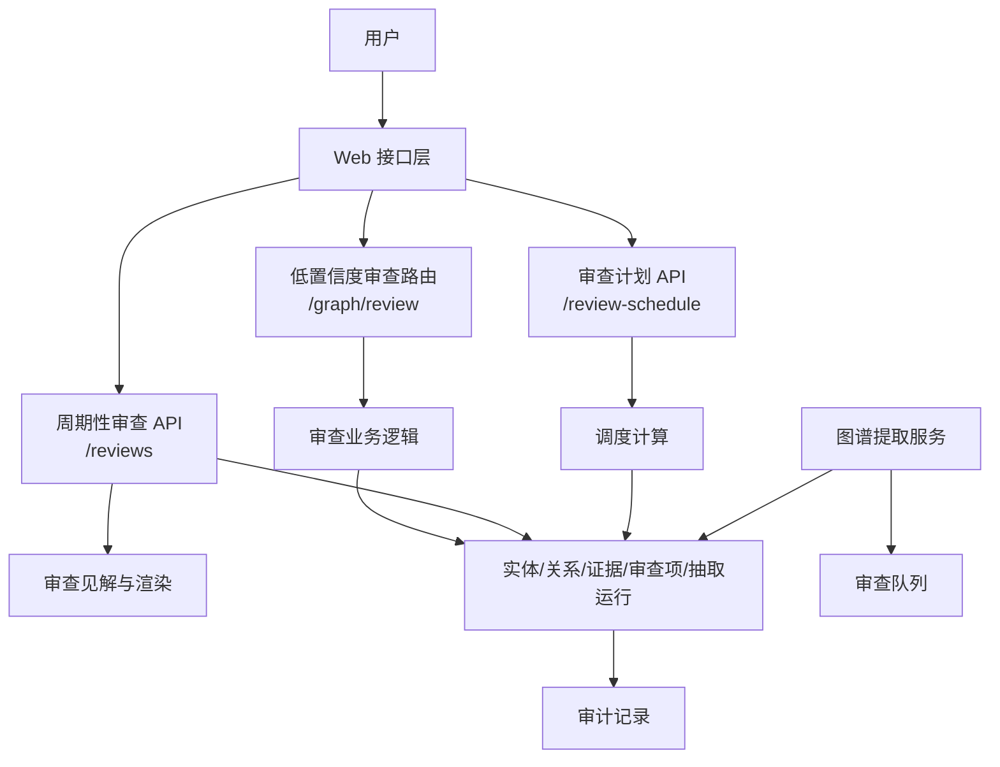
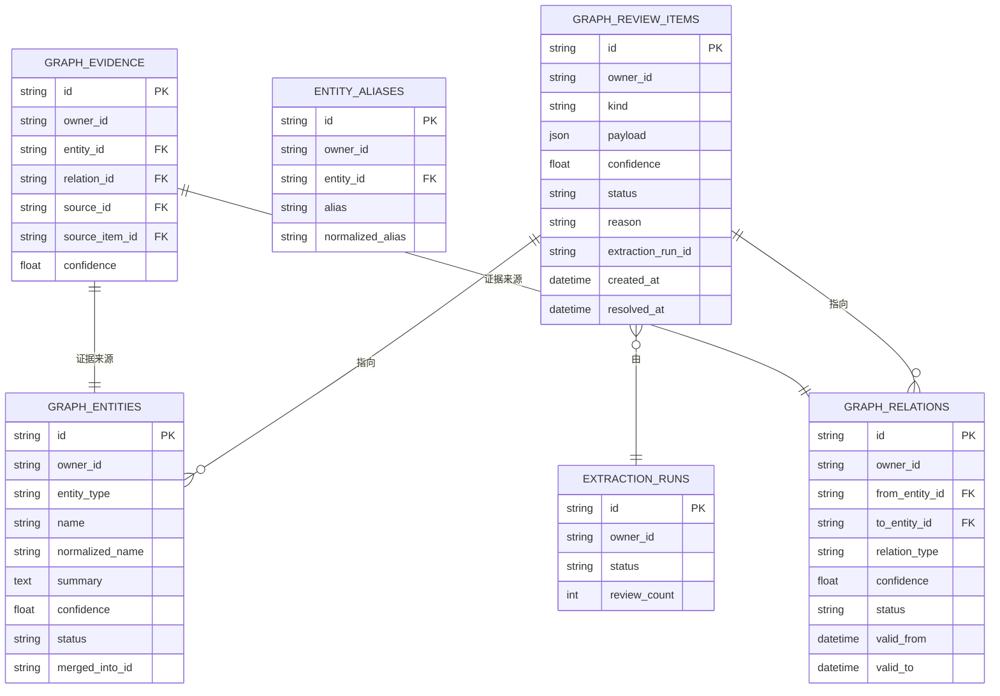
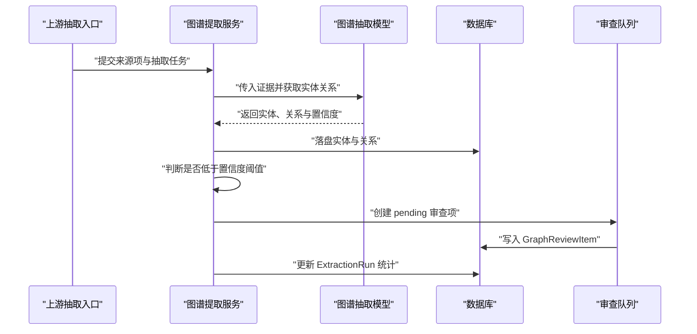
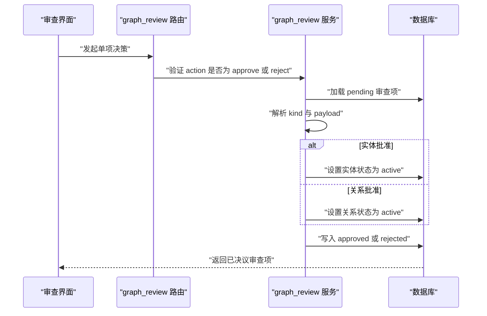
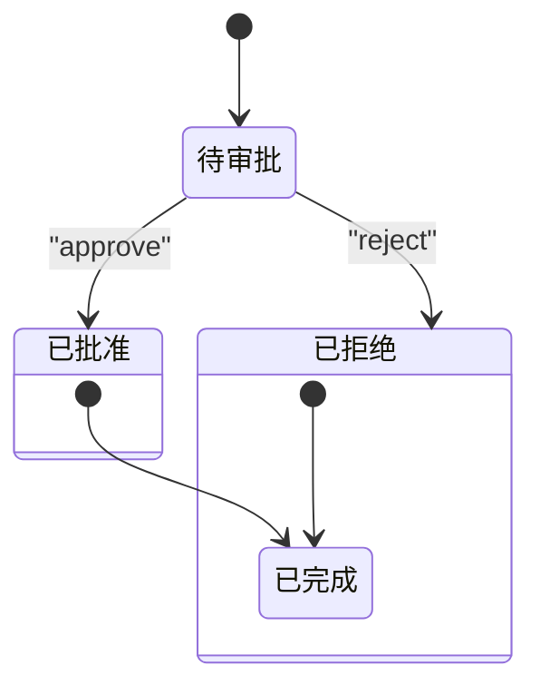
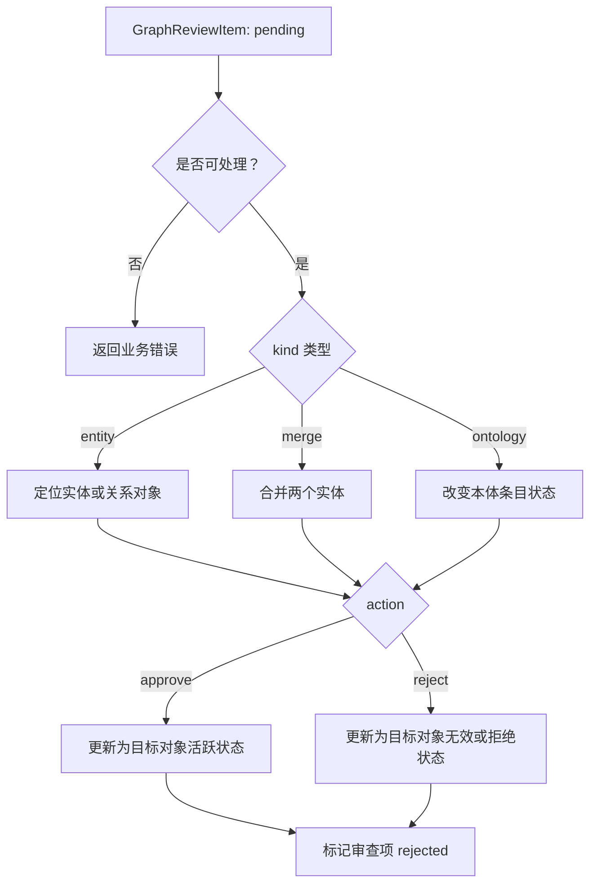
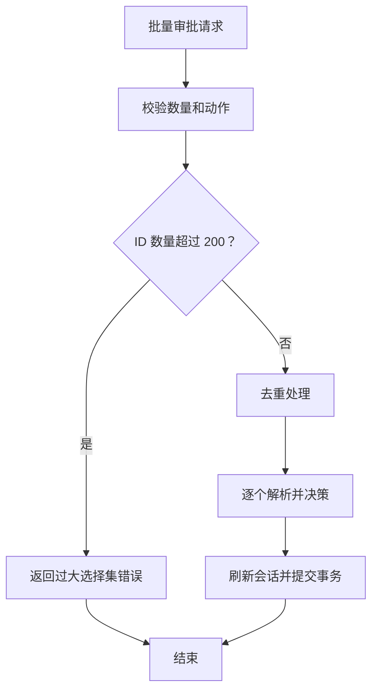
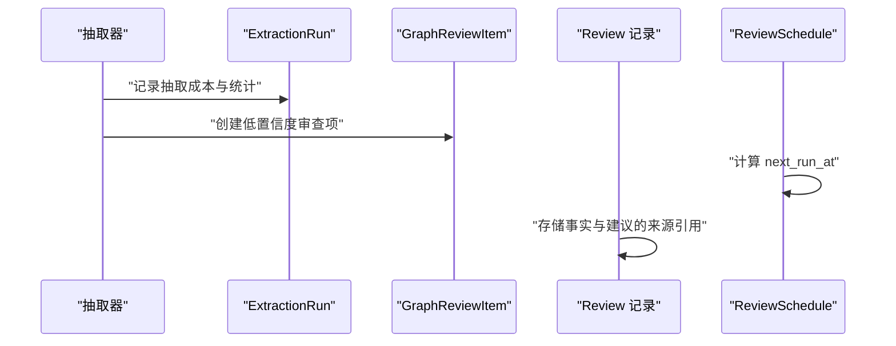
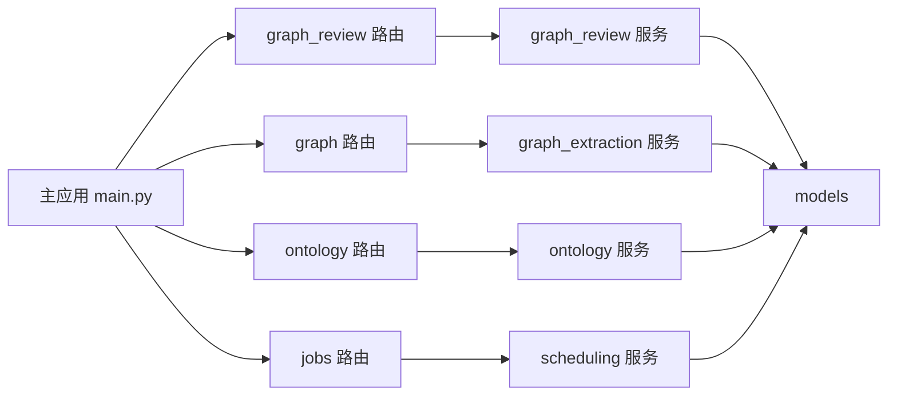
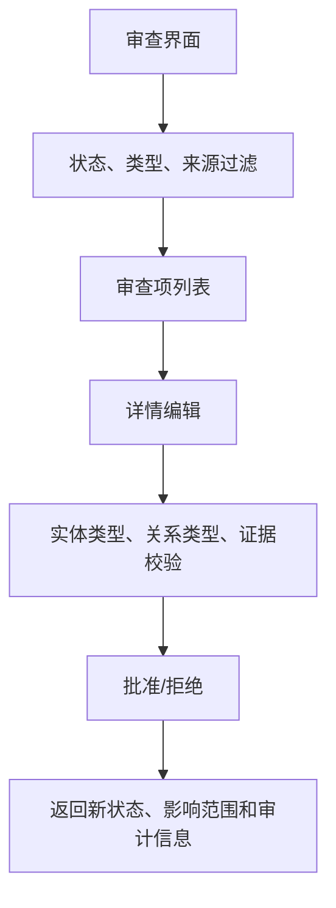

# 审查工作流

<cite>
**本文引用的文件**   
- [graph_review.py](file://src/personal_ai_life_os/api/routes/graph_review.py)
- [graph_review 服务](file://src/personal_ai_life_os/services/graph_review.py)
- [reviews API](file://src/personal_ai_life_os/api/routes/reviews.py)
- [review_schedule API](file://src/personal_ai_life_os/api/routes/review_schedule.py)
- [数据模型](file://src/personal_ai_life_os/models.py)
- [证据图表结构迁移](file://migrations/versions/d2f5a8c14e73_add_evidence_graph_tables.py)
- [API 模式定义](file://src/personal_ai_life_os/api/schemas.py)
- [应用配置](file://src/personal_ai_life_os/config.py)
- [主应用装配](file://src/personal_ai_life_os/main.py)
- [图谱提取与持久化](file://src/personal_ai_life_os/services/graph_extraction.py)
- [图谱测试](file://tests/test_graph_review.py)
</cite>

## 目录
1. [简介](#简介)
2. [项目结构与职责边界](#项目结构与职责边界)
3. [核心概念与数据模型](#核心概念与数据模型)
4. [低置信度项目的自动标记机制](#低置信度项目的自动标记机制)
5. [人工审查接口与交互流程](#人工审查接口与交互流程)
6. [审查状态转换模型](#审查状态转换模型)
7. [批量审查与优先级设计](#批量审查与优先级设计)
8. [通知、审计追踪与版本管理](#通知审计追踪与版本管理)
9. [依赖关系分析](#依赖关系分析)
10. [性能与可靠性特征](#性能与可靠性特征)
11. [规则配置、权限控制与界面定制实践](#规则配置权限控制与界面定制实践)
12. [故障排查指南](#故障排查指南)
13. [结论](#结论)

## 简介

审查工作流围绕“证据图抽取后的不确定性决策”展开。系统先从来源项中抽取实体、关系和相关建议，再根据置信度判断是否直接进入生产图结构；低于阈值的变更会被放入按用户隔离的审查队列。用户通过图形实体编辑、类型校验和决策操作完成最终处理，而审批或拒绝会直接修改实体、关系、本体条目或合并记录。

同时，系统还提供另一个面向周期汇总的人工审查入口：基于来源项生成每周审查草稿，并支持模板渲染、来源引用校验、外部模型生成、Markdown 导出以及定时排程。这个 Review 对象虽然不等同于 GraphReviewItem，但它体现了同一类“人工参与的可审计数据处理”模式。

## 项目结构与职责边界

| 模块 | 职责 | 主要输入 | 主要输出 |
|---|---|---|---|
| `api/routes/graph_review.py` | 暴露低置信度图谱项的列表、编辑、单项决策和批量决策接口 | 当前用户、会话、请求参数 | 审查项响应、已处理项列表 |
| `services/graph_review.py` | 实现审查项查询、验证、编辑、批准、拒绝、批量处理 | SQLAlchemy 会话、用户标识 | 可更新的实体、关系、本体记录 |
| `models.py` | 定义实体、关系、证据、审查项、运行记录等数据库映射 | 数据库字段约束 | ORM 模型 |
| `services/graph_extraction.py` | 调用图谱抽取模型、落盘实体和关系、判定置信度、插入审查项 | 来源项、模型返回文档 | 实体、关系、审查项、抽取运行记录 |
| `api/routes/reviews.py` | 生成周期性证据审查草稿、渲染 Markdown、验证引用和支持性 | 来源项、可选模型提供商 | 审查草稿、Markdown 文本 |
| `api/routes/review_schedule.py` | 查询或设置周期性审查任务的时间、时区、是否使用外部模型 | 当前用户 | 调度配置响应 |
| `main.py` | 挂载审查路由、启动后台任务和调度循环 | 应用状态、设置 | Web 服务器、worker、调度器 |
| `config.py` | 提供置信度阈值、提取数量上限、模型定价等运行时策略 | 环境变量、配置文件 | Settings |
| `api/schemas.py` | 定义审查请求和响应的 Pydantic 类型约束 | 客户端 JSON | 校验后的结构化数据 |



**图示来源**   
- [main.py:236-239](file://src/personal_ai_life_os/main.py#L236-L239)
- [graph_review.py:1-16](file://src/personal_ai_life_os/api/routes/graph_review.py#L1-L16)
- [reviews_api:1-40](file://src/personal_ai_life_os/api/routes/reviews.py#L1-L40)
- [graph_extraction.py:506-525](file://src/personal_ai_life_os/services/graph_extraction.py#L506-L525)

**小节来源**   
- [graph_review.py:1-129](file://src/personal_ai_life_os/api/routes/graph_review.py#L1-L129)
- [graph_review 服务:1-286](file://src/personal_ai_life_os/services/graph_review.py#L1-L286)
- [reviews_api:1-676](file://src/personal_ai_life_os/api/routes/reviews.py#L1-L676)
- [main.py:236-239](file://src/personal_ai_life_os/main.py#L236-L239)

## 核心概念与数据模型

### 低置信度图谱审查项

`GraphReviewItem` 是低置信度图结构变更的人工干预载体。关键字段包括：

| 字段 | 含义 | 重要行为 |
|---|---|---|
| `owner_id` | 所有者用户 | 所有查询和写入必须限制在当前用户 |
| `kind` | 待审查内容类型 | `entity`、`relation`、`merge`、`ontology` |
| `payload` | 目标对象的上下文快照 | 保存实体或关系 ID，以及编辑历史字段 |
| `confidence` | 审查视图中的最终置信度 | 由抽取结果产生，并可被人工编辑覆盖 |
| `status` | 审查生命周期状态 | `pending`、`approved`、`rejected` |
| `reason` | 未决原因标签 | 便于过滤和审计 |
| `extraction_run_id` | 关联抽取运行 | 用于影响范围分析 |
| `created_at` / `resolved_at` | 进入队列时间和决议时间 | 用于排序和审计 |

### 实体与关系的基础状态

| 模型 | 关键状态 | 说明 |
|---|---|---|
| `GraphEntity` | `active`、`pending_review`、`invalid`，以及其他被合并的状态 | 高置信度实体可直接活跃；低置信度实体可能暂存为待定；被拒绝后标为无效 |
| `GraphRelation` | `active`、`pending_review`、`invalid` | 关系同样受置信度阈值控制 |
| `OntologyType` | `proposed`、`approved`、`rejected` | 模型提出的新实体或关系类型需经审批后才能用于正式数据 |
| `ExtractionRun` | `queued`、`completed`、`failed` 等 | 一次图谱抽取任务的生命周期记录 |

### 证据和别名

| 模型 | 作用 |
|---|---|
| `GraphEvidence` | 绑定实体或关系与具体来源项，保留原文引用和定位信息 |
| `EntityAlias` | 实体别名归一化映射，提升名称匹配能力 |
| `EntityMergeLogs` | 记录实体合并的影响面、快照、撤销时间 |



**图示来源**   
- [数据模型:409-613](file://src/personal_ai_life_os/models.py#L409-L613)
- [证据图表结构迁移:44-210](file://migrations/versions/d2f5a8c14e73_add_evidence_graph_tables.py#L44-L210)

**小节来源**   
- [数据模型:409-613](file://src/personal_ai_life_os/models.py#L409-L613)
- [证据图表结构迁移:44-210](file://migrations/versions/d2f5a8c14e73_add_evidence_graph_tables.py#L44-L210)

## 低置信度项目的自动标记机制

低置信度项目的生成并不是在路由层完成的，而是在图谱抽取服务把模型返回的实体和关系落库时决定的。整体过程如下：

1. 选择一组来源项作为抽取输入。
2. 调用底层图谱模型，获得实体数组和关系数组。
3. 对每个实体：
   - 清理类型、名称、摘要和置信度。
   - 检查实体类型是否属于核心类型或已通过本体的批准集合。
   - 检查是否存在有效证据；若类型不被认可或缺少证据，会把候选置信度压低至较低值。
   - 根据当前配置的置信度阈值，将实体状态设为 `active` 或 `pending_review`。
4. 对每条关系做类似处理，并把两端实体连接起来。
5. 对未达到活跃条件的实体和关系创建 `GraphReviewItem`，初始状态为 `pending`，并带上抽取运行编号、类型、负载信息和置信度。
6. 更新 `ExtractionRun` 的实体数、关系数和审查数。



**图示来源**   
- [图谱提取与持久化:528-566](file://src/personal_ai_life_os/services/graph_extraction.py#L528-L566)
- [图谱提取与持久化:506-525](file://src/personal_ai_life_os/services/graph_extraction.py#L506-L525)
- [应用配置:60-70](file://src/personal_ai_life_os/config.py#L60-L70)

### 置信度阈值判断

默认置信度阈值为 `0.75`，由 `Settings.graph_extraction_confidence_threshold` 提供。该值会影响实体和关系的初始状态划分：

| 实际置信度 | 阈值比较 | 初始状态 | 是否需要审查 |
|---|---|---|---|
| 大于等于阈值 | ≥ threshold | `active` | 通常不需要 |
| 小于阈值 | < threshold | `pending_review` | 需要进入审查队列 |

此外，以下情况会主动降低候选置信度：

- 实体类型不在核心类型内且尚未进入本体批准名单。
- 没有来自来源项的有效引用证据。

这保证了即使是高置信度的原始输出，也会因为语义不一致或证据缺失而落到审查通道。

### 优先级排序算法

当前审查队列为分页查询，排序规则是：

```text
按 created_at 降序，再按 id 升序
```

这意味着最新创建的审查项更靠前，ID 较新的项在同一时间戳下优先显示。查询还支持：

- 按用户过滤。
- 按 `status` 过滤。
- 按 `kind` 过滤。
- 限制最大返回条数。

注意：当前实现没有基于 `confidence` 高低进行自动重排。也就是说，真正决定“谁先审”的规则是“后进队者先展示”，而不是“更低置信度者先展示”。

**小节来源**   
- [reviews_api:265-305](file://src/personal_ai_life_os/services/graph_extraction.py#L265-L305)
- [reviews_api:528-566](file://src/personal_ai_life_os/services/graph_extraction.py#L528-L566)
- [reviews_api:506-525](file://src/personal_ai_life_os/services/graph_extraction.py#L506-L525)
- [应用配置:60-70](file://src/personal_ai_life_os/config.py#L60-L70)

## 人工审查接口与交互流程

### 列出审查队列

`GET /api/v1/graph/review` 返回当前用户的审查列表。

| 参数 | 默认值 | 约束 | 说明 |
|---|---|---|---|
| `status` | `pending` | 最长 24 个字符 | 过滤审查状态 |
| `kind` | 无 | 最长 16 个字符 | 按 `entity`、`relation`、`merge`、`ontology` 过滤 |
| `limit` | `100` | 1 到 200 | 页面大小 |

返回值包含总数和审查项列表，每项至少包括 ID、类型、负载、置信度、状态、原因、抽取运行编号、创建时间和决议时间。

### 编辑单个审查项

`PATCH /api/v1/graph/review/{item_id}` 允许用户在批准或拒绝前修正对象。

可用字段：

| 字段 | 实体模式 | 关系模式 | 验证规则 |
|---|---|---|---|
| `name` | 更新实体名称 | 不允许 | 不能为空，最多 500 字符，并按空格规范化 |
| `entity_type` | 设置实体类型 | 不适用 | 必须是核心类型或已批准的本体名称 |
| `relation_type` | 不适用 | 设置关系类型 | 必须是核心类型或已批准的本体名称 |
| `summary` | 更新摘要 | 不支持关系摘要 | 可为空字符串，清空后会转为空值 |
| `confidence` | 0.0 到 1.0 | 0.0 到 1.0 | 会同时更新实体或关系的持久化置信度，以及当前审查项的置信度 |

请求体必须至少提供一个非空字段，否则会触发校验错误。

### 做出审批或拒绝决定

`POST /api/v1/graph/review/{item_id}/decision`

| 动作 | 实体效果 | 关系效果 | 其他效果 |
|---|---|---|---|
| 批准 | 状态变为 `active` | 状态变为 `active` | 审查项状态变为 `approved` |
| 拒绝 | 状态变为 `invalid` | 状态变为 `invalid` | 审查项状态变为 `rejected` |

如果实体已经不存在，或被合并、已经被拒绝，批准会被拒绝；关系也遵循相同安全条件。

### 单项批准序列



**图示来源**   
- [graph_review.py:110-129](file://src/personal_ai_life_os/api/routes/graph_review.py#L110-L129)
- [graph_review 服务:223-267](file://src/personal_ai_life_os/services/graph_review.py#L223-L267)

**小节来源**   
- [graph_review.py:36-129](file://src/personal_ai_life_os/api/routes/graph_review.py#L36-L129)
- [graph_review 服务:25-286](file://src/personal_ai_life_os/services/graph_review.py#L25-L286)
- [API 模式定义:501-547](file://src/personal_ai_life_os/api/schemas.py#L501-L547)

## 审查状态转换模型

### 低置信度审查项状态

| 状态 | 含义 | 可达到的后续状态 |
|---|---|---|
| `pending` | 等待人工处理 | `approved`、`rejected` |
| `approved` | 已进入可信图结构 | 不再变更 |
| `rejected` | 明确拒绝 | 不再变更 |

### 实体和关系状态

| 实体或关系状态 | 含义 |
|---|---|
| `active` | 已被接受，参与查询和关系网络 |
| `pending_review` | 抽取阶段因低于阈值暂时保留，等待审查 |
| `invalid` | 被拒绝或无法成为可信数据 |



实体和关系的批准分支会更复杂，但审查项本身的简化流程就是“从待处理到终态”。

对于合并和本体审查：

| kind | 批准语义 | 拒绝语义 |
|---|---|---|
| `merge` | 执行实体合并逻辑 | 当前实现未在拒绝分支中给出明确的撤销路径，只保证不会错误批准不可批准的实体或关系 |
| `ontology` | 将提案本体条目设为 `approved` | 将 `proposed` 本体条目设为 `rejected` 并递增版本 |



**图示来源**   
- [graph_review 服务:175-286](file://src/personal_ai_life_os/services/graph_review.py#L175-L286)

**小节来源**   
- [graph_review 服务:170-286](file://src/personal_ai_life_os/services/graph_review.py#L170-L286)

## 批量审查与优先级设计

### 批量接口

`POST /api/v1/graph/review/bulk`

| 字段 | 类型 | 约束 | 说明 |
|---|---|---|---|
| `item_ids` | 字符串数组 | 最小长度 1，最大长度 200 | 需要批处理的审查项 ID |
| `action` | 字面量 | `approve` 或 `reject` | 统一处理动作 |

内部去重后会逐个调用单项决策逻辑。这样做的好处是复用同一个审批/拒绝语义，坏处是批量操作的原子性和回滚边界需要谨慎理解：错误会抛回上层，由 FastAPI 统一包装为带 `code` 和 `message` 的 HTTP 错误。

### 当前排序策略

当前列表查询按创建时间倒序排序，并非按置信度升序。因此：

- “最低置信度优先”不是现成功能。
- “最近创建优先”才是默认排序。
- 如果需要更智能的优先级，应在 `list_items` 中加入按置信度、类型紧急程度、证据缺失等因素的复合排序逻辑。

### 过滤器操作

现有过滤器支持：

- 按所有者过滤。
- 按审查状态过滤。
- 按 `kind` 过滤。
- 按分页限制控制返回量。

建议在新增过滤器时保持向后兼容，例如新增布尔字段时使用 `None=忽略` 的语义。

### 影响范围分析

审查项通过 `extraction_run_id` 关联抽取运行，而 `ExtractionRun` 记录：

- 请求哈希。
- 请求来源项 ID 列表。
- 实体、关系和审查计数。
- 成本与延迟。
- 失败原因。

结合这些字段可以回答“某个低置信度项来源于哪些来源项”，从而辅助批量审查时的影响范围评估。

### 批量处理流程图



**图示来源**   
- [graph_review.py:61-82](file://src/personal_ai_life_os/api/routes/graph_review.py#L61-L82)
- [graph_review 服务:257-270](file://src/personal_ai_life_os/services/graph_review.py#L257-L270)

**小节来源**   
- [graph_review.py:61-82](file://src/personal_ai_life_os/api/routes/graph_review.py#L61-L82)
- [graph_review 服务:248-270](file://src/personal_ai_life_os/services/graph_review.py#L248-L270)
- [数据模型:564-590](file://src/personal_ai_life_os/models.py#L564-L590)

## 通知、审计追踪与版本管理

### 审查变更记录

审计线索主要体现在以下几处：

| 数据 | 审计价值 |
|---|---|
| `GraphReviewItem.resolved_at` | 记录人工决策时间 |
| `GraphReviewItem.status` | 记录决策结果 |
| `GraphReviewItem.reason` | 保留未决原因或分类标签 |
| `GraphReviewItem.extraction_run_id` | 回溯到一次完整抽取任务 |
| `ExtractionRun.error_code` | 记录抽取失败原因 |
| `ExtractionRun.input_tokens / output_tokens / cost_usd` | 记录模型成本和资源消耗 |
| `EntityMergeLogs.snapshot` | 记录实体合并前后的快照 |
| `OntologyType.version` | 当提案被拒绝时递增版本，保留变更历史 |

### 历史版本管理

本体类型采用显式版本号：拒绝提案时会增加 `version` 并更新时间戳。这与实体合并日志配合，可用于审计哪些语义类型曾处于提案阶段。

### 与周期性审查的关系

周期性 Review 对象是另一种“人工审阅数据”的记录方式，它不同于 GraphReviewItem，但仍共享以下审计原则：

- 来源项引用必须可定位。
- 事实和建议应关联来源 ID。
- Markdown 渲染会尝试标注来源引用。
- 可通过模板或外部模型生成草稿。
- 通过 `/review-schedule` 设置下次执行时间。

需要注意的是，当前代码中没有可见的通用“推送通知”模块；所谓“通知”更多体现为前端轮询审查队列、后端保留历史记录、排程器计算下次运行时间等被动机制。



**图示来源**   
- [图谱提取与持久化:775-810](file://src/personal_ai_life_os/services/graph_extraction.py#L775-L810)
- [数据模型:564-613](file://src/personal_ai_life_os/models.py#L564-L613)
- [review_schedule API:16-87](file://src/personal_ai_life_os/api/routes/review_schedule.py#L16-L87)

**小节来源**   
- [数据模型:542-613](file://src/personal_ai_life_os/models.py#L542-L613)
- [review_schedule API:16-87](file://src/personal_ai_life_os/api/routes/review_schedule.py#L16-L87)
- [reviews_api:32-120](file://src/personal_ai_life_os/api/routes/reviews.py#L32-L120)

## 依赖关系分析



**图示来源**   
- [main.py:20-52](file://src/personal_ai_life_os/main.py#L20-L52)
- [main.py:236-247](file://src/personal_ai_life_os/main.py#L236-L247)

**小节来源**   
- [main.py:20-52](file://src/personal_ai_life_os/main.py#L20-L52)
- [main.py:236-247](file://src/personal_ai_life_os/main.py#L236-L247)

### 组件耦合观察

- API 层主要负责鉴权边界和用户输入校验，业务逻辑集中在 services。
- 低置信度审查逻辑集中在 `services/graph_review.py`，避免路由承担过多状态机逻辑。
- `graph_extraction` 不仅落盘实体关系，还负责创建审查项，形成“抽取→决策”的单向依赖。
- `ontology` 服务为本体名称提供批准列表，让审查过程中能够验证自定义类型。
- `graph_merges` 是合并类审查的关键依赖。
- models 被多个层共享，但未反向依赖业务逻辑，符合一般分层约定。

潜在风险点：

- 批量决策目前以逐个解析的方式实现，缺乏跨多项的强事务补偿机制；大量失败可能需要外层重试或分批缩小。
- 列表排序稳定但没有业务优先级；随着数据增长，低置信度项可能被“更早创建的旧项”淹没。
- 审查项编辑时，只校验实体或关系的存在性与所有权，但不会自动重建关系完整性约束；这需要依赖数据库约束和上层逻辑共同保障。

## 性能与可靠性特征

| 维度 | 当前表现 | 建议优化 |
|---|---|---|
| 查询复杂度 | 列表按 `owner_id` 索引 + 创建时间与主键排序 | 可扩展添加 `owner_id + status`、`owner_id + kind + created_at` 等组合索引 |
| 批量上限 | 单批最多 200 个审查项 | 可引入分片批次、部分成功响应和失败项报告 |
| 置信度阈值 | 全局默认 0.75 | 支持按租户或任务类型区分阈值 |
| 并发访问 | 路由层依赖 SQLalchemy 会话 + 显式 rollback | 建议使用乐观锁或唯一约束防止重复决策 |
| 副作用 | 批准会直接改变实体/关系状态 | 可增加“生效时间”或“预览版本”以便回滚 |
| 审计 | 保留 `resolved_at`、`status`、`reason`、抽取运行 | 可增加审计事件流水表，专门记录“谁做了什么” |
| 外部模型依赖 | 图谱抽取可能失败并记录错误 | 已有失败状态和错误码；可补充重试和降级策略 |

**小节来源**   
- [graph_review 服务:25-62](file://src/personal_ai_life_os/services/graph_review.py#L25-L62)
- [graph_review 服务:248-270](file://src/personal_ai_life_os/services/graph_review.py#L248-L270)
- [应用配置:60-70](file://src/personal_ai_life_os/config.py#L60-L70)
- [数据模型:564-613](file://src/personal_ai_life_os/models.py#L564-L613)

## 规则配置、权限控制与界面定制实践

### 审查规则配置

| 配置项 | 默认值 | 用途 | 生产建议 |
|---|---:|---|---|
| `graph_extraction_confidence_threshold` | `0.75` | 决定实体和关系是否直接活跃 | 根据数据源质量调高或调低 |
| `graph_extraction_max_items` | `10` | 单次抽取支持的来源项上限 | 控制模型输入成本 |
| `processsing_mode` | `inline` | 同步或 worker 模式 | 生产应使用 worker 模式 |
| `registration_mode` | `open` | 注册策略 | 生产禁用开放注册 |
| `model_provider` | `none` | 是否启用外部模型 | 生产需配置凭证、价格表和隐私披露 |

### 权限控制

当前实现的主要权限边界是：

- 所有审查项都带有 `owner_id`。
- 列表接口强制使用当前用户 ID 构建筛选条件。
- 编辑和决策前先加载指定 `owner_id` 的审查项。
- 实体、关系和本体操作也都要求对象归属当前用户。
- 路由依赖 `CurrentUserDep` 注入已认证用户。

推荐扩展：

- 明确“审查员角色”与“普通用户”的区别，允许管理员审核他人数据。
- 对批量接口加入速率限制。
- 对敏感操作记录操作人、时间、IP 或会话标识。

### 用户界面定制最佳实践

基于现有数据结构，推荐审查界面按照以下层次组织：

1. **筛选区**
   - 状态：全部、待处理、已批准、已拒绝。
   - 类型：实体、关系、合并、本体。
   - 来源抽取任务：通过 `extraction_run_id` 快速定位同一次建模批次。
   - 证据缺失：展示缺少来源引用的待审查项。

2. **列表区**
   - 列包括：ID、类型、名称或关系类型、置信度、状态、原因、创建时间。
   - 默认排序建议改为“低置信度优先”，并在置信度接近时保持“创建时间优先”。

3. **详情面板**
   - 实体编辑：名称、类型、摘要、置信度。
   - 关系编辑：关系类型、起止实体、置信度、有效期。
   - 证据区：逐条显示来源项标题和引文。
   - 影响范围：显示关联的 `extraction_run_id` 及其来源项 ID。

4. **决策区**
   - 批准：确认目标对象活跃。
   - 拒绝：确认目标对象无效或拒绝提案。
   - 批量决策：勾选多条后统一批准或拒绝。



[此图为概念界面流程，不对应单一源代码文件]

**小节来源**   
- [graph_review.py:36-129](file://src/personal_ai_life_os/api/routes/graph_review.py#L36-L129)
- [graph_review 服务:100-270](file://src/personal_ai_life_os/services/graph_review.py#L100-L270)
- [API 模式定义:501-547](file://src/personal_ai_life_os/api/schemas.py#L501-L547)
- [应用配置:60-70](file://src/personal_ai_life_os/config.py#L60-L70)

## 故障排查指南

### 常见错误与诊断

| 现象 | 可能原因 | 定位方法 |
|---|---|---|
| 审查项不存在 | ID 错误或对象不属于当前用户 | 检查 `owner_id` 和 `id` |
| 审查项已处理 | 再次调用决策接口 | 审查项状态已是 `approved` 或 `rejected` |
| 实体或关系不存在 | 源对象已被删除或转移 | 检查 `payload` 中 ID 是否仍有效 |
| 实体不可批准 | 实体已被合并、无效或状态不合法 | 检查实体 `status` 和合并记录 |
| 类型未知 | 自定义类型未在本体中批准 | 先在 ontology 中通过提案 → 批准 |
| 批量操作失败 | ID 过多、重复或其中一个无法处理 | 缩减批次、排除重复 ID、查看错误代码 |
| 请求无变更 | 编辑请求所有字段都为空 | 至少提供一项可修改字段 |
| 抽取失败 | 下游模型出错或成本限制 | 查看 `ExtractionRun.error_code` 与 `cost_usd` |

### 错误分类表

| 错误码 | 含义 | HTTP 语义 |
|---|---|---|
| `review_item_not_found` | 审查项不存在 | 404 |
| `review_item_resolved` | 审查项已处理 | 409 |
| `unknown_entity_type` | 实体类型未被批准 | 422 |
| `unknown_relation_type` | 关系类型未被批准 | 422 |
| `graph_entity_not_found` | 被审查实体不存在 | 404 |
| `graph_relation_not_found` | 被审查关系不存在 | 404 |
| `entity_not_approvable` | 实体不可批准 | 409 |
| `relation_not_approvable` | 关系不可批准 | 409 |
| `unsupported_review_kind` | 不支持的审查类型 | 422 |
| `invalid_review_action` | action 不是 approve 或 reject | 422 |
| `review_selection_required` | 批量请求缺少选择 | 422 |
| `review_selection_too_large` | 批量选择超过 200 | 413 |

**小节来源**   
- [graph_review 服务:20-270](file://src/personal_ai_life_os/services/graph_review.py#L20-L270)
- [graph_review.py:17-34](file://src/personal_ai_life_os/api/routes/graph_review.py#L17-L34)

### 单元测试覆盖要点

测试脚本验证了以下行为：

- 高置信度和低置信度实体分别落入不同渠道。
- 待审查项可以通过编辑调整名称与置信度。
- 批准后实体变为活跃，拒绝后相关实体不再出现在活跃实体列表中。
- 重复决策返回冲突错误。
- 其他用户的用户无法访问当前用户的待审查项。
- 批量批准接口能一次性处理多个审查项。
- 本体类型治理流程可用。

**小节来源**   
- [图谱测试:1-495](file://tests/test_graph_review.py#L1-L495)

## 结论

审查工作流在该项目中承担了“从自动化不确定知识到可信图结构”的关键桥接职责。它通过：

- 基于配置的置信度阈值自动分流。
- 严格的用户隔离和对象所有权校验。
- 清晰的审查项、实体、关系、本体三类待处理路径。
- 保留抽取运行、决策时间、原因和状态的历史轨迹。

构建了一个既可自动化又可人工矫正的数据流水线。当前实现的短板在于：列表未提供基于置信度或业务紧急性的优先级排序；批量操作未返回细粒度的部分成功报告；通知机制较弱；审计尚未抽象为独立事件流。未来可优先考虑扩展排序策略、增强批量响应格式、引入审计事件表，并把周期性 Review 与图谱审查队列统一到统一的“待处理事项”界面下，从而形成完整的证据驱动型个人智能操作系统审查体验。