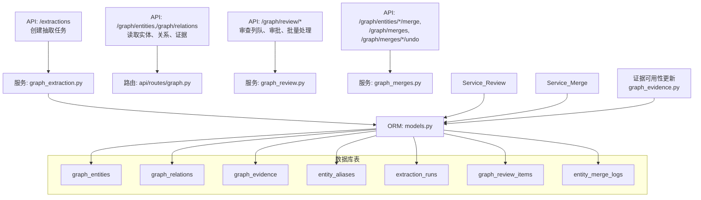
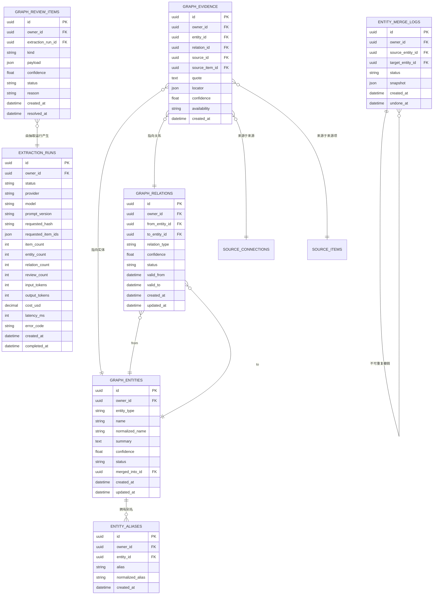
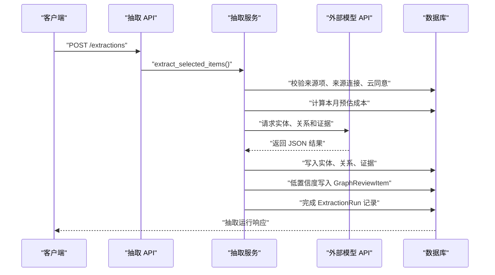
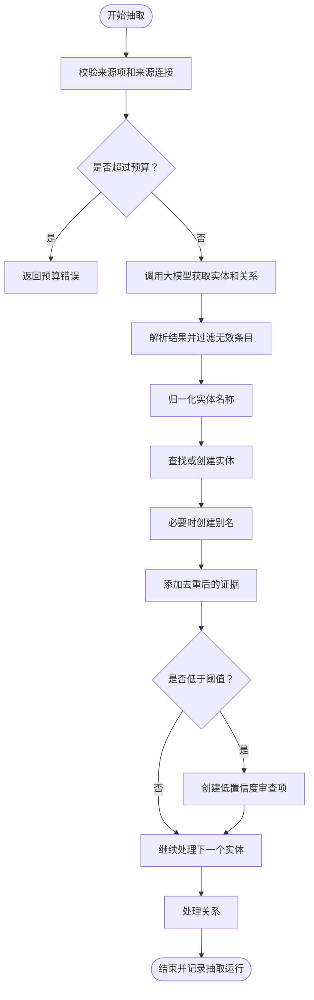
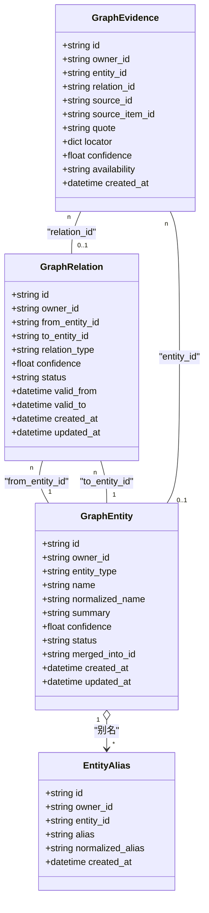
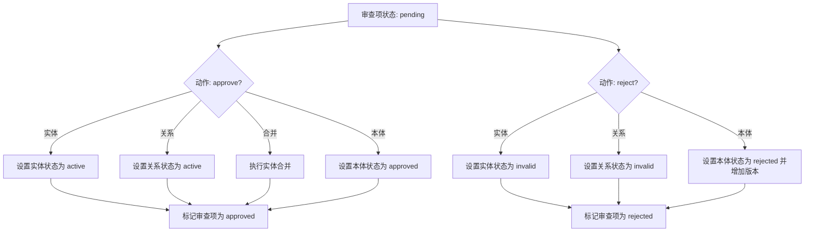
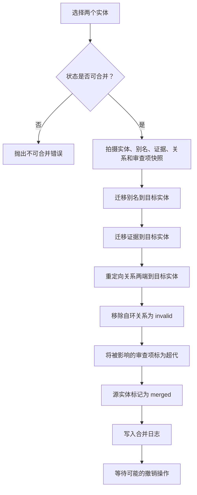
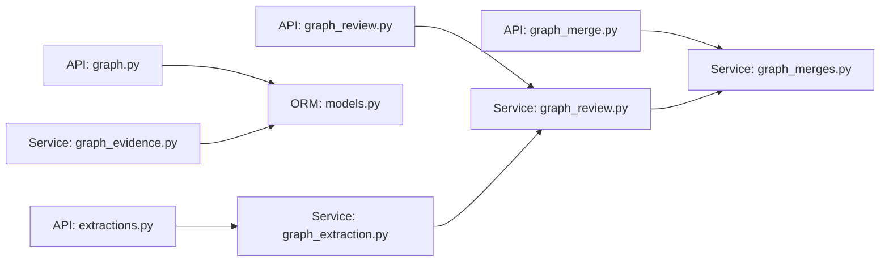
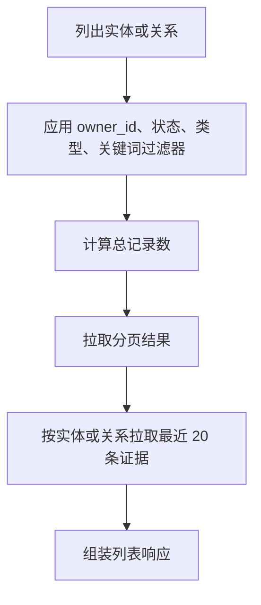

# 证据图系统

<cite>
**本文件引用的源文件**   
- [models.py](file://src/personal_ai_life_os/models.py)
- [d2f5a8c14e73_add_evidence_graph_tables.py](file://migrations/versions/d2f5a8c14e73_add_evidence_graph_tables.py)
- [graph_extraction.py](file://src/personal_ai_life_os/services/graph_extraction.py)
- [graph_review.py](file://src/personal_ai_life_os/services/graph_review.py)
- [graph_merges.py](file://src/personal_ai_life_os/services/graph_merges.py)
- [graph_evidence.py](file://src/personal_ai_life_os/services/graph_evidence.py)
- [extractions.py](file://src/personal_ai_life_os/api/routes/extractions.py)
- [graph.py](file://src/personal_ai_life_os/api/routes/graph.py)
- [graph_merge.py](file://src/personal_ai_life_os/api/routes/graph_merge.py)
- [graph_review.py](file://src/personal_ai_life_os/api/routes/graph_review.py)
- [schemas.py](file://src/personal_ai_life_os/api/schemas.py)
</cite>

## 目录
1. [介绍](#介绍)
2. [项目结构](#项目结构)
3. [核心模型与关系](#核心模型与关系)
4. [架构总览](#架构总览)
5. [详细组件分析](#详细组件分析)
6. [依赖关系分析](#依赖关系分析)
7. [可视化数据结构与查询优化](#可视化数据结构与查询优化)
8. [API 接口文档](#api-接口文档)
9. [性能与大规模数据处理最佳实践](#性能与大规模数据处理最佳实践)
10. [与其他模块集成：搜索结果与问答系统](#与其他模块集成搜索结果与问答系统)
11. [故障排查](#故障排查)
12. [结论](#结论)

## 介绍
证据图系统负责把用户选择的个人来源项转化为可追溯、可审查、可合并的结构化知识图谱。它同时承担四个职责：
- 使用大模型进行实体抽取和关系抽取，并生成证据摘要。
- 将置信度不足的实体或关系进入“待审查”队列，供人工修改、批准或拒绝。
- 支持高置信度重复实体的可逆合并，保留完整撤销历史。
- 为其他上层能力提供经过清洗、审计和可观测的图谱查询数据。

系统围绕三个核心领域模型展开：**GraphEntity（实体）**、**GraphRelation（关系）**和**GraphEvidence（证据）**。三者不是简单的一对多，而是通过多对一的来源回溯、可选关联、状态控制和多值别名共同构成一个有历史、有证据、可回滚的可信图谱。

## 项目结构
证据图相关的后端代码主要集中在服务层路由和服务逻辑中：

**图表来源**
- [extractions.py:1-90](file://src/personal_ai_life_os/api/routes/extractions.py#L1-L90)
- [graph.py:1-135](file://src/personal_ai_life_os/api/routes/graph.py#L1-L135)
- [graph_review.py:1-129](file://src/personal_ai_life_os/api/routes/graph_review.py#L1-L129)
- [graph_merge.py:1-86](file://src/personal_ai_life_os/api/routes/graph_merge.py#L1-L86)
- [graph_extraction.py:1-200](file://src/personal_ai_life_os/services/graph_extraction.py#L1-L200)
- [graph_review.py:1-200](file://src/personal_ai_life_os/services/graph_review.py#L1-L200)
- [graph_merges.py:1-200](file://src/personal_ai_life_os/services/graph_merges.py#L1-L200)
- [models.py:409-614](file://src/personal_ai_life_os/models.py#L409-L614)

**章节来源**
- [extractions.py:1-90](file://src/personal_ai_life_os/api/routes/extractions.py#L1-L90)
- [graph.py:1-135](file://src/personal_ai_life_os/api/routes/graph.py#L1-L135)
- [graph_review.py:1-129](file://src/personal_ai_life_os/api/routes/graph_review.py#L1-L129)
- [graph_merge.py:1-86](file://src/personal_ai_life_os/api/routes/graph_merge.py#L1-L86)
- [models.py:409-614](file://src/personal_ai_life_os/models.py#L409-L614)

## 核心模型与关系

### 领域实体模型概览

| 模型 | 主要字段 | 职责 | 关键约束 |
| --- | --- | --- | --- |
| GraphEntity | owner_id、entity_type、name、normalized_name、summary、confidence、status、merged_into_id、created_by、created_at、updated_at | 表示图中已存在的命名实体 | 按 owner_id、entity_type、normalized_name 做索引；存在自引用 merged_into_id |
| GraphRelation | owner_id、from_entity_id、to_entity_id、relation_type、confidence、status、valid_from、valid_to、created_by、created_at、updated_at | 表示两个实体之间的事实性连接 | from/to 均外键指向 GraphEntity |
| GraphEvidence | owner_id、entity_id、relation_id、source_id、source_item_id、quote、locator、confidence、availability、created_at | 记录实体或关系的原始依据 | entity_id 或 relation_id 至少有一个；按 source 和 availability 索引 |
| EntityAlias | owner_id、entity_id、alias、normalized_alias、created_at | 记录同一实体的别名变体 | normalized_alias 配合 owner_id 建立别名查找 |
| EntityMergeLog | owner_id、source_entity_id、target_entity_id、status、snapshot、created_at、undone_at | 记录实体合并及可逆撤销操作 | snapshot 是 JSON 快照 |
| GraphReviewItem | owner_id、extraction_run_id、kind、payload、confidence、status、reason、created_at、resolved_at | 承载低置信度或未审核对象的决策记录 | kind 为 entity/relation/merge/ontology |
| ExtractionRun | owner_id、status、provider、model、prompt_version、requested_hash、requested_item_ids、item_count、entity_count、relation_count、review_count、input_tokens、output_tokens、cost_usd、latency_ms、error_code、created_at、completed_at | 追踪一次抽取运行的输入、输出、成本和生命周期 | requested_hash 用于去重 |
| OntologyType | owner_id、kind、name、description、status、source、version、created_at、updated_at | 定义实体类型和关系类型的本体 | owner_id+kind+name 唯一 |

### 核心三类模型的复杂关系

**图表来源**
- [models.py:409-614](file://src/personal_ai_life_os/models.py#L409-L614)
- [d2f5a8c14e73_add_evidence_graph_tables.py:14-274](file://migrations/versions/d2f5a8c14e73_add_evidence_graph_tables.py#L14-L274)

**章节来源**
- [models.py:409-614](file://src/personal_ai_life_os/models.py#L409-L614)
- [d2f5a8c14e73_add_evidence_graph_tables.py:14-274](file://migrations/versions/d2f5a8c14e73_add_evidence_graph_tables.py#L14-L274)

## 架构总览

证据图系统的处理链路可以分解为五个阶段：
1. **输入校验与预算检查**：校验选中来源项、来源连接、云同意和本月预算。
2. **大模型抽取**：构造提示词，调用 OpenAI 兼容接口获得实体、关系和证据。
3. **持久化与置信度分级**：实体与关系按阈值判断 active 或 pending_review。
4. **审查工作流**：未达阈值的对象进入审查队列，人工可编辑、批准或拒绝。
5. **实体合并与撤销**：重复高置信度实体可合并，保留证据、关系、别名和审查记录的快照并允许撤销。

**图表来源**
- [extractions.py:49-90](file://src/personal_ai_life_os/api/routes/extractions.py#L49-L90)
- [graph_extraction.py:460-844](file://src/personal_ai_life_os/services/graph_extraction.py#L460-L844)

**章节来源**
- [extractions.py:49-90](file://src/personal_ai_life_os/api/routes/extractions.py#L49-L90)
- [graph_extraction.py:460-844](file://src/personal_ai_life_os/services/graph_extraction.py#L460-L844)

## 详细组件分析

### 基于 AI 的实体抽取流程

抽取服务首先验证用户选中的来源项：
- 来源项必须属于当前用户且未被删除、处于当前版本。
- 来源连接必须活跃，并通过最新版本的云同意思确认。
- 抽取数量不得超过配置上限，单次预估 token 费用不得超过每次调用预算。
- 当月累计支出加本次预估支出不得超过月度预算。

抽取调用采用固定提示词，要求返回 `entities` 和 `relations` 数组，每个实体包含 type、name、summary、confidence 和 evidence，每个关系包含 from_key、to_key、type、confidence 和 evidence。模型只被允许使用已传入的来源 ID 和精确短引语，不能凭空编造事实。

持久化过程中的关键策略包括：
- 实体名称先按空白归一化和小写处理得到 normalized_name。
- 如果同名同类型实体已存在，会复用该实体并取更高的 confidence，不同拼写转为别名。
- 如果别名命中已有活跃实体，会把新实体合并到该历史实体，而不是直接复制。
- 未识别的自定义类型会被提议为 proposed 本体条目。
- 实体和关系默认以 confidence 是否低于阈值决定是否进入 pending_review。
- 每条证据以 owner_id、entity_id/relation_id、source_item_id、quote 作为去重依据，避免重复写入。
- 如果没有有效证据，置信度会被进一步下调，从而更容易进入审查流程。

**图表来源**
- [graph_extraction.py:200-460](file://src/personal_ai_life_os/services/graph_extraction.py#L200-L460)
- [graph_extraction.py:460-844](file://src/personal_ai_life_os/services/graph_extraction.py#L460-L844)

**章节来源**
- [graph_extraction.py:1-200](file://src/personal_ai_life_os/services/graph_extraction.py#L1-L200)
- [graph_extraction.py:200-460](file://src/personal_ai_life_os/services/graph_extraction.py#L200-L460)
- [graph_extraction.py:460-844](file://src/personal_ai_life_os/services/graph_extraction.py#L460-L844)
- [extractions.py:49-90](file://src/personal_ai_life_os/api/routes/extractions.py#L49-L90)

### GraphEntity、GraphRelation 与 GraphEvidence 的关系机制

GraphEntity 代表图中的核心对象，例如项目、目标、人员、事件或决策等。GraphRelation 表示这些实体之间的结构化联系，并且支持时间有效性区间 valid_from、valid_to。GraphEvidence 不是实体本身的一部分，而是独立于图和关系的一层溯源信息：它可以指向某个实体，也可以指向某个关系，同时记录来自哪个来源连接、哪个来源项、具体引语和定位信息。

这种设计有以下重要意义：
- 实体、关系、证据三者的生命周期可以部分解耦。例如，即使某个来源被暂停或删除，证据仍保留 availability=active 以外的状态以便历史追溯。
- 当实体被合并时，服务会把原实体的证据迁移到目标实体，并把关联到原实体的关系的两端指针一并调整。
- 审查项并不存储真实实体，而通过 kind、payload 和 confidence 抽象统一描述实体修订、关系修订、合并操作和本体提案。

**图表来源**
- [models.py:409-517](file://src/personal_ai_life_os/models.py#L409-L517)

**章节来源**
- [models.py:409-517](file://src/personal_ai_life_os/models.py#L409-L517)

### 低置信度标记与审查工作流

低置信度并非直接丢弃，而是进入 GraphReviewItem 队列。审查项的 kind 可以是：
- entity：实体类型、名称、摘要或置信度需要确认。
- relation：关系类型或置信度需要确认。
- merge：用户发起的实体合并需要确认。
- ontology：自定义类型需要正式批准。

审查服务的核心行为如下：
- list_items 可按状态和 kind 过滤当前用户的审查项。
- update_item 只能编辑 pending 状态的实体或关系，且类型必须先通过核心集合或本体白名单验证。
- approve 会将实体或关系从 pending_review 设为 active；对于 merge 和 ontology 类型，则分别触发合并和批准本体。
- reject 会将实体或关系设为 invalid，或者把 proposed 的本体设为 rejected 并增加版本号。
- resolve_bulk 支持批量最多 200 个审查项，并用 dict.from_keys 去重。

**图表来源**
- [graph_review.py:146-256](file://src/personal_ai_life_os/services/graph_review.py#L146-L256)

**章节来源**
- [graph_review.py:1-200](file://src/personal_ai_life_os/services/graph_review.py#L1-L200)
- [graph_review.py:200-286](file://src/personal_ai_life_os/services/graph_review.py#L200-L286)

### 实体合并算法与冲突解决

合并函数把 source_entity_id 指向的目标合并进 target_entity_id。合并前进行严格校验：
- source 和 target 必须不同。
- 两者都必须是可合并的状态：active 或 pending_review。
- 不允许已合并或已被拒绝的对象继续参与合并。

合并过程中捕获并保存以下快照：
- 被合并实体的基础属性、别名列表、相关证据 ID 和相关关系。
- 受影响且仍处于 pending 状态的审查项。
- 为目标实体新增一个原名别名，防止搜索丢失历史记录。

然后执行：
- 将源实体别名全部迁移到目标实体。
- 将所有指向源实体的证据迁移到目标实体。
- 将所有涉及源实体的关系两端指针重新指向目标实体。
- 若关系两端指向同一个实体，则将其状态标记为 invalid。
- 将被影响的审查项标记为 superseded。
- 将源实体标记为 merged，并记录 merged_into_id。
- 写入 EntityMergeLog，包含完整的可撤销快照。

撤销过程则反向恢复：
- 恢复源实体的 name、entity_type、normalized_name、summary、confidence、status 和 merged_into_id。
- 把别名迁移回原实体。
- 删除合并时为目标实体创建的临时别名。
- 还原证据关系引用。
- 还原相关关系两端的实体 ID 和状态。
- 将被覆盖的审查项恢复为 pending 并清除 resolved_at。
- 将日志标记为 undone 并记录 undone_at。

**图表来源**
- [graph_merges.py:57-200](file://src/personal_ai_life_os/services/graph_merges.py#L57-L200)
- [graph_merges.py:200-312](file://src/personal_ai_life_os/services/graph_merges.py#L200-L312)

**章节来源**
- [graph_merges.py:1-312](file://src/personal_ai_life_os/services/graph_merges.py#L1-L312)

### 证据可用性更新

当来源连接或来源项被禁用或删除时，证据不会直接物理删除，而是将其 availability 从 active 更新为非活跃状态。这保证：
- 历史证据依然保留。
- 新的抽取和问答检索可以跳过不可用的证据。
- 证据状态可作为审计轨迹的一部分。

可用性与来源生命周期的绑定由专门的证据服务提供，根据 owner_id、item_ids 或 source_id 一次性批量更新。

**章节来源**
- [graph_evidence.py:1-45](file://src/personal_ai_life_os/services/graph_evidence.py#L1-L45)
- [models.py:466-497](file://src/personal_ai_life_os/models.py#L466-L497)

## 依赖关系分析

代码层面的依赖链清晰分层：
- API 层只做请求绑定、限流参数、错误封装和序列化处理。
- 服务层封装业务规则：抽取、审查、合并和证据可用性问题。
- ORM 层暴露实体表和关系映射。
- 迁移文件提供数据库结构演进依据。

**图表来源**
- [extractions.py:1-90](file://src/personal_ai_life_os/api/routes/extractions.py#L1-L90)
- [graph.py:1-135](file://src/personal_ai_life_os/api/routes/graph.py#L1-L135)
- [graph_review.py:1-286](file://src/personal_ai_life_os/services/graph_review.py#L1-L286)
- [graph_merges.py:1-312](file://src/personal_ai_life_os/services/graph_merges.py#L1-L312)
- [graph_evidence.py:1-45](file://src/personal_ai_life_os/services/graph_evidence.py#L1-L45)
- [models.py:409-614](file://src/personal_ai_life_os/models.py#L409-L614)

**章节来源**
- [graph_extraction.py:1-200](file://src/personal_ai_life_os/services/graph_extraction.py#L1-L200)
- [graph_review.py:1-286](file://src/personal_ai_life_os/services/graph_review.py#L1-L286)
- [graph_merges.py:1-312](file://src/personal_ai_life_os/services/graph_merges.py#L1-L312)

## 可视化数据结构与查询优化

### 当前提供的查询能力

目前公开的只读 API 只提供两类查询：
- 实体列表：按实体类型过滤、按名称模糊匹配、分页限制。
- 关系列表：按关系类型过滤，排除状态为 invalid 的记录。

两者都带有证据子集查询，但证据查询默认限制最多 20 条，并按创建时间和主键排序。

**图表来源**
- [graph.py:17-135](file://src/personal_ai_life_os/api/routes/graph.py#L17-L135)

**章节来源**
- [graph.py:1-135](file://src/personal_ai_life_os/api/routes/graph.py#L1-L135)

### 查询优化建议

- 实体查询已在 normalized_name、owner_id、entity_type、status 上建索引，适合按所有者、类型和名称归一化的快速过滤。
- 关系查询在 relation_type、from_entity_id、to_entity_id 上建索引，有利于路径式查询。
- 证据查询在 owner_id/source_id 和 owner_id/availability 上建复合索引，便于按来源和可用性过滤。
- 当前证据子查询在每个实体或关系响应中都会追加，可能在大量图谱场景下造成 N+1 负载。建议：
  - 对只读列表接口分离证据加载；
  - 扩大证据缓存层，例如按 entity_id 或 relation_id 构建轻量索引；
  - 对高频查询扩展更深层的图谱邻接查询，而非每行反复扫描 graph_evidence。

## API 接口文档

### 实体抽取接口

#### POST /extractions

创建一个新的证据图抽取任务。

| 属性 | 类型 | 说明 |
| --- | --- | --- |
| item_ids | 字符串数组 | 要抽取的来源项 ID，至少一个且不超过配置上限 |
| provider | 字符串或空 | 可选的大模型提供者标识 |

成功响应结构：

| 字段 | 类型 | 说明 |
| --- | --- | --- |
| id | 字符串 | 抽取运行 ID |
| status | 字符串 | queued、running、completed、failed 等 |
| provider | 字符串 | 使用的模型提供者 |
| model | 字符串 | 使用的模型名 |
| prompt_version | 字符串 | 提示词版本 |
| item_count | 整数 | 输入来源项数量 |
| entity_count | 整数 | 新增实体数量 |
| relation_count | 整数 | 新增关系数量 |
| review_count | 整数 | 生成的审查项数量 |
| input_tokens | 整数 | 输入 token 数 |
| output_tokens | 整数 | 输出 token 数 |
| cost_usd | 数字或空 | 实际成本美元 |
| latency_ms | 整数 | 模型调用耗时毫秒 |
| error_code | 字符串或空 | 失败时的错误码 |
| budget_used_usd | 数字 | 当月已花费 |
| budget_limit_usd | 数字 | 当月预算上限 |
| budget_warning | 布尔值 | 是否接近预算警告线 |
| created_at | 时间戳 | 创建时间 |
| completed_at | 时间戳或空 | 完成时间 |

常见错误码：

| 错误码 | 状态码 | 含义 |
| --- | --- | --- |
| item_selection_required | 422 | 没有选择来源项 |
| extraction_batch_too_large | 413 | 单次抽取数量超出上限 |
| source_item_not_found | 404 | 一个或多个来源项不存在 |
| source_not_active | 409 | 来源连接未激活 |
| source_cloud_consent_required | 409 | 未满足来源云同同意要求 |
| model_provider_unavailable | 409 | 模型提供者未配置或不合法 |
| model_provider_unconfigured | 409 | 提供者缺少必要字段 |
| model_cost_unconfigured | 409 | 未按 token 计费价格配置成本 |
| model_cost_per_call_exceeded | 409 | 单次调用成本超出上限 |
| model_budget_exceeded | 409 | 月度预算不足 |
| graph_extraction_failed | 502 | 抽取失败 |

成功响应示例见响应模式定义。

**章节来源**
- [extractions.py:1-90](file://src/personal_ai_life_os/api/routes/extractions.py#L1-L90)
- [graph_extraction.py:656-844](file://src/personal_ai_life_os/services/graph_extraction.py#L656-L844)
- [schemas.py:404-447](file://src/personal_ai_life_os/api/schemas.py#L404-L447)

### 图谱读取接口

#### GET /graph/entities

列出当前用户下的实体。

| 参数 | 类型 | 必填 | 默认值 | 说明 |
| --- | --- | --- | --- | --- |
| entity_type | 字符串 | 否 | 空 | 按实体类型过滤 |
| q | 字符串 | 否 | 空 | 按名称模糊匹配 |
| limit | 整数 | 否 | 50 | 最大 100 |

响应字段：

| 字段 | 类型 | 说明 |
| --- | --- | --- |
| total | 整数 | 符合条件的总数 |
| items | 数组 | 实体列表，每项含证据摘要 |

实体项包含 entity_type、name、summary、confidence、status、evidence、created_at、updated_at。证据项包含 quote、confidence、availability、source_id、source_item_id、locator、created_at。

#### GET /graph/relations

列出当前用户下的关系。

| 参数 | 类型 | 必填 | 默认值 | 说明 |
| --- | --- | --- | --- | --- |
| relation_type | 字符串 | 否 | 空 | 按关系类型过滤 |
| limit | 整数 | 否 | 50 | 最大 100 |

响应字段与实体列表类似，但包含 from_entity_id、to_entity_id、relation_type、status 和 evidence。

**章节来源**
- [graph.py:17-135](file://src/personal_ai_life_os/api/routes/graph.py#L17-L135)
- [schemas.py:456-498](file://src/personal_ai_life_os/api/schemas.py#L456-L498)

### 审查接口

#### GET /graph/review

获取审查队列。

| 参数 | 类型 | 必填 | 默认值 | 说明 |
| --- | --- | --- | --- | --- |
| status | 字符串 | 否 | pending | 过滤审查状态 |
| kind | 字符串 | 否 | 空 | 过滤 entity、relation、merge、ontology |
| limit | 整数 | 否 | 100 | 最大 200 |

#### PATCH /graph/review/{item_id}

编辑审查项。

请求体字段：

| 字段 | 类型 | 必填 | 说明 |
| --- | --- | --- | --- |
| name | 字符串 | 否 | 实体名称，不能超过 500 |
| entity_type | 字符串 | 否 | 实体类型，需为核心类型或已批准本体 |
| relation_type | 字符串 | 否 | 关系类型，需为核心类型或已批准本体 |
| summary | 字符串 | 否 | 实体摘要 |
| confidence | 数字 | 否 | 置信度，取值 0 到 1 |

响应包含审查项的 id、kind、payload、confidence、status、reason、extraction_run_id、created_at、resolved_at。

#### POST /graph/review/{item_id}/decision

对一个审查项作出 approve 或 reject 决定。

请求体：

| 字段 | 类型 | 必填 | 说明 |
| --- | --- | --- | --- |
| action | "approve" 或 "reject" | 是 | 批准或拒绝 |

#### POST /graph/review/bulk

批量处理审查项。

请求体：

| 字段 | 类型 | 必填 | 说明 |
| --- | --- | --- | --- |
| item_ids | 字符串数组 | 是 | 至少 1 个，最多 200 个 |
| action | "approve" 或 "reject" | 是 | 批量动作 |

**章节来源**
- [graph_review.py:1-129](file://src/personal_ai_life_os/api/routes/graph_review.py#L1-L129)
- [graph_review.py:1-286](file://src/personal_ai_life_os/services/graph_review.py#L1-L286)
- [schemas.py:501-547](file://src/personal_ai_life_os/api/schemas.py#L501-L547)

### 合并接口

#### POST /graph/entities/{entity_id}/merge

把一个实体合并到另一个实体。

请求体：

| 字段 | 类型 | 必填 | 说明 |
| --- | --- | --- | --- |
| target_entity_id | 字符串 | 是 | 目标实体 ID |

响应结构包含合并日志的 id、source_entity_id、target_entity_id、source_name、target_name、status、evidence_count、relation_count、created_at、undone_at。

#### GET /graph/merges

列出当前用户的合并历史。

#### POST /graph/merges/{merge_id}/undo

撤销一次合并。

**章节来源**
- [graph_merge.py:1-86](file://src/personal_ai_life_os/api/routes/graph_merge.py#L1-L86)
- [graph_merges.py:57-312](file://src/personal_ai_life_os/services/graph_merges.py#L57-L312)
- [schemas.py:550-569](file://src/personal_ai_life_os/api/schemas.py#L550-L569)

## 性能与大规模数据处理最佳实践

### 抽取阶段的性能考虑

- 单次抽取输入数量和 token 长度已经通过估算函数限制，防止超大请求被送入大模型。
- 实体最多处理前 200 项，关系最多处理前 300 项，降低无界长图的膨胀风险。
- 实体名归一化和别名查找减少重复实体；证据以 item_id+quote 去重减少存储冗余。
- 抽取运行记录 provider、model、prompt_version、requested_hash、token 数和 cost_usd，可用于监控异常开销。
- 模型调用超时和 response_format=json_object 可减少非法响应造成的异常处理开销。

### 审查与合并的性能考虑

- 审查列表使用分页和索引，默认最多返回 100 条，查询条件可缩小范围。
- 批量审查限制最多 200 项并自动去重，避免超大提交卡住事务。
- 合并操作一次性拍摄快照，然后以批量 SQL 更新证据和关系，减少逐条往返。
- 审查项在被合并影响后标记为 superseded，避免用户再次重复审查。

### 大数据量建议

- 控制单次抽取的最大来源项数量；大批量数据应分批抽取。
- 使用 entity_type 和 relation_type 分片查询，避免全表遍历。
- 不强制在图谱读取接口每次都返回证据，可在详情端按需加载。
- 对高频使用的 normalized_name 和 relation edge 维护服务端缓存。
- 对证据可用性高的查询优先过滤 availability=active，避开被禁用来源的数据。

[本节为一般性指导，不直接分析具体代码片段]

## 与其他模块集成：搜索结果与问答系统

证据图系统并不孤立存在：
- 搜索结果模块可能通过 GraphEntity.name、entity_type 和置信度等字段增强检索的可解释性。
- 问答系统可以引用 GraphEvidence.quote 和 locator，给出答案背后的精确出处。
- 抽取运行和模型运行共用成本统计，便于在产品层面展示每月使用情况。
- 来源连接的可用性会影响证据可用性，从而影响搜索和问答结果的可信度。

当前证据可用性服务提供了两个关键工具：
- 按一批来源项 ID 将 GraphEvidence.availability 置为非活跃。
- 按来源连接 ID 整体停用其关联证据。

这样，上层搜索结果和问答系统可以通过 availability 字段区分“仍可引用的证据”和“历史残留证据”。

**章节来源**
- [graph_evidence.py:1-45](file://src/personal_ai_life_os/services/graph_evidence.py#L1-L45)
- [graph_extraction.py:656-844](file://src/personal_ai_life_os/services/graph_extraction.py#L656-L844)
- [models.py:564-590](file://src/personal_ai_life_os/models.py#L564-L590)
- [models.py:466-497](file://src/personal_ai_life_os/models.py#L466-L497)

## 故障排查

### 常见抽取错误

| 现象 | 可能原因 | 排查方向 |
| --- | --- | --- |
| 提示选择至少一个来源项 | 传入 item_ids 为空或全部为空字符串 | 检查请求体 |
| 来源项不存在 | 所选来源项 ID 无效、被删除或不在当前账户下 | 检查 SourceItem 所有权和删除标记 |
| 来源未激活 | SourceConnection.status 不是 active | 恢复或重新授权来源 |
| 需要云同同意 | 未接受或版本过旧 | 更新来源云同意见协议 |
| 单次成本过高 | Token 估算超限 | 减少输入项或使用更小模型 |
| 月度预算超支 | 当月累计消费加上本次预估超出预算 | 查看月度预算和使用量 |
| 抽取失败 | 模型返回非法 JSON 或网络异常 | 查看 ExtractionRun.error_code 和 ModelRun.cost_usd |

### 常见审查错误

| 现象 | 可能原因 | 修复方式 |
| --- | --- | --- |
| 找不到审查项 | item_id 不属于当前用户 | 检查权限和用户 ID |
| 审查项已处理 | 状态不是 pending | 不要重复批准或拒绝 |
| 实体或关系不存在 | 已被合并、拒绝或删除 | 重新获取当前图数据 |
| 实体名称为空 | 编辑 name 字段为空 | 提供非空名称 |
| 未知实体类型 | 未加入核心集合或未批准本体 | 先在本体列表中批准该类型 |
| 未知关系类型 | 同上，但作用于关系 | 批准对应关系类型 |
| 批量选择过多或为空 | 超过 200 或数量为 0 | 分批提交 |

### 常见合并错误

| 现象 | 可能原因 | 修复方式 |
| --- | --- | --- |
| 选择相同实体 | source 和 target 相同 | 选择不同的实体 |
| 实体不可合并 | 实体已被合并或被拒绝 | 重新审视图谱状态 |
| 目标实体不可合并 | 目标实体也处于非法状态 | 确保目标是 active 或 pending_review |
| 合并记录不存在 | merge_id 不属于当前用户或不存在 | 查看 /graph/merges |
| 合并已被撤销 | undo 操作已执行 | 不要再次撤销 |
| 被合并实体不存在 | 撤销时发现原实体已消失 | 无法撤销，需要重建或人工修复 |

**章节来源**
- [graph_extraction.py:656-844](file://src/personal_ai_life_os/services/graph_extraction.py#L656-L844)
- [graph_review.py:17-286](file://src/personal_ai_life_os/services/graph_review.py#L17-L286)
- [graph_merges.py:38-312](file://src/personal_ai_life_os/services/graph_merges.py#L38-L312)

## 结论

证据图系统的核心价值在于把非结构化或个人内容转化成一个具有证据、状态、审计轨迹和可撤销操作的可靠知识图谱。GraphEntity、GraphRelation 和 GraphEvidence 的设计不仅表达“发生了什么”，还表达“为什么可信”。低置信度的实体和关系不会被盲目信任，而是进入审查流程；重复实体可以合并，但保留完整历史快照；来源变更不会影响数据的存在性，只会影响证据可用性。

后续优化方向包括：
- 扩展图谱遍历和邻接查询接口，支持更复杂的推理路径。
- 将证据按实体和关系维度缓存，减少大规模视图响应延迟。
- 对审查队列引入优先级和定时提醒。
- 提供更细粒度的模型成本和预算控制，支持不同来源的抽取配额。
- 为搜索、问答、日历、笔记等上层能力提供统一的图谱引用格式，让所有能力都能明确引用哪些实体、关系及其原始证据。