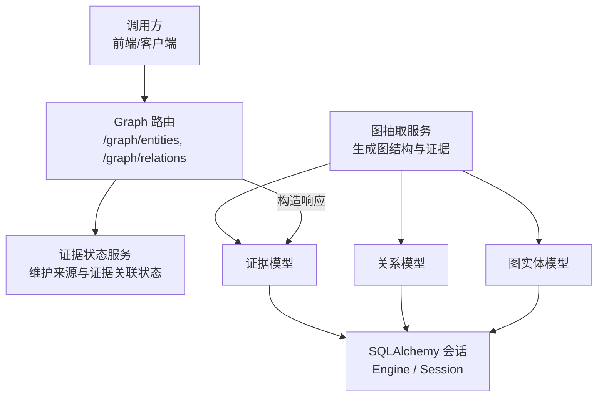
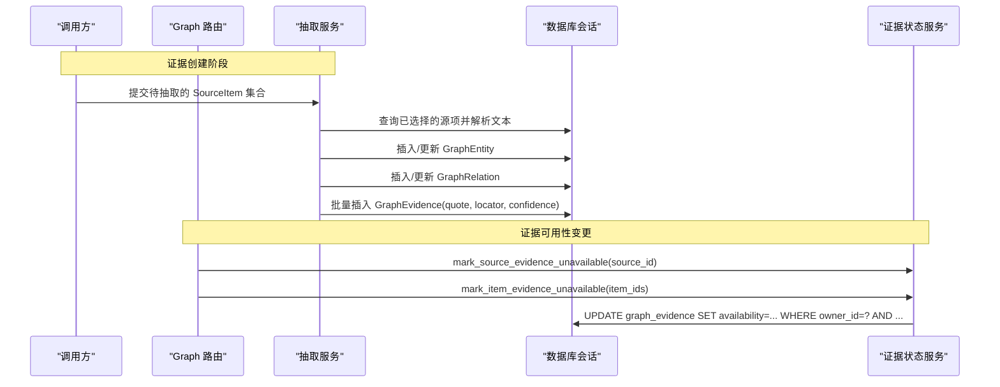
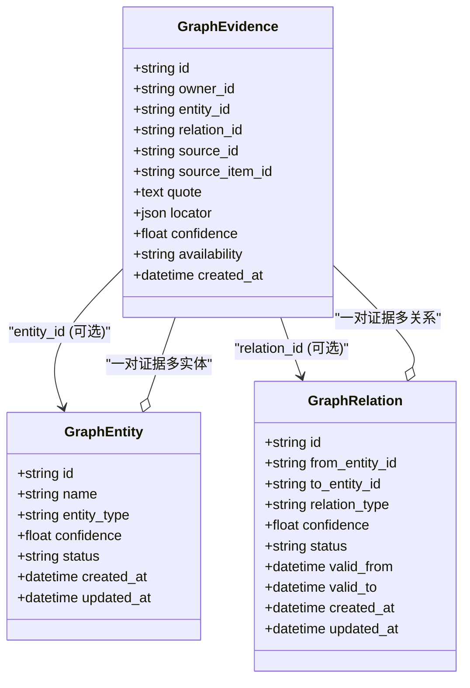
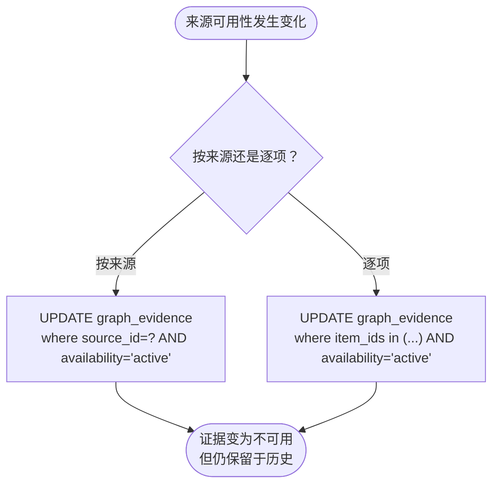
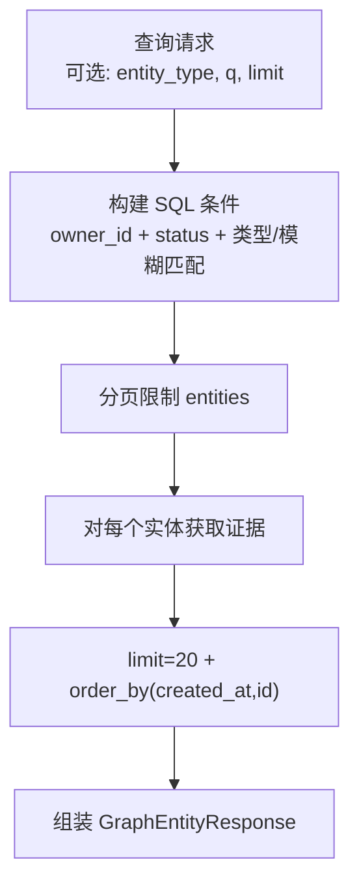
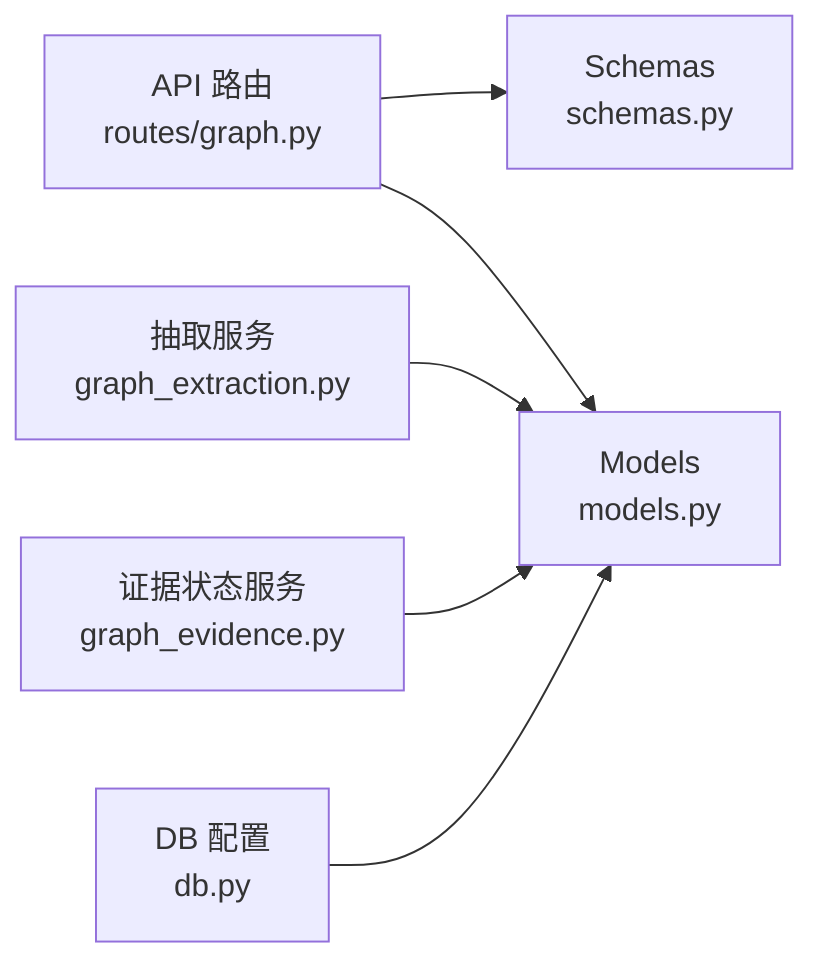

# 证据管理

<cite>
**本文引用的文件**
- [graph_evidence.py](file://src/personal_ai_life_os/services/graph_evidence.py)
- [graph.py](file://src/personal_ai_life_os/api/routes/graph.py)
- [schemas.py](file://src/personal_ai_life_os/api/schemas.py)
- [models.py](file://src/personal_ai_life_os/models.py)
- [db.py](file://src/personal_ai_life_os/db.py)
- [d2f5a8c14e73_add_evidence_graph_tables.py](file://migrations/versions/d2f5a8c14e73_add_evidence_graph_tables.py)
- [graph_extraction.py](file://src/personal_ai_life_os/services/graph_extraction.py)
</cite>

## 目录
1. [引言](#引言)
2. [项目结构](#项目结构)
3. [核心组件](#核心组件)
4. [架构总览](#架构总览)
5. [详细组件分析](#详细组件分析)
6. [依赖关系分析](#依赖关系分析)
7. [性能考虑](#性能考虑)
8. [故障排查指南](#故障排查指南)
9. [结论](#结论)
10. [附录：API与集成示例](#附录api与集成示例)

## 引言
本文围绕“证据图系统的证据管理”展开，重点解释证据模型 GraphEvidence 的设计、证据与实体和关系的映射、来源追踪与版本管理策略，以及检索过滤、可视化思路、质量评估机制与存储优化建议。文档同时给出 API 使用要点和可落地的集成路径，便于前端、侧边程序或桌面客户端理解如何构建从源数据到知识图谱的证据支撑网络。

## 项目结构
证据管理主要涉及以下层次：
- 模型层：定义图实体、关系、证据等持久化结构。
- 服务层：负责将选定的源项转换为证据并写入图模型，同时在源生命周期变化时更新证据可用性。
- API 路由层：提供面向外部调用的证据、实体和关系查询接口。
- 数据库层：统一引擎、会话管理和时序类型适配。



**图表来源**
- [graph.py:20-135](file://src/personal_ai_life_os/api/routes/graph.py#L20-L135)
- [graph_extraction.py:1-200](file://src/personal_ai_life_os/services/graph_extraction.py#L1-L200)
- [graph_evidence.py:1-45](file://src/personal_ai_life_os/services/graph_evidence.py#L1-L45)
- [models.py:409-497](file://src/personal_ai_life_os/models.py#L409-L497)
- [db.py:26-75](file://src/personal_ai_life_os/db.py#L26-L75)

**章节来源**
- [graph.py:1-135](file://src/personal_ai_life_os/api/routes/graph.py#L1-L135)
- [models.py:409-497](file://src/personal_ai_life_os/models.py#L409-L497)
- [db.py:1-75](file://src/personal_ai_life_os/db.py#L1-L75)

## 核心组件
- GraphEvidence：证据基础结构，用于承载一条具体原文片段及其对实体或关系的支持强度；具备租户隔离、来源链接与可用性字段。
- GraphEntity：知识图谱中的实体节点，支持类型、名称、摘要、置信度与状态，以及与证据的多对一关联。
- GraphRelation：两个实体之间的双向边，含类型、置信度、可选时间区间和状态，同样由多条证据支撑。
- 抽取服务：依据输入 SourceItem 列表调用大模型，输出实体、关系及证据并持久化。
- 证据状态服务：在 SourceConnection 或 SourceItem 生命周期变化时批量维护证据可用性，使失效证据仍保留审计历史但不参与推理问答。
- API 读取路由：为所有者隔离的图实体、关系、证据提供查询接口，并默认限制返回证据数量，以控制流量与复杂度。

**章节来源**
- [models.py:409-497](file://src/personal_ai_life_os/models.py#L409-L497)
- [graph_extraction.py:1-100](file://src/personal_ai_life_os/services/graph_extraction.py#L1-L100)
- [graph_evidence.py:1-45](file://src/personal_ai_life_os/services/graph_evidence.py#L1-L45)
- [graph.py:20-135](file://src/personal_ai_life_os/api/routes/graph.py#L20-L135)

## 架构总览
下图展示证据从源数据到图谱，再回查到前端可视化的流程。



**图表来源**
- [graph_extraction.py:1-200](file://src/personal_ai_life_os/services/graph_extraction.py#L1-L200)
- [graph_evidence.py:8-45](file://src/personal_ai_life_os/services/graph_evidence.py#L8-L45)
- [models.py:466-497](file://src/personal_ai_life_os/models.py#L466-L497)
- [d2f5a8c14e73_add_evidence_graph_tables.py:90-140](file://migrations/versions/d2f5a8c14e73_add_evidence_graph_tables.py#L90-L140)

## 详细组件分析

### GraphEvidence 模型设计
证据是连接 SourceItem 与 GraphEntity / GraphRelation 的桥梁，核心字段职责如下：
- id：记录级唯一键。
- owner_id：多租户隔离。
- entity_id/relation_id：二选一指向目标（表约束保证至少一个非空），实现对实体和关系的双向支撑。
- source_id/source_item_id：分别绑定来源连接与单条源项，形成溯源链。
- quote/locator：原文片段及定位元信息（JSON 可灵活扩展）。
- confidence：该证据对目标的信任程度。
- availability：证据可用状态，通常受来源启用、禁用或删除影响；活跃证据参与推理，非活跃证据仅保留审计轨迹。
- created_at：创建时间，用于排序和审计。



**图表来源**
- [models.py:409-497](file://src/personal_ai_life_os/models.py#L409-L497)
- [d2f5a8c14e73_add_evidence_graph_tables.py:60-140](file://migrations/versions/d2f5a8c14e73_add_evidence_graph_tables.py#L60-L140)

证据与实体/关系的映射规则：
- 一条证据必须且只能支撑一个目标：entity_id 与 relation_id 中恰有一个非空。
- 多个证据可以支撑同一个实体或关系，从而实现证据聚合强度可视化。
- 证据始终通过 source_id/source_item_id 回溯到原始数据，确保可解释性。

**章节来源**
- [models.py:466-497](file://src/personal_ai_life_os/models.py#L466-L497)
- [d2f5a8c14e73_add_evidence_graph_tables.py:90-140](file://migrations/versions/d2f5a8c14e73_add_evidence_graph_tables.py#L90-L140)

### 来源追踪与版本管理
- 来源追踪：
  - source_id 指向 SourceConnection，体现数据来源通道（如文件夹、云同步等）。
  - source_item_id 指向 SourceItem，定位具体消息、段落或图片等原子内容。
  - quote 与 locator(JSON) 可进一步描述证据位置，例如页码、坐标或 JSONPath，便于前端定位。
- 版本管理：
  - 当前实现主要通过 availability 进行软删除或下线处理，而非物理删除证据；这样保留历史记录的同时，让抽取与问答不再消费失效证据。
  - 实体与关系层面还存在 merged_into_id 与实体合并日志结构，表示实体合并后的归属与归档轨迹。
  - 抽取过程记录抽取运行元数据，包括提示词版本、输入哈希、统计信息等，可用于重复计算与成本核算。

**章节来源**
- [models.py:409-431](file://src/personal_ai_life_os/models.py#L409-L431)
- [models.py:438-464](file://src/personal_ai_life_os/models.py#L438-L464)
- [models.py:466-497](file://src/personal_ai_life_os/models.py#L466-L497)
- [d2f5a8c14e73_add_evidence_graph_tables.py:141-275](file://migrations/versions/d2f5a8c14e73_add_evidence_graph_tables.py#L141-L275)

### 证据关联策略：SourceItem 与 GraphEntity 的双向链接
证据服务提供两类状态同步方法：
- mark_source_evidence_unavailable：根据 SourceConnection 的可用性整体标记其全部证据。
- mark_item_evidence_unavailable：针对一批 SourceItem 精确标记，适合细粒度数据生命周期事件。

两者都只更新当前为“active”的证据，避免覆盖历史状态，保持审计可追溯。



**图表来源**
- [graph_evidence.py:8-45](file://src/personal_ai_life_os/services/graph_evidence.py#L8-L45)
- [d2f5a8c14e73_add_evidence_graph_tables.py:90-140](file://migrations/versions/d2f5a8c14e73_add_evidence_graph_tables.py#L90-L140)

此模式确保了：
- SourceItem → GraphEntity/GraphRelation：通过证据引用。
- GraphEntity/GraphRelation → SourceItem：通过证据反向定位。
- SourceConnection → GraphEvidence：支持整批快速下线。

**章节来源**
- [graph_evidence.py:1-45](file://src/personal_ai_life_os/services/graph_evidence.py#L1-L45)
- [models.py:466-497](file://src/personal_ai_life_os/models.py#L466-L497)

### 证据检索与过滤
当前 Graph 读取路由提供两种主要能力：

- 列出实体与关系，并附带每条实体的证据摘要
  - 实体列表可按 entity_type 过滤，并按 name icontains 关键字检索，默认只返回 active 与 pending_review 状态的实体。
  - 每个实体返回至多 20 条证据，便于前端渲染证据密度与支撑强度。
- 列出关系，并附带每条关系的证据摘要
  - 排除 invalid 的关系。
  - 同样最多返回 20 条证据。

注意：当前 API 未直接暴露 time_range、content_type、quality 等筛选参数，但模型字段提供了扩展入口：
- 时间范围：created_at、valid_from/valid_to 可作为后续增强过滤条件。
- 内容类型：可通过 source.kind 或 locator.type 等字段扩展。
- 质量筛选：confidence 和 availability 已在现有查询中天然起到作用；可在此基础上增加最小置信度阈值。



**图表来源**
- [graph.py:26-96](file://src/personal_ai_life_os/api/routes/graph.py#L26-L96)
- [graphschemareference:456-498](file://src/personal_ai_life_os/api/schemas.py#L456-L498)

**章节来源**
- [graph.py:20-135](file://src/personal_ai_life_os/api/routes/graph.py#L20-L135)
- [schemas.py:456-498](file://src/personal_ai_life_os/api/schemas.py#L456-L498)

### 证据可视化工具建议
基于证据模型，可视化应关注：
- 证据密度：同一实体的证据条数越高，代表支撑越强。
- 置信度分布：利用 evidence.confidence 计算实体/关系的加权评分。
- 关系网络：通过 GraphRelation.from_entity_id/to_entity_id 与 relation_type 绘制连线。
- 来源溯源：显示 source_id/source_item_id 并可点击跳转详情。
- 有效性：区分 active 与不可用证据，帮助审查者快速识别退化证据。

推荐指标：
- 实体强度 = sum(evidence.confidence)。
- 关系强度 = sum(evidence.confidence) / 证据数量，或直接采用 GraphRelation.confidence。
- 来源可信度：结合 SourceConnection.status、last_sync_at 等做前置评分。

当前路由已返回证据列表，前端可实现按时间倒序排列与置信度排序，并在用户交互时按需加载更多证据或跳转到证据所在来源。

**章节来源**
- [graph.py:60-135](file://src/personal_ai_life_os/api/routes/graph.py#L60-L135)
- [models.py:409-497](file://src/personal_ai_life_os/models.py#L409-L497)

### 证据质量评估机制
- 模型打分：抽取服务会根据模型输出设置 GraphEvidence.confidence 与 GraphEntity/GraphRelation.confidence。
- 审阅调整：GraphReviewUpdateRequest 允许对名称、摘要、置信度等进行人工修正，从而更新实体/关系的最终评分。
- 可用性作为第二维度：availability 反映证据是否仍可由系统消费，避免过时引用污染推理结果。
- 权威性与来源治理：可在上层接入来源信誉与同步健康度评估，结合证据密度与置信度共同决定整体可信水平。

需要说明的是，现有代码中并未给出自动化的综合可信算法，实际产品层可将模型评分、人工评审、来源状态和时间衰减等信号融合为最终评分。

**章节来源**
- [graph_extraction.py:1-120](file://src/personal_ai_life_os/services/graph_extraction.py#L1-L120)
- [schemas.py:501-519](file://src/personal_ai_life_os/api/schemas.py#L501-L519)
- [models.py:409-497](file://src/personal_ai_life_os/models.py#L409-L497)

### 证据存储优化：压缩、备份恢复与清理
本节为一般性建议，未直接对应特定仓库实现：
- 压缩策略：
  - quote 字符串若重复率高，可在存储前按内容去重或在应用层做简单压缩（如 LZ4），但会牺牲可读性。
  - locator JSON 应尽量精简，仅保存必要导航字段。
- 备份恢复：
  - 使用系统自带的备份恢复脚本进行数据库备份与校验，并结合 Alembic 迁移保证 schema 一致性。
  - 对证据表与大模型调用记录单独建立快照，加速问题回溯。
- 清理规则：
  - 对长期 inactive 且未被任何实体/关系重新引用的低置信证据，可制定归档策略或冷存储迁移。
  - 结合 SourceItem/GC 策略定期回收不再被索引的数据，但应谨慎对待证据的历史价值。

由于上述建议不属于当前仓库已实现逻辑，仅提供工程实践参考。

[本节未直接分析具体代码文件]

## 依赖关系分析


**图表来源**
- [graph.py:1-20](file://src/personal_ai_life_os/api/routes/graph.py#L1-L20)
- [schemas.py:456-519](file://src/personal_ai_life_os/api/schemas.py#L456-L519)
- [models.py:409-497](file://src/personal_ai_life_os/models.py#L409-L497)
- [graph_extraction.py:1-80](file://src/personal_ai_life_os/services/graph_extraction.py#L1-L80)
- [graph_evidence.py:1-45](file://src/personal_ai_life_os/services/graph_evidence.py#L1-L45)
- [db.py:26-75](file://src/personal_ai_life_os/db.py#L26-L75)

耦合与内聚分析：
- API 路由与 Models、Schemas 紧密耦合，但与业务逻辑解耦，易于测试。
- 证据状态服务与数据层直接操作 GraphEvidence，职责单一、内聚度高。
- 抽取服务同时产出三张主表，属于强业务耦合点，需通过事务与幂等设计降低副作用。

潜在循环依赖：
- 当前未发现直接导入回路；各模块以单向依赖组织。

外部依赖点：
- 抽取服务可能调用外部大模型，存在超时、认证失败、限流等非预期情况，需在集成中重试与降级。

**章节来源**
- [graph.py:1-135](file://src/personal_ai_life_os/api/routes/graph.py#L1-L135)
- [graph_extraction.py:1-120](file://src/personal_ai_life_os/services/graph_extraction.py#L1-L120)
- [graph_evidence.py:1-45](file://src/personal_ai_life_os/services/graph_evidence.py#L1-L45)
- [db.py:26-75](file://src/personal_ai_life_os/db.py#L26-L75)

## 性能考虑
- 证据分页上限：证据加载默认 limit=20，防止大图节点引发过重响应。
- 复合索引：entities、relations 与 evidence 均针对 owner_id 及相关枚举建立索引，提升多租户查询性能。
- 软卸载：可用性字段避免了删除大量证据导致的外键级联开销和历史丢失风险。
- 会话配置：SQLite WAL 模式与非独占锁可提高并发读取；PG 环境使用连接池与 ping 保护。

建议：
- 对高频查询添加更具体的索引组合，如 owner_id + created_at、owner_id + availability。
- 对大型结果集采用游标式分页，减少单次内存占用。
- 在批量抽取时按批次提交，控制事务大小。

**章节来源**
- [graph.py:34-65](file://src/personal_ai_life_os/api/routes/graph.py#L34-L65)
- [d2f5a8c14e73_add_evidence_graph_tables.py:16-140](file://migrations/versions/d2f5a8c14e73_add_evidence_graph_tables.py#L16-L140)
- [db.py:26-75](file://src/personal_ai_life_os/db.py#L26-L75)

## 故障排查指南
常见问题与建议：
- 证据无法被问答消费：
  - 检查 evidence.availability 是否被更新为非活跃值。
  - 确认 SourceConnection 或 SourceItem 的生命周期事件是否触发离线逻辑。
- 证据不可见：
  - API 默认只返回 active/pending_review 实体与有效关系。
  - 单个实体的证据数量限制为 20，如需更多需在前端分页加载或扩展后端。
- 引用完整性异常：
  - 证据的 entity_id/relation_id 必须指向存在的行，删除实体/关系时会级联删除相关证据。
  - 删除 source_id/source_item_id 也会级联删除证据。
- 跨租户访问问题：
  - 所有查询强制 owner_id 过滤，避免横向越权。
- 抽取任务失败或成本异常：
  - 检查 model provider 配置与凭证，核对 tokens 用量与 cost_usd 统计。

**章节来源**
- [graph_evidence.py:8-45](file://src/personal_ai_life_os/services/graph_evidence.py#L8-L45)
- [graph.py:26-135](file://src/personal_ai_life_os/api/routes/graph.py#L26-L135)
- [d2f5a8c14e73_add_evidence_graph_tables.py:90-140](file://migrations/versions/d2f5a8c14e73_add_evidence_graph_tables.py#L90-L140)
- [graph_extraction.py:120-200](file://src/personal_ai_life_os/services/graph_extraction.py#L120-L200)

## 结论
GraphEvidence 通过将“原文片段”与“图实体/关系”解耦，构建了可审计、可追踪、可扩展的证据体系。结合 availability 软控制、owner_id 多租户隔离与索引优化，系统在准确性与性能之间取得平衡。未来可以在 API 层增强时间与类型过滤、在上层整合可信度综合评分，并通过前端可视化放大证据网络的解释力。

## 附录：API与集成示例

### 读取图实体及证据
- 路径：GET /graph/entities
- 关键查询参数：
  - entity_type：可选，按实体类型过滤。
  - q：可选，按实体名称模糊检索。
  - limit：[1, 100]，默认 50。
- 返回体包含 total 与 items，每项带有 evidence 列表，最多 20 条证据。

使用示例（概念性）：
```bash
curl -H "Authorization: Bearer <token>" \
  "$(BASE_URL)/graph/entities?entity_type=project&q=购物&limit=20"
```

期望响应结构中每个实体附带证据摘要，供前端渲染支撑强度与溯源。

**章节来源**
- [graph.py:66-96](file://src/personal_ai_life_os/api/routes/graph.py#L66-L96)
- [schemas.py:467-482](file://src/personal_ai_life_os/api/schemas.py#L467-L482)

### 读取图关系及证据
- 路径：GET /graph/relations
- 关键查询参数：
  - relation_type：可选，按关系类型过滤。
  - limit：[1, 100]，默认 50。
- 返回体包含 total 与 items，每项带有 evidence 列表。

使用示例（概念性）：
```bash
curl -H "Authorization: Bearer <token>" \
  "$(BASE_URL)/graph/relations?relation_type=supports_goal&limit=50"
```

**章节来源**
- [graph.py:100-135](file://src/personal_ai_life_os/api/routes/graph.py#L100-L135)
- [schemas.py:484-498](file://src/personal_ai_life_os/api/schemas.py#L484-L498)

### 证据状态更新（服务端内部）
当 SourceConnection 或 SourceItem 发生增删改时，调用证据状态服务更新对应证据的 availability，以保持问答与抽取不消费失效证据。

典型调用场景：
- 禁用来源：mark_source_evidence_unavailable(owner_id, source_id, "inactive")
- 删除个别源项：mark_item_evidence_unavailable(owner_id, item_ids={"itemId1","itemId2"}, "inactive")

**章节来源**
- [graph_evidence.py:8-45](file://src/personal_ai_life_os/services/graph_evidence.py#L8-L45)