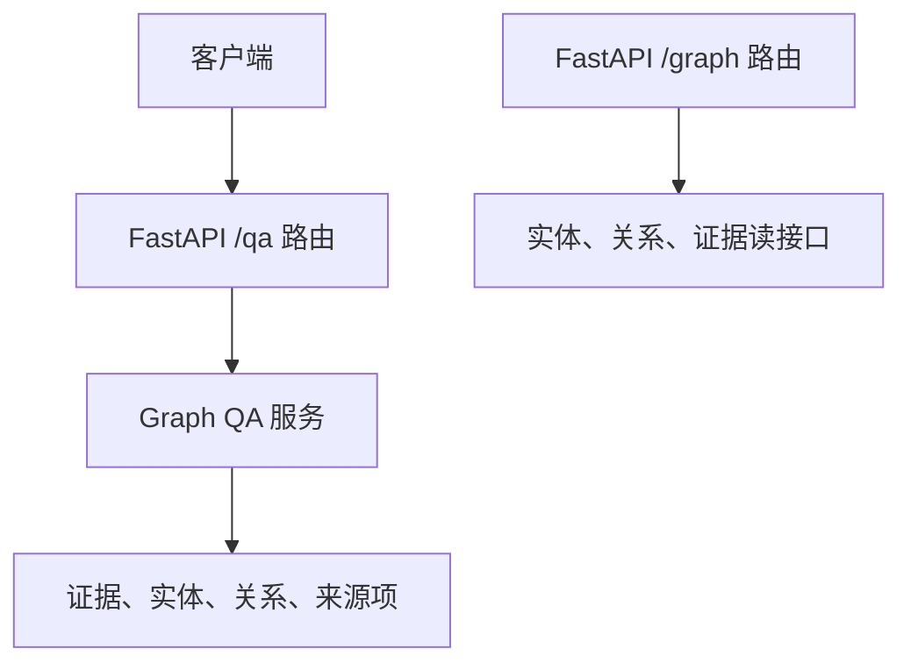
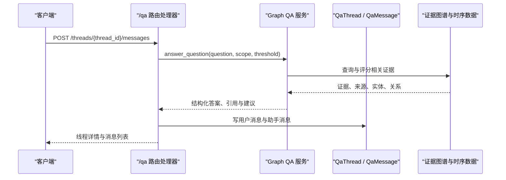
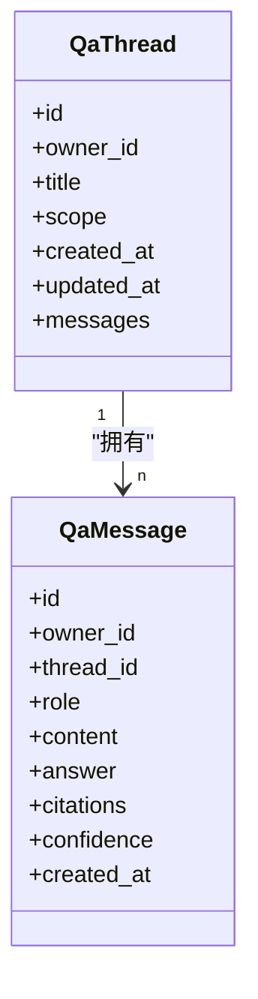
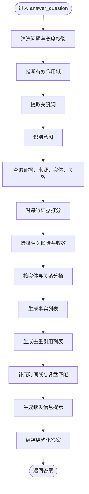
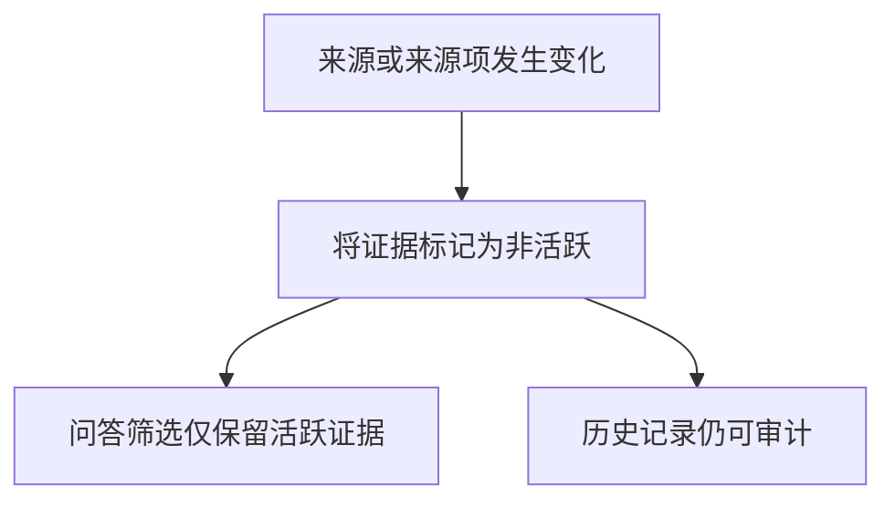
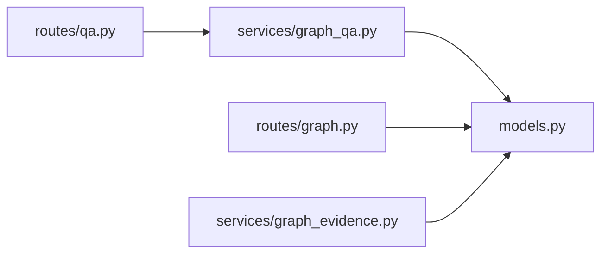
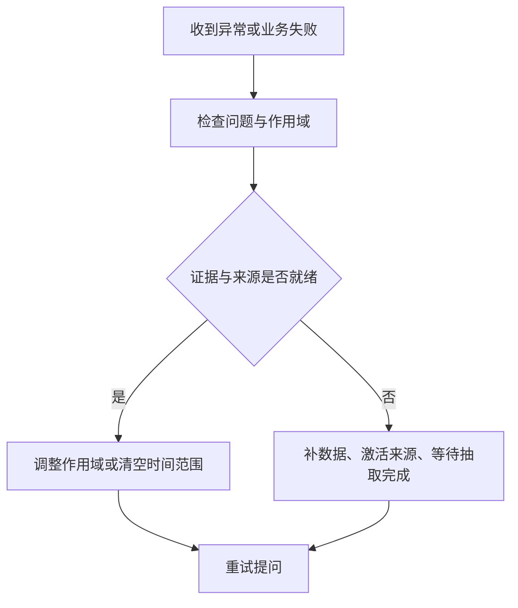
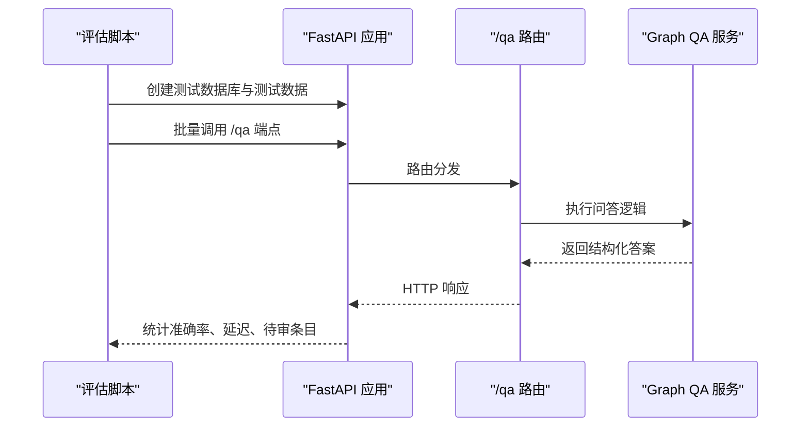

# 问答系统

<cite>
**本文引用的文件**
- [src/personal_ai_life_os/api/routes/qa.py](file://src/personal_ai_life_os/api/routes/qa.py)
- [src/personal_ai_life_os/services/graph_qa.py](file://src/personal_ai_life_os/services/graph_qa.py)
- [src/personal_ai_life_os/services/graph_evidence.py](file://src/personal_ai_life_os/services/graph_evidence.py)
- [src/personal_ai_life_os/api/routes/graph.py](file://src/personal_ai_life_os/api/routes/graph.py)
- [src/personal_ai_life_os/api/schemas.py](file://src/personal_ai_life_os/api/schemas.py)
- [src/personal_ai_life_os/models.py](file://src/personal_ai_life_os/models.py)
- [scripts/evaluate_graph_qa.py](file://scripts/evaluate_graph_qa.py)
</cite>

## 目录
1. [简介](#简介)
2. [项目结构](#项目结构)
3. [核心组件](#核心组件)
4. [架构总览](#架构总览)
5. [详细组件分析](#详细组件分析)
6. [依赖关系分析](#依赖关系分析)
7. [性能考虑](#性能考虑)
8. [故障排查指南](#故障排查指南)
9. [结论](#结论)
10. [附录：API 端点与示例](#附录api-端点与示例)

## 简介
本文件系统性地说明 Personal-AI-Life-OS 的问答系统，重点包括：
- QA 线程模型、多轮对话状态管理及上下文继承。
- 从证据图谱和时序数据中提取相关信息，生成结构化答案与可信引用。
- 上下文理解、关键词提取、意图识别及时间范围推断。
- API 端点规范，涵盖初始问题与续问格式。
- 性能优化策略、并发处理方式、缓存现状与改进建议。
- 错误处理、安全边界、审计字段与用户体验建议。

## 项目结构
问答相关代码主要分布在以下层次：
- API 路由层负责请求校验、权限控制、会话（线程）持久化和服务编排。
- 领域服务层实现证据检索、排序、事实聚合、建议生成等逻辑。
- 数据模型层定义线程、消息、实体、关系、来源项等表结构。
- 图读路由暴露可浏览的证据、实体和关系视图，供上层界面展示和调试。

**图示来源**
- [src/personal_ai_life_os/api/routes/qa.py:1-200](file://src/personal_ai_life_os/api/routes/qa.py#L1-L200)
- [src/personal_ai_life_os/services/graph_qa.py:200-699](file://src/personal_ai_life_os/services/graph_qa.py#L200-L699)
- [src/personal_ai_life_os/api/routes/graph.py:1-135](file://src/personal_ai_life_os/api/routes/graph.py#L1-L135)
- [src/personal_ai_life_os/models.py:616-654](file://src/personal_ai_life_os/models.py#L616-L654)

**章节来源**
- [src/personal_ai_life_os/api/routes/qa.py:1-200](file://src/personal_ai_life_os/api/routes/qa.py#L1-L200)
- [src/personal_ai_life_os/api/routes/graph.py:1-135](file://src/personal_ai_life_os/api/routes/graph.py#L1-L135)
- [src/personal_ai_life_os/models.py:616-654](file://src/personal_ai_life_os/models.py#L616-L654)

## 核心组件
- **QA 线程与会话模型**：`QaThread` 保存所有者、标题、作用域和时间戳；`QaMessage` 记录用户与助手的逐条消息，并附加结构化答案、引用、置信度。
- **QA 路由处理器**：负责线程列表、创建、详情获取、提问和删除；通过 `answer_question` 构建答案并写入消息历史。
- **Graph QA 服务**：解析问题作用域，执行关键词提取、意图检测、范围推断，查询证据行并打分，聚合成事实与引用，返回完整结构化结果。
- **证据可用性与生命周期管理**：在来源或来源项不可用时标记证据为不活跃，使问答自动排除失效来源但保留历史。
- **图可读接口**：列出实体、关系及其关联证据，便于检查数据质量与引用链路。

**章节来源**
- [src/personal_ai_life_os/models.py:616-654](file://src/personal_ai_life_os/models.py#L616-L654)
- [src/personal_ai_life_os/api/routes/qa.py:1-200](file://src/personal_ai_life_os/api/routes/qa.py#L1-L200)
- [src/personal_ai_life_os/services/graph_qa.py:200-699](file://src/personal_ai_life_os/services/graph_qa.py#L200-L699)
- [src/personal_ai_life_os/services/graph_evidence.py:1-45](file://src/personal_ai_life_os/services/graph_evidence.py#L1-L45)
- [src/personal_ai_life_os/api/routes/graph.py:1-135](file://src/personal_ai_life_os/api/routes/graph.py#L1-L135)

## 架构总览
下图展示一次“提问”的端到端流程：客户端调用 `/qa` 路由，路由层校验作用域、调用服务层执行知识检索和答案组装，再将用户问题和助手回答作为两条消息落库。

**图示来源**
- [src/personal_ai_life_os/api/routes/qa.py:120-200](file://src/personal_ai_life_os/api/routes/qa.py#L120-L200)
- [src/personal_ai_life_os/services/graph_qa.py:200-699](file://src/personal_ai_life_os/services/graph_qa.py#L200-L699)
- [src/personal_ai_life_os/models.py:616-654](file://src/personal_ai_life_os/models.py#L616-L654)

## 详细组件分析

### 线程模型与会话状态
- **线程 `QaThread`**
  - 关键字段：所有者、标题、作用域、创建时间和更新时间。
  - 作用域支持限定来源、实体、时间上下限，并在每次对话后可能更新。
- **消息 `QaMessage`**
  - 角色区分 `user` 和 `assistant`。
  - 助手消息存储摘要文本 `content`、结构化答案 `answer`、原始引用 `citations` 和整体置信度 `confidence`。
  - 按创建时间顺序组织，保证多轮对话的线性时序。
- **会话更新规则**
  - 每次提问后，线程作用域会被刷新为服务返回的最新作用域。
  - 默认标题会在首次被用户问题摘要替换，便于快速定位线程主题。
  - 所有变更在同一数据库事务内提交。

**图示来源**
- [src/personal_ai_life_os/models.py:616-654](file://src/personal_ai_life_os/models.py#L616-L654)

**章节来源**
- [src/personal_ai_life_os/models.py:616-654](file://src/personal_ai_life_os/models.py#L616-L654)
- [src/personal_ai_life_os/api/routes/qa.py:70-200](file://src/personal_ai_life_os/api/routes/qa.py#L70-L200)

### 证据抽取与问答服务
`answer_question` 是整个问答的核心处理函数，完成以下步骤：
1. 输入校验：清空多余空格、长度限制、空问题保护。
2. 范围推断：如果未指定时间范围，则根据自然语言线索推断最近一周、两周或一月范围。
3. 关键词提取：同时提取英文词元和中文字符片段，去除停用词，截断到固定数量。
4. 意图检测：从预设词汇集合匹配决策、项目、成长、时间线等意图。
5. 证据召回：联合查询证据、来源项、来源连接、实体和关系，依据状态过滤，并按作用域和时间条件裁剪。
6. 相关性打分：综合关键词匹配、意图和实体类型加分。
7. 候选收敛：优先保留有相关性的结果，必要时回退到更多候选，避免完全无结果。
8. 事实聚合：按实体和关系分桶取最高置信度证据，形成事实条目。
9. 引用去重：按置信度和发生时间排序去重，限制引用数量。
10. 上下文扩展：搜索时间线和周复盘中的相关片段。
11. 缺失信息提示：例如没有可用证据、没有关系证据、置信度过低或证据缺少时间信息时给出建议。
12. 最终输出：返回答案状态、摘要、事实、引用、时间线匹配、复盘匹配、缺失信息、后续建议、置信度、作用域、关键词、意图、延迟和版本。

**图示来源**
- [src/personal_ai_life_os/services/graph_qa.py:200-699](file://src/personal_ai_life_os/services/graph_qa.py#L200-L699)

**章节来源**
- [src/personal_ai_life_os/services/graph_qa.py:200-699](file://src/personal_ai_life_os/services/graph_qa.py#L200-L699)

### 上下文理解、关键词提取与语义搜索集成
- **上下文理解**
  - 通过意图词表判断是否属于决策、项目、成长或时间线查询。
  - 若问题包含“上周”“最近”“上个月”等线索且没有显式时间范围，则构造动态起止时间。
- **关键词提取**
  - 英文单词通过正则匹配字母开头词组，中文使用 Unicode CJK 块划分连续片段。
  - 同时提取双字短语，过滤常见停用词，最大保留 12 个关键词。
- **语义搜索集成**
  - 当前实现以关键词匹配、SQL `icontains`、实体名和摘要匹配为主。
  - 证据表还维护证据置信度与引用信息，可作为相关性排名的基础信号。
  - 如需更深层语义向量检索，可在现有证据筛选之前增加嵌入向量化相似度排序，再合并为融合得分。

**章节来源**
- [src/personal_ai_life_os/services/graph_qa.py:100-200](file://src/personal_ai_life_os/services/graph_qa.py#L100-L200)
- [src/personal_ai_life_os/api/routes/graph.py:40-135](file://src/personal_ai_life_os/api/routes/graph.py#L40-L135)

### 结构化输出格式
服务端统一由服务层构造字典，并由 Pydantic 模型序列化为标准 JSON：
- **答案响应**
  - `status`：`answered` 或 `insufficient_evidence`。
  - `summary`：面向用户的结论性摘要。
  - `facts`：结构化事实清单，每个事实包含标签、细节、依据类型、置信度、实体或关系标识以及证据 ID 列表。
  - `citations`：去重后的原文引用，每项含证据 ID、引用文本、置信度、可用性、来源信息、发生时间与定位对象。
  - `timeline_matches`：时间线片段匹配。
  - `review_matches`：周复盘片段匹配。
  - `missing_info`：风险提示与操作建议。
  - `suggestions`：可引导继续操作的后续建议，如查看项目、创建提醒、复核决定等。
  - `confidence`：全局置信度，通常等于最高事实的置信度。
  - `scope`：本次生效的作用域，供下次续问继承。
  - `keywords`、`intent`、`latency_ms`、`version`：诊断与控制字段。

**章节来源**
- [src/personal_ai_life_os/services/graph_qa.py:606-699](file://src/personal_ai_life_os/services/graph_qa.py#L606-L699)
- [src/personal_ai_life_os/api/schemas.py:617-680](file://src/personal_ai_life_os/api/schemas.py#L617-L680)

### 证据来源与可用性管理
当来源或来源项被停用或删除时，系统不会直接删除旧证据，而是将其可用性标记为非活跃，从而：
- 保持历史可追溯。
- 让当前抽取和问答自动忽略失效来源。
- 允许审计人员核对原始来源状态变迁。

**图示来源**
- [src/personal_ai_life_os/services/graph_evidence.py:1-45](file://src/personal_ai_life_os/services/graph_evidence.py#L1-L45)

**章节来源**
- [src/personal_ai_life_os/services/graph_evidence.py:1-45](file://src/personal_ai_life_os/services/graph_evidence.py#L1-L45)
- [src/personal_ai_life_os/services/graph_qa.py:320-420](file://src/personal_ai_life_os/services/graph_qa.py#L320-L420)

### 对话交互与续问
- **续问如何继承上下文**
  - 每次提问会返回最新的 `scope`。
  - 客户端再次发起续问时，应将该作用域作为下一次请求的作用域，从而保持来源、实体和时间范围的延续。
- **线程标题演化**
  - 新线程默认标题较短，首条问题会自动改写线程标题为问题的前导片段，便于用户浏览线程列表。
- **多轮对话消息序列**
  - 每条用户问题和助手回答都追加到线程消息末尾。
  - 前端可直接读取最后一条助手消息的结构化答案，而不需要重新计算。

**章节来源**
- [src/personal_ai_life_os/api/routes/qa.py:120-200](file://src/personal_ai_life_os/api/routes/qa.py#L120-L200)
- [src/personal_ai_life_os/api/schemas.py:600-680](file://src/personal_ai_life_os/api/schemas.py#L600-L680)

## 依赖关系分析
- **API 层依赖服务层**：`/qa` 路由依赖 `graph_qa.answer_question`，并把异常转换为 HTTP 响应。
- **服务层依赖模型层与数据库约束**：依赖 `QaThread`、`QaMessage`、`GraphEvidence`、`GraphEntity`、`GraphRelation`、`SourceItem`、`SourceConnection` 和 `Review`。
- **证据可用性钩子与服务层协作**：证据可用性变化会影响服务层查询条件中的 `availability == "active"` 过滤。
- **图读路由独立于问答逻辑**：主要用于浏览已存在的实体、关系和证据，不修改状态。

**图示来源**
- [src/personal_ai_life_os/api/routes/qa.py:1-200](file://src/personal_ai_life_os/api/routes/qa.py#L1-L200)
- [src/personal_ai_life_os/services/graph_qa.py:1-699](file://src/personal_ai_life_os/services/graph_qa.py#L1-L699)
- [src/personal_ai_life_os/models.py:616-654](file://src/personal_ai_life_os/models.py#L616-L654)
- [src/personal_ai_life_os/api/routes/graph.py:1-135](file://src/personal_ai_life_os/api/routes/graph.py#L1-L135)
- [src/personal_ai_life_os/services/graph_evidence.py:1-45](file://src/personal_ai_life_os/services/graph_evidence.py#L1-L45)

**章节来源**
- [src/personal_ai_life_os/api/routes/qa.py:1-200](file://src/personal_ai_life_os/api/routes/qa.py#L1-L200)
- [src/personal_ai_life_os/services/graph_qa.py:1-699](file://src/personal_ai_life_os/services/graph_qa.py#L1-L699)
- [src/personal_ai_life_os/models.py:616-654](file://src/personal_ai_life_os/models.py#L616-L654)
- [src/personal_ai_life_os/api/routes/graph.py:1-135](file://src/personal_ai_life_os/api/routes/graph.py#L1-L135)
- [src/personal_ai_life_os/services/graph_evidence.py:1-45](file://src/personal_ai_life_os/services/graph_evidence.py#L1-L45)

## 性能考虑
当前实现的关键性能特征如下：

| 环节 | 实现方式 | 复杂度与影响 | 优化空间 |
|---|---|---|---|
| 关键词提取 | 正则扫描英文词元与中文片段，最多保留 12 个关键词 | O(n)，n 为问题字符数，开销很低 | 可预编译表达式并复用 |
| 意图检测 | 遍历预设意图词汇集合 | O(意图数×关键词数)，常量级规模 | 可将高频词建索引或哈希集 |
| 证据召回 | SQL JOIN 多个表，按所有者、来源连接状态、实体状态、关系状态和作用域过滤 | 受数据库索引和行数影响，单次限制上限 500 行 | 为常见查询添加覆盖索引，结合分页物化视图 |
| 打分与收敛 | 内存中对最多约 500 行打分，再切片至 60 行候选 | O(k log k)，k ≤ 500 | 可按分数分段阈值降采样 |
| 事实聚合 | 按实体和关系分桶并取最高置信度 | O(m)，m 为候选行数 | 可预分桶或使用流式统计 |
| 引用去重 | 按置信度和时间排序后去重，最多 20 条 | O(p log p)，p ≤ 60 | 通常极小 |
| 时间线和复盘匹配 | SQL 条件过滤和字符串包含查询 | 取决于数据和索引质量 | 对常用查询列加索引 |
| 线程与消息写入 | 单线程串行写用户与助手两条消息 | 低冲突，短事务 | 可拆分长事务、异步记录日志 |

整体来看，当前系统适合本地优先、中小规模个人知识数据；在高并发场景下可通过应用层限流、只读副本、连接池配置及查询缓存进一步提升吞吐。

**章节来源**
- [src/personal_ai_life_os/services/graph_qa.py:320-460](file://src/personal_ai_life_os/services/graph_qa.py#L320-L460)
- [src/personal_ai_life_os/services/graph_qa.py:560-699](file://src/personal_ai_life_os/services/graph_qa.py#L560-L699)
- [src/personal_ai_life_os/models.py:616-654](file://src/personal_ai_life_os/models.py#L616-L654)

## 故障排查指南

### 常见问题与修复思路
- **问题为空或过长**
  - 现象：抛出参数错误类异常。
  - 原因：问题为空或超过长度限制。
  - 修复：提示用户缩短问题或增加明确上下文。
- **作用域非法**
  - 现象：日期非法、起止范围颠倒、过滤项过多。
  - 原因：作用域字段类型错误或超过最大过滤数量。
  - 修复：检查 ISO 日期格式，缩小来源和实体筛选范围。
- **无可靠证据**
  - 现象：返回 `insufficient_evidence`。
  - 原因：没有活跃证据或最高置信度低于阈值。
  - 修复：先确认数据来源已同步、来源连接活跃，并检查证据抽取是否完成。
- **缺少时间信息**
  - 现象：提示部分证据没有时间。
  - 原因：来源项缺失发生时间。
  - 修复：补充来源的时间元数据，或在 UI 中显式标注不确定时间。
- **线程不存在**
  - 现象：返回 404，携带线程未找到编码。
  - 原因：线程 ID 无效或不属于当前用户。
  - 修复：使用线程列表页选择的 thread_id。

**图示来源**
- [src/personal_ai_life_os/api/routes/qa.py:20-40](file://src/personal_ai_life_os/api/routes/qa.py#L20-L40)
- [src/personal_ai_life_os/api/routes/qa.py:120-200](file://src/personal_ai_life_os/api/routes/qa.py#L120-L200)
- [src/personal_ai_life_os/services/graph_qa.py:200-260](file://src/personal_ai_life_os/services/graph_qa.py#L200-L260)

**章节来源**
- [src/personal_ai_life_os/api/routes/qa.py:20-40](file://src/personal_ai_life_os/api/routes/qa.py#L20-L40)
- [src/personal_ai_life_os/api/routes/qa.py:120-200](file://src/personal_ai_life_os/api/routes/qa.py#L120-L200)
- [src/personal_ai_life_os/services/graph_qa.py:200-260](file://src/personal_ai_life_os/services/graph_qa.py#L200-L260)

### 安全考虑
- **租户隔离**：所有查询均以 `owner_id` 过滤，确保用户只能访问自己的线程、消息、来源和证据。
- **作用域限制**：来源 ID、实体 ID、关键词等输入均有最大长度或数量限制，避免放大攻击面。
- **状态可见性控制**：只暴露 `active` 和待审核状态的实体；无效或过期证据不影响已有引用，但不会参与当前推理。
- **外部模型同意记录**：模型使用与提供方同意通过其他模块记录，问答路由本身不直接依赖大模型，而是基于证据图谱进行结构化生成。
- **建议与副作用防护**：当前 `answer_question` 返回结构化数据，并不直接调用代理工具；后续若扩展动作能力，应保持审批、撤销与审计机制。

**章节来源**
- [src/personal_ai_life_os/api/routes/qa.py:120-200](file://src/personal_ai_life_os/api/routes/qa.py#L120-L200)
- [src/personal_ai_life_os/services/graph_qa.py:300-460](file://src/personal_ai_life_os/services/graph_qa.py#L300-L460)
- [src/personal_ai_life_os/models.py:30-120](file://src/personal_ai_life_os/models.py#L30-L120)

## 结论
该问答系统围绕“证据驱动”的核心设计，把自然语言问题映射到结构化的图谱证据、来源项和时序数据上。线程模型维护多轮对话，服务层提供可解释的事实、引用和建议，并通过作用域和意图实现上下文理解。系统在性能、安全性与可追踪性方面有明确约束，同时保留了扩展语义搜索、缓存、批处理和异步处理的接口空间。对于生产部署，建议优先完善索引、监控耗时与失败率，并对高价值查询路径引入只读缓存。

[本节不直接分析具体文件]

## 附录：API 端点与示例

### 端点总览
- `GET /qa/scope`：获取当前用户最近一个线程的 ID 和作用域，用于续问初始化。
- `GET /qa/threads`：列出当前用户的线程，不包含全部消息，适合线程列表渲染。
- `POST /qa/threads`：创建线程，可附带初始作用域和标题。
- `GET /qa/threads/{thread_id}`：获取线程详情，包含完整消息列表。
- `POST /qa/threads/{thread_id}/messages`：发送初始问题或续问，返回线程与新消息。
- `DELETE /qa/threads/{thread_id}`：删除线程。

### 初始问题与续问格式
- **初始问题请求**
  - 请求体需包含问题文本。
  - 可选作用域可指定来源 ID 列表、实体 ID 列表以及起止时间。
  - 示例结构描述：
    - `question`：非空字符串，最大长度与后端验证一致。
    - `scope.source_ids`：来源 ID 列表，单个请求最多 50 个。
    - `scope.entity_ids`：实体 ID 列表，单个请求最多 50 个。
    - `scope.start`、`scope.end`：ISO 8601 时间字符串。
- **续问请求**
  - 复用上一次返回的 `scope`，保持来源、实体与时间范围一致。
  - 可进一步收窄范围，例如限定某个实体或时间段。
  - 不建议重复发送相同问题；如要强调不同侧重点，应明确加入新的范围或上下文信息。

### 成功响应要点
- 线程详情中包含用户消息和助手消息。
- 助手消息里的 `answer` 字段即为结构化答案，包含 `status`、`summary`、`facts`、`citations`、`confidence` 等字段。
- 客户端应根据 `status` 决定是否显示“证据不足”提示。
- 建议客户端使用返回的 `scope` 进行后续续问，以保证一致性。

**章节来源**
- [src/personal_ai_life_os/api/routes/qa.py:40-200](file://src/personal_ai_life_os/api/routes/qa.py#L40-L200)
- [src/personal_ai_life_os/api/schemas.py:600-680](file://src/personal_ai_life_os/api/schemas.py#L600-L680)

### 单元测试与评估脚本
评估脚本通过 FastAPI 测试客户端模拟真实 API 调用，准备不同语言和意图的用例，运行后报告引用准确性、延迟分位数和待审核证据数量。它不要求外部模型提供者，适合作为回归与基线测试。

**图示来源**
- [scripts/evaluate_graph_qa.py:1-80](file://scripts/evaluate_graph_qa.py#L1-L80)
- [scripts/evaluate_graph_qa.py:80-200](file://scripts/evaluate_graph_qa.py#L80-L200)
- [src/personal_ai_life_os/api/routes/qa.py:120-200](file://src/personal_ai_life_os/api/routes/qa.py#L120-L200)
- [src/personal_ai_life_os/services/graph_qa.py:606-699](file://src/personal_ai_life_os/services/graph_qa.py#L606-L699)

**章节来源**
- [scripts/evaluate_graph_qa.py:1-80](file://scripts/evaluate_graph_qa.py#L1-L80)
- [scripts/evaluate_graph_qa.py:80-200](file://scripts/evaluate_graph_qa.py#L80-L200)