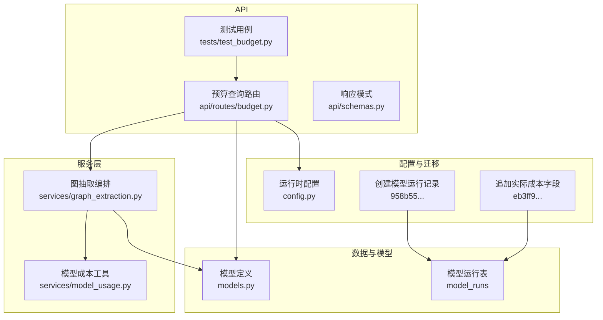
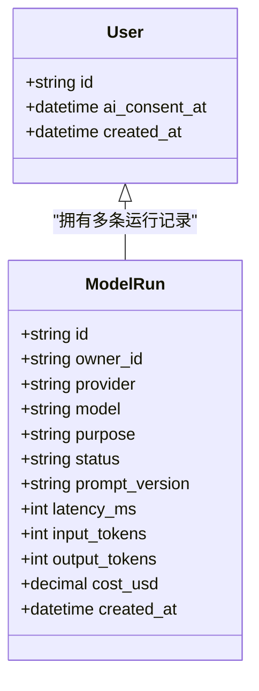
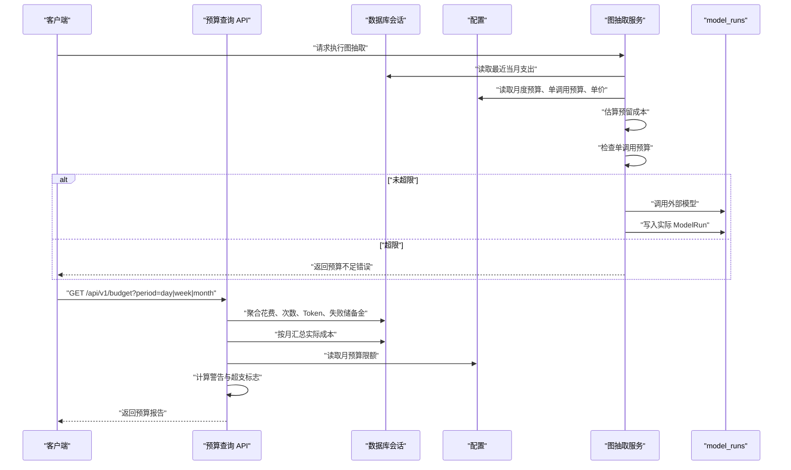
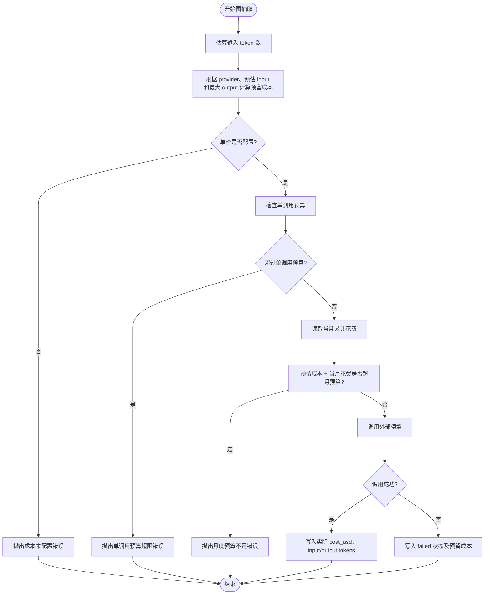
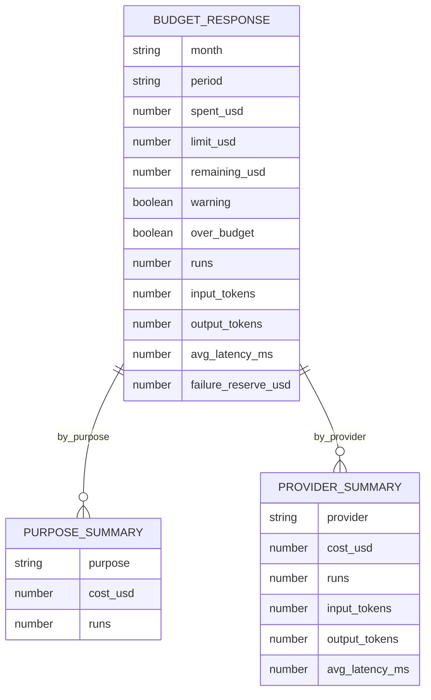
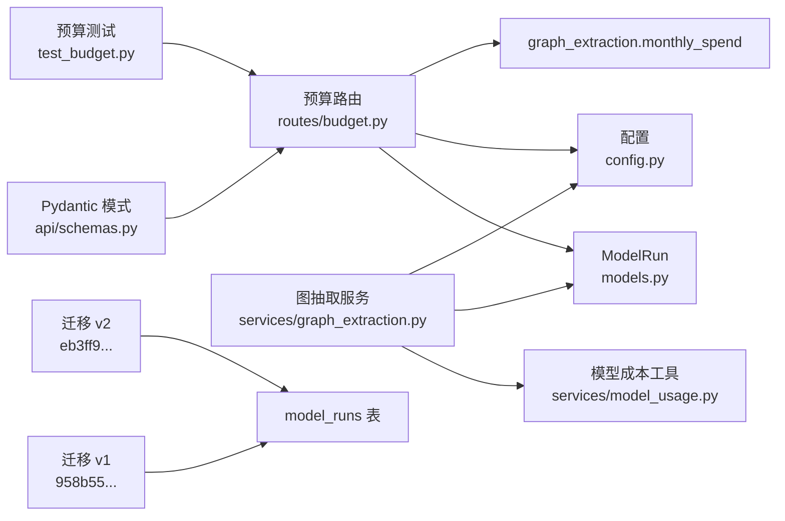
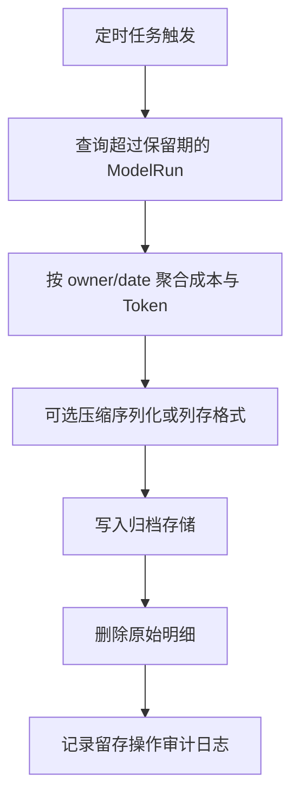

# 预算与成本管理

<cite>
**本文引用的文件**   
- [src/personal_ai_life_os/models.py](file://src/personal_ai_life_os/models.py)
- [src/personal_ai_life_os/services/model_usage.py](file://src/personal_ai_life_os/services/model_usage.py)
- [src/personal_ai_life_os/config.py](file://src/personal_ai_life_os/config.py)
- [src/personal_ai_life_os/services/graph_extraction.py](file://src/personal_ai_life_os/services/graph_extraction.py)
- [src/personal_ai_life_os/api/routes/budget.py](file://src/personal_ai_life_os/api/routes/budget.py)
- [src/personal_ai_life_os/api/schemas.py](file://src/personal_ai_life_os/api/schemas.py)
- [migrations/versions/958b551e0397_record_model_usage.py](file://migrations/versions/958b551e0397_record_model_usage.py)
- [migrations/versions/eb3ff930ec06_track_estimated_model_costs.py](file://migrations/versions/eb3ff930ec06_track_estimated_model_costs.py)
- [tests/test_budget.py](file://tests/test_budget.py)
</cite>

## 目录
1. [引言](#引言)
2. [项目结构与适用范围](#项目结构与适用范围)
3. [核心数据模型与职责边界](#核心数据模型与职责边界)
4. [体系结构总览](#体系结构总览)
5. [详细组件分析](#详细组件分析)
6. [依赖关系分析](#依赖关系分析)
7. [性能、压缩与归档策略](#性能压缩与归档策略)
8. [审计、合规性与故障处理](#审计合规性与故障处理)
9. [排障指南](#排障指南)
10. [结论](#结论)
11. [附录：配置字段与接口清单](#附录配置字段与接口清单)

## 引言

Personal-AI-Life-OS 的预算与成本管理系统围绕“运行记录、成本估算、周期预算、预警阻断和对外报表”构建。系统不假设某一种外部 AI 提供商统一计费，而是通过可配置的 Token 单价将输入输出用量折算为美元成本；同时记录每次模型调用（provider、model、purpose、状态、Token 数、延迟等），并在此基础上按月聚合、按目的和 provider 拆分，提供预算仪表盘。

预算机制分为三层：

| 层级 | 职责 | 典型行为 |
| --- | --- | --- |
| 计量层 | 收集每次调用中的 provider、model、输入输出 token、延迟和费用 | 提取成功后使用真实 Token 写回成本，失败则写回预留成本 |
| 预算层 | 计算当月累计花费、剩余额度、超支标志与 80% 预警标志 | 在业务入口处预占并发行拒绝策略 |
| 报表层 | 对外暴露当前周期内花费、失败储备金、目的分摊和 provider 明细 | 聚合 `ModelRun` 并通过 Pydantic schema 返回 |

该文档从模型设计、流程控制、API 响应形态、迁移历史到部署期合规配置展开，既适合开发者定位实现细节，也适合运维和产品人员理解预算约束如何影响功能可用性。

## 项目结构与适用范围

预算与成本管理涉及以下代码区域：

**图表来源**
- [src/personal_ai_life_os/models.py:760-782](file://src/personal_ai_life_os/models.py#L760-L782)
- [src/personal_ai_life_os/services/model_usage.py:1-20](file://src/personal_ai_life_os/services/model_usage.py#L1-L20)
- [src/personal_ai_life_os/services/graph_extraction.py:235-244](file://src/personal_ai_life_os/services/graph_extraction.py#L235-L244)
- [src/personal_ai_life_os/config.py:56-67](file://src/personal_ai_life_os/config.py#L56-L67)
- [src/personal_ai_life_os/api/routes/budget.py:1-118](file://src/personal_ai_life_os/api/routes/budget.py#L1-L118)
- [src/personal_ai_life_os/api/schemas.py:852-881](file://src/personal_ai_life_os/api/schemas.py#L852-L881)
- [migrations/versions/958b551e0397_record_model_usage.py:1-50](file://migrations/versions/958b551e0397_record_model_usage.py#L1-L50)
- [migrations/versions/eb3ff930ec06_track_estimated_model_costs.py:1-28](file://migrations/versions/eb3ff930ec06_track_estimated_model_costs.py#L1-L28)
- [tests/test_budget.py:1-64](file://tests/test_budget.py#L1-L64)

系统对预算管理的直接覆盖范围包括：

1. **计量记录：** 以 `ModelRun` 记录 owner、provider、model、purpose、token、延迟和美元成本。
2. **成本换算：** 使用 `model_usage.py` 的工具函数将 token 乘以配置的每百万 token 价格，得到美元估算值。
3. **前置拦截：** 在图抽取流程中预留成本、检查单调用上限和月度预算上限。
4. **预算报表：** 提供 `/budget` 查询接口，按 day / week / month 汇总花费和失败储备金。
5. **配置校验：** 生产环境要求启用外部模型时必须设置输入、输出单价和单次调用预算。

本节不分析无关的业务模块，例如用户认证主逻辑、图形检索索引或桌面文件夹扫描。

**章节来源**
- [src/personal_ai_life_os/services/graph_extraction.py:700-838](file://src/personal_ai_life_os/services/graph_extraction.py#L700-L838)
- [src/personal_ai_life_os/api/routes/budget.py:1-118](file://src/personal_ai_life_os/api/routes/budget.py#L1-L118)

## 核心数据模型与职责边界

### ModelRun：模型运行计量实体

`ModelRun` 是本次预算管理的事实表。它不是传统意义上的“账单”，而是一次 AI 调用的运行事实；费用可能是估算值，也可能是在调用后回填的真实值。

| 字段组 | 含义 | 说明 |
| --- | --- | --- |
| 标识与归属 | id、owner_id | 每条记录属于一个用户租户 |
| 调用方上下文 | provider、model、prompt_version | 追踪哪个模型和哪版 prompt 被调用 |
| 业务分类 | purpose、status | purpose 表示用途；status 区分成功、失败、备用路径等 |
| 计量指标 | input_tokens、output_tokens、latency_ms | 用于趋势分析和延迟观测 |
| 费用指标 | cost_usd | 可为空；未启用定价时为 None |
| 时间指标 | created_at | 用于日、周、月周期切分 |

**图表来源**
- [src/personal_ai_life_os/models.py:760-782](file://src/personal_ai_life_os/models.py#L760-L782)
- [migrations/versions/958b551e0397_record_model_usage.py:20-35](file://migrations/versions/958b551e0397_record_model_usage.py#L20-L35)
- [migrations/versions/eb3ff930ec06_track_estimated_model_costs.py:20-28](file://migrations/versions/eb3ff930ec06_track_estimated_model_costs.py#L20-L28)

### 成本估算工具

`services/model_usage.py` 定义了最小化的成本换算入口：

- `model_cost_usd(input_tokens, output_tokens, config)`：若配置了正数的输入/输出单价，则按 `(input × input_rate + output × output_rate) / 1,000,000` 计算美元。
- `model_rates_configured(config)`：用于判断当前是否具备计价能力。
- 常量 `MILLION = Decimal(1_000_000)`，避免硬编码数量级。

该模块刻意保持简单；当前图抽取流程使用内部 `_provider_cost` 进行换算，但该逻辑并不完全等同于本工具函数。也就是说，`ModelRun.cost_usd` 最终取值受具体业务流控制，而不是由 `model_usage.py` 强制决定所有成本来源。

**章节来源**
- [src/personal_ai_life_os/services/model_usage.py:1-20](file://src/personal_ai_life_os/services/model_usage.py#L1-L20)
- [src/personal_ai_life_os/services/graph_extraction.py:777-779](file://src/personal_ai_life_os/services/graph_extraction.py#L777-L779)

### 配置项中的预算边界

预算相关的配置集中在 `Settings`：

| 配置项 | 默认值或形式 | 作用 |
| --- | ---: | --- |
| `model_input_cost_per_million_usd` | `Decimal(0)` | 每百万输入 token 的美元价格 |
| `model_output_cost_per_million_usd` | `Decimal(0)` | 每百万输出 token 的美元价格 |
| `model_max_cost_per_call_usd` | `"0.10"` | 单次调用的成本上限 |
| `model_monthly_budget_usd` | `"5.00"` | 每月模型预算上限 |
| `app_env` | 环境变量 | 影响生产校验；桌面模式下即使未显式启用预算也会参与拦截判断 |

生产模式下如果选择了外部模型提供者，系统会强制验证：

- `model_provider == "openai"`
- 配置了非零且为正数的输入、输出单价
- `model_max_cost_per_call_usd > 0`
- 配置了隐私披露 URL 与保留说明
- 使用了安全的凭证、CORS、对象存储和指标令牌等更广泛的生产安全检查

这使预算系统在“能跑起来”之外，还具备部署态合规门槛。

**章节来源**
- [src/personal_ai_life_os/config.py:56-67](file://src/personal_ai_life_os/config.py#L56-L67)
- [src/personal_ai_life_os/config.py:104-132](file://src/personal_ai_life_os/config.py#L104-L132)

## 体系结构总览

预算系统在业务流程中的位置如下：

**图表来源**
- [src/personal_ai_life_os/services/graph_extraction.py:720-744](file://src/personal_ai_life_os/services/graph_extraction.py#L720-L744)
- [src/personal_ai_life_os/services/graph_extraction.py:777-838](file://src/personal_ai_life_os/services/graph_extraction.py#L777-L838)
- [src/personal_ai_life_os/api/routes/budget.py:24-118](file://src/personal_ai_life_os/api/routes/budget.py#L24-L118)

## 详细组件分析

### 1. 模型运行与计量模型

#### 表结构演进

第一次建表迁移负责建立 `model_runs` 的基础列：

- owner、provider、model、purpose、status
- prompt_version、latency_ms
- input_tokens、output_tokens
- created_at
- 并在 owner+created_at、owner、purpose、status 上创建索引

第二次迁移增加 `cost_usd`，类型为 `Numeric(12, 8)`，允许为空。后续模型定义中出现 `Numeric(12, 6)` 的写法，但实际新增列来自迁移脚本。因此阅读时应以迁移为准：历史记录的精度可能因早期写入方式存在差异，新的聚合应容忍 decimal 精度变化。

#### 复杂度分析

- 单条记录写入时间：O(1)
- 按月成本聚合：取决于 SQL 引擎优化；当前按 owner_id + created_at 过滤，并使用 `SUM(cost_usd)`
- 按 purpose/provider 分组：GROUP BY 开销随不同值数量线性增长
- 索引建议：已维护 owner+created_at 复合索引，满足常用预算过滤；其他维度索引可根据查询热点扩展

**章节来源**
- [migrations/versions/958b551e0397_record_model_usage.py:20-42](file://migrations/versions/958b551e0397_record_model_usage.py#L20-L42)
- [migrations/versions/eb3ff930ec06_track_estimated_model_costs.py:20-28](file://migrations/versions/eb3ff930ec06_track_estimated_model_costs.py#L20-L28)
- [src/personal_ai_life_os/models.py:760-782](file://src/personal_ai_life_os/models.py#L760-L782)

### 2. 成本换算与预留策略

图抽取服务的成本流程是理解 provider 计费抽象的关键。流程不是简单“调用一次就写一次费用”，而是先预留、后确认，或失败时退化为预留记录：

**图表来源**
- [src/personal_ai_life_os/services/graph_extraction.py:720-744](file://src/personal_ai_life_os/services/graph_extraction.py#L720-L744)
- [src/personal_ai_life_os/services/graph_extraction.py:777-838](file://src/personal_ai_life_os/services/graph_extraction.py#L777-L838)

需要注意两点：

1. `monthly_spend` 只累加 `ModelRun.cost_usd`，并未按 provider 单独累计。因此预算报警是基于总成本的粗略监控，不会自动识别 “OpenAI 超了但 Anthropic 还有额度” 这种多 provider 场景。
2. 成功率很高时，`actual_cost = _provider_cost(provider, input_tokens, output_tokens) or reserved_cost` 优先使用真实消耗；失败时仍保留 `reserved_cost`，用于体现业务风险成本。

**章节来源**
- [src/personal_ai_life_os/services/graph_extraction.py:235-244](file://src/personal_ai_life_os/services/graph_extraction.py#L235-L244)
- [src/personal_ai_life_os/services/graph_extraction.py:720-779](file://src/personal_ai_life_os/services/graph_extraction.py#L720-L779)
- [src/personal_ai_life_os/services/graph_extraction.py:787-838](file://src/personal_ai_life_os/services/graph_extraction.py#L787-L838)

### 3. 预算预警机制

当前实现包含三种关键控制：

| 控制类型 | 条件 | 结果 |
| --- | --- | --- |
| 单价缺失 | 输入或输出单价不大于 0 | 阻止图抽取并提示未配置成本 |
| 单调用上限 | 预留成本大于 `model_max_cost_per_call_usd` | 抛出一个明确的 per-call budget 超限错误 |
| 月度预算 | 当月花费 + 预留成本超过 `model_monthly_budget_usd` | 抛出月度预算不足错误 |

在查询层面，预算 API 还会计算两个布尔标志：

- `warning`：当月累计花费达到月预算的 80% 时置位
- `over_budget`：当月累计花费严格超过月预算时置位

失败准备金（failure reserve）用于统计处于 fallback、budget_fallback、budget_exceeded、consent_withdrawn 等失败状态记录的成本合计，帮助仪表板显示“已被标记为高风险但仍计入成本”的数据。

**章节来源**
- [src/personal_ai_life_os/api/routes/budget.py:14-30](file://src/personal_ai_life_os/api/routes/budget.py#L14-L30)
- [src/personal_ai_life_os/api/routes/budget.py:46-118](file://src/personal_ai_life_os/api/routes/budget.py#L46-L118)
- [tests/test_budget.py:33-64](file://tests/test_budget.py#L33-L64)

### 4. 预算报表与响应模型

预算接口响应分为整体、目的维度和 provider 维度：

**图表来源**
- [src/personal_ai_life_os/api/schemas.py:852-881](file://src/personal_ai_life_os/api/schemas.py#L852-L881)

当前接口的能力边界如下：

- 支持按 `period=day|week|month` 查看短期或月度预算
- 聚合每个用途的花费与次数
- 聚合每个 provider 的花费、次数、token、平均延迟
- 计算剩余额度和阈值标志
- 返回失败准备金但不进一步拆解失败原因

尚未提供的扩展能力包括：

- 按 provider 设置的独立月度预算
- 多维预测（如基于过去 N 天的日均花费外推）
- 多维度成本分摊（组织、项目、环境）
- 第三方通知回调（邮件、Webhook）

这些可以作为后续迭代补充到路由和 service 层，而不必改动 `ModelRun`。

**章节来源**
- [src/personal_ai_life_os/api/routes/budget.py:24-118](file://src/personal_ai_life_os/api/routes/budget.py#L24-L118)
- [src/personal_ai_life_os/api/schemas.py:852-881](file://src/personal_ai_life_os/api/schemas.py#L852-L881)
- [tests/test_budget.py:33-64](file://tests/test_budget.py#L33-L64)

### 5. Provider 计费格式与费用换算

目前仓库中可见的计量转换主要来源于外部模型的 usage 字段：

- 输入 token：`usage.prompt_tokens`
- 输出 token：`usage.completion_tokens`

这符合 OpenAI 类 chat completion 响应结构。对于其它提供商，代码中并没有统一的 provider adapter 规范；当前实现更依赖具体服务内部获取 token 的方式，以及通过“配置单价 + 估算方法”把任何 token 计数转化为成本。

建议在后续引入 provider registry：

| 阶段 | 建议设计 |
| --- | --- |
| 统一用量 | 所有 provider 返回 `{input_tokens, output_tokens, usage_meta}` |
| 统一计价 | 使用 `model_usage.py` 中的工具作为基准计价实现 |
| 自定义定价 | 允许 provider 级别覆盖单价或使用官方账单 |
| 对齐记账 | 实际账单入库前做一次对账步骤，保留原始 provider 账单 |

**章节来源**
- [src/personal_ai_life_os/services/graph_extraction.py:226-232](file://src/personal_ai_life_os/services/graph_extraction.py#L226-L232)
- [src/personal_ai_life_os/services/model_usage.py:1-20](file://src/personal_ai_life_os/services/model_usage.py#L1-L20)

### 6. 趋势分析、成本分摊与预测模型

当前系统没有独立的趋势分析、预测模型或正式成本分摊服务。但已有足够原始数据支撑后续扩展：

| 分析目标 | 现有支撑 | 需要补充的实现 |
| --- | --- | --- |
| 每日/每周趋势 | `created_at` + cost_usd + input/output tokens | 增加按日期聚合的查询或服务函数 |
| provider 成本分摊 | by_provider 列表 | 可增加 provider 维度预算阈值 |
| purpose 成本分摊 | by_purpose 列表 | 可扩展为跨业务线的成本归集 |
| 预测模型 | 时间序列成本数据 | 可增加简单移动平均、回归或 ML 预测函数 |
| 组织级分摊 | owner_id 隔离 | 如需组织分摊，需引入 tenant/org 字段与权限控制 |

这些分析可以放在一个新的 reporting service 中，复用 `ModelRun` 而不污染现有 graph extraction 流程。

**章节来源**
- [src/personal_ai_life_os/api/routes/budget.py:60-118](file://src/personal_ai_life_os/api/routes/budget.py#L60-L118)

## 依赖关系分析

**图表来源**
- [src/personal_ai_life_os/api/routes/budget.py:1-118](file://src/personal_ai_life_os/api/routes/budget.py#L1-L118)
- [src/personal_ai_life_os/services/graph_extraction.py:235-244](file://src/personal_ai_life_os/services/graph_extraction.py#L235-L244)
- [src/personal_ai_life_os/services/model_usage.py:1-20](file://src/personal_ai_life_os/services/model_usage.py#L1-L20)
- [src/personal_ai_life_os/models.py:760-782](file://src/personal_ai_life_os/models.py#L760-L782)
- [src/personal_ai_life_os/api/schemas.py:852-881](file://src/personal_ai_life_os/api/schemas.py#L852-L881)
- [migrations/versions/958b551e0397_record_model_usage.py:20-42](file://migrations/versions/958b551e0397_record_model_usage.py#L20-L42)
- [migrations/versions/eb3ff930ec06_track_estimated_model_costs.py:20-28](file://migrations/versions/eb3ff930ec06_track_estimated_model_costs.py#L20-L28)
- [tests/test_budget.py:1-64](file://tests/test_budget.py#L1-L64)

耦合关系要点：

- 预算路由直接依赖 `ModelRun` 表和 `settings`，耦合较低但职责较重。
- 图抽取服务既承担业务编排，又承担成本预留逻辑，耦合最高。
- `model_usage.py` 目前只是一个轻量工具，没有被广泛引用；未来应成为 provider 计价的唯一入口。
- 测试用例覆盖了基本警告和超支判定，但没有覆盖 provider 维度、延迟、失败储备金或周期切换，这是测试缺口。

## 性能、压缩与归档策略

### 查询性能

当前预算查询使用 SQL 侧聚合：

- 一次性求和 `spent_usd`
- 一次性统计运行次数、input/output tokens、平均延迟
- 按 purpose、provider GROUP BY 分别执行

优点：SQL 层效率高，避免 Python 端大量拉取。  
风险：随着 `ModelRun` 规模增长，GROUP BY 会变慢，尤其当 purpose 和 provider 基数很大时。

优化建议：

1. 为 `ModelRun(owner_id, created_at, cost_usd)` 建立更细粒度的覆盖索引，加速月度查询。
2. 对 high-cardinality 的 query 增加物化视图或分区表（例如按月 partitioning）。
3. 增加缓存层，缓存最近一天或一周的聚合结果，降低高频 dashboard 查询压力。

### 数据压缩

建议在历史数据到达一定规模后引入压缩方案：

| 策略 | 适用阶段 | 说明 |
| --- | --- | --- |
| 热数据保留 | 最近 30–90 天 | 完整 `ModelRun` 记录，支持快速查询 |
| 冷数据聚合 | 更早时间 | 降采样到日粒度，仅保存 `date、owner_id、sum_cost、sum_input、sum_output` |
| 原始消息归档 | 审计要求强时 | 将 provider 原始账单或日志存于对象存储，数据库中只留元数据 |
| 成本快照表 | 报表层 | 预计算每日/每月成本，减少实时聚合 |

### 历史归档

推荐的归档流程：

该流程应遵循最小权限原则，并由审计系统记录归档和删除动作。

[本节为通用架构建议，未直接分析具体源文件]

## 审计、合规性与故障处理

### 审计相关字段

以下字段支持事后审计：

| 字段 | 审计价值 |
| --- | --- |
| owner_id | 责任主体 |
| provider、model | 外部供应商与技术选型 |
| prompt_version | 提示词变更可追溯 |
| status、error_code | 成功/失败及异常类型 |
| input_tokens、output_tokens | 用量计量 |
| cost_usd | 成本事实 |
| created_at | 时间戳 |

不过，当前 `ModelRun` 没有单独的审计事件表。推荐新增一个 `model_cost_audit_log`，至少记录：

- 事件类型（estimated、confirmed、archived、depleted）
- 原 record id
- change delta
- 操作者或调度器身份
- 审计时间

### 合规性要求

生产环境的 `Settings` 已经对使用外部模型提出合规性要求：

- 必须提供隐私 URL 和保留说明
- 必须设置 token 单价和单调用预算
- 必须使用安全凭据、CORS、S3 对象存储和指标令牌

这意味着部署者不能仅在本地调试关闭预算校验；要上线模型功能，就必须明确配置计价参数，并对外披露数据处理方式。

### 常见故障类型

| 错误类型 | 发生条件 | 系统行为 |
| --- | --- | --- |
| 成本未配置 | 输入或输出单价无效 | 抛出“未配置成本”错误 |
| 单调用预算超限 | 单次预留成本超过上限 | 拒绝调用 |
| 月度预算不足 | 当月累计 + 预留成本超月预算 | 拒绝继续调用 |
| 查询隔离失效 | 用户 ID 未正确限制 | 不应发生，但应加入测试用例 |
| 成本精度不一致 | Numeric 精度差异 | 报表应以字符串 decimal 输出以避免浮点误差 |

测试用例验证了：

- 初始花费为零、月度限额、剩余金额
- 添加一条 4 美元记录后出现 warning
- 再添加 1.5 美元后进入 over_budget
- 不同用户的预算相互隔离

**章节来源**
- [src/personal_ai_life_os/config.py:104-132](file://src/personal_ai_life_os/config.py#L104-L132)
- [tests/test_budget.py:33-64](file://tests/test_budget.py#L33-L64)

## 排障指南

### 预算接口一直报零花费

排查步骤：

1. 确认当前请求 user 是否在 `ModelRun.owner_id` 下存在记录。
2. 检查 `ModelRun.created_at` 是否落入当月。
3. 检查 `cost_usd` 是否为 None；若未配置成本，聚合会得到零。
4. 确认 period 是否确实按 day/week/month 截断。

对应参考：

**章节来源**
- [src/personal_ai_life_os/api/routes/budget.py:24-44](file://src/personal_ai_life_os/api/routes/budget.py#L24-L44)

### 业务调用被拒绝并提示预算不足

可能原因：

1. 月预算过低或未正确设置。
2. 之前的失败记录仍带有预留成本。
3. 当前批次估算出的预留成本过大。
4. 桌面开发模式下预算校验逻辑更敏感。

定位建议：

- 查看图抽取服务在预留成本和月度预算分支处的错误码。
- 使用预算查询接口查看 `over_budget` 和 `warning`。
- 检查是否因为单调用预算太小导致直接失败。

**章节来源**
- [src/personal_ai_life_os/services/graph_extraction.py:731-744](file://src/personal_ai_life_os/services/graph_extraction.py#L731-L744)
- [src/personal_ai_life_os/services/graph_extraction.py:777-786](file://src/personal_ai_life_os/services/graph_extraction.py#L777-L786)

### 成本与实际账单不一致

原因可能包括：

1. provider 返回的 usage 字段未被捕获，走的是估算 cost。
2. 不同 provider 的 token 定义不同。
3. 旧记录使用旧的精度或预留成本。
4. 成本换算未在统一工具中集中实现。

建议措施：

- 标准化外部模型的 usage 解析。
- 使用 `model_usage.py` 的 `model_cost_usd` 作为基准计价函数。
- 对历史数据做批量校准，并将差异记录进审计日志。
- 在 `cost_usd` 旁增加 `cost_source` 字段，区分 estimated 和 billed。

**章节来源**
- [src/personal_ai_life_os/services/model_usage.py:1-20](file://src/personal_ai_life_os/services/model_usage.py#L1-L20)
- [src/personal_ai_life_os/services/graph_extraction.py:777-838](file://src/personal_ai_life_os/services/graph_extraction.py#L777-L838)

## 结论

Personal-AI-Life-OS 当前的预算与成本管理已经具备“可计量、可估算、可预警、可报表”的最小闭环，但仍有明显的扩展空间：

- 计量模型可用，但成本计算在不同位置存在实现差异。
- 预算拦截有效，但目前是全局月度预算，不支持 provider 级或用途级独立预算。
- 预算查询能提供丰富的聚合视图，但缺少趋势、预测和多维分摊。
- 生产配置对审计和合规形成一定门槛，值得在产品流程中强化用户告知。
- 长期数据治理需要归档、压缩、对账和审计事件表配合。

面向下一步迭代，建议优先完成：

1. 将 `model_usage.py` 设为唯一成本计价入口。
2. 增加 provider 和 purpose 级别的预算阈值。
3. 增加月度趋势和简单预测服务。
4. 建立成本审计事件表。
5. 设计历史数据归档与压缩流程。

[本节为总结，不直接分析具体源文件]

## 附录：配置字段与接口清单

### 预算相关配置字段

| 字段 | 类型 | 默认值或示例 | 用途 |
| --- | --- | ---: | --- |
| `model_input_cost_per_million_usd` | Decimal | `Decimal(0)` | 输入 token 每百万美元单价 |
| `model_output_cost_per_million_usd` | Decimal | `Decimal(0)` | 输出 token 每百万美元单价 |
| `model_max_cost_per_call_usd` | Decimal | `"0.10"` | 单调用成本上限 |
| `model_monthly_budget_usd` | Decimal | `"5.00"` | 月度模型总预算 |

**章节来源**
- [src/personal_ai_life_os/config.py:56-67](file://src/personal_ai_life_os/config.py#L56-L67)
- [src/personal_ai_life_os/config.py:114-125](file://src/personal_ai_life_os/config.py#L114-L125)

### 预算与用量接口

| 方法 | 路径 | 返回 | 说明 |
| --- | --- | --- | --- |
| GET | `/api/v1/budget` | `BudgetResponse` | 支持 `period=day|week|month` |

响应关键字段：

| 字段 | 类型 | 语义 |
| --- | --- | --- |
| `month` | string | YYYY-MM |
| `period` | string | day / week / month |
| `spent_usd` | decimal | 当前周期实际花费 |
| `limit_usd` | decimal | 月预算限额 |
| `remaining_usd` | decimal | 剩余额度 |
| `warning` | bool | 累计 >= 80% 预算 |
| `over_budget` | bool | 累计 > 100% 预算 |
| `runs` | int | 调用次数 |
| `input_tokens` | int | 输入 token 合计 |
| `output_tokens` | int | 输出 token 合计 |
| `avg_latency_ms` | int | 平均延迟 |
| `failure_reserve_usd` | decimal | 失败/备用路径成本合计 |
| `by_purpose` | list | 目的维度费用分摊 |
| `by_provider` | list | provider 维度费用、Token 与延迟 |

**章节来源**
- [src/personal_ai_life_os/api/routes/budget.py:14-118](file://src/personal_ai_life_os/api/routes/budget.py#L14-L118)
- [src/personal_ai_life_os/api/schemas.py:852-881](file://src/personal_ai_life_os/api/schemas.py#L852-L881)