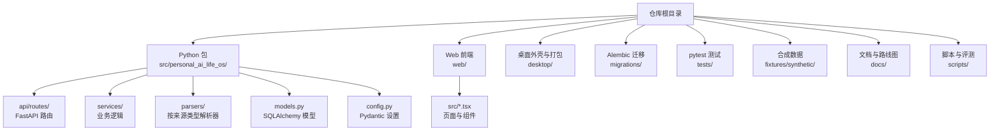
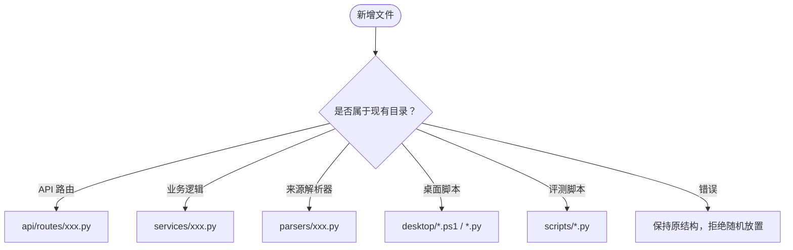
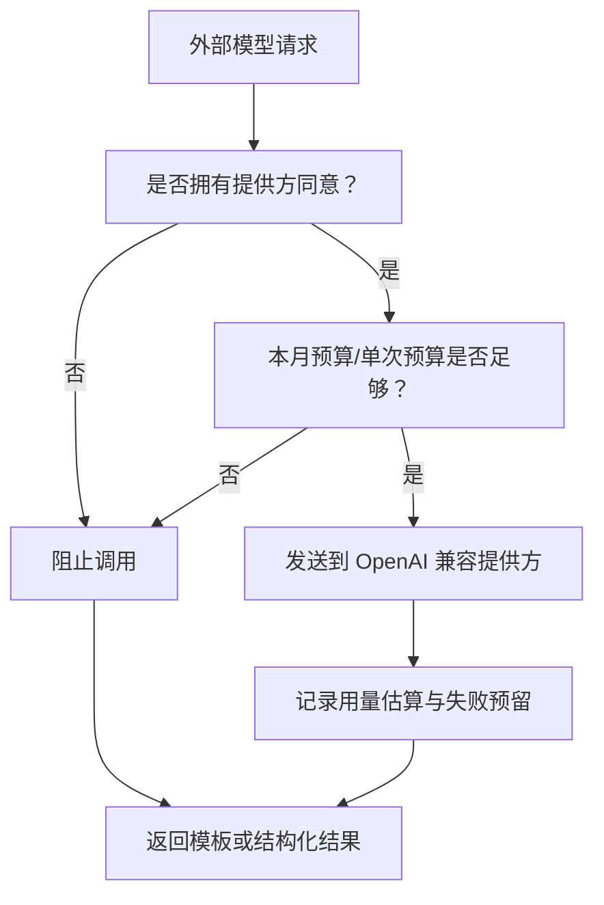

# AI 编码助手指南

<cite>
**本文引用的文件**
- [AGENTS.md](file://AGENTS.md)
- [README.md](file://README.md)
- [CONTRIBUTING.md](file://CONTRIBUTING.md)
- [pyproject.toml](file://pyproject.toml)
- [config.py](file://src/personal_ai_life_os/config.py)
- [privacy.md](file://docs/architecture/privacy.md)
- [prd.md](file://docs/product/prd.md)
- [tauri.conf.json](file://desktop/src-tauri/tauri.conf.json)
</cite>

## 目录
1. [引言](#引言)
2. [项目定位](#项目定位)
3. [开发命令清单](#开发命令清单)
4. [仓库结构约定](#仓库结构约定)
5. [不变式与隐私约束](#不变式与隐私约束)
6. [敏感区域阅读索引](#敏感区域阅读索引)
7. [已知陷阱](#已知陷阱)
8. [AI 编码助手自检清单](#ai-编码助手自检清单)
9. [结论](#结论)

## 引言
AGENTS.md 是为仓库中的 AI 编码助手编写本地开发辅助文档，而不是部署 Wiki、架构 Wiki 或测试 Wiki 的一部分。它面向熟悉 Python/Node/Tauri 的协作工程师和 AI 代理，帮助新成员在第一次改动前掌握项目方向、可执行命令、目录约定、隐私不可变原则，以及遇到敏感模块时应该先阅读的索引。

## 项目定位
Personal AI Life OS 是一个 Apache-2.0 授权的隐私优先个人记忆系统。核心目标不是构建通用知识库服务器，而是让个人用户主动选择工作、学习和生活中的资料，完成“导入—时间线—证据图谱—复盘提醒—可导出”的闭环。

关键产品定位如下：
- 输入来源包括 ChatGPT 等聊天导出、ICS 日历快照、照片、文档和快速笔记。
- 生成内容（摘要、回顾、提醒、图谱实体）必须可溯源到原始来源。
- 外部模型调用默认关闭，需要显式同意、提供方配置、预算控制。
- Windows 桌面 MVP 通过 Tauri 2 + Python sidecar 运行于本机，不等同于公共托管多租户服务。
- 当前尚未允许真实个人资料进入未经验证的共享部署；发布前必须遵循发布清单。

这些结论同时来自产品需求和代码级设置校验，避免把“能力边界”误写成“已上线功能”。

**章节来源**
- [prd.md:1-97](file://docs/product/prd.md#L1-L97)
- [README.md:1-118](file://README.md#L1-L118)

## 开发命令清单
AI 编码助手在执行任何变更前，应先理解以下命令的用途、语言和依赖版本。

### Python 后端与工具
| 命令 | 用途 | 注意事项 |
|---|---|---|
| `uv sync --python 3.11 --all-groups` | 同步 Python 环境及桌面等分组依赖 | 使用 `uv.lock` 锁定版本 |
| `uv run ruff check .` | 运行 Ruff 检查，行宽 100、目标 py311 | 由 `pyproject.toml` 定义规则 |
| `uv run pytest -q` | 运行完整 pytest 套件 | 单测约 130 个，部分用例依赖固定日期 |
| `uv run alembic upgrade head` | 应用数据库迁移 | 新增迁移，不要编辑已应用的修订 |
| `uv run uvicorn personal_ai_life_os.main:app --reload` | 启动 FastAPI 开发服务器 | 默认监听 `127.0.0.1:8000` |
| `uv run lifeos --help` | 查看 CLI 入口用法 | 主脚本为 `personal_ai_life_os.cli:app` |

### Web 前端
| 命令 | 用途 | 注意事项 |
|---|---|---|
| `cd web && npm ci` | 安装 Node 依赖 | 使用锁定文件，非 `npm install` |
| `npm run dev` | 启动 Vite 开发服务器 | 开发代理转发至本地 API |
| `npm run lint` | 运行 oxlint | TS/TSX 静态检查 |
| `npm run build` | 构建生产资源 | TypeScript 编译加 Vite 打包 |
| `npm run test:e2e` | 运行 Playwright 端到端测试 | 自管合成 API 与 Web 端口 |

### 桌面与 Sidecar
| 命令 | 用途 | 注意事项 |
|---|---|---|
| `uv sync --locked --group desktop` | 安装桌面相关依赖 | 锁定依赖并包含 PyInstaller/Tauri 支持 |
| `uv run --frozen --group desktop pytest -q` | 仅运行桌面相关测试 | 要求依赖完全匹配锁文件 |
| `./desktop/build-installer.ps1` | 构建安装包 | Windows x64 专用脚本 |
| `./desktop/smoke-installer.ps1` | 运行桌面冒烟测试 | 验收打包产物行为 |

### 评测与基准
| 命令 | 用途 | 数据范围 |
|---|---|---|
| `uv run python scripts/evaluate_reviews.py` | 评估复盘质量 | 合成数据 |
| `uv run python scripts/evaluate_search.py` | 评估搜索 | 合成数据 |
| `uv run python scripts/evaluate_graph_qa.py` | 评估图谱问答 | 合成数据 |
| `uv run python scripts/benchmark_mvp.py` | 本地 MVP 性能基准 | 本地 SQLite，不代表托管 PostgreSQL 性能 |
| `uv run python scripts/rebuild_search_index.py` | 重建搜索索引 | 基于 FTS5/pg_trgm 候选索引 |

上述命令来源包括项目 README、AGENTS.md 根说明和 `pyproject.toml`。AI 代理不得擅自添加新的全局命令；新增脚本应放在 `scripts/` 下，并在 AGENTS.md 同步维护。

**章节来源**
- [AGENTS.md:7-40](file://AGENTS.md#L7-L40)
- [README.md:57-118](file://README.md#L57-L118)
- [pyproject.toml:12-57](file://pyproject.toml#L12-L57)

## 仓库结构约定
仓库采用语言分层 + 子系统划分结构。AI 代理在引入新文件时应遵循既有命名和位置约定，避免新建模糊的顶层文件或跨层职责块。

要点说明：
- `src/personal_ai_life_os/` 是 Python 包。路由应保持薄逻辑，具体业务放在 `services/`。
- `parsers/` 是受限边界的来源类型解析器，不要在此处写全局业务。
- `services/` 承担导入、图谱、盘点、插件、搜索、任务调度等核心流程。
- `migrations/` 只追加新版本，不修改已应用历史。
- `tests/conftest.py` 在每个测试应用中构造临时 SQLite。
- `fixtures/synthetic/` 仅容纳伪造数据，不能用作真实样本库。
- `web/` 中只有被 desktop runtime 识别的路径才应调用 Tauri API。

**图表来源**
- [AGENTS.md:41-66](file://AGENTS.md#L41-L66)

**章节来源**
- [AGENTS.md:41-66](file://AGENTS.md#L41-L66)
- [README.md:105-118](file://README.md#L105-L118)

## 不变式与隐私约束
作为隐私优先的个人记忆系统，该仓库对“哪些事情绝对不能做”有比一般业务系统更强的约束。AI 编码助手应将以下规则视为变更否决条件。

### 隐私与不可变性
1. **导入原件不可变**：用户上传的聊天导出、照片、文档、记忆文件等内容不得被侧链程序改写。解析后的条目必须保留 source 和出处信息。
2. **所有数据按所有者隔离**：记录查询必须按 owner 过滤；API、插件、后台任务和导出都需遵守同一边界。
3. **导入数据视为不受信任**：不能把未验证文本、图片、agent 文件直接当作安全数据写入日志、JSON、终端输出或数据库明文字段。
4. **对象存储与数据库分离处理**：对象存储用于附件和导入物，删除通过独立 tombstone/ledger 路径实现。

### 删除不可变
删除不会单纯“软标记一条记录就结束”：
- 删除通过持久的删除日记和墓碑路径进行。
- 服务启动时回放墓碑，防止数据库恢复后重新复活已删内容。
- 普通源删除会失效关联的复盘和提醒；照片批删除会移除同批其他照片。
- 快速笔记是唯一例外：单个笔记删除只软删自身，并使引用它的记录失效。
- ICS 取消或缺失事件只软删受影响的版本，不影响整个来源。

### 外部 AI 最小化启用
- 模型提供方默认为 `none`，外部调用默认关闭。
- 开启外部模型需要：提供方配置、每提供方同意、当前披露版本、正数的 token 成本和预算。
- 会话令牌、provider key、预算上限、隐私披露等均在运行时配置，不在数据库持久化敏感值。
- 生产环境强制要求 S3 兼容对象存储、带加密的数据卷、TLS、私有的 metrics token，且禁止自动建表、开放注册、暴露 localhost CORS。

**图表来源**
- [privacy.md:9-53](file://docs/architecture/privacy.md#L9-L53)
- [config.py:20-132](file://src/personal_ai_life_os/config.py#L20-L132)

**章节来源**
- [AGENTS.md:48-68](file://AGENTS.md#L48-L68)
- [privacy.md:9-53](file://docs/architecture/privacy.md#L9-L53)
- [config.py:20-132](file://src/personal_ai_life_os/config.py#L20-L132)

## 敏感区域阅读索引
当 AI 编码助手准备修改以下区域之一时，应优先阅读对应文档，而不是直接根据上下文推断行为。

| 敏感区域 | 必须先读 | 原因 |
|---|---|---|
| 产品行为契约 | `docs/product/prd.md` | 确定 MVP 边界、用户旅程和“MVP 外内容” |
| 架构与数据模型 | `docs/architecture/overview.md`、`docs/architecture/data-model.md` | 理解 owner、source、item、tombstone 关系 |
| 桌面 Shell 与 Sidecar | `desktop/src-tauri/tauri.conf.json`、`docs/operations/desktop-acceptance.md` | 本地端口、CSP、origin 限制、打包资源 |
| 隐私规则与限制 | `docs/architecture/privacy.md` | 删除保证、令牌、OCR、插件、审核与审计边界 |
| 发布流程 | `docs/operations/release-checklist.md` | 桌面签名、分发和真实数据准入门槛 |
| 环境与安全 | `src/personal_ai_life_os/config.py`、`.env.example` | token secret、CORS、模型提供方、预算校验 |
| 评价与基准 | `scripts/*eval*.py`、`scripts/benchmark_mvp.py` | 合成数据范围，不代表生产指标 |

注意：AGENTS.md 末尾列出了若干权威文档路径，但其中 `docs/architecture/desktop.md` 在当前仓库结构中不存在，实际存在的是 `docs/operations/desktop-acceptance.md` 和桌面 Tauri 配置。AI 助手应以实际存在文件和 README 引用为准，不要盲目复制 AGENTS.md 中的无效链接。

**章节来源**
- [AGENTS.md:67-70](file://AGENTS.md#L67-L70)
- [privacy.md:1-53](file://docs/architecture/privacy.md#L1-L53)
- [README.md:57-118](file://README.md#L57-L118)

## 已知陷阱
AI 编码助手在执行命令时，应避免常见平台差异和锁定不一致问题。

1. **uv.lock 可能因镜像被重写**：本地全局 uv 可能默认 Aliyun 镜像，裸 `uv run` 会改写 lock 文件 URL 和 revision。推荐 `uv run --frozen`，或用 `.venv/Scripts/python.exe` 直接运行 ruff/pytest。发布一致性应复现 `UV_DEFAULT_INDEX=https://pypi.org/simple UV_INDEX_URL=https://pypi.org/simple uv lock --check` 的方式检查。
2. **cargo 不在 Git Bash PATH**：Tauri/Rust 相关命令需用绝对路径，例如 `/c/Users/Lenovo/.cargo/bin/cargo.exe`。
3. **依赖日期的测试必须固定时钟**：测试中对“今天”的依赖会造成日期漂移；参考注释中指出 `tests/test_graph_qa.py` 曾因真实时钟失败。
4. **桌面安全策略严格**：登录注册和邮箱登录被禁用；CORS 锁定为桌面 origin；sidecar 绑定随机回环端口并使用逐次启动秘密；Tauri CSP 不允许内联脚本和 frame。
5. **Sidecar 打包结构重要**：PyInstaller onedir 的 `_internal` 目录必须完整随包分发。
6. **上传大小上限明确**：文本 5 MB/文件，照片 20 MB/4000 万像素，复盘周期最多 500 个来源项。
7. **语言与界面优先级**：Web UI 中文优先，桌面与 Web 流程需保持一致性。
8. **工具链版本**：Node 24、Rust/MSVC、Python 3.12 x64（桌面 sidecar 构建）、Python 3.11+（运行）、Ruff py311 目标。

**章节来源**
- [AGENTS.md:53-66](file://AGENTS.md#L53-L66)
- [README.md:34-56](file://README.md#L34-L56)
- [tauri.conf.json:1-29](file://desktop/src-tauri/tauri.conf.json#L1-L29)

## AI 编码助手自检清单
每次提交前应回答以下问题。如果任一答案为“否”，不应合并该变更。

- 是否确认本次改动只影响所需范围？是否遵循 `api/routes/` 薄路由、`services/` 业务逻辑、`parsers/` 按来源类型的约定？
- 是否运行了正确的命令？Python 用 `uv run ruff check .` 和 `uv run pytest -q`，Web 用 `npm run lint` 和 `npm run test:e2e`。
- 是否避免了污染 `uv.lock`？是否考虑了 `uv run --frozen` 和本地镜像差异。
- 是否没有在日志、API 响应、对象存储路径或错误信息中泄露 API key、聊天正文、照片内容或个人数据。
- 是否保留了 ownership 过滤和溯源字段？是否没有把外部生成的内容伪装成用户原文。
- 是否尊重删除路径？新增删除是否走墓碑机制，而不是仅打一个布尔标志。
- 是否在没有显式同意时阻止外部模型调用，并正确处理预算与月度限额。
- 是否没有改动已应用的 Alembic 迁移；是否需要新增迁移并附带说明。
- 是否没有在桌面/CSP/CORs/Tauri 安全配置上擅自放宽访问面。
- 是否更新了 README 或 AGENTS.md 中相关的命令或入口，但没有复制虚假文档路径。

**章节来源**
- [AGENTS.md:7-66](file://AGENTS.md#L7-L66)
- [CONTRIBUTING.md:1-25](file://CONTRIBUTING.md#L1-L25)

## 结论
这份 AI 编码助手指南的核心不是增加另一套复杂规范，而是把已有仓库信息整理成“新贡献者/AI 代理第一次可用”的开发入口。它强调四个维度：能用 uv/pnpm/desktop 正确启动项目；能按照 src/web/desktop/migrations/tests 结构组织代码；能不破坏隐私、删除和模型调用的安全边界；能在改动敏感区域前查阅 prd、隐私和桌面验收文档。

当 AI 助手遇到“可以扩展”和“必须保持不变”之间的冲突时，应保守解读：在不破坏 owner 隔离、溯源、删除回放、外部模型白名单和桌面安全策略的前提下再进行增量改进。