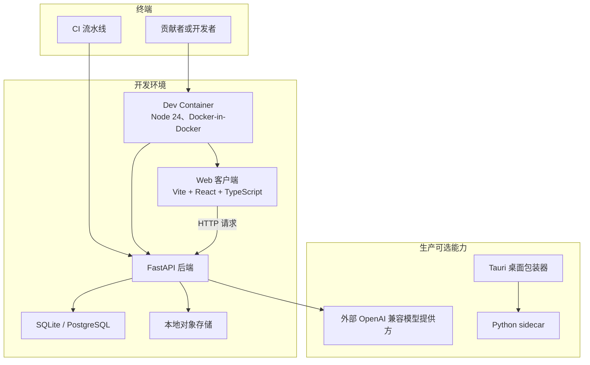
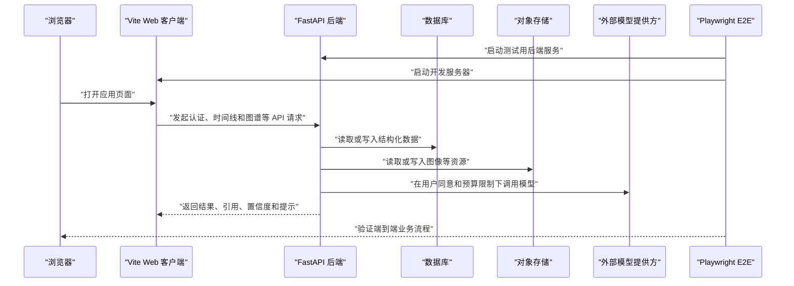
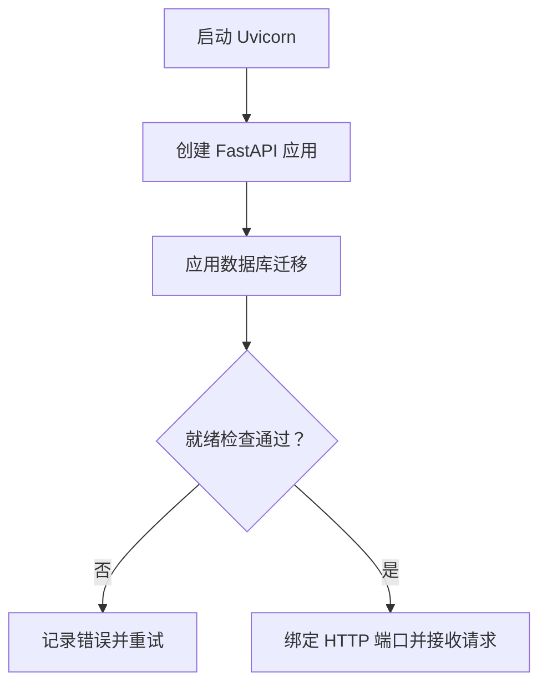
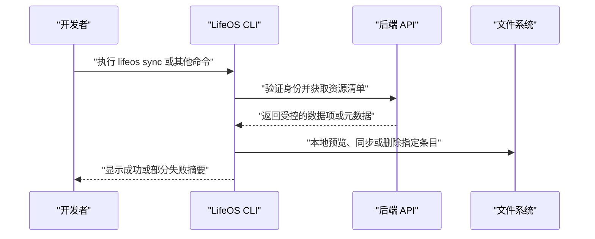
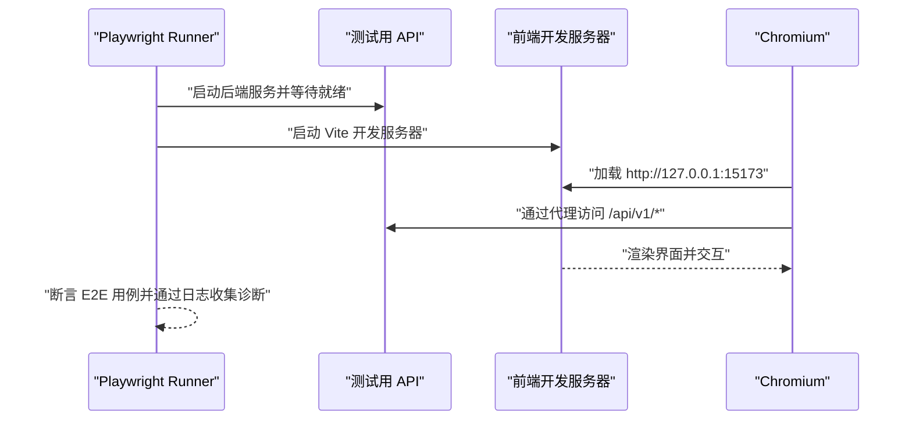
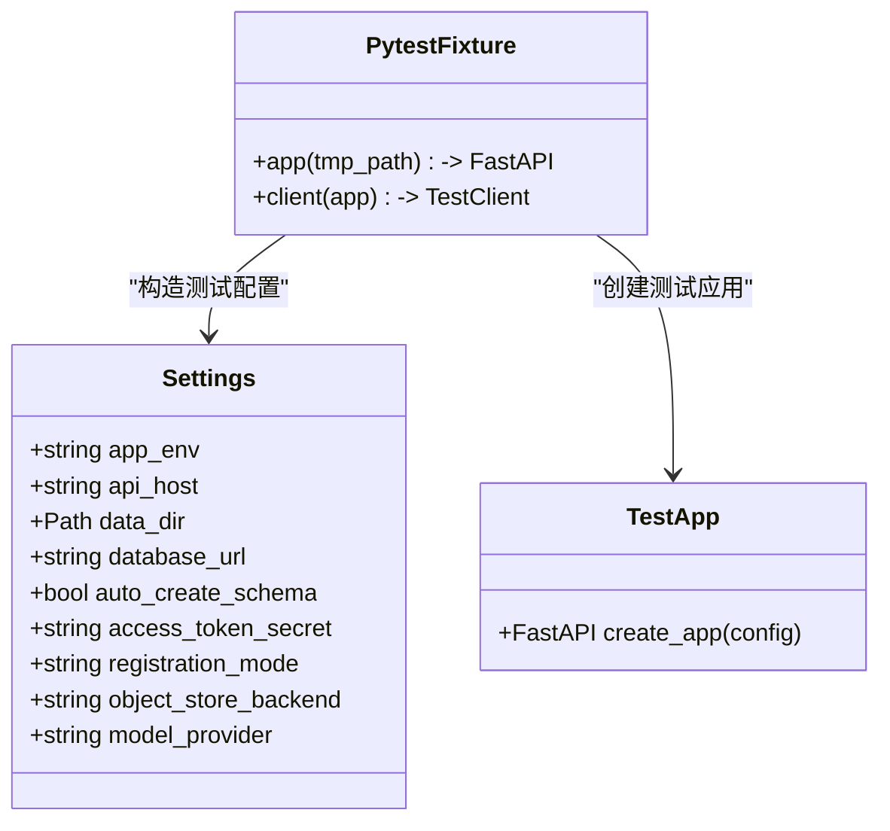
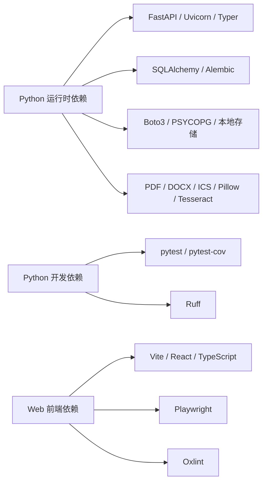
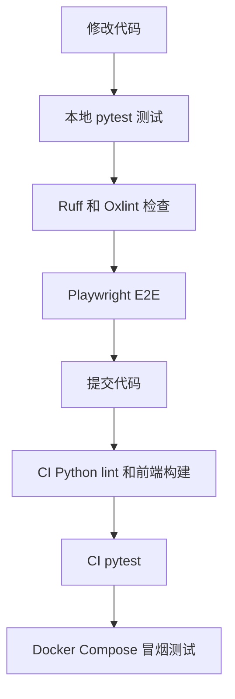

# 开发指南

<cite>
**本文引用的文件**   
- [README.md](file://README.md)
- [CONTRIBUTING.md](file://CONTRIBUTING.md)
- [pyproject.toml](file://pyproject.toml)
- [.github/workflows/ci.yml](file://.github/workflows/ci.yml)
- [src/personal_ai_life_os/main.py](file://src/personal_ai_life_os/main.py)
- [src/personal_ai_life_os/cli.py](file://src/personal_ai_life_os/cli.py)
- [web/package.json](file://web/package.json)
- [web/playwright.config.ts](file://web/playwright.config.ts)
- [.devcontainer/devcontainer.json](file://.devcontainer/devcontainer.json)
- [desktop/src-tauri/Cargo.toml](file://desktop/src-tauri/Cargo.toml)
- [tests/conftest.py](file://tests/conftest.py)
- [SECURITY.md](file://SECURITY.md)
</cite>

## 目录
1. [简介](#简介)
2. [项目结构](#项目结构)
3. [核心组件](#核心组件)
4. [架构总览](#架构总览)
5. [详细组件分析](#详细组件分析)
6. [依赖分析](#依赖分析)
7. [性能注意事项](#性能注意事项)
8. [故障排查指南](#故障排查指南)
9. [结论](#结论)
10. [附录：贡献与合规](#附录贡献与合规)

## 简介
Personal AI Life OS 是一个开源的个人记忆系统：在用户明确授权的前提下，导入聊天导出、日历快照、照片和文档等来源，维护可追溯的时间线，抽取带证据的实体与关系图谱，生成周复盘、提醒与反思，并支持将数据以 Markdown 形式导出到 Obsidian。当前版本处于 MVP 阶段，本地 API、命令行工具、Web 工作流、审查流程、图片处理和生产部署模板均已实现，Windows 桌面 MVP（D0–D5）也已通过基于合成数据的本机验收。该项目采用 Apache-2.0 许可证，默认使用 SQLite 和本地对象存储进行开发，并可组合使用 PostgreSQL 和外部的 S3 兼容对象存储进行生产部署。

## 项目结构
仓库采用按职责分层的组织方式：
- `src/personal_ai_life_os/`：后端 FastAPI 应用、CLI、模型、数据库配置、存储服务、业务服务层和路由。
- `web/`：React + TypeScript Web 客户端，使用 Vite 构建、Playwright E2E 测试和 Oxlint 检查。
- `desktop/src-tauri/`：基于 Tauri 的 Windows 桌面壳进程，负责启动 Python sidecar、托盘、单实例和通知等功能。
- `tests/`：pytest 单元测试和部分集成测试。
- `migrations/`：Alembic 数据库迁移。
- `scripts/`：评估搜索、评测审阅质量、重建搜索索引和本地基准测试脚本。
- `docker-compose*.yml`：用于 Compose 环境的编排。
- `.devcontainer/`：GitHub Codespaces / Dev Container 配置。
- `.github/workflows/`：CI 流水线配置。

**图示来源**  
- [.devcontainer/devcontainer.json:1-33](file://.devcontainer/devcontainer.json#L1-L33)
- [web/package.json:1-29](file://web/package.json#L1-L29)
- [pyproject.toml:1-58](file://pyproject.toml#L1-L58)
- [desktop/src-tauri/Cargo.toml:1-19](file://desktop/src-tauri/Cargo.toml#L1-L19)

**章节来源**  
- [README.md:83-118](file://README.md#L83-L118)
- [CONTRIBUTING.md:1-25](file://CONTRIBUTING.md#L1-L25)

## 核心组件
### 后端接口与服务
后端基于 FastAPI，提供 REST API、交互式文档、健康检查、就绪检查和统一的应用生命周期入口。关键特性包括：
- 用户认证、凭据管理、多租户隔离。
- 快速笔记、标签和集合管理。
- 多源导入与解析器。
- 图片 OCR 与可选的异步处理模式。
- 实体与关系图谱提取、审查、合并与查询。
- 评论、洞察、提醒和项目目标管理。
- 搜索索引与保存的检索条件。
- 插件机制、凭证审批和预算控制。
- 计划任务、作业执行和用户行为审计。

**章节来源**  
- [README.md:15-82](file://README.md#L15-L82)
- [pyproject.toml:1-37](file://pyproject.toml#L1-L37)
- [src/personal_ai_life_os/main.py](file://src/personal_ai_life_os/main.py)

### 命令行工具
CLI 暴露 `lifeos` 命令，支持注册、登录、查看当前用户、预览、同步和导出等操作。它由 Typer 驱动，并挂载在 `personal_ai_life_os.cli:app`。该 CLI 也用于每日文件夹同步，可与 Windows 计划任务配合重复运行。

**章节来源**  
- [README.md:11-12](file://README.md#L11-L12)
- [README.md:45-62](file://README.md#L45-L62)
- [README.md:103-108](file://README.md#L103-L108)
- [pyproject.toml:34-37](file://pyproject.toml#L34-L37)
- [src/personal_ai_life_os/cli.py](file://src/personal_ai_life_os/cli.py)

### Web 客户端
Web 前端使用 React、TypeScript 和 Vite，提供时间线浏览、提问、图谱交互、审查、搜索结果、设置和 PWA 功能。开发脚本包含 `npm run dev`、`npm run build`、`npm run lint` 和 Playwright E2E 测试脚本。Oxlint 是主要的 JS/TS 静态检查工具，而不是传统 ESLint。

**章节来源**  
- [web/package.json:1-29](file://web/package.json#L1-L29)
- [web/.oxlintrc.json:1-8](file://web/.oxlintrc.json#L1-L8)
- [README.md:53-65](file://README.md#L53-L65)

### Tauri 桌面壳
桌面侧使用 Tauri 2 构建原生外壳，负责在 Windows 上托管 WebView2、启动 Python sidecar、管理系统托盘、单实例运行、通知、对话框、注册表访问和安全令牌。Rust 包名是 `lifeos`，版本号与仓库 Python 包保持一致。

**章节来源**  
- [desktop/src-tauri/Cargo.toml:1-19](file://desktop/src-tauri/Cargo.toml#L1-L19)
- [README.md:34-47](file://README.md#L34-L47)

## 架构总览
后端作为中央服务，承担认证、持久化、业务编排、外部模型调用限制、OCR、作业队列和搜索索引维护职责；前端通过 HTTP 调用 API，并提供浏览器通知、PWA、下载回退和本地 Vault 直写体验；桌面壳则封装这些能力，使其对终端用户更像本地安装程序。

**图示来源**  
- [web/playwright.config.ts:1-53](file://web/playwright.config.ts#L1-L53)
- [README.md:39-65](file://README.md#L39-L65)

## 详细组件分析

### 后端入口与健康检查
后端由 FastAPI 应用工厂创建，并在健康检查和就绪检查中对外暴露服务能力。开发时可直接运行 Uvicorn，加载 Alembic 迁移后监听默认地址。

**图示来源**  
- [pyproject.toml:1-37](file://pyproject.toml#L1-L37)
- [README.md:45-52](file://README.md#L45-L52)
- [.github/workflows/ci.yml:24-34](file://.github/workflows/ci.yml#L24-L34)

**章节来源**  
- [README.md:45-65](file://README.md#L45-L65)
- [.github/workflows/ci.yml:1-57](file://.github/workflows/ci.yml#L1-L57)

### CLI 工作流
CLI 用于用户注册、登录、查看身份、预览导入内容、同步文件夹和导出数据。新增 CLI 命令时应保持参数清晰、权限最小、输出可读，并在帮助文本中说明输入限制和失败回退行为。

**图示来源**  
- [README.md:45-65](file://README.md#L45-L65)
- [pyproject.toml:34-37](file://pyproject.toml#L34-L37)

**章节来源**  
- [src/personal_ai_life_os/cli.py](file://src/personal_ai_life_os/cli.py)
- [pyproject.toml:34-37](file://pyproject.toml#L34-L37)

### Web 客户端与 E2E 测试
Web 客户端通过 npm scripts 管理开发、构建、静态检查和 E2E 测试。Playwright 会同时启动测试用 API 和前端开发服务器，并使用合成环境变量绕过真实外部 AI，避免 E2E 测试泄露密钥。

**图示来源**  
- [web/package.json:1-29](file://web/package.json#L1-L29)
- [web/playwright.config.ts:1-53](file://web/playwright.config.ts#L1-L53)

**章节来源**  
- [web/package.json:1-29](file://web/package.json#L1-L29)
- [web/playwright.config.ts:1-53](file://web/playwright.config.ts#L1-L53)

### 单元测试夹具
pytest 夹具通过临时路径注入 SQLite、只读数据和模拟的配置对象，避免破坏宿主环境的数据库。所有需要 FastAPI 应用的测试可以复用此夹具获取一致的运行时行为。

**图示来源**  
- [tests/conftest.py:1-31](file://tests/conftest.py#L1-L31)

**章节来源**  
- [tests/conftest.py:1-31](file://tests/conftest.py#L1-L31)

## 依赖分析
项目的依赖分为运行时依赖、桌面打包相关依赖和开发依赖三类：

| 类别 | 主要用途 | 关键依赖 | 备注 |
|---|---|---|---|
| 运行时 | Web API、ORM、迁移、CLI、网络请求、鉴权、密码哈希、PDF 和 ICS 解析、OCR、对象存储 | FastAPI、SQLAlchemy、Alembic、Uvicorn、PyJWT、Pydantic Settings、Pillow、pypdf、python-docx、icalendar、boto3、psycopg、httpx、pwdlib、typer、pytesseract | 使用版本范围而非固定锁定版本；后端依赖由 Python 包管理器和 uv lock 控制 |
| 桌面开发 | PyInstaller、ijson、平台依赖 | desktop 分组依赖 | 仅在桌面打包或构建时需要 |
| 开发 | 单元测试、覆盖率、Ruff | pytest、pytest-cov、ruff | 单元测试根路径为 `tests`，Ruff 行宽 100、目标 Python 3.11 |
| 前端 | Vite、React、TypeScript、Playwright、Oxlint | web/package.json 中的依赖 | 前端使用 Oxlint 替代 ESLint，Playwright 作为 E2E 框架 |

**图示来源**  
- [pyproject.toml:1-58](file://pyproject.toml#L1-L58)
- [web/package.json:1-29](file://web/package.json#L1-L29)

**章节来源**  
- [pyproject.toml:1-58](file://pyproject.toml#L1-L58)
- [web/package.json:1-29](file://web/package.json#L1-L29)

## 性能注意事项
- 后端默认使用 SQLite，适合开发和 MVP 验证；生产可通过 Compose 切换到 PostgreSQL，并通过对象存储扩展文件容量。
- 搜索使用有界候选索引，不会引入语义向量索引；大规模数据时需关注 FTS 和全文匹配的性能边界。
- 外部模型调用受预算限制，超过阈值会警告或阻止调用；应避免无上限地触发外部推理任务。
- 图片处理可选择内联或恢复性作业模式；批量扫描大目录时应考虑并发和资源占用。
- 本地 benchmark 脚本仅用于生成的 SQLite 数据，不代表托管 PostgreSQL 表现。

**章节来源**  
- [README.md:69-82](file://README.md#L69-L82)
- [README.md:109-118](file://README.md#L109-L118)

## 故障排查指南

### 开发环境无法启动
- 确认 Python 3.11+、uv 和 Node.js 已安装，或使用 GitHub Codespaces 预置 Dev Container。
- 复制 `.env.example` 为 `.env`，并确保敏感字段没有误提交到仓库。
- API 默认在 `127.0.0.1:8000`，Web 开发服务器默认在 `127.0.0.1:5173`，两者端口不可冲突。
- Docker Compose 模式下应先启动 `db` 等依赖服务，再运行镜像服务。

**章节来源**  
- [README.md:39-65](file://README.md#L39-L65)
- [.devcontainer/devcontainer.json:1-33](file://.devcontainer/devcontainer.json#L1-L33)

### 单元测试失败
- 优先使用 `uv run pytest -q` 复现问题。
- 检查测试夹具是否使用了临时目录和 SQLite，避免与其他测试共享状态。
- 若测试依赖外部模型，应确认 `MODEL_PROVIDER=none` 或在受控的合成环境中运行。

**章节来源**  
- [pyproject.toml:43-48](file://pyproject.toml#L43-L48)
- [tests/conftest.py:1-31](file://tests/conftest.py#L1-L31)
- [README.md:100-108](file://README.md#L100-L108)

### E2E 测试失败
- 确保 Playwright 能启动两个 web server：API 运行在 `18000`，前端在 `15173`。
- 若浏览器通道不匹配，可通过环境变量调整 `LIFEOS_BROWSER_CHANNEL`。
- 日志和产物通常位于 playwright 默认的测试报告和截图路径。

**章节来源**  
- [web/playwright.config.ts:1-53](file://web/playwright.config.ts#L1-L53)
- [web/package.json:1-29](file://web/package.json#L1-L29)

### IDE 调试建议
- 直接调试 `personal_ai_life_os.main:app`，或使用 `uvicorn personal_ai_life_os.main:app --reload`。
- 在后端打断点时，确保 `database_url`、`data_dir`、`object_store_backend` 指向临时路径以避免污染数据。
- 在前端调试时，使用浏览器开发者工具的网络面板观察 `/api/v1/*` 的请求和响应。

**章节来源**  
- [README.md:45-65](file://README.md#L45-L65)
- [tests/conftest.py:1-31](file://tests/conftest.py#L1-L31)

## 结论
Personal AI Life OS 在 MVP 阶段已经覆盖从数据导入、证据抽取、知识图谱、周复盘、提醒与搜索，到网页应用和 Windows 桌面的完整链路。新贡献者应从 README 的本地开发流程入手，先让 API 和 Web 客户端在 Dev Container 或本机运行，再通过 pytest 和 Playwright 建立反馈回路。新增功能应保持数据来源可追溯、权限最小、日志不包含敏感信息，并以小而清晰的 Pull Request 提交审查。

[无需“章节来源”，因为本节总结已有内容而不分析具体代码段]

## 附录：贡献与合规

### 开发环境搭建步骤
1. **安装基础工具链**
   - Python 3.11 或更高版本。
   - Node.js 24 和 npm，用于 `web/` 前端。
   - Rust 工具链，用于 Tauri 桌面构建和 Rust 依赖编译。
   - 可选：Docker Desktop 或 Dev Container，用于 Compose 服务和 Codespaces。

2. **克隆仓库并准备环境**
   - 复制 `.env.example` 为 `.env`，填写必要的环境变量，但不要提交个人凭据。
   - 使用 `uv sync --python 3.11 --all-groups` 安装 Python 依赖组。
   - 安装 `web/` 依赖：进入 `web/` 后执行 `npm ci`。

3. **启动后端**
   - 运行 Alembic 迁移，然后执行 `uvicorn personal_ai_life_os.main:app --reload`。
   - 打开 `http://127.0.0.1:8000/docs` 查看交互式 API 文档和健康检查。

4. **启动 Web 客户端**
   - 进入 `web/` 后执行 `npm run dev`。
   - 打开 `http://127.0.0.1:5173`，开发代理会自动转发到本地 API。

5. **可选：使用 Compose 或 Dev Container**
   - 运行 `docker compose up --build --detach --wait` 启动完整依赖栈。
   - 在 GitHub Codespaces 中创建 Dev Container，内置 Node 24、Docker 和端口自动转发。

**章节来源**  
- [README.md:39-82](file://README.md#L39-L82)
- [.devcontainer/devcontainer.json:1-33](file://.devcontainer/devcontainer.json#L1-L33)
- [CONTRIBUTING.md:12-18](file://CONTRIBUTING.md#L12-L18)

### 代码规范与风格
- **Python 规范**
  - 本项目使用 Ruff 进行静态检查和格式化，行宽配置为 100，目标 Python 版本为 3.11。
  - 建议使用 `uv run ruff check .` 在提交前检查代码风格。
  - 注意：仓库中没有启用 Black 作为默认 Python 格式化工具。
- **TypeScript 与前端规范**
  - 前端使用 Oxlint，配置文件位于 `web/.oxlintrc.json`。
  - 当前规则启用了 React Hook 规则和组件导出限制。
  - 执行 `npm run lint` 或进入 `web/` 后再运行 Oxlint。
- **Git 提交约定**
  - 项目强调简短、清晰、可审阅的提交信息和小型 Pull Request。
  - 不要提交个人信息、聊天记录、照片、内存文件和生产数据。
  - 新增连接器必须说明读取权限、收集字段、删除行为和导出行为。

**章节来源**  
- [pyproject.toml:48-58](file://pyproject.toml#L48-L58)
- [web/package.json:1-29](file://web/package.json#L1-L29)
- [web/.oxlintrc.json:1-8](file://web/.oxlintrc.json#L1-L8)
- [CONTRIBUTING.md:12-25](file://CONTRIBUTING.md#L12-L25)

### 项目目录结构与模块组织原则
- `src/personal_ai_life_os/`
  - 应用入口、API 路由、依赖注入和模式定义。
  - parsers 负责解析 Markdown、ChatGPT 导出、文档、图片和日历。
  - services 封装业务逻辑，如图谱抽取、证据、审查、作业、定时任务和搜索索引。
  - db、models、config、storage 等基础设施模块被其他组件复用。
- `tests/`
  - 针对业务逻辑、API、解析器、作业行为和配置的 pytest 测试。
- `web/`
  - 前端源码、PWA 配置、Vite 配置、Oxlint 规则、playwright 配置和 e2e 用例。
- `desktop/src-tauri/`
  - Tauri 和 Rust 相关包声明与依赖。
- `migrations/`
  - Alembic 迁移目录，每次数据库结构变更应添加独立版本。
- `scripts/`
  - 评估、基准、备份、还原和运维辅助脚本。
- `docs/`
  - PRD、架构决策、路线图、运营流程和操作手册。

**章节来源**  
- [README.md:83-118](file://README.md#L83-L118)
- [pyproject.toml:43-58](file://pyproject.toml#L43-L58)
- [desktop/src-tauri/Cargo.toml:1-19](file://desktop/src-tauri/Cargo.toml#L1-L19)

### 新增功能标准流程
1. 阅读产品需求、架构概览和现有 issue。
2. 设计数据模型、权限边界、隐私和导出影响。
3. 实现后端 service、parser、API 路由或前端页面，保持数据来源可追溯。
4. 编写单元测试；如有 UI 变化，补充 Playwright E2E 测试。
5. 运行 Ruff、pytest、前端 lint 和构建脚本。
6. 提交小而清晰的变更，附上测试方法和风险说明。

**章节来源**  
- [CONTRIBUTING.md:1-25](file://CONTRIBUTING.md#L1-L25)
- [README.md:83-118](file://README.md#L83-L118)

### 修复 Bug 标准流程
1. 根据 issue 和报错复现问题，定位后端日志、前端网络请求或 E2E 用例。
2. 判断是否与敏感数据、权限、数据一致性、外部模型调用或文件 I/O 有关。
3. 增加最小化测试用例覆盖边缘情况。
4. 修复后运行完整 CI 等价命令：Ruff、pytest、前端 lint 和构建。
5. 更新相关文档，特别是安全相关或数据模型变更。

**章节来源**  
- [SECURITY.md:1-13](file://SECURITY.md#L1-L13)
- [.github/workflows/ci.yml:1-57](file://.github/workflows/ci.yml#L1-L57)

### 测试策略
- **单元测试**
  - 使用 pytest，测试路径位于 `tests`。
  - 默认添加 `-ra` 选项，便于收集测试报告。
  - 通过 `conftest.py` 的夹具创建 FastAPI 应用，避免共享持久化数据。
- **集成测试**
  - CI 中执行完整的 Python lint、测试、前端 lint 和前端构建。
  - 还包含 Docker Compose smoke 检查，验证健康端点和就绪端点。
- **E2E 测试**
  - Playwright 测试位于 `web/e2e/`，通过 `npm run test:e2e` 执行。
  - 会拉起一个测试用后端和一个开发前端，使用合成数据运行浏览器自动化流程。

**图示来源**  
- [pyproject.toml:43-48](file://pyproject.toml#L43-L48)
- [web/package.json:1-29](file://web/package.json#L1-L29)
- [web/playwright.config.ts:1-53](file://web/playwright.config.ts#L1-L53)
- [.github/workflows/ci.yml:1-57](file://.github/workflows/ci.yml#L1-L57)

**章节来源**  
- [tests/conftest.py:1-31](file://tests/conftest.py#L1-L31)
- [web/playwright.config.ts:1-53](file://web/playwright.config.ts#L1-L53)
- [.github/workflows/ci.yml:1-57](file://.github/workflows/ci.yml#L1-L57)

### 代码审查流程与 Pull Request 规范
- 提交前应先在本地运行 Ruff、pytest、Oxlint、构建和 E2E 测试。
- 每个 PR 应聚焦单一主题，例如新增连接器、修复检索 bug 或调整审查流程。
- PR 描述应包含变更目的、受影响模块、测试方式、回归风险和发布影响。
- 新功能需体现数据来源追踪、权限说明、隐私处理和可导出性。
- CI 失败时应先看失败的 job：Python lint、Python 测试、前端构建或 Compose 冒烟测试。

**章节来源**  
- [CONTRIBUTING.md:12-25](file://CONTRIBUTING.md#L12-L25)
- [.github/workflows/ci.yml:1-57](file://.github/workflows/ci.yml#L1-L57)

### 常见问题解答
- **为什么 Web 客户端打不开？**  
  检查 Node.js 24、`npm ci` 是否成功、以及是否启动了开发代理和后端 API。
- **为什么 pytest 报数据库或路径错误？**  
  夹具会创建临时数据目录；请确认测试没有复用持久化 SQLite 或全局状态。
- **为什么 E2E 无法连接后端？**  
  Playwright 会启动 `18000` 端口上的后端和 `15173` 端口的前端，确认两个服务都已就绪。
- **能否直接使用真实聊天记录或个人照片测试？**  
  不应随意提交真实个人资料；应优先使用 `fixtures/synthetic/` 中的合成数据，或遵循发布和验收流程。

**章节来源**  
- [README.md:39-82](file://README.md#L39-L82)
- [tests/conftest.py:1-31](file://tests/conftest.py#L1-L31)
- [web/playwright.config.ts:1-53](file://web/playwright.config.ts#L1-L53)

### 最佳实践
- 始终把导入数据视为不可信用户输入。
- 不提交个人资料、聊天导出、照片、凭据和产品信息。
- 原始来源内容应保持可追溯；AI 生成的注释应标记并可编辑。
- 避免授予广域权限或后台自动采集；连接器必须透明说明权限。
- 变更配置和数据模型时必须更新文档。
- 日志不得包含原始聊天文本、图片内容、访问令牌或 Agent 记忆内容。

**章节来源**  
- [CONTRIBUTING.md:15-25](file://CONTRIBUTING.md#L15-L25)
- [SECURITY.md:1-13](file://SECURITY.md#L1-L13)

### 贡献者行为准则与社区参与
- 项目欢迎早期阶段的贡献，但强调聚焦问题和清晰的设计说明。
- 重大变更应先讨论 issue，再提交 PR。
- 贡献在 Apache-2.0 许可证下提交。
- 安全问题不要在公开 issue 中披露；通过仓库提供的私有联系方式报告漏洞，并附带复现步骤、影响版本和潜在影响。

**章节来源**  
- [CONTRIBUTING.md:1-25](file://CONTRIBUTING.md#L1-L25)
- [SECURITY.md:1-13](file://SECURITY.md#L1-L13)