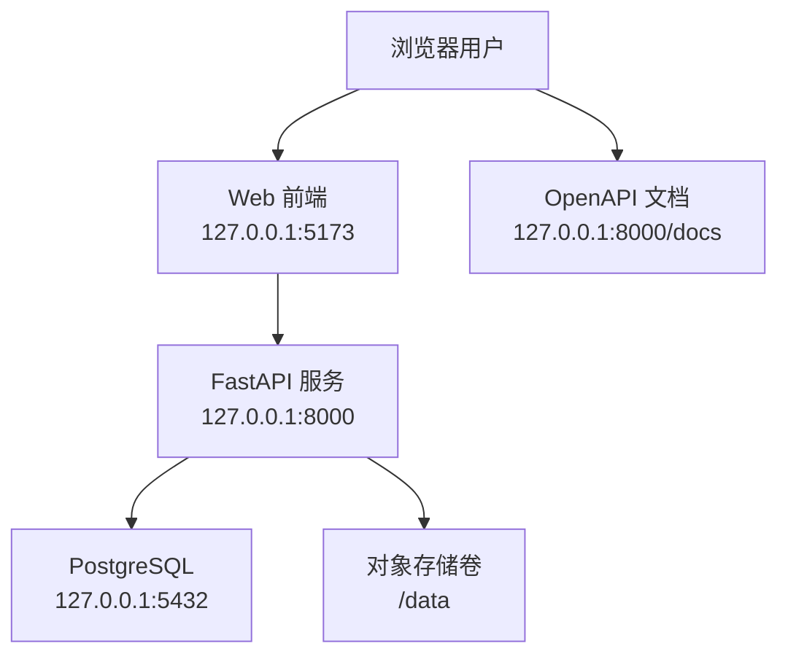
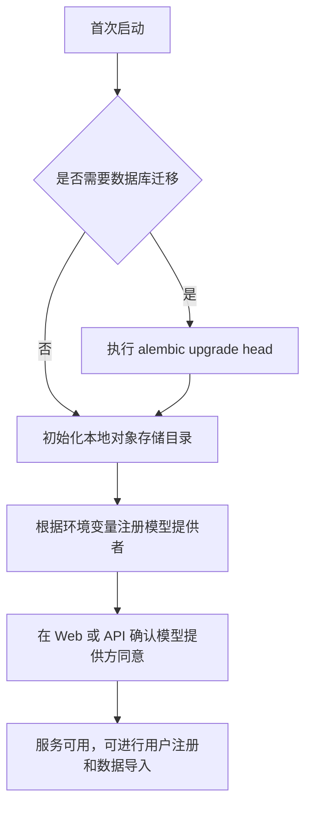
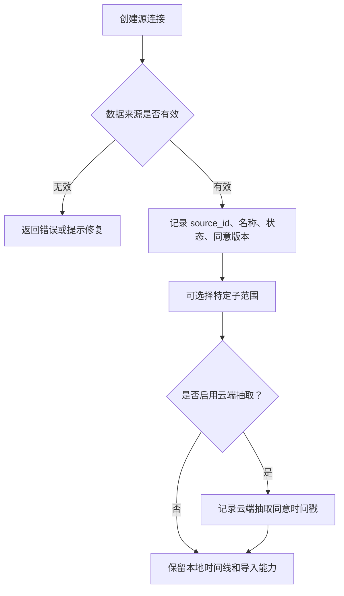
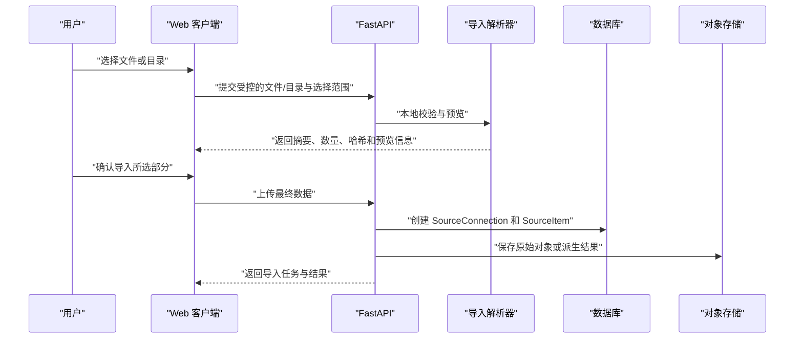
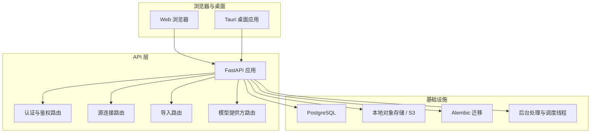
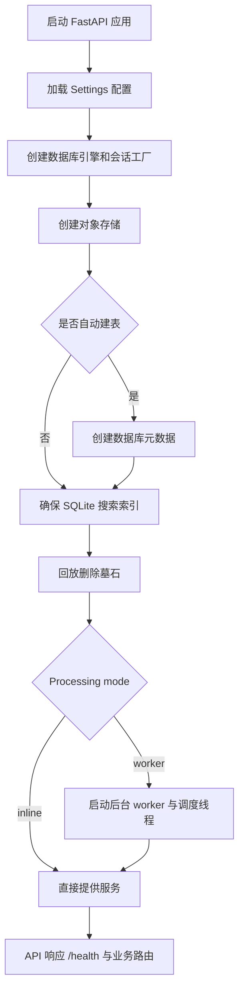
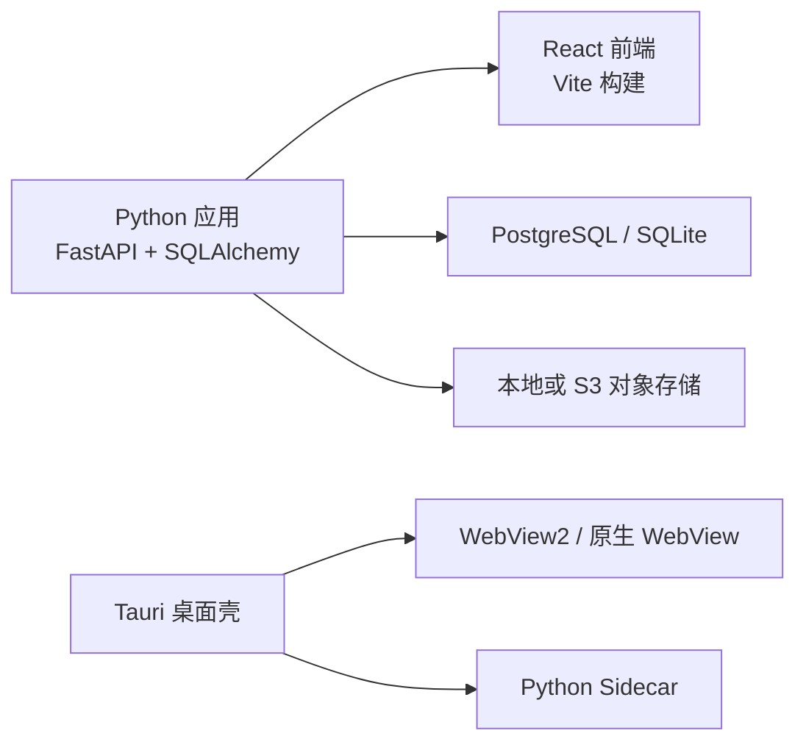

# 快速开始

<cite>
**本文引用的文件**   
- [README.md](file://README.md)
- [docker-compose.yml](file://docker-compose.yml)
- [Dockerfile](file://Dockerfile)
- [pyproject.toml](file://pyproject.toml)
- [ci.yml](file://.github/workflows/ci.yml)
- [deployment.md](file://docs/operations/deployment.md)
- [support-matrix.md](file://docs/operations/support-matrix.md)
- [main.py](file://src/personal_ai_life_os/main.py)
- [config.py](file://src/personal_ai_life_os/config.py)
- [cli.py](file://src/personal_ai_life_os/cli.py)
- [sources.py](file://src/personal_ai_life_os/api/routes/sources.py)
- [model_providers.py](file://src/personal_ai_life_os/api/routes/model_providers.py)
- [devcontainer.json](file://.devcontainer/devcontainer.json)
</cite>

## 目录

1. [简介](#简介)
2. [环境准备](#环境准备)
3. [一键启动与手动安装](#一键启动与手动安装)
4. [首次运行后的基本配置](#首次运行后的基本配置)
5. [第一个用户、源连接与数据导入流程](#第一个用户源连接与数据导入流程)
6. [时间线查看与基础使用](#时间线查看与基础使用)
7. [架构概览](#架构概览)
8. [依赖关系说明](#依赖关系说明)
9. [常见问题与排查](#常见问题与排查)
10. [后续步骤与建议](#后续步骤与建议)

## 简介

Personal-AI-Life-OS 是一个以隐私为核心、面向个人工作学习与记忆管理的开源系统。它支持导入经过明确选择的聊天导出、日历快照、照片和 Agent 记忆文件；生成可审阅的时间线、证据图谱、周报与提醒；并导出可带 Obsidian 元数据的 Markdown。项目采用 FastAPI 后端、React/TypeScript Web 前端，可通过 SQLite 本地开发、PostgreSQL Compose 环境或 S3 兼容对象存储部署；同时提供 Windows Tauri 桌面构建能力。

本项目仍处于 MVP 阶段：本地 API、CLI、Web 工作流、数据导入、照片处理、生产模板和 Windows 桌面 MVP 已实现，但尚未在托管环境中正式发布或获准直接处理真实个人资料。初次使用建议使用合成示例数据，而不是直接进入生产模式。

**章节来源**
- [README.md:1-118](file://README.md#L1-L118)

## 环境准备

### 必需运行时

| 组件 | 最低版本 | 用途 | 备注 |
|---|---:|---|---|
| Python | 3.11+ | 运行 FastAPI 后端和 CLI | 包管理器推荐 uv，PyPI 声明要求 `>=3.11` |
| Node.js | 24 | 运行 Web 前端开发与生产构建 | CI 中使用 `setup-node` 指定 Node 24 |
| Docker 与 Docker Compose | 较新版本 | 一键拉起 API、Web、PostgreSQL 和对象存储 | 推荐 Docker Desktop；Compose 服务包含健康检查 |
| Rust 工具链 | 随 Tauri 最新稳定版安装 | 构建桌面端安装包 | 用于 `desktop/src-tauri`；日常 Web/API 开发非必需 |

Python 项目声明要求 `requires-python = ">=3.11"`，并通过 `[project.scripts]` 注册 `lifeos` CLI。CI 使用 `uv sync --locked --all-groups`，因此使用 uv 管理虚拟环境和依赖是最稳妥的方式。

Node.js 前端位于 `web` 目录。CI 中的前端 Job 显式安装 Node 24 并使用 `npm ci`；开发模式下通过 Vite 在端口 5173 启动，并反向代理到本地 API。

Rust 工具链只在以下场景明显需要：

1. 执行 Tauri 相关命令（例如 `tauri dev`、`tauri build`）。
2. 修改 `desktop/src-tauri/Cargo.toml` 或重新编译桌面侧进程。
3. 构建 Windows NSIS 安装包。
4. 运行桌面端专用脚本（PowerShell 打包、Sidecar 构建、OCR 预准备等）。

若只做 API、CLI 或 Compose 开发，可以跳过 Rust 安装。

**章节来源**
- [pyproject.toml:1-58](file://pyproject.toml#L1-L58)
- [.github/workflows/ci.yml:15-57](file://.github/workflows/ci.yml#L15-L57)
- [README.md:44-118](file://README.md#L44-L118)

### 可选能力与环境变量

| 能力 | 需要配置的变量或条件 | 默认行为 |
|---|---|---|
| OpenAI 兼容模型调用 | `MODEL_PROVIDER=openai`，可选 `OPENAI_API_KEY`、`OPENAI_BASE_URL`、价格预算相关变量 | 本地实例默认关闭外部 AI，保证无密钥也可运行 |
| PostgreSQL 数据库 | `DATABASE_URL` 指向 Compose 的 `db` 服务 | 本机开发默认使用 SQLite `data/lifeos.db` |
| 本地对象存储 | `OBJECT_STORE_BACKEND=local`，数据存放于 `data/objects` | Compose 中通过 `/data` 卷持久化 |
| 云对象存储 | `OBJECT_STORE_BACKEND=s3`，配合 `S3_BUCKET`、`S3_REGION` 等 | 生产部署要求使用私有 S3 兼容存储 |
| OCR | Docker 镜像内置 tesseract | 图片文字提取可在内联或 worker 模式执行 |
| CLI 登录凭据 | 写入 `~/.personal-ai-life-os/credentials.json` | 通过 `lifeos login` 自动创建并加密权限控制 |

`Settings.validate_production_configuration` 在 `app_env=production` 下会强制开启多项安全约束，例如必须修改访问令牌密钥、关闭自动建表、启用可恢复 worker、禁止开放注册、限制 CORS、强制使用私有对象存储等。普通开发者不必理解全部规则，只需先让本地环境跑起来。

**章节来源**
- [config.py:1-132](file://src/personal_ai_life_os/config.py#L1-L132)
- [Dockerfile:1-25](file://Dockerfile#L1-L25)
- [deployment.md:1-153](file://docs/operations/deployment.md#L1-L153)

## 一键启动与手动安装

### 方式一：基于 Docker Compose 的一键启动

推荐使用仓库自带的 `docker-compose.yml`。它会构建 Web 前端、FastAPI 服务和 PostgreSQL，并把应用数据与数据库数据放入独立 volume。

#### 启动步骤

1. 确认本机已安装 Docker 与 Docker Compose。
2. 在项目根目录执行：

```powershell
docker compose -f docker-compose.yml up --build --detach --wait
```

3. 等待容器启动完成。API 默认监听 `127.0.0.1:8000`，Web 客户端默认监听 `127.0.0.1:5173`。
4. 打开浏览器访问：

| 页面 | 地址 | 说明 |
|---|---|---|
| Web 客户端 | http://127.0.0.1:5173 | 首次操作入口 |
| 后端健康检查 | http://127.0.0.1:8000/api/v1/health | Compose 和健康检查使用 |
| API 文档 | http://127.0.0.1:8000/docs | 仅开发环境默认显示 |

Compose 的 `api` 服务在执行 Alembic 迁移后启动 Uvicorn，并在 `/api/v1/health` 上暴露健康检查；`db` 服务通过 `pg_isready` 判断就绪；`web` 服务等待 API 健康后才标记自身健康。

#### 停止服务

```powershell
docker compose -f docker-compose.yml down
```

如果想彻底删除本地测试数据库和对象数据，才追加 `-v`：

```powershell
docker compose -f docker-compose.yml down -v
```

**注意：** 删除卷会永久丢失本地实例数据，不要对包含真实资料的部署重复此操作。

#### Compose 服务结构



**图示来源**
- [docker-compose.yml:1-78](file://docker-compose.yml#L1-L78)

### 方式二：手动本地安装

适合希望在机器上直接运行 Python 后端并调试源代码的场景。

#### 安装 Python 依赖

```powershell
uv sync --python 3.11 --all-groups
Copy-Item .env.example .env
```

如果没有 `.env.example`，可以直接设置所需环境变量；Compose 模式一般不依赖 `.env`，因为配置来自容器环境。

#### 初始化数据库

```powershell
uv run alembic upgrade head
```

该命令会根据 `migrations/versions` 下的版本迁移创建所有表结构。SQLite 默认将数据存储在当前目录的 `data/lifeos.db`。

#### 启动后端

```powershell
uv run uvicorn personal_ai_life_os.main:app --reload
```

后端默认绑定 `127.0.0.1:8000`。

#### 启动前端

再打开一个终端：

```powershell
cd web
npm ci
npm run dev
```

启动后访问 http://127.0.0.1:5173。开发模式下 Web 会通过 Vite 代理连接到本地 API。

### GitHub Codespaces 方式

如果需要无需本地环境的开发体验，可以使用仓库提供的 Dev Container。Codespace 会安装锁定后的 Python 与 Node 依赖，并启动开发 stack；Web 客户端通过私有端口 5173 暴露。

Dev Container 配置路径为 `.devcontainer/devcontainer.json`；部署指南提供了在 Codespaces 中验证可用的命令集合。

**章节来源**
- [README.md:44-118](file://README.md#L44-L118)
- [docker-compose.yml:1-78](file://docker-compose.yml#L1-L78)
- [deployment.md:1-153](file://docs/operations/deployment.md#L1-L153)
- [ci.yml:1-57](file://.github/workflows/ci.yml#L1-L57)

## 首次运行后的基本配置

### 数据库初始化

无论选择 SQLite 还是 PostgreSQL，项目都使用 Alembic 管理数据库结构。关键路径如下：

- `alembic.ini`：Alembic 配置文件入口。
- `migrations/env.py`：Alembic 环境配置。
- `migrations/script.py.mako`：迁移脚本模板。
- `migrations/versions/*`：版本化迁移文件。

启动前至少执行一次：

```powershell
uv run alembic upgrade head
```

如果未来要检查当前代码是否与数据库存在偏差：

```powershell
uv run alembic check
```

Compose 中数据库由 `postgres_data` 卷保存，建议定期备份；备份还原前必须先停止 Compose 栈。

### 对象存储配置

默认开发和 Compose 开发配置使用本地对象存储：

| 配置项 | 值 | 说明 |
|---|---|---|
| `OBJECT_STORE_BACKEND` | `local` | 启用本地文件系统对象存储 |
| `DATA_DIR` | `/data` 或 `./data` | 数据和对象目录 |
| 数据存储位置 | `data/objects` | 照片、文档原始内容通常在此 |

生产部署要求切换为私有 S3 兼容存储，并配置主存储桶、备份存储桶和独立的删除日志桶；同时需要关闭 `AUTO_CREATE_SCHEMA`。

### AI Provider 设置

默认后端不会主动使用外部大模型。若要启用审查、图谱抽取或图片描述等云能力：

1. 设置 `MODEL_PROVIDER=openai`。
2. 提供 `OPENAI_API_KEY`。
3. 如需自定义网关，设置 `OPENAI_BASE_URL`。
4. 填写合理的输入输出单价与调用预算。
5. 在 Web 设置中为所选 provider 明确授予同意。

Provider 列表、模型选择和同意状态由 `/api/v1/model-providers` 接口管理。每个 provider 的同意状态是“所有者 + provider + 披露版本号”维度的；切换 provider 或更新披露版本后可能需要重新授权。



**图示来源**
- [config.py:1-132](file://src/personal_ai_life_os/config.py#L1-L132)
- [model_providers.py:1-79](file://src/personal_ai_life_os/api/routes/model_providers.py#L1-L79)

**章节来源**
- [config.py:1-132](file://src/personal_ai_life_os/config.py#L1-L132)
- [README.md:67-118](file://README.md#L67-L118)
- [deployment.md:1-153](file://docs/operations/deployment.md#L1-L153)

## 第一个用户、源连接与数据导入流程

### 第一步：注册第一个用户

后端默认允许公开注册，除非配置为邀请模式或封闭模式。

| 注册模式 | 适用场景 | 说明 |
|---|---|---|
| `registration_mode=open` | 本地开发 | 任何人可注册 |
| `registration_mode=invitation` | 协作或准生产 | 需要提供 `signup_invite_code` |
| `registration_mode=closed` | 管理员引导 | 只允许后台或通过 API 创建初始账号 |

Web 客户端首屏可直接进入用户注册流程；也可以使用 CLI 的认证相关命令进行交互。后端对注册请求做了速率限制，防止短时间内频繁调用。

### 第二步：登录并保持会话

登录后，凭证会写入本机用户的凭据路径，默认位置为 `~/.personal-ai-life-os/credentials.json`。CLI 会从该文件或环境变量中读取 `access_token`，并将 `Authorization: Bearer ...` 头发送给 API。

若出现“未登录到该 API”的错误，通常是：

- 尚未执行 `lifeos login`。
- 切换到新的 API 地址但未重新登录。
- 凭据文件损坏或被清理。
- 使用了不同账户但复用同一凭据文件。

CLI 会自动避免符号链接作为凭据文件路径，并以更安全的方式写入临时文件后再替换目标。

### 第三步：创建源连接

“源”代表你授权系统读取的数据来源，包括聊天记录、日历、本地文件夹、照片来源等。后端在 `/api/v1/sources` 下管理源的生命周期：

| 操作 | HTTP 方法 | 语义 |
|---|---|---|
| 创建源 | `POST /api/v1/sources` | 新建用户隔离的 SourceConnection |
| 列出源 | `GET /api/v1/sources` | 按创建时间倒序展示活跃源 |
| 查询源 | `GET /api/v1/sources/{id}` | 获取单个源详情 |
| 暂停或继续 | `PATCH /api/v1/sources/{id}/status` | 控制自动化同步状态 |
| 更新选择范围 | `PATCH /api/v1/sources/{id}/scope` | 限定 ChatGPT 对话等细粒度范围 |
| 开启或关闭云端抽取同意 | `PATCH /api/v1/sources/{id}/cloud-consent` | 允许或拒绝对该源执行云端推理 |

内部生成的 quick-note 类型源不支持直接使用这些通用源管理接口，需要通过 Quick Notes API 管理。



**图示来源**
- [sources.py:1-200](file://src/personal_ai_life_os/api/routes/sources.py#L1-L200)

### 第四步：上传并导入数据

本项目强调“用户明确选择”后才能上传。推荐的操作顺序如下：

1. **Markdown 记忆或笔记**：从本地目录选择 `.md` 或 `.markdown` 文件；CLI 会解析摘要、时间和行号范围。
2. **ChatGPT 导出**：上传受支持的 JSON 格式导出，并在本地预览后将选定的对话上传至服务器。
3. **日历 ICS**：上传 `.ics` 文件，界面支持预览事件数量和更新时间；完整快照会覆盖旧版本。
4. **文档**：文本型 PDF、DOCX、TXT、Markdown 可通过 Web 上传。
5. **照片**：每次最多选择 10 张 JPEG、PNG 或 WebP，单张照片限制为 20 MB；后端会重编码以去除 EXIF/GPS 元数据。



**图示来源**
- [cli.py:1-200](file://src/personal_ai_life_os/cli.py#L1-L200)
- [sources.py:1-200](file://src/personal_ai_life_os/api/routes/sources.py#L1-L200)
- [support-matrix.md:1-68](file://docs/operations/support-matrix.md#L1-L68)

**章节来源**
- [cli.py:1-200](file://src/personal_ai_life_os/cli.py#L1-L200)
- [sources.py:1-200](file://src/personal_ai_life_os/api/routes/sources.py#L1-L200)
- [support-matrix.md:1-68](file://docs/operations/support-matrix.md#L1-L68)

## 时间线查看与基础使用

成功导入数据后，可以查看“时间线”。时间线条目是按 Owner 隔离的，不会跨用户共享；删除某个笔记不会影响其它笔记，即使它们基于同一原始文件生成，也遵循软删除与去重逻辑。

常见能力包括：

- 按日期范围和来源筛选。
- 查看原始来源引用。
- 搜索已导入条目、周报和提醒。
- 给条目添加标签和收藏集合。
- 导出稳定 Markdown，并为 Obsidian 写入 frontmatter。
- 在 Chromium 内核浏览器中选择 Obsidian Vault 目录进行直写；其余环境降级为下载。

需要注意的是，当前 MVP 不包含语义/向量索引；搜索结果经过候选索引过滤后还会用严格的 owner、当前版本、删除状态和过滤条件重新校验。

**章节来源**
- [README.md:14-118](file://README.md#L14-L118)
- [support-matrix.md:1-68](file://docs/operations/support-matrix.md#L1-L68)

## 架构概览

整体系统由四个主要部分组成：Web 前端、FastAPI 后端、PostgreSQL（本地或 Compose）、本地或云对象存储。桌面端通过 Tauri 封装 WebView 和 Python Sidecar，而 Docker 模式则用 Nginx/Vite 开发代理、Uvicorn 和 pgvector 扩展的 PostgreSQL 组成。



**图示来源**
- [main.py:1-200](file://src/personal_ai_life_os/main.py#L1-L200)
- [docker-compose.yml:1-78](file://docker-compose.yml#L1-L78)
- [pyproject.toml:1-58](file://pyproject.toml#L1-L58)

### 生命周期与启动顺序



**图示来源**
- [main.py:1-200](file://src/personal_ai_life_os/main.py#L1-L200)
- [config.py:1-132](file://src/personal_ai_life_os/config.py#L1-L132)

**章节来源**
- [main.py:1-200](file://src/personal_ai_life_os/main.py#L1-L200)

## 依赖关系说明

### Python 依赖分类

| 分类 | 依赖示例 | 作用 |
|---|---|---|
| Web 框架 | FastAPI、Uvicorn | 提供 REST API、中间件与 ASGI 服务端点 |
| 数据库 | SQLAlchemy、Alembic、psycopg[binary] | ORM、迁移和 PostgreSQL 驱动 |
| 认证 | pwdlib[argon2]、PyJWT | 密码哈希、JWT 访问令牌 |
| 数据模型 | Pydantic、pydantic-settings | 请求响应模型与环境配置加载 |
| 文件处理 | Pillow、pypdf、python-docx、icalendar | 图片、PDF、DOCX、ICS 导入 |
| 对象存储 | boto3 | S3 兼容对象存储客户端 |
| OCR | pytesseract | Tesseract 文字识别 |
| 命令行 | typer | CLI 应用入口 |

### 前端依赖

前端为 React + TypeScript + Vite，通过 `web/package.json` 管理。CI 中会执行 lint、构建和端到端测试；生产部署通过单独的 `web/Dockerfile.dev` 构建并暴露 5173 端口。

### Tauri 桌面依赖

Tauri 配置中定义了产品名称、版本号、应用标识符、窗口大小、打包目标 NSIS 以及安全 CSP。其 `beforeBuildCommand` 会先构建前端产物；Windows 安装包会在当前用户模式下安装，并通过 installer hooks 配置安装行为。



**图示来源**
- [pyproject.toml:1-58](file://pyproject.toml#L1-L58)
- [desktop/src-tauri/tauri.conf.json:1-29](file://desktop/src-tauri/tauri.conf.json#L1-L29)

**章节来源**
- [pyproject.toml:1-58](file://pyproject.toml#L1-L58)
- [docker-compose.yml:1-78](file://docker-compose.yml#L1-L78)
- [desktop/src-tauri/tauri.conf.json:1-29](file://desktop/src-tauri/tauri.conf.json#L1-L29)

## 常见问题与排查

### 端口冲突

| 现象 | 可能原因 | 处理方法 |
|---|---|---|
| `127.0.0.1:8000` 无法访问 | 本机已有进程占用，或 API 未启动完成 | 检查是否有其他 Python/Uvicorn 进程；等待 Compose `api` 健康检查通过 |
| `127.0.0.1:5173` 无法访问 | `web` 服务未构建成功或代理未连通 | 使用 `docker compose logs web`；尝试重建前端服务 |
| `127.0.0.1:5432` 被占用 | 本机已安装 PostgreSQL | 停掉本机 PG，或将 Compose 映射改为其它端口并修改 `DATABASE_URL` |

`docker-compose.yml` 将所有端口映射到 loopback：

- `127.0.0.1:5173 → web`
- `127.0.0.1:8000 → api`
- `127.0.0.1:5432 → db`

### 依赖安装失败

| 问题 | 典型原因 | 解决思路 |
|---|---|---|
| `uv sync` 失败 | Python 版本不满足 `>=3.11` | 安装 3.11 或更高版本并安装 uv |
| 网络超时 | PyPI 或 npm 镜像不可用 | 配置国内缓存或加速镜像 |
| Tesseract OCR 报错 | 系统缺少 `tesseract` 可执行文件或语言模型 | 使用 Docker Compose，避免本地依赖；或使用已预装 OCR 的镜像 |
| Rust 工具链缺失 | 尝试执行 `tauri` 命令 | 安装 Rustup 和 Tauri CLI |
| Node 前端构建失败 | Node 版本不是 24 或使用 `npm install` 而非 `npm ci` | 使用 Node 24 和项目锁定的 `package-lock.json` |

### 数据库初始化失败

| 错误方向 | 原因 | 处理方法 |
|---|---|---|
| Alembic 找不到迁移 | 工作目录不正确或 `migrations` 目录缺失 | 在项目根目录执行 `alembic upgrade head` |
| 迁移后仍报错表不存在 | 数据库连接字符串或 schema 错误 | 检查 `DATABASE_URL` 和用户/密码 |
| Compose 启动慢 | PostgreSQL 尚未完全就绪 | 等待 healthcheck；检查 `db` 日志 |

### 登录与权限问题

| 现象 | 原因 | 解决方案 |
|---|---|---|
| CLI 提示“未登录” | 没有 credentials 文件或 access token | 运行 `lifeos login` |
| Web 报 CORS 错误 | 前后端 origin 不匹配 | 开发环境保持默认的 `localhost:5173`；生产环境正确配置 `CORS_ORIGINS` |
| 注册被限频 | 注册接口有 1 小时限速保护 | 等待一段时间后再试 |
| 文件无法上传 | 超出文件大小限制或文件类型不被支持 | 参考 MVP 支持矩阵检查大小、类型和字符编码 |

### 对象存储或文件访问问题

| 症状 | 诊断重点 | 处理方式 |
|---|---|---|
| 照片导入失败 | Tesseract 未安装或 OCR 结果为空 | 使用 Docker 镜像；接受 OCR 可能失败但不影响元数据导入 |
| 本地对象存储写入失败 | `data` 目录权限不足 | Linux 中确保应用用户拥有写入权限；Docker 中检查 volume mount |
| 删除后数据仍未消失 | 对象存储版本控制或删除延迟 | 检查 S3 版本策略和删除日志桶；必要时重新执行还原演练 |

### Windows 桌面构建失败

常见原因包括：

- 未安装 Rust 工具链。
- Node.js 不在 PATH 中或不是预期版本。
- PowerShell 脚本执行策略阻止执行。
- NSIS 工具链或 Electron/Tauri 原生依赖安装失败。
- Windows 权限不足，无法写入当前用户目录。

对于仅做开发的初学者，优先使用 Docker Compose 启动 Web 与 API；只有需要桌面功能时再安装 Rust 和 Tauri。

**章节来源**
- [docker-compose.yml:1-78](file://docker-compose.yml#L1-L78)
- [README.md:44-118](file://README.md#L44-L118)
- [support-matrix.md:1-68](file://docs/operations/support-matrix.md#L1-L68)
- [deployment.md:1-153](file://docs/operations/deployment.md#L1-L153)

## 后续步骤与建议

### 推荐的学习顺序

1. 先用 Docker Compose 启动完整 stack。
2. 注册第一个本地用户。
3. 上传一个 Markdown 记忆文件和一张照片。
4. 查看时间线和统一搜索。
5. 打开设置页，查看模型提供方和同意状态。
6. 可选：配置 OpenAI 兼容 provider，并开启一次模型调用。
7. 学习源码时，从 `src/personal_ai_life_os/main.py` 和 `src/personal_ai_life_os/config.py` 入手。
8. 熟悉 API 后再进入 routes、services、parsers 模块。

### 推荐关注的源码路径

| 学习目标 | 推荐文件 |
|---|---|
| 应用入口与生命周期 | `src/personal_ai_life_os/main.py` |
| 环境变量与配置校验 | `src/personal_ai_life_os/config.py` |
| 用户注册、登录、限流、桌面模式鉴权 | `src/personal_ai_life_os/main.py` |
| CLI 认证、本地凭据和文件预览 | `src/personal_ai_life_os/cli.py` |
| 源连接管理 | `src/personal_ai_life_os/api/routes/sources.py` |
| 模型提供方与同意 | `src/personal_ai_life_os/api/routes/model_providers.py` |
| Compose 启动结构 | `docker-compose.yml` |
| 支持范围与边界 | `docs/operations/support-matrix.md` |

**章节来源**
- [main.py:1-200](file://src/personal_ai_life_os/main.py#L1-L200)
- [config.py:1-132](file://src/personal_ai_life_os/config.py#L1-L132)
- [cli.py:1-200](file://src/personal_ai_life_os/cli.py#L1-L200)
- [sources.py:1-200](file://src/personal_ai_life_os/api/routes/sources.py#L1-L200)
- [model_providers.py:1-79](file://src/personal_ai_life_os/api/routes/model_providers.py#L1-L79)
- [support-matrix.md:1-68](file://docs/operations/support-matrix.md#L1-L68)