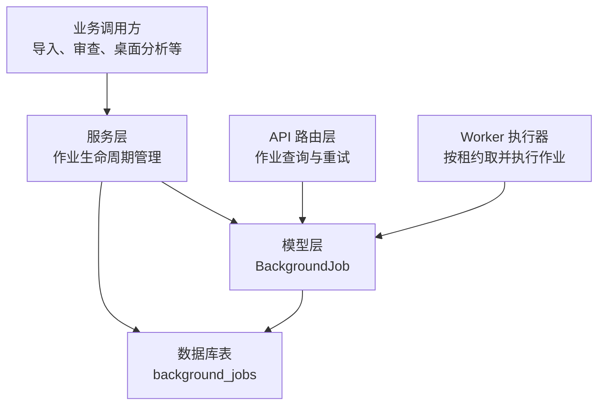
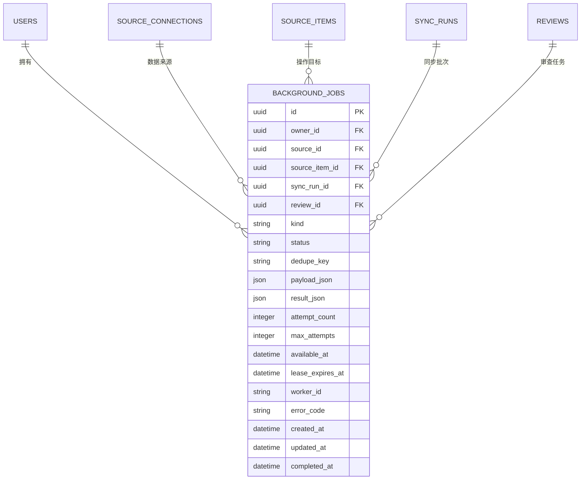
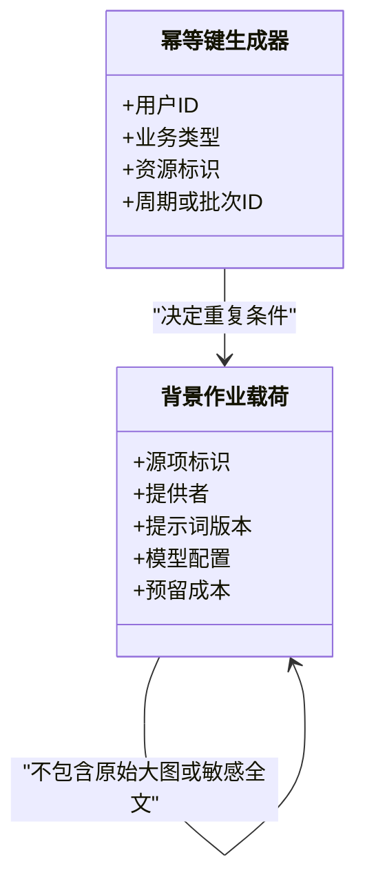
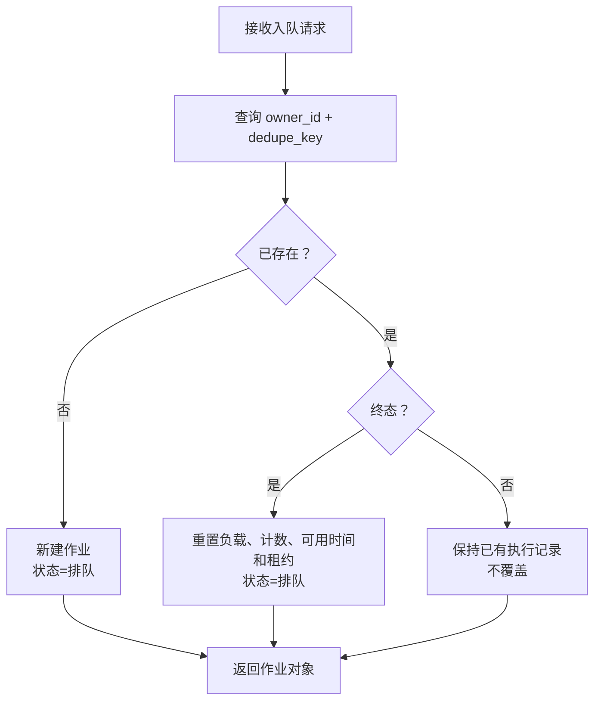
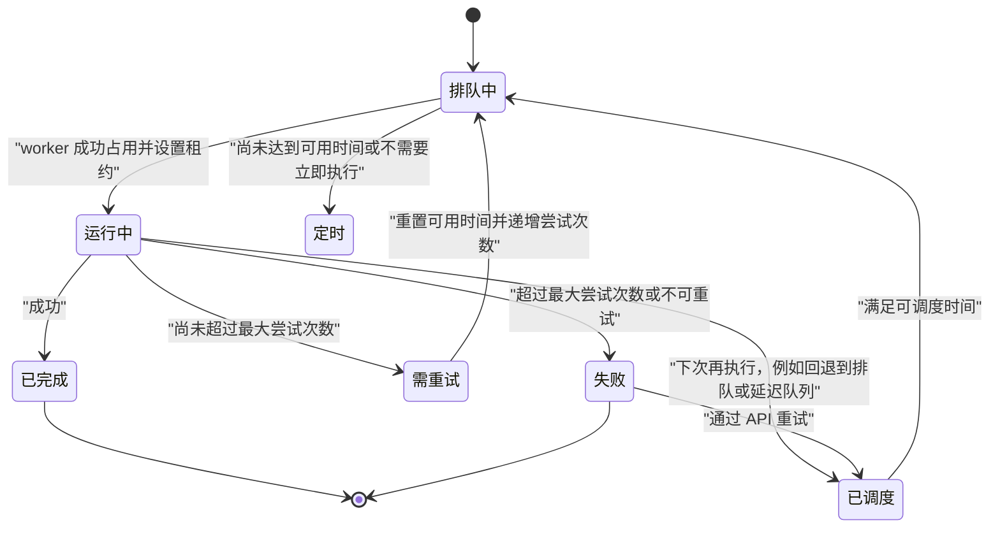
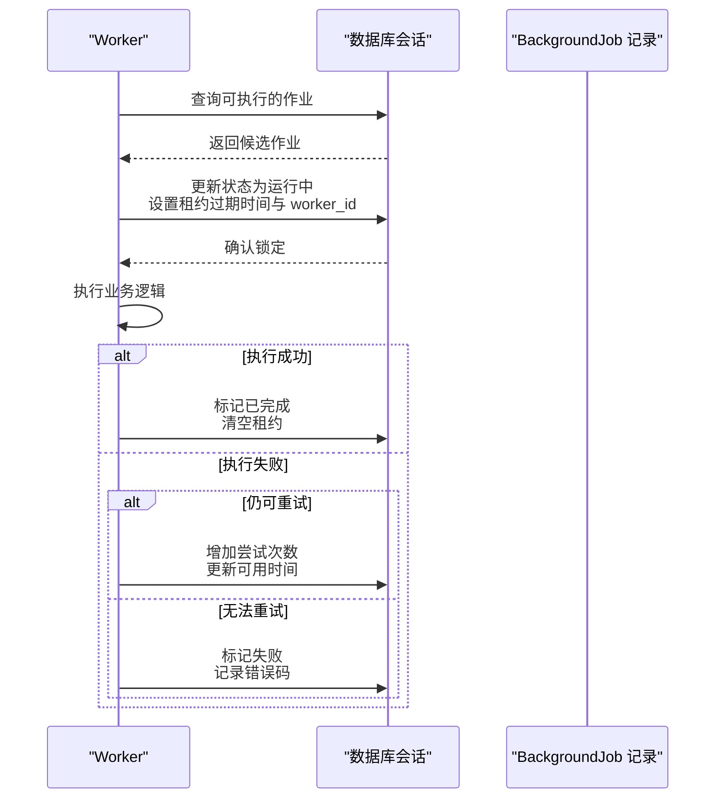
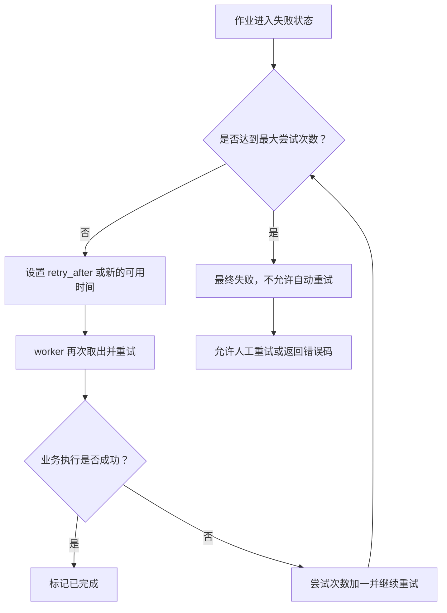
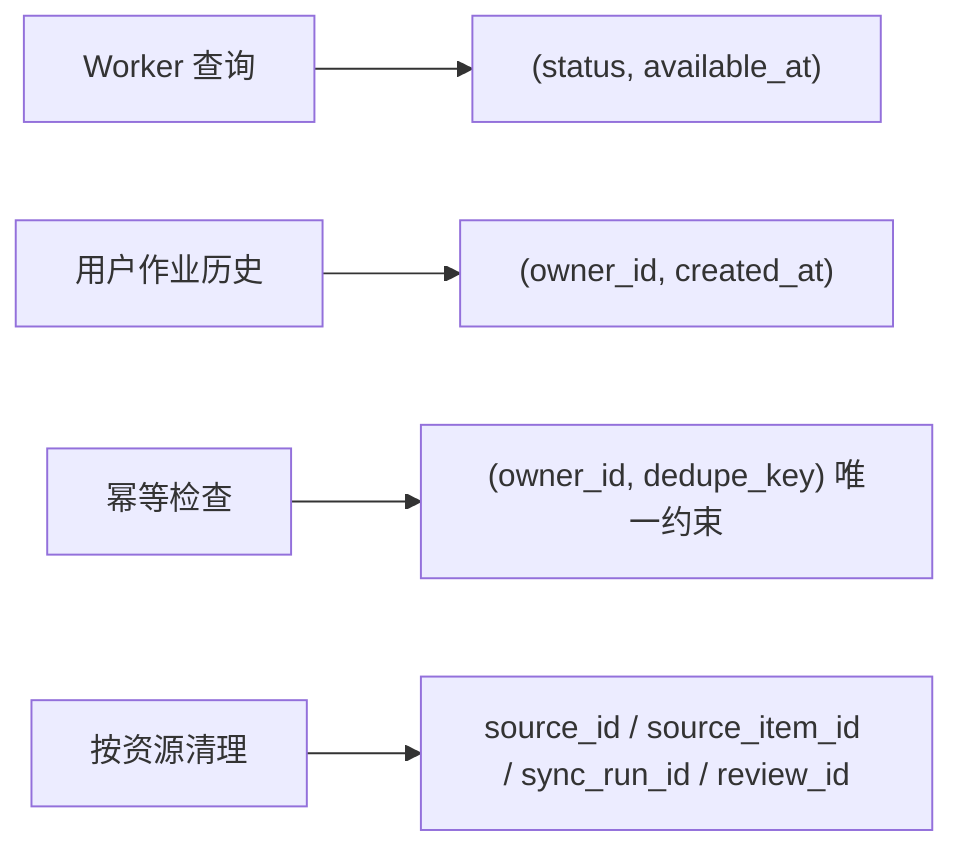

# BackgroundJob 核心作业模型

<cite>
**本文引用的文件**
- [models.py](file://src/personal_ai_life_os/models.py)
- [jobs.py](file://src/personal_ai_life_os/services/jobs.py)
- [c101bc66b1a3_add_durable_background_jobs.py](file://migrations/versions/c101bc66b1a3_add_durable_background_jobs.py)
- [jobs.py](file://src/personal_ai_life_os/api/routes/jobs.py)
- [schemas.py](file://src/personal_ai_life_os/api/schemas.py)
- [ingestion.py](file://src/personal_ai_life_os/services/ingestion.py)
- [agent_actions.py](file://src/personal_ai_life_os/services/agent_actions.py)
</cite>

## 目录
1. [引言](#引言)
2. [项目结构中的作业相关位置](#项目结构中的作业相关位置)
3. [核心数据模型](#核心数据模型)
4. [作业类型枚举与负载语义](#作业类型枚举与负载语义)
5. [幂等提交与去重键](#幂等提交与去重键)
6. [分布式锁与租用机制](#分布式锁与租用机制)
7. [重试策略与状态机](#重试策略与状态机)
8. [API、查询与索引策略](#api查询与索引策略)
9. [性能优化与配置建议](#性能优化与配置建议)
10. [故障排查指南](#故障排查指南)
11. [结论](#结论)

## 引言
本文围绕 `background_jobs` 表建立一份完整的作业数据模型文档。该表用于承载系统内所有持久化后台任务，例如同步源、图像识别、桌面分析、审查生成等操作。本文重点说明以下能力：

- **唯一标识与租户隔离**：每个作业通过全局 `id` 标识，并通过 `owner_id` 限定所有者范围。
- **作业类型与负载**：`kind` 描述任务种类；`payload_json` 承载任务执行所需参数，但不包含敏感的业务原始内容。
- **幂等性保证**：通过 `(owner_id, dedupe_key)` 联合唯一约束防止重复提交同一逻辑任务。
- **分布式安全执行**：通过 `lease_expires_at` 实现“租约过期后其他 worker 可重新抢占”的轻量分布式锁语义。
- **重试与失败保护**：由 `attempt_count`、`max_attempts` 控制最大尝试次数；结合状态机完成重试或终态标记。
- **调度时序**：使用 `available_at` 控制任务何时变得可被 worker 取走。

本模型属于基础设施级对象，实际业务 API（如图谱提取、导入处理、提醒、照片 OCR 等）通过不同的 `kind` 和 `payload_json` 组合复用同一张作业表。

## 项目结构中的作业相关位置
从仓库组织看，BackgroundJob 贯穿数据库建模、迁移、业务服务调用以及对外 API：

| 层次 | 主要文件 | 职责 |
|---|---|---|
| 数据库模型 | [models.py:784-838](file://src/personal_ai_life_os/models.py#L784-L838) | 定义 `BackgroundJob` ORM 类及关联关系。 |
| 数据库迁移 | [c101bc66b1a3_add_durable_background_jobs.py](file://migrations/versions/c101bc66b1a3_add_durable_background_jobs.py#L1-L75) | 创建 `background_jobs` 表、唯一约束和多列索引。 |
| 作业生命周期服务 | [services/jobs.py:60-289](file://src/personal_ai_life_os/services/jobs.py#L60-L289) | 入队、取消、重试、查找可用作业等核心流程。 |
| 外部 API 路由 | [api/routes/jobs.py:1-82](file://src/personal_ai_life_os/api/routes/jobs.py#L1-L82) | 查看作业状态及人工重试接口。 |
| API 响应模型 | [schemas.py:148-156](file://src/personal_ai_life_os/api/schemas.py#L148-L156) | 稳定输出的作业字段。 |
| 实际触发点示例 | [ingestion.py:527-543](file://src/personal_ai_life_os/services/ingestion.py#L527-L543)、[agent_actions.py:428-440](file://src/personal_ai_life_os/services/agent_actions.py#L428-L440) | 演示不同场景下的作业入队方式。 |



图示展示了作业从业务调用入队，到数据库持久化，再由 worker 读取执行的整体路径。API 层主要用于状态查询和人工重试，不承担复杂调度逻辑。

## 核心数据模型
`BackgroundJob` 的核心字段可以分为六类：身份与归属、调度信息、执行元数据、结果与错误、分布式锁元数据、审计时间戳。

### 字段语义总览

| 字段 | 类型 / 约束 | 作用与规则 |
|---|---|---|
| `id` | UUID 字符串，主键 | 作业的绝对唯一标识，由应用生成。 |
| `owner_id` | UUID，非空，用户外键 | 将作业限制在当前用户租户范围内，支持多租户隔离。 |
| `source_id` | UUID，可选，来源连接外键 | 表示作业是否来源于某个数据源。 |
| `source_item_id` | UUID，可选，源项外键 | 表示作业具体操作的源项实例。 |
| `sync_run_id` | UUID，可选，同步运行外键 | 表示作业关联的同步批任务。 |
| `review_id` | UUID，可选，审查外键 | 表示作业与某次知识审查生成相关。 |
| `kind` | 长度不超过 40 的字符串 | 作业类型代码，如照片 OCR、桌面分析、定期审查等。 |
| `status` | 长度不超过 24 的字符串，默认排队中 | 作业当前生命周期状态。 |
| `dedupe_key` | 长度不超过 300 的字符串 | 幂等提交键；配合 `owner_id` 构成联合唯一约束。 |
| `payload_json` | JSON 字典，默认空字典 | 作业负载，保存执行任务所需的上下文，不直接保存大体积敏感原文。 |
| `result_json` | JSON 字典或空值 | 成功时的结构化结果输出。 |
| `attempt_count` | 整数，默认 0 | 已尝试执行次数。 |
| `max_attempts` | 整数，默认 3 | 允许的最大执行尝试次数。 |
| `available_at` | 带时区的时间戳，默认当前时间 | 任务最早可以被 worker 选中的时间。 |
| `lease_expires_at` | 带时区时间戳或空值 | 当前 worker 对作业持有租约的截止时间。 |
| `worker_id` | 字符串或空值，长度不超过 120 | 当前领取并执行作业的 worker 标识。 |
| `error_code` | 字符串或空值，长度不超过 80 | 失败原因或取消原因，如业务校验失败、权限不足等。 |
| `created_at` | 带时区时间戳，默认当前时间 | 作业记录创建时间。 |
| `updated_at` | 带时区时间戳，默认当前时间 | 记录最近一次更新的时间。 |
| `completed_at` | 带时区时间戳或空值 | 作业进入终态完成或被取消的时间。 |

#### 唯一约束与索引
模型层声明了三个关键约束与索引：

| 名称或组成 | 含义 |
|---|---|
| `uq_background_job_owner_dedupe` | `(owner_id, dedupe_key)` 联合唯一约束，确保同一用户下同一幂等键只能有一条活跃记录。 |
| `ix_background_jobs_status_available` | 优先扫描“可执行且可用”的作业。 |
| `ix_background_jobs_owner_created` | 查询用户在某时间段内的作业历史。 |
| `ix_background_jobs_source_id` | 根据来源连接取消或删除作业。 |
| `ix_background_jobs_source_item_id` | 根据源项定位相关作业。 |
| `ix_background_jobs_sync_run_id` | 根据同步批次清理或追踪作业。 |
| `ix_background_jobs_review_id` | 根据审查记录清理相关作业。 |

迁移中还创建了这些额外索引：`owner_id`、`kind`、`status`、`available_at`、`(status, available_at)`、`owner_id + created_at`、`source_id`、`source_item_id`、`sync_run_id`、`review_id`。



**图示来源**
- [models.py:784-838](file://src/personal_ai_life_os/models.py#L784-L838)
- [c101bc66b1a3_add_durable_background_jobs.py:19-73](file://migrations/versions/c101bc66b1a3_add_durable_background_jobs.py#L19-L73)

**章节来源**
- [models.py:784-838](file://src/personal_ai_life_os/models.py#L784-L838)
- [c101bc66b1a3_add_durable_background_jobs.py:19-73](file://migrations/versions/c101bc66b1a3_add_durable_background_jobs.py#L19-L73)

## 作业类型枚举与负载语义
当前代码库没有把 `kind` 定义为严格的 Python 枚举或数据库枚举常量；它被实现为短字符串字段，由业务侧约定取值。从已有使用处可以看到以下常见类别：

| 作业类型 | 典型含义 | 触发位置 |
|---|---|---|
| `photo_ocr` | 对图片进行文本识别。 | 图像处理入库流程。 |
| `desktop_analysis` | 基于本地文件或会话内容进行桌面侧分析。 | 数据处理完成后触发。 |
| `weekly_review` | 按周期生成知识库审查摘要。 | 智能体动作中触发。 |
| `photo_description` | 为图片生成描述文本，通常受 AI 模型授权控制。 | 撤销 AI 授权等业务会取消该类型作业。 |

需要注意：文档目标中提到的 `sync_source`、`extract_graph`、`process_import`、`review_reminder` 可以作为通用作业类型的扩展命名风格，但不应假设它们已经作为现有固定值出现在所有业务分支中。新增 `kind` 时应遵循相同规范：

- 使用短横线分隔的小写英文单词；
- 控制在 40 个字符以内；
- 与幂等键前缀保持一致，例如 `sync-source:` 或 `extract-graph:`；
- 在幂等键中包含足够区分业务的上下文，如用户 ID、源 ID、资源 ID、周期标识等。

#### 负载结构原则
`payload_json` 是作业的可序列化上下文。其设计要点是：

1. **保留执行依据，不复制原始大体积内容**。例如只保存 `source_item_id`，而不把整张图复制到负载中。
2. **保持幂等**。负载中的可判定参数要与 `dedupe_key` 语义一致。
3. **可扩展**。如果以后需要传递提示词版本、模型名、成本预留等元数据，应放在一个稳定的结构中。
4. **可观测**。对于可能失败的长作业，应将关键阶段写入 `result_json`，便于 API 暴露和排错。

当前示例包括：

- 图片 OCR：负载通常包含 `source_item_id`。
- 桌面分析：负载可包含 `provider`。
- 每周审查：负载包含 `review_id`、提示词版本、模型配置与成本预留值。



**图示来源**
- [ingestion.py:527-543](file://src/personal_ai_life_os/services/ingestion.py#L527-L543)
- [agent_actions.py:428-440](file://src/personal_ai_life_os/services/agent_actions.py#L428-L440)

**章节来源**
- [schemas.py:148-156](file://src/personal_ai_life_os/api/schemas.py#L148-L156)
- [ingestion.py:527-543](file://src/personal_ai_life_os/services/ingestion.py#L527-L543)
- [agent_actions.py:428-440](file://src/personal_ai_life_os/services/agent_actions.py#L428-L440)

## 幂等提交与去重键
幂等性的核心是 `(owner_id, dedupe_key)` 联合唯一约束。`enqueue_background_job` 会先按 `owner_id` 和 `dedupe_key` 查找记录：

- 如果已存在，且状态是失败、取消或已完成，则将其重新置为待处理状态，并重置执行计数、可用时间、租约和结果；
- 如果已存在，且状态仍是排队中、运行中等进行中状态，则不会简单覆盖，从而避免静默丢弃正在进行的任务；
- 如果不存在，则新建一条状态为排队中的作业。

这种设计的目标是：**对相同业务语义的提交请求保持安全，而不是盲目覆盖正在运行的作业。**

建议的 `dedupe_key` 构造范式：

```text
{kind}:{owner_id_or_context_scope}:{resource_id}[:period_or_batch]
```

实际参考：

| 用例 | 幂等键形式 | 行为 |
|---|---|---|
| 图片 OCR | 以运行 ID 和源项 ID 为后缀 | 同一张图片在同一次同步运行中不会重复生成 OCR。 |
| 桌面分析 | 以源项 ID 为后缀 | 针对同一条源项只安排一次分析。 |
| 每周审查 | 以审查 ID 为后缀 | 同一个审查任务在同一轮中不会重复执行。 |

#### 重试与幂等的关系
API 层的 `/jobs/{job_id}/retry` 会将失败或取消的任务重置为排队中，并把 `attempt_count` 置零。由于幂等键未改变，系统仍会把这次重试视为同一段业务逻辑的重试，而不是完全不同的新工作流。这符合多数“恢复型重试”的场景；但如果上层需要强制生成全新结果，应当重新构造新的幂等键。



**图示来源**
- [jobs.py:60-109](file://src/personal_ai_life_os/services/jobs.py#L60-L109)

**章节来源**
- [jobs.py:60-109](file://src/personal_ai_life_os/services/jobs.py#L60-L109)

## 分布式锁与租用机制
系统没有使用 Redis 或外部分布式锁服务，而是用数据库字段实现一种轻量租约模式。关键字段如下：

| 字段 | 租用语义 |
|---|---|
| `status` | 表明作业当前生命周期阶段。 |
| `lease_expires_at` | 当前 worker 持有该作业的锁直到该时间点。 |
| `worker_id` | 谁正在执行该作业。 |
| `available_at` | 当任务还没到达等待时间时，即使可取也不应提前抢走。 |

核心流程是：

1. Worker 选择一个时间窗口，例如每次循环查询“排队中且已达到可用时间”或“运行中且租约已过期的作业”。
2. Worker 选中某条作业后，将其状态改为运行中，设置 `lease_expires_at` 为当前时间加超时阈值，并记录 `worker_id`。
3. 其他 worker 不能再次抢到同一条仍在有效租约中的作业。
4. 若原 worker 崩溃，租约到期后，其他 worker 可以重新选择该作业，从而实现故障转移。
5. 作业完成、失败或取消时，清除 `lease_expires_at` 和 `worker_id`，并将状态置为终态。



该状态图反映的是当前服务层实际参与的状态转换。文档目标中提到的 `pending` 并不是现有 `status` 默认值；代码中的初始值是 `queued`。“ leased” 是一个并发概念，并非独立状态名；当前代码将租赁后的状态称为 `running`，并用 `lease_expires_at` 表达锁边界。



**图示来源**
- [jobs.py:277-289](file://src/personal_ai_life_os/services/jobs.py#L277-L289)

**章节来源**
- [jobs.py:277-289](file://src/personal_ai_life_os/services/jobs.py#L277-L289)

## 重试策略与状态机
### 重试相关字段

| 字段 | 含义 | 当前默认值 |
|---|---|---:|
| `attempt_count` | 本次幂等任务累计尝试次数 | 0 |
| `max_attempts` | 允许的最大尝试次数 | 3 |
| `available_at` | 下一次可执行时间 | 通常为当前时间或计划时间 |
| `lease_expires_at` | 当前锁的过期时间 | 无 |
| `error_code` | 失败或取消原因 | 空 |

### 触发重试的位置
目前明确的重置尝试次数逻辑是“人工重试”入口：

- 用户通过 `/jobs/{job_id}/retry` 触发；
- 服务将状态改回排队中；
- 重置 `attempt_count`、`available_at`、`lease_expires_at`、`worker_id`、`error_code`、`result_json`；
- 对某些业务类型还会检查用户授权、源连接状态和审查可用性。

对于自动失败判断，当前代码在服务层中存在按租约过期扫描的查询逻辑，但是否将所有失败路径统一转换为“需重试 → 排队中”的闭环节点，需要结合 worker 的具体实现完整确认。对外 API 和幂等入队逻辑至少保证了“失败后可显式重试”。

### 重试流程图



**图示来源**
- [jobs.py:249-257](file://src/personal_ai_life_os/services/jobs.py#L249-L257)

**章节来源**
- [jobs.py:249-257](file://src/personal_ai_life_os/services/jobs.py#L249-L257)

## API、查询与索引策略
### 作业查询
最基础的单作业查询通过 API 路由完成。该路由要求同时传入 `job_id` 和当前登录用户的 `owner_id`，因此天然具备基础权限隔离。

推荐的基础 SQL 查询方向：

| 场景 | 查询思路 |
|---|---|
| 查看指定作业 | 按 `id` 和 `owner_id` 查询。 |
| 查看失败可重试作业 | 按 `status IN (failed, cancelled)` 筛选。 |
| 查看用户作业历史 | 按 `owner_id`、`kind` 和 `created_at` 范围查询。 |
| 统计某来源剩余作业 | 按 `source_id`、`status NOT IN` 完成或取消 过滤。 |

API 暴露的响应字段包括：

| 字段 | 说明 |
|---|---|
| `id` | 作业唯一标识。 |
| `kind` | 作业类型。 |
| `status` | 当前状态。 |
| `attempt_count` | 当前尝试次数。 |
| `max_attempts` | 允许最大次数。 |
| `error_code` | 错误或取消原因。 |
| `result_json` | 成功结果。 |
| `created_at` | 创建时间。 |
| `updated_at` | 更新时间。 |
| `completed_at` | 完成或取消时间。 |

注意：API 响应模型省略了 `dedupe_key`、`payload_json`、`lease_expires_at`、`worker_id`、`available_at`、`source_id`、`source_item_id`、`sync_run_id`、`review_id` 等内部字段，以避免向客户端泄露调度细节。

### 索引策略总结
现有索引覆盖了高频查询维度：

- `(status, available_at)`：worker 高效挑选可执行作业；
- `owner_id + created_at`：用户作业历史查询；
- `owner_id + dedupe_key`：幂等去重；
- `owner_id`、`kind`、`status`、`available_at`：迁移层辅助常见过滤；
- `source_id`、`source_item_id`、`sync_run_id`、`review_id`：按业务资源清理作业。

维护建议：

- 如果引入复杂的“延迟队列”或“时间分片”，可增加分区或复合索引以减少全表扫描。
- 如果 `payload_json` 开始支持部分条件搜索，应考虑是否在 PostgreSQL JSON 上创建 GIN 索引；否则不要随意对 JSON 全字段做普通 B-tree 索引。
- 已完成的历史作业建议考虑归档策略，避免 `background_jobs` 无限增长。



**图示来源**
- [models.py:788-800](file://src/personal_ai_life_os/models.py#L788-L800)
- [c101bc66b1a3_add_durable_background_jobs.py:47-73](file://migrations/versions/c101bc66b1a3_add_durable_background_jobs.py#L47-L73)

**章节来源**
- [jobs.py:18-28](file://src/personal_ai_life_os/api/routes/jobs.py#L18-L28)
- [jobs.py:30-82](file://src/personal_ai_life_os/api/routes/jobs.py#L30-L82)
- [schemas.py:148-156](file://src/personal_ai_life_os/api/schemas.py#L148-L156)

## 性能优化与配置建议
### 并发控制
- 单个 Worker 不应同时持有过多作业，建议在进程内使用信号量或队列限制并发执行数量。
- worker 获取作业时应使用数据库事务，避免两条 worker 在同一语句中读取到相同候选并被重复领取。
- 对于耗时较长的作业（例如模型推理），应将“领取锁”与“业务锁”分离：先短事务获取租约，再在长事务外执行业务，最后短事务收尾。

### 超时设置
- `lease_expires_at` 应小于 worker 预期最大执行时间加上一定宽限。例如业务最长需要 60 秒，则租约可设为 75 至 120 秒。
- 如果作业可能执行数分钟，建议使用较短租约配合心跳续期，但当前模型没有心跳字段；因此应保守估算最长执行时间。
- `available_at` 可用于“延迟执行”，实现简单的退避或定时调度。

### 失败重试策略
- 可恢复错误：网络超时、上游服务临时不可用，适合指数退避重试。
- 不可恢复错误：权限缺失、输入无效、数据不存在，应避免自动重试。
- `RetryableJobError` 表明异常包装体系中可以携带 `retryable` 标志；但当前公开的服务入口未在所有失败分支中一致使用该封装。建议在统一错误处理中落地该语义。

### 负载大小控制
- `payload_json` 应尽可能小。对于图片、文档全文等大附件，只存放引用标识和必要的元数据。
- 对超长 JSON 负载，应在 worker 入口处做上限校验。
- 日志中不要打印敏感 payload 内容。

### 数据清理
- 已完成、失败和取消的作业应保留一段时间用于审计，然后归档或物理删除。
- 清理策略应考虑与 `SyncRun`、`SourceItem`、`Review` 等实体的依赖顺序。
- 迁移和备份脚本中已经出现批量更新 `background_jobs.status` 的做法，说明运维层会用到全局清理逻辑。

## 故障排查指南
### 作业一直占用但不再推进
可能原因：

1. worker 崩溃但租约仍未过期，导致其他 worker 无法抢占；
2. 业务执行长时间阻塞，但没有正确更新状态；
3. `lease_expires_at` 设置过短，导致频繁抢锁竞争；或过长，导致卡死作业难以释放。

排查步骤：

1. 通过 `id` 和 `owner_id` 查询作业记录。
2. 检查 `status` 是否为运行中。
3. 对比 `lease_expires_at` 与当前时间。
4. 检查 `worker_id` 是否能对应到活动进程。
5. 如果租约已过期但未更新，可将其转为排队或失败状态以便恢复。

### 幂等键冲突
现象：

- 相同业务调用重复提交，期望幂等但没有重新执行。
- 或者重试后希望产生新结果，却被旧记录拦截。

排查要点：

- 检查 `dedupe_key` 是否与业务语义一致。
- 如果确实需要新生效，应更换键值，而不是仅修改 `payload_json`。
- 如果使用 API 重试，注意它只会恢复已有任务，不一定刷新幂等键。

### 资源状态不匹配导致重试失败
API 路由对以下业务有前置校验：

| 条件 | 错误含义 |
|---|---|
| 用户找不到作业 | 作业不存在或无权访问。 |
| 作业不是失败或取消状态 | 不支持对该状态重试。 |
| 来源连接未激活 | 需要先恢复来源连接。 |
| AI 模型同意缺失或不一致 | 需要重新接受模型授权。 |
| 审查不可用或已失效 | 需要重新生成审查。 |
| 审查已确认 | 已通过人工确认的任务不允许再生成。 |

### 常见错误码
| 错误码 | 含义 |
|---|---|
| `job_not_found` | 作业不存在或不属于当前用户。 |
| `job_not_retryable` | 只有失败或取消的作业可重试。 |
| `source_not_active` | 关联的数据源未激活。 |
| `model_consent_required` | 需要当前模型的知情同意。 |
| `review_unavailable` | 关联审查不可用。 |
| `review_already_confirmed` | 已确认的审查不能通过该作业再生成。 |

**章节来源**
- [jobs.py:18-82](file://src/personal_ai_life_os/api/routes/jobs.py#L18-L82)

## 结论
`background_jobs` 是一个以业务上下文为核心的持久化作业模型。它的优势在于结构简单、可移植性强，不需要额外的分布式锁基础设施；代价是并发控制和调度语义需要仔细在事务和超时边界中维护。

在实践中，应重点关注以下实践：

- 用 `(owner_id, dedupe_key)` 做幂等，而不是仅靠 `payload_json`。
- 用 `lease_expires_at` 表达锁过期，而不是手动比较状态。
- 将“可恢复失败”与“不可恢复失败”区分开，避免无限重试或永久失败。
- 保持 payload 精简、可观测，并通过 `result_json` 记录重要结果。
- 谨慎增加新的 `kind` 类型，同时完善对应的幂等键、API 校验和错误码。
- 随着数据增长，规划作业表的归档、清理和索引优化策略。