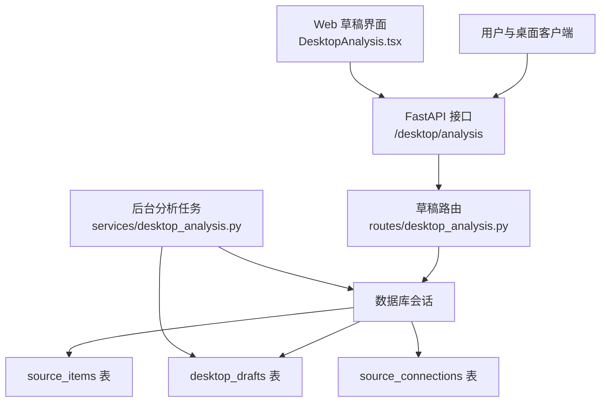
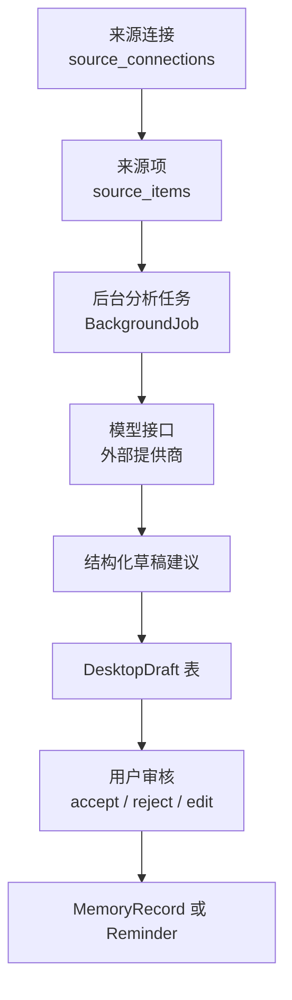
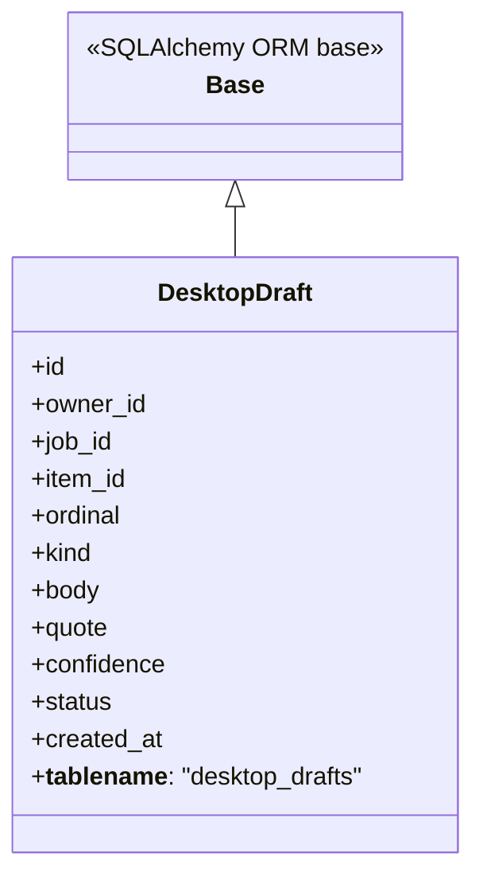
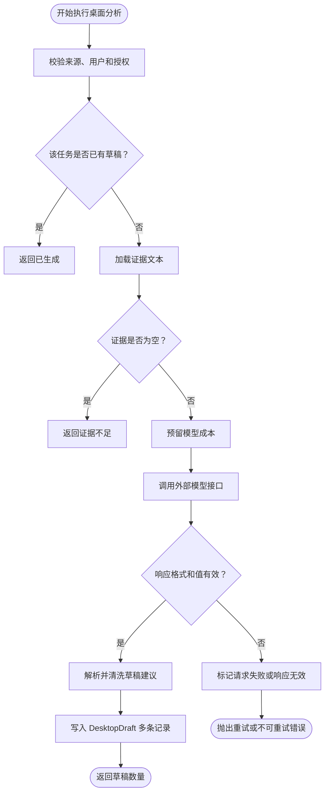
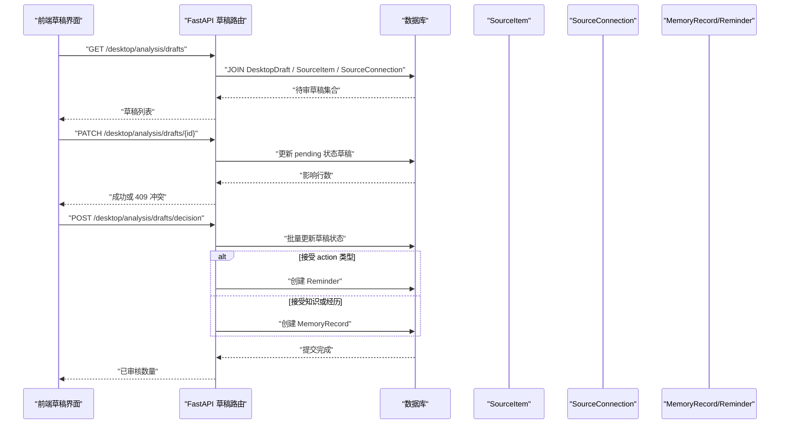
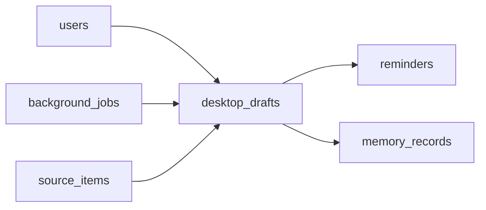
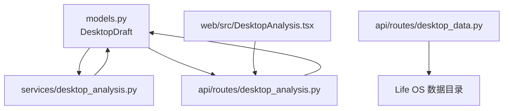
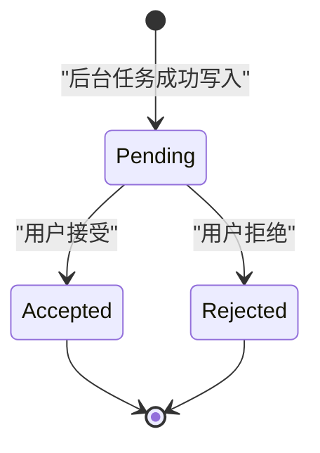
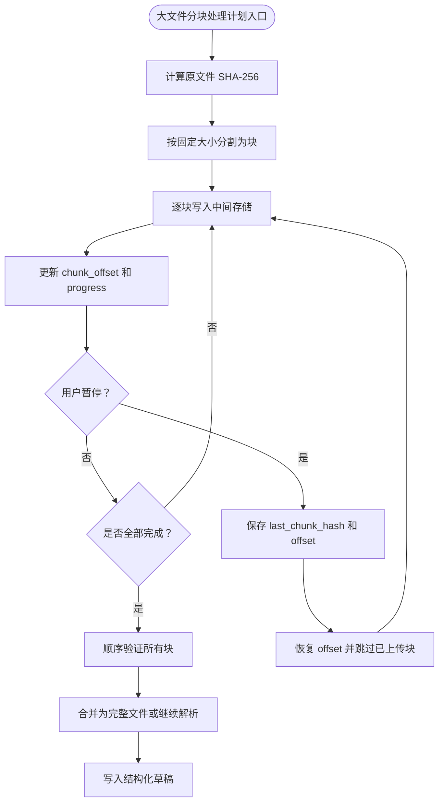

# DesktopDraft 桌面草稿模型

<cite>
**本文引用的文件**   
- [models.py](file://src/personal_ai_life_os/models.py)
- [desktop_analysis.py（迁移文件）](file://migrations/versions/c8d73b1e0afd_desktop_drafts.py)
- [desktop_analysis.py（服务层）](file://src/personal_ai_life_os/services/desktop_analysis.py)
- [desktop_analysis.py（接口路由）](file://src/personal_ai_life_os/api/routes/desktop_analysis.py)
- [desktop_data.py（数据备份与导出）](file://src/personal_ai_life_os/api/routes/desktop_data.py)
- [DesktopAnalysis.tsx（前端组件）](file://web/src/DesktopAnalysis.tsx)
</cite>

## 目录

1. [引言](#引言)
2. [项目结构中的草稿位置](#项目结构中的草稿位置)
3. [核心数据模型](#核心数据模型)
4. [架构总览](#架构总览)
5. [详细组件分析](#详细组件分析)
6. [依赖关系分析](#依赖关系分析)
7. [处理流程与状态](#处理流程与状态)
8. [文件系统映射与安全验证](#文件系统映射与安全验证)
9. [大文件、分块处理与中间状态的边界](#大文件分块处理与中间状态的边界)
10. [清理策略、存储优化与磁盘空间管理](#清理策略存储优化与磁盘空间管理)
11. [错误恢复、一致性与完整性检查](#错误恢复一致性与完整性检查)
12. [性能考虑](#性能考虑)
13. [故障排查指南](#故障排查指南)
14. [结论](#结论)

## 引言

DesktopDraft 是 Personal AI Life OS 中面向桌面端来源分析的草稿暂存数据模型。它并不直接负责读取大型二进制文件或实现传统意义上的“磁盘断点续传”，而是以数据库行记录的形式，持久化由后台任务生成的结构化分析草稿。其目标是让系统能够在多用户、多来源、可审查的工作流中安全地缓存和分析结果，并提供接受、拒绝和修改等审核操作。

需要特别注意：当前仓库中的 `desktop_drafts` 表定义的是**每条分析草稿的元数据及摘要字段**，并没有 `draft_id`、`file_path`、`file_size_bytes`、`chunk_offset`、`chunk_total` 或显式的处理进度字段。该模型更准确的定位是：

- **来源证据到结构化草稿的持久化载体**；
- **后台任务的输出产物索引**；
- **待审核内容的业务状态容器**；
- **后续转换为记忆、提醒或其他实体的稳定输入**。

文档随后会基于实际代码描述字段、约束、查询行为和集成点，并明确指出哪些需求在当前实现中尚未存在，避免把概念设计误写为已有实现。

## 项目结构中的草稿位置

DesktopDraft 出现在以下主要位置：

| 层级 | 文件 | 职责 |
|---|---|---|
| 数据模型层 | `src/personal_ai_life_os/models.py` | 定义 `DesktopDraft` 表结构、外键、唯一约束与全局索引 |
| 迁移层 | `migrations/versions/c8d73b1e0afd_desktop_drafts.py` | 创建 `desktop_drafts` 表、唯一索引和查询用复合索引 |
| 服务层 | `src/personal_ai_life_os/services/desktop_analysis.py` | 执行桌面分析任务、校验外部模型响应、写入草稿 |
| 接口层 | `src/personal_ai_life_os/api/routes/desktop_analysis.py` | 暴露草稿列表、编辑、批量决策、已确认笔记和任务查询接口 |
| 数据服务层 | `src/personal_ai_life_os/api/routes/desktop_data.py` | 提供本地备份与 Markdown 导出能力，但不直接管理 `DesktopDraft` |
| 前端界面 | `web/src/DesktopAnalysis.tsx` | 展示待审草稿、任务状态、批量预览和接受/拒绝操作 |



图表来源
- [desktop_analysis.py（接口路由）](file://src/personal_ai_life_os/api/routes/desktop_analysis.py#L1-L159)
- [desktop_analysis.py（服务层）](file://src/personal_ai_life_os/services/desktop_analysis.py#L1-L147)
- [DesktopAnalysis.tsx（前端组件）](file://web/src/DesktopAnalysis.tsx#L1-L200)

章节来源
- [desktop_analysis.py（接口路由）](file://src/personal_ai_life_os/api/routes/desktop_analysis.py#L1-L159)
- [desktop_analysis.py（服务层）](file://src/personal_ai_life_os/services/desktop_analysis.py#L1-L147)

## 核心数据模型

### 表级定义

`DesktopDraft` 对应数据库表 `desktop_drafts`，其主要定义包括：

| 字段名 | 类型 | 含义 | 必填/默认值 | 关键约束 |
|---|---|---|---:|---|
| `id` | UUID | 草稿的主键标识 | 自动分配 UUID，必填 | 主键 |
| `owner_id` | UUID | 所属用户标识 | 必填 | 外键指向 `users.id`，删除用户时级联删除 |
| `job_id` | UUID | 生成该草稿的后台任务标识 | 必填 | 外键指向 `background_jobs.id`，任务被删除后级联删除 |
| `item_id` | UUID | 关联的证据来源项标识 | 必填，带索引 | 外键指向 `source_items.id` |
| `ordinal` | Integer | 同任务内的草稿序号 | 必填 | 同 `job_id` 具唯一性约束 |
| `kind` | String(24) | 草稿类型 | 必填 | 服务层仅允许 experience、knowledge、action |
| `body` | Text | 草稿正文 | 必填 | 接口更新时限制最大长度和空白修剪 |
| `quote` | Text | 引用原文片段 | 必填 | 服务层要求原始文本包含该引用 |
| `confidence` | Float | 模型置信度 | 必填 | 服务层强制位于 0.75 到 1 之间 |
| `status` | String(24) | 草稿审核状态 | 默认 `pending` | API 查询通常只返回 pending 草稿 |
| `created_at` | UTC 时间戳 | 创建时间 | 必填 | 使用应用内 UTC 时间助手 |

需要注意，实际数据库迁移中没有显式新增 `updated_at` 字段；`created_at` 仍由默认值和 ORM 语义负责初始化。

### 关键字段说明

| 名称 | 是否实际存在于当前实现 | 当前含义 |
|---|---:|---|
| `draft_id` | 否 | 不存在；实际主键为 `id` |
| `file_path` | 否 | 当前实现未保存原始文件路径；来源通过 `source_id` → `SourceConnection` 间接关联 |
| `file_size_bytes` | 否 | 没有该字段 |
| `chunk_offset` | 否 | 没有该字段 |
| `chunk_total` | 否 | 没有该字段 |
| `progress_percent` | 否 | 没有该字段；当前后端以任务 `BackgroundJob` 表达任务级进度 |
| `status = parsing / analyzing / complete / error` | 部分相关 | `status` 用于草稿审核状态，通常为 `pending`、`accepted` 或 `rejected`；`parsing / analyzing / complete / error` 更接近 `BackgroundJob` 的任务状态语义 |
| `created_at / updated_at` | 部分相关 | 存在 `created_at`；当前无 `updated_at` |

因此，文档目标中列举的部分字段属于**期望形态**，而不是现有 `DesktopDraft` 模型的实现事实。

### 表和索引

迁移文件和模型共同体现以下结构要素：

```mermaid
erDiagram
  USERS ||--o{ DESKTOP_DRAFTS : "owner_id"
  BACKGROUND_JOBS ||--o{ DESKTOP_DRAFTS : "job_id"
  SOURCE_ITEMS ||--o{ DESKTOP_DRAFTS : "item_id"

  DESKTOP_DRAFTS {
    uuid id PK
    uuid owner_id FK
    uuid job_id FK
    uuid item_id FK
    int ordinal
    string kind
    text body
    text quote
    float confidence
    string status
    datetime created_at
  }

  UNIQUE_CONSTRAINT {
    uq_desktop_draft_job_ordinal "job_id + ordinal"
  }

  INDEX {
    ix_desktop_drafts_owner_status "owner_id + status"
    ix_desktop_drafts_item_id "item_id"
  }
```

图表来源
- [desktop_analysis.py（迁移文件）](file://migrations/versions/c8d73b1e0afd_desktop_drafts.py#L1-L33)
- [models.py](file://src/personal_ai_life_os/models.py#L830-L863)

### 字段复杂度与约束

| 场景 | 时间与空间特性 | 说明 |
|---|---|---|
| 查询待审草稿 | 通常为 O(log n) 至 O(k)，k 为返回行数 | 通过 `owner_id` 和 `status` 复合索引加速常见过滤 |
| 按 `item_id` 扫描 | 使用单列索引 | 适合查找某来源项的草稿 |
| 每个任务最多产生有限草稿 | 每任务有序号保证唯一性 | 唯一约束防止重复插入同一批次草稿 |
| 文本容量 | Text 字段无固定长度上限 | 接口层限制 `body` 最大约 1000；服务端 `quote` 长度也有限制 |
| 排序成本 | 按来源名称、类型优先级和创建时间排序 | 可能涉及外层排序；合理分页可控制偏移开销 |

章节来源
- [models.py:830-863](file://src/personal_ai_life_os/models.py#L830-L863)
- [desktop_analysis.py（迁移文件）:10-30](file://migrations/versions/c8d73b1e0afd_desktop_drafts.py#L10-L30)

## 架构总览

DesktopDraft 处于**来源解析 → 模型分析 → 草稿缓存 → 用户审核 → 结果落库**的中间环节：

1. `BackgroundJob` 表示一次桌面分析任务。
2. 后台服务从 `SourceItem` 拉取证据文本。
3. 调用外部兼容的大模型接口生成结构化草稿建议。
4. 成功后以 `DesktopDraft` 形式持久化。
5. 用户在前端查看 `pending` 草稿，修改、接受或拒绝。
6. 接受的 `action` 转化为提醒；其他类型可转化为已确认的记忆。



图表来源
- [desktop_analysis.py（服务层）:70-147](file://src/personal_ai_life_os/services/desktop_analysis.py#L70-L147)
- [desktop_analysis.py（接口路由）:44-145](file://src/personal_ai_life_os/api/routes/desktop_analysis.py#L44-L145)

## 详细组件分析

### 数据模型层：`DesktopDraft`

`DesktopDraft` 继承自 SQLAlchemy `Base`，使用 `UUID(as_uuid=False)` 作为字符串形式的 UUID，并使用应用统一的 UTC 时间类型和 ID 生成函数。它同时声明了两类约束：

- 唯一性约束：`job_id` 与 `ordinal` 组成唯一键；
- 全局索引：`(owner_id, status)`，便于按用户和审核状态查询。

字段方面，草稿不是二进制文件对象，而是**结构化提示结果的最终形态**。草稿正文和引用分别进入 `body` 与 `quote`，而 `kind` 限定草稿的业务类别。



图表来源
- [models.py:830-863](file://src/personal_ai_life_os/models.py#L830-L863)

章节来源
- [models.py:820-863](file://src/personal_ai_life_os/models.py#L820-L863)

### 服务层：`execute_desktop_analysis`

服务层负责将来源证据转化为草稿。其关键行为如下：

1. 校验来源、用户和权限；若任一条件不满足则抛出重试失败错误。
2. 检查是否已经为该 `job_id` 生成过草稿，避免重复执行。
3. 从 `SourceItem.content_text` 截取不超过固定长度的证据。
4. 预估算令牌成本，并对照预算配置做软失败处理。
5. 调用外部模型的聊天补全接口。
6. 对返回 JSON 做严格清洗：限类型、去重、范围检查、引用必须出现在原文中。
7. 最多保留前三条草稿建议。
8. 成功时将草稿逐条写入 `DesktopDraft`，并以相同 `job_id` 和递增 `ordinal` 写入。



图表来源
- [desktop_analysis.py（服务层）:70-147](file://src/personal_ai_life_os/services/desktop_analysis.py#L70-L147)

章节来源
- [desktop_analysis.py（服务层）:12-147](file://src/personal_ai_life_os/services/desktop_analysis.py#L12-L147)

### 接口路由：草稿 API

草稿相关的 REST 接口集中在 `/desktop/analysis`：

| 方法 | 路径 | 行为 | 返回 |
|---|---|---|---|
| GET | `/desktop/analysis/drafts` | 列出当前用户的待审草稿，按来源名、类型优先级和创建时间排序 | 草稿列表 |
| PATCH | `/desktop/analysis/drafts/{draft_id}` | 更新单个草稿正文，仅在状态仍为 `pending` 时生效 | 204 或错误 |
| POST | `/desktop/analysis/drafts/decision` | 批量接受或拒绝草稿；`action` 类型的接受会创建提醒 | 接受计数 |
| GET | `/desktop/analysis/confirmed` | 列出已确认的来源分析笔记 | 最近笔记列表 |
| GET | `/desktop/analysis/jobs` | 列出用户的桌面分析任务 | 任务状态信息 |



图表来源
- [desktop_analysis.py（接口路由）:44-L145](file://src/personal_ai_life_os/api/routes/desktop_analysis.py#L44-L145)
- [DesktopAnalysis.tsx（前端组件）:1-L200](file://web/src/DesktopAnalysis.tsx#L1-L200)

章节来源
- [desktop_analysis.py（接口路由）:1-L159](file://src/personal_ai_life_os/api/routes/desktop_analysis.py#L1-L159)

### 前端交互：草稿列表与决策

前端组件会轮询三类数据：

- 待审草稿；
- 分析任务；
- 已确认笔记。

用户可进行的操作包括选择草稿、预览批量接受、编辑单个草稿、接受、拒绝。前端的错误消息中包含模型授权、预算、提供方不可用等后端错误码的映射，例如：

- “需要提供方授权”
- “需要来源授权”
- “预算不足”
- “模型请求失败”
- “模型响应格式错误”
- “提供方不可用”
- “来源记录已变更”

章节来源
- [DesktopAnalysis.tsx:1-L200](file://web/src/DesktopAnalysis.tsx#L1-L200)

## 依赖关系分析

### 表级依赖

`DesktopDraft` 的外键关系决定了它与以下实体紧密耦合：

- `users`：拥有者维度隔离；
- `background_jobs`：任务生命周期；
- `source_items`：数据来源锚点；
- `reminders`：当草稿为 `action` 并被接受时，创建提醒；
- `memory_records`：当知识或经历被接受时，创建记忆记录。



图表来源
- [desktop_analysis.py（迁移文件）:10-L30](file://migrations/versions/c8d73b1e0afd_desktop_drafts.py#L10-L30)
- [desktop_analysis.py（接口路由）:115-L140](file://src/personal_ai_life_os/api/routes/desktop_analysis.py#L115-L140)
- [models.py:830-L875](file://src/personal_ai_life_os/models.py#L830-L875)

### 模块间依赖



图表来源
- [models.py:830-L863](file://src/personal_ai_life_os/models.py#L830-L863)
- [desktop_analysis.py（服务层）:1-L20](file://src/personal_ai_life_os/services/desktop_analysis.py#L1-L20)
- [desktop_analysis.py（接口路由）:1-L20](file://src/personal_ai_life_os/api/routes/desktop_analysis.py#L1-L20)
- [desktop_data.py:1-L25](file://src/personal_ai_life_os/api/routes/desktop_data.py#L1-L25)

章节来源
- [models.py:830-L863](file://src/personal_ai_life_os/models.py#L830-L863)
- [desktop_analysis.py（服务层）:1-L20](file://src/personal_ai_life_os/services/desktop_analysis.py#L1-L20)
- [desktop_analysis.py（接口路由）:1-L20](file://src/personal_ai_life_os/api/routes/desktop_analysis.py#L1-L20)
- [desktop_data.py:1-L25](file://src/personal_ai_life_os/api/routes/desktop_data.py#L1-L25)

## 处理流程与状态

### 草稿状态机

当前 `DesktopDraft.status` 的实际取值主要围绕审核阶段，典型流程如下：



图中：

- `Pending` 是默认状态；
- `Accepted` 和 `Rejected` 是通过批量决策接口更新的审核终态；
- `PENDING` 是 API 查询默认筛选的条件；
- `UPDATE` 操作只在 `status == "pending"` 时生效；
- 并发更新或重复决策会触发 HTTP 409 冲突。

需要明确：**当前模型中的 `status` 并非大文件的处理状态**。`parsing`、`analyzing`、`complete`、`error` 更适合作为 `BackgroundJob.status` 的描述，而非 `DesktopDraft.status`。

### 任务状态与草稿状态的区别

| 层次 | 状态含义 | 典型值 |
|---|---|---|
| `BackgroundJob` | 任务调度与执行情况 | queued、running、completed、failed、cancelled 等 |
| `DesktopDraft` | 草稿审核情况 | pending、accepted、rejected |
| `SourceConnection` | 来源连接健康状况 | active、paused 等 |
| `SourceItem` | 来源项生命周期 | 是否存在、是否当前、是否删除 |

章节来源
- [desktop_analysis.py（接口路由）:44-L145](file://src/personal_ai_life_os/api/routes/desktop_analysis.py#L44-L145)

## 文件系统映射与安全验证

### 现有路径映射方式

DesktopDraft 本身**不直接保存原始文件路径**。系统对文件的访问链是：

1. `DesktopFolder` / `DesktopFolderFile` 描述桌面文件夹扫描和文件键；
2. `SourceConnection` 维护来源连接，如云端或本地连接的授权状态；
3. `SourceItem` 维护来源项内容、标题、定位符和生命周期；
4. `DesktopDraft.item_id` 通过 `SourceItem` 间接关联到数据来源。

### 接口层路径安全示例

虽然草稿模型不包含 `file_path`，但本项目的数据导入与导出 API 展示了路径安全的通用策略：

- 使用 `verify_path_grant` 和用户选定的路径凭据；
- 禁止相对路径回退或链接到敏感数据目录；
- 校验非法字符和设备名；
- 对备份 ZIP 文件进行解压和数据库校验；
- 导出 Markdown 时要求文件扩展名合法，且不在 Life OS 数据目录内部；
- 使用临时文件先写入再替换，避免部分写入造成损坏。

这些模式可以复用到大文件上传和草稿元数据存储场景中。

章节来源
- [desktop_analysis.py（接口路由）:50-L90](file://src/personal_ai_life_os/api/routes/desktop_analysis.py#L50-L90)
- [desktop_data.py:1-L107](file://src/personal_ai_life_os/api/routes/desktop_data.py#L1-L107)

## 大文件、分块处理与中间状态的边界

### 当前实现的真实边界

当前 `DesktopDraft` **不是大型二进制文件的断点续传模型**。它的分块语义是“一个任务产生多个草稿条目”，而不是“一个二进制文件切分为若干字节块”。

| 概念 | 是否由 `DesktopDraft` 实现 | 替代方案或当前位置 |
|---|---:|---|
| 二进制文件分块读取 | 否 | 当前分析服务基于 `SourceItem.content_text`，并未在草稿表中记录 byte-level chunk |
| `chunk_offset` | 否 | 需要新增偏移字段并配合文件校验和 |
| `chunk_total` | 否 | 如需支持断点续传可新增总块数字段 |
| `progress_percent` | 否 | 可通过 `chunk_offset / chunk_total` 派生进度 |
| `file_size_bytes` | 否 | 可新增文件大小字段用于校验 |
| 暂停 / 恢复 | 部分可用 | 可基于草稿 `job_id` 和现有后台任务机制重建或重试 |
| 取消 | 部分可用 | 前端显示任务取消状态；草稿仍可保留供审核 |

### 如果未来要实现大型文件断点续传

若要将本模型扩展为真正的“大文件中间状态模型”，可考虑增加以下字段，但不代表当前实现已经具备它们：

| 建议新增字段 | 类型 | 用途 | 一致性建议 |
|---|---|---|---|
| `file_hash_sha256` | String(64) | 校验原文件一致性 | 写入块之前先计算哈希 |
| `chunk_size_bytes` | Integer | 每个块的大小 | 固定块大小更容易恢复 |
| `chunk_offset` | Integer | 当前已成功处理的偏移 | 幂等写入时必须检查覆盖风险 |
| `chunk_total` | Integer | 总块数 | 取消后仍需保留用于恢复 |
| `bytes_processed` | Integer | 累计字节数 | 可派生百分比进度 |
| `last_chunk_hash` | String(64) | 最后一个块的校验值 | 校验拼接后的顺序 |
| `processing_state` | JSON | 可选：解析器状态、偏移、编码器缓冲 | 保持精简，避免序列化膨胀 |
| `status` | String(24) | 文件处理状态 | `parsing` / `analyzing` / `complete` / `error` |

不过必须强调：上述字段和设计思路仅用于未来扩展规划；当前仓库中 `desktop_drafts` 表并无这些列。



[本节流程图展示概念设计，不对应具体代码文件，故不提供图表来源]

## 清理策略、存储优化与磁盘空间管理

### 现有清理和删除能力

当前项目提供了针对数据库内容和本地文件的备份、还原与导出能力，可用于整体数据生命周期管理：

- 获取备份状态；
- 配置本地备份目录；
- 立即生成 SQLite 快照；
- 指定 ZIP 包进行恢复；
- 将 Markdown 导出到受控目录。

但这些接口并未直接提供按用户清理过时 `DesktopDraft` 的专用功能。草稿清理更适合放在以下两种场景：

1. **任务级清理**：用户主动重新触发分析时，清空旧草稿或根据 `job_id` 归档。
2. **结果固化后清理**：当 `pending` 草稿长期未被审核，将其移入历史表或压缩归档。

### 推荐实践

| 策略 | 做法 | 优点 | 风险 |
|---|---|---|---|
| 基于任务清理 | 按 `job_id` 清理已完成但未接受的历史草稿 | 防止同一来源重复生成大量草稿 | 可能误删用户正在阅读的旧结果 |
| 时间窗口归档 | 超过设定天数的 `pending` 草稿归档 | 控制活跃表增长 | 可能需要重建可访问历史视图 |
| 空间阈值清理 | 当草稿总量或存储空间达到阈值时清理最早的非活跃草稿 | 保护磁盘空间 | 可能影响用户审计回溯 |
| 软删除 | 设置 `archived_at` 或 `status=archived` | 保留恢复能力 | 查询需过滤归档状态 |
| 结果固化 | 接受后将正文存入 Memory 或 Reminder，并清理草稿 | 提高读写分离程度 | 数据迁移要一致 |

由于现有 API 没有原生“按用户清理过期草稿”接口，建议优先通过数据库管理脚本、备份恢复流程或新的内部管理接口实现，并确保有审计日志。

章节来源
- [desktop_data.py:1-L107](file://src/personal_ai_life_os/api/routes/desktop_data.py#L1-L107)
- [desktop_analysis.py（接口路由）:115-L145](file://src/personal_ai_life_os/api/routes/desktop_analysis.py#L115-L145)

## 错误恢复、一致性与完整性检查

### 现有错误处理机制

当前服务层在处理外部模型调用和响应解析时区分了多种错误：

| 错误类型 | 行为 | 可重试 |
|---|---|---:|
| 来源不可用 | 不可重试错误 | 否 |
| 来源未授权 | 不可重试错误 | 否 |
| 模型提供方不可用 | 不可重试错误 | 否 |
| 用户未授权模型提供方 | 不可重试错误 | 否 |
| 预算不足 | 不可重试错误 | 否 |
| 网络请求失败 | 返回失败状态，部分情况下可重试 | 视任务框架策略 |
| 响应格式无效 | 返回失败状态 | 视任务框架策略 |

草稿写入前的校验包括：

- `kind` 属于白名单；
- `body` 非空且长度合法；
- `quote` 长度合法且必须出现在证据原文中；
- `confidence` 位于 `[0.75, 1]`；
- 去重依据 `(kind, body.strip())`；
- 最多保留三条草稿。

### 数据一致性要点

| 检查点 | 实现或建议 | 建议增强 |
|---|---|---|
| 任务幂等 | 服务层会检查 `job_id` 是否已有草稿 | 可在写入前加唯一约束或事务锁 |
| 草稿唯一性 | `job_id + ordinal` 唯一 | 已满足 |
| 用户隔离 | `owner_id` 外键且接口按 `owner_id` 过滤 | 查询可进一步校验 `item.owner_id` |
| 来源有效性 | 查询 `SourceItem.is_current`、`deleted_at`、`SourceConnection.status` | 已有较多过滤，但仍应防范竞态 |
| 草稿可更新性 | 只在 `status="pending"` 时可更新 | 已有冲突检测 |
| 撤销接受/拒绝 | 接口没有原生撤回操作 | 可增加逆向状态或审计动作 |
| 外部状态漂移 | 源连接或模型配置变更后可能拒绝任务 | 服务层已有部分检查 |

章节来源
- [desktop_analysis.py（服务层）:24-L147](file://src/personal_ai_life_os/services/desktop_analysis.py#L24-L147)
- [desktop_analysis.py（接口路由）:92-L140](file://src/personal_ai_life_os/api/routes/desktop_analysis.py#L92-L140)

## 性能考虑

### 数据库层面

- 使用 UUID 主键和字符串形式存储 UUID，可减少依赖数据库内置 UUID 索引优化的差异。
- `(owner_id, status)` 复合索引适合最常见的“按用户查看待审草稿”查询。
- `item_id` 单列索引可提升按来源项反查效率。
- 排序同时依赖来源名称、业务优先级和时间，大数据量下建议限制分页规模，避免大偏移。

### 接口层面

- 列表接口有 `offset` 和 `limit`，默认分页上限为 200。
- 批量决策接口允许最多 100 个 `ids`，可避免极端批处理请求。
- 单一草稿更新要求主体非空，并通过影响行数判定是否已被审核。

### 服务层层面

- 每次分析会从 `SourceItem.content_text` 取出最多一段固定长度证据，避免无限放大输入。
- 调用外部模型时设置了超时和重定向控制。
- 返回结果最多解析三个草稿，降低模型输出体积和内存压力。
- 成本预留逻辑可阻止预算超限任务继续运行。

章节来源
- [desktop_analysis.py（接口路由）:66-L127](file://src/personal_ai_life_os/api/routes/desktop_analysis.py#L66-L127)
- [desktop_analysis.py（服务层）:30-L147](file://src/personal_ai_life_os/services/desktop_analysis.py#L30-L147)

## 故障排查指南

### 常见问题与原因

| 现象 | 可能原因 | 排查方向 |
|---|---|---|
| 草稿列表为空 | 无 `pending` 草稿、任务未执行、来源不可用 | 检查 `/desktop/analysis/jobs` 和本地来源状态 |
| 草稿不可编辑 | 草稿已被审核或不存在 | 检查接口返回的 409 冲突消息 |
| 批量接受失败 | 某些草稿状态发生变化 | 刷新列表后再试，前端也会返回“部分草稿已变更” |
| 接受后未创建提醒 | 草稿 `kind` 不是 `action` | `action` 才写入 Reminder |
| 模型调用失败 | 网络问题、密钥错误或响应格式不符合预期 | 查看 `model_request_failed` 或 `model_response_invalid` |
| 任务频繁失败 | 模型提供方不可用、预算不足或来源授权未就绪 | 检查 provider 配置和 consent |
| 草稿重复出现 | 不同任务产生了新草稿 | 注意任务状态与草稿批次的关系 |

### 调试建议

1. 先查看 `/desktop/analysis/jobs`，确认任务是否完成。
2. 如任务失败，关注错误码和尝试次数。
3. 对于草稿不一致，先确认是否已被审核，再刷新列表。
4. 对于外部模型相关失败，核对提供方 URL、密钥、披露版本和用户授权。
5. 对于数据安全和路径问题，参考导出和备份 API 的错误语义。

章节来源
- [DesktopAnalysis.tsx:90-L180](file://web/src/DesktopAnalysis.tsx#L90-L180)
- [desktop_analysis.py（接口路由）:66-L145](file://src/personal_ai_life_os/api/routes/desktop_analysis.py#L66-L145)

## 结论

DesktopDraft 是当前系统中“来源分析草稿”的核心持久化实体。它的主要价值在于：

- 将一次性的外部模型输出稳定保存到数据库中；
- 为用户提供可审核、可修改、可接受的中间产物；
- 与来源项、后台任务和后续结果实体形成清晰的链路；
- 通过唯一约束、状态过滤和接口冲突检查保障基本一致性。

但它**不是**一个大文件的二进制块级分片与断点续传系统。如果产品确实需要支持大型文件暂停、恢复、取消以及 `chunk_offset`、`chunk_total`、`file_size_bytes`、`progress_percent`、`file_path` 等字段，需要在不破坏现有草稿语义的前提下新增专门的中间状态模型或扩展现有表，并严格遵守当前项目的路径校验、用户隔离、预算控制和事务一致性规范。现有代码应当作为参考，而不是声称已经实现了这些大文件中间状态特性。