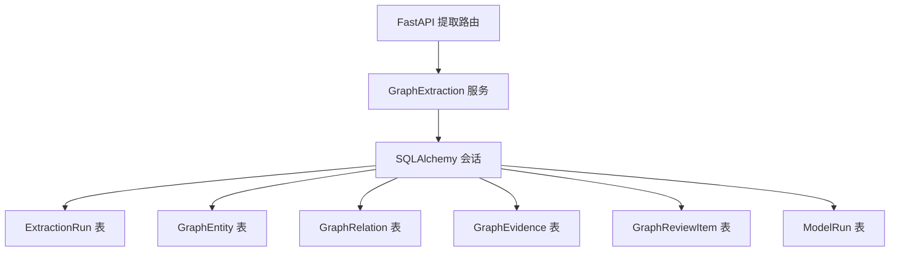
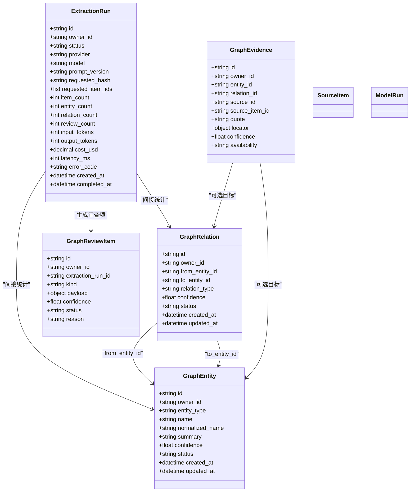
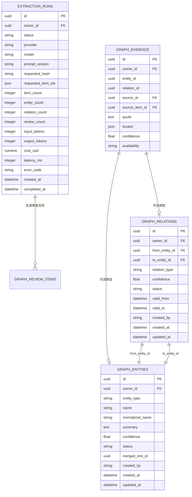
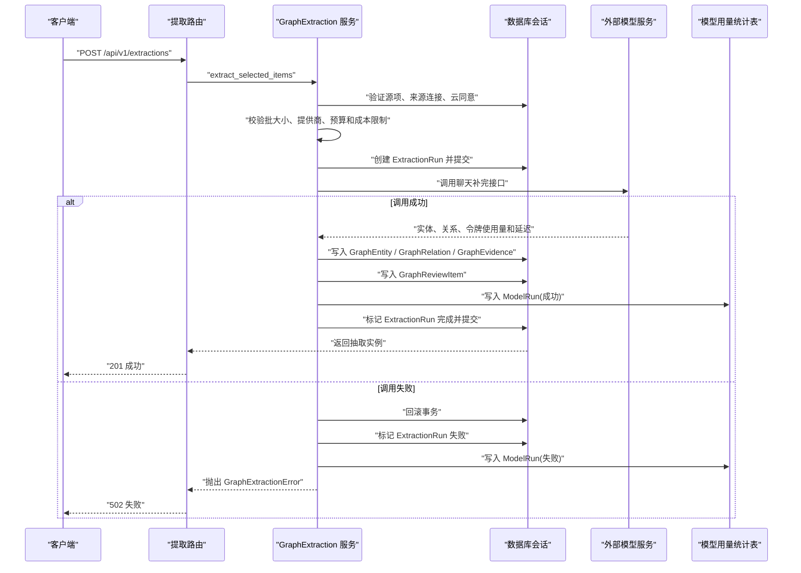
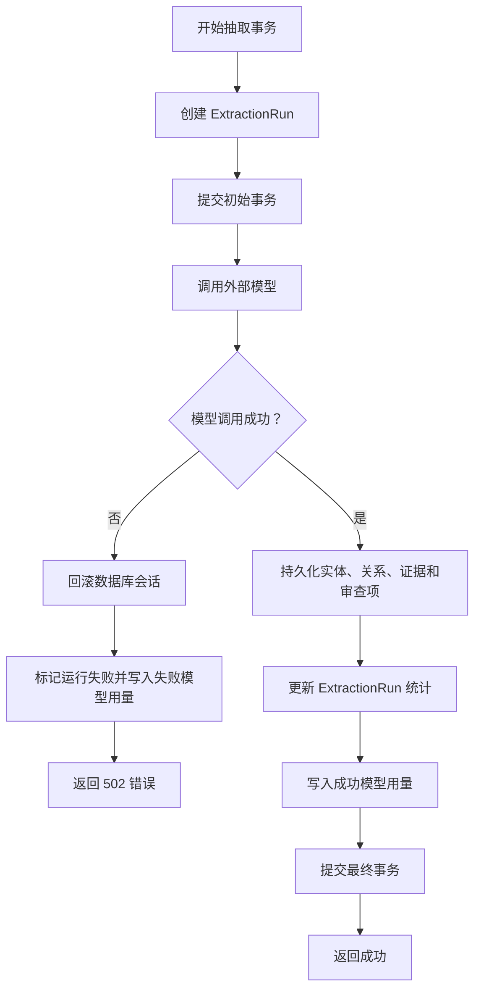
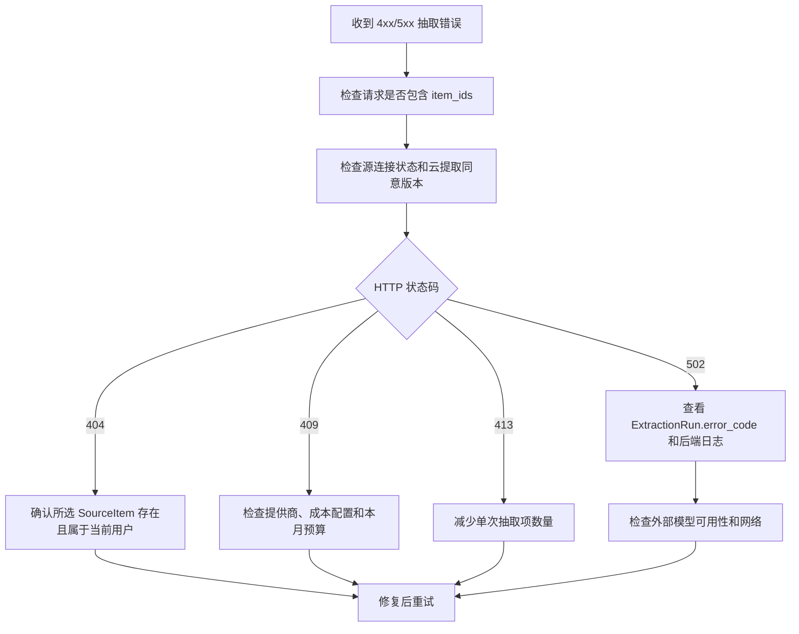

# ExtractionRun 抽取运行模型

<cite>
**本文引用的文件**   
- [models.py](file://src/personal_ai_life_os/models.py)
- [graph_extraction.py](file://src/personal_ai_life_os/services/graph_extraction.py)
- [extractions.py](file://src/personal_ai_life_os/api/routes/extractions.py)
- [schemas.py](file://src/personal_ai_life_os/api/schemas.py)
- [d2f5a8c14e73_add_evidence_graph_tables.py](file://migrations/versions/d2f5a8c14e73_add_evidence_graph_tables.py)
- [test_graph_extraction.py](file://tests/test_graph_extraction.py)
</cite>

## 目录

1. [引言](#引言)
2. [项目定位与数据域范围](#项目定位与数据域范围)
3. [ExtractionRun 模型字段规范](#extractionrun-模型字段规范)
4. [架构总览与职责划分](#架构总览与职责划分)
5. [关键字段语义与取值约束](#关键字段语义与取值约束)
6. [与 GraphEntity、GraphRelation 的数据关系](#与-graphentity-graphrelation-的数据关系)
7. [执行流程与时序关系](#执行流程与时序关系)
8. [大规模抽取任务的指标收集策略](#大规模抽取任务的指标收集策略)
9. [批量插入、事务处理与回滚机制](#批量插入事务处理与回滚机制)
10. [抽取质量分析建议](#抽取质量分析建议)
11. [成本优化建议](#成本优化建议)
12. [故障排查指南](#故障排查指南)
13. [结论](#结论)

## 引言

ExtractionRun 是证据图抽取任务的核心运行记录模型。它不直接存储图谱实体或关系，而是用于描述一次抽取任务的上下文、输入来源、统计结果、成本消耗和最终状态。该模型面向“从用户选择的源项目中抽取证据图”这一业务流程，将外部模型调用、知识图谱写入、审查项生成、成本记录和月度预算校验整合到一个可追踪、可审计、可重复的运行实例中。

在本文中：

- `extraction_id` 对应数据库模型中的 `ExtractionRun.id`，即抽取实例 ID。
- `graph_entities_extracted` 对应 `entity_count`，表示本次运行新持久化的实体数量。
- `graph_relations_extracted` 对应 `relation_count`，表示本次运行新持久化的关系数量。
- `model_provider` 对应 `provider`，表示本次使用的模型提供商名称。
- `cost_tokens` 对应 `input_tokens` 与 `output_tokens`，表示提示词令牌数与补全令牌数。
- `processing_duration_ms` 对应 `latency_ms`，表示实际外部模型调用的耗时（毫秒）。
- `confidence_score` 没有单独字段；系统中用实体的置信度和审查项标记来间接表达抽取质量。
- `error_details` 没有结构化错误对象字段；系统通过 `error_code`、异常类型名和执行日志提供错误信息。

这些设计让 ExtractionRun 更适合做“任务级指标记录”，而不是“实体质量字段容器”。

**本节引用**
- [models.py:564-598](file://src/personal_ai_life_os/models.py#L564-L598)
- [graph_extraction.py:580-844](file://src/personal_ai_life_os/services/graph_extraction.py#L580-L844)

## 项目定位与数据域范围

Evidence Graph 相关数据由多个表共同组成：

| 领域 | 主要表 | 作用 |
|---|---|---|
| 运行记录 | `extraction_runs` | 记录每次抽取请求、状态、统计指标和失败信息 |
| 实体 | `graph_entities` | 存储抽取产生的实体及其置信度、状态和别名 |
| 关系 | `graph_relations` | 存储实体之间的证据关系 |
| 证据 | `graph_evidence` | 把实体或关系关联到具体源条目和引文片段 |
| 审查项 | `graph_review_items` | 标记低置信度或证据缺失的实体和关系 |
| 本体类型 | `ontology_types` | 记录实体类型与关系类型的审核状态 |
| 模型使用 | `model_runs` | 聚合各用途的模型令牌、延迟和成本 |

ExtractionRun 是这些表的“调度入口”和“结果出口”。它的状态反映整个抽取生命周期：从排队、创建、运行到完成或失败。



**图示来源**
- [extractions.py:49-89](file://src/personal_ai_life_os/api/routes/extractions.py#L49-L89)
- [graph_extraction.py:580-844](file://src/personal_ai_life_os/services/graph_extraction.py#L580-L844)
- [models.py:564-631](file://src/personal_ai_life_os/models.py#L564-L631)

**本节引用**
- [models.py:286-347](file://src/personal_ai_life_os/models.py#L286-L347)
- [models.py:349-437](file://src/personal_ai_life_os/models.py#L349-L437)
- [models.py:501-631](file://src/personal_ai_life_os/models.py#L501-L631)
- [d2f5a8c14e73_add_evidence_graph_tables.py:130-213](file://migrations/versions/d2f5a8c14e73_add_evidence_graph_tables.py#L130-L213)

## ExtractionRun 模型字段规范

`ExtractionRun` 的主要字段如下表所示。为便于对照实现，这里保留 SQLAlchemy 模型与迁移中的核心含义，但不会复制代码内容。

| 字段 | 类型或等价语义 | 是否必填 | 默认值 | 说明 |
|---|---:|---:|---:|---|
| `id` | UUID 字符串 | 是 | 自动生成 | 抽取实例 ID；对外返回时作为 `extraction_id` |
| `owner_id` | UUID 字符串 | 是 | — | 所属用户，保证多租户隔离 |
| `status` | 字符串 | 是 | `queued` | 运行状态，包括排队、运行中、完成、失败等阶段 |
| `provider` | 最长 120 字符 | 是 | — | 模型提供商名称，如 OpenAI 或其他 OpenAI 兼容服务端点标识 |
| `model` | 最长 160 字符 | 是 | — | 具体模型名称 |
| `prompt_version` | 最长 40 字符 | 是 | — | 抽取提示词版本，用于可重现性和模型提示演进追踪 |
| `requested_hash` | SHA-256 哈希 | 是 | — | 由输入项、提供商、模型和提示版本计算，用于去重 |
| `requested_item_ids` | JSON 数组 | 是 | 空数组 | 本次抽取请求排序后的唯一源项 ID 列表 |
| `item_count` | 整数 | 是 | 0 | 成功加载并参与抽取的源项目数量 |
| `entity_count` | 整数 | 是 | 0 | 本次运行新持久化的实体数量 |
| `relation_count` | 整数 | 是 | 0 | 本次运行新持久化的关系数量 |
| `review_count` | 整数 | 是 | 0 | 生成的待审查条目数量，用于低置信度或缺乏证据的检查 |
| `input_tokens` | 整数 | 是 | 0 | 传递给外部模型的提示词令牌数 |
| `output_tokens` | 整数 | 是 | 0 | 外部模型返回的补全令牌数 |
| `cost_usd` | 小数，精度 12 位，最多 6 位小数 | 否 | NULL | 本次运行按令牌计算的成本美元值 |
| `latency_ms` | 整数 | 是 | 0 | 实际外部模型调用的耗时，单位毫秒 |
| `error_code` | 字符串，最长 80 字符 | 否 | NULL | 失败时的错误码 |
| `created_at` | UTC 时间 | 是 | 当前 UTC 时间 | 记录创建时间 |
| `completed_at` | UTC 时间 | 否 | NULL | 完成或失败时写入 |

需要注意：数据库中不存在名为 `extraction_id` 的独立字段；外部 API 和文档中的 `extraction_id` 映射为 `ExtractionRun.id`。同样，`graph_entities_extracted` 和 `graph_relations_extracted` 是概念字段名，实际映射为 `entity_count` 和 `relation_count`。`error_details` 也未作为 JSON 字段保存；系统在实现中使用 `error_code` 与运行时异常类型名记录失败原因。

**本节引用**
- [models.py:564-598](file://src/personal_ai_life_os/models.py#L564-L598)
- [d2f5a8c14e73_add_evidence_graph_tables.py:183-213](file://migrations/versions/d2f5a8c14e73_add_evidence_graph_tables.py#L183-L213)

## 架构总览与职责划分



**图示来源**
- [models.py:286-347](file://src/personal_ai_life_os/models.py#L286-L347)
- [models.py:349-437](file://src/personal_ai_life_os/models.py#L349-L437)
- [models.py:501-631](file://src/personal_ai_life_os/models.py#L501-L631)
- [d2f5a8c14e73_add_evidence_graph_tables.py:13-130](file://migrations/versions/d2f5a8c14e73_add_evidence_graph_tables.py#L13-L130)

ExtractionRun 与其他模型的关系具有以下特点：

1. **无直接外键指向实体或关系**：实体数量和关系数量以计数形式存入 ExtractionRun，这样查询运行记录不需要连接大图数据。
2. **通过审查项形成弱关联**：GraphReviewItem 通过 `extraction_run_id` 反向引用运行实例。
3. **通过统计数据间接关联图谱完整性**：如果实体、关系或证据写入失败，ExtractionRun 的状态会进入失败分支，而实体关系表可能保持未修改或部分写入。
4. **与源项目和源连接间接关联**：运行记录不保存完整的源项内容，只保存 `requested_item_ids` 和 `item_count`；完整数据通过 SourceItem 和 SourceConnection 表查询。

## 关键字段语义与取值约束

### `extraction_id`：抽取实例 ID

- 类型为自生成 UUID 字符串。
- 用于 POST `/api/v1/extractions` 返回的 `id` 字段。
- 用于 GET `/api/v1/extractions/{run_id}` 的路径参数。
- 配合 `owner_id` 实现所有权隔离。
- 测试用例验证重复抽取返回相同 ID，体现幂等设计。

### `graph_entities_extracted`：抽取的实体数量

- 实际数据库列为 `entity_count`。
- 表示“本次运行新持久化”的实体数量，不是图谱中已有实体总数。
- `_persist_graph` 仅在 `_find_or_create_entity` 创建新实体时增加计数。
- 已存在实体被合并、别名更新或置信度提升不会增加该计数。
- 对低置信度或缺少证据的实体也会创建实体记录，同时生成审查项；这类实体仍计入实体计数。

### `graph_relations_extracted`：抽取的关系数量

- 实际数据库列为 `relation_count`。
- 仅当新的三元组组合（起点实体、终点实体、关系类型）不存在时才增加计数。
- 过滤自环、无效关系类型和无法解析的实体键。
- 与实体计数不同，关系的判定更严格，因为必须同时找到起点和终点。

### `model_provider`：模型提供商

- 实际数据库列为 `provider`。
- 可来自用户显式选择的 OpenAI 兼容提供商，也可来自配置的默认 OpenAI 提供商。
- 提供商解析阶段会校验 `base_url`、`api_key`、`model`、输入输出单价等字段。
- 未配置或不可用时会返回 `model_provider_unavailable`、`model_provider_unconfigured` 等错误。

### `cost_tokens`：tokens 使用量

- 系统拆分记录 `input_tokens` 和 `output_tokens`。
- `input_tokens` 来自外部模型的 usage.prompt_tokens。
- `output_tokens` 来自外部模型的 usage.completion_tokens。
- `cost_usd` 根据实际令牌和提供商单价计算；若未配置单价，则回退到预估成本。
- 失败时，失败路径会使用估计令牌数和预留成本进行记录，以便预算跟踪不因外部模型异常完全失效。

### `processing_duration_ms`：处理耗时

- 实际数据库列为 `latency_ms`。
- 它是外部 HTTP 调用的单调时钟耗时，单位为毫秒。
- 注意：它不是整个 `extract_selected_items` 方法的整体耗时，而是调用外部模型的时间。
- 失败分支中延迟设为 0，因为请求可能未真正到达外部服务。

### `confidence_score`：平均置信度

- 模型中没有直接的 `confidence_score` 字段。
- 置信度体现在以下位置：
  - GraphEntity.confidence
  - GraphRelation.confidence
  - GraphEvidence.confidence
  - GraphReviewItem.confidence
- 判断是否需要审查时，系统比较 `confidence < threshold`。
- 如果需要全局“平均置信度”，应在查询层聚合 GraphEntity 和 GraphRelation 上的置信度，而不是读取 ExtractionRun 字段。

### `error_details`：错误详情

- 模型没有 `error_details` JSON 字段。
- 运行时错误分为两类：
  - 业务校验失败：抛出 `GraphExtractionError`，包含 `code`、`message`、`status_code`。
  - 外部调用失败：捕获通用 Exception，将异常类型名写入 `error_code`，并记录警告日志。
- 对外接口会把 `GraphExtractionError` 转换为带有 `code` 和 `message` 的 HTTP 错误响应。
- 因此排查时应优先检查响应体中的错误码，然后查看后端日志中的异常类型和运行状态。

**本节引用**
- [models.py:564-631](file://src/personal_ai_life_os/models.py#L564-L631)
- [graph_extraction.py:55-179](file://src/personal_ai_life_os/services/graph_extraction.py#L55-L179)
- [graph_extraction.py:180-243](file://src/personal_ai_life_os/services/graph_extraction.py#L180-L243)
- [graph_extraction.py:245-579](file://src/personal_ai_life_os/services/graph_extraction.py#L245-L579)
- [graph_extraction.py:654-844](file://src/personal_ai_life_os/services/graph_extraction.py#L654-L844)
- [extractions.py:12-89](file://src/personal_ai_life_os/api/routes/extractions.py#L12-L89)
- [test_graph_extraction.py:180-281](file://tests/test_graph_extraction.py#L180-L281)

## 与 GraphEntity、GraphRelation 的数据关系

### 实体关系



**图示来源**
- [d2f5a8c14e73_add_evidence_graph_tables.py:13-130](file://migrations/versions/d2f5a8c14e73_add_evidence_graph_tables.py#L13-L130)
- [d2f5a8c14e73_add_evidence_graph_tables.py:183-213](file://migrations/versions/d2f5a8c14e73_add_evidence_graph_tables.py#L183-L213)
- [models.py:501-631](file://src/personal_ai_life_os/models.py#L501-L631)

### 一致性保证机制

| 一致性目标 | 实现方式 | 风险边界 |
|---|---|---|
| 同一运行实例的可追溯性 | `requested_hash`、`requested_item_ids`、`prompt_version` | 仅适合轻量比对；跨版本或大输入不建议依赖哈希做精确对比 |
| 幂等抽取 | 基于请求参数的哈希 + 已完成状态复用现有运行 | 仅对相同提供商、模型和提示版本有效 |
| 实体合并 | 按所有者、实体类型、标准化名称查找已有实体 | 需要警惕自然语言名称差异；别名机制部分缓解此问题 |
| 关系唯一性 | 同所有者、起点、终点、关系类型、活跃状态的联合判定 | 不在数据库层建唯一约束，应用层负责防重 |
| 证据去重 | 按实体或关系、源条目、引文文本判重 | 长引文裁剪上限会影响匹配敏感性 |
| 主体完整性 | 外键强制要求 source_id、entity_id、relation_id、source_item_id 指向真实记录 | 软删除或历史状态场景需结合查询条件 |
| 抽取目标唯一性 | `graph_evidence` 的 `ck_graph_evidence_target` 约束实体或关系二选一 | 两者均为空时约束拒绝插入 |

### 数据一致性重要注意事项

1. `entity_count` 和 `relation_count` 表示本次运行的增量，不代表图谱全局总量。
2. GraphRelation 通过外键强制起点和终点实体存在，且删除实体时关系级联删除。
3. GraphEvidence 可以指向实体或关系，但不能两者都为空。
4. 抽取过程先写入 GraphEntity，再写入 GraphRelation，最后追加 GraphEvidence 和 GraphReviewItem。
5. 若模型返回的实体键无法对应已有实体，则该关系会被跳过，不会创建悬空关系。
6. 若实体置信度低于阈值，仍可能创建实体，但会进入待审查状态并记录审查项。

**本节引用**
- [models.py:286-437](file://src/personal_ai_life_os/models.py#L286-L437)
- [d2f5a8c14e73_add_evidence_graph_tables.py:13-130](file://migrations/versions/d2f5a8c14e73_add_evidence_graph_tables.py#L13-L130)
- [graph_extraction.py:245-579](file://src/personal_ai_life_os/services/graph_extraction.py#L245-L579)

## 执行流程与时序关系



**图示来源**
- [extractions.py:49-89](file://src/personal_ai_life_os/api/routes/extractions.py#L49-L89)
- [graph_extraction.py:654-844](file://src/personal_ai_life_os/services/graph_extraction.py#L654-L844)
- [graph_extraction.py:180-243](file://src/personal_ai_life_os/services/graph_extraction.py#L180-L243)

关键步骤顺序如下：

1. 路由层接收请求并授权当前用户。
2. 服务层解析并校验所选源项、来源连接、云同意、提供商、成本和本月预算。
3. 计算 `requested_hash` 后检查是否存在相同的已完成运行。
4. 预创建 ExtractionRun，立即提交事务以保证幂等性和查询可见性。
5. 构建自定义类型提示并调用外部模型。
6. 将模型输出的实体、关系、证据转化为持久化对象。
7. 根据置信度阈值生成审查项。
8. 更新 ExtractionRun 并写入 ModelRun。
9. 发生异常时回滚所有变更，并将运行标记为失败。

**本节引用**
- [graph_extraction.py:654-844](file://src/personal_ai_life_os/services/graph_extraction.py#L654-L844)
- [extractions.py:49-89](file://src/personal_ai_life_os/api/routes/extractions.py#L49-L89)

## 大规模抽取任务的指标收集策略

### 输入限制策略

当前实现采用“单次请求上限”而非内部自动分批：

- `item_count` 由配置 `graph_extraction_max_items` 限制。
- 超出上限返回 `extraction_batch_too_large`。
- 这是防止请求过大导致内存、令牌数、外部模型超时等问题的一道防护门。

| 配置 | 影响范围 | 推荐理解方式 |
|---|---|---|
| `graph_extraction_max_items` | 单次抽取最大源项数 | 控制输入负载 |
| `model_max_output_tokens` | 外部模型最大输出长度 | 影响成本估算与截断风险 |
| `model_max_cost_per_call_usd` | 单次调用最大估算成本 | 防止昂贵批次直接进入模型 |
| `model_monthly_budget_usd` | 用户当月模型支出上限 | 与已有 ModelRun 合计做预算拦截 |
| `graph_extraction_confidence_threshold` | 低置信度审查阈值 | 决定实体和关系是否需要人工审查 |

### 内存管理要点

抽取服务会临时维护以下数据结构：

| 结构 | 作用 | 规模特征 |
|---|---|---|
| `unique_ids` | 去重排序后的请求 ID | 与 `item_count` 成正比 |
| `rows` | 查询出的 SourceItem 与 SourceConnection | 与选中项数量成正比 |
| `items` | 过滤后的源项列表 | 传给外部模型 |
| `item_map` | 源项 ID 到对象的映射 | 证据关联时使用 |
| `key_map` | 模型实体键到 GraphEntity 对象的映射 | 关联实体键时查找起点和终点 |
| 实体遍历上限 | 最多处理前 200 个实体 | 防止超长实体列表放大循环 |
| 关系遍历上限 | 最多处理前 300 个关系 | 防止过长关系列表 |

这说明抽取服务具备一定基础限流能力，但并不等同于真正的分片写入或队列消费。

### 性能监控指标

应从 ExtractionRun 和其他相关表采集以下指标：

| 指标 | 数据来源 | 用途 |
|---|---|---|
| 抽取成功率 | ExtractionRun.status | 观察模型可用性和上游数据健康 |
| 实体密度 | `entity_count / item_count` | 评估每条源数据产生的实体数量 |
| 关系密度 | `relation_count / item_count` | 评估图谱复杂程度 |
| 审查率 | `review_count / (entity_count + relation_count)` | 衡量模型可信程度和质量压力 |
| 平均延迟 | ExtractionRun.latency_ms | 监控外部模型稳定性 |
| 实际成本 | extraction cost_usd + monthly budget | 预算控制和成本分摊 |
| 令牌效率 | `entity_count / input_tokens` | 评估提示词性价比 |
| 预算告警 | 本月累计成本接近月度预算阈值 | 提前拦截高风险调用 |

**本节引用**
- [graph_extraction.py:580-647](file://src/personal_ai_life_os/services/graph_extraction.py#L580-L647)
- [graph_extraction.py:654-748](file://src/personal_ai_life_os/services/graph_extraction.py#L654-L748)
- [test_graph_extraction.py:246-281](file://tests/test_graph_extraction.py#L246-L281)

## 批量插入、事务处理与回滚机制

### 批量插入现状

当前实现并非简单地将全部对象一次性批量提交。其主要写入路径如下：

1. 初始运行记录创建后立即提交。
2. 每个实体通过 `_find_or_create_entity` 查找或创建。
3. 每个关系通过 `_find_or_create_relation` 查找或创建。
4. 每个有效证据通过 `_add_evidence` 去重后添加。
5. 每个低置信度或证据缺失项通过 `_add_review` 添加。
6. 成功后统一更新 ExtractionRun，再写入 ModelRun，并提交。

这意味着：

- 批量规模主要受 Python 对象累积和外键查询次数影响。
- SQLAlchemy 通常会对同一会话内新增对象进行批量操作优化，但模型层未显式使用 `session.bulk_insert_mappings` 等方法。
- 对于大规模实体或关系集合，应优先考虑减小 `graph_extraction_max_items`，并在上层引入异步批处理或队列。

### 事务处理规则

| 阶段 | 事务行为 | 目的 |
|---|---|---|
| 参数校验 | 尚未创建运行记录 | 快速失败，减少无用数据库操作 |
| 幂等命中 | 返回已有完成的 ExtractionRun | 避免重复写入 |
| 创建运行记录 | 新建后立即提交 | 使重复请求能查到已创建的运行实例 |
| 外部模型调用 | 在已提交事务后执行 | 调用失败时不应破坏初始运行记录 |
| 图谱持久化 | 在同一会话中累积写入 | 利用会话事务保证原子性 |
| 成功完成 | 更新运行记录并写入 ModelRun，最后提交 | 确保统计、图谱、审查项一致 |
| 异常失败 | 会话回滚，重试设置失败状态 | 防止部分写入的脏数据 |

### 回滚机制与潜在风险



**图示来源**
- [graph_extraction.py:720-844](file://src/personal_ai_life_os/services/graph_extraction.py#L720-L844)

需要特别注意：**初始运行记录是先提交后再调用外部模型的**。这意味着即使后续持久化失败，`ExtractionRun` 本身可能已经存在。不过，由于异常处理中会执行 `session.rollback()` 并重新将运行设置为 `failed`，典型失败场景下运行记录最终状态应为失败。

潜在风险包括：

1. 如果外部模型返回部分合法结果后又中途报错，数据库状态取决于 SQLAlchemy 会话的回滚能力。
2. 由于 EntityAlias 等辅助表可能在不同写入路径中被修改，应重点测试混合旧实体和新实体的场景。
3. 幂等哈希仅针对已完成运行；失败后重试仍可创建新运行。
4. 成本估算和预留逻辑发生在调用前，失败路径复用估算成本，以避免预算跟踪出现巨大空洞。

**本节引用**
- [graph_extraction.py:720-844](file://src/personal_ai_life_os/services/graph_extraction.py#L720-L844)
- [graph_extraction.py:461-579](file://src/personal_ai_life_os/services/graph_extraction.py#L461-L579)

## 抽取质量分析建议

### 基于现有字段的分析方法

| 分析维度 | 建议字段或关联表 | 解释 |
|---|---|---|
| 抽取产出效率 | `entity_count`、`relation_count`、`item_count` | 衡量每项源数据平均能产生多少实体和关系 |
| 模型稳定性 | `latency_ms`、`status` | 高延迟和失败率可能来自外部模型或网络 |
| 模型透明度 | `input_tokens`、`output_tokens`、`provider`、`model`、`prompt_version` | 支持不同模型和提示版本的回溯 |
| 质量控制 | `review_count`、GraphReviewItem、GraphEntity.confidence | 低置信度或未充分证据的项目需要人工审查 |
| 数据可信度 | GraphEvidence.quote、GraphEvidence.confidence | 证据越短越具体，越容易核验 |
| 长期趋势 | ExtractionRun.created_at、monthly budget | 分析周期性的抽取质量和成本变化 |

### 置信度解读

系统中的置信度并非一个固定阈值下的准确率指标，而是一个“值得人类复核程度”的信号：

- 置信度 ≥ 阈值：实体或关系可直接视为活跃状态。
- 置信度 < 阈值：创建 GraphReviewItem，建议进入人工审查流程。
- 类型未获批准：置信度会被限制到较低水平。
- 缺少证据：置信度同样会被限制到较低水平。
- 多次抽取可能提升已有实体的置信度，取最大值而非平均值。

### 质量改进方向

| 方向 | 做法 | 预期效果 |
|---|---|---|
| 提高证据质量 | 缩短并精确选取 source item 的文本摘要 | 降低无关信息带来的噪声 |
| 稳定命名 | 调整本体类型并审批常用实体类型 | 减少同名异义词导致的碎片化 |
| 强化阈值 | 调低或调高 `graph_extraction_confidence_threshold` | 平衡自动化程度和审查工作量 |
| 增强约束 | 鼓励模型返回可靠 evidence | 降低缺证据比例 |
| 监控审查积压 | 按 GraphReviewItem.extraction_run_id 统计待审项 | 发现持续低质量抽取 |
| 版本化提示 | 使用 `prompt_version` 对比 A/B 结果 | 量化提示词迭代收益 |

[本节无特定文件分析引用]

## 成本优化建议

### 成本构成

`cost_usd` 来源于外部模型返回的实际令牌数，计算公式大致为：

```
成本 = (输入令牌 × 每百万输入令牌单价 + 输出令牌 × 每百万输出令牌单价) ÷ 1,000,000
```

若提供商未配置单价，系统会使用预留估算成本，以避免预算追踪丢失。

### 优化策略

| 策略 | 具体手段 | 注意事项 |
|---|---|---|
| 控制批大小 | 调小 `graph_extraction_max_items` | 避免单批 token 超过 `model_max_cost_per_call_usd` |
| 限制输出长度 | 合理配置 `model_max_output_tokens` | 输出截断可能导致不完整图谱 |
| 选择低价提供商 | 使用 `graph_model_providers` 配置低成本 OpenAI 兼容模型 | 质量可能下降，需结合审查流程 |
| 启用预算保护 | 设置 `model_monthly_budget_usd` | Desktop 环境另有预算判断分支 |
| 抑制高估成本调用 | 使用 `model_max_cost_per_call_usd` 前置拦截 | 防止昂贵请求进入外部系统 |
| 识别低效提示 | 关注 `input_tokens` 增长而实体关系未同步增长的情况 | 可能需要压缩 source item 的 text 字段 |
| 使用幂等重复执行 | 相同请求复用 Completed 运行 | 避免重复建模，但要确认下游图谱是否接受幂等副作用 |

### 预算警告

路由层会在返回 ExtractionRun 时计算用户当月模型支出，并在支出达到预算的 80% 时设置预算告警标志。单元测试覆盖了以下行为：

- 预算极低时阻止抽取。
- 上月已有模型消费时触发 80% 预算告警。
- 不同模型用途共用 ModelRun.cost_usd 计算月度支出。

**本节引用**
- [graph_extraction.py:125-179](file://src/personal_ai_life_os/services/graph_extraction.py#L125-L179)
- [graph_extraction.py:245-269](file://src/personal_ai_life_os/services/graph_extraction.py#L245-L269)
- [graph_extraction.py:720-761](file://src/personal_ai_life_os/services/graph_extraction.py#L720-L761)
- [extractions.py:22-89](file://src/personal_ai_life_os/api/routes/extractions.py#L22-L89)
- [test_graph_extraction.py:246-281](file://tests/test_graph_extraction.py#L246-L281)

## 故障排查指南

### 常见错误分类

| 错误码或现象 | 含义 | 处理方法 |
|---|---|---|
| `item_selection_required` | 未选择任何源项 | 至少选择一个有效的 SourceItem |
| `extraction_batch_too_large` | 选择项超过单次上限 | 分批调用或调大配置 |
| `source_item_not_found` | 选择的源项不存在或不属于当前用户 | 检查权限和源项生命周期 |
| `source_not_active` | 来源连接暂停 | 激活来源连接 |
| `source_cloud_consent_required` | 来源未开启最新版云提取同意 | 更新云提取同意版本 |
| `model_provider_unavailable` / `model_provider_unconfigured` | 提供商未配置或字段缺失 | 检查 `graph_model_providers` 或默认 OpenAI 配置 |
| `model_cost_unconfigured` | 未配置每百万令牌单价 | 补充输入输出单价 |
| `model_cost_per_call_exceeded` | 估算单批成本超限额 | 减小批大小或降低成本上限 |
| `model_budget_exceeded` | 月度预算不足 | 等待新周期、调高预算或暂停其他模型用途 |
| `graph_extraction_failed` | 外部模型调用或后续处理失败 | 查看 ExtractionRun.error_code、后端日志和重试窗口 |

### 逐步排查流程



**图示来源**
- [graph_extraction.py:580-719](file://src/personal_ai_life_os/services/graph_extraction.py#L580-L719)
- [extractions.py:49-89](file://src/personal_ai_life_os/api/routes/extractions.py#L49-L89)
- [test_graph_extraction.py:246-281](file://tests/test_graph_extraction.py#L246-L281)

### 数据不一致诊断

如果发现 ExtractionRun 报告成功，但实体或关系数量不符合预期：

1. 检查 `entity_count`、`relation_count`、`review_count` 是否为 0。
2. 查询 GraphReviewItem 是否有大量低置信度项目。
3. 确认 GraphQL API 中实体的 status 是否为 active 或 pending_review。
4. 确认图谱查询未误加 `merged_into_id IS NULL` 等过滤条件。
5. 检查实体名称、entity_type 与期望本体类型是否一致。
6. 如果关系数量为 0，优先检查起点或终点实体键能否映射到 key_map。
7. 检查 GraphEvidence 是否因 quote 长度限制或来源映射差异未被创建。

**本节引用**
- [graph_extraction.py:461-579](file://src/personal_ai_life_os/services/graph_extraction.py#L461-L579)
- [graph_extraction.py:580-844](file://src/personal_ai_life_os/services/graph_extraction.py#L580-L844)
- [test_graph_extraction.py:66-179](file://tests/test_graph_extraction.py#L66-L179)

## 结论

ExtractionRun 是证据图抽取系统的运行中枢。它并不追求把所有质量信号塞进自身字段，而是把“任务级指标”和“图谱级事实”分开：

- ExtractionRun 负责运行 ID、状态、输入快照、统计指标、成本和失败信息。
- GraphEntity 和 GraphRelation 负责图谱事实、置信度和状态。
- GraphEvidence 负责把图表元素追溯到原始证据。
- GraphReviewItem 负责把低质量结果交给人类决策。
- ModelRun 负责跨用途的模型使用和成本汇总。

对于未来扩展，建议优先考虑：

1. 若需要“平均置信度”，在查询层聚合实体和关系置信度，避免污染运行记录的简洁语义。
2. 若需要更详细的结构化错误信息，可在 Migration 中增加 `error_details` 或 `error_json` 列，并明确兼容性迁移策略。
3. 对超大任务引入上层批处理器或后台队列，避免 HTTP 请求直接承载大批量源项。
4. 考虑在更高并发环境中为运行记录增加幂等锁或分布式锁，进一步降低竞写概率。
5. 保留 `prompt_version`、`provider`、`model`、`input_tokens`、`output_tokens`、`cost_usd` 的历史序列，持续优化模型选择和提示工程。