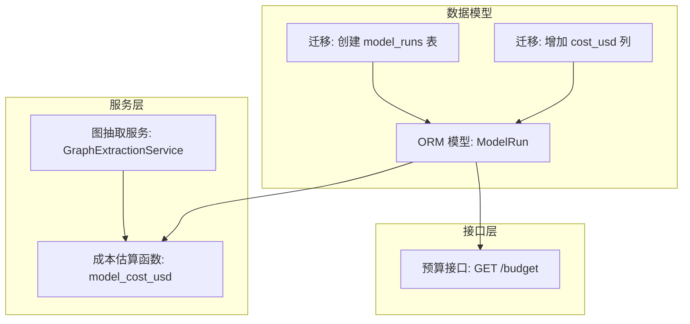
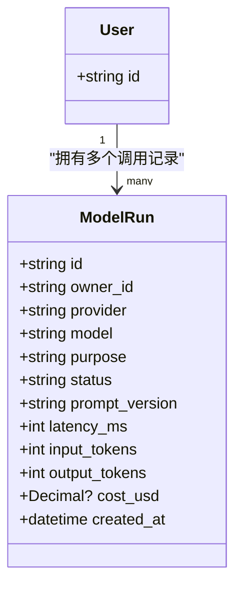
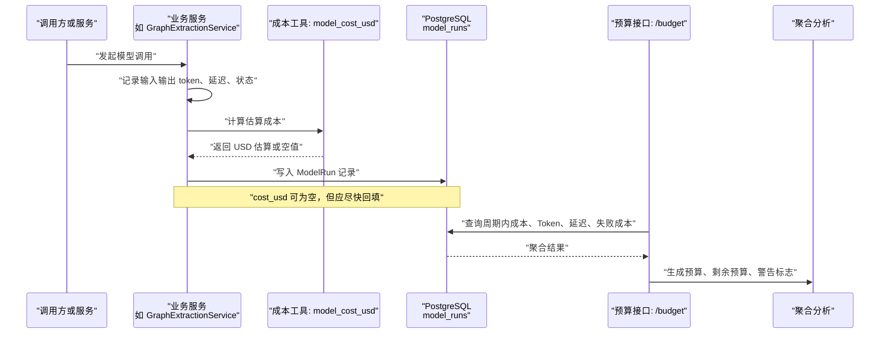
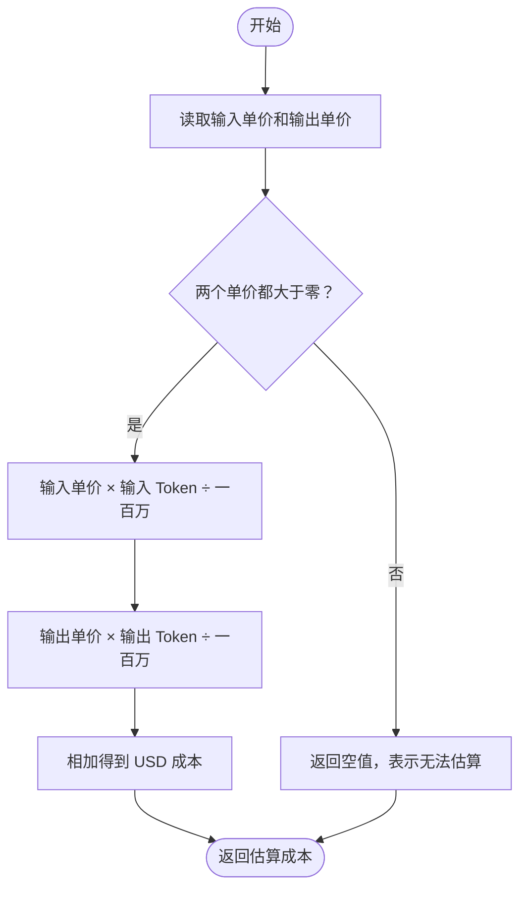
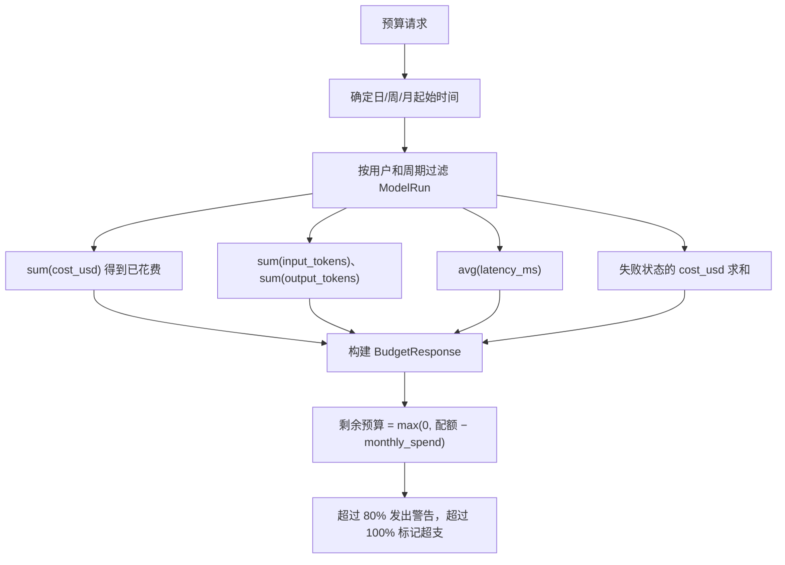
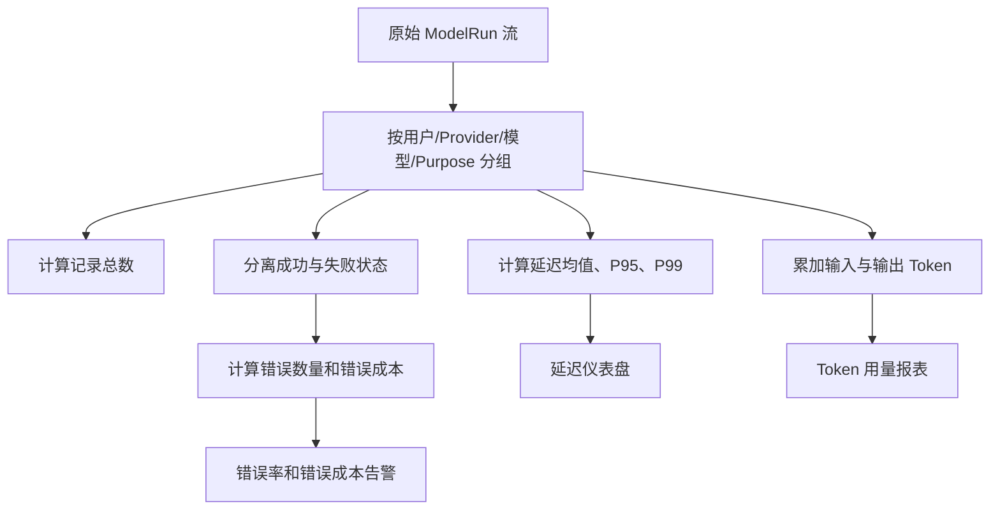
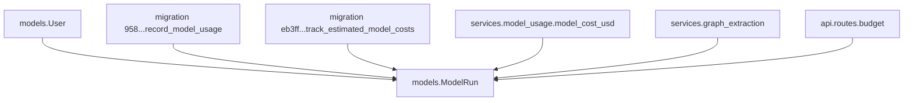
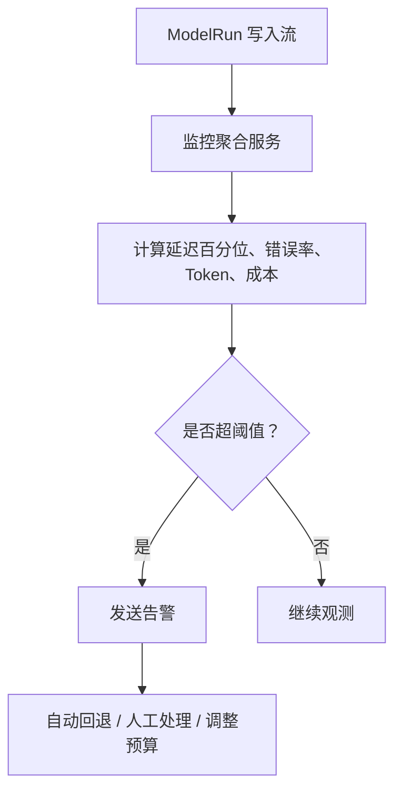

# ModelRun 模型调用记录模型

<cite>
**本文引用的文件 **
- [models.py](file://src/personal_ai_life_os/models.py)
- [958b551e0397_record_model_usage.py](file://migrations/versions/958b551e0397_record_model_usage.py)
- [eb3ff930ec06_track_estimated_model_costs.py](file://migrations/versions/eb3ff930ec06_track_estimated_model_costs.py)
- [model_usage.py](file://src/personal_ai_life_os/services/model_usage.py)
- [budget.py](file://src/personal_ai_life_os/api/routes/budget.py)
- [graph_extraction.py](file://src/personal_ai_life_os/services/graph_extraction.py)
</cite>

## 目录
1. [简介](#简介)
2. [项目结构与数据来源](#项目结构与数据来源)
3. [核心数据模型](#核心数据模型)
4. [架构总览](#架构总览)
5. [详细字段与业务语义](#详细字段与业务语义)
6. [成本计算与预算集成](#成本计算与预算集成)
7. [性能指标收集与统计策略](#性能指标收集与统计策略)
8. [依赖关系分析](#依赖关系分析)
9. [高频写入优化与归档建议](#高频写入优化与归档建议)
10. [异常检测与告警设计](#异常检测与告警设计)
11. [常见排查清单](#常见排查清单)
12. [结论](#结论)

## 简介
ModelRun 是本项目中用于追踪 AI 模型调用记录的持久化数据模型，主要面向以下目标：
- 记录每次外部模型调用的基础信息、输入输出 Token 用量和响应延迟。
- 为成本核算提供最小事实表，并与预算系统联动，支持按月汇总支出。
- 作为性能监控的基础来源，通过聚合分析延迟、Token 用量和失败状态。

本模型目前对应数据库中的 `model_runs` 表，由独立的迁移脚本创建；估算成本通过另一个独立迁移引入。

## 项目结构与数据来源
ModelRun 的数据结构和用途分布在以下几处：
- ORM 模型定义位于应用主模型模块。
- 建表和索引变更位于 Alembic 迁移文件。
- 通用美元成本估算函数位于服务层。
- 预算接口读取 ModelRun 并聚合成本、Token 和延迟。
- 图抽取流程展示了如何使用 Provider 费率并构造估算成本。

**图表来源 **
- [models.py:770-790](file://src/personal_ai_life_os/models.py#L770-L790)
- [958b551e0397_record_model_usage.py:20-43](file://migrations/versions/958b551e0397_record_model_usage.py#L20-L43)
- [eb3ff930ec06_track_estimated_model_costs.py:20-26](file://migrations/versions/eb3ff930ec06_track_estimated_model_costs.py#L20-L26)
- [model_usage.py:1-20](file://src/personal_ai_life_os/services/model_usage.py#L1-L20)
- [graph_extraction.py:135-172](file://src/personal_ai_life_os/services/graph_extraction.py#L135-L172)
- [budget.py:12-28](file://src/personal_ai_life_os/api/routes/budget.py#L12-L28)

**章节来源**
- [models.py:770-790](file://src/personal_ai_life_os/models.py#L770-L790)
- [958b551e0397_record_model_usage.py:1-50](file://migrations/versions/958b551e0397_record_model_usage.py#L1-L50)
- [eb3ff930ec06_track_estimated_model_costs.py:1-28](file://migrations/versions/eb3ff930ec06_track_estimated_model_costs.py#L1-L28)
- [model_usage.py:1-20](file://src/personal_ai_life_os/services/model_usage.py#L1-L20)
- [budget.py:12-118](file://src/personal_ai_life_os/api/routes/budget.py#L12-L118)
- [graph_extraction.py:135-172](file://src/personal_ai_life_os/services/graph_extraction.py#L135-L172)

## 核心数据模型
ModelRun 的核心职责是记录一次“某用户、某个提供方、某个具体模型”的完整调用过程，并把 Token 使用和响应时间固化下来，从而支撑后续的成本、性能和额度分析。

**图表来源 **
- [models.py:770-790](file://src/personal_ai_life_os/models.py#L770-L790)

该模型通过外键关联 `users` 表，便于按用户维度查询调用历史和支出。主键使用无转储字符串形式的 UUID，索引覆盖常用过滤和排序维度。

**章节来源**
- [models.py:770-790](file://src/personal_ai_life_os/models.py#L770-L790)

## 架构总览
从调用方到数据存储与统计的整体链路如下：

当前代码路径的关键映射：
- 写入侧可参考图抽取等服务中对 ModelRun 的使用方式。
- 成本估算函数位于服务层配置模块。
- 预算接口直接对 ModelRun 执行 SQL 级聚合。

**图表来源 **
- [graph_extraction.py:1-60](file://src/personal_ai_life_os/services/graph_extraction.py#L1-L60)
- [model_usage.py:7-20](file://src/personal_ai_life_os/services/model_usage.py#L7-L20)
- [budget.py:35-118](file://src/personal_ai_life_os/api/routes/budget.py#L35-L118)

## 详细字段与业务语义
| 字段 | 类型 | 是否必填 | 索引/约束说明 | 业务含义与建议 |
|---|---|---:|---|---|
| `id` | UUID 字符串 | 是 | 主键 | 每次调用的唯一标识，可作为外部系统 trace ID 或内部 run_id。 |
| `owner_id` | UUID 字符串 | 是 | 普通索引 | 调用者所属用户的 ID；按用户统计成本和限额。 |
| `provider` | 字符串，最长 120 | 是 | 普通索引 | 模型提供方名称，例如 OpenAI、Claude、本地兼容服务等。 |
| `model` | 字符串，最长 160 | 是 | 无单独索引 | 具体模型版本，可用于区分不同推理能力或定价模型。 |
| `purpose` | 字符串，最长 40 | 是 | 普通索引 | 调用目的或功能标签，例如 “graph_extraction”、“chat” 等，适合成本分摊和功能维度分析。 |
| `status` | 字符串，最长 24 | 是 | 普通索引 | 运行状态，正常与失败状态应分开管理。 |
| `prompt_version` | 字符串，最长 80 | 是 | 无索引 | Prompt 或提示工程版本；有助于追踪调用质量变化。 |
| `latency_ms` | 整数 | 是，默认 0 | 无索引 | 本次调用的响应延迟毫秒数；用于平均、P95、P99 分析。 |
| `input_tokens` | 整数 | 是，默认 0 | 无索引 | 输入 Token 数量。 |
| `output_tokens` | 整数 | 是，默认 0 | 无索引 | 输出 Token 数量；实际 API 返回可能用 completion_tokens，但此处统一使用 output_tokens。 |
| `cost_usd` | Decimal(precision=12, scale=8)，可空 | 否 | 无索引 | 单次调用估算成本（美元）；允许为空以兼容未配置单价的场景。 |
| `created_at` | UTC 时间戳 | 是 | 复合索引 `(owner_id, created_at)` | 记录创建时间，用于按月、按周、按天切分预算。 |

### 与用户需求字段的映射说明
用户要求中提到的字段与本实现存在部分命名差异，需要注意：

| 用户需求字段 | 实际模型字段 | 差异解释 |
|---|---|---|
| `run_id` | `id` | 本实现使用 `id` 作为调用标识，可直接视为 `run_id`。 |
| `provider_name` | `provider` | 名称略有不同，语义相同。 |
| `model_name` | `model` | 名称略有不同，语义相同。 |
| `input_tokens` | `input_tokens` | 完全一致。 |
| `output_tokens` | `output_tokens` | 完全一致。 |
| `completion_tokens` | `output_tokens` | 当前实现没有单独字段；若上游 API 提供 `completion_tokens`，应在数据入库前统一到 `output_tokens`。 |
| `total_cost` | `cost_usd` | 单条记录使用 `cost_usd`；月度 `total_cost` 由预算接口通过聚合计算，不存储为单行字段。 |
| `latency_ms` | `latency_ms` | 完全一致。 |
| `cache_hit` | 当前缺失 | 当前模型中没有缓存命中标志；如需保留，需要新增布尔列。 |

### 索引与查询覆盖
根据预算接口的查询模式，当前已明确创建的索引包括：
- `ix_model_runs_owner_created`: 按用户和时间段聚合预算。
- `ix_model_runs_owner_id`: 快速按用户筛选。
- `ix_model_runs_purpose`: 按功能目的分组。
- `ix_model_runs_status`: 按状态聚合错误率与失败成本。

如果未来频繁按 `provider`、`model`、`created_at` 做联合统计，应考虑添加更细粒度的复合索引。

**章节来源**
- [models.py:770-790](file://src/personal_ai_life_os/models.py#L770-L790)
- [958b551e0397_record_model_usage.py:20-43](file://migrations/versions/958b551e0397_record_model_usage.py#L20-L43)
- [eb3ff930ec06_track_estimated_model_costs.py:20-26](file://migrations/versions/eb3ff930ec06_track_estimated_model_costs.py#L20-L26)
- [budget.py:35-118](file://src/personal_ai_life_os/api/routes/budget.py#L35-L118)

## 成本计算与预算集成
### 单次成本计算
当前通用成本估算逻辑位于服务层：
- 输入单价：`config.model_input_cost_per_million_usd`。
- 输出单价：`config.model_output_cost_per_million_usd`。
- 计算公式为：输入单价乘以输入 Token 除以一百万，加上输出单价乘以输出 Token 除以一百万。
- 当任一单价小于等于零时，函数返回空值；只有两者均大于零时才返回估算结果。

图中也暴露出另一个更具体的 Provider 成本函数，会根据具体 Provider 配置的输入输出单价计算单次成本；如果未配置有效单价，则同样返回空值。

**图表来源 **
- [model_usage.py:7-20](file://src/personal_ai_life_os/services/model_usage.py#L7-L20)
- [graph_extraction.py:150-172](file://src/personal_ai_life_os/services/graph_extraction.py#L150-L172)

### 月度预算汇总
预算接口定义了成功失败的分组逻辑，并从 `ModelRun.cost_usd` 进行累计：
- 周期支持天、周、月。
- 查询条件包含用户 ID 和起始时间。
- 累计字段包括：总成本、输入 Token、输出 Token、平均延迟、失败成本预留。
- 失败状态包含回退、预算回退、超预算和用户拒绝授权等场景。
- 每月预算来自 `monthly_spend(session, user.id, now)`，并通过配置项 `model_monthly_budget_usd` 判断剩余金额和是否超支。

**图表来源 **
- [budget.py:16-118](file://src/personal_ai_life_os/api/routes/budget.py#L16-L118)

### 与预算系统的集成建议
- `cost_usd` 是预算接口依赖的唯一单行成本字段；若该字段为空，聚合会返回 0，因此必须确保写入时尽可能填充。
- 建议在服务层写入 ModelRun 之前先计算 `cost_usd`；只有在极端情况下才允许空值。
- 对于已有历史数据，可通过批处理任务基于 `input_tokens`、`output_tokens` 和配置单价回溯补齐。

**章节来源**
- [model_usage.py:7-20](file://src/personal_ai_life_os/services/model_usage.py#L7-L20)
- [budget.py:16-118](file://src/personal_ai_life_os/api/routes/budget.py#L16-L118)
- [eb3ff930ec06_track_estimated_model_costs.py:20-26](file://migrations/versions/eb3ff930ec06_track_estimated_model_costs.py#L20-L26)

## 性能指标收集与统计策略
### 当前收集的指标
当前 ModelRun 已经覆盖以下关键指标：
- 总调用次数。
- 输入 Token 总量。
- 输出 Token 总量。
- 平均延迟毫秒。
- 失败成本的预留金额。
- 按 Purpose 和 Provider 的分组统计。

失败统计通过一组预设失败状态过滤，并只对这些失败记录的 `cost_usd` 做累积，而不是简单按记录数统计错误率。

### P95/P99 延迟统计
当前 SQL 层只做 `AVG(latency_ms)`。P95 和 P99 延迟更适合通过以下方式实现：
- PostgreSQL 上可使用 `PERCENTILE_CONT` 百分位函数对延迟采样集合计算。
- 或者在应用层将最近一段时间的延迟放入内存统计结构，定期计算百分位。
- 高吞吐场景下建议使用聚合表或物化视图，例如每天按 `owner_id`、`provider`、`model`、`purpose` 存储 `p95_latency_ms`、`p99_latency_ms`、`failure_rate`、`cost_usd`、`token_sum` 等字段。

### 错误率监控
预算接口已将特定状态视为失败，包括：
- 回退。
- 预算回退。
- 超预算。
- 用户拒绝授权。

推荐扩展的错误率计算方法：
- 成功率 = 非失败记录数 ÷ 总记录数。
- 错误成本占比 = 失败状态的 cost_usd ÷ 总 cost_usd。
- 高危错误应包含不可重试的外部 API 超时、权限缺失、配额耗尽和严重格式错误。

[此图为概念性流程图，不直接映射单一源码文件]

## 依赖关系分析
ModelRun 在整个系统中的依赖方向如下：

### 耦合点
- 预算接口强依赖 `ModelRun.cost_usd` 存在且有值。
- 成本估算函数依赖配置对象中的输入输出单价。
- 图抽取服务引用 ModelRun 以及 Provider 成本计算逻辑。

### 潜在风险
- 如果只写入 `output_tokens`，而忽略 `completion_tokens`，Token 统计可能与计费账单不一致。
- `cost_usd` 为空会导致预算低估；需要在写入链路保证填充。
- 缺少 `cache_hit` 字段时，无法直接分析缓存命中对延迟和成本的影响。

**章节来源**
- [models.py:770-790](file://src/personal_ai_life_os/models.py#L770-L790)
- [model_usage.py:7-20](file://src/personal_ai_life_os/services/model_usage.py#L7-L20)
- [budget.py:35-118](file://src/personal_ai_life_os/api/routes/budget.py#L35-L118)

## 高频写入优化与归档建议
ModelRun 属于高频写入日志型表。随着调用量增长，单表查询、聚合和删除压力会逐渐上升。

### 数据压缩建议
- 使用支持列存或自动分层的数据库特性时，可对 `model_runs` 启用压缩分层；注意避免对高频更新列强制压缩。
- 对于不需要频繁检索的旧明细行，可将低频时段的数据移动到冷存储或归档表。
- 避免长期保留完整的 prompt、response body 等大文本字段于主表中；这些内容应放到对象存储或专用日志表，并在 ModelRun 中仅保留短摘要或溯源 ID。

### 分区与归档策略
建议按时间维度对 `model_runs` 进行分区或归档：
- 热数据：近 30~90 天的明细，供实时预算、监控、审计查询。
- 温数据：过去 6~12 个月的历史明细，用于合规审计和部分历史分析。
- 冷数据：更早的记录，迁移到低成本归档介质。
- 每月生产一份聚合快照表，包括 `period`、`owner_id`、`provider`、`model`、`purpose`、`runs`、`input_tokens`、`output_tokens`、`cost_usd`、`avg_latency_ms`、`p95_latency_ms`、`p99_latency_ms`、`error_count`、`fail_cost_usd`。这样常规报表不再扫描全量表。

### 写入性能优化
- 批量插入：在服务层使用批次事务减少连接开销。
- 控制事务大小：每个批次不宜过大，以免锁竞争和长事务影响数据库稳定性。
- 减少索引维护开销：仅在必要字段上加索引，如 `owner_id`、`created_at`、`purpose`、`status`。
- 异步落库：对不影响主业务流程的 ModelRun 写入，可使用后台任务队列，防止模型调用链路阻塞。
- 合理刷新频率：如果需要实时预算，可结合聚合表降低主表查询压力。

### 索引补充建议
在现有基础上，可根据典型查询增加以下索引：
- `(owner_id, created_at)`：预算和列表分页（已有）。
- `(owner_id, purpose, created_at)`：按功能和周期统计。
- `(owner_id, provider, created_at)`：按提供方和周期统计。
- `(status, created_at)`：错误率趋势分析。
- `(purpose, created_at)`：按功能维度做时间和 Token 用量排行。

**本节为通用优化指导，不直接分析特定文件**

## 异常检测与告警设计
### 当前失败的分类
预算接口中定义的失败状态有：
- `fallback`
- `budget_fallback`
- `budget_exceeded`
- `consent_withdrawn`

这意味着失败不仅是系统错误，还包括业务层面主动降级或阻断的场景。

### 建议的异常检测规则
| 规则名称 | 触发条件 | 建议动作 |
|---|---|---|
| 单次延迟突增 | P99 延迟相比上一窗口升高超过阈值 | 通知运维和模型提供商健康检查。 |
| Token 暴涨 | 同一 Provider 或模型的 input/output Token 环比激增 | 审查 prompt 是否变大、输入来源是否异常。 |
| 错误率飙升 | 连续 N 分钟失败率超过阈值 | 暂停自动重试、回退到备用模型。 |
| 成本超支 | 当月累计 cost_usd 超过月配额 | 关闭非必需功能、切换低价格 Provider。 |
| 成本为零但调用活跃 | 大量记录 cost_usd 为空 | 检查模型单价配置和写入逻辑。 |
| 缓存缺失影响大 | 长期无 cache_hit 且延迟、成本偏高 | 评估是否可引入缓存或复用已完成结果。 |

[此图为概念性流程图，不直接映射单一源码文件]

### 预算与异常的关系
预算接口已经能暴露：
- 当月已花费。
- 月度配额和剩余金额。
- 超过 80% 的预警。
- 超过配额的超限标记。
- 失败费用预留。

在实际告警系统中，应以 `monthly_spend` 为基础，并结合 ModelRun 的失败状态和 `cost_usd` 做组合决策。

**章节来源**
- [budget.py:16-118](file://src/personal_ai_life_os/api/routes/budget.py#L16-L118)
- [model_usage.py:7-20](file://src/personal_ai_life_os/services/model_usage.py#L7-L20)

## 常见排查清单
1. **成本为 0 或月度预算偏低**
   - 检查 `cost_usd` 是否为空。
   - 核对 `model_input_cost_per_million_usd` 和 `model_output_cost_per_million_usd` 是否配置为正数。
   - 确认写入逻辑确实在插入 ModelRun 时计算了成本。

2. **Token 统计与实际账单不一致**
   - 核对是否使用 `output_tokens` 而非 `completion_tokens`。
   - 检查 prompt 长度、消息上下文长度和系统提示是否被计入调用成本。

3. **延迟统计不准确**
   - 检查延迟测量是否只包含网络延时，还是包含了后端处理延时。
   - 确认是否存在重试后多次写库导致多份延迟样本。

4. **预算查询慢**
   - 检查是否有 `(owner_id, created_at)` 类复合索引。
   - 考虑按月或按周建立聚合表，避免长期全表扫描。

5. **缺少缓存指标**
   - 当前无 `cache_hit` 字段；若要支持缓存命中率，需要新增布尔字段并在写入侧记录。

6. **失败状态分类不完整**
   - 如果上层 API 返回其他错误码，需要在失败状态集合和监控规则中扩展。

**章节来源**
- [budget.py:16-118](file://src/personal_ai_life_os/api/routes/budget.py#L16-L118)
- [model_usage.py:7-20](file://src/personal_ai_life_os/services/model_usage.py#L7-L20)
- [models.py:770-790](file://src/personal_ai_life_os/models.py#L770-L790)

## 结论
ModelRun 是当前项目中最基础的 AI 模型调用事实表。它提供了用户维度、提供方维度、模型维度和功能维度的最小可查询单元，并支持通过 `cost_usd`、`latency_ms`、`input_tokens`、`output_tokens` 支撑预算、性能和 Token 分析。

为了完善用户需求所强调的能力，建议后续演进重点包括：
1. 将需求中的命名规范化：把 `run_id`、`provider_name`、`model_name` 视为 `id`、`provider`、`model` 的同义字段。
2. 明确 `completion_tokens` 与 `output_tokens` 的统一口径，优先以模型计费口径为准。
3. 增强缓存建模：增加 `cache_hit` 或类似字段，分析缓存命中对延迟和成本的影响。
4. 补齐 p95/p99 延迟指标，并通过聚合表提升历史统计性能。
5. 强化异常检测和告警规则，尤其是成本为空、Token 突变、错误率上升和缓存失效四类问题。
6. 建立明确的压缩、分区和归档策略，保证主表稳定、查询可控，同时满足长期合规和审计需求。