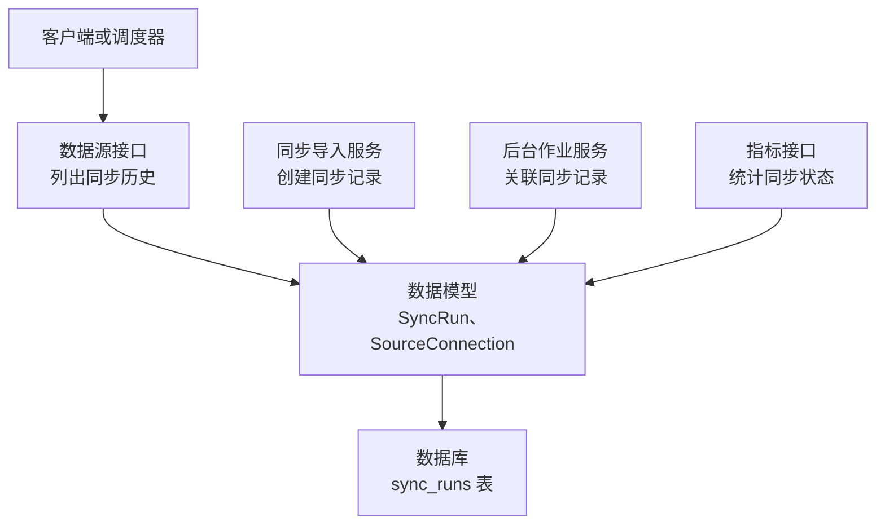
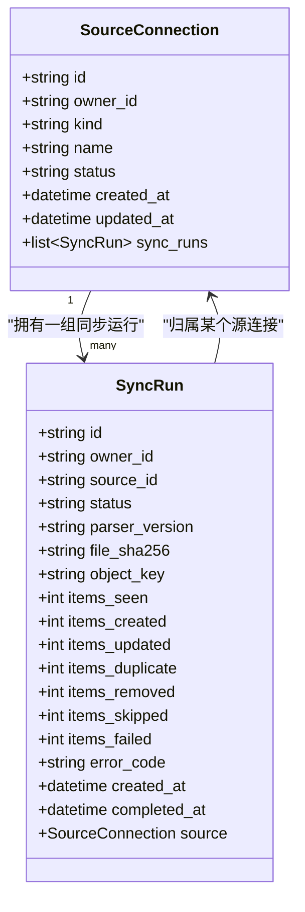
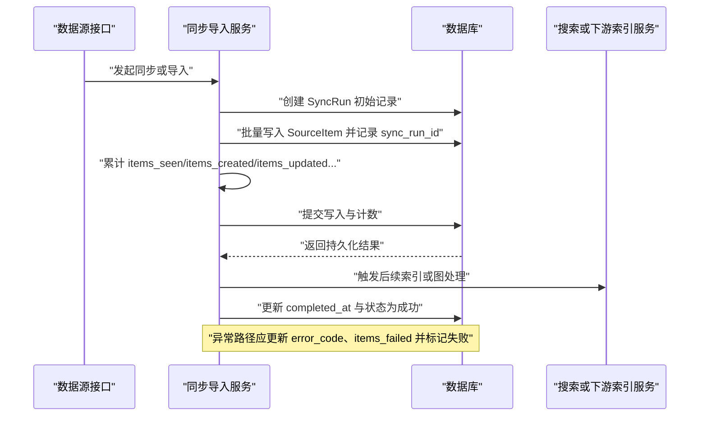
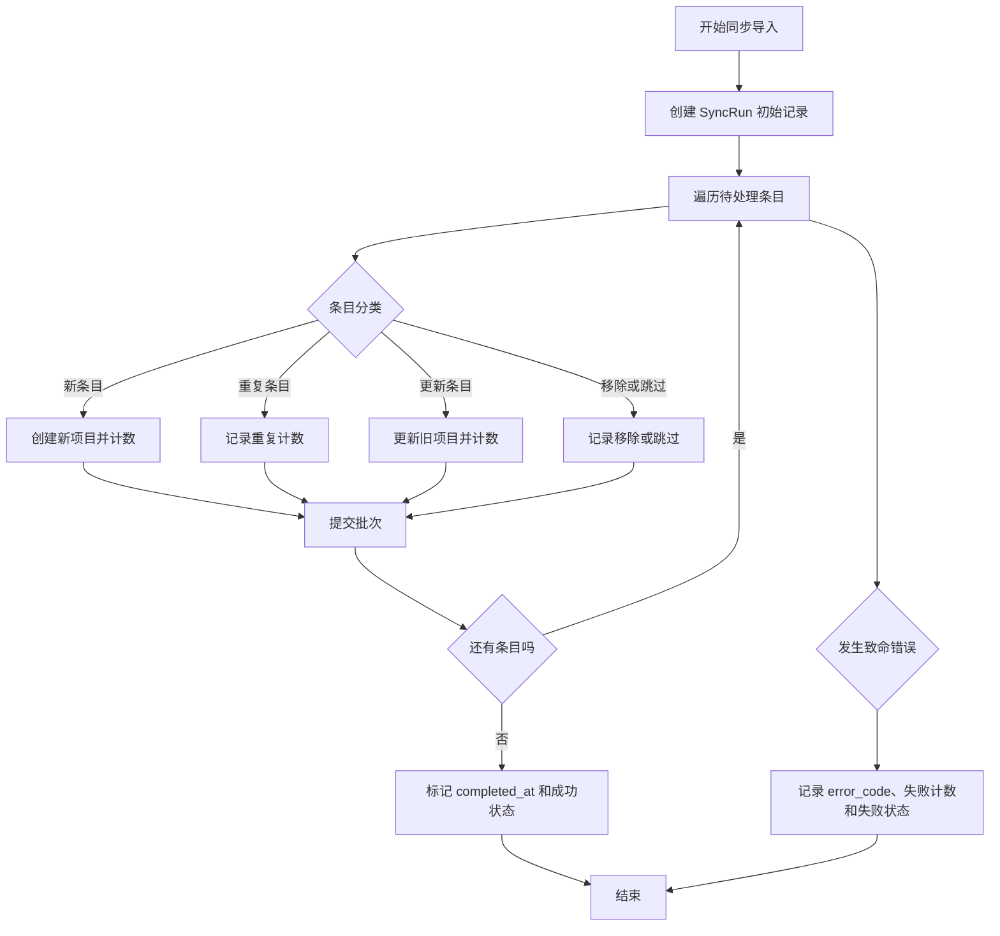
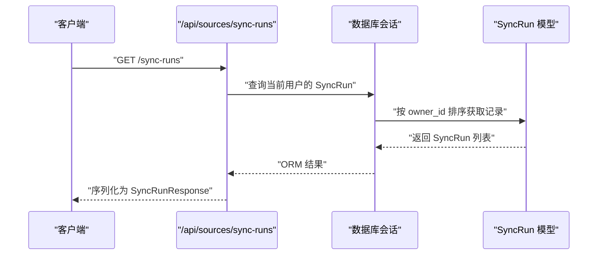
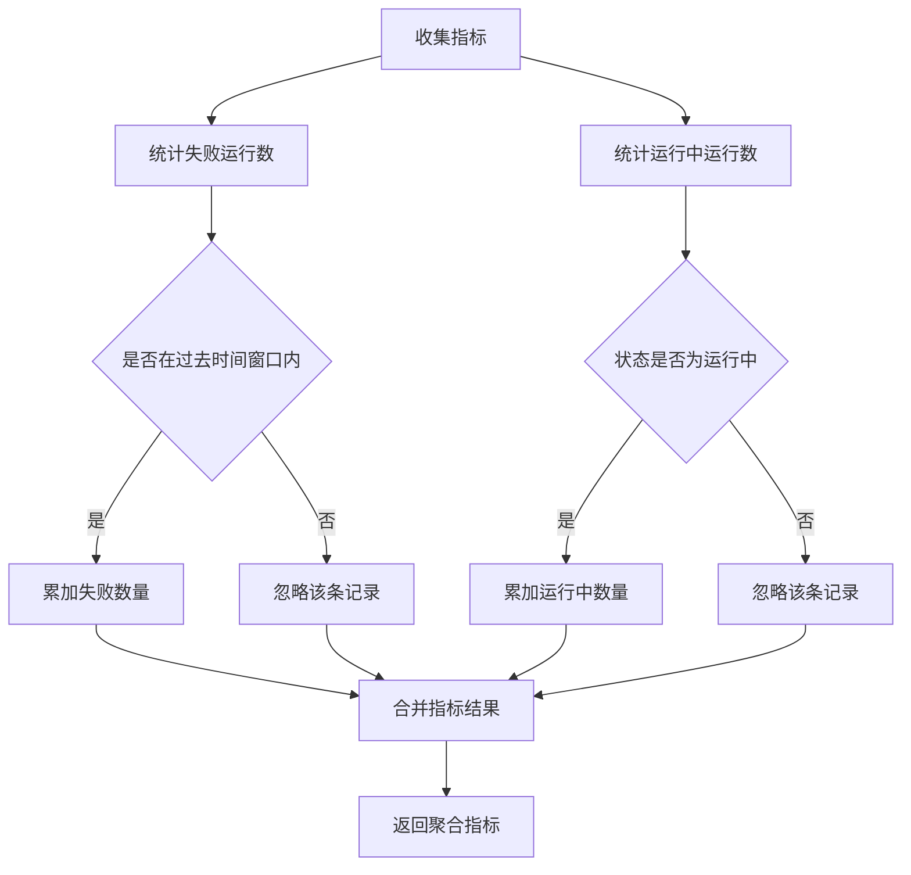
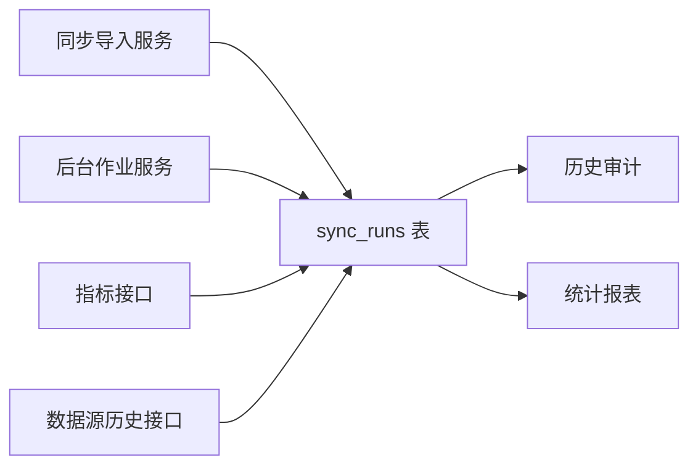
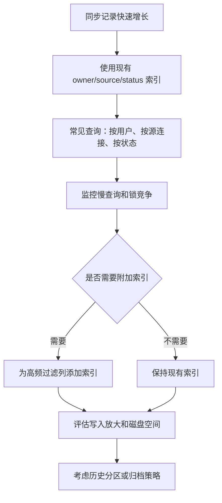
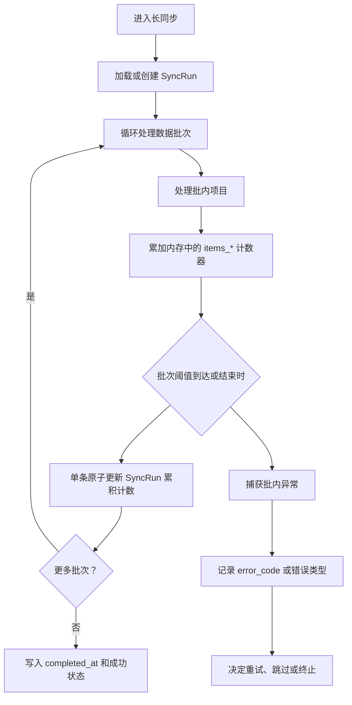
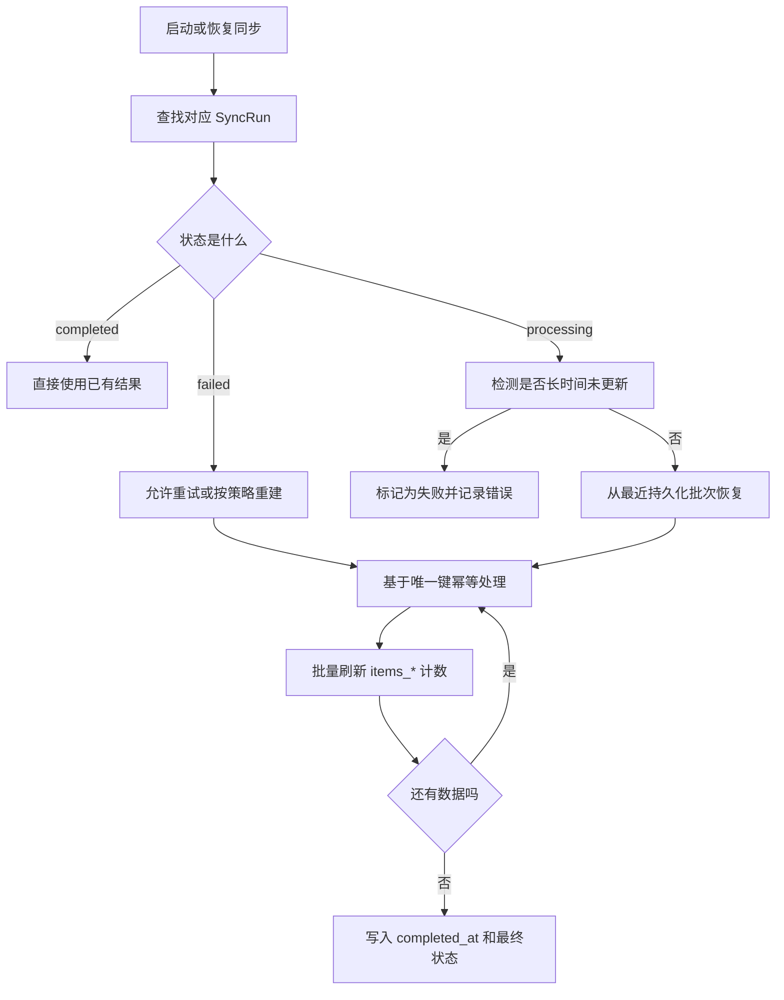

# SyncRun 同步运行模型

<cite>
**本文引用的文件**
- [models.py](file://src/personal_ai_life_os/models.py)
- [ingestion.py](file://src/personal_ai_life_os/services/ingestion.py)
- [sources.py](file://src/personal_ai_life_os/api/routes/sources.py)
- [schemas.py](file://src/personal_ai_life_os/api/schemas.py)
- [metrics.py](file://src/personal_ai_life_os/api/routes/metrics.py)
- [jobs.py](file://src/personal_ai_life_os/services/jobs.py)
- [0de3d72c2e1f_initial_tenant_scoped_schema.py](file://migrations/versions/0de3d72c2e1f_initial_tenant_scoped_schema.py)
</cite>

## 目录

1. [引言](#引言)
2. [项目结构](#项目结构)
3. [核心数据模型](#核心数据模型)
4. [架构总览](#架构总览)
5. [详细组件分析](#详细组件分析)
6. [依赖关系分析](#依赖关系分析)
7. [性能与索引设计](#性能与索引设计)
8. [进度更新与原子性](#进度更新与原子性)
9. [查询示例](#查询示例)
10. [错误恢复与断点续传建议](#错误恢复与断点续传建议)
11. [故障排查指南](#故障排查指南)
12. [结论](#结论)

## 引言

SyncRun 是用于记录“源连接同步任务”执行历史和统计信息的核心数据模型。它的职责不是直接定义字段名为 `sync_id`、`source_connection_id`、`total_items` 等用户期望名称，而是以现有实现为准，记录每个同步操作的归属用户、所属源连接、状态、解析元数据、逐项计数、错误信息以及时间戳，并通过关系模型与 `SourceConnection` 建立多对一关联。

当前仓库中的 `SyncRun` 表名映射为 `sync_runs`，主键字段为 `id`，对应业务上的“同步实例标识”；外键字段为 `source_id`，指向 `source_connections.id`，表示该条同步记录属于哪个源连接。它不保存 `start_time`/`end_time` 和 `success_rate` 这类命名完全一致的用户概念字段，但通过 `created_at`、`completed_at`、`status` 以及各种 `items_` 计数器提供可推导出相同语义的数据。

本文件会：

- 基于源码准确描述 `SyncRun` 的数据库映射与 SQLAlchemy 对象映射。
- 解释它与 `SourceConnection` 的外键关系和多对一模式。
- 说明如何在已有字段上表达“开始时间、结束时间、处理总数、成功数、失败数、最近错误”等业务含义。
- 给出在长期同步中增量更新指标的建议流程。
- 提供可用于历史查询、健康监控和性能分析的 SQL 思路。
- 补充错误恢复和断点续传的实现建议，并明确这些建议是当前仓库尚未完整实现的扩展方向。

**章节来源**
- [models.py:150-176](file://src/personal_ai_life_os/models.py#L150-L176)
- [0de3d72c2e1f_initial_tenant_scoped_schema.py:106-128](file://migrations/versions/0de3d72c2e1f_initial_tenant_scoped_schema.py#L106-L128)

## 项目结构

本节仅聚焦与 SyncRun 相关的代码位置：

- **模型层**：`src/personal_ai_life_os/models.py` 定义 `SyncRun`、`SourceConnection` 及双向关系。
- **导入与同步流程**：`src/personal_ai_life_os/services/ingestion.py` 创建 SyncRun、写入 SourceItem、并在失败路径中回写失败状态。
- **接口层**：`src/personal_ai_life_os/api/routes/sources.py` 暴露按用户查询 SyncRun 列表的能力。
- **接口响应模式**：`src/personal_ai_life_os/api/schemas.py` 提供 `SyncRunResponse`。
- **指标与健康**：`src/personal_ai_life_os/api/routes/metrics.py` 根据 `SyncRun.status` 计算失败数和运行中数量。
- **后台作业绑定**：`src/personal_ai_life_os/services/jobs.py` 将后台 Job 与 SyncRun 绑定，并在任务生命周期内回填状态。
- **迁移脚本**：`migrations/...` 定义了 `sync_runs` 表的建表和索引逻辑。



**图表来源**
- [sources.py:291-301](file://src/personal_ai_life_os/api/routes/sources.py#L291-L301)
- [ingestion.py:398-480](file://src/personal_ai_life_os/services/ingestion.py#L398-L480)
- [metrics.py:30-41](file://src/personal_ai_life_os/api/routes/metrics.py#L30-L41)
- [models.py:150-176](file://src/personal_ai_life_os/models.py#L150-L176)

**章节来源**
- [sources.py:291-301](file://src/personal_ai_life_os/api/routes/sources.py#L291-L301)
- [ingestion.py:398-480](file://src/personal_ai_life_os/services/ingestion.py#L398-L480)
- [schemas.py:124-143](file://src/personal_ai_life_os/api/schemas.py#L124-L143)
- [metrics.py:30-41](file://src/personal_ai_life_os/api/routes/metrics.py#L30-L41)
- [models.py:150-176](file://src/personal_ai_life_os/models.py#L150-L176)

## 核心数据模型

### SyncRun 表字段的业务含义对照

| 用户描述字段 | 仓库实际字段或等价概念 | 类型/默认值 | 业务含义与约束 |
|---|---|---:|---|
| `sync_id`（同步实例标识） | `id` | 无符号 UUID 字符串 | 同步记录的主键。由 `new_id` 生成。 |
| 所属租户 | `owner_id` | 无符号 UUID 字符串，非空、带索引 | 该次同步结果归属的用户。删除用户时级联删除同步记录。 |
| `source_connection_id`（关联源连接） | `source_id` | 无符号 UUID 字符串，非空、带索引、外键 | 外键指向 `source_connections.id`，表示这次同步来自哪个源连接。 |
| `status`（同步状态） | `status` | 短文本，默认 `processing`，带索引 | 表示同步生命周期状态；例如运行中、成功或失败。 |
| `start_time`（开始时间） | `created_at` | UTC 时间戳，非空，默认当前时间 | 记录首次创建该同步运行的时间。 |
| `end_time`（结束时间） | `completed_at` | 可空 UTC 时间戳 | 当同步完成或最终失败时写入；为空时表示仍活跃或未结算。 |
| `total_items`（处理项目总数） | 推导字段 | 可由各 `items_*` 汇总 | 可用 `items_seen + items_failed + items_skipped` 作为已识别输入项的上界；也可以根据业务把 `items_created + items_updated + items_duplicate + items_removed` 视为已落库处理的条目集合。 |
| `success_count`（成功统计） | 推导字段 | — | 典型实现用 `items_created + items_updated` 表示真正成功落库的数量。 |
| `success_rate`（成功率） | 推导字段 | — | 通常用成功数除以已识别输入项总数；需要避免除以零。 |
| `error_count`（错误数量） | `items_failed` | 整数，默认 0 | 表示该同步运行中处理失败的项目数。 |
| `last_error`（最近错误信息） | `error_code` | 可空短文本 | 存储错误分类码或简短错误信息；不适合存放超长堆栈。 |
| 其他元数据 | `parser_version`、`file_sha256`、`object_key` | 可空短文本/哈希/对象键 | 记录解析版本、文件摘要、或外部对象键，便于定位数据来源。 |
| 细项计数 | `items_seen`、`items_created`、`items_updated`、`items_duplicate`、`items_removed`、`items_skipped` | 整数，默认 0 | 覆盖扫描到、创建、更新、重复、删除、跳过的不同分类。 |

需要注意两点：

1. 仓库中没有字段叫 `sync_id`。如果调用方从外部传入这个 ID，应按仓库实现使用模型的 `id` 主键，而不是新建独立业务键。
2. 仓库中没有字段叫 `source_connection_id`。它实际字段名是 `source_id`，但业务语义就是“源连接 ID”。

**章节来源**
- [models.py:150-176](file://src/personal_ai_life_os/models.py#L150-L176)
- [0de3d72c2e1f_initial_tenant_scoped_schema.py:106-128](file://migrations/versions/0de3d72c2e1f_initial_tenant_scoped_schema.py#L106-L128)

### 与 SourceConnection 的关联关系

`SourceConnection` 类中包含一个 `sync_runs` 关系，`SyncRun` 类中包含一个 `source` 关系，并且双方互为反向填充。这构成了典型的**一对多（SourceConnection → SyncRun）**关系：

- 一个 `SourceConnection` 可以有多条 `SyncRun`。
- 一条 `SyncRun` 只能属于一个 `SourceConnection`。
- 两个类都带有级联删除行为，确保删除源连接或相关实体时不会留下孤立记录。
- `sync_runs` 的关系被定义为“所有者拥有所有子项”，从而在 ORM 层强调从源连接到同步历史的纵向追踪能力。



**图表来源**
- [models.py:126-146](file://src/personal_ai_life_os/models.py#L126-L146)
- [models.py:150-176](file://src/personal_ai_life_os/models.py#L150-L176)

**章节来源**
- [models.py:126-146](file://src/personal_ai_life_os/models.py#L126-L146)
- [models.py:150-176](file://src/personal_ai_life_os/models.py#L150-L176)

## 架构总览

SyncRun 的生命周期大致围绕“创建运行记录 → 写入或跳过资源项 → 累计计数 → 标记完成或失败 → 对外提供查询和指标”。



**图表来源**
- [ingestion.py:398-561](file://src/personal_ai_life_os/services/ingestion.py#L398-L561)
- [ingestion.py:591-599](file://src/personal_ai_life_os/services/ingestion.py#L591-L599)
- [jobs.py:146-148](file://src/personal_ai_life_os/services/jobs.py#L146-L148)
- [sources.py:291-301](file://src/personal_ai_life_os/api/routes/sources.py#L291-L301)

## 详细组件分析

### 同步导入流程中的 SyncRun

`ingestion.py` 是 SyncRun 的重要生产者之一。它会：

1. 准备本次同步的上下文，并将 `run.id` 作为 `sync_run_id` 提供给后续数据写入路径。
2. 创建 `SyncRun` 实例并持久化。
3. 在处理过程中累计各项 `items_*` 计数。
4. 在成功路径中将相关资源写入数据库并继续下游索引。
5. 在失败路径中创建失败状态的 SyncRun，并设置错误信息。



**图表来源**
- [ingestion.py:398-480](file://src/personal_ai_life_os/services/ingestion.py#L398-L480)
- [ingestion.py:528-561](file://src/personal_ai_life_os/services/ingestion.py#L528-L561)

**章节来源**
- [ingestion.py:382-599](file://src/personal_ai_life_os/services/ingestion.py#L382-L599)

### 同步历史接口

数据源接口提供 `GET /sync-runs`，用于按当前认证用户查询其同步历史。它返回多个 `SyncRunResponse` 对象，这些响应对象由 `schemas.py` 定义。

关键要点：

- 查询范围限制在当前 `owner_id`。
- 默认排序为新近创建的记录在前。
- 返回的是模型实例经过 Pydantic 模型转换后的结构化数据，而非原始 ORM 行。



**图表来源**
- [sources.py:291-301](file://src/personal_ai_life_os/api/routes/sources.py#L291-L301)
- [schemas.py:124-143](file://src/personal_ai_life_os/api/schemas.py#L124-L143)

**章节来源**
- [sources.py:291-301](file://src/personal_ai_life_os/api/routes/sources.py#L291-L301)
- [schemas.py:124-143](file://src/personal_ai_life_os/api/schemas.py#L124-L143)

### 同步健康指标

`metrics.py` 中使用 `SyncRun.status` 进行两类基础统计：

1. 指定时间窗口内的失败次数。
2. 当前仍处于运行中状态的同步运行数量。

这表明系统在运维层面依赖 `status` 字段来快速判断整体同步健康度。



**图表来源**
- [metrics.py:30-41](file://src/personal_ai_life_os/api/routes/metrics.py#L30-L41)

**章节来源**
- [metrics.py:30-41](file://src/personal_ai_life_os/api/routes/metrics.py#L30-L41)

## 依赖关系分析

SyncRun 处于整个同步系统的枢纽位置：

- 上游创建者包括导入服务和可能存在的其他批量数据处理入口。
- 下游消费者包括：
  - 同步历史查询接口。
  - 健康指标聚合接口。
  - 后台作业系统。
  - 外部审计或导出需求。



**图表来源**
- [ingestion.py:398-480](file://src/personal_ai_life_os/services/ingestion.py#L398-L480)
- [jobs.py:146-148](file://src/personal_ai_life_os/services/jobs.py#L146-L148)
- [metrics.py:30-41](file://src/personal_ai_life_os/api/routes/metrics.py#L30-L41)
- [sources.py:291-301](file://src/personal_ai_life_os/api/routes/sources.py#L291-L301)

**章节来源**
- [ingestion.py:398-480](file://src/personal_ai_life_os/services/ingestion.py#L398-L480)
- [jobs.py:52-100](file://src/personal_ai_life_os/services/jobs.py#L52-L100)
- [metrics.py:30-41](file://src/personal_ai_life_os/api/routes/metrics.py#L30-L41)
- [sources.py:291-301](file://src/personal_ai_life_os/api/routes/sources.py#L291-L301)

## 性能与索引设计

现有迁移为 `sync_runs` 提供了以下索引：

- 复合索引 `(owner_id, created_at)`。
- 单列索引 `owner_id`。
- 单列索引 `source_id`。
- 单列索引 `status`。

这些索引使以下查询较为高效：

- 按用户分页查看同步历史。
- 按用户在较新时间段内查看同步。
- 按源连接统计最近同步。
- 统计运行中或失败的同步数量。

需要注意的性能风险：

1. `sync_runs` 会持续增长。如果没有归档策略，历史数据会持续膨胀。
2. `items_*` 是频繁更新的整数列；高吞吐同步应避免在每个项目更新时都开启昂贵日志操作。
3. 如果未来增加复杂条件查询（例如按 `object_key` 去重），应评估新增索引，而不是一味选择全表扫描。



**图表来源**
- [0de3d72c2e1f_initial_tenant_scoped_schema.py:125-128](file://migrations/versions/0de3d72c2e1f_initial_tenant_scoped_schema.py#L125-L128)
- [models.py:150-153](file://src/personal_ai_life_os/models.py#L150-L153)

**章节来源**
- [models.py:150-153](file://src/personal_ai_life_os/models.py#L150-L153)
- [0de3d72c2e1f_initial_tenant_scoped_schema.py:125-128](file://migrations/versions/0de3d72c2e1f_initial_tenant_scoped_schema.py#L125-L128)

## 进度更新与原子性

### 如何表达进度

虽然模型没有名为 `start_time/end_time/total_items/success_rate/error_count/last_error` 的同名字段，但这些概念可以通过现有字段组合表达：

| 进度维度 | 推荐表达式 |
|---|---|
| 开始时间 | `created_at` |
| 结束时间 | `completed_at`；若为空则认为仍在运行 |
| 已识别输入总量 | `COALESCE(items_seen, 0)`；也可退化为 `items_failed + items_skipped + items_created + items_updated` 的上界 |
| 成功数量 | `COALESCE(items_created, 0) + COALESCE(items_updated, 0)` |
| 失败数量 | `COALESCE(items_failed, 0)` |
| 成功率 | 如总输入大于 0，则用成功数除以总输入；否则返回 0 或保留未定义 |
| 最近错误 | `error_code` |
| 同步状态 | `status` |

### 推荐的增量更新流程

在长时间运行的同步中，不应每处理一行都提交一次事务并提交整个 SyncRun 行。推荐策略如下：

1. 在进入同步开始时，先持久化 SyncRun 初始记录。
2. 分批处理数据：读取一批、校验、写入或跳过、累加内存中的计数器。
3. 每批完成后，使用单条更新语句将累计增量加到 `items_*` 列。
4. 对每次增量更新单独做错误处理；单个项目失败只影响该项目计数，不应当让整个同步失败。
5. 成功后一次性提交 SyncRun 的最终状态、`completed_at` 和成功标志。
6. 失败时应至少写出 `error_code`、`items_failed` 以及失败状态，确保能看出哪里中断。



**图表来源**
- [ingestion.py:398-561](file://src/personal_ai_life_os/services/ingestion.py#L398-L561)
- [models.py:160-173](file://src/personal_ai_life_os/models.py#L160-L173)

### 原子性保证要点

- 同一次数据库事务中，应同时写入目标数据行和对应的 SyncRun 增量或最终状态。否则可能出现数据已写入但同步记录未及时更新的情况。
- 对于部分失败的场景，应区分“某一项失败”和“整个运行失败”。前者只增加 `items_failed`，后者还要把 `status` 设为失败并写入 `error_code`。
- 如果采用幂等导入，应以外部唯一标识为基础判断重复或更新；SyncRun 的状态变更也应满足幂等要求，避免多次回调重复刷新时间戳或状态。

**章节来源**
- [models.py:160-173](file://src/personal_ai_life_os/models.py#L160-L173)
- [ingestion.py:398-561](file://src/personal_ai_life_os/services/ingestion.py#L398-L561)

## 查询示例

以下查询为面向仓库现有模式的通用 SQL 示例，实际列名需与当前数据库一致。为避免误读，这里不使用仓库源码片段，而只做语法示意。

### 查询最近 N 天同步历史

用途：用户或管理员查看某个源连接的同步记录。

```sql
SELECT
    id AS sync_id,
    source_id AS source_connection_id,
    owner_id,
    status,
    created_at AS start_time,
    completed_at AS end_time,
    parser_version,
    file_sha256,
    object_key,
    items_seen,
    items_created,
    items_updated,
    items_duplicate,
    items_removed,
    items_skipped,
    items_failed AS error_count,
    error_code AS last_error
FROM sync_runs
WHERE source_id = :source_connection_id
  AND owner_id = :tenant_owner_id
ORDER BY created_at DESC
LIMIT :limit;
```

### 计算成功率与运行时长

用途：分析单次同步的性能和质量。

```sql
SELECT
    id AS sync_id,
    created_at AS start_time,
    completed_at AS end_time,
    EXTRACT(EPOCH FROM (completed_at - created_at)) AS duration_seconds,
    COALESCE(items_failed, 0) AS error_count,
    COALESCE(items_created, 0) + COALESCE(items_updated, 0) AS success_count,
    GREATEST(
        0,
        (COALESCE(items_created, 0) + COALESCE(items_updated, 0)) * 100.0 / NULLIF(COALESCE(items_seen, 0), 0)
    ) AS success_rate_percent
FROM sync_runs
WHERE source_id = :source_connection_id
  AND status IN ('completed', 'failed')
ORDER BY created_at DESC;
```

### 监控同步健康状态

用途：快速发现失败率高、长时间运行中或停滞的任务。

```sql
SELECT
    source_id,
    COUNT(*) AS total_runs,
    SUM(CASE WHEN status = 'completed' THEN 1 ELSE 0 END) AS successful_runs,
    SUM(CASE WHEN status = 'failed'   THEN 1 ELSE 0 END) AS failed_runs,
    SUM(CASE WHEN status = 'processing' THEN 1 ELSE 0 END) AS running_runs,
    AVG(COALESCE(items_created, 0) + COALESCE(items_updated, 0)) AS average_success_count
FROM sync_runs
WHERE created_at >= NOW() - INTERVAL '30 days'
GROUP BY source_id
ORDER BY failed_runs DESC;
```

### 查找失败原因最频繁的源连接

用途：集中排查问题源。

```sql
SELECT
    source_id,
    error_code,
    COUNT(*) AS failure_count
FROM sync_runs
WHERE status = 'failed'
GROUP BY source_id, error_code
ORDER BY failure_count DESC
LIMIT 10;
```

### 根据 object_key 查关联同步

用途：判断某个外部对象上次由哪个同步运行写入或维护。

```sql
SELECT
    id AS sync_id,
    source_id,
    object_key,
    status,
    created_at,
    completed_at
FROM sync_runs
WHERE object_key = :external_object_key
ORDER BY created_at DESC
LIMIT 1;
```

**章节来源**
- [models.py:150-176](file://src/personal_ai_life_os/models.py#L150-L176)
- [metrics.py:30-41](file://src/personal_ai_life_os/api/routes/metrics.py#L30-L41)
- [sources.py:291-301](file://src/personal_ai_life_os/api/routes/sources.py#L291-L301)

## 错误恢复与断点续传建议

当前仓库已经具备若干支持恢复的基础元素，但没有完整的断点续传实现文档。下面提出与现有模型匹配的建议方案。

### 当前可用的恢复依据

| 机制 | 作用 | 限制 |
|---|---|---|
| `status` 字段 | 标识运行中、成功或失败状态 | 状态本身不表示“已成功处理多少项”，需要结合 `items_*` |
| `object_key` | 标识外部对象或可幂等定位的数据单元 | 并非每条 SyncRun 都一定填写 |
| `file_sha256` | 检查输入文件是否变化 | 仅适用于本地文件场景 |
| `parser_version` | 区分不同解析逻辑产生的结果 | 不能单独用来恢复半程状态 |
| `created_at` / `completed_at` | 判断运行是否已完成或卡住 | 不能替代实际进度 |
| `items_*` 计数器 | 近似知道哪些类别已经处理 | 不等同于每条记录的偏移量 |

### 推荐的断点恢复策略

1. **以条目为单位幂等处理**  
   使用 `object_key` 或等效的唯一键判断是否已存在。若已存在且内容未变，可归类为“重复”或“跳过”；若内容变化，则走更新路径。

2. **以批次为进度边界**  
   不建议每个条目都写数据库，但应定期将 `items_seen`、`items_created`、`items_updated`、`items_skipped`、`items_failed` 写入数据库。这样即使进程崩溃，也能根据最后持久化批次估算进度。

3. **保留未完成对象键**  
   对于可重入的增量同步，应把正在处理但仍可能失败的 `object_key` 记录在 SyncRun 或其他进度表中，便于下次启动后跳过已确认成功的条目。

4. **失败恢复时优先重建状态一致性**  
   重启后若发现 `status` 为运行中但长期没有更新：
   - 检查是否存在更晚的 `completed_at` 或成功状态。
   - 若没有，则将状态改为失败，并设置合理的 `error_code`。
   - 重新拉起该源的同步，基于幂等键决定是否重复处理。

5. **处理顺序幂等性**  
   无论系统从哪个条目恢复，只要唯一键不变、目标数据以幂等方式写入，就可以避免产生额外复制或删除。

6. **清理悬挂对象键**  
   如果同步失败后 `object_key` 仍然非空，应在清理逻辑中评估是否需要清空该字段或转入待观察状态，避免把失败任务误判为已持久化。



**图表来源**
- [models.py:150-176](file://src/personal_ai_life_os/models.py#L150-L176)
- [ingestion.py:528-561](file://src/personal_ai_life_os/services/ingestion.py#L528-L561)

**章节来源**
- [models.py:150-176](file://src/personal_ai_life_os/models.py#L150-L176)
- [ingestion.py:398-561](file://src/personal_ai_life_os/services/ingestion.py#L398-L561)

## 故障排查指南

### 常见问题定位清单

| 现象 | 可能原因 | 排查方式 |
|---|---|---|
| 同步长时间处于运行中 | 任务卡住、批处理未提交、外部资源不可用 | 检查 `status=processing`、`created_at` 距今多久、`completed_at` 是否为空 |
| 成功率为零 | 全部失败、未正确计算 `items_created`/`items_updated`、或者输入全部被判定为重复 | 比较 `items_failed`、`items_duplicate`、`items_seen` |
| 多次调用后重复写入 | 唯一键不一致、对象键未稳定、下游幂等性不足 | 检查 `object_key` 和 `file_sha256` |
| 历史过多导致接口缓慢 | 缺少归档、查询未按用户或时间窗过滤 | 确认查询使用了 `owner_id`、`source_id`、`created_at` 索引 |
| 指标显示大量失败 | 数据源格式变化、权限失效、解析器不兼容 | 看 `error_code` 和最近失败趋势 |
| 恢复后重复执行 | 幂等键缺失或不稳定 | 检查业务唯一键设计与 `object_key` |

### 推荐诊断查询

```sql
SELECT
    source_id,
    status,
    COUNT(*) AS run_count,
    MAX(created_at) AS latest_start,
    MIN(created_at) AS earliest_start,
    SUM(COALESCE(items_failed, 0)) AS total_failures,
    SUM(COALESCE(items_created, 0) + COALESCE(items_updated, 0)) AS total_successes
FROM sync_runs
WHERE created_at >= NOW() - INTERVAL '7 days'
GROUP BY source_id, status
HAVING run_count > 0
ORDER BY latest_start DESC;
```

**章节来源**
- [metrics.py:30-41](file://src/personal_ai_life_os/api/routes/metrics.py#L30-L41)
- [sources.py:291-301](file://src/personal_ai_life_os/api/routes/sources.py#L291-L301)
- [models.py:150-176](file://src/personal_ai_life_os/models.py#L150-L176)

## 结论

SyncRun 是一个围绕“每次同步运行”组织的强约束记录：它有明确的归属用户、归属源连接、生命周期状态、详细计数、错误信息和时间戳。尽管用户文档常希望看到 `sync_id`、`source_connection_id`、`total_items`、`success_count`、`success_rate`、`error_count`、`last_error`、`start_time`、`end_time` 这样的直白命名，仓库的实际实现选择了更贴近 SQLAlchemy 映射和业务演进历史的名字。

在实际使用中，应遵循以下原则：

- 使用 `id` 作为同步实例 ID。
- 使用 `source_id` 作为源连接外键。
- 使用 `created_at` 和 `completed_at` 代表开始与结束时间。
- 从 `items_created`、`items_updated`、`items_failed`、`items_seen` 等字段推导出成功率、失败率和总工作量。
- 始终维持 `status`、`error_code`、`object_key` 的一致性。
- 在高吞吐场景中采用批量幂等处理和事务内原子更新。
- 对长时间运行任务加入存活检查和失败恢复逻辑。

这样可以在不改变模型主契约的前提下，获得一套既能审计、又能监控、还能支撑增量同步与断点恢复的同步运行记录体系。

**章节来源**
- [models.py:126-176](file://src/personal_ai_life_os/models.py#L126-L176)
- [ingestion.py:398-599](file://src/personal_ai_life_os/services/ingestion.py#L398-L599)
- [schemas.py:124-143](file://src/personal_ai_life_os/api/schemas.py#L124-L143)
- [metrics.py:30-41](file://src/personal_ai_life_os/api/routes/metrics.py#L30-L41)
- [sources.py:291-301](file://src/personal_ai_life_os/api/routes/sources.py#L291-L301)