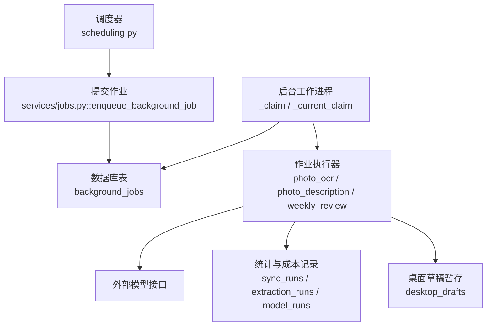
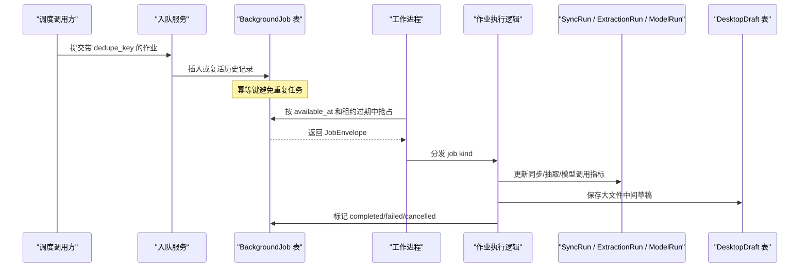
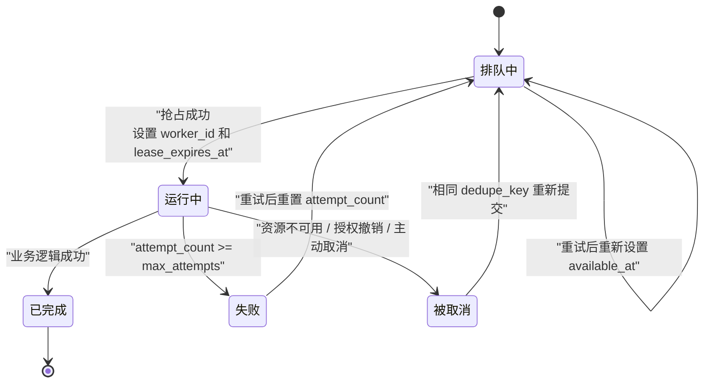
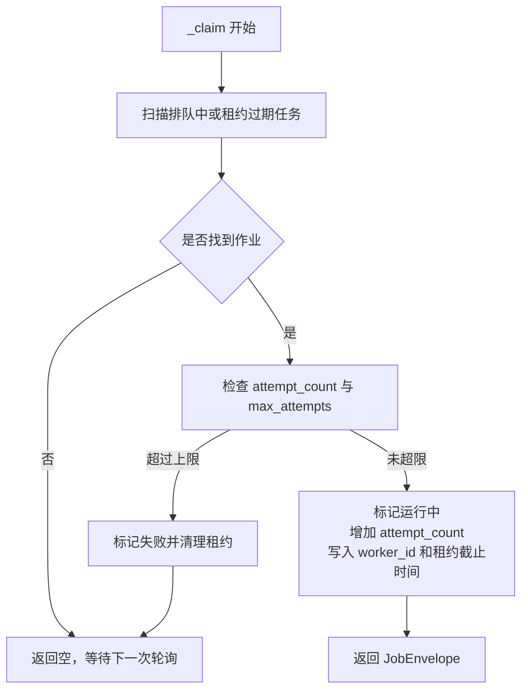
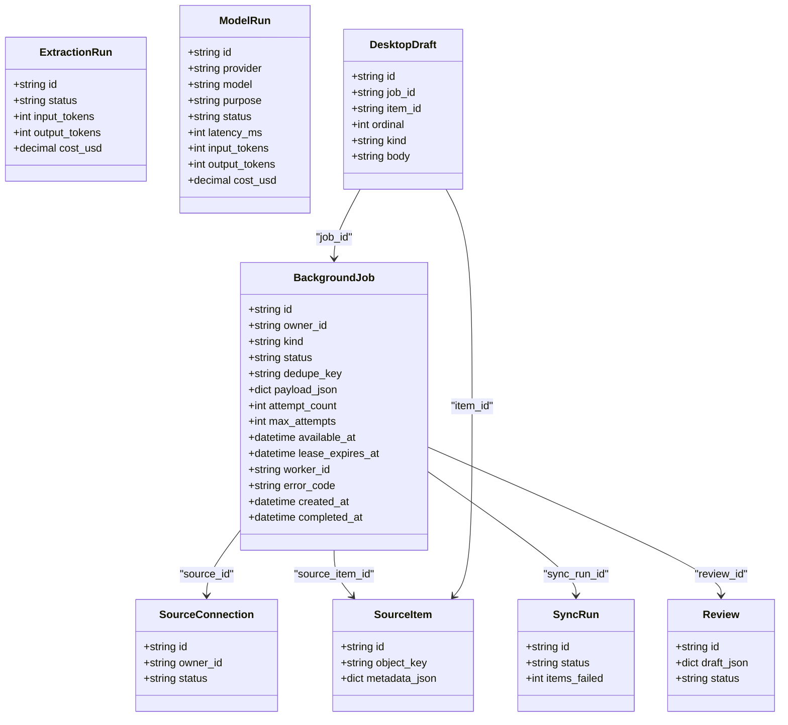
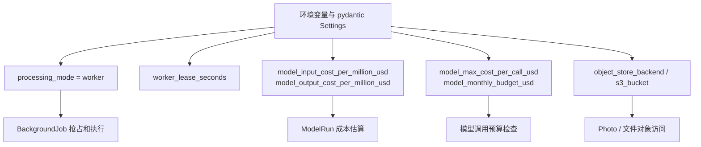

# 任务作业模型

<cite>
**本文引用的文件**
- [models.py](file://src/personal_ai_life_os/models.py)
- [data-model.md](file://docs/architecture/data-model.md)
- [jobs.py](file://src/personal_ai_life_os/services/jobs.py)
- [scheduling.py](file://src/personal_ai_life_os/services/scheduling.py)
- [c101bc66b1a3_add_durable_background_jobs.py](file://migrations/versions/c101bc66b1a3_add_durable_background_jobs.py)
- [c8d73b1e0afd_desktop_drafts.py](file://migrations/versions/c8d73b1e0afd_desktop_drafts.py)
- [config.py](file://src/personal_ai_life_os/config.py)
</cite>

## 目录
1. [引言](#引言)
2. [项目结构](#项目结构)
3. [核心数据模型](#核心数据模型)
4. [架构总览](#架构总览)
5. [组件详细分析](#组件详细分析)
6. [依赖关系分析](#依赖关系分析)
7. [性能与并发特性](#性能与并发特性)
8. [故障排查指南](#故障排查指南)
9. [结论](#结论)
10. [附录：调度配置示例](#附录调度配置示例)

## 引言
本文件围绕 Personal-AI-Life-OS 的任务作业系统，系统性说明可恢复、租户隔离的作业调度数据模型。重点包括：

- BackgroundJob 作为持久化作业表，承载幂等键、重试计数与分布式租约过期字段。
- SyncRun 同步运行实例的统计指标和生命周期字段。
- ExtractionRun 抽取任务运行的指标收集字段。
- ModelRun 模型调用记录的成本追踪与性能监控字段。
- DesktopDraft 桌面端大文件的草稿分片暂存状态。
- job kind 的职责边界与状态机迁移。
- 调度入口、重试策略、锁机制和高并发场景下的实现要点及优化建议。

## 项目结构
本项目的数据建模位于 SQLAlchemy 模型模块中，并通过 Alembic 管理迁移。文档级架构说明对 BackgroundJob、ModelRun 等实体做了概括；具体实现则在业务服务模块中进行编排。

**图表来源**
- [scheduling.py:100-200](file://src/personal_ai_life_os/services/scheduling.py#L100-L200)
- [jobs.py:60-120](file://src/personal_ai_life_os/services/jobs.py#L60-L120)
- [jobs.py:300-420](file://src/personal_ai_life_os/services/jobs.py#L300-L420)

**章节来源**
- [data-model.md:1-26](file://docs/architecture/data-model.md#L1-L26)
- [models.py:784-L829](file://src/personal_ai_life_os/models.py#L784-L829)

## 核心数据模型

### BackgroundJob
BackgroundJob 是系统的持久化工作单元，其关键设计点如下：

| 类别 | 字段 | 语义与作用 |
|---|---|---|
| 身份与多租户 | id、owner_id | 唯一标识和工作租户边界。 |
| 关联对象 | source_id、source_item_id、sync_run_id、review_id | 将作业关联到数据来源、数据项、同步批次或周期性审查。 |
| 类型与幂等 | kind、dedupe_key | 作业种类和同租户幂等键，用于避免重复调度相同任务。 |
| 载荷与结果 | payload_json、result_json | 存储结构化控制信息，而非用户原始内容；最终结果以轻量记录保存。 |
| 重试控制 | attempt_count、max_attempts | 已尝试次数与最大允许次数。超过上限后进入终态失败。 |
| 队列调度 | status、available_at | 可执行时间与状态共同决定何时被抢占。 |
| 分布式锁 | lease_expires_at、worker_id | 工作进程持有的租约时间戳与占位工作节点标识，用于检测卡死任务。 |
| 错误与审计 | error_code、created_at、updated_at、completed_at | 统一错误码与完整时间线。 |

UniqueConstraint( owner_id, dedupe_key )保证同一用户在任意时刻只存在一个同幂等键的工作项；当历史已完成、失败或被取消的记录再次以相同 dedupe_key 入队时，会被“复活”并重置为待处理状态，从而实现基于键的幂等重入。

索引 ix_background_jobs_status_available、owner_created、source_* 和 review_* 支撑按状态/时间扫描、租户隔离和关联查询。

**章节来源**
- [models.py:784-L829](file://src/personal_ai_life_os/models.py#L784-L829)
- [jobs.py:60-120](file://src/personal_ai_life_os/services/jobs.py#L60-L120)

### SyncRun
SyncRun 追踪一次数据源同步的整体进度，字段分为三类：

- 跟踪字段：owner_id、source_id、status、parser_version、file_sha256、object_key、error_code、created_at、completed_at。
- 指标字段：items_seen、items_created、items_updated、items_duplicate、items_removed、items_skipped、items_failed。
- 关系字段：通过 relationship 与 SourceConnection 关联，形成 owner → source → sync_runs 的数据链路。

状态从 processing 开始，可在批量操作结束、部分失败、取消或完成时进一步更新；error_code 和 completed_at 共同构成诊断线索。

**章节来源**
- [models.py:136-L168](file://src/personal_ai_life_os/models.py#L136-L168)
- [jobs.py:280-L320](file://src/personal_ai_life_os/services/jobs.py#L280-L320)

### ExtractionRun
ExtractionRun 记录图抽取任务的性能与产出统计，关键字段包括：

| 字段 | 作用 |
|---|---|
| status | 抽取运行状态，初始为 queued。 |
| provider/model/prompt_version | 模型提供方、模型名称和提示词版本。 |
| requested_hash/requested_item_ids | 本次抽取的请求摘要与候选数据项列表。 |
| item_count/entity_count/relation_count/review_count | 输入项数与生成图实体的产出计数。 |
| input_tokens/output_tokens/cost_usd | 实际 Token 用量和费用统计。 |
| latency_ms/error_code/created_at/completed_at | 延迟、错误和生命周期时间戳。 |

该表适合按 owner_id + created_at 或 status 聚合，用于评估抽取吞吐、成本和失败分布。

**章节来源**
- [models.py:564-L589](file://src/personal_ai_life_os/models.py#L564-L589)

### ModelRun
ModelRun 仅记录模型使用元数据，不写入用户请求内容和响应正文，符合隐私设计原则。关键字段：

- provider、model、purpose、prompt_version：用于成本分摊与模型版本溯源。
- status：成功、预算超限或失败等状态。
- latency_ms、input_tokens、output_tokens：性能与 Token 用量。
- cost_usd：根据每百万 Token 价格计算出的估计成本。

在 Photo Description、Weekly Review 失败路径中，即使没有真实 Token 输出，也会记录一条保守预估成本，便于预算监控。

**章节来源**
- [data-model.md:8-L26](file://docs/architecture/data-model.md#L8-L26)
- [models.py:764-L782](file://src/personal_ai_life_os/models.py#L764-L782)
- [jobs.py:360-L420](file://src/personal_ai_life_os/services/jobs.py#L360-L420)

### DesktopDraft
DesktopDraft 是桌面端草稿暂存表，主要服务大文件或分批处理过程中需要中间状态的作业：

- owner_id、job_id：归属用户和所属 BackgroundJob。
- item_id：可选关联 SourceItem，表示正在处理的素材项。
- ordinal：在同一 job 内保持有序性。
- kind、body、quote、confidence：用于描述草稿类型、主体内容、引用片段和质量分数。

唯一约束 (job_id, ordinal) 保证每个作业内草稿顺序稳定；索引 (owner_id, status) 支持桌面端对进行中草稿的快速筛选。

**章节来源**
- [models.py:830-L851](file://src/personal_ai_life_os/models.py#L830-L851)
- [c8d73b1e0afd_desktop_drafts.py](file://migrations/versions/c8d73b1e0afd_desktop_drafts.py)

## 架构总览
背景作业的调度流程可以分为三个阶段：入队、抢占执行、结果落库与指标沉淀。

**图表来源**
- [jobs.py:60-120](file://src/personal_ai_life_os/services/jobs.py#L60-L120)
- [jobs.py:230-L320](file://src/personal_ai_life_os/services/jobs.py#L230-L320)
- [jobs.py:360-L420](file://src/personal_ai_life_os/services/jobs.py#L360-L420)

**章节来源**
- [jobs.py:60-L520](file://src/personal_ai_life_os/services/jobs.py#L60-L520)

## 组件详细分析

### BackgroundJob：分布式锁、重试与幂等
BackgroundJob 的状态变化不是简单的一行布尔标志，而是由“入队检查→抢占锁定→执行→失败终止”构成的状态流。

关键点：

- 幂等性：en qu e_b ackground_j ob 先按 owner_id + dedupe_key 查找；若存在且状态为 failed、cancelled 或 completed，则复活并重置 try_count、payload、lease 等字段。
- 分布式锁：_claim 读取可用或租约已过期的任务，将其 status 改为 running，并写入 worker_id 和 lease_expires_at；数据库方言为 PostgreSQL 时使用 with_for_update(skip_locked=True) 进行行级锁竞争。
- 租约释放：worker 正常完成、异常终止或 lease 到期后，都会清理 lease_expires_at 和 worker_id；超时的 running 作业会被转为失败，防止永久占用。
- 重试边界：attempt_count 每次 claim 递增；到达 max_attempts 后不再继续重试，而是直接调用终端失败逻辑。

**图表来源**
- [jobs.py:230-L290](file://src/personal_ai_life_os/services/jobs.py#L230-L290)

**章节来源**
- [jobs.py:60-L120](file://src/personal_ai_life_os/services/jobs.py#L60-L120)
- [jobs.py:230-L420](file://src/personal_ai_life_os/services/jobs.py#L230-L420)
- [c101bc66b1a3_add_durable_background_jobs.py](file://migrations/versions/c101bc66b1a3_add_durable_background_jobs.py)

### SyncRun：同步任务指标与协作关系
SyncRun 并不直接持有复杂的业务算法，而是暴露一组可观察指标字段，便于外部监控系统采集：

- items_seen：扫描到的候选对象数。
- items_created / items_updated / items_duplicate / items_removed / items_skipped / items_failed：增量统计各类结果。
- error_code：与 status 结合区分部分失败、完全失败和取消。
- completed_at：任务结束时间。

当 BackgroundJob 关联 sync_run_id 时，部分失败会更新为 partially_failed；完成或取消时会更新为 completed 或 cancelled，并把 source.last_sync_at 刷新回源连接。

**章节来源**
- [models.py:136-L168](file://src/personal_ai_life_os/models.py#L136-L168)
- [jobs.py:250-L320](file://src/personal_ai_life_os/services/jobs.py#L250-L320)

### ExtractionRun：抽取任务统计
ExtractionRun 更偏向模型驱动的图抽取运行记录：

- 请求范围：requested_hash 和 requested_item_ids 帮助定位某次抽取对应的输入集合。
- 产出规模：item_count、entity_count、relation_count、review_count。
- Token 和成本：input_tokens、output_tokens、cost_usd。
- 性能与问题：latency_ms、error_code、created_at、completed_at。

它与 GraphEntity、GraphRelation、GraphEvidence 等表在业务层配合使用，但 ExtractionRun 本身保留的是“运行级统计”，而不是单条图的拓扑结构。

**章节来源**
- [models.py:564-L589](file://src/personal_ai_life_os/models.py#L564-L589)

### ModelRun：成本追踪与性能监控
ModelRun 的设计目标是记录“谁、在什么用途下、调用了哪个模型、花了多少钱”。它不适合判断业务逻辑正确性，而应配合上层监控做如下分析：

- 成本趋势：按 owner_id、provider、model 聚合 sum(cost_usd)。
- 成功率与失败原因：按 purpose、status、error_code 分组。
- 延迟与 Token 使用：比较 input_tokens、output_tokens 与 latency_ms，识别慢请求或超额消耗。
- 预估与实际差异：对比 ExtractionRun.cost_usd 与 ModelRun.cost_usd（若两者同时存在），验证计费逻辑准确性。

**章节来源**
- [data-model.md:8-L26](file://docs/architecture/data-model.md#L8-L26)
- [models.py:764-L782](file://src/personal_ai_life_os/models.py#L764-L782)

### DesktopDraft：大文件中间状态
DesktopDraft 主要用于以下场景：

- 单次 BackgroundJob 无法一次性传输大文件内容。
- 多个阶段任务共享同一 item_id。
- 界面需要展示逐步加载的草稿结果。

因为表有 job_id 与 ordinal 的组合主键，客户端或服务端可以可靠地追加分片，并在完成后按 ordinal 排序重建完整内容。

**章节来源**
- [models.py:830-L851](file://src/personal_ai_life_os/models.py#L830-L851)
- [c8d73b1e0afd_desktop_drafts.py](file://migrations/versions/c8d73b1e0afd_desktop_drafts.py)

### job kind 的职责分工
现有代码中可见的作业种类包括：

| kind | 主要职责 | 关键副作用 |
|---|---|---|
| photo_ocr | 对图片进行文字识别并将结果写回 SourceItem.content_text。 | 更新 SourceItem.metadata_json.ocr_status 与 SyncRun。 |
| photo_description | 调用外部模型生成图片描述，并进行授权和预算校验。 | 可能写入 ModelRun、SourceItem 描述相关字段。 |
| weekly_review | 生成周期性审查任务并异步渲染结果。 | 可能写入 Review draft 和 ModelRun。 |
| desktop_analysis | 桌面端分析作业，受模型授权与配置保护。 | 取消时会清除对应 SourceItem.metadata 中描述状态。 |
| 其他由 enqueue 接受字符串类型的 kind | 可扩展的新类型，需配套 _execute_ 路由和 _fail_terminal 兼容逻辑。 | 需在失败路径补充 State 和统计表更新。 |

**章节来源**
- [jobs.py:180-L220](file://src/personal_ai_life_os/services/jobs.py#L180-L220)
- [jobs.py:360-L520](file://src/personal_ai_life_os/services/jobs.py#L360-L520)

## 依赖关系分析

**图表来源**
- [models.py:136-L168](file://src/personal_ai_life_os/models.py#L136-L168)
- [models.py:564-L589](file://src/personal_ai_life_os/models.py#L564-L589)
- [models.py:764-L851](file://src/personal_ai_life_os/models.py#L764-L851)

**章节来源**
- [models.py:136-L168](file://src/personal_ai_life_os/models.py#L136-L168)
- [models.py:564-L589](file://src/personal_ai_life_os/models.py#L564-L589)
- [models.py:764-L851](file://src/personal_ai_life_os/models.py#L764-L851)

## 性能与并发特性

### 分布式抢占与锁
- 抢占查询使用 created_at、id 作为默认排序，使作业尽量公平排队。
- PostgreSQL 方言启用 for_update(skip_locked=True)，减少多 worker 之间的行锁争用。
- 非 PostgreSQL 数据库仍会使用普通 SELECT 抢占，因此高并发时需要避免多次重复扫描未加锁行，可通过应用层限流或合理 poll interval 缓解。

### 重试与租约
- worker_lease_seconds 默认 60 秒；长时间运行任务可能触发超时保护，被重新抢占。
- attempt_count 与 max_attempts 提供硬性上限，避免无限重试。
- recommended 实践：对于 IO 密集型 OCR，适当提高 lease 时间；对模型调用密集任务，考虑把单个作业拆成更小的批。

### 并发优化建议
1. **按租户分区或分库**：tenant-scoped schema 天然支持按 owner_id 过滤，未来可按租户水平扩展。
2. **限制单 worker 并发度**：避免单一 worker 大量占用 database 游标，导致抢占扫描变慢。
3. **缩小 scan 窗口**：优先扫描 available_at <= now 的小窗，避免全表扫描。
4. **批量结果落库**：OCR 和图片描述完成后再统一 commit，可减少事务抖动。
5. **监控抢锁失败率**：当 skip_locked 命中率低时，说明 worker 数量过大或索引不足，应调整 worker_lease_seconds 或增加合适索引。
6. **限流外部模型**：结合 model_max_cost_per_call_usd 和 model_monthly_budget_usd，避免集中调用造成突发成本。

### 状态机风险
- 若 worker 进程在写入 result_json 之前崩溃，lease 过期后可被重新抢占。
- 如果幂等键发生变化，旧任务的失败记录不会被复活，可能产生重复作业；必须确保 dedupe_key 来自稳定的业务键。
- _current_claim 使用 worker_id 校验当前占位者，但若数据库连接不一致或事务边界不当，可能出现乐观覆盖问题；PostgreSQL 的 for_update 可增强一致性。

**章节来源**
- [config.py:17-L45](file://src/personal_ai_life_os/config.py#L17-L45)
- [jobs.py:230-L290](file://src/personal_ai_life_os/services/jobs.py#L230-L290)

## 故障排查指南

| 现象 | 可能原因 | 排查步骤 | 修复建议 |
|---|---|---|---|
| 作业永远处于运行中 | worker 崩溃导致 lease 未释放 | 查看 background_jobs 的 lease_expires_at 和 worker_id | 缩短 worker_lease_seconds，检查 worker 崩溃日志 |
| 同一业务请求重复生成结果 | dedupe_key 不同或历史状态未被复活 | 检查幂等键一致性和 enqueue 命中条件 | 使用 stable key；确认失败/取消后可复活 |
| 图片 OCR 失败但不重试 | 已达到 max_attempts 或使用不支持的图片类型 | 查看 error_code 和 attempt_count | 提高 max_attempts 或修正输入类型 |
| 每周审查一直 pending | 无活动数据源或模型未授权/预算不足 | 检查 ReviewSchedule、User AI consent、ModelProvider 配置 | 配置外部模型和预算阈值 |
| SyncRun 显示部分失败 | 关联 BackgroundJob 失败触发了部分失败逻辑 | 查看 sync_runs.error_code 与关联 BackgroundJob | 修复输入文件、权限或解析器版本 |
| ModelRun 有大量零 Token 记录 | 未成功调用模型或仅预提成本 | 检查 purpose、status 与 error_code | 区分预算预留与实际调用记录 |

**章节来源**
- [jobs.py:230-L420](file://src/personal_ai_life_os/services/jobs.py#L230-L420)

## 结论
Personal-AI-Life-OS 的任务作业系统以 BackgroundJob 为中心，通过租户隔离、幂等键、重试计数和分布式租约实现了可恢复、可观测、可重启的作业调度。SyncRun 负责同步任务的统计追踪，ExtractionRun 记录模型驱动抽取的运行指标，ModelRun 专注成本与性能元数据，DesktopDraft 则为桌面端大文件提供有序的分片暂存。新增 job kind 时应同步维护幂等性、失败终态、租约释放及相关状态表的副作用逻辑，并确保在生产环境使用 worker 模式和 S3 对象存储。

## 附录：调度配置示例
以下是与本调度模型相关的核心环境变量建议值。生产环境由 Settings 强制要求 processing_mode 为 worker，并禁止自动建表和 localhost CORS 源。

- APP_ENV：development / production / desktop
- DATABASE_URL：SQLite 开发地址或生产 PostgreSQL 连接串
- PROCESSING_MODE：development 可用 inline，production 必须 worker
- WORKER_POLL_INTERVAL_SECONDS：poll 频率，例如 0.5
- WORKER_LEASE_SECONDS：租约有效期，例如 60
- OBJECT_STORE_BACKEND：local / s3
- S3_BUCKET：S3 目标桶
- MODEL_PROVIDER：none / openai
- OPENAI_API_KEY：OpenAI API Key
- MODEL_INPUT_COST_PER_MILLION_USD：输入 Token 单价
- MODEL_OUTPUT_COST_PER_MILLION_USD：输出 Token 单价
- MODEL_MAX_COST_PER_CALL_USD：单次模型调用预算上限
- MODEL_MONTHLY_BUDGET_USD：月度模型预算
- METRICS_TOKEN：Metrics 鉴权令牌

这些配置影响：

- 调度模式是否启用 worker 流程。
- BackgroundJob 抢占和租约行为。
- 对象存储后端。
- 模型调用预算、Token 价格与月度预算校验。
- 生产环境安全约束。

**图表来源**
- [config.py:17-L45](file://src/personal_ai_life_os/config.py#L17-L45)
- [config.py:70-L130](file://src/personal_ai_life_os/config.py#L70-L130)

**章节来源**
- [config.py:1-L132](file://src/personal_ai_life_os/config.py#L1-L132)