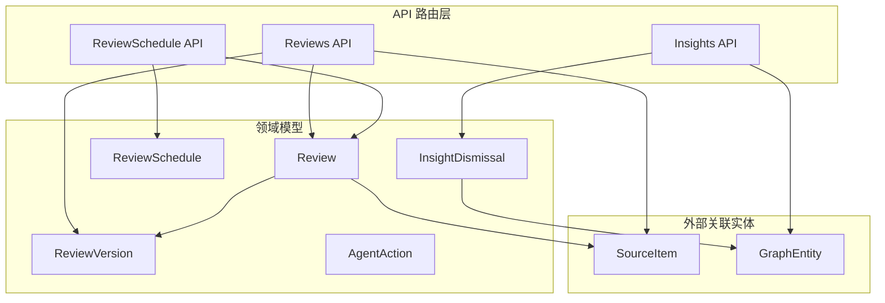
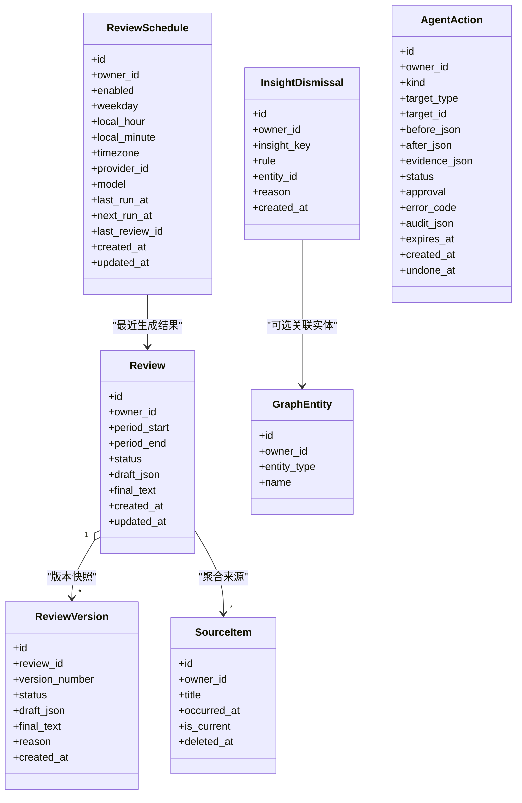
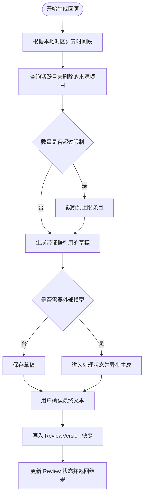
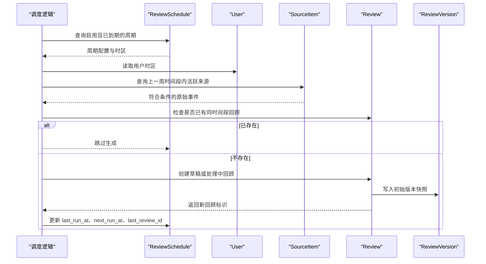
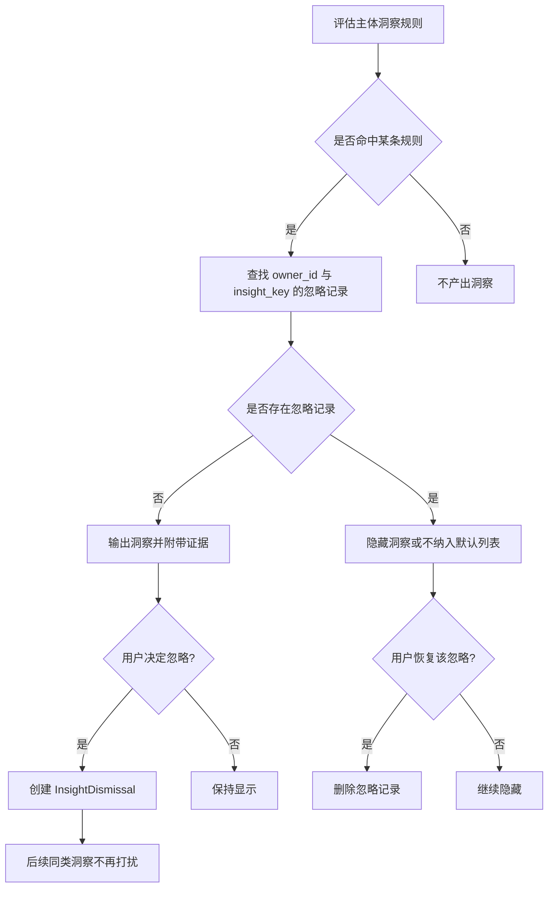
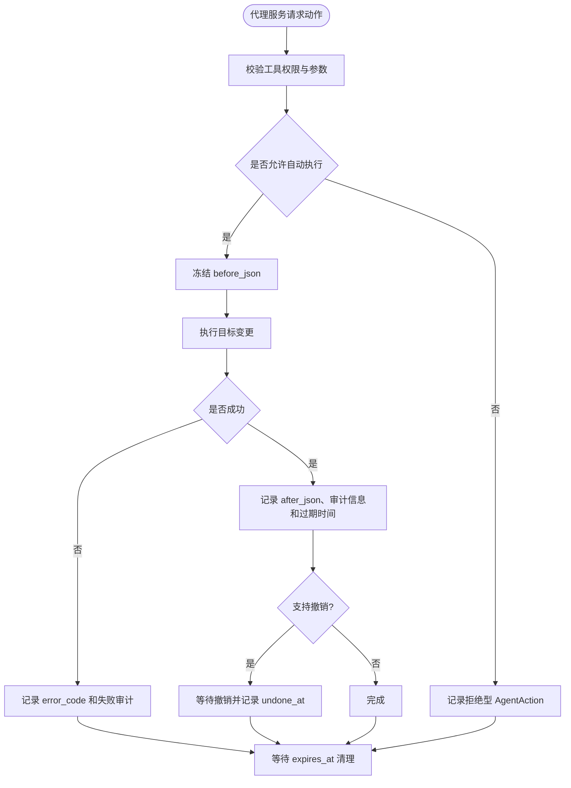
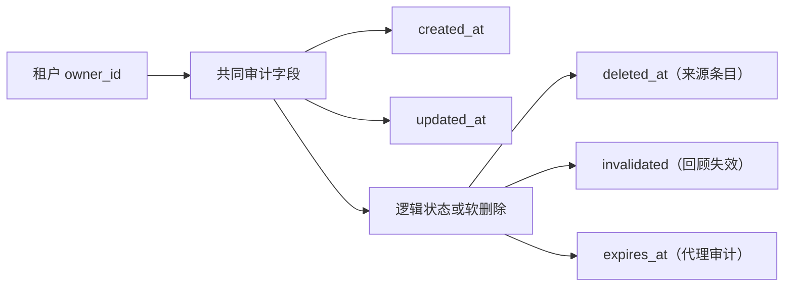
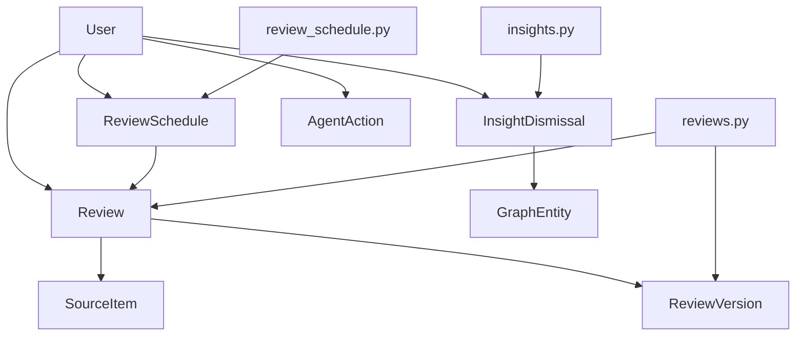
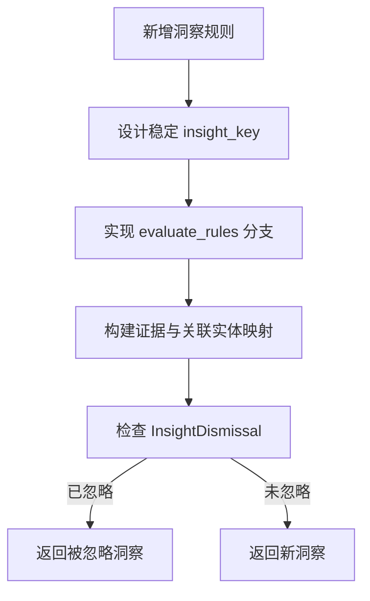

# 回顾与洞察模型

<cite>
**本文引用的文件**
- [models.py](file://src/personal_ai_life_os/models.py)
- [reviews.py](file://src/personal_ai_life_os/api/routes/reviews.py)
- [review_schedule.py](file://src/personal_ai_life_os/api/routes/review_schedule.py)
- [insights.py](file://src/personal_ai_life_os/api/routes/insights.py)
- [d7f1a3b5c902_add_insights_agent_and_plugins.py](file://migrations/versions/d7f1a3b5c902_add_insights_agent_and_plugins.py)
- [a1b7c9d3e504_add_provider_consent_and_review_versions.py](file://migrations/versions/a1b7c9d3e504_add_provider_consent_and_review_versions.py)
- [b7d4f6a1c902_add_review_schedules.py](file://migrations/versions/b7d4f6a1c902_add_review_schedules.py)
</cite>

## 目录
1. [引言](#引言)
2. [项目结构与定位](#项目结构与定位)
3. [核心数据模型](#核心数据模型)
4. [版本化回顾体系](#版本化回顾体系)
5. [回顾周期定时机制](#回顾周期定时机制)
6. [洞察忽略机制](#洞察忽略机制)
7. [代理操作审计](#代理操作审计)
8. [统一审计字段与软删除模式](#统一审计字段与软删除模式)
9. [依赖关系图](#依赖关系图)
10. [周期配置示例](#周期配置示例)
11. [洞察规则定制方法](#洞察规则定制方法)
12. [故障排查指南](#故障排查指南)
13. [结论](#结论)

## 引言
本文聚焦 Personal-AI-Life-OS 回顾与洞察系统的数据模型，重点说明以下能力：
- Review、ReviewVersion、ReviewSchedule 构成“按时间段聚合 → 草稿迭代 → 定时触发”的版本化回顾管理体系。
- InsightDismissal 提供可恢复的洞察忽略机制，避免重复通知导致体验下降。
- AgentAction 记录代理操作的执行前后状态、证据与审批信息，保障自动化操作可追溯。
- 所有关键模型遵循一致的审计时间戳和租户隔离设计；部分实体采用软删除或逻辑失效状态。
- 文档给出回顾周期配置建议和洞察规则定制的扩展思路，帮助使用者在不深入源码的情况下正确建模需求。

## 项目结构与定位
回顾与洞察相关的数据结构集中在应用模型文件中，并通过 API 路由层暴露对外行为：
- 模型定义位于统一的领域模型模块中，包含 Review、ReviewVersion、ReviewSchedule、InsightDismissal、AgentAction 等实体。
- 回顾生成与版本导出在 Reviews API 中实现，ReviewSchedule API 管理用户级周期性任务，Insights API 管理洞察规则和忽略记录。
- 数据库迁移脚本记录了 ReviewVersion、ReviewSchedule、InsightDismissal、AgentAction 的表结构、索引和外键约束，是理解真实存储语义的重要依据。

**图表来源**
- [reviews.py:318-676](file://src/personal_ai_life_os/api/routes/reviews.py#L318-L676)
- [review_schedule.py:1-90](file://src/personal_ai_life_os/api/routes/review_schedule.py#L1-L90)
- [insights.py:1-93](file://src/personal_ai_life_os/api/routes/insights.py#L1-L93)
- [models.py:338-406](file://src/personal_ai_life_os/models.py#L338-L406)
- [models.py:657-701](file://src/personal_ai_life_os/models.py#L657-L701)

**章节来源**
- [models.py:338-406](file://src/personal_ai_life_os/models.py#L338-L406)
- [models.py:657-701](file://src/personal_ai_life_os/models.py#L657-L701)
- [reviews.py:318-676](file://src/personal_ai_life_os/api/routes/reviews.py#L318-L676)
- [review_schedule.py:1-90](file://src/personal_ai_life_os/api/routes/review_schedule.py#L1-L90)
- [insights.py:1-93](file://src/personal_ai_life_os/api/routes/insights.py#L1-L93)

## 核心数据模型
本节以业务视角梳理每个模型的角色、关键字段和设计意图。

| 模型 | 主键 | 租户隔离 | 时间段 / 周期 | 状态 | 草稿 / 快照 | 审计字段 | 说明 |
|---|---|---|---|---|---|---|---|
| Review | id | owner_id | period_start、period_end | draft / processing / confirmed / invalidated | draft_json、final_text | created_at、updated_at | 将一段时间内的来源事件聚合成一次回顾。 |
| ReviewVersion | id | review_id → owner_id（间接） | 不直接表示时间段 | status | draft_json、final_text、reason | created_at | 保存每次提交、确认或删除理由的版本快照。 |
| ReviewSchedule | id | owner_id | weekday、local_hour、local_minute、timezone | enabled | last_run_at、next_run_at、last_review_id | created_at、updated_at | 配置用户自己的定时回顾任务。 |
| InsightDismissal | id | owner_id | insight_key、rule | 不显式状态 | entity_id、reason | created_at | 标记某条洞察被忽略，防止重复干扰。 |
| AgentAction | id | owner_id | target_type、target_id | status | before_json、after_json、audit_json、error_code、expires_at、undone_at | created_at | 代理执行的原子动作审计，支持撤销追踪。 |

**图表来源**
- [models.py:338-406](file://src/personal_ai_life_os/models.py#L338-L406)
- [models.py:409-514](file://src/personal_ai_life_os/models.py#L409-L514)
- [models.py:657-701](file://src/personal_ai_life_os/models.py#L657-L701)

**章节来源**
- [models.py:338-406](file://src/personal_ai_life_os/models.py#L338-L406)
- [models.py:657-701](file://src/personal_ai_life_os/models.py#L657-L701)

## 版本化回顾体系
Review 是“按时间段聚合的一次回顾”，而不是某个单一事件。其核心设计如下：

- **时间段聚合**：通过 owner_id、period_start、period_end 唯一确定一个回顾区间。同一用户的同一时间区间只允许存在一条 Review，避免了重复生成冲突。
- **草稿状态**：Review.status 为 draft 时表示待编辑，confirmed 表示已保存最终文本，processing 表示正在调用外部模型生成，invalidated 表示引用证据失效后需要重新生成。
- **双层持久化**：Review.draft_json 保留结构化草稿，Review.final_text 保留用户确认后导出的 Markdown 全文。
- **版本控制**：ReviewVersion 对 Review 的每次重要变更产生快照，包括提交、确认、撤销原因和创建时间。每个 Review 有多个版本，并保证 version_number 的唯一性。
- **来源关联**：Review 通过多对多关系与 SourceItem 关联，便于回溯哪些原始数据参与了某次回顾。

**图表来源**
- [reviews.py:328-350](file://src/personal_ai_life_os/api/routes/reviews.py#L328-L350)
- [reviews.py:557-584](file://src/personal_ai_life_os/api/routes/reviews.py#L557-L584)
- [reviews.py:634-652](file://src/personal_ai_life_os/api/routes/reviews.py#L634-L652)

### Review 字段语义
- id：UUID 字符串主键。
- owner_id：回顾属于哪个用户。
- period_start、period_end：严格的时间区间，构成唯一约束。
- status：草稿、处理中、已确认、失效。
- draft_json：结构化证据事实和建议。
- final_text：用户确认后的完整回顾正文。
- created_at、updated_at：创建时间和更新时间。

### ReviewVersion 字段语义
- review_id：所属 Review。
- version_number：递增版本号。
- status：版本状态。
- draft_json、final_text：版本级别的草稿与正文快照。
- reason：提交原因，例如确认、回滚或自动快照。
- created_at：版本生成时间。

**章节来源**
- [models.py:338-379](file://src/personal_ai_life_os/models.py#L338-L379)
- [reviews.py:328-350](file://src/personal_ai_life_os/api/routes/reviews.py#L328-L350)
- [reviews.py:557-584](file://src/personal_ai_life_os/api/routes/reviews.py#L557-L584)
- [reviews.py:634-652](file://src/personal_ai_life_os/api/routes/reviews.py#L634-L652)
- [a1b7c9d3e504_add_provider_consent_and_review_versions.py:1-65](file://migrations/versions/a1b7c9d3e504_add_provider_consent_and_review_versions.py#L1-L65)

## 回顾周期定时机制
ReviewSchedule 是“每个用户一条”的定时任务配置，用于按周触发回顾生成。

- **用户唯一性**：owner_id 是唯一约束，表示一个用户只有一份回顾计划。
- **星期调度**：weekday 指定一周中的哪一天运行，配合 local_hour 和 local_minute 形成“本地墙钟时间”。
- **时区与下次运行时间**：timezone 描述本地时区；next_run_at 记录下一次应执行的时间，last_run_at 记录上次执行时间。
- **模型选择**：use_external_model 表示是否使用外部模型；provider_id 和 model 指明具体提供者与模型名称。
- **最近成果**：last_review_id 指向本次周期生成的 Review，方便调度器跟踪效果。
- **索引优化**：enabled + next_run_at 复合索引便于快速筛选即将到期的调度任务。

**图表来源**
- [review_schedule.py:25-90](file://src/personal_ai_life_os/api/routes/review_schedule.py#L25-L90)
- [b7d4f6a1c902_add_review_schedules.py:17-45](file://migrations/versions/b7d4f6a1c902_add_review_schedules.py#L17-L45)

**章节来源**
- [models.py:381-406](file://src/personal_ai_life_os/models.py#L381-L406)
- [review_schedule.py:1-90](file://src/personal_ai_life_os/api/routes/review_schedule.py#L1-L90)
- [b7d4f6a1c902_add_review_schedules.py:1-47](file://migrations/versions/b7d4f6a1c902_add_review_schedules.py#L1-L47)

## 洞察忽略机制
InsightDismissal 是洞察系统中的“暂忽略策略”，用于防止用户对同一类问题反复收到相同提醒。

- **幂等忽略**：同一个 owner_id + insight_key 只能有一条忽略记录，避免重复登记。
- **规则维度**：rule 字段限定忽略范围，使忽略只作用于特定规则下的同一洞察键，不污染其他规则。
- **关联实体**：entity_id 可选关联到 GraphEntity，帮助用户知道这条洞察最初指向哪个目标对象。
- **原因存档**：reason 允许保留用户拒绝洞察的原因，最多 500 字符，可用于后续分析误报。
- **API 行为**：
  - 列出洞察时可包含被忽略条目，便于审计和恢复。
  - 忽视接口接受 insight_key、rule、entity_id、reason，并写入 InsightDismissal。
  - 恢复接口删除对应忽略记录，让洞察再次可见。

**图表来源**
- [insights.py:38-93](file://src/personal_ai_life_os/api/routes/insights.py#L38-L93)
- [d7f1a3b5c902_add_insights_agent_and_plugins.py:21-46](file://migrations/versions/d7f1a3b5c902_add_insights_agent_and_plugins.py#L21-L46)

**章节来源**
- [models.py:657-676](file://src/personal_ai_life_os/models.py#L657-L676)
- [insights.py:1-93](file://src/personal_ai_life_os/api/routes/insights.py#L1-L93)
- [d7f1a3b5c902_add_insights_agent_and_plugins.py:1-152](file://migrations/versions/d7f1a3b5c902_add_insights_agent_and_plugins.py#L1-L152)

## 代理操作审计
AgentAction 是对代理行为的“操作前 → 执行后 → 撤销”全链路审计记录，适用于自动化修改数据的场景。

- **动作分类**：kind 表示动作类型，target_type、target_id 表示影响的目标域和目标标识。
- **前后对比**：before_json 和 after_json 记录受影响的资源在执行前后的 JSON 状态，便于差异审查。
- **证据与元数据**：evidence_json 保存支撑动作的数据证据；audit_json 保存平台或人工审计信息；error_code 记录失败原因。
- **生命周期**：status 表达活动状态，expires_at 表示审计记录到期清理时间，undone_at 表示该操作被撤销的时间。
- **权限边界**：服务层会校验工具是否允许自动执行；红线工具或未审批工具会被拒绝并写入 rejected 审计记录。

**图表来源**
- [models.py:677-701](file://src/personal_ai_life_os/models.py#L677-L701)
- [d7f1a3b5c902_add_insights_agent_and_plugins.py:48-90](file://migrations/versions/d7f1a3b5c902_add_insights_agent_and_plugins.py#L48-L90)

**章节来源**
- [models.py:677-701](file://src/personal_ai_life_os/models.py#L677-L701)
- [d7f1a3b5c902_add_insights_agent_and_plugins.py:1-152](file://migrations/versions/d7f1a3b5c902_add_insights_agent_and_plugins.py#L1-L152)

## 统一审计字段与软删除模式
虽然不同模型的业务职责不同，但它们在审计和隔离设计上保持一致：

- **租户隔离**：Review、ReviewVersion、ReviewSchedule、InsightDismissal、AgentAction 均通过 owner_id 与用户绑定，外键均带有 ondelete=CASCADE，确保用户删除时下游数据同步清理。
- **创建时间**：Review、ReviewVersion、ReviewSchedule、InsightDismissal、AgentAction 都包含 created_at，默认值为当前 UTC 时间。
- **更新时间**：Review 和 ReviewSchedule 明确设置 updated_at 并在更新时刷新，适合监控最后活跃时间。
- **逻辑软删除**：SourceItem 使用 deleted_at 与 is_current 组合实现逻辑删除和最新版本控制；ReviewStatus 使用 invalidated 标记证据失效，而非物理删除。
- **迁移一致性**：ReviewVersion、ReviewSchedule、InsightDismissal、AgentAction 均由 Alembic 迁移创建，具备明确的升级/回滚语义。

**图表来源**
- [models.py:338-406](file://src/personal_ai_life_os/models.py#L338-L406)
- [models.py:657-701](file://src/personal_ai_life_os/models.py#L657-L701)

**章节来源**
- [models.py:338-406](file://src/personal_ai_life_os/models.py#L338-L406)
- [models.py:657-701](file://src/personal_ai_life_os/models.py#L657-L701)
- [a1b7c9d3e504_add_provider_consent_and_review_versions.py:1-65](file://migrations/versions/a1b7c9d3e504_add_provider_consent_and_review_versions.py#L1-L65)
- [b7d4f6a1c902_add_review_schedules.py:1-47](file://migrations/versions/b7d4f6a1c902_add_review_schedules.py#L1-L47)
- [d7f1a3b5c902_add_insights_agent_and_plugins.py:1-152](file://migrations/versions/d7f1a3b5c902_add_insights_agent_and_plugins.py#L1-L152)

## 依赖关系图
从模型与 API 层面看，核心依赖如下：

**图表来源**
- [models.py:338-406](file://src/personal_ai_life_os/models.py#L338-L406)
- [models.py:657-701](file://src/personal_ai_life_os/models.py#L657-L701)
- [reviews.py:318-676](file://src/personal_ai_life_os/api/routes/reviews.py#L318-L676)
- [review_schedule.py:1-90](file://src/personal_ai_life_os/api/routes/review_schedule.py#L1-L90)
- [insights.py:1-93](file://src/personal_ai_life_os/api/routes/insights.py#L1-L93)

**章节来源**
- [models.py:338-406](file://src/personal_ai_life_os/models.py#L338-L406)
- [models.py:657-701](file://src/personal_ai_life_os/models.py#L657-L701)
- [reviews.py:318-676](file://src/personal_ai_life_os/api/routes/reviews.py#L318-L676)
- [review_schedule.py:1-90](file://src/personal_ai_life_os/api/routes/review_schedule.py#L1-L90)
- [insights.py:1-93](file://src/personal_ai_life_os/api/routes/insights.py#L1-L93)

## 周期配置示例
ReviewSchedule 的设计鼓励通过 API 调整用户的本地回顾时间。推荐配置方式如下：

- **关闭自动回顾**：将 enabled 设为 false，weekday、local_hour、local_minute 可保留默认值。
- **启用每周日傍晚回顾**：设置为星期日所在位、晚上固定时刻和用户时区。
- **切换模型提供者**：如需使用外部模型，启用 use_external_model，同时填写 provider_id 和 model；若不使用，则保留默认内部模板路径。
- **查看历史轨迹**：last_run_at 反映调度器最后一次执行时间，last_review_id 指向最近一次成功的 Review。
- **预测下次时间**：next_run_at 由调度计算得出，便于前端展示“下次自动生成回顾”的倒计时。

建议在实际业务中：
- 将 timezone 与用户账户的时区保持一致。
- 当用户更改 weekday、local_hour 或 local_minute 时，必须重新计算 next_run_at。
- 如果关闭了 enabled，应将 next_run_at 清空，避免遗留时间误导调度。

**章节来源**
- [review_schedule.py:15-90](file://src/personal_ai_life_os/api/routes/review_schedule.py#L15-L90)
- [models.py:381-406](file://src/personal_ai_life_os/models.py#L381-L406)
- [b7d4f6a1c902_add_review_schedules.py:17-45](file://migrations/versions/b7d4f6a1c902_add_review_schedules.py#L17-L45)

## 洞察规则定制方法
InsightDismissal 本身只负责“记住用户已经忽略过什么”，它并不定义全部洞察业务逻辑，而是作为规则评估结果的副作用存储。定制化过程可分三步：

1. **新增洞察实体类型**：在现有 entity_type（goal、commitment、project、skill）中选择合适的类别，或在相应上下文中扩展类型空间。
2. **编写规则判定**：基于 GraphEvidence、GraphRelation、SourceItem 和 GraphEntity 的状态判断是否存在过期承诺、逾期事项、风险趋势等信号。
3. **稳定生成 insight_key**：确保同一种规则对同一对象的产出具有稳定的 insight_key，这样 InsightDismissal 才能有效覆盖同类提醒。
4. **结合 ignore 策略**：
   - 对用户明确忽略的记录，通过 owner_id 和 insight_key 进行匹配。
   - 对于修复后可重新出现的洞察，应保留 restore 入口，让用户能够撤销忽略。
5. **证据呈现**：将关联的 GraphEvidence、SourceItem、SourceConnection 整理成精简证据列表，帮助用户理解为什么这条洞察出现。

**图表来源**
- [insights.py:1-93](file://src/personal_ai_life_os/api/routes/insights.py#L1-L93)
- [models.py:657-676](file://src/personal_ai_life_os/models.py#L657-L676)

**章节来源**
- [insights.py:1-93](file://src/personal_ai_life_os/api/routes/insights.py#L1-L93)
- [models.py:657-676](file://src/personal_ai_life_os/models.py#L657-L676)
- [d7f1a3b5c902_add_insights_agent_and_plugins.py:21-46](file://migrations/versions/d7f1a3b5c902_add_insights_agent_and_plugins.py#L21-L46)

## 故障排查指南

### 无法生成新回顾
- 检查 Review 是否已存在同时间段条目。
- 检查 Review 状态是否为 processing，如果是则需要等待异步生成完成。
- 如果 Review 状态为 invalided，说明引用证据已被删除，需要重新生成。

### 周期任务未按预期执行
- 检查 ReviewSchedule.enabled 是否为 true。
- 检查 weekday、local_hour、local_minute 是否符合用户预期。
- 检查 timezone 是否与用户时区一致。
- 检查 next_run_at 是否已经过期或为空。

### 反复看到想隐藏的洞察
- 确认使用的是正确的 insight_key 和 rule。
- 使用忽视接口登记原因，避免未来再次弹出。
- 如果需要恢复，使用删除忽略记录的接口。

### 代理动作被拒绝
- 确认该动作是否在允许列表中。
- 对需要人工审批的动作，不要以完全自动模式运行。
- 查看 AgentAction.error_code 和 audit_json，定位拒绝原因和执行阶段。

**章节来源**
- [reviews.py:328-350](file://src/personal_ai_life_os/api/routes/reviews.py#L328-L350)
- [reviews.py:562-607](file://src/personal_ai_life_os/api/routes/reviews.py#L562-L607)
- [insights.py:49-93](file://src/personal_ai_life_os/api/routes/insights.py#L49-L93)
- [models.py:657-701](file://src/personal_ai_life_os/models.py#L657-L701)

## 结论
Review、ReviewVersion、ReviewSchedule、InsightDismissal、AgentAction 共同构成了 Personal-AI-Life-OS 回顾与洞察系统的核心数据基座：

- Review 用时间段聚合经验，ReviewVersion 保留每一次专业迭代，ReviewSchedule 把回顾变成可持续运行的用户习惯。
- InsightDismissal 用可恢复的忽略策略平衡智能提醒与用户体验。
- AgentAction 通过 before/after/evidence/audit/expires 等字段，让代理操作具备审计和撤销能力。
- 这些模型共享 owner_id、created_at、updated_at 等通用语义，并配合逻辑状态和软删除实践，形成一致、可演进的数据治理基础。