# 插件与审计模型

<cite>
**本文引用的文件**   
- [models.py](file://src/personal_ai_life_os/models.py)
- [plugins.py（路由）](file://src/personal_ai_life_os/api/routes/plugins.py)
- [plugins.py（服务）](file://src/personal_ai_life_os/services/plugins.py)
- [schemas.py](file://src/personal_ai_life_os/api/schemas.py)
- [qa.py（路由）](file://src/personal_ai_life_os/api/routes/qa.py)
- [graph_qa.py](file://src/personal_ai_life_os/services/graph_qa.py)
- [model_consent.py](file://src/personal_ai_life_os/services/model_consent.py)
</cite>

## 目录

1. [引言](#引言)
2. [项目结构中的相关模块](#项目结构中的相关模块)
3. [核心数据模型概览](#核心数据模型概览)
4. [架构总览](#架构总览)
5. [插件清单与注册机制](#插件清单与注册机制)
6. [权限控制与最小权限原则](#权限控制与最小权限原则)
7. [插件执行、沙箱与数据安全边界](#插件执行沙箱与数据安全边界)
8. [审计日志模型与追踪流程](#审计日志模型与追踪流程)
9. [问答会话与会话上下文管理](#问答会话与会话上下文管理)
10. [模型提供者同意与法律合规](#模型提供者同意与法律合规)
11. [依赖关系分析](#依赖关系分析)
12. [插件开发指南](#插件开发指南)
13. [审计日志查询方法](#审计日志查询方法)
14. [性能与复杂度分析](#性能与复杂度分析)
15. [故障排查指南](#故障排查指南)
16. [结论](#结论)

## 引言

本文件系统性地梳理 Personal-AI-Life-OS 中“插件系统”和“审计跟踪”的数据模型，并补充文档目标中要求的相关组件：问答会话 `QaThread`、消息记录 `QaMessage`，以及用户隐私同意 `ModelConsent`。

该系统的目标是：

- 让插件以受控方式访问应用内部数据。
- 用明确的权限清单实现最小权限控制。
- 对所有插件安装、启用、禁用、调用和卸载行为写入不可简化的审计日志。
- 把对话线程、消息历史、证据引用和本地图知识组织成可检索的结构。
- 对模型提供方暴露能力做可撤销的合规授权记录。

## 项目结构中的相关模块

| 路径 | 职责 | 主要影响对象 |
|---|---|---|
| `src/personal_ai_life_os/models.py` | 数据库 ORM 模型定义 | 插件、审计、问答、同意等表结构 |
| `src/personal_ai_life_os/api/routes/plugins.py` | 插件注册、启用、卸载、调用、审计查询的 REST 路由 | `PluginManifest`、`PluginAuditLog` |
| `src/personal_ai_life_os/services/plugins.py` | 插件目录、权限检查、连接器、智能体工具、审计辅助逻辑 | 所有插件运行逻辑 |
| `src/personal_ai_life_os/api/routes/qa.py` | 问答会话创建、消息提交、列表与删除 | `QaThread`、`QaMessage` |
| `src/personal_ai_life_os/services/graph_qa.py` | 基于图的问答范围解析、意图识别、检索限制 | `QaScope`、图表查询限制 |
| `src/personal_ai_life_os/api/schemas.py` | HTTP 请求和响应数据结构 | API 稳定契约 |
| `src/personal_ai_life_os/services/model_consent.py` | 模型提供者同意记录、披露版本校验 | `ModelConsent`、`User` |

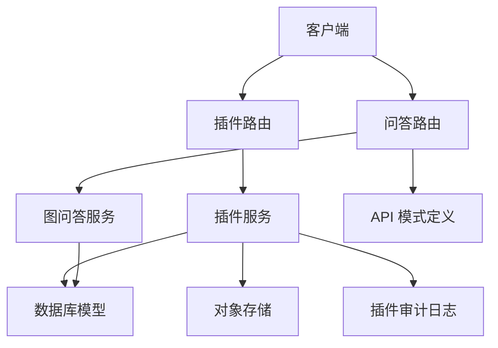

**图表来源**
- [plugins.py（路由）:1-158](file://src/personal_ai_life_os/api/routes/plugins.py#L1-L158)
- [plugins.py（服务）:1-551](file://src/personal_ai_life_os/services/plugins.py#L1-L551)
- [qa.py（路由）:1-276](file://src/personal_ai_life_os/api/routes/qa.py#L1-L276)
- [graph_qa.py:1-200](file://src/personal_ai_life_os/services/graph_qa.py#L1-L200)

**章节来源**
- [plugins.py（路由）:1-158](file://src/personal_ai_life_os/api/routes/plugins.py#L1-L158)
- [models.py:616-761](file://src/personal_ai_life_os/models.py#L616-L761)

## 核心数据模型概览

### 插件与审计主模型

| 模型 | 说明 | 关键字段 |
|---|---|---|
| `PluginManifest` | 当前租户已注册的插件 | `owner_id`、`name`、`version`、`kind`、`entrypoint`、`status`、`config_json` |
| `PluginPermission` | 每个插件的权限授予记录 | `owner_id`、`plugin_id`、`permission`、`granted` |
| `PluginAuditLog` | 插件生命周期与调用的审计事件 | `owner_id`、`plugin_id`、`action`、`status`、`detail_json`、`created_at` |

### 问答会话相关模型

| 模型 | 说明 | 关键字段 |
|---|---|---|
| `QaThread` | 一次问答上下文会话 | `owner_id`、`title`、`scope`、`created_at`、`updated_at` |
| `QaMessage` | 用户或助手的一条消息 | `thread_id`、`role`、`content`、`answer`、`citations`、`confidence`、`created_at` |

### 隐私合规相关模型

| 模型 | 说明 | 关键字段 |
|---|---|---|
| `ModelConsent` | 用户对某个模型提供方的许可记录 | `owner_id`、`provider_id`、`disclosure_version`、`granted_at`、`revoked_at` |
| `User` | 用户基本信息及全局 AI 同意字段 | `ai_consent_at`、`ai_consent_provider`、`ai_consent_disclosure_version` |

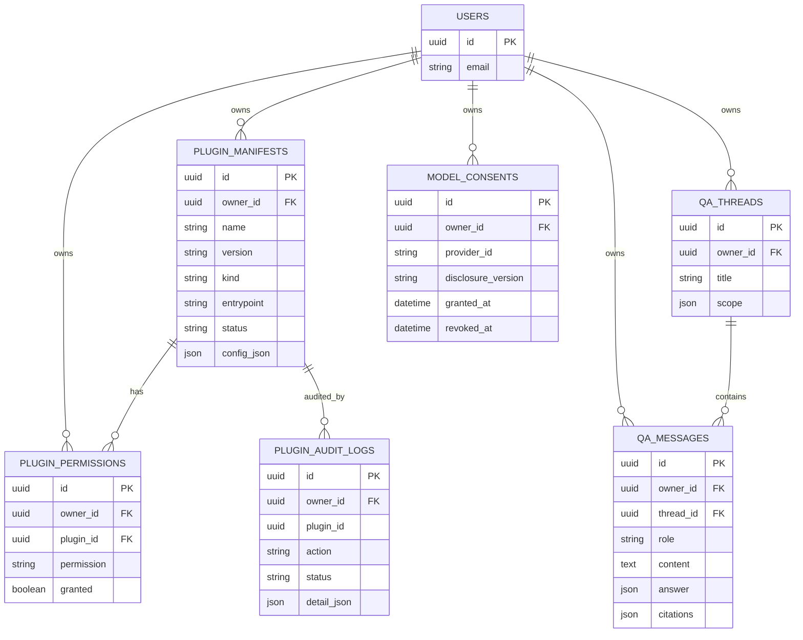

**图表来源**
- [models.py:616-761](file://src/personal_ai_life_os/models.py#L616-L761)
- [models.py:50-110](file://src/personal_ai_life_os/models.py#L50-L110)

**章节来源**
- [models.py:616-761](file://src/personal_ai_life_os/models.py#L616-L761)
- [models.py:50-110](file://src/personal_ai_life_os/models.py#L50-L110)

## 架构总览

插件系统和审计体系的核心流向是：

1. 前端向 `/plugins` 接口发起注册、启用、调用、卸载和审计查询。
2. 路由层解析请求并验证认证用户。
3. 插件服务查找内置插件目录、校验权限、限制输入大小、加载连接器或智能体工具。
4. 调用成功、失败或被禁止时，统一写入 `PluginAuditLog`。
5. 问答路由接收问题和作用域，生成问题回复后写入 `QaMessage`，并保留上一轮的 `scope`。
6. 模型提供者的外部数据处理必须通过 `ModelConsent` 授权，且不能绕过披露版本检查。

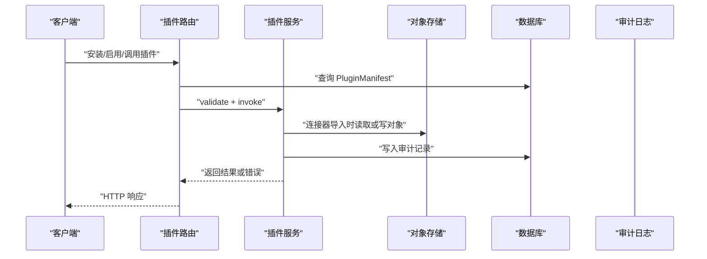

**图表来源**
- [plugins.py（路由）:23-158](file://src/personal_ai_life_os/api/routes/plugins.py#L23-L158)
- [plugins.py（服务）:37-158](file://src/personal_ai_life_os/services/plugins.py#L37-L158)
- [plugins.py（服务）:345-551](file://src/personal_ai_life_os/services/plugins.py#L345-L551)

**章节来源**
- [plugins.py（路由）:1-158](file://src/personal_ai_life_os/api/routes/plugins.py#L1-L158)
- [plugins.py（服务）:1-551](file://src/personal_ai_life_os/services/plugins.py#L1-L551)

## 插件清单与注册机制

### `PluginManifest` 的职责

`PluginManifest` 不是原始插件代码容器，而是“租户维度上的插件注册记录”。它表达的是“谁已经安装了哪个插件”，而不是“插件二进制在哪里”。

关键字段含义如下：

| 字段 | 含义 |
|---|---|
| `owner_id` | 插件属于哪个用户。这是多租户隔离的关键。 |
| `name` | 插件名称，在同一用户下唯一。 |
| `version` | 从内置插件目录声明的版本。 |
| `kind` | 插件类型：`connector` 或 `agent_tool`。 |
| `entrypoint` | 入口点字符串，例如内置 JSON 连接器或图搜索工具。 |
| `status` | 插件状态，目前使用 `installed`、`enabled`、`disabled`。 |
| `config_json` | 预留的插件配置空间。 |
| `permissions` | 关联的 `PluginPermission` 记录集合。 |

### 两种插件类型

代码中的内置目录区分了两种插件：

| 类型 | 示例 | 入口点 | 主要能力 |
|---|---|---|---|
| `connector` | generic-json-connector | `builtin:generic_json` | 预览、导入、删除本地文件或聊天导出源。 |
| `agent_tool` | graph-search-agent | `builtin:graph_search` | 在授权范围内读取所有者图实体和证据。 |

### 入口点管理

入口点采用硬编码匹配的方式处理。当前支持的入口点为：

- `builtin:generic_json`：支持连接器操作。
- `builtin:graph_search`：支持图查询操作。

如果入口点未知，调用时会抛出“不支持该入口点”的错误。

### 注册流程

安装插件的逻辑包括：

1. 在内置插件目录中按名称查找插件条目。
2. 检查同名插件是否已经安装。
3. 检查已安装插件数量是否超过配置上限。
4. 校验请求的权限是否在已声明权限集合内。
5. 拒绝不在清单中声明的权限。
6. 创建 `PluginManifest`。
7. 为每个批准的权限创建一条 `PluginPermission` 记录。

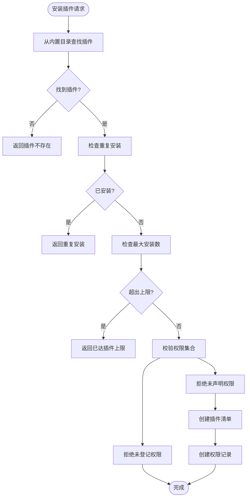

**图表来源**
- [plugins.py（服务）:86-158](file://src/personal_ai_life_os/services/plugins.py#L86-L158)

**章节来源**
- [models.py:703-745](file://src/personal_ai_life_os/models.py#L703-L745)
- [plugins.py（服务）:37-158](file://src/personal_ai_life_os/services/plugins.py#L37-L158)

## 权限控制与最小权限原则

权限系统在两层上做防护：

| 层级 | 内容 |
|---|---|
| 清单声明层 | 每种插件只能声明自己需要的权限。 |
| 运行时校验层 | 每次调用前都必须显式检查所需权限。 |

### 权限目录

当前权限目录包含连接器权限和智能体权限：

| 权限 | 语义 |
|---|---|
| `connector.preview` | 预览用户选择的文件，不持久化数据。 |
| `connector.import` | 将文件导入为新来源。 |
| `connector.read_selected_path` | 仅读取用户明确选择的文件路径或内容。 |
| `connector.delete` | 请求删除已导入来源。 |
| `agent.read_graph` | 读取所有者范围内的图实体与证据。 |
| `agent.read_timeline` | 读取时间线项目。 |
| `agent.read_files` | 经批准后读取用户选择文件。 |
| `agent.write_files` | 经批准后修改文件。 |
| `agent.external_send` | 经批准向外发送内容。 |
| `agent.payment` | 经批准进行支付或转账。 |
| `agent.delete_data` | 经批准删除数据。 |
| `agent.change_goal` | 经批准更改目标。 |

注意：当前 `BUILTIN_PLUGINS` 仅使用了其中一部分权限，未来新增插件仍需遵守同一目录约束。

### 最小权限实现方式

最小权限主要体现在：

- 安装时可以省略权限列表，默认使用插件清单声明的最小权限集。
- 不允许请求清单外权限。
- 不允许请求未登记的权限。
- 运行时检查使用 `granted=true` 的权限记录来判断是否允许。
- 权限缺失时返回 `plugin_permission_denied` 错误，并在审计日志中标记为被拒绝。

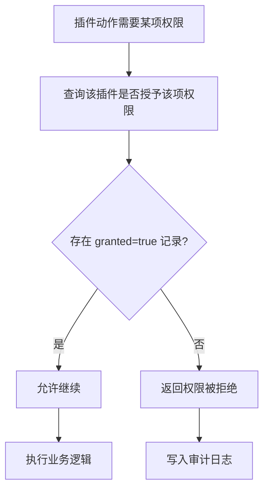

**图表来源**
- [plugins.py（服务）:232-247](file://src/personal_ai_life_os/services/plugins.py#L232-L247)
- [plugins.py（服务）:418-493](file://src/personal_ai_life_os/services/plugins.py#L418-L493)

**章节来源**
- [plugins.py（服务）:20-42](file://src/personal_ai_life_os/services/plugins.py#L20-L42)
- [plugins.py（服务）:232-247](file://src/personal_ai_life_os/services/plugins.py#L232-L247)
- [plugins.py（服务）:418-493](file://src/personal_ai_life_os/services/plugins.py#L418-L493)

## 插件执行沙箱与数据安全边界

当前代码没有启动独立操作系统进程或使用 Python `ast.unsafe`、受限执行器等语言级沙箱。因此，这里的“沙箱”更准确地说是一种**数据和流程边界**，而不是操作系统级隔离。

安全边界包括：

| 边界 | 实现 |
|---|---|
| 租户隔离 | 所有模型都有 `owner_id`，查询均带用户限定。 |
| 权限白名单 | 只允许可见权限。 |
| 入口点白名单 | 只允许已实现的内置入口点。 |
| 连接器大小限制 | 文本内容最大 5 MiB。 |
| 对象存储隔离 | 使用 `ObjectStore` 管理非结构化存储。 |
| 审计全覆盖 | 成功、拒绝、异常都尝试写入审计。 |
| 状态关闭 | 插件状态不为 `enabled` 时直接拒绝调用。 |

### 连接器沙箱

连接器插件通过 `_parse_connector`、`_import_connector` 和 `_delete_connector_source` 分别处理预览、导入和删除。这些函数都先校验用户和插件状态，再访问对象存储。

### 智能体工具沙箱

智能体工具 `builtin:graph_search` 只做受控搜索：

- 搜索词来自外部请求。
- 必须拥有 `agent.read_graph` 权限。
- 只查询 `active` 图实体。
- 只返回有限的证据条目。
- 不使用用户会话状态之外的隐藏范围。

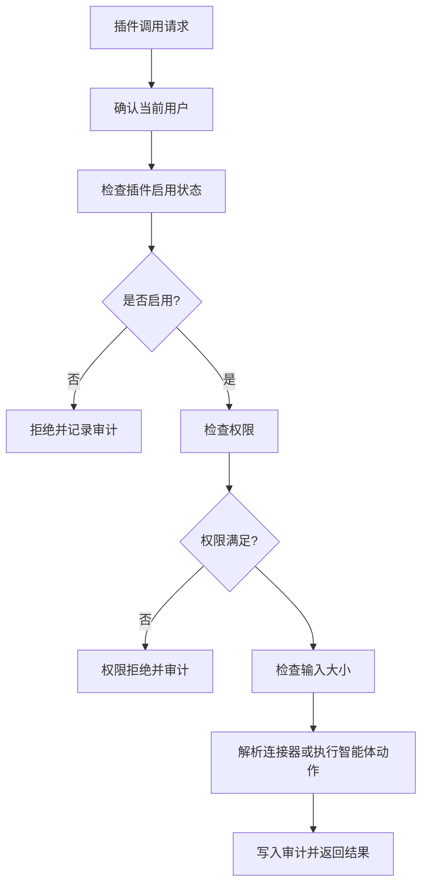

**图表来源**
- [plugins.py（服务）:345-551](file://src/personal_ai_life_os/services/plugins.py#L345-L551)

**章节来源**
- [plugins.py（服务）:59-85](file://src/personal_ai_life_os/services/plugins.py#L59-L85)
- [plugins.py（服务）:345-551](file://src/personal_ai_life_os/services/plugins.py#L345-L551)

## 审计日志模型与追踪流程

### `PluginAuditLog` 字段含义

| 字段 | 含义 |
|---|---|
| `id` | 审计事件主键。 |
| `owner_id` | 触发行为的用户。 |
| `plugin_id` | 相关插件；卸载后可为 `null`。 |
| `action` | 动作类型，如安装、启用、禁用、导入、搜索、卸载等。 |
| `status` | `succeeded`、`denied`、`failed`。 |
| `detail_json` | 可选扩展字段，例如文件名、权限列表、错误码。 |
| `created_at` | 审计事件发生时间。 |

### 审计覆盖场景

| 场景 | action | 典型 status |
|---|---|---|
| 安装插件 | `install` | `succeeded` |
| 启用插件 | `enabled` | `succeeded` |
| 禁用插件 | `disabled` | `succeeded` |
| 卸载插件 | `uninstall` | `succeeded` |
| 调用被禁用的插件 | 具体 action | `denied` |
| 权限被拒绝 | 具体 action | `denied` |
| 业务调用失败 | 具体 action | `failed` |
| 非预期异常 | 具体 action | `failed` |

### 审计查询 API

插件审计查询路由返回分页总量和最近审计记录，查询条件限定为当前登录用户的 `owner_id`，避免跨租户访问。

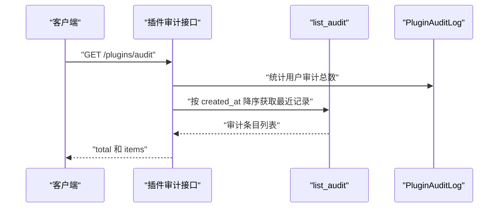

**图表来源**
- [plugins.py（路由）:116-158](file://src/personal_ai_life_os/api/routes/plugins.py#L116-L158)
- [plugins.py（服务）:526-551](file://src/personal_ai_life_os/services/plugins.py#L526-L551)
- [schemas.py:838-849](file://src/personal_ai_life_os/api/schemas.py#L838-L849)

**章节来源**
- [models.py:747-761](file://src/personal_ai_life_os/models.py#L747-L761)
- [plugins.py（路由）:116-158](file://src/personal_ai_life_os/api/routes/plugins.py#L116-L158)
- [plugins.py（服务）:37-52](file://src/personal_ai_life_os/services/plugins.py#L37-L52)
- [plugins.py（服务）:526-551](file://src/personal_ai_life_os/services/plugins.py#L526-L551)

## 问答会话与会话上下文管理

### `QaThread` 的作用

`QaThread` 表示一次问答上下文。它不只是标题容器，还负责保存会话级别的 `scope`，用于限制下一次回答的来源范围、实体范围和日期范围。

| 字段 | 用途 |
|---|---|
| `owner_id` | 会话所有权隔离。 |
| `title` | 可读标题，默认值会按提问摘要优化。 |
| `scope` | JSON 作用域，包含数据源、实体和时间范围。 |
| `created_at`、`updated_at` | 会话生命周期的时间戳。 |

### `QaMessage` 的作用

`QaMessage` 记录对话历史和回答元信息：

| 字段 | 用途 |
|---|---|
| `thread_id` | 所属对话线程。 |
| `role` | `user` 或 `assistant`。 |
| `content` | 用户问题或助手摘要内容。 |
| `answer` | 结构化答案，可能包含事实、建议、时间线匹配等。 |
| `citations` | 引用来源列表。 |
| `confidence` | 置信度分数。 |
| `created_at` | 消息时间顺序。 |

### 上下文保留与历史检索

问答服务的上下文保留体现在：

- 新会话可以接受初始作用域。
- 每次提问后会更新会话的 `scope`。
- 下次提问时，如果请求中没有给出作用域，则回退到会话原有作用域。
- 会话列表默认限制最近 50 条。
- 获取单个会话时可包含完整消息。
- 消息按 `created_at` 排序，便于前端恢复对话时序。

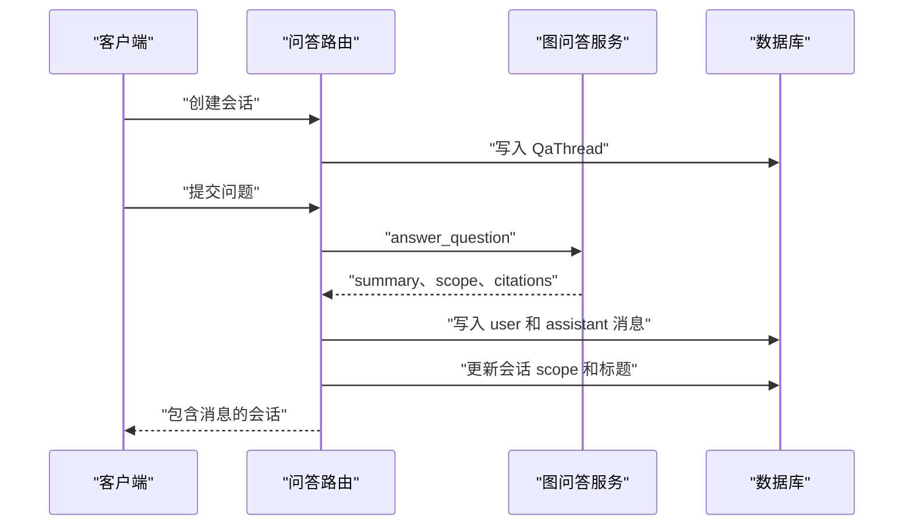

**图表来源**
- [qa.py（路由）:71-200](file://src/personal_ai_life_os/api/routes/qa.py#L71-L200)

**章节来源**
- [models.py:616-654](file://src/personal_ai_life_os/models.py#L616-L654)
- [qa.py（路由）:71-200](file://src/personal_ai_life_os/api/routes/qa.py#L71-L200)
- [graph_qa.py:65-140](file://src/personal_ai_life_os/services/graph_qa.py#L65-L140)

## 模型提供者同意与法律合规

### `ModelConsent` 的职责

`ModelConsent` 是对“哪个用户在什么时候同意使用哪个模型提供方”的法律合规记录。核心要点是：

- 用户明确授权后，才能启用外部模型处理。
- 记录包含披露版本，确保用户同意的是最新隐私条款。
- 允许撤销同意。
- 与默认的本地内置提供方做兼容兼容。

### 一致性要求

同意函数在启用外部处理前进行检查：

1. 提供方必须有可用凭据。
2. 必须配置计费速率。
3. 必须公开隐私链接、数据披露内容和保留策略。
4. 用户不能同意过期的披露版本。

如果这些都满足，系统才会创建或更新 `ModelConsent`。对于默认内置提供方，还会同步更新 `User` 的全局 AI 同意字段。

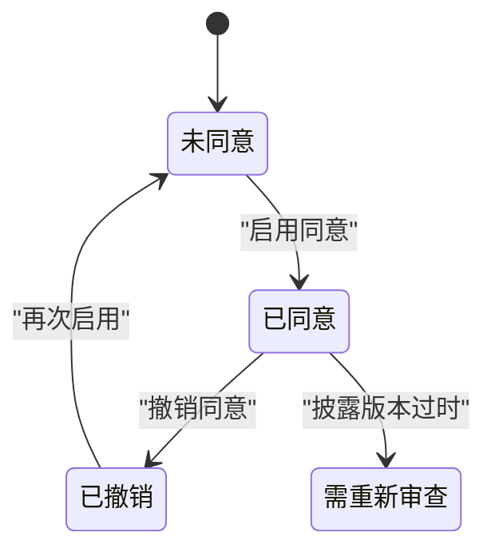

**图表来源**
- [model_consent.py:48-110](file://src/personal_ai_life_os/services/model_consent.py#L48-L110)

**章节来源**
- [models.py:80-110](file://src/personal_ai_life_os/models.py#L80-L110)
- [model_consent.py:7-110](file://src/personal_ai_life_os/services/model_consent.py#L7-L110)

## 依赖关系分析

### 组件依赖图

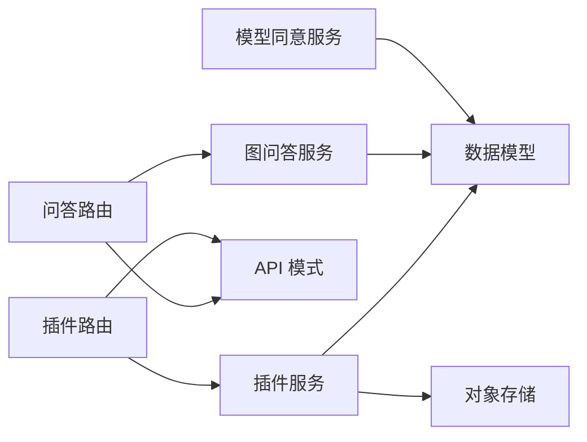

**图表来源**
- [plugins.py（路由）:1-20](file://src/personal_ai_life_os/api/routes/plugins.py#L1-L20)
- [plugins.py（服务）:10-26](file://src/personal_ai_life_os/services/plugins.py#L10-L26)
- [qa.py（路由）:11-24](file://src/personal_ai_life_os/api/routes/qa.py#L11-L24)
- [model_consent.py:7-14](file://src/personal_ai_life_os/services/model_consent.py#L7-L14)

### 耦合性评估

| 模块 | 耦合特点 | 风险 |
|---|---|---|
| `PluginManifest` | 低代码耦合，高语义约束 | 入口点需要集中在插件服务维护 |
| `PluginPermission` | 通过 `owner_id` 强绑定 | 权限变更需要审计 |
| `PluginAuditLog` | 面向审计，可随插件解耦查询 | 不建议直接由用户修改 |
| `QaThread` | 承载会话状态 | 长时间会话的 `scope` 可能积累大 JSON |
| `QaMessage` | 一对多依赖线程 | 消息量大时需分页或归档 |
| `ModelConsent` | 依赖模型提供方配置 | 披露版本不一致时必须阻止授权 |

**章节来源**
- [models.py:616-761](file://src/personal_ai_life_os/models.py#L616-L761)
- [plugins.py（服务）:345-551](file://src/personal_ai_life_os/services/plugins.py#L345-L551)
- [qa.py（路由）:71-200](file://src/personal_ai_life_os/api/routes/qa.py#L71-L200)
- [model_consent.py:48-110](file://src/personal_ai_life_os/services/model_consent.py#L48-L110)

## 插件开发指南

本节适用于需要在当前系统中增加新插件的开发者。

### 第一步：决定插件类型

| 场景 | 选择 |
|---|---|
| 导入或预览文件来源 | `connector` |
| 调用内部工具或增强现有功能 | `agent_tool` |

### 第二步：在内置目录中添加插件条目

插件目录是一个命名到插件元信息的映射。新增条目需要声明：

- `version`
- `kind`
- `entrypoint`
- `description`
- `permissions`

### 第三步：确定权限

只在权限目录中声明真实需要的权限。不要请求宽泛权限；例如能读就不写，能预览就不导入。

### 第四步：实现入口点

在 `invoke_plugin` 中新增一个入口点分支：

1. 判断插件 `entrypoint`。
2. 根据 `action` 分发到具体方法。
3. 在每个敏感动作前调用权限检查。
4. 对非法输入进行参数校验。
5. 把所有调用结果写入审计。
6. 捕获异常并转换为统一的 `PluginError`。

### 第五步：实现请求与响应模式

在 `api/schemas.py` 中添加对应的 Pydantic 请求和响应模型，保持向前兼容。

### 第六步：测试关键路径

重点测试：

- 未安装插件。
- 权限不足。
- 未启用插件。
- 空输入或超大输入。
- 非法动作。
- 成功调用后的审计记录。
- 插件被禁用后仍被调用的情况。

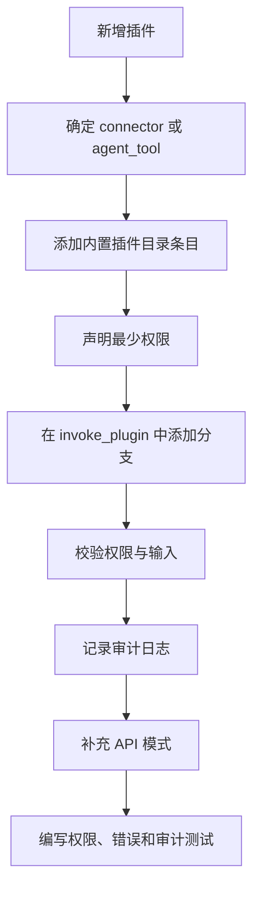

[此图为概念流程，不需要源代码来源]

**章节来源**
- [plugins.py（服务）:37-85](file://src/personal_ai_life_os/services/plugins.py#L37-L85)
- [plugins.py（服务）:345-551](file://src/personal_ai_life_os/services/plugins.py#L345-L551)
- [schemas.py:838-849](file://src/personal_ai_life_os/api/schemas.py#L838-L849)

## 审计日志查询方法

### 基本查询

调用插件审计接口可获得当前用户的审计记录，默认按创建时间降序返回最近若干条。

### 推荐过滤字段

| 过滤目的 | 推荐字段 |
|---|---|
| 查看某个插件的操作 | `plugin_id` |
| 查看成功操作 | `status = succeeded` |
| 查看失败操作 | `status = failed` |
| 查看被拒动作 | `status = denied` |
| 回溯时间段 | `created_at` |
| 定位异常 | `detail_json.code`、`detail_json.message` |

### 常见审计序列

安装插件后，典型审计序列为：

1. `install succeeded`
2. 如需启用：`enabled succeeded`
3. 实际使用：`preview/IMPORT/search` 对应动作
4. 成功调用：`succeeded`
5. 最终卸载：`uninstall succeeded`，并释放后续引用链。

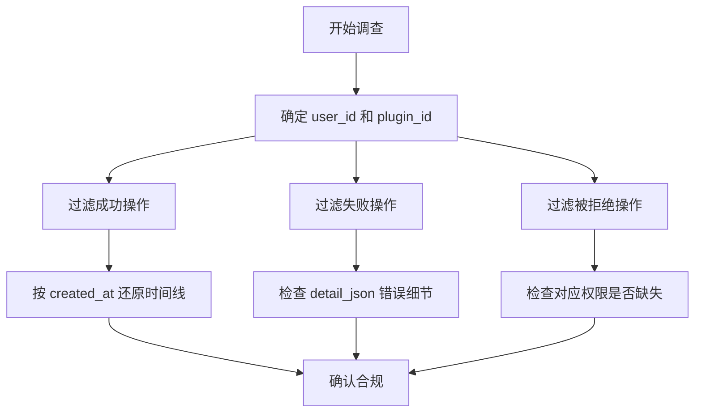

[此图为概念查询流程，不需要源代码来源]

**章节来源**
- [plugins.py（路由）:116-158](file://src/personal_ai_life_os/api/routes/plugins.py#L116-L158)
- [plugins.py（服务）:526-551](file://src/personal_ai_life_os/services/plugins.py#L526-L551)

## 性能与复杂度分析

### 数据库查询复杂度

| 操作 | 典型复杂度 | 索引与注意事项 |
|---|---|---|
| 列出用户安装的插件 | O(n) | 基于 `owner_id` 筛选 |
| 按插件 ID 和租户查找插件 | O(1) 或 O(log n) | 有主键和用户组合索引 |
| 列出用户审计日志 | O(k) | 按 `owner_id`、`created_at` 排序，k 为返回条数 |
| 列出问答线程 | O(k) | 按 `owner_id`、`updated_at` 排序，默认限制 50 |
| 插入对话消息 | O(1) | 消息数增长不影响单条插入 |
| 图搜索 | O(n + e) | n 为候选实体，e 为关联证据行数，有显式限制 |

### 审计写入开销

每次插件调用至少写入一次审计，异常情况也可能额外写入。对高频调用插件应关注：

- 审计表增长速度。
- 查询时的 `limit` 限制。
- 未来可能需要按月份分区或归档。

### 问答上下文膨胀

`QaThread.scope` 是 JSON，长期会话会反复覆盖，但历史消息会累积。建议：

- 定期归档旧会话。
- 限制单次回复的消息数量。
- 对长对话使用分页加载历史消息。
- 避免在 scope 中写入大型结构化数据。

**章节来源**
- [plugins.py（路由）:33-44](file://src/personal_ai_life_os/api/routes/plugins.py#L33-L44)
- [plugins.py（路由）:116-158](file://src/personal_ai_life_os/api/routes/plugins.py#L116-L158)
- [qa.py（路由）:89-113](file://src/personal_ai_life_os/api/routes/qa.py#L89-L113)
- [plugins.py（服务）:453-518](file://src/personal_ai_life_os/services/plugins.py#L453-L518)

## 故障排查指南

### 常见错误与修复

| 错误现象 | 可能原因 | 排查步骤 |
|---|---|---|
| 安装时报“插件不存在” | 插件名不在内置目录 | 检查内置插件目录名称 |
| 安装时报权限未声明 | 请求权限不在插件清单中 | 对比插件 `permissions` 与请求 |
| 调用时报权限被拒绝 | 缺少对应 `granted=true` 权限 | 检查权限是否授予 |
| 调用时被禁用 | 插件状态不是 `enabled` | 先设置启用状态 |
| 连接器导入失败 | 文件过大、格式不支持或解码失败 | 检查文件大小、后缀和内容 |
| 问答无答案或证据不足 | 作用域太窄或缺少活跃证据 | 扩大 `scope` 或检查数据来源 |
| 无法启用外部模型同意 | 披露版本过时或配置不完整 | 检查配置、披露 URL 和计费 |

### 调试技巧

1. 先查 `PluginManifest`：确认插件已安装、状态为启用、权限已授予。
2. 再查 `PluginAuditLog`：确认 `action`、`status` 和 `detail_json`。
3. 如果是连接器问题，确认对象存储中是否存在相关资源。
4. 如果是问答问题，检查会话 `scope` 是否正确继承。
5. 如果是模型提供方问题，确认 `ModelConsent` 的披露版本和启用标记。

**章节来源**
- [plugins.py（服务）:86-158](file://src/personal_ai_life_os/services/plugins.py#L86-L158)
- [plugins.py（服务）:418-551](file://src/personal_ai_life_os/services/plugins.py#L418-L551)
- [qa.py（路由）:71-200](file://src/personal_ai_life_os/api/routes/qa.py#L71-L200)
- [model_consent.py:48-110](file://src/personal_ai_life_os/services/model_consent.py#L48-L110)

## 结论

Personal-AI-Life-OS 的插件系统与审计模型采用了“声明式清单 + 运行时代码检查 + 可追溯审计”的组合方案：

- `PluginManifest` 负责描述插件身份、类型和入口点。
- `PluginPermission` 负责强制最小权限。
- `PluginAuditLog` 负责保证安装、启用、调用和卸载行为可核查。
- `QaThread` 和 `QaMessage` 提供了可检索的问答上下文。
- `ModelConsent` 为用户提供模型提供方授权的合规记录。

当前实现更接近轻量级的沙箱边界，而不是严格进程隔离。生产环境若引入第三方脚本执行或远端能力，需要进一步考虑：

- 网络出向控制。
- 资源配额与超时。
- 输入输出大小与内存上限。
- 第三方代码签名或来源验证。
- 更细粒度的审批流，特别是涉及支付或删除数据的智能体权限。