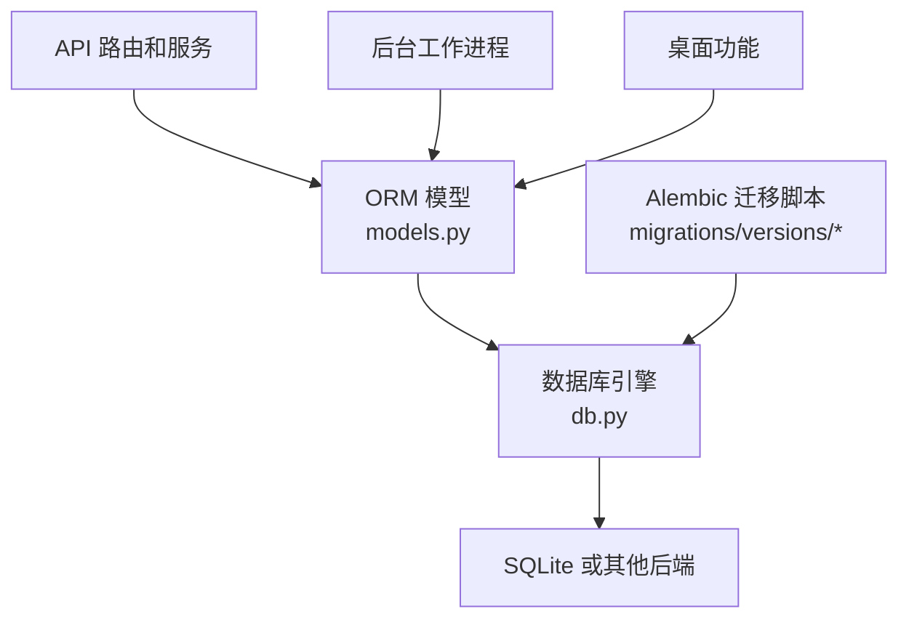
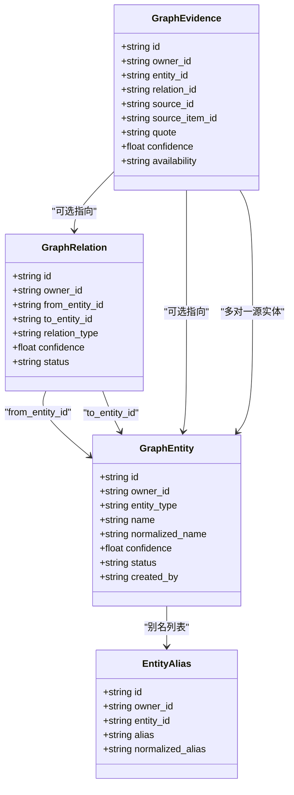
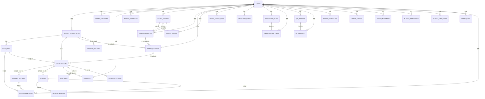
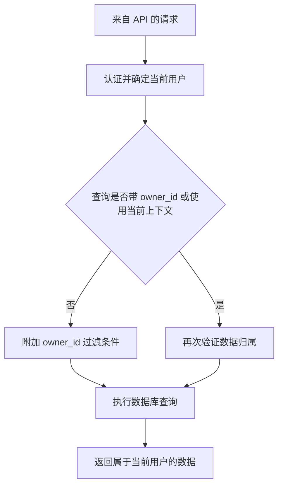
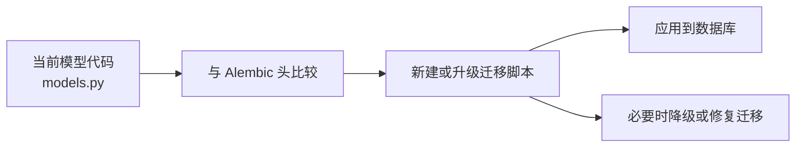
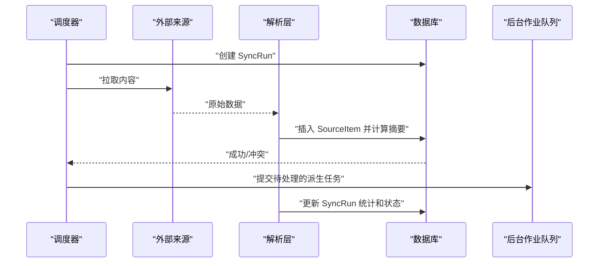
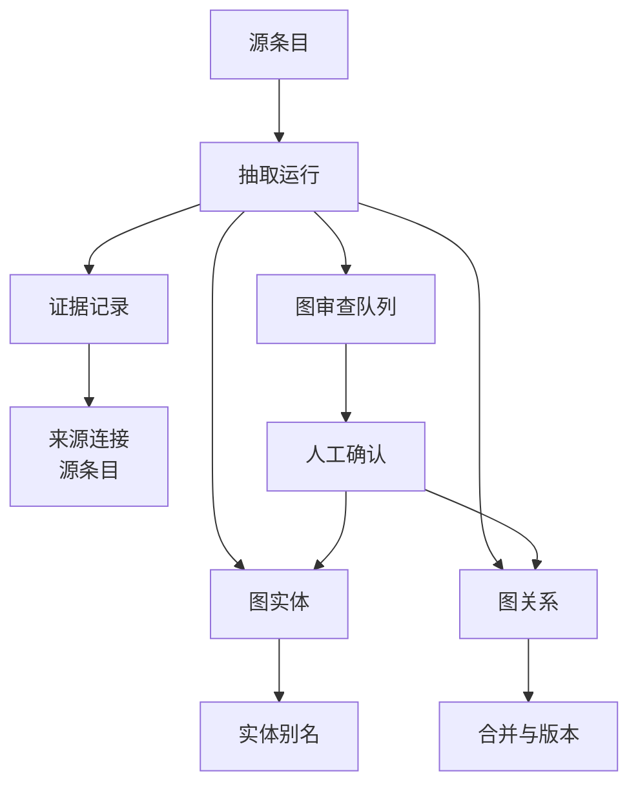
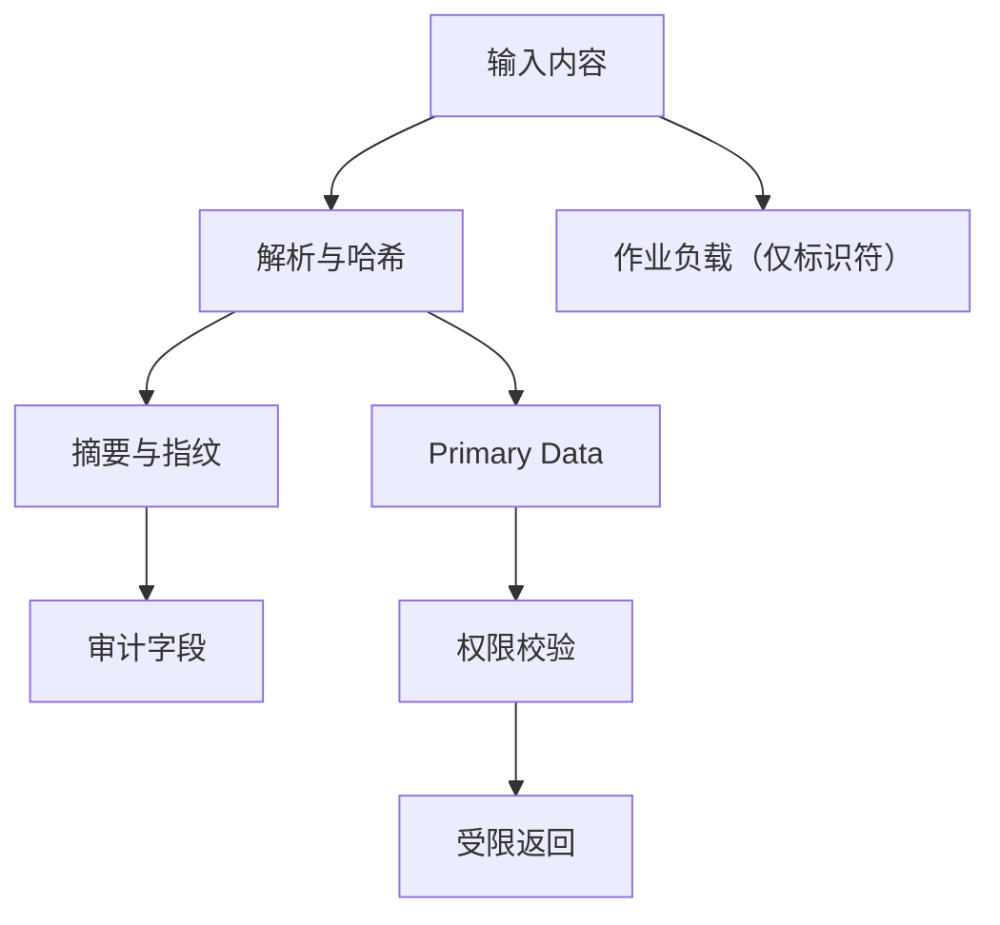

# 数据模型

<cite>
**本文引用的文件**   
- [models.py](file://src/personal_ai_life_os/models.py)
- [db.py](file://src/personal_ai_life_os/db.py)
- [data-model.md](file://docs/architecture/data-model.md)
- [0de3d72c2e1f_initial_tenant_scoped_schema.py](file://migrations/versions/0de3d72c2e1f_initial_tenant_scoped_schema.py)
- [513becf54638_account_deletion_and_reminder_citations.py](file://migrations/versions/513becf54638_account_deletion_and_reminder_citations.py)
- [958b551e0397_record_model_usage.py](file://migrations/versions/958b551e0397_record_model_usage.py)
- [a1b7c9d3e504_add_provider_consent_and_review_versions.py](file://migrations/versions/a1b7c9d3e504_add_provider_consent_and_review_versions.py)
- [b68cce9036fd_desktop_folder_sources.py](file://migrations/versions/b68cce9036fd_desktop_folder_sources.py)
- [b7d4f6a1c902_add_review_schedules.py](file://migrations/versions/b7d4f6a1c902_add_review_schedules.py)
- [b8e2c4d6f901_add_graph_qa_threads_and_ontology_versions.py](file://migrations/versions/b8e2c4d6f901_add_graph_qa_threads_and_ontology_versions.py)
- [c101bc66b1a3_add_durable_background_jobs.py](file://migrations/versions/c101bc66b1a3_add_durable_background_jobs.py)
- [c8d73b1e0afd_desktop_drafts.py](file://migrations/versions/c8d73b1e0afd_desktop_drafts.py)
- [d2f5a8c14e73_add_evidence_graph_tables.py](file://migrations/versions/d2f5a8c14e73_add_evidence_graph_tables.py)
- [d7f1a3b5c902_add_insights_agent_and_plugins.py](file://migrations/versions/d7f1a3b5c902_add_insights_agent_and_plugins.py)
- [eb3ff930ec06_track_estimated_model_costs.py](file://migrations/versions/eb3ff930ec06_track_estimated_model_costs.py)
- [f9a1c4d8e702_add_search_indexes_and_organization.py](file://migrations/versions/f9a1c4d8e702_add_search_indexes_and_organization.py)
</cite>

## 目录

1. [引言](#引言)
2. [项目结构与定位](#项目结构与定位)
3. [核心概念](#核心概念)
4. [实体与关系映射总览](#实体与关系映射总览)
5. [租户隔离设计](#租户隔离设计)
6. [详细字段说明](#详细字段说明)
7. [索引策略与约束](#索引策略与约束)
8. [迁移历史与版本控制](#迁移历史与版本控制)
9. [数据流与工作流](#数据流与工作流)
10. [查询模式与最佳实践](#查询模式与最佳实践)
11. [数据安全与访问控制](#数据安全与访问控制)
12. [性能注意事项](#性能注意事项)
13. [故障排查指南](#故障排查指南)
14. [结论](#结论)

## 引言

Personal-AI-Life-OS 的数据模型以 SQLAlchemy ORM 为核心，围绕“用户拥有的数据”展开。系统把用户作为身份、鉴权、租户和数据隔离的统一边界：所有持久化实体普遍携带 `owner_id`，并通过外键、级联删除、联合唯一约束和会话上下文共同实现多用户安全。

整体数据层分为几个层次：

| 层次 | 主要职责 |
|---|---|
| 身份与权限 | 用户、密码哈希、AI 使用同意、订阅或模型提供方同意 |
| 输入来源 | 显式源连接、同步记录、解析后原始条目 |
| 用户内容 | 记忆、审查、提醒、标签、集合、保存的搜索 |
| 知识图谱 | 实体、别名、关系、证据、合并日志、本体类型 |
| 处理过程 | 抽取运行、图审查项、问答线程、插件、操作审计 |
| 后台任务 | 可恢复作业、结果、重试、锁租约 |
| 模型使用情况 | 无内容的调用统计与成本估算 |
| 桌面相关 | 桌面文件夹、本地文件、草稿 |

文档对象模型部分还强调 Alembic 迁移管理所有表结构变更；API 层不仅要校验请求所属 `owner_id`，还会在继续跟随资源关系之前再次验证已认证用户的权限范围。

**章节来源**
- [data-model.md:1-10](file://docs/architecture/data-model.md#L1-L10)

## 项目结构与定位

本项目使用 Python 源码模块表达数据模型，SQLAlchemy 声明式基础类集中定义，Alembic 脚本集中放在 `migrations/versions` 下。数据库引擎、UTC 时间类型装饰器以及基于请求作用域的会话工厂集中在 `db.py` 中。

**图示来源**
- [models.py:1-50](file://src/personal_ai_life_os/models.py#L1-L50)
- [db.py:1-75](file://src/personal_ai_life_os/db.py#L1-L75)
- [data-model.md:1-10](file://docs/architecture/data-model.md#L1-L10)

**章节来源**
- [models.py:1-50](file://src/personal_ai_life_os/models.py#L1-L50)
- [db.py:1-75](file://src/personal_ai_life_os/db.py#L1-L75)
- [data-model.md:1-10](file://docs/architecture/data-model.md#L1-L10)

## 核心概念

### User

用户是系统的顶层租户标识和审计所有者。主键使用 UUID 字符串；邮箱全局唯一且建立索引；密码使用哈希存储而非明文。其余重要语义包括：

| 领域 | 含义 |
|---|---|
| 身份隔离 | 邮箱唯一，通常用于登录账户识别 |
| 时区隔离 | 用户时区用于日期和提醒调度等展示转换 |
| AI 同意 | 记录接受 AI 使用的授权时间与提供方信息 |
| 注销状态 | 支持申请删除的时间标记 |
| 关联边界 | 拥有源连接、模型提供方同意、以及通过其他表的 `owner_id` 间接拥有绝大多数资源 |

模型通过关系将 `User` 与其直接子资源连接起来，并在父实体删除时使用级联删除策略。

**章节来源**
- [models.py:62-95](file://src/personal_ai_life_os/models.py#L62-L95)

### SourceConnection 与 SyncRun

`SourceConnection` 代表一个显式的、用户选择的来源，例如日历、聊天导出、文档或桌面文件夹。它记录来源种类、名称、当前状态、同意版本号、选择范围、最近同步时间等。其状态字段被单独建索引，便于查询活跃源。

`SyncRun` 是对一次导入尝试的可观测追踪，记录解析器版本、外部文件摘要、对象存储键、各类计数、错误码和时间戳。它把生成的 `SourceItem` 归因到某次具体的同步操作中。

### SourceItem

`SourceItem` 是解析后的原始内容入口。它不依赖某个上层主题，而是连接记忆、审查、提醒、标签、集合和知识图谱证据等下游实体。关键字段包括：

| 字段类别 | 字段 |
|---|---|
| 所有权 | `owner_id`、`source_id`、`sync_run_id` |
| 稳定性 | `external_id`、`source_sha256`、`stored_sha256` |
| 可读性 | `kind`、`title`、`content_text` |
| 时间 | `occurred_at`、`created_at`、`deleted_at` |
| 解析元数据 | `parser_version`、`source_timezone`、`source_locator`、`metadata_json` |
| 生命周期 | `is_current` |

版本重复由联合唯一约束保障：同一用户、来源、外部 ID 和来源内容摘要最多只允许一个当前记录，避免重复导入产生冲突副本。

**章节来源**
- [models.py:201-283](file://src/personal_ai_life_os/models.py#L201-L283)

### MemoryRecord 与 Review

`MemoryRecord` 是用户确认的记忆片段，默认类型为笔记，也可扩展。它维护正文、生成来源标记、审核状态、发生时间和来源条目关联。审核状态为常用过滤条件，因此建立了 `(owner_id, review_status)` 复合索引。

`Review` 表示周期性复盘草稿或正式结果，具有半开区间 `[period_start, period_end)` 的语义，并通过联合唯一约束保证同属用户和周期不会重复存在。它也支持版本记录，从而保留每次编辑意图、最终文本和原因。

两者都通过中间关联表引用 `SourceItem`：

| 中间表 | 左端 | 右端 | 级联策略 |
|---|---|---|---|
| `memory_record_sources` | 记忆记录 | 源条目 | 级联删除 |
| `review_sources` | 审查记录 | 源条目 | 级联删除 |
| `reminder_sources` | 提醒 | 源条目 | 级联删除 |

**章节来源**
- [models.py:286-444](file://src/personal_ai_life_os/models.py#L286-L444)

### GraphEntity、GraphRelation、GraphEvidence

知识图谱层把真实世界中的概念拆成实体、关系和证据三要素。

| 实体 | 职责 |
|---|---|
| `GraphEntity` | 存储人、地点、事件或任意分类对象的标准化名称、摘要、置信度和状态 |
| `EntityAlias` | 为实体提供多种别名写法并支持标准化查询 |
| `GraphRelation` | 记录两个实体之间的有向关系及其时间有效性 |
| `GraphEvidence` | 把实体或关系绑定到证据来源，如具体源连接和源条目 |

证据模型包含检查约束：每条证据至少必须指向一个实体或关系之一，不允许空目标。这使得引用完整性不只体现在外键上，也体现在业务约束上。

**图示来源**
- [models.py:447-602](file://src/personal_ai_life_os/models.py#L447-L602)

**章节来源**
- [models.py:447-602](file://src/personal_ai_life_os/models.py#L447-L602)

### BackgroundJob

背景作业是实现可恢复 OCR 及可选模型工作的核心持久化单元。设计原则是：负载字段仅包含标识符和处理控制信息，不写入真实源内容。

关键机制包括：

| 机制 | 字段或特性 |
|---|---|
| 幂等去重 | `owner_id + dedupe_key` 唯一 |
| 状态机 | `queued` 等待、执行中、失败、成功等状态 |
| 重试 | `attempt_count`、`max_attempts`、`error_code` |
| 可见性 | `available_at` 延迟释放给工作者 |
| 并发保护 | `lease_expires_at`、`worker_id` |
| 结果 | `result_json` 仅对所有者可读取的结果 |
| 溯源 | 可选关联源连接、源条目、同步记录、审查 |

作业表对状态、可见时间和所有常见关联 ID 建立索引，使领取、筛选和按来源回溯查询足够高效。

**章节来源**
- [models.py:802-875](file://src/personal_ai_life_os/models.py#L802-L875)

### 其他重要实体概览

| 实体 | 用途 |
|---|---|
| `ModelConsent` | 用户对外部模型提供方的同意与撤回记录 |
| `Tag` / `Collection` | 对 `SourceItem` 的分类与分组 |
| `SavedSearch` | 用户保存的简单搜索过滤器 |
| `Reminder` / `ReminderSchedule` | 后续提醒与定时审查调度 |
| `ExtractionRun` | 图谱抽取运行的成本和指标记录 |
| `GraphReviewItem` | 需要人工确认的实体、关系、合并或本体建议 |
| `QaThread` / `QaMessage` | 针对图谱和来源的回答对话线程 |
| `PluginManifest` / `PluginPermission` / `PluginAuditLog` | 插件清单、许可与审计 |
| `AgentAction` | Agent 操作的变更前后可审计快照 |
| `ModelRun` | 不含实际 prompt/output 的内容的模型调用统计 |
| `DesktopFolder` / `DesktopFolderFile` / `DesktopDraft` | 桌面端文件夹扫描与草稿 |

这些实体的共同特征是：大多数表带 `owner_id`；很多表用 JSON 字段承载结构化元数据；多数实体附带 `created_at`，部分带有 `updated_at` 或删除时间。

**章节来源**
- [models.py:96-797](file://src/personal_ai_life_os/models.py#L96-L797)

## 实体与关系映射总览

**图示来源**
- [models.py:62-875](file://src/personal_ai_life_os/models.py#L62-L875)

这个 ER 图展示了四个主要数据域：

1. **来源与原始内容**：`SourceConnection → SyncRun → SourceItem`
2. **用户认知层**：`MemoryRecord`、`Review`、`Reminder`、`Tag`、`Collection`、`SavedSearch`
3. **知识图谱层**：`GraphEntity`、`GraphRelation`、`GraphEvidence`、`EntityAlias`、本体和合并日志
4. **处理与可观测层**：`BackgroundJob`、`ModelRun`、`ExtractionRun`、`GraphReviewItem`、`AgentAction`、`Plugin*`、`QaThread/Messages`

## 租户隔离设计

该系统采用“每个记录一个 `owner_id`”的主分离方式，而不是数据库级别的多租户 schema。这意味着：

- 几乎每张业务表都有 `owner_id` 列和外键指向 `users.id`。
- 删除用户时会触发一级外键级联删除其直接拥有的记录。
- 间接拥有记录依赖两层保护：上游父表的外键级联删除，以及 API 层再次校验当前认证用户是否匹配查询条件。
- 许多查询可以按 `(owner_id, ...)` 组合快速过滤，因此大量索引以 `owner_id` 作为前导列。

某些表没有显式 `owner_id`，但仍然属于特定租户上下文：

| 表族 | 归属方式 |
|---|---|
| `memory_record_sources`、`review_sources`、`reminder_sources` | 作为中间关联表，两端均已被 `owner_id` 区分 |
| `item_tags`、`item_collections` | 通过 `tags.owner_id` / `collections.owner_id` 和 `source_items.owner_id` 限定 |
| `desktop_folders.source_id` | 主键即为对应 `source_connections.source_id`，而该外键最终落到 `users.id` |
| `plugin_permissions.owner_id` | 每个插件权限同时绑定用户和插件实例 |
| 纯审计表如 `plugin_audit_logs` | 通过自身的 `owner_id` 隔离，或通过可选 `plugin_id` 间接关联 |

**图示来源**
- [models.py:62-875](file://src/personal_ai_life_os/models.py#L62-L875)
- [data-model.md:1-10](file://docs/architecture/data-model.md#L1-L10)

**章节来源**
- [models.py:62-875](file://src/personal_ai_life_os/models.py#L62-L875)
- [data-model.md:1-10](file://docs/architecture/data-model.md#L1-L10)

## 详细字段说明

以下重点说明问题描述中提到的主要模型。

### 用户与提供者同意

| 模型 | 关键字段 |
|---|---|
| `User` | `id`、`email`、`password_hash`、`timezone`、`ai_consent_at`、`ai_consent_provider`、`ai_consent_disclosure_version`、`deletion_requested_at`、`created_at` |
| `ModelConsent` | `id`、`owner_id`、`provider_id`、`disclosure_version`、`granted_at`、`revoked_at` |

`ModelConsent` 对同一个所有者与提供者只允许一条同意记录，并使用索引加速按 `(owner_id, provider_id)` 查询。

**章节来源**
- [models.py:62-123](file://src/personal_ai_life_os/models.py#L62-L123)

### 源连接与同步

| 模型 | 关键字段 |
|---|---|
| `SourceConnection` | `id`、`owner_id`、`kind`、`name`、`status`、`consent_version`、`selected_scope`、`created_at`、`updated_at`、`last_sync_at`、`cloud_consent_at`、`cloud_consent_version` |
| `SyncRun` | `id`、`owner_id`、`source_id`、`status`、`parser_version`、`file_sha256`、`object_key`、各类 `items_*` 计数、`error_code`、时间戳 |

`SourceConnection.status` 支持多种生命周期状态，并以复合索引 `(owner_id, status)` 优化按用户在用源的查询。`SyncRun` 的计数字段默认值使用服务器端默认值以减少应用层空写入。

**章节来源**
- [models.py:126-200](file://src/personal_ai_life_os/models.py#L126-L200)

### 源条目与标签、集合

| 模型 | 关键字段 |
|---|---|
| `SourceItem` | `owner_id`、`source_id`、`sync_run_id`、`external_id`、`kind`、`title`、`content_text`、`occurred_at`、`source_timezone`、`source_sha256`、`stored_sha256`、`parser_version`、`object_key`、`source_locator`、`metadata_json`、`is_current`、`deleted_at`、`created_at` |
| `Tag` | `owner_id`、`name`、`name_key`、`color`、时间戳 |
| `Collection` | `owner_id`、`name`、`name_key`、`description`、时间戳 |

`name_key` 常用于统一大小写、去除空白等规范化比较，结合唯一约束实现用户对同名标签和集合的保护。

**章节来源**
- [models.py:201-349](file://src/personal_ai_life_os/models.py#L201-L349)

### 记忆、审查与提醒

| 模型 | 关键字段 |
|---|---|
| `MemoryRecord` | `owner_id`、`kind`、`body`、`generated_by`、`review_status`、`occurred_at`、时间戳 |
| `Review` | `owner_id`、`period_start`、`period_end`、`status`、`draft_json`、`final_text`、时间戳 |
| `ReviewVersion` | `review_id`、`version_number`、`status`、`draft_json`、`final_text`、`reason`、`created_at` |
| `ReviewSchedule` | `owner_id`、`enabled`、`weekday`、`local_hour`、`local_minute`、`timezone`、`use_external_model`、`provider_id`、`model`、调度时间戳、`last_review_id` |

审查期间采用半开区间约束；版本记录保证任何一次修改可被回查。提醒记录支持多条内存记录，形成一对多关联。

**章节来源**
- [models.py:352-444](file://src/personal_ai_life_os/models.py#L352-L444)

### 知识图谱核心

| 模型 | 关键字段 |
|---|---|
| `GraphEntity` | `owner_id`、`entity_type`、`name`、`normalized_name`、`summary`、`confidence`、`status`、`merged_into_id`、`created_by`、时间戳 |
| `GraphRelation` | `owner_id`、`from_entity_id`、`to_entity_id`、`relation_type`、`confidence`、`status`、`valid_from`、`valid_to`、`created_by`、时间戳 |
| `GraphEvidence` | `owner_id`、`entity_id`、`relation_id`、`source_id`、`source_item_id`、`quote`、`locator`、`confidence`、`availability`、`created_at` |
| `EntityAlias` | `owner_id`、`entity_id`、`alias`、`normalized_alias`、`created_at` |
| `EntityMergeLog` | `owner_id`、`source_entity_id`、`target_entity_id`、`status`、`snapshot`、`created_at`、`undone_at` |

实体支持自我合并到另一个实体；合并日志保留快照以便撤销跟踪。关系支持有效起止时间，体现知识随时间变化的语义。

**章节来源**
- [models.py:447-602](file://src/personal_ai_life_os/models.py#L447-L602)

### 图谱提取与审查

| 模型 | 关键字段 |
|---|---|
| `OntologyType` | `owner_id`、`kind`、`name`、`description`、`status`、`source`、`created_by`、`version`、时间戳 |
| `ExtractionRun` | `owner_id`、`status`、`provider`、`model`、`prompt_version`、`requested_hash`、`requested_item_ids`、各类计数、`input_tokens`、`output_tokens`、`cost_usd`、`latency_ms`、`error_code`、时间戳 |
| `GraphReviewItem` | `owner_id`、`extraction_run_id`、`kind`、`payload`、`confidence`、`status`、`reason`、时间戳 |

抽取运行聚合本次大模型调用的 token、耗时、成本和生成物数量；审查项则让每项候选都可以被单独决策。

**章节来源**
- [models.py:605-717](file://src/personal_ai_life_os/models.py#L605-L717)

### 问答、插件与 Agent

| 模型 | 关键字段 |
|---|---|
| `QaThread` | `owner_id`、`title`、`scope`、时间戳 |
| `QaMessage` | `owner_id`、`thread_id`、`role`、`content`、`answer`、`citations`、`confidence`、`created_at` |
| `InsightDismissal` | `owner_id`、`insight_key`、`rule`、`entity_id`、`reason`、`created_at` |
| `AgentAction` | `owner_id`、`kind`、`target_type`、`target_id`、`before_json`、`after_json`、`evidence_json`、`status`、`approval`、`audit_json`、`expires_at`、时间戳 |
| `PluginManifest` | `owner_id`、`name`、`version`、`kind`、`entrypoint`、`status`、`config_json`、时间戳 |
| `PluginPermission` | `owner_id`、`plugin_id`、`permission`、`granted`、`created_at` |
| `PluginAuditLog` | `owner_id`、`plugin_id`、`action`、`status`、`detail_json`、`created_at` |

Agent 操作记录变更前后快照；插件清单和权限实现细粒度能力授权；问答线程保持人类用户和系统助手的往返上下文。

**章节来源**
- [models.py:720-801](file://src/personal_ai_life_os/models.py#L720-L801)

### 模型使用与后台作业

| 模型 | 关键字段 |
|---|---|
| `ModelRun` | `owner_id`、`provider`、`model`、`purpose`、`prompt_version`、`latency_ms`、`input_tokens`、`output_tokens`、`cost_usd`、`created_at` |
| `BackgroundJob` | `owner_id`、`source_id`、`source_item_id`、`sync_run_id`、`review_id`、`kind`、`status`、`dedupe_key`、`payload_json`、`result_json`、`attempt_count`、`max_attempts`、`available_at`、`lease_expires_at`、`worker_id`、`error_code`、时间戳 |

文档明确说明：记忆草稿可能由模型生成并由所有者检索，但应随源删除而清理；`ModelRun` 只记录用量和成本元数据，不记录 prompt 或输出内容。

**章节来源**
- [models.py:802-875](file://src/personal_ai_life_os/models.py#L802-L875)
- [data-model.md:13-26](file://docs/architecture/data-model.md#L13-L26)

## 索引策略与约束

### 主键

几乎所有表使用字符串形式的 UUID 作为主键，默认值由通用函数生成。这样有利于分布式生成、防止序列猜测、并把业务键与技术主键解耦。

### 唯一性约束

| 业务场景 | 唯一约束或索引逻辑 |
|---|---|
| 用户账号 | 邮箱唯一 |
| 源条目版本 | `(owner_id, source_id, external_id, source_sha256)` |
| 标签命名 | `(owner_id, name_key)` |
| 集合命名 | `(owner_id, name_key)` |
| 保存搜索 | `(owner_id, name_key)` |
| 审查周期 | `(owner_id, period_start, period_end)` |
| 审查版本 | `(review_id, version_number)` |
| 审查调度 | `(owner_id)` 单人单配置 |
| 图谱本体类型 | `(owner_id, kind, name)` |
| 插件清单 | `(owner_id, name)` |
| 插件权限 | `(plugin_id, permission)` |
| 洞察拒绝 | `(owner_id, insight_key)` |
| 模型提供方同意 | `(owner_id, provider_id)` |
| 背景作业去重 | `(owner_id, dedupe_key)` |
| 桌面文件夹文件 | `(source_id, file_key)` |

此外，`GraphEvidence` 使用检查约束确保 `entity_id` 与 `relation_id` 至少非空，强化证据目标合法性。

### 外键与级联删除

| 父子关系 | 删除行为 |
|---|---|
| `users` → 所有直接拥有表 | `CASCADE` |
| `source_connections` → `source_items`、`sync_runs` | `CASCADE` |
| `sync_runs` → `background_jobs`、`source_items` | `CASCADE` |
| `reviews` → `review_versions` | `CASCADE` |
| `qa_threads` → `qa_messages` | `CASCADE` |
| `plugin_manifests` → `plugin_permissions` | `CASCADE` |
| 实体合并日志中的旧实体和新实体 | `SET NULL`，允许合并历史保留 |
| 抽取运行到图审查项 | `SET NULL`，允许作业完成后继续审查 |
| 审查调度指向最近一次审查结果 | `SET NULL` |

### 常用查询索引

| 查询场景 | 索引 |
|---|---|
| 用户源按状态查询 | `(owner_id, status)` |
| 用户条目按时间检索 | `(owner_id, occurred_at)` |
| 用户条目按来源归因 | `(owner_id, source_id)` |
| 用户同步运行 | `(owner_id, created_at)` |
| 记忆审核状态 | `(owner_id, review_status)` |
| 图表实体类型/名称 | `(owner_id, entity_type)`、`(owner_id, normalized_name)` |
| 关系查询 | `(owner_id, relation_type)`、`from_entity_id`、`to_entity_id` |
| 证据溯源 | `(owner_id, source_id)`、`(owner_id, availability)` |
| 作业领取和分配 | `(status, available_at)`、`(owner_id, created_at)` |
| 插件、模型运行、Agent 审计 | 常用排序字段 `(owner_id, created_at)`、`(owner_id, status)`、`(owner_id, purpose)` |

**章节来源**
- [models.py:126-875](file://src/personal_ai_life_os/models.py#L126-L875)

## 迁移历史与版本控制

系统通过 Alembic 管理架构演进，每次变更都是一个独立迁移脚本。项目文档总结了部分早期和核心迁移：

| 迁移 | 主要内容 |
|---|---|
| `0de3d72c2e1f` | 初始租户化方案，确立用户拥有者隔离的基础表结构 |
| `513becf54638` | 账户删除支持与提醒的引用关系 |
| `958b551e0397` | 记录模型使用情况 |
| `a1b7c9d3e504` | 提供方同意与审查版本 |
| `b68cce9036fd` | 桌面端文件夹来源 |
| `b7d4f6a1c902` | 添加审查计划调度 |
| `b8e2c4d6f901` | 图谱问答线程和本体版本 |
| `c101bc66b1a3` | 可靠的后台作业 |
| `c8d73b1e0afd` | 桌面草稿 |
| `d2f5a8c14e73` | 证据图相关表 |
| `d7f1a3b5c902` | 洞察、Agent 与插件 |
| `eb3ff930ec06` | 模型成本估算 |
| `f9a1c4d8e702` | 搜索索引和组织相关扩展 |

这些脚本共同构成向后兼容的版本链。新增模型通常伴随三个层面：Schema 变更、索引优化、以及 API 或 Worker 对新增字段的消费逻辑。

**图示来源**
- [data-model.md:24-26](file://docs/architecture/data-model.md#L24-L26)
- [migrations/versions/0de3d72c2e1f_initial_tenant_scoped_schema.py:1-10](file://migrations/versions/0de3d72c2e1f_initial_tenant_scoped_schema.py#L1-L10)

**章节来源**
- [data-model.md:24-26](file://docs/architecture/data-model.md#L24-L26)
- [0de3d72c2e1f_initial_tenant_scoped_schema.py](file://migrations/versions/0de3d72c2e1f_initial_tenant_scoped_schema.py)
- [c101bc66b1a3_add_durable_background_jobs.py](file://migrations/versions/c101bc66b1a3_add_durable_background_jobs.py)

## 数据流与工作流

### 来源同步到源条目

这个流程保证了：

- 每次同步都可观测。
- 解析结果与原始来源摘要关联。
- 版本冲突可通过现有唯一约束识别。
- 下游处理通过作业队列异步完成，降低导入主路径延迟。

**图示来源**
- [models.py:126-283](file://src/personal_ai_life_os/models.py#L126-L283)
- [models.py:802-875](file://src/personal_ai_life_os/models.py#L802-L875)

### 图谱抽取、证据与审查

**图示来源**
- [models.py:447-717](file://src/personal_ai_life_os/models.py#L447-L717)

## 查询模式与最佳实践

### 按租户过滤

所有面向用户的读查询都应强制加入 `owner_id` 过滤。推荐模式：

- API 层从认证会话提取 `owner_id`。
- Service 层方法始终接收当前 `owner_id`。
- ORM 查询使用 `Session.query(Model).filter_by(owner_id=current_owner_id)`。
- 避免直接使用未经验证的 URL 参数决定数据来源。
- 如果查询涉及跨表 JOIN，应在应用层或在数据库中同时验证双方所属用户一致。

### 事务处理

- Web 请求使用基于 FastAPI 的会话生成器，每次请求一个事务。
- 导入类写入应批量提交 `SyncRun` 统计，减少高频提交开销。
- 复杂图谱构建建议使用显式事务块，避免部分写入导致不一致。
- 删除敏感数据前应写外部存储 tombstone，并按文档所述在启动回放阶段协调数据库一致性。

### 批量操作

- 优先使用 `add_all` 或类似批量插入接口减少 ORM 刷新次数。
- 对于高吞吐导入，应分批提交，既避免单次事务过大，又避免每行提交带来的锁竞争。
- JSON 字段适合批量写入结构化元数据，但应避免在热路径频繁修改大型 JSON。
- 如需更新多个 `SourceItem.is_current` 标志，应谨慎处理并发导入导致的竞态；唯一约束可防止重复，但状态切换仍需顺序逻辑。

### 分页与扫描

- 不要无条件全表扫描；即使表不大，也应始终带上 `owner_id` 限制。
- 对时间范围查询使用 `occurred_at` 索引；对标签/集合查询利用中间表上的 `(tag_id, item_id)` 或 `(collection_id, item_id)` 索引。
- 对于模糊名称匹配，避免使用前缀通配符导致索引失效；考虑全文搜索或额外规范化字段。

### 作业领取与重试

- 领取作业时应原子更新 `status`、`lease_expires_at` 和 `worker_id`。
- 失败时应增加 `attempt_count` 并设置退避策略。
- 成功时必须清除租约并写入 `result_json`。
- 过期作业应被清理回收器或重新入队，防止长期悬挂。

**章节来源**
- [models.py:126-875](file://src/personal_ai_life_os/models.py#L126-L875)
- [db.py:1-75](file://src/personal_ai_life_os/db.py#L1-L75)
- [data-model.md:13-26](file://docs/architecture/data-model.md#L13-L26)

## 数据安全与访问控制

| 保护面 | 机制 |
|---|---|
| 密码 | 使用哈希存储，不存明文；配合 `password_hash` 长度限制 |
| 租户隔离 | 每表 `owner_id` + 外键 + 应用层权限校验 |
| AI 同意 | 用户级 AI 使用和模型提供方同意分别记录 |
| 内容泄露防护 | `ModelRun` 不记录 prompt/output；`BackgroundJob.payload_json` 只存放标识符 |
| 敏感元数据 | JSON 列可存储私有结果；需通过认证层再暴露 |
| 删除流程 | `User.deletion_requested_at` 配合外部存储 tombstone 和数据重建阶段的回压 |
| 审计 | Agent 动作、插件清单、权限和日志记录变更轨迹 |
| 会话一致性 | SQLite 下显式开启外键；生产环境使用连接池探测 |

**图示来源**
- [models.py:201-283](file://src/personal_ai_life_os/models.py#L201-L283)
- [models.py:802-875](file://src/personal_ai_life_os/models.py#L802-L875)
- [data-model.md:13-26](file://docs/architecture/data-model.md#L13-L26)

**章节来源**
- [models.py:62-875](file://src/personal_ai_life_os/models.py#L62-L875)
- [data-model.md:13-26](file://docs/architecture/data-model.md#L13-L26)

## 性能注意事项

1. **索引命中优先于宽泛 JSON 查询**：JSON 列灵活强大，但不利于传统 B-tree 索引；应通过 `name_key`、`status`、`entity_type`、`occurred_at` 等结构化字段做热查询。
2. **避免 N+1 加载大结果集**：对 `SourceItem.memory_records`、`reviews`、`reminders`、`tags`、`collections` 等关系应使用 Eager Load 或分片查询。
3. **控制 JSON 列体积**：`content_text`、`quote`、`summary`、`draft_json`、`payload_json`、`result_json` 都可能增长；对大型附件使用外部对象存储，并只在本表保留 `object_key`。
4. **严格分页**：基于 ID 游标或时间范围分页优于偏移分页，尤其在大规模用户数据下。
5. **作业批处理**：工作者应按 `source_id`、`sync_run_id` 或 `owner_id` 分批认领，避免热点作业争用。
6. **SQLite 生产注意**：启用 WAL 能提升并发读性能，但仍需注意写入锁；对高吞吐导入应考虑数据库迁移到更合适的后端。
7. **避免大事务长时间持锁**：大批量写入应分成小事务并提交中间进度。

[本节为一般性能指导，不直接分析具体代码行]

## 故障排查指南

| 现象 | 可能原因 | 排查方向 |
|---|---|---|
| 导入重复条目的提示 | `uq_source_item_version` 冲突 | 检查 `owner_id`、`source_id`、`external_id`、`source_sha256` 的组合 |
| 无法读取非本人数据 | API 权限校验缺失或前端传错 ID | 确认会话中 `owner_id` 和查询过滤器 |
| 源被删除后条目异常 | 级联删除是否符合预期 | 检查 `SourceConnection` → `SourceItem` 的外键行为 |
| 证据找不到来源 | `entity_id` 和 `relation_id` 都为空或一方被删除 | 检查检查约束与下游引用 |
| 作业长期悬挂 | 租约未过期或被提前释放 | 检查 `lease_expires_at`、`worker_id` 和工作进程状态 |
| 审查期间重叠 | 重复的 `period_start`/`period_end` | 检查 `uq_review_period` 约束与应用层写入逻辑 |
| 提醒重复 | 提醒多对多关联未及时清理 | 检查 `reminder_sources` 和 `reminder_records` |
| 性能退化 | 缺少 `owner_id` 过滤或全表扫描 | 检查 SQL 执行计划和索引使用 |
| 时间异常 | 时区未保持一致 | 检查 `UTCDateTime` 装饰器的绑定与返回值行为 |
| SQLite 外键失效 | 未启用 PRAGMA | 检查引擎初始化时是否执行 `PRAGMA foreign_keys=ON` |

数据库层会自动将传入时区转换为 UTC，并在读取时恢复时区信息，从而减少客户端差异；同时 SQLite 连接会启用外键检查，开发桌面环境下还可启用 WAL 模式。

**章节来源**
- [db.py:8-75](file://src/personal_ai_life_os/db.py#L8-L75)
- [models.py:126-875](file://src/personal_ai_life_os/models.py#L126-L875)

## 结论

Personal-AI-Life-OS 的数据模型以 `User` 作为唯一租户边界，用统一的 `owner_id` 字段实现清晰的多用户隔离；用显式外键和级联策略保证生命周期一致性；用联合唯一索引保障版本号、标签名、审查周期、作业去重等关键业务不变量；用中间表建模多对多关系；用 JSON 列承载灵活元数据；用持久化作业和审计表连接实时系统与长期记录。

设计最需要注意的约束是：不要在 ORM 层绕过 `owner_id` 过滤，不要把真实敏感内容放进可被共享的作业负载，不要在大规模数据查询中忽略主过滤索引，也不要在没有迁移备份的情况下修改已有 Alembic 版本。

[本节为总结性内容，不直接分析具体文件]