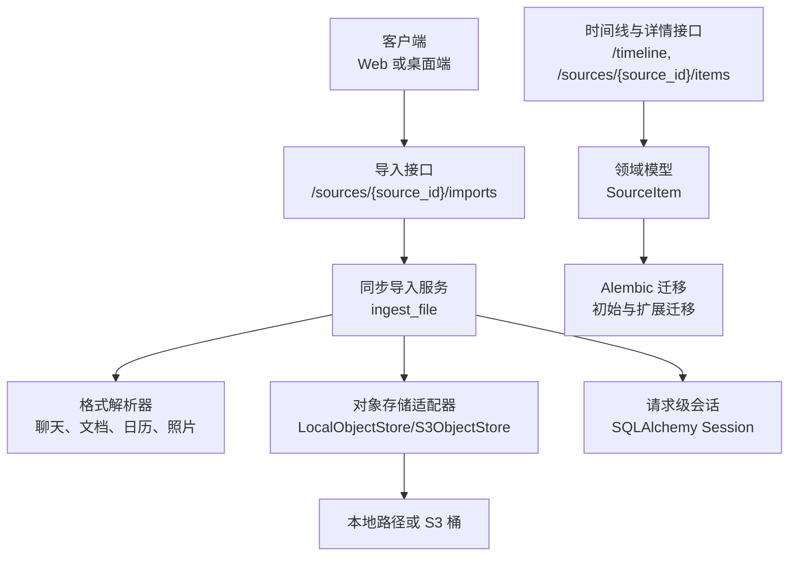
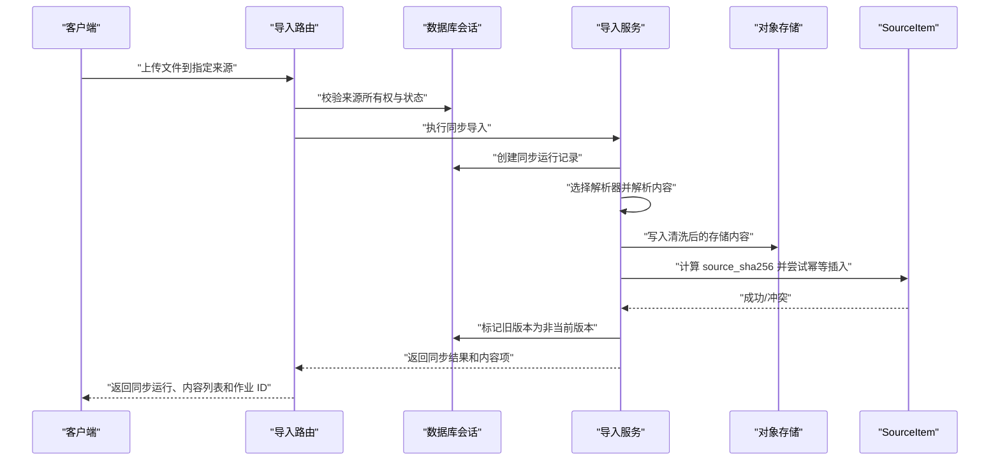
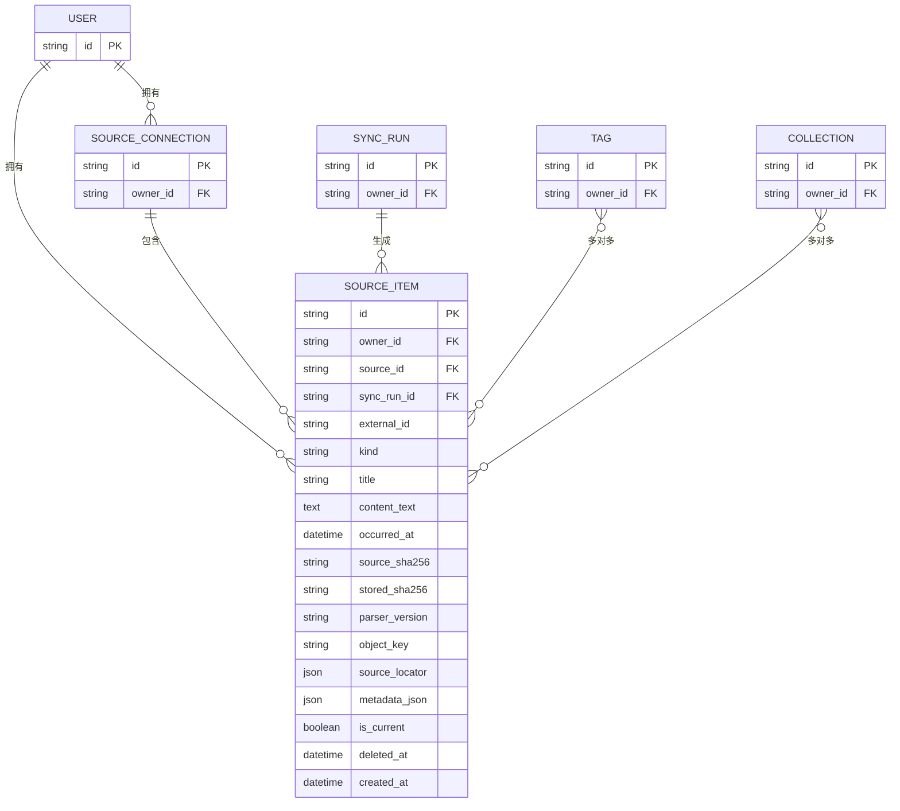
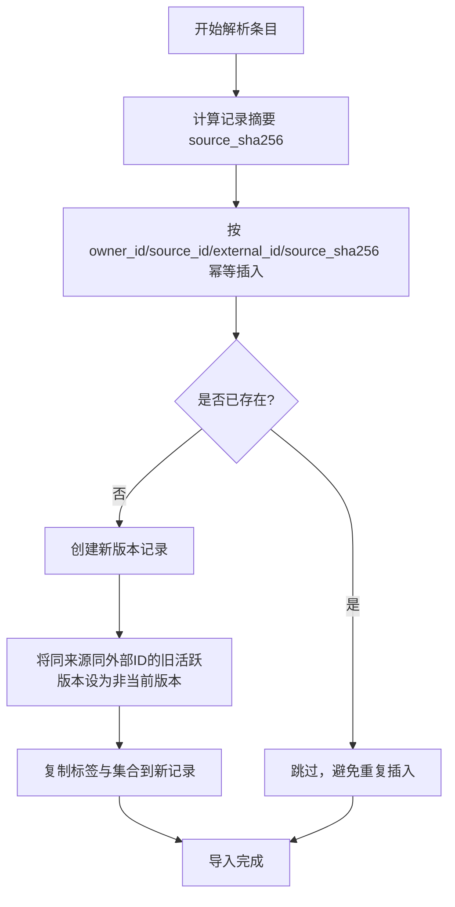
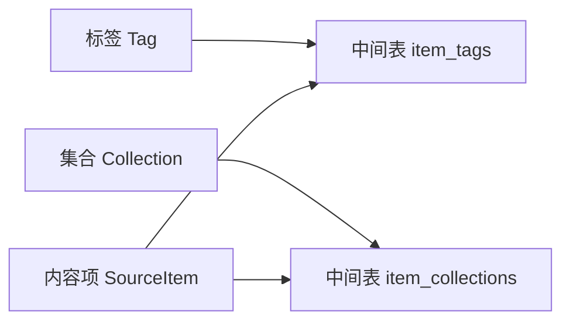
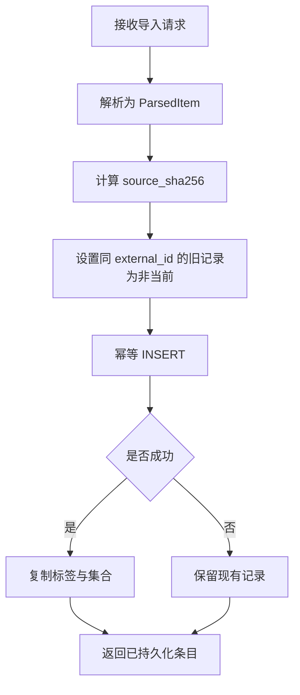
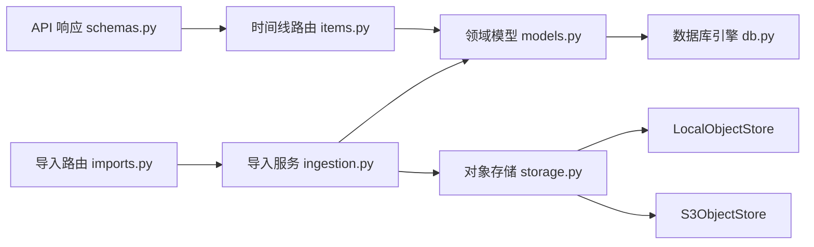

# 内容项实体 SourceItem

<cite>
**本文引用的文件**   
- [models.py](file://src/personal_ai_life_os/models.py)
- [ingestion.py](file://src/personal_ai_life_os/services/ingestion.py)
- [imports.py](file://src/personal_ai_life_os/api/routes/imports.py)
- [items.py](file://src/personal_ai_life_os/api/routes/items.py)
- [schemas.py](file://src/personal_ai_life_os/api/schemas.py)
- [storage.py](file://src/personal_ai_life_os/storage.py)
- [db.py](file://src/personal_ai_life_os/db.py)
</cite>

## 目录

1. [引言](#引言)
2. [项目结构定位](#项目结构定位)
3. [核心实体定义](#核心实体定义)
4. [架构总览](#架构总览)
5. [详细组件分析](#详细组件分析)
6. [依赖关系分析](#依赖关系分析)
7. [性能与存储特性](#性能与存储特性)
8. [故障排查指南](#故障排查指南)
9. [结论](#结论)

## 引言

`SourceItem` 是 Personal AI Life OS 的统一内容项实体。它不关注消息、文档、照片或日程等不同来源的语法差异，而是把各类来源都抽象为“由谁拥有、属于哪个数据源、代表外部世界的哪一个原始对象”的标准记录。这个设计使标签系统、集合分组、时间线查询、内容更新历史、对象存储关联和下游知识图谱等能力都可以在同一个数据模型上工作。

需要特别说明：本仓库中未使用名为 `content_type` 的列名来表示媒体类型，也没有名为 `content_size_bytes` 或 `source_updated_at` 的字段。相关语义通过 `kind`、`metadata_json.content_type`、`stored_sha256/object_key`、`source_sha256` 以及 `created_at` 等字段共同表达。

## 项目结构定位

`SourceItem` 位于后端领域模型层，由导入 API 调用注入服务写入数据库，并由对象存储适配器和迁移脚本提供持久化基础。



**图示来源**
- [imports.py:10-127](file://src/personal_ai_life_os/api/routes/imports.py#L10-L127)
- [ingestion.py:347-500](file://src/personal_ai_life_os/services/ingestion.py#L347-L500)
- [models.py:207-260](file://src/personal_ai_life_os/models.py#L207-L260)
- [storage.py:1-90](file://src/personal_ai_life_os/storage.py#L1-L90)

**章节来源**
- [imports.py:1-134](file://src/personal_ai_life_os/api/routes/imports.py#L1-L134)
- [models.py:207-260](file://src/personal_ai_life_os/models.py#L207-L260)
- [storage.py:1-90](file://src/personal_ai_life_os/storage.py#L1-L90)

## 核心实体定义

`SourceItem` 的核心职责是统一多源内容记录，并作为标签、集合、记忆、提醒、审查等上层能力的关联中心。

| 字段 | 类型 | 含义与作用 |
|---|---|---|
| `id` | UUID 字符串主键 | 内容项的内部唯一标识，默认自动生成 |
| `owner_id` | UUID 外键，索引 | 租户隔离；同一来源下的内容按用户区分，防止不同用户之间互相可见 |
| `source_id` | UUID 外键，索引 | 来源连接；表示这条内容来自某个聊天导出、文件夹、相册、日历等具体数据源 |
| `sync_run_id` | UUID 外键，索引 | 绑定到某次同步运行，便于追溯导入批次 |
| `external_id` | 最长 512 的文本 | 来源侧提供的稳定标识，是去重逻辑的关键维度之一 |
| `kind` | 字符串，索引 | 内部统一的内容类别，例如聊天、文档、照片、日历等 |
| `title` | 最长 500 的文本 | 人类可读标题，会被截断保存 |
| `content_text` | 可空长文本 | 标准化后的正文摘要或关键文本片段 |
| `occurred_at` | UTC 时间戳，索引 | 原始业务事件发生时间，可为空 |
| `source_timezone` | 最多 80 字符 | 记录来源使用的时区名称 |
| `source_sha256` | 64 字符哈希，索引 | 当前版本在入库时的内容摘要，用于幂等去重 |
| `stored_sha256` | 64 字符哈希 | 实际存入对象存储的字节内容摘要 |
| `parser_version` | 字符串 | 解析该内容的解析器版本号 |
| `object_key` | 最长 600 字符 | 私有对象存储中的对象键，不直接暴露给前端 |
| `source_locator` | JSON | 来源定位信息，例如桌面文件路径、聊天记录来源上下文 |
| `metadata_json` | JSON | 扩展元数据，包括内容类型、内容完整性摘要、快照编号等 |
| `is_current` | 布尔值，索引 | 标记是否为最新版本；历史版本保留但不再活跃 |
| `deleted_at` | UTC 时间戳 | 软删除时间 |
| `created_at` | UTC 时间戳 | 数据库记录创建时间 |

### 统一内容项抽象

| 维度 | 设计说明 |
|---|---|
| 租户隔离 | 所有查询都以 `owner_id` 为起点，确保用户无法跨账号访问内容 |
| 来源归属 | `source_id` 明确一条记录来自哪个已授权来源 |
| 外部世界映射 | `external_id` 是对来源侧对象的引用；相同来源下，相同外部对象会形成版本历史而不是重复记录 |
| 时间建模 | `occurred_at` 表示原始事件或内容产生时间，`created_at` 表示数据库落盘时间 |
| 内容分类 | `kind` 表达结构化类型，`metadata_json.content_type` 补充更细粒度的媒体类型 |
| 版本演进 | `is_current` + `deleted_at` 控制最新与历史版本；旧版本不会自动物理删除，以便审计和恢复 |

需要注意：仓库中没有 `source_updated_at` 字段，因此“原始内容更新时间”通常不能从 `SourceItem.source_updated_at` 读取。应根据具体来源的语义从 `occurred_at`、`metadata_json`、同步运行批次或上游源表字段获得；如果需要精确反映某份外部文件的最后修改时间，应在导入阶段写入 `occurred_at` 或 `metadata_json` 中的对应位置。

**章节来源**
- [models.py:207-260](file://src/personal_ai_life_os/models.py#L207-L260)
- [items.py:60-170](file://src/personal_ai_life_os/api/routes/items.py#L60-L170)

## 架构总览

`SourceItem` 的导入链路遵循“限制上传体积 → 校验来源权限 → 解析 → 写入对象存储 → 计算并插入版本记录”的顺序。



**图示来源**
- [imports.py:23-127](file://src/personal_ai_life_os/api/routes/imports.py#L23-L127)
- [ingestion.py:347-500](file://src/personal_ai_life_os/services/ingestion.py#L347-L500)
- [storage.py:38-90](file://src/personal_ai_life_os/storage.py#L38-L90)

## 详细组件分析

### `SourceItem` 实体关系图



**图示来源**
- [models.py:90-118](file://src/personal_ai_life_os/models.py#L90-L118)
- [models.py:207-260](file://src/personal_ai_life_os/models.py#L207-L260)

### 主键、租户隔离与来源关联

`SourceItem.id` 是主键；真正决定是否重复的约束不是 `external_id`，而是：

```text
唯一约束(owner_id, source_id, external_id, source_sha256)
```

这意味着：

- `owner_id` 实现租户隔离：同一 `external_id` 在不同用户下可以存在。
- `source_id` 限制重复范围：只有同一个数据源才认为 `external_id` 具有可比性。
- `external_id` 表示来源侧对象身份。
- `source_sha256` 表示该版本的内容摘要；如果相同来源下的相同外部对象产生了新版本内容，摘要不同就能以新行记录。

这比“仅凭 `external_id` 去重”更稳健：它允许对同一条外部内容进行增量更新，同时避免完整复制。

**章节来源**
- [models.py:207-223](file://src/personal_ai_life_os/models.py#L207-L223)

### 去重机制与 `source_sha256` 内容完整性校验

导入流程中使用 `_record_hash` 计算基于外部 ID、类型、标题、正文、发生时间、来源位置和元数据的组合摘要，然后将其写入 `source_sha256`。插入时根据数据库方言使用 `INSERT ... ON CONFLICT DO NOTHING`，即幂等写入。



**图示来源**
- [ingestion.py:204-240](file://src/personal_ai_life_os/services/ingestion.py#L204-L240)
- [ingestion.py:420-495](file://src/personal_ai_life_os/services/ingestion.py#L420-L495)
- [models.py:207-223](file://src/personal_ai_life_os/models.py#L207-L223)

需要注意的是，虽然模型中使用了 `source_sha256`，而迁移定义中也使用了同名字段，但在部分代码注释或早期模型描述中曾被误称为 `checksum`。应以代码为准：校验字段是 `source_sha256`。

### 双时间戳：`created_at` 与“原始内容更新时间”

`SourceItem.created_at` 始终表示数据库创建时间。仓库中不存在 `source_updated_at` 字段，因此不要把两者混为一谈。

| 时间意义 | 推荐字段 | 注意事项 |
|---|---|---|
| 数据库记录首次创建时间 | `created_at` | 每次新增版本都会更新 |
| 来源侧的业务时间 | `occurred_at` | 可能为空，且表示业务事件时间而非入库时间 |
| 同步批次的处理时间 | `SyncRun.created_at` | 适合判断最近一次同步发生的时间 |
| 存储内容字节指纹 | `stored_sha256` + `object_key` | 可证明底层二进制是否一致 |
| 应用层内容摘要指纹 | `source_sha256` | 用于去重 |
| 前端可读的最终更新时间 | 无专用字段 | 通常需要结合 `created_at`、`metadata_json`、父级集合/来源更新时间推断 |

如果业务需要严格追踪“原始内容更新时间”，建议在导入时将上游文件或外部资源的最后修改时间写入 `occurred_at` 或 `metadata_json.file_last_modified`，而不是假设存在 `source_updated_at`。

**章节来源**
- [models.py:226-244](file://src/personal_ai_life_os/models.py#L226-L244)
- [models.py:120-157](file://src/personal_ai_life_os/models.py#L120-L157)
- [ingestion.py:347-405](file://src/personal_ai_life_os/services/ingestion.py#L347-L405)

### 内容类型与 `metadata_json.content_type`

`SourceItem.kind` 表示内容的主要分类，例如聊天记录、文档、日历事件、照片等。媒体类型的更详细信息存储在 `metadata_json.content_type` 中，这是对象存储写入时带入的实际 `Content-Type`。

| 场景 | 使用字段 |
|---|---|
| 过滤聊天类内容 | `kind = "chat_export"` 或 `kind = "memory_markdown"` |
| 获取浏览器可识别的 MIME 类型 | `metadata_json.content_type` |
| 判断是否为图片 | `kind == "photo"`，并结合 `metadata_json.media_type` |
| 判断文档类型 | `kind == "document"`，再结合文件名或 `metadata_json` |
| 展示日历 | `kind == "calendar_ics"` |

注意：不要假定每个 `SourceItem` 都带有有效的 `content_path`，因为实际存储路径保存在 `object_key` 中，而存储适配器会对键做安全校验和安全前缀封装。客户端不应直接拼接任意路径来读取文件。

**章节来源**
- [ingestion.py:368-418](file://src/personal_ai_life_os/services/ingestion.py#L368-L418)
- [storage.py:13-36](file://src/personal_ai_life_os/storage.py#L13-L36)

### 标签与集合的多对多关系

`SourceItem` 通过两张关联表分别关联 `tags` 和 `collections`：

| 关联 | 中间表 | 主要索引 |
|---|---|---|
| 标签 | `item_tags` | `(tag_id, item_id)` |
| 集合 | `item_collections` | `(collection_id, item_id)` |

这种设计带来以下特性：

- 一个内容项可以属于多个标签和多个集合。
- 一个标签或集合可以被多个内容项引用。
- 删除中间表记录时，`ondelete="CASCADE"` 保证外键一致性。
- 当内容项因版本更新而产生新 `SourceItem` 时，标签和集合会在代码层复制到新记录，从而让查询保持一致性。



**图示来源**
- [models.py:71-94](file://src/personal_ai_life_os/models.py#L71-L94)
- [models.py:246-260](file://src/personal_ai_life_os/models.py#L246-L260)

**章节来源**
- [models.py:62-94](file://src/personal_ai_life_os/models.py#L62-L94)
- [models.py:241-260](file://src/personal_ai_life_os/models.py#L241-L260)
- [ingestion.py:242-250](file://src/personal_ai_life_os/services/ingestion.py#L242-L250)

### 幂等导入流程最佳实践

幂等性在本项目中不是只靠外部 ID，也不是只靠哈希，而是组合实现：

1. 客户端重复上传同一来源、同一内容不会破坏数据。
2. 应用层先检查是否有相同来源、相同外部 ID 的当前版本。
3. 如果现有版本的 `source_sha256` 与当前内容摘要不同，则把旧版本 `is_current` 置为 `False`。
4. 新记录以 `(owner_id, source_id, external_id, source_sha256)` 作为唯一键插入。
5. 如果是重复记录，数据库层拒绝插入。
6. 标签和集合从旧活跃版本复制到新版本。

对于日历导入，系统还会基于 ICS 序列号、取消状态和去重摘要进行特殊处理，避免重复或过期日程污染数据。



**图示来源**
- [ingestion.py:405-495](file://src/personal_ai_life_os/services/ingestion.py#L405-L495)
- [ingestion.py:204-240](file://src/personal_ai_life_os/services/ingestion.py#L204-L240)

### 内容更新建议

由于 `SourceItem` 采用不可变版本模式，不建议直接 `UPDATE` 已有记录的正文。推荐做法：

- 不要手动修改 `is_current` 以外的历史版本，以免破坏版本链。
- 新内容应重新解析、重新上传，由导入服务生成新的 `SourceItem`。
- 保持 `external_id` 与来源侧稳定身份一致。
- 如果内容确实不变，重复导入应被 `source_sha256` 去重。
- 如果来源侧删除了某条记录，日历导入会自动把旧条目设为非当前；其他来源可根据上游变更显式标记或删除，但需注意系统中还涉及软删除、派生数据和证据可用性标志。

**章节来源**
- [ingestion.py:405-495](file://src/personal_ai_life_os/services/ingestion.py#L405-L495)
- [ingestion.py:242-250](file://src/personal_ai_life_os/services/ingestion.py#L242-L250)

### 按标签和集合的组织模式

推荐组织策略：

- 使用标签对内容进行分类、优先级、主题、项目来源等轻量归类。
- 使用集合对内容做有名称、可描述、带维护时间的主题归档。
- 导入完成后不要遍历中间表去重建标签关系；应按业务操作（搜索、编辑 UI）在事务中增删目标 `SourceItem` 的关联。
- 版本更新后需要验证新记录已继承原标签和集合，或通过导入流水线自动补齐。

查询时建议优先走模型的 `SourceItem.tags` 和 `SourceItem.collections` 关系，或使用中间表索引 `(tag_id, item_id)` / `(collection_id, item_id)` 反向查找。

**章节来源**
- [models.py:62-94](file://src/personal_ai_life_os/models.py#L62-L94)
- [models.py:246-260](file://src/personal_ai_life_os/models.py#L246-L260)

### 大文件处理策略

导入接口对用户上传大小做了限制：

- 照片来源受 `max_photo_upload_bytes` 限制。
- 文本及一般文件来源受 `max_text_upload_bytes` 限制。
- 超出限制返回 413 错误。
- 大型内容仍可通过异步任务、批量工具或后台导入入口处理，而不是在普通 HTTP 导入接口中无限加载。

对象存储层将存储内容与 `SourceItem.object_key` 解耦。键本身不包含敏感用户 ID，但前缀结构按 `owners/<uuid>/sources/<uuid>/<hash>/source.bin` 构建，并对 key 做安全检查。

**章节来源**
- [imports.py:23-62](file://src/personal_ai_life_os/api/routes/imports.py#L23-L62)
- [storage.py:38-90](file://src/personal_ai_life_os/storage.py#L38-L90)
- [ingestion.py:368-418](file://src/personal_ai_life_os/services/ingestion.py#L368-L418)

### 数据迁移注意事项

初始迁移定义了 `source_items` 的主键、外键、唯一约束、索引和中间表结构。后续迁移可能增加业务表或扩展上下文，但 `SourceItem` 的基线语义应保持向后兼容。

迁移相关要点：

- 新增字段时必须允许旧客户端继续写入默认值，或提供双向回滚逻辑。
- 新增联合唯一键时需评估历史数据冲突。
- 中间表 `item_tags`、`item_collections` 已对外键配置级联删除，扩缩容时应避免在未关闭外键或忽略异常的情况下手工写中间表。
- 不要仅用 `external_id` 做去重测试；真实约束是四元组 `(owner_id, source_id, external_id, source_sha256)`。
- 如需恢复旧对象存储内容，应通过对象存储适配器接口读取 `object_key`，而不是直接拼接 URL。

**章节来源**
- [migrations/versions/0de3d72c2e1f_initial_tenant_scoped_schema.py:137-189](file://migrations/versions/0de3d72c2e1f_initial_tenant_scoped_schema.py#L137-L189)

## 依赖关系分析



**图示来源**
- [imports.py:10-127](file://src/personal_ai_life_os/api/routes/imports.py#L10-L127)
- [items.py:10-170](file://src/personal_ai_life_os/api/routes/items.py#L10-L170)
- [ingestion.py:347-500](file://src/personal_ai_life_os/services/ingestion.py#L347-L500)
- [schemas.py:161-174](file://src/personal_ai_life_os/api/schemas.py#L161-L174)
- [db.py:9-75](file://src/personal_ai_life_os/db.py#L9-L75)

### 组件耦合度

- `ingestion.py` 是 `SourceItem` 最重要的写入点，耦合度高但职责清晰：解析、校验、持久化、对象存储关联。
- `models.py` 声明实体关系，是多个模块共享的唯一权威数据定义。
- `imports.py` 只做 API 输入边界校验和结果转换，不持有复杂领域逻辑。
- `items.py` 负责时间线和来源下内容查询，强调过滤条件、分页游标和所有者隔离。
- `storage.py` 与数据库完全解耦，仅通过 `object_key` 通信。

潜在改进方向：

- 如果未来有更多来源导入方式，可在 `ingestion.py` 内继续扩展解析器分支，但应避免引入循环导入。
- 如果查询复杂度持续增长，可将高频过滤器提取到专门的仓储或服务方法中。

**章节来源**
- [imports.py:1-134](file://src/personal_ai_life_os/api/routes/imports.py#L1-L134)
- [items.py:1-170](file://src/personal_ai_life_os/api/routes/items.py#L1-L170)
- [ingestion.py:1-200](file://src/personal_ai_life_os/services/ingestion.py#L1-L200)
- [models.py:207-260](file://src/personal_ai_life_os/models.py#L207-L260)

## 性能与存储特性

| 方面 | 现状与建议 |
|---|---|
| 去重性能 | 利用唯一索引 `(owner_id, source_id, external_id, source_sha256)`，避免全表重复检测 |
| 时间查询 | `owner_id` + `occurred_at` 复合索引有助于按用户和时间段分页 |
| 来源查询 | `owner_id` + `source_id` 支持来源维度的快速筛选 |
| 类型筛选 | `kind` 单列索引适合粗粒度过滤；媒体类型在 JSON 中需配合全文或搜索索引 |
| 摘要计算 | 每条记录计算一次 `source_sha256`；对象存储写入前计算 `stored_sha256` |
| 大文件风险 | 使用配置上限避免单次请求占用过多内存 |
| 并发导入 | 日历导入中对来源加锁，减少并发竞态；其他来源依赖数据库唯一约束兜底 |
| 时间字段统一 | 通过 `UTCDateTime` 类型装饰器强制存储 UTC，SQLite 也保留时区语义 |
| 对象键安全 | 禁止绝对路径、非法字符和逃逸根路径，降低路径穿越风险 |

### 存储与时间精度

`UTCDateTime` 在绑定参数和结果读取时对没有时区信息的时间补 UTC，并在读取时转换为 UTC。这对跨 SQLite、PostgreSQL 环境很重要，能够降低前后端时间解析歧义。

对象存储写入时使用临时文件原子替换，避免半写对象；S3 实现启用服务器端 AES256 加密。这些特性直接影响内容完整性与数据安全。

**章节来源**
- [db.py:17-39](file://src/personal_ai_life_os/db.py#L17-L39)
- [storage.py:38-90](file://src/personal_ai_life_os/storage.py#L38-L90)
- [models.py:207-223](file://src/personal_ai_life_os/models.py#L207-L223)

## 故障排查指南

| 问题现象 | 可能原因 | 排查步骤 |
|---|---|---|
| 重复导入产生多条内容 | `external_id` 相同但 `source_sha256` 不同；属于预期版本更新 | 比较两条记录的 `source_sha256` 和 `metadata_json.content_digest` |
| 重复导入无变化 | 触发唯一键冲突或内容摘要相同 | 检查导入次数和同步运行统计字段 |
| 时间显示错乱 | 前端未正确处理 UTC 或来源 `source_timezone` | 核对 `occurred_at`、`source_timezone` 和客户端时区设置 |
| 找不到所属来源 | 传入的 `source_id` 不属于当前用户 | 检查 `owner_id` 与 `source_id` 权限校验 |
| 上传过大 | 文件超过来源类型的最大上传字节数 | 检查 `max_photo_upload_bytes` 或 `max_text_upload_bytes` |
| 内容类型无法正确预览 | `metadata_json.content_type` 缺失或不匹配 | 检查导入来源是否覆盖默认 MIME 类型 |
| 标签或集合丢失 | 新内容项未继承旧版本关系 | 验证导入流程中的 `_copy_item_organization` 是否在版本替换时被调用 |
| 无法找到存储内容 | `object_key` 无效或被篡改 | 通过对象存储适配器读取，不要直接拼接路径 |
| 时间戳不一致 | SQLite 或 PG 读写行为差异 | 确认 `UTCDateTime` 已启用，并且输入输出均为带时区时间 |

**章节来源**
- [imports.py:23-104](file://src/personal_ai_life_os/api/routes/imports.py#L23-L104)
- [ingestion.py:204-250](file://src/personal_ai_life_os/services/ingestion.py#L204-L250)
- [storage.py:38-90](file://src/personal_ai_life_os/storage.py#L38-L90)

## 结论

`SourceItem` 是整个系统的核心数据枢纽。它以 UUID 主键、租户隔离和来源归一为基础，把多样内容抽象为统一的版本化记录。其去重机制依赖于 `owner_id`、`source_id`、`external_id` 与 `source_sha256` 的组合，而不仅仅是单一外部 ID。时间方面使用 `created_at` 跟踪入库时间，`occurred_at` 表示业务发生时间；系统没有 `source_updated_at`，因此“原始内容更新时间”应通过业务时间和元数据推断。

在实际使用中，应当：

- 保持 `external_id` 与来源侧稳定身份一致。
- 通过重新导入实现内容更新，而不是直接更新历史版本。
- 使用标签和集合对内容进行灵活组织和回溯。
- 遵守上传大小限制和对象存储安全规则。
- 在所有查询中保留 `owner_id` 过滤，确保租户隔离。
- 在迁移和备份时，同时考虑数据库记录、对象存储内容和中间表关系。