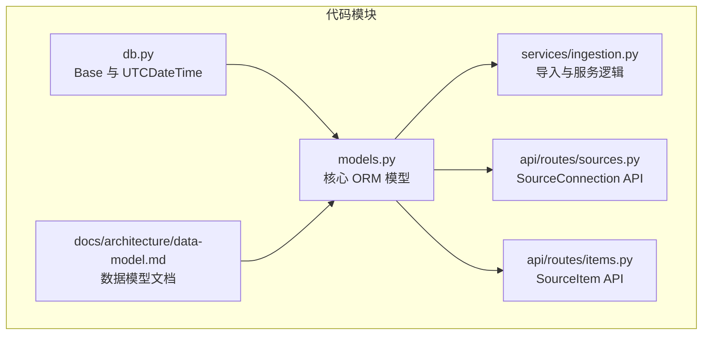
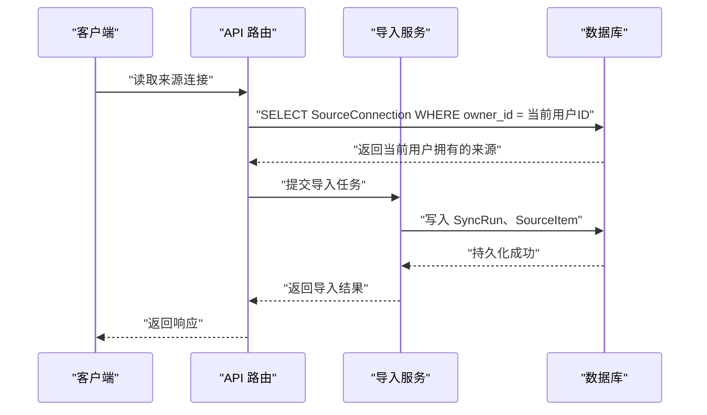
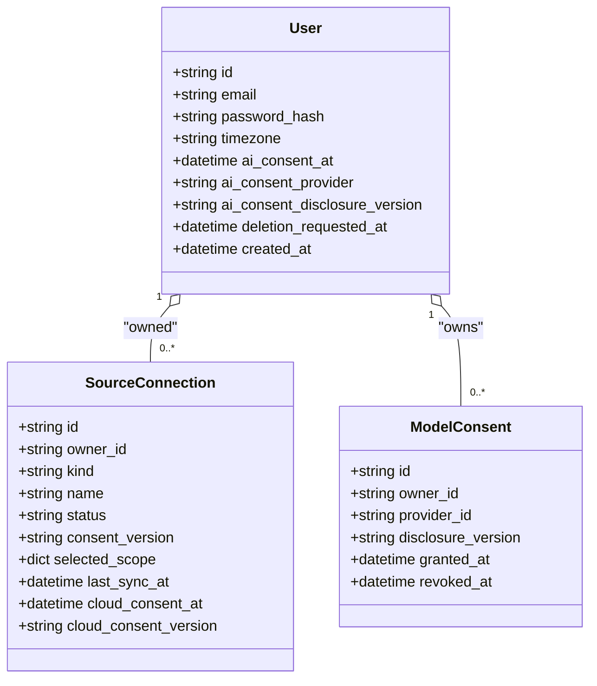
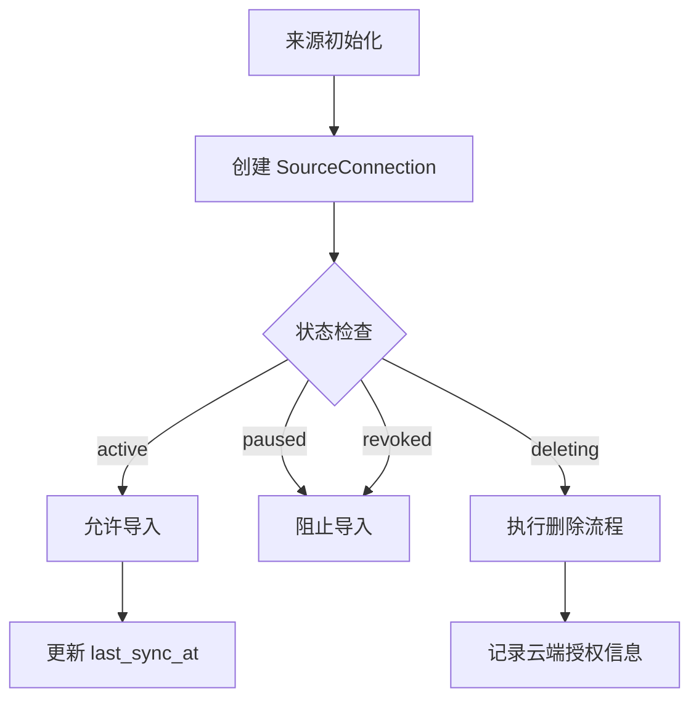
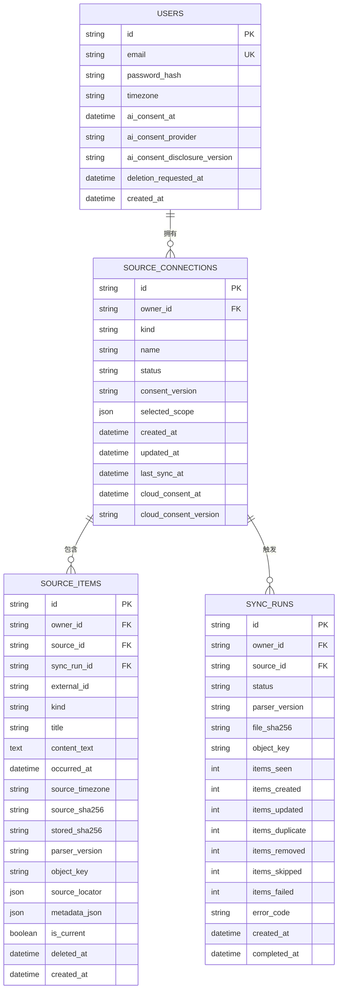
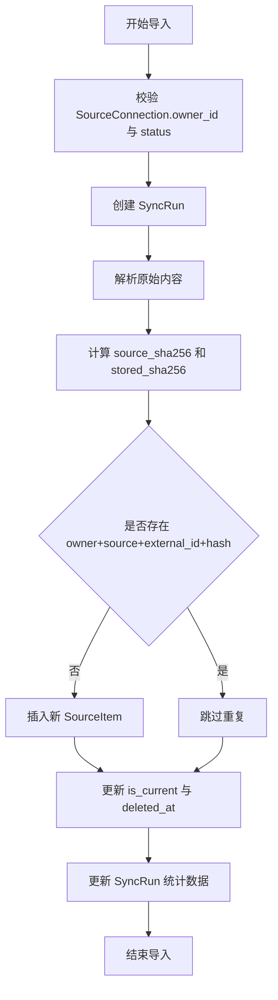

# 核心实体模型

<cite>
**本文引用的文件**   
- [models.py](file://src/personal_ai_life_os/models.py)
- [data-model.md](file://docs/architecture/data-model.md)
- [db.py](file://src/personal_ai_life_os/db.py)
- [ingestion.py](file://src/personal_ai_life_os/services/ingestion.py)
- [sources.py](file://src/personal_ai_life_os/api/routes/sources.py)
- [items.py](file://src/personal_ai_life_os/api/routes/items.py)
- [f4a9d7b36c21_add_source_cloud_consent.py](file://migrations/versions/f4a9d7b36c21_add_source_cloud_consent.py)
</cite>

## 目录
1. [引言](#引言)
2. [项目结构与建模范围](#项目结构与建模范围)
3. [核心实体总览](#核心实体总览)
4. [架构与租户隔离设计](#架构与租户隔离设计)
5. [User 模型详解](#user-模型详解)
6. [SourceConnection 模型详解](#sourceconnection-模型详解)
7. [SourceItem 模型详解](#sourceitem-模型详解)
8. [主键选型：UUID 的理由与性能考虑](#主键选型uuid-的理由与性能考虑)
9. [实体关系图](#实体关系图)
10. [数据写入与时序一致性流程](#数据写入与时序一致性流程)
11. [CRUD 使用指南与示例查询](#crud-使用指南与示例查询)
12. [常见问题与排错](#常见问题与排错)
13. [结论](#结论)

## 引言

本项目是一个面向个人知识、会话记忆、日程、提醒和证据图的 AI 生活操作系统。数据库层通过 SQLAlchemy ORM 管理用户可拥有的资源，所有用户相关表均以 `owner_id` 作为租户隔离边界，API 在处理请求时再次校验当前认证用户的归属关系。

本文件聚焦三个基石实体：

- **User**：账户身份、时区、AI 授权状态与删除状态。
- **SourceConnection**：外部数据源连接，包括连接器类型、生命周期状态和云端授权追踪。
- **SourceItem**：统一的数据条目模型，支持去重、版本化、时间戳归一化和内容与摘要分离存储。

理解这三个实体后，用户可以正确配置数据来源、安全导入内容、避免重复记录，并基于 owner_id 进行安全的多租户式数据访问。

## 项目结构与建模范围

本次文档围绕后端数据层的核心文件进行分析：

- `src/personal_ai_life_os/models.py`：定义 User、SourceConnection、SourceItem 等核心 SQLAlchemy 模型。
- `docs/architecture/data-model.md`：数据模型说明文档，强调 `owner_id` 租户隔离、时间戳处理和 SourceItem 版本约束。
- `src/personal_ai_life_os/db.py`：定义数据库基类 Base 和 UTC 时间字段 UTCDateTime。
- `src/personal_ai_life_os/services/ingestion.py`：实现 SourceItem 的去重写入、SHA256 校验、版本控制、同步统计及删除策略。
- `src/personal_ai_life_os/api/routes/sources.py`：SourceConnection 的 API 路由和权限校验逻辑。
- `src/personal_ai_life_os/api/routes/items.py`：SourceItem 查询时过滤已删除条目、处理图片描述等内容流。
- `migrations/versions/f4a9d7b36c21_add_source_cloud_consent.py`：为 SourceConnection 增加云端同意时间与版本字段。



**图示来源**
- [models.py:1-22](file://src/personal_ai_life_os/models.py#L1-L22)
- [db.py:15-28](file://src/personal_ai_life_os/db.py#L15-L28)
- [ingestion.py:17-25](file://src/personal_ai_life_os/services/ingestion.py#L17-L25)
- [sources.py:23-24](file://src/personal_ai_life_os/api/routes/sources.py#L23-L24)
- [items.py:91](file://src/personal_ai_life_os/api/routes/items.py#L91)
- [data-model.md:1-20](file://docs/architecture/data-model.md#L1-L20)

**章节来源**
- [models.py:1-22](file://src/personal_ai_life_os/models.py#L1-L22)
- [data-model.md:1-20](file://docs/architecture/data-model.md#L1-L20)

## 核心实体总览

| 实体 | 主要职责 | 关键字段 | 关联 |
| --- | --- | --- | --- |
| User | 账户认证、身份隔离边界、AI 授权状态、删除状态 | id、email、password_hash、timezone、ai_consent_at、deletion_requested_at、created_at | sources、model_consents |
| SourceConnection | 外部数据源连接、连接器类型、状态与权限跟踪 | id、owner_id、kind、name、status、consent_version、cloud_consent_at、last_sync_at | owner、items、sync_runs |
| SourceItem | 统一数据项、版本快照、去重、内容引用与元数据 | id、owner_id、source_id、external_id、content_text、stored_sha256、is_current、deleted_at | source、memory_records、reviews、reminders、tags、collections |

从系统设计上看：

- User 是所有权起点；SourceConnection 表示“从哪个外部来源获取数据”；SourceItem 表示“已经解析并存储的内容条目”。
- 三者都通过 UUID 字符串主键绑定，并通过 SQLAlchemy 外键形成层级关系。
- SourceItem 并非简单文本字段，而是通过 external_id、source_sha256、stored_sha256、parser_version 等多维度完成幂等插入和增量更新。

**章节来源**
- [models.py:60-206](file://src/personal_ai_life_os/models.py#L60-L206)
- [models.py:207-258](file://src/personal_ai_life_os/models.py#L207-L258)
- [data-model.md:4-17](file://docs/architecture/data-model.md#L4-L17)

## 架构与租户隔离设计

项目采用以用户为中心的租户隔离模式。数据模型层并不强制每个业务表都必须包含 tenant_id，但通过 owner_id 将用户与资源绑定；API 层则通过依赖注入获取当前用户 ID，并在每次访问受保护资源时加入 `owner_id` 过滤条件。

关键点如下：

| 层级 | 行为 |
| --- | --- |
| 数据模型层 | 所有用户拥有型表设置 owner_id 外键；级联删除保证用户或来源被删除时下游数据清理。 |
| API 层 | `_source_or_404` 等辅助函数根据 owner_id 查询 SourceConnection；所有 SourceConnection 列表接口按当前用户过滤。 |
| 服务层 | ingestion 操作接收 owner_id 并写入 SourceItem，防止跨用户写入。 |



**图示来源**
- [sources.py:40-44](file://src/personal_ai_life_os/api/routes/sources.py#L40-L44)
- [ingestion.py:397-405](file://src/personal_ai_life_os/services/ingestion.py#L397-L405)

**章节来源**
- [data-model.md:1-5](file://docs/architecture/data-model.md#L1-L5)
- [sources.py:23-44](file://src/personal_ai_life_os/api/routes/sources.py#L23-L44)

## User 模型详解

### 角色与设计目标

User 是系统内的最终所有者。它既承担登录身份，也作为资源所有权边界。后续扩展的 ModelConsent 也以 owner_id 与 User 关联，表示用户对特定 AI 提供者的授权记录。

关键属性包括：

| 字段 | 含义 |
| --- | --- |
| id | 用户主键，使用 UUID 字符串生成器 new_id。 |
| email | 登录账号，唯一且带索引。 |
| password_hash | 安全密码哈希值。 |
| timezone | 用户日历时区，默认 UTC。 |
| ai_consent_at | AI 隐私披露同意时间戳。 |
| ai_consent_provider | 同意涉及的 AI 提供方。 |
| ai_consent_disclosure_version | 同意的披露协议版本。 |
| deletion_requested_at | 用户请求删除的时间标记，用于延迟清理。 |
| created_at | 创建时间。 |
| sources | 该用户拥有的 SourceConnection 集合。 |
| model_consents | 该用户对各模型提供方的授权记录。 |

### 时区配置

User.timezone 为用户本地日历日期的基础。虽然数据库中使用 UTC 时间，但在业务层可以通过该字段将日期、周期和提醒与用户所在区域对齐。例如，在 MemoryRecord、Reminder、Review 等业务模型中，通常会把只含日期的文本标题转换为带时区的日期区间。

### AI 授权状态

AI 授权不是简单的布尔开关，而是一组审计字段：

- ai_consent_at：同意时间。
- ai_consent_provider：对应提供者标识。
- ai_consent_disclosure_version：同意的内容版本。

这与 ModelConsent 表配合，使系统不仅能记录“是否允许”，还能记录“何时、对谁、依据哪个版本许可”。

### 删除标记

deletion_requested_at 表明账户进入“申请删除”状态。配合服务层的删除流程，系统可以：

1. 停止新数据同步。
2. 标记待删除对象。
3. 触发对象存储删除墓碑。
4. 清理派生数据和关联记录。
5. 最终移除用户实体。



**图示来源**
- [models.py:60-83](file://src/personal_ai_life_os/models.py#L60-L83)
- [models.py:85-110](file://src/personal_ai_life_os/models.py#L85-L110)
- [models.py:114-150](file://src/personal_ai_life_os/models.py#L114-L150)

**章节来源**
- [models.py:60-83](file://src/personal_ai_life_os/models.py#L60-L83)
- [models.py:85-110](file://src/personal_ai_life_os/models.py#L85-L110)
- [data-model.md:6-9](file://docs/architecture/data-model.md#L6-L9)

## SourceConnection 模型详解

### 连接器类型与用途

kind 字段标识来源类型，例如桌面文件夹、iCal 日历、聊天记录、文档、照片等。status 控制连接器生命周期。典型状态包括：

- active：激活，允许导入。
- paused：暂停，暂不导入。
- revoked：拒绝或撤销权限。
- deleting：正在删除。
- 其他扩展状态可由上层控制。

API 层在列出来源时排除 quick_note 内部来源和 deleting 状态来源，这体现了“展示给用户的来源连接”和“系统内部来源”的区别。

### 状态管理与权限字段

| 字段 | 用途 |
| --- | --- |
| owner_id | 所属用户，实现来源的租户隔离。 |
| kind | 连接器类型，决定使用的解析器和数据格式。 |
| name | 用户可读来源名称。 |
| status | 来源生命周期状态。 |
| consent_version | 本地选择范围时的同意版本。 |
| selected_scope | JSON 结构，记录用户允许的抓取范围或筛选条件。 |
| last_sync_at | 最后一次同步时间，供前端显示来源活跃度。 |
| cloud_consent_at / cloud_consent_version | 云端平台授权同意时间和版本，由迁移脚本新增。 |



**图示来源**
- [models.py:114-150](file://src/personal_ai_life_os/models.py#L114-L150)
- [ingestion.py:394-395](file://src/personal_ai_life_os/services/ingestion.py#L394-L395)
- [f4a9d7b36c21_add_source_cloud_consent.py:17-31](file://migrations/versions/f4a9d7b36c21_add_source_cloud_consent.py#L17-L31)

**章节来源**
- [models.py:114-150](file://src/personal_ai_life_os/models.py#L114-L150)
- [sources.py:40-91](file://src/personal_ai_life_os/api/routes/sources.py#L40-L91)
- [f4a9d7b36c21_add_source_cloud_consent.py:17-31](file://migrations/versions/f4a9d7b36c21_add_source_cloud_consent.py#L17-L31)

## SourceItem 模型详解

### 统一数据项结构

SourceItem 是将不同来源（邮件、聊天导出、文档、照片、日历）标准化后的核心对象。每条记录包含以下信息：

| 字段 | 含义 |
| --- | --- |
| id | 系统主键，UUID 字符串。 |
| owner_id | 所属用户。 |
| source_id | 来源连接 ID。 |
| sync_run_id | 导入任务 ID，便于追踪批处理。 |
| external_id | 外部系统给出的稳定标识。 |
| kind | 数据条目类型。 |
| title | 条目标题。 |
| content_text | 正文文本；大内容可通过 object_key 指向对象存储。 |
| occurred_at | 原始事件时间。 |
| source_timezone | 原始数据提供的时区。 |
| source_sha256 | 解析后内容指纹的衍生校验值。 |
| stored_sha256 | 实际存储对象的 SHA256。 |
| parser_version | 解析器版本，方便追溯解析逻辑变化。 |
| object_key | 对象存储键。 |
| source_locator | JSON 定位器，如文件名、路径或云端对象地址。 |
| metadata_json | 解析器附加元数据，例如 ICS 状态、序列号、内容 MIME 类型等。 |
| is_current | 是否当前版本。 |
| deleted_at | 软删除时间。 |
| created_at | 入库时间。 |

### external_id 去重机制

external_id 是外部来源提供的稳定 ID，用于区分现实世界中的同一对象，比如一条日历事件、一份聊天记录、一篇文章。仅用 external_id 不够，因为同一外部对象可能在不同时间或不同输入中多次出现，因此模型使用联合唯一约束：

```
owner_id, source_id, external_id, source_sha256
```

这意味着：

- 相同用户、相同来源、相同外部 ID、相同内容指纹 → 不插入重复项。
- 外部内容发生真实变化（导致 source_sha256 不同）→ 允许新版本插入。
- 不同来源的相同 external_id → 不视为重复，避免混淆不同系统的“同名对象”。

### source_sha256 与 stored_sha256

这两个 SHA256 字段职责不同：

- source_sha256：计算方式依赖具体来源；通用记录指纹来自 parsed.external_id、kind、title、content_text、occurred_at、source_locator、metadata 的统一序列化。它用于判断逻辑内容是否真的发生变化。
- stored_sha256：表示对象存储中真实内容的哈希，通常用于大文件或图像，避免数据库直接膨胀。

这种“双校验值”设计同时覆盖了轻量内容和重量内容：

| 内容类型 | 校验重点 |
| --- | --- |
| 小文本 | source_sha256 主导去重。 |
| 大对象 | stored_sha256 反映真实存储对象；object_key 承载对象地址。 |
| 变更场景 | parser_version 与 metadata_json 共同记录解析行为和语义快照。 |

### 时间戳处理策略

- occurred_at：尽量保留原始事件时间，可能是 null。
- source_timezone：记录源数据的时区，帮助用户还原本地日期。
- created_at：入库时间，统一使用 UTCDateTime。
- deleted_at：软删除标记，查询时需要显式排除。
- is_current：用于版本化旧条目。新条目的 is_current 为 true，旧条目被覆盖时置 false。

### 内容存储策略

SourceItem.content_text 适合中小文本；当需要存储大图或二进制内容时，系统更倾向于：

1. 将二进制内容写入对象存储。
2. 记录 object_key。
3. 记录 stored_sha256 做完整性校验。
4. 如果需要图片描述，可由后端调用 OCR 或模型服务生成后写入 metadata_json 或其他派生字段。
5. 查询时对非图片类型或不需要的字段减少传输。

**章节来源**
- [models.py:207-258](file://src/personal_ai_life_os/models.py#L207-L258)
- [ingestion.py:187-220](file://src/personal_ai_life_os/services/ingestion.py#L187-L220)
- [ingestion.py:233-362](file://src/personal_ai_life_os/services/ingestion.py#L233-L362)
- [items.py:325-351](file://src/personal_ai_life_os/api/routes/items.py#L325-L351)

## 主键选型：UUID 的理由与性能考虑

系统中的主键全部采用 UUID 字符串，并使用自定义 new_id 生成器。使用 `Uuid(as_uuid=False)` 而不是原生 uuid 类型，意味着数据库中以字符串形式存储 UUID。

### 为什么选择 UUID

| 原因 | 说明 |
| --- | --- |
| 全局唯一性 | 客户端或服务端可在写前生成主键，不需要强依赖数据库自增序列。 |
| 分布式友好 | 多个写入进程或边缘部署不会产生 ID 冲突。 |
| 安全性 | 相比自增整数，UUID 不易暴露数据规模顺序。 |
| 可移植性 | SQLite 和 PostgreSQL 均可按字符串可靠存储和索引。 |

### 性能权衡

| 优点 | 缺点 |
| --- | --- |
| 无中心序列瓶颈 | UUID 字符串比整数占更多存储空间。 |
| 可并行写入 | 随机 ID 可能导致聚簇索引局部写入。 |
| 适合云原生和微服务 | 查询成本略高于纯整数主键。 |

在本项目中，这些表属于中等规模的用户数据层，性能瓶颈通常不在主键比较，而在于：

- 全文搜索索引。
- SourceItem 大量关联表的维护。
- 导入过程中的批量去重和对象存储读写。
- 查询时按 owner_id 过滤的安全保障。

因此，UUID 的选择更符合云原生和分布式开发习惯，且系统通过在常见查询字段上建立索引来缓解随机主键的性能劣势。

**章节来源**
- [models.py:8-22](file://src/personal_ai_life_os/models.py#L8-L22)
- [models.py:60-206](file://src/personal_ai_life_os/models.py#L60-L206)

## 实体关系图



**图示来源**
- [models.py:60-206](file://src/personal_ai_life_os/models.py#L60-L206)
- [models.py:207-258](file://src/personal_ai_life_os/models.py#L207-L258)

## 数据写入与时序一致性流程

SourceItem 的写入由 ingestion 服务驱动，核心逻辑如下：

1. 验证来源连接属于当前用户且处于 active 状态。
2. 创建 SyncRun 并记录文件 hash。
3. 选择合适解析器，将原始字节转为结构化 ParsedItem。
4. 为条目构造 source_sha256 和 stored_sha256。
5. 通过外部 ID、来源、用户和内容指纹做幂等插入。
6. 更新 is_current、deleted_at 和同步统计计数。
7. 将不再存在的条目标记为软删除，并清理派生数据。



**图示来源**
- [ingestion.py:365-405](file://src/personal_ai_life_os/services/ingestion.py#L365-L405)
- [ingestion.py:187-220](file://src/personal_ai_life_os/services/ingestion.py#L187-L220)
- [ingestion.py:233-362](file://src/personal_ai_life_os/services/ingestion.py#L233-L362)

**章节来源**
- [ingestion.py:187-220](file://src/personal_ai_life_os/services/ingestion.py#L187-L220)
- [ingestion.py:233-362](file://src/personal_ai_life_os/services/ingestion.py#L233-L362)
- [ingestion.py:365-405](file://src/personal_ai_life_os/services/ingestion.py#L365-L405)

## CRUD 使用指南与示例查询

注意：以下查询以 SQL 思路描述，不要直接复制成生产语句；实际调用应优先使用 SQLAlchemy Session、API 路由或封装好的服务层函数。

### 用户基本操作

| 场景 | 推荐方式 |
| --- | --- |
| 创建用户 | 调用注册或账户创建 API，不要直接向 users 表插入未经验证数据。 |
| 查询用户 | 根据 email 获取用户，并结合 JWT 或鉴权上下文校验当前用户。 |
| 查看 AI 授权 | 查询 User.ai_consent_* 或 ModelConsent 表，结合 provider_id 判断是否允许使用某模型。 |
| 软删除账户 | 设置 deletion_requested_at，随后由删除服务逐步清理。 |

SQL 示例思路：

```sql
SELECT id, email, timezone, ai_consent_at, ai_consent_provider, ai_consent_disclosure_version, deletion_requested_at
FROM users
WHERE email = '当前用户邮箱';
```

### 来源连接操作

| 场景 | 推荐方式 |
| --- | --- |
| 列出来源 | API 已按当前用户和 exclude internal/deleting 条件返回。 |
| 新增来源 | 调用创建来源 API，传入 kind、name、selected_scope。 |
| 启用或暂停 | 更新 status 为 active 或 paused。 |
| 检查云端授权 | 读取 cloud_consent_at 和 cloud_consent_version。 |

SQL 示例思路：

```sql
SELECT id, kind, name, status, consent_version, selected_scope, last_sync_at, cloud_consent_at, cloud_consent_version
FROM source_connections
WHERE owner_id = '当前用户ID'
  AND kind != 'quick_note'
  AND status != 'deleting';
```

### SourceItem 查询与更新

| 场景 | 推荐方式 |
| --- | --- |
| 列出当前条目 | 过滤 owner_id、source_id、is_current=true、deleted_at IS NULL。 |
| 历史版本 | 按 external_id 分组，读取 is_current=false 的记录。 |
| 查找重复 | 使用 unique 组合 owner_id、source_id、external_id、source_sha256 判断是否幂等。 |
| 查看删除条目 | 读取 deleted_at 不为空的历史记录。 |

SQL 示例思路：

```sql
SELECT id, external_id, kind, title, occurred_at, source_timezone, is_current, deleted_at
FROM source_items
WHERE owner_id = '当前用户ID'
  AND source_id = '当前来源ID'
  AND is_current = true
  AND deleted_at IS NULL;
```

### 典型写入流程

建议通过 ingestion service 调用，而不是自行拼 insert 语句。若必须手动模拟，参考以下字段组合：

| 字段 | 赋值来源 |
| --- | --- |
| owner_id | 当前用户 ID。 |
| source_id | 已创建的 SourceConnection.id。 |
| sync_run_id | 刚创建的 SyncRun.id。 |
| external_id | 外部系统稳定 ID。 |
| kind | 解析器确定。 |
| title | 解析后标题。 |
| content_text | 解析后正文。 |
| occurred_at | 解析后的业务时间。 |
| source_timezone | 源数据时区。 |
| source_sha256 | 由解析后字段规范化计算。 |
| stored_sha256 | 对象存储内容哈希。 |
| parser_version | 使用的解析器版本号。 |
| object_key | 对象存储 key。 |
| source_locator | 来源定位器 JSON。 |
| metadata_json | 解析器元数据。 |
| is_current | 新条目设为 true。 |

**章节来源**
- [sources.py:84-91](file://src/personal_ai_life_os/api/routes/sources.py#L84-L91)
- [items.py:91](file://src/personal_ai_life_os/api/routes/items.py#L91)
- [ingestion.py:308-346](file://src/personal_ai_life_os/services/ingestion.py#L308-L346)

## 常见问题与排错

| 问题 | 可能原因 | 处理方法 |
| --- | --- | --- |
| 重新导入没有产生重复条目 | external_id + source_sha256 命中唯一约束，或内容指纹完全相同。 | 确认 external_id 是否正确映射到外部对象；确认内容确实发生变化。 |
| 旧版本条目无法被替代 | existing 未被设置 is_current=false 或 deleted_at，或解析器未走版本更新分支。 | 检查 ingestion 中 _persist_calendar_items 或同类持久化逻辑。 |
| 页面仍显示已删除内容 | 查询没有过滤 deleted_at。 | 在所有 SourceItem 查询中添加 `deleted_at IS NULL`。 |
| 来源不可用 | status 不是 active。 | 先恢复来源状态。 |
| 云端来源缺少授权 | cloud_consent_at 为空或 cloud_consent_version 不匹配。 | 补录云端授权字段，或重新完成云端授权流程。 |
| 导入失败但没有日志 | SyncRun.error_code 未填充。 | 在服务捕获异常时更新 error_code、status 和 completed_at。 |

**章节来源**
- [models.py:207-258](file://src/personal_ai_life_os/models.py#L207-L258)
- [ingestion.py:187-220](file://src/personal_ai_life_os/services/ingestion.py#L187-L220)
- [ingestion.py:348-362](file://src/personal_ai_life_os/services/ingestion.py#L348-L362)
- [f4a9d7b36c21_add_source_cloud_consent.py:17-31](file://migrations/versions/f4a9d7b36c21_add_source_cloud_consent.py#L17-L31)

## 结论

Personal-AI-Life-OS 的核心数据模型围绕 User、SourceConnection、SourceItem 构建，形成了一个清晰的所有权—来源—内容三级结构：

- User 提供身份和租户隔离边界。
- SourceConnection 负责管理外部来源的类型、范围、生命周期和云端授权。
- SourceItem 负责稳定标识、版本化、内容摘要、时间戳与对象存储解耦。

通过 owner_id、unique 约束、UTCDateTime、JSON 元数据和外键级联删除，系统在数据一致性、可追溯性和安全性之间取得了平衡。对于新增功能，建议遵循以下原则：

1. 所有用户数据都以 owner_id 隔离。
2. 外部稳定标识放入 external_id，而非将其混入业务 ID。
3. 内容指纹用 source_sha256，对象完整性用 stored_sha256。
4. 时间字段使用 UTCDateTime 并保留 source_timezone。
5. 任何可能变更的外部记录都应保留历史版本，而不是原地覆盖。
6. 查询必须显式过滤 deleted_at 和 is_current。

掌握这些规则后，开发者可以在系统中安全地接入多种数据源、避免重复数据，并为 AI 记忆、审查、搜索和对话提供高质量的基础事实。