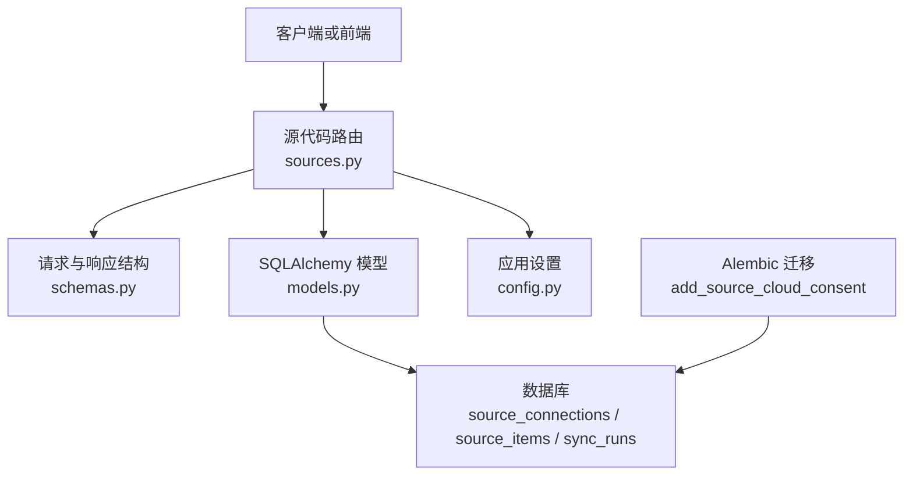
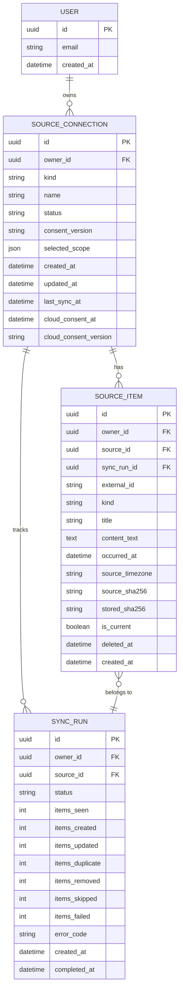
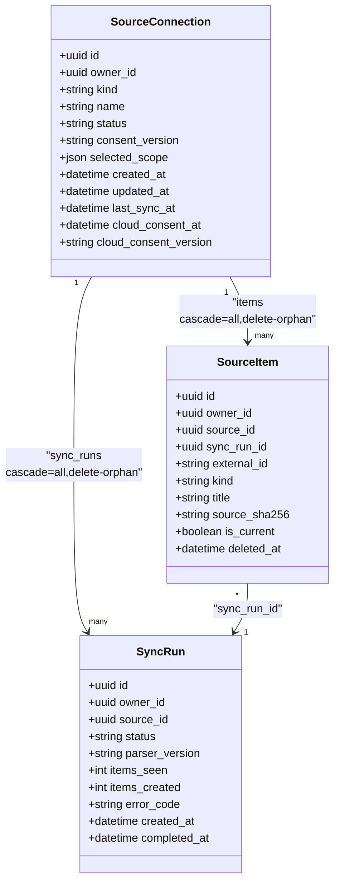
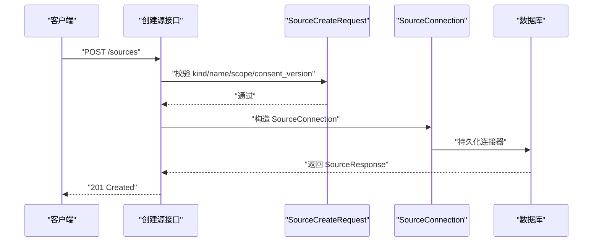
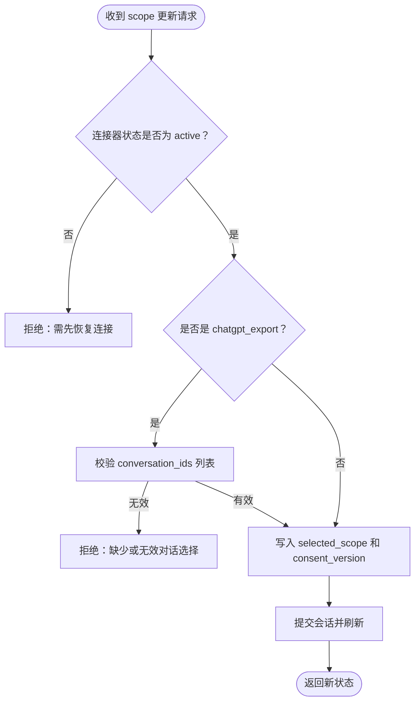
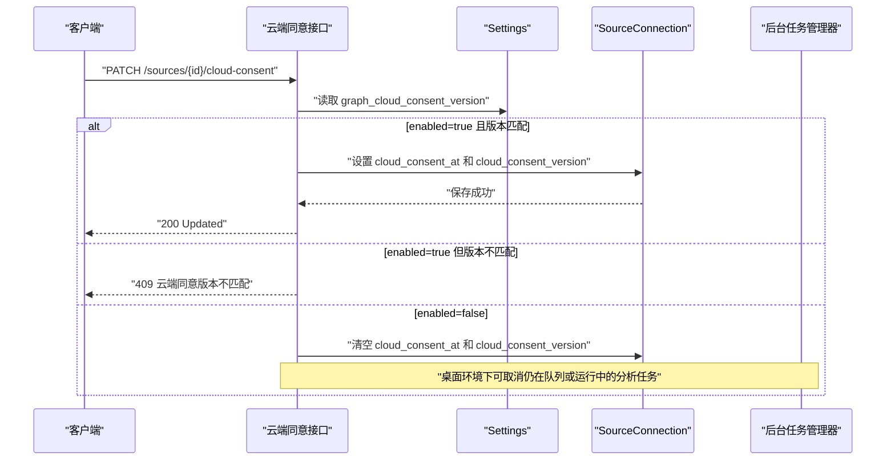
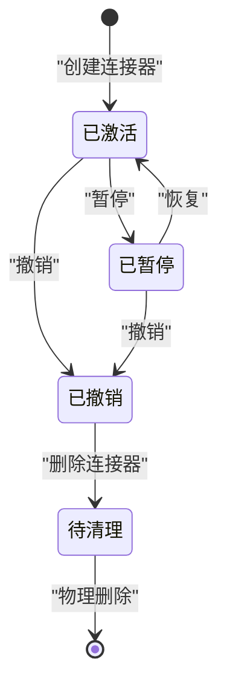
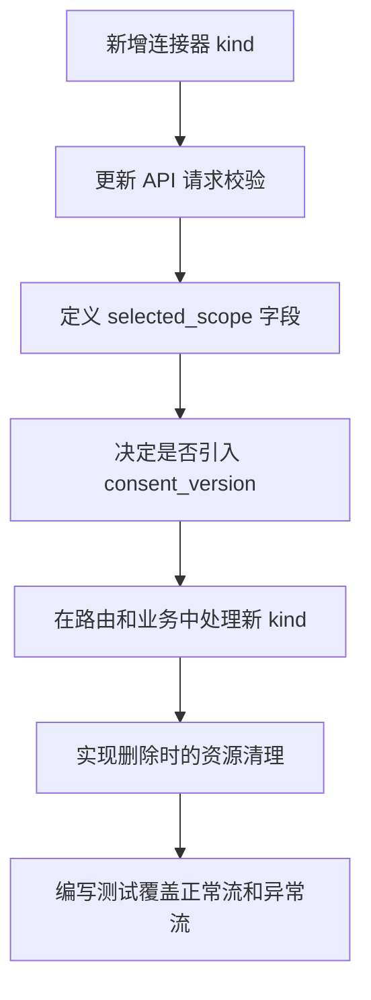

# 源连接实体 SourceConnection

<cite>
**本文引用的文件**   
- [models.py](file://src/personal_ai_life_os/models.py)
- [sources.py](file://src/personal_ai_life_os/api/routes/sources.py)
- [schemas.py](file://src/personal_ai_life_os/api/schemas.py)
- [config.py](file://src/personal_ai_life_os/config.py)
- [f4a9d7b36c21_add_source_cloud_consent.py](file://migrations/versions/f4a9d7b36c21_add_source_cloud_consent.py)
- [data-model.md](file://docs/architecture/data-model.md)
</cite>

## 目录
1. [介绍](#介绍)
2. [项目结构定位](#项目结构定位)
3. [核心字段与数据类型](#核心字段与数据类型)
4. [架构总览](#架构总览)
5. [关键关系设计](#关键关系设计)
6. [连接器管理 API 流程](#连接器管理-api-流程)
7. [同意版本与云端授权追踪](#同意版本与云端授权追踪)
8. [业务状态机](#业务状态机)
9. [扩展示例：新增一种连接器类型](#扩展示例新增一种连接器类型)
10. [按租户隔离的查询模式](#按租户隔离的查询模式)
11. [安全性考虑](#安全性考虑)
12. [性能与可扩展性](#性能与可扩展性)
13. [故障排查指南](#故障排查指南)
14. [结论](#结论)

## 介绍
SourceConnection 是个人知识库系统中用于表达“外部来源数据”的连接器实体。它负责记录某个数据源的标识、用户可见名称、启用状态、同意版本、差异化配置范围，以及是否已同意将某些处理逻辑升级到云端服务。与之配套的是每次导入的同步记录 SyncRun，以及解析后的数据条目 SourceItem。

该实体的核心价值在于：
- 以 owner_id 实现多租户或多账号隔离；
- 用 kind 区分不同数据来源；
- 用 selected_scope 存储不同连接器需要的差异化选择参数；
- 通过 consent_version 和 cloud_consent_at/cloud_consent_version 区分本地同意与云端服务同意；
- 通过 cascade="all, delete-orphan" 管理 SourceItem 与 SyncRun 的生命周期；
- 通过 API 提供启用、暂停、更改 scope、撤销、删除和云端同意切换等完整操作。

## 项目结构定位
SourceConnection 的实现横跨数据库模型、API 路由、请求响应结构和数据库迁移四个层面：
- 数据模型定义位于核心模型文件中；
- HTTP API 集中在 sources 路由中；
- 请求校验结构与响应结构集中在 schemas 中；
- 云端同意字段由独立的 Alembic 迁移添加；
- 配置项中包含云端同意版本号控制。

**图示来源**
- [sources.py:12-40](file://src/personal_ai_life_os/api/routes/sources.py#L12-L40)
- [models.py:120-149](file://src/personal_ai_life_os/models.py#L120-L149)
- [schemas.py:72-126](file://src/personal_ai_life_os/api/schemas.py#L72-L126)
- [config.py:64-120](file://src/personal_ai_life_os/config.py#L64-L120)
- [f4a9d7b36c21_add_source_cloud_consent.py:18-31](file://migrations/versions/f4a9d7b36c21_add_source_cloud_consent.py#L18-L31)

**章节来源**
- [models.py:120-149](file://src/personal_ai_life_os/models.py#L120-L149)
- [sources.py:12-40](file://src/personal_ai_life_os/api/routes/sources.py#L12-L40)
- [data-model.md:1-26](file://docs/architecture/data-model.md#L1-L26)

## 核心字段与数据类型
下面按职责分组说明 SourceConnection 的主要字段及其语义。

| 字段 | 类型 | 必填 | 默认值或约束 | 含义 |
|---|---|---:|---|---|
| id | UUID 字符串 | 是 | 自生成主键 | 连接器唯一标识，不可复用 |
| owner_id | UUID 字符串外键 | 是 | 引用 users.id | 归属用户或租户隔离边界 |
| kind | 文本 | 是 | 无默认值 | 连接器类型标识符，如日历、文档、照片、聊天导出等 |
| name | 文本 | 是 | 最大长度 240 | 用户自定义的名称，创建时会被去除首尾空白 |
| status | 文本 | 是 | active | 生命周期状态，支持 active、paused、revoked、deleting 等业务状态 |
| consent_version | 文本 | 是 | 无默认值 | 当前连接器的本地数据使用同意版本 |
| selected_scope | JSON 字典 | 否 | 空对象 | 连接器差异化配置参数，例如需要导入的对话 ID 列表 |
| created_at | UTC 时间戳 | 是 | 创建时刻 | 连接器创建时间 |
| updated_at | UTC 时间戳 | 是 | 创建或更新时刻 | 最近一次属性更新时间 |
| last_sync_at | UTC 时间戳 | 否 | null | 最近一次成功同步时间，由上游导入流程通常进行回填 |
| cloud_consent_at | UTC 时间戳 | 否 | null | 云端服务授权同意的授予或撤销时间 |
| cloud_consent_version | 文本 | 否 | null | 云端服务授权的同意版本标识 |

其中：
- `id`、`owner_id`、`kind` 共同描述连接器的基本身份；
- `status` 由 API 层控制转换；
- `consent_version` 用于跟踪本地数据同意版本；
- `selected_scope` 是扩展点，允许不同 connector 携带不同的配置结构；
- `cloud_consent_at` 和 `cloud_consent_version` 实现云端服务的同意审计和版本约束。

数据库层还维护了按 `owner_id` 与 `status` 组合的索引，用于优化按账户筛选连接器的常见查询。

**章节来源**
- [models.py:120-149](file://src/personal_ai_life_os/models.py#L120-L149)
- [f4a9d7b36c21_add_source_cloud_consent.py:18-31](file://migrations/versions/f4a9d7b36c21_add_source_cloud_consent.py#L18-L31)

## 架构总览
SourceConnection 处于“数据源元数据”这一层。它不直接存储原始内容，而是描述“从哪个外部来源、哪些范围、在什么状态下接入系统”。

**图示来源**
- [models.py:120-149](file://src/personal_ai_life_os/models.py#L120-L149)
- [models.py:150-247](file://src/personal_ai_life_os/models.py#L150-L247)

## 关键关系设计
### 一对多关系 SourceConnection → SourceItem
SourceConnection 与 SourceItem 是一对多关系，且声明了 `cascade="all, delete-orphan"`。其影响包括：
- 当删除 SourceConnection 时，会级联删除关联的所有 SourceItem；
- 如果一个 SourceItem 被移除但 SourceConnection 仍存在，ORM 也会视为孤儿并删除该条目；
- 这避免了残留的解析条目脱离连接器管理，确保“有源必有条”的可审计数据流。

### 一对多关系 SourceConnection → SyncRun
SyncRun 表示一次实际的导入或同步尝试，包含：
- 状态（processing、success、failed 等）；
- 解析器版本；
- 文件哈希、对象存储键；
- 各计数指标（看到条目数、新建、更新、重复、移除、跳过、失败）；
- 结构化错误码；
- 时间与完成时间。

这种设计让“连接器本身是什么”与“某次同步结果如何”解耦。

**图示来源**
- [models.py:120-149](file://src/personal_ai_life_os/models.py#L120-L149)
- [models.py:150-247](file://src/personal_ai_life_os/models.py#L150-L247)

**章节来源**
- [models.py:120-247](file://src/personal_ai_life_os/models.py#L120-L247)
- [data-model.md:1-26](file://docs/architecture/data-model.md#L1-L26)

## 连接器管理 API 流程

### 创建连接器
- 请求体使用 `SourceCreateRequest`，限制 kind 为受支持的常量；
- 服务端自动写入：
  - owner_id：当前登录用户；
  - status：active；
  - consent_version：来自请求；
  - selected_scope：来自请求，默认空对象；
- quick_note 作为内部来源不被普通创建接口直接暴露。

**图示来源**
- [sources.py:40-75](file://src/personal_ai_life_os/api/routes/sources.py#L40-L75)
- [schemas.py:72-100](file://src/personal_ai_life_os/api/schemas.py#L72-L100)

### 列出连接器
- 仅返回当前用户的连接器；
- 排除 internal source kind 为 quick_note 的类型；
- 排除 status 为 deleting 的记录；
- 按创建时间和 id 排序，避免纯时间不稳定造成的分页抖动。

### 更新连接器状态
- 只接受 active 或 paused；
- 其他状态不可恢复，调用者应新建连接器；
- 设为 paused 时会取消与该连接器相关的后台任务。

### 更新选中范围
- 只有 status 为 active 的连接器可以修改 selected_scope；
- chatgpt_export 类型必须传入 conversation_ids，否则校验失败；
- selected_scope 同时更新 consent_version，形成“范围变更即新同意”的版本控制入口。

**图示来源**
- [sources.py:118-160](file://src/personal_ai_life_os/api/routes/sources.py#L118-L160)
- [schemas.py:116-135](file://src/personal_ai_life_os/api/schemas.py#L116-L135)

**章节来源**
- [sources.py:40-160](file://src/personal_ai_life_os/api/routes/sources.py#L40-L160)
- [schemas.py:72-135](file://src/personal_ai_life_os/api/schemas.py#L72-L135)

## 同意版本与云端授权追踪

### 本地同意版本 consent_version
- 表示该连接器的本地数据使用同意版本；
- 创建或更改 selected_scope 时，都由调用方传入当前版本；
- 这样即使 selected_scope 不变，也可以通过对 consent_version 升版来体现策略变化。

### 云端服务授权 cloud_consent_at / cloud_consent_version
- cloud_consent_at 记录云端授权开启或撤销的时间点；
- cloud_consent_version 记录使用的是哪一版云端授权披露；
- 该字段集由独立 Alembic 迁移 f4a9d7b36c21 添加到 source_connections 表；
- 启用云端功能前，后端会比较请求中的 consent_version 与应用配置 graph_cloud_consent_version 是否一致；
- 不一致时返回 409，提示客户端重新加载最新云端披露。

**图示来源**
- [sources.py:160-218](file://src/personal_ai_life_os/api/routes/sources.py#L160-L218)
- [f4a9d7b36c21_add_source_cloud_consent.py:18-31](file://migrations/versions/f4a9d7b36c21_add_source_cloud_consent.py#L18-L31)
- [config.py:96-100](file://src/personal_ai_life_os/config.py#L96-L100)

**章节来源**
- [sources.py:160-218](file://src/personal_ai_life_os/api/routes/sources.py#L160-L218)
- [f4a9d7b36c21_add_source_cloud_consent.py:18-31](file://migrations/versions/f4a9d7b36c21_add_source_cloud_consent.py#L18-L31)
- [config.py:96-100](file://src/personal_ai_life_os/config.py#L96-L100)

## 业务状态机
当前 API 实际支持的状态流转如下：

注意事项：
- 初始状态默认为 active；
- 支持 active ↔ paused；
- revoked 后不再允许恢复，只能重新创建；
- deleting 是资源删除流程中间态，不应出现在正常列出结果中；
- quick_note 作为内部源，会通过拒绝函数禁止用户直接管理；
- 撤销操作还会标记图形证据不可用，并取消相关任务。

**图示来源**
- [sources.py:88-116](file://src/personal_ai_life_os/api/routes/sources.py#L88-L116)
- [sources.py:200-240](file://src/personal_ai_life_os/api/routes/sources.py#L200-L240)

**章节来源**
- [sources.py:60-116](file://src/personal_ai_life_os/api/routes/sources.py#L60-L116)
- [sources.py:200-240](file://src/personal_ai_life_os/api/routes/sources.py#L200-L240)

## 扩展示例：新增一种连接器类型
新增连接器类型的推荐步骤如下：

1. **定义连接器行为**
   - 在合适的位置注册新的 kind，例如导入器、解析器或插件机制。
   - 明确该 kind 的业务职责和数据输出。

2. **在请求结构中添加类型约束**
   - 在 SourceCreateRequest 的 kind 字面量中添加新类型；
   - 如果该连接器需要特定选择范围，在 schema validator 中增加校验规则；
   - 如果需要云端能力，也要同步更新 SourceCloudConsentRequest 或相关请求校验。

3. **确定 selected_scope 数据结构**
   - 对 new_kind 定义必需的 JSON 字段；
   - 与已有 chatgpt_export 的做法保持一致：把外部系统选择范围放在 selected_scope 中；
   - 建议保留 conversation_ids、folder_paths、object_prefixes 等可读字段，便于前端渲染和日志诊断。

4. **处理 consent_version 升级**
   - 如果该连接器新增了可选云端处理能力，应增加对应的 consent_version；
   - API 层应将 selected_scope 的更新与 consent_version 一起写入，保证“配置+同意版本”原子生效。

5. **补充状态和清理逻辑**
   - 如果连接器会创建外部资源，应在删除流程中清理对应 object_key；
   - 如果使用云端分析，撤销或禁用 cloud_consent 时应中断相关后台任务。

[此图为概念流程图，不对应具体源码行]

**章节来源**
- [schemas.py:72-135](file://src/personal_ai_life_os/api/schemas.py#L72-L135)
- [sources.py:118-160](file://src/personal_ai_life_os/api/routes/sources.py#L118-L160)

## 按租户隔离的查询模式
所有用户可控资源都使用 owner_id 做租户隔离。以下查询模式是关键实践：

| 场景 | 过滤条件 | 行为说明 |
|---|---|---|
| 列出连接器 | `owner_id == user.id` | 屏蔽其他用户的数据 |
| 获取单个连接器 | `id AND owner_id` | `_source_or_404` 辅助函数确保未找到时返回 404 |
| 列出不含 internal 和删除中的连接器 | `kind != 'quick_note' AND status != 'deleting'` | 前端列表稳定显示可用源 |
| 下载来源条目 | 关联 SourceConnection 并同时校验 `item.owner_id`、`source.status != 'deleting'` | 防止访问已被删除来源的内容 |
| 查看同步记录 | `owner_id == user.id` | 按时间倒序限制数量，避免历史爆炸 |
| 删除来源内容 | 同样按 `owner_id` 校验 Item，并沿 source_id 触发删除 | 避免越权删除他人文件或衍生数据 |

这些约束在路由层统一检查，而非依赖 ORM 自动注入；因此扩展新接口时必须显式加入 owner_id 过滤。

**章节来源**
- [sources.py:34-56](file://src/personal_ai_life_os/api/routes/sources.py#L34-L56)
- [sources.py:75-94](file://src/personal_ai_life_os/api/routes/sources.py#L75-L94)
- [sources.py:240-394](file://src/personal_ai_life_os/api/routes/sources.py#L240-L394)
- [data-model.md:1-26](file://docs/architecture/data-model.md#L1-L26)

## 安全性考虑

| 风险 | 现有控制 | 建议 |
|---|---|---|
| 越权访问 | 所有接口优先通过 session 用户 id 查询，不存在则 404 | 新增任何读写出接口都必须检查 owner_id |
| 内部来源滥用 | quick_note kind 拒绝普通管理接口 | 内部来源由系统专用路径访问 |
| 不同意云端服务仍发送数据 | 云端同意版本与服务端配置严格比对 | 云端服务启动时应再次校验 cloud_consent_version |
| 同意关闭后仍有任务运行 | desktop 模式下会取消 queued/running 的 background job | worker 模式也应实现同类取消逻辑 |
| JSON 配置泄露 | selected_scope 可能包含敏感外部 ID | 输出到外部日志时应脱敏；限制 JSON 体积和深度 |
| 删除中途失败 | 删除过程使用 tombstone 对象存储删除事务 | 重试接口应幂等且报告清理仍在进行 |
| 协议回退攻击 | consent_version 参与决策 | 客户端不能随意降级 consent_version；服务端必须比较配置 |

重点提醒：
- selected_scope 属于连接器的私有配置，不应进入共享审计日志；
- cloud_consent 开关变更应单独审计，因为它是“跨本地与云端服务”的敏感决策点；
- 删除流程应先写删除记账（tombstone），再执行资源清理，保证生产环境的最终一致性。

**章节来源**
- [sources.py:160-394](file://src/personal_ai_life_os/api/routes/sources.py#L160-L394)
- [config.py:64-120](file://src/personal_ai_life_os/config.py#L64-L120)

## 性能与可扩展性
- SourceConnection 表拥有 `ix_sources_owner_status` 复合索引，适合按用户状态筛选连接器；
- SourceItem 表通过多个索引加速 timeline、owner/source 查询；
- UniqueConstraint 保证同一 owner、source、external_id 和 source 内容哈希下不会产生重复版本；
- SyncRun 持有统计计数，便于前端显示导入质量而不必重新解析全部数据；
- selected_scope 为 JSON，适合快速演进连接器参数，但应避免存入过大 blob；
- 大对象文件通过 object_key 指向对象存储，不在数据库内膨胀；
- 云端同意判断基于短字符串版本对比，成本很低。

优化建议：
- 如果连接器种类增多，可在后端维护 kind 的能力矩阵，包括是否需要 selected_scope、是否需要云端同意、是否支持预览；
- 对 selected_scope 较大或频繁更新的连接器，考虑在变更时递增 minor version，避免 UI 误判；
- 对高频读取的连接器和同步统计，可配合缓存层增加过期策略。

**章节来源**
- [models.py:120-247](file://src/personal_ai_life_os/models.py#L120-L247)
- [sources.py:240-394](file://src/personal_ai_life_os/api/routes/sources.py#L240-L394)

## 故障排查指南

| 现象 | 可能原因 | 排查步骤 |
|---|---|---|
| 创建连接器时报 409 或校验失败 | kind 不支持、name 为空、conversation_ids 非法 | 检查 request kind 是否在白名单，scope 是否符合对应连接器要求 |
| 列表不显示某个连接器 | 状态为 quick_note 内部源或 deleting | 确认 kind 类型和状态；deleting 会在列表接口过滤掉 |
| 更新状态时报 409 无法恢复 | 连接器状态不是 active 或 paused | 若为 revoked 或 deleting，应重新创建而非恢复 |
| 更新 scope 报 422 | chatgpt_export 未传入 conversation_ids | 补充 conversation_ids，并保持总数不超过限制 |
| 启用云端功能报 409 版本不匹配 | 客户端提供的 consent_version 与 Settings.graph_cloud_consent_version 不一致 | 前端重新拉取最新云端同意披露并使用最新版本号 |
| 禁用云端同意后仍有任务执行 | 仅运行环境未正确取消作业 | 检查是否为 desktop 模式，以及后台任务状态是否被清为 cancelled |
| 删除连接器返回 503 | 对象存储删除失败或删除记账未写入 | 重复请求并重试；检查对象存储权限、bucket、删除记账 bucket |
| 下载原始文件返回 410 | 原始文件已不存在或为 quick_note | 确认 object_key 是否有效；quick_note 不返回原始文件 |
| 历史同步记录变脏 | 旧导入流程未正确填充统计或错误码 | 查看 SyncRun.error_code 与时间戳，必要时通过迁移修复或重写导入 |
| 云端同意存在但并未真正调用云端 | 只有 cloud_consent 打开不等于业务逻辑已集成 | 检查云端分析或服务调用的入口处是否检查 cloud_consent_at/version |

**章节来源**
- [sources.py:88-394](file://src/personal_ai_life_os/api/routes/sources.py#L88-L394)
- [schemas.py:72-135](file://src/personal_ai_life_os/api/schemas.py#L72-L135)

## 结论
SourceConnection 是整个 Personal AI Life OS 数据接入能力的元数据中心。它既承担多租户隔离、连接器类型管理和生命周期状态机职责，又通过 selected_scope 实现了不同外部系统的差异化配置扩展点。consent_version 与 cloud_consent_at/cloud_consent_version 的组合，则清晰地区分了本地数据使用和云端服务能力这两个不同维度的“同意”概念。

最佳实践可以概括为：
- 所有接口始终用 owner_id 过滤；
- kind 一旦新增就必须绑定明确的 selected_scope 规则和同意版本；
- 涉及云端能力时必须对照 Settings.graph_cloud_consent_version；
- 删除前先写删除记账，再清理对象存储和派生数据；
- 撤销或禁用云端同意时要中断尚未完成的任务；
- 所有对外输出的 selected_scope 和 object_key 都应谨慎脱敏，避免泄露隐私信息。