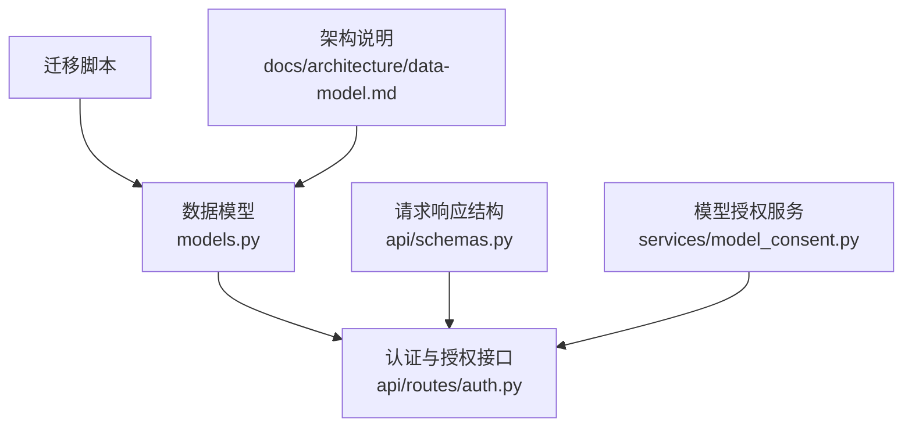
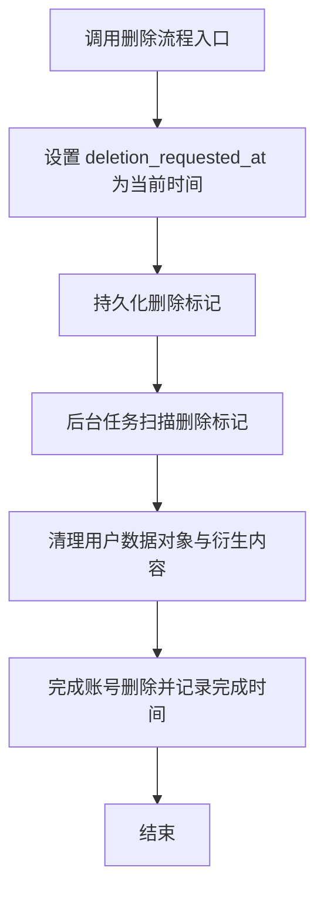
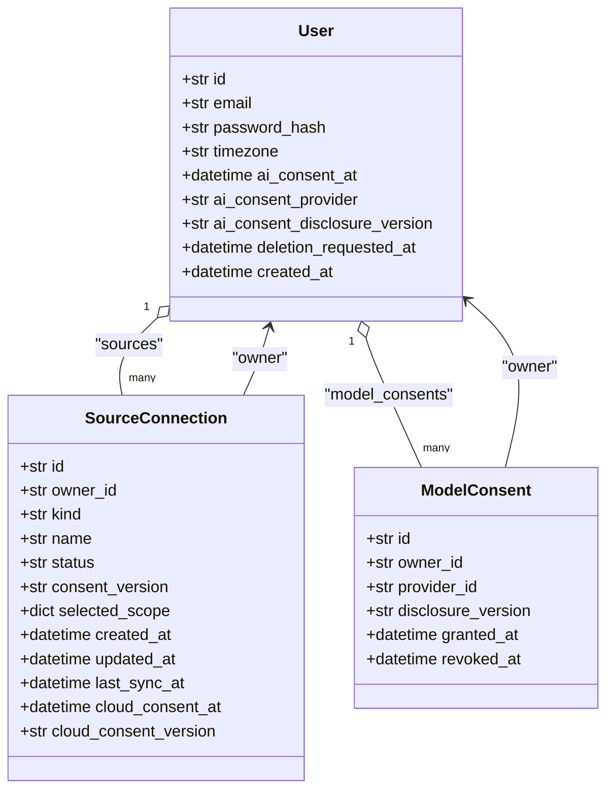
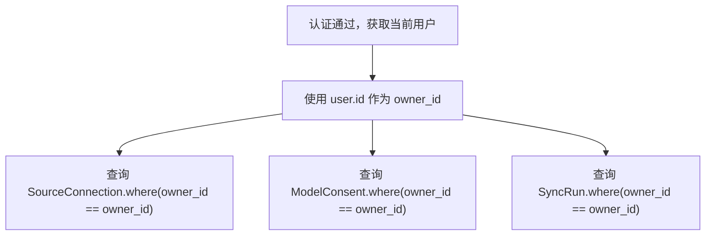
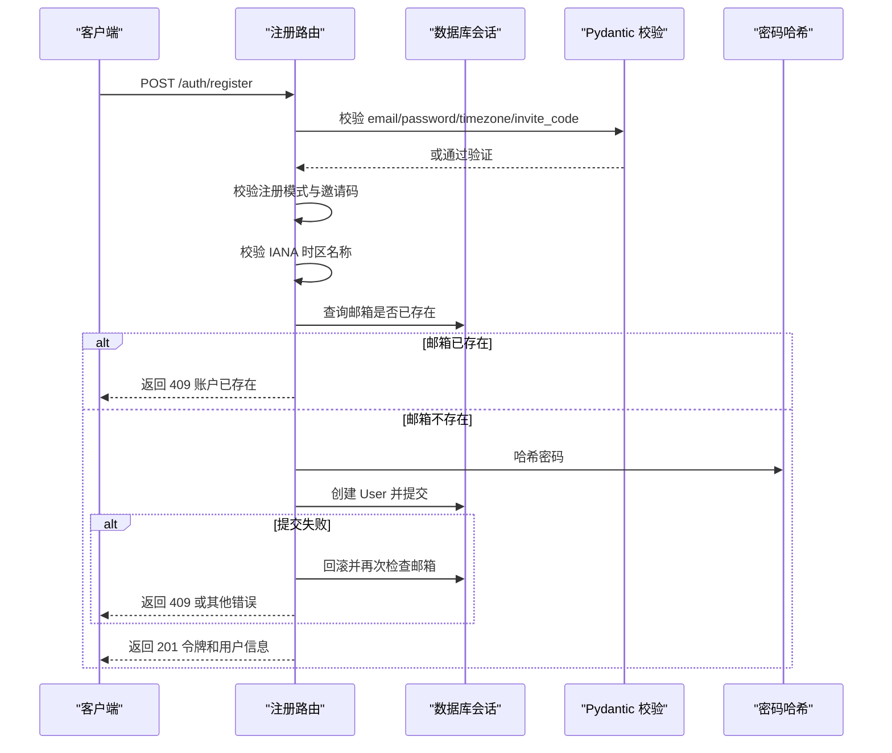
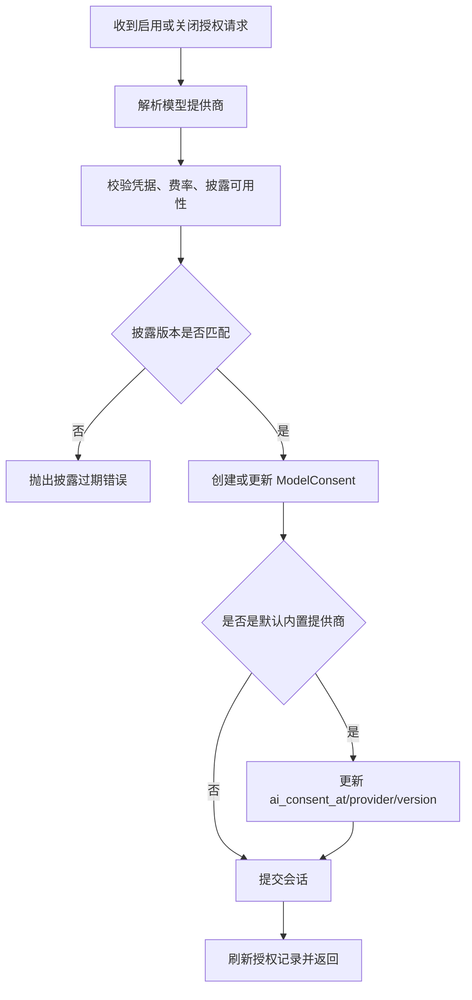
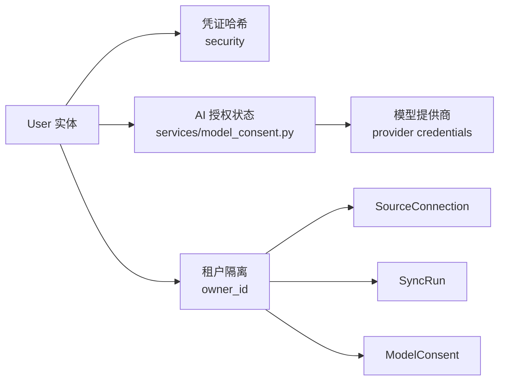

# 用户实体 User

<cite>
**本文引用的文件 **
- [models.py](file://src/personal_ai_life_os/models.py)
- [auth.py](file://src/personal_ai_life_os/api/routes/auth.py)
- [schemas.py](file://src/personal_ai_life_os/api/schemas.py)
- [model_consent.py](file://src/personal_ai_life_os/services/model_consent.py)
- [data-model.md](file://docs/architecture/data-model.md)
- [a1b7c9d3e504_add_provider_consent_and_review_versions.py](file://migrations/versions/a1b7c9d3e504_add_provider_consent_and_review_versions.py)
- [513becf54638_account_deletion_and_reminder_citations.py](file://migrations/versions/513becf54638_account_deletion_and_reminder_citations.py)
- [deletion.py](file://src/personal_ai_life_os/services/deletion.py)
</cite>

## 目录
1. [简介](#简介)
2. [项目结构与定位](#项目结构与定位)
3. [User 模型字段详解](#user-模型字段详解)
4. [软删除标记 deletion_requested_at](#软删除标记-deletion_requested_at)
5. [创建时间 created_at](#创建时间-created_at)
6. [一对多关系：User、SourceConnection 与 ModelConsent](#一对多关系usersourceconnection-与-modelconsent)
7. [租户隔离查询模式](#租户隔离查询模式)
8. [用户注册流程与字段验证](#用户注册流程与字段验证)
9. [AI 数据使用授权流程](#ai-数据使用授权流程)
10. [依赖与架构视图](#依赖与架构视图)
11. [安全性最佳实践](#安全性最佳实践)
12. [常见问题排查](#常见问题排查)
13. [总结](#总结)

## 简介
User 是该系统中认证与数据隔离的核心主体。它既承载账户登录所需的凭证，也承载账号级配置和数据隔离边界，包括时区设置以及 AI 数据处理授权信息。所有以 owner_id 关联的 SourceConnection、ModelConsent、SyncRun 等记录都通过外键和 API 层校验实现租户隔离。

在本项目中，User 的持久化定义位于 SQLAlchemy ORM 层；注册、登录和 AI 授权则集中在 FastAPI 路由和服务层；数据模型整体说明参考架构文档中的 data-model。

**章节来源**
- [data-model.md:1-26](file://docs/architecture/data-model.md#L1-L26)

## 项目结构与定位
User 属于 `personal_ai_life_os` 应用的核心数据模型模块。围绕它的关键位置如下：

- 数据库模型：`src/personal_ai_life_os/models.py`
- 注册、登录与 AI 授权接口：`src/personal_ai_life_os/api/routes/auth.py`
- 请求响应数据模型：`src/personal_ai_life_os/api/schemas.py`
- 模型提供商授权服务：`src/personal_ai_life_os/services/model_consent.py`
- 迁移脚本：`migrations/versions/a1b7c9d3e504...`（新增 Provider 授权）、`migrations/versions/513becf54638...`（新增 delection_requested_at）
- 架构说明：`docs/architecture/data-model.md`

**图表来源**
- [models.py](file://src/personal_ai_life_os/models.py)
- [auth.py](file://src/personal_ai_life_os/api/routes/auth.py)
- [schemas.py](file://src/personal_ai_life_os/api/schemas.py)
- [model_consent.py](file://src/personal_ai_life_os/services/model_consent.py)
- [a1b7c9d3e504_add_provider_consent_and_review_versions.py](file://migrations/versions/a1b7c9d3e504_add_provider_consent_and_review_versions.py)
- [513becf54638_account_deletion_and_reminder_citations.py](file://migrations/versions/513becf54638_account_deletion_and_reminder_citations.py)

**章节来源**
- [models.py:1-80](file://src/personal_ai_life_os/models.py#L1-L80)
- [auth.py:1-50](file://src/personal_ai_life_os/api/routes/auth.py#L1-L50)
- [schema definitions: RegisterRequest, LoginRequest, UserResponse, TokenResponse](file://src/personal_ai_life_os/api/schemas.py#L1-L200)

## User 模型字段详解
User 对应 `users` 表，主要字段及其作用如下：

| 字段名 | 类型或约束 | 默认值或含义 | 说明 |
|---|---|---|---|
| `id` | UUID（作为字符串存储），主键 | `new_id()` | 用户唯一标识，生成策略为随机 UUID。 |
| `email` | 字符串，最大长度 320，唯一索引 | 无 | 账户标识符，配合 API 层的邮箱规范化与唯一性检查。 |
| `password_hash` | 字符串，最大长度 512 | 无 | 密码哈希值，不存储明文密码。 |
| `timezone` | 字符串，最大长度 64 | `"UTC"` | 用户时区，用于本地日期展示和会话相关时间计算。 |
| `ai_consent_at` | 可选时间戳 | 空 | 表示用户在账户层面授予默认 AI 提供商使用权限的时间。 |
| `ai_consent_provider` | 可选字符串，最大长度 120 | 空 | 表示默认的 AI 授权提供方，通常用于内置默认提供商兼容。 |
| `ai_consent_disclosure_version` | 可选字符串，最大长度 120 | 空 | 绑定该授权时的隐私披露版本。 |
| `deletion_requested_at` | 可选时间戳 | 空 | 软删除申请时间，表示用户已提出账号删除请求但尚未完全销毁。 |
| `created_at` | UTC 时间戳 | `utcnow()` | 用户账户创建时间。 |

这些字段共同构成三类信息：

1. **身份与凭证**：`id`、`email`、`password_hash`。
2. **用户上下文**：`timezone`、`created_at`。
3. **AI 数据授权状态**：`ai_consent_at`、`ai_consent_provider`、`ai_consent_disclosure_version`。
4. **合规生命周期**：`deletion_requested_at`。

**章节来源**
- [models.py:41-90](file://src/personal_ai_life_os/models.py#L41-L90)

## 软删除标记 deletion_requested_at
`deletion_requested_at` 是“软删除”或“删除申请态”标志，而不是立即物理删除用户记录。

它的主要作用是：

- 明确表达“用户已申请删除账号”。
- 允许后端在后台任务、清理流程和审计场景中识别需要回收的数据。
- 避免直接删除导致关联历史、引用或备份恢复过程中的强一致性难题。
- 与对象存储中的删除标记（tombstone）配合，完成更彻底的数据擦除流程。

从迁移来看，该字段是在初始 tenant-scoped schema 之后新增的，对应迁移编号 `513becf54638`，其升级操作向 `users` 表添加了该可选时间戳列。

删除流程并非只写一个字段；`services/deletion.py` 中还实现了项级、源级和账号级的删除记录、完成记录及墓碑写入。Account 层会协调对象存储中残留数据的清理。

**图表来源**
- [513becf54638_account_deletion_and_reminder_citations.py:19-34](file://migrations/versions/513becf54638_account_deletion_and_reminder_citations.py#L19-L34)
- [deletion.py](file://src/personal_ai_life_os/services/deletion.py)

需要注意：
- 如果业务规则要求某个接口在存在删除标记时拒绝新写入，应显式检查该字段。
- 如果希望保留审计日志，不应直接物理删除 `users` 行，而是依赖删除标记、外部资源清理和时间戳字段。

**章节来源**
- [513becf54638_account_deletion_and_reminder_citations.py:19-34](file://migrations/versions/513becf54638_account_deletion_and_reminder_citations.py#L19-L34)
- [deletion.py:1-120](file://src/personal_ai_life_os/services/deletion.py#L1-L120)

## 创建时间 created_at
`created_at` 是一个 UTC 时间戳字段，默认由应用定义的 `utcnow` 生成。它在用户注册成功提交到数据库时自动填充。

实际影响包括：

- 归档导出：`account/archive` 导出的 `account.json` 包含 `created_at`，便于用户查看创建时间。
- 排序和审计：可用于按注册时间分析用户增长或行为趋势。
- 安全：时间戳是 UTC 可序列化的 ISO 格式，不会泄露服务器时区偏好。

**章节来源**
- [models.py:9-20](file://src/personal_ai_life_os/models.py#L9-L20)
- [models.py:41-90](file://src/personal_ai_life_os/models.py#L41-L90)
- [account archive usage in account.py](file://src/personal_ai_life_os/api/routes/account.py#L1-L200)

## 一对多关系：User、SourceConnection 与 ModelConsent
User 是拥有者（owner），SourceConnection 和 ModelConsent 是其关联子实体。

- User → SourceConnection：一个用户可以拥有多个数据来源连接。
- User → ModelConsent：一个用户可以针对一个或多个模型提供商分别授权。

ORM 层使用 `back_populates` 建立双向关系：

- `User.sources` 导航到 `SourceConnection.owner`。
- `User.model_consents` 导航到 `ModelConsent.owner`。
- `SourceConnection.owner` 反向导航到 `User.sources`。
- `ModelConsent.owner` 反向导航到 `User.model_consents`。

此外，SourceConnection 本身还拥有一对多的 SourceItem、SyncRun，进一步形成“用户 → 数据源 → 同步执行/解析条目”的关系链。

**图表来源**
- [models.py:41-145](file://src/personal_ai_life_os/models.py#L41-L145)

**章节来源**
- [models.py:41-145](file://src/personal_ai_life_os/models.py#L41-L145)

## 租户隔离查询模式
所有用户拥有的资源通过 `owner_id` 进行隔离。典型查询模式是“先确认当前用户的 owner_id，再查子记录”。

常见模式举例：

1. **查找某用户的所有数据来源**：
   - 查询 SourceConnection 时使用 `owner_id == user.id`。
   - 示例见 account 归档端点中对 `SourceConnection.owner_id` 的过滤。

2. **查找某用户的所有模型授权**：
   - 查询 ModelConsent 时使用 `owner_id == user.id`。

3. **查找某用户的所有同步执行记录**：
   - 查询 SyncRun 时使用 `owner_id == user.id`。

这种设计确保不同用户的 SourceConnection、SyncRun、Review、MemoryRecord、Job 等数据不会被跨用户访问。

**章节来源**
- [account archive queries in account.py](file://src/personal_ai_life_os/api/routes/account.py#L1-L200)
- [model consent service](file://src/personal_ai_life_os/services/model_consent.py#L1-L110)

## 用户注册流程与字段验证
用户注册流程发生在 `auth.register` 路由。核心步骤如下：

1. 校验注册模式是否开放。
2. 如要求邀请码，则使用恒等比较校验邀请码。
3. 校验 `timezone` 是否为有效的 IANA 时区。
4. 检查邮箱是否已存在。
5. 对密码调用 `hash_password` 后创建 User。
6. 提交事务；出现异常时回滚，并二次检查邮箱是否存在以避免竞态条件。
7. 刷新用户对象并返回令牌及用户响应。

### 注册请求字段的校验逻辑

| 字段 | 层 | 验证规则 |
|---|---|---|
| `email` | Pydantic Schema | 最小长度 5，最大长度 320；提供自定义验证器去除两端空白、转为小写、强制只有一个 `@`、域名必须包含点且不能含空格。 |
| `password` | Pydantic Schema | 最小长度 12，最大长度 256。 |
| `timezone` | Pydantic Schema + 路由层 | Schema 默认值为 `"UTC"`，最大长度 64；路由层使用 ZoneInfo 严格校验 IANA 时区。 |
| `invite_code` | Pydantic Schema + 路由层 | 可选；当注册模式为邀请制时，后端用恒定时间比较函数校验邀请码。 |
| `id/password_hash/deletion_requested_at/created_at` | 后端内部 | 由 ORM、默认值和 Hashing 过程生成，不由注册输入直接赋值。 |

**图表来源**
- [auth.py register and desktop profile](file://src/personal_ai_life_os/api/routes/auth.py#L60-L150)
- [schemas.py RegisterRequest and validators](file://src/personal_ai_life_os/api/schemas.py#L1-L80)

**章节来源**
- [auth.py:60-150](file://src/personal_ai_life_os/api/routes/auth.py#L60-L150)
- [schemas.py:1-80](file://src/personal_ai_life_os/api/schemas.py#L1-L80)

## AI 数据使用授权流程
AI 授权涉及两个层次：

1. **账号级默认授权字段**：`ai_consent_at`、`ai_consent_provider`、`ai_consent_disclosure_version`。
2. **每个模型提供商的独立授权记录**：`model_consents` 表中的 `granted_at`、`revoked_at`、`disclosure_version`。

服务层 `has_consent` 的逻辑如下：

- 优先检查该用户+提供商的 `ModelConsent` 记录是否有效，即已授予且未撤销，并且披露版本号匹配。
- 如果没有记录，但目标提供商是内置默认提供商，则回退到 User 账户级字段：
  - `ai_consent_at` 非空；
  - `ai_consent_provider` 为允许的默认提供商集合；
  - `ai_consent_disclosure_version` 与提供商披露版本一致。

`set_consent` 会创建或更新 `ModelConsent` 记录；当目标是默认内置提供商时，还会同步更新 User 账户级授权字段。

**图表来源**
- [model_consent.py has_consent/set_consent](file://src/personal_ai_life_os/services/model_consent.py#L1-L110)

需要注意的是：
- 如果启用外部模型但缺少凭据、未配置价格或未提供完整隐私披露，服务层会抛出明确的 `ModelProviderError`。
- 客户端必须先调用披露接口获取当前 `model_disclosure_version`，然后再提交相同版本的授权请求。

**章节来源**
- [model_consent.py:1-110](file://src/personal_ai_life_os/services/model_consent.py#L1-L110)
- [auth.py model-disclosure and ai-consent routes](file://src/personal_ai_life_os/api/routes/auth.py#L150-L210)
- [migration a1b7c9d3e504](file://migrations/versions/a1b7c9d3e504_add_provider_consent_and_review_versions.py#L1-L65)

## 依赖与架构视图
User 不直接访问外部网络凭证，但通过以下路径间接影响数据安全边界：

- `password_hash` 由安全模块处理。
- `ai_consent_*` 字段被 `services/model_consent.py` 用于判断是否允许访问外部模型。
- `created_at` 和 `timezone` 进入用户响应的序列化输出。
- `owner_id` 是后续 SourceConnection、SyncRun、SourceItem、Review 等资源的归属依据。

**图表来源**
- [models.py User、SourceConnection、ModelConsent](file://src/personal_ai_life_os/models.py#L41-L145)
- [model_consent.py](file://src/personal_ai_life_os/services/model_consent.py#L1-L110)

**章节来源**
- [models.py:41-145](file://src/personal_ai_life_os/models.py#L41-L145)
- [model_consent.py:1-110](file://src/personal_ai_life_os/services/model_consent.py#L1-L110)
- [data-model.md:1-26](file://docs/architecture/data-model.md#L1-L26)

## 安全性最佳实践
结合 User 模型和相关流程，建议遵循以下实践：

1. **绝不保存明文密码**
   - 通过 `password_hash` 字段保存 Argon2 哈希结果。
   - 注册时统一调用 `hash_password`。
   - 登录时调用 `verify_password`。

2. **限制邮箱大小和格式**
   - Schema 层限制最大 320 字符。
   - 校验器强制小写、去空白、单一 `@`、域名必须有域后缀。
   - DB 层对 `email` 设唯一索引，防止并发重复注册。

3. **保护时区合法性**
   - 使用 IANA 时区名称，并通过 `ZoneInfo` 校验。
   - 默认值为 `"UTC"`。

4. **把 AI 授权当作敏感行为**
   - 启用前校验提供商凭据、费率和隐私披露文本。
   - 对比披露版本号，避免旧版本授权绕过新版本披露要求。
   - 支持撤销授权，同时保持历史记录可审计。

5. **不要把 UserResponse 暴露多余字段**
   - `UserResponse` 仅暴露必要字段；不要为了调试随意增加 `password_hash`、内部 ID 映射或原始权限标记。

6. **谨慎处理删除流程**
   - `deletion_requested_at` 只是删除标记。
   - 配套使用对象存储墓碑和后台清理任务完成真正数据擦除。
   - 不要在业务查询中遗漏该标记，否则可能出现“用户申请删除后仍活跃”的问题。

7. **始终按 owner_id 查询**
   - 任何子资源查询都必须包含 `owner_id == current_user.id`。
   - 对外部导入或批量清理也应传入明确的 owner_id。

**章节来源**
- [auth.py register/login/middleware patterns](file://src/personal_ai_life_os/api/routes/auth.py#L60-L200)
- [schemas.py email/password/timezone validation](file://src/personal_ai_life_os/api/schemas.py#L1-L120)
- [model_consent.py set_consent checks](file://src/personal_ai_life_os/services/model_consent.py#L40-L110)
- [513becf54638 migration](file://migrations/versions/513becf54638_account_deletion_and_reminder_citations.py#L19-L34)

## 常见问题排查

| 问题 | 可能原因 | 排查方法 |
|---|---|---|
| 注册返回邮箱已存在 | `email` 唯一冲突或服务端未捕获插入异常 | 检查是否存在同名邮箱；查看注册路由异常分支与会话回滚逻辑。 |
| 注册时报无效时区 | 输入的 `timezone` 不是有效 IANA 名称 | 前端使用受支持的时区列表；服务端 `ZoneInfo` 校验失败。 |
| 登录失败但账号存在 | 密码错误或 `password_hash` 被意外覆盖 | 检查登录路由使用的验证函数；确认注册流程调用的是正确的哈希方法。 |
| 外部模型提示需要授权 | 用户未启用外部模型授权或未满足披露版本要求 | 调用 `/auth/model-disclosure` 获取当前披露版本，再调用 `/auth/ai-consent` 启用授权。 |
| 撤销授权后仍能使用外部模型 | `ModelConsent.revoked_at` 非空或披露版本不一致 | 检查 `has_consent` 返回条件和用户响应中的 `ai_consent_at`。 |
| 删除账号后数据仍未清空 | 仅设置 `deletion_requested_at`，但未执行后台清理流程 | 检查删除墓碑、对象存储清理和后台任务是否完成。 |
| 同一用户多次访问不同 source 产生歧义 | 查询遗漏 `owner_id` 或鉴权未正确传递当前用户 | 审查 `account.py` 和 source/sync 相关查询，确保均附加 `owner_id == user.id`。 |

**章节来源**
- [auth.py register/login/reset flows](file://src/personal_ai_life_os/api/routes/auth.py#L60-L210)
- [schemas.py RegisterRequest/LoginRequest validation](file://src/personal_ai_life_os/api/schemas.py#L1-L120)
- [model_consent.py consent decision logic](file://src/personal_ai_life_os/services/model_consent.py#L1-L110)
- [deletion.py tombstone cleanup flow](file://src/personal_ai_life_os/services/deletion.py#L1-L200)

## 总结
User 不仅是登录凭证载体，还是整个系统的租户边界。它通过以下机制保障安全和可审计性：

- 使用 UUID 主键和唯一邮箱保证身份稳定性。
- 使用密码哈希而非明文保护凭据。
- 使用 UTC 时间戳追踪创建时间与 AI 授权时间。
- 支持时区差异，让时间与日期对用户更友好。
- 将 AI 数据使用授权拆分为账户级字段与每条模型提供商记录。
- 使用 `deletion_requested_at` 实现安全的软删除过渡。
- 通过 `owner_id` 将 User、SourceConnection、ModelConsent、SyncRun 等数据串成清晰的租户隔离体系。

对于扩展新的业务字段，应优先评估它是否需要纳入租户隔离、是否会影响安全边界，以及是否能由现有 User、SourceConnection、ModelConsent 或新建实体承担。

**章节来源**
- [models.py User definition and relationships](file://src/personal_ai_life_os/models.py#L41-L145)
- [data-model.md entity overview](file://docs/architecture/data-model.md#L1-L26)