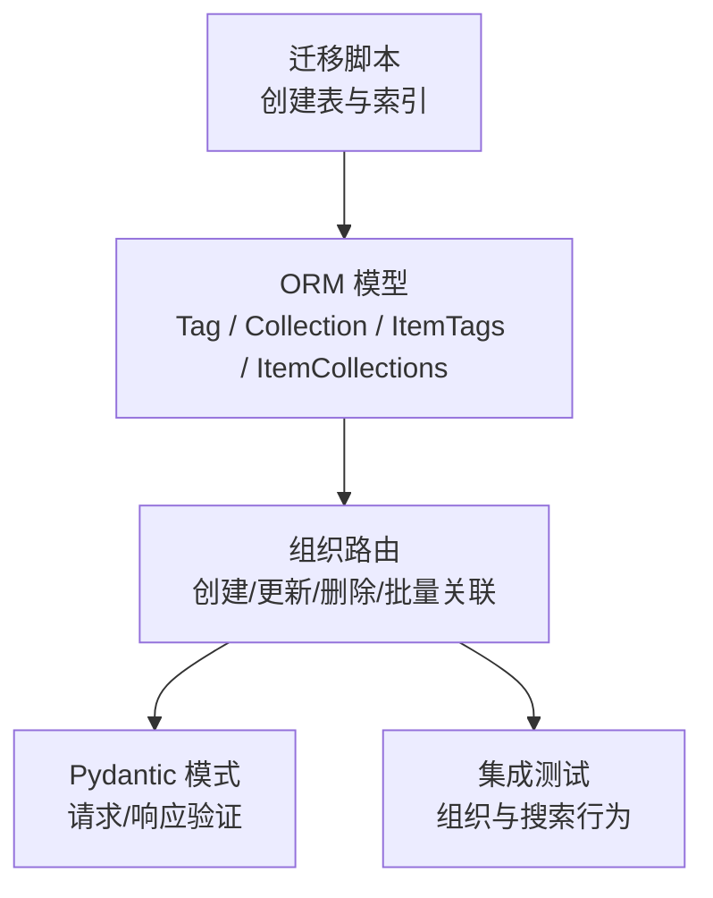
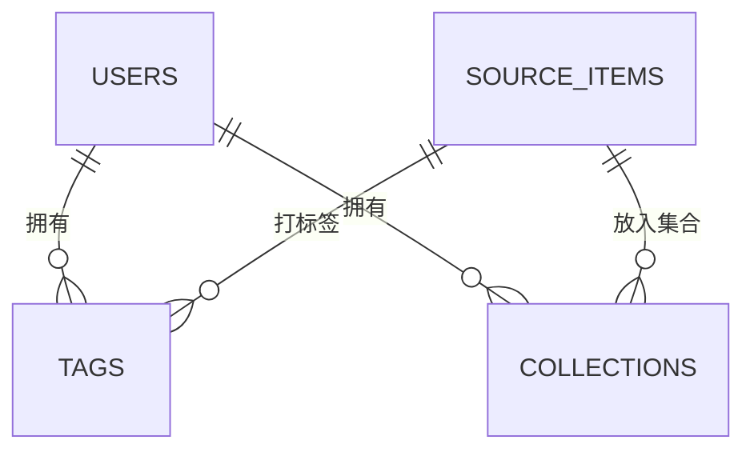
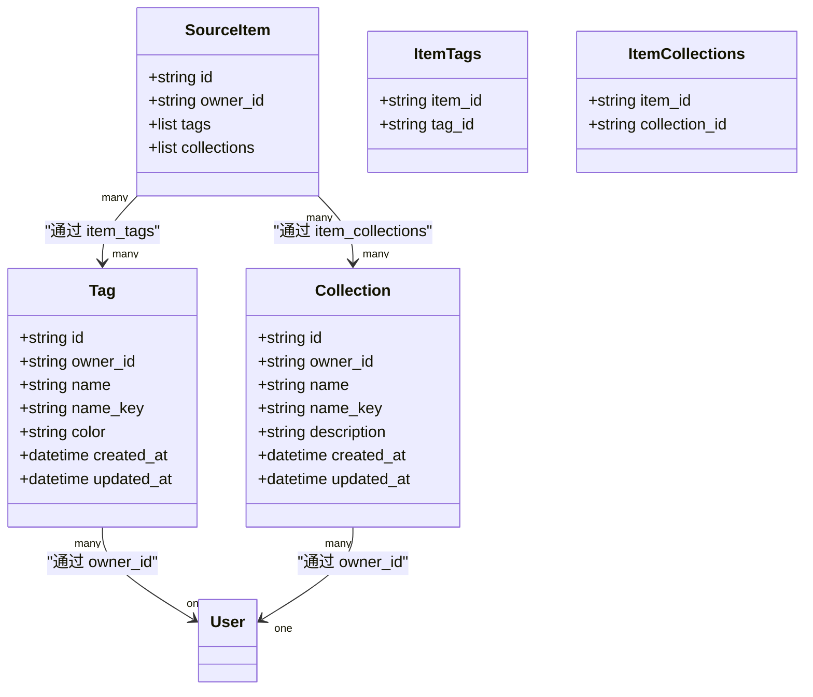
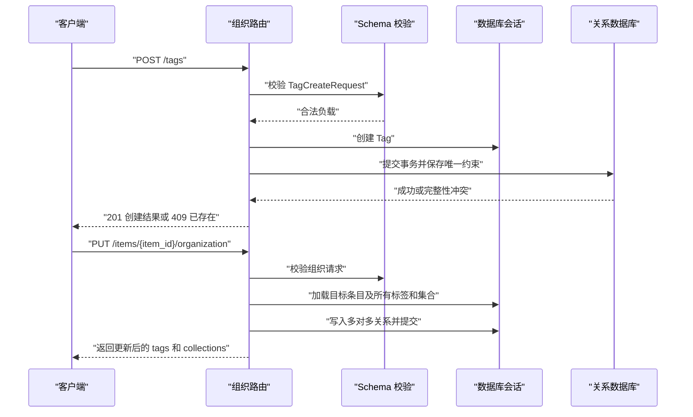
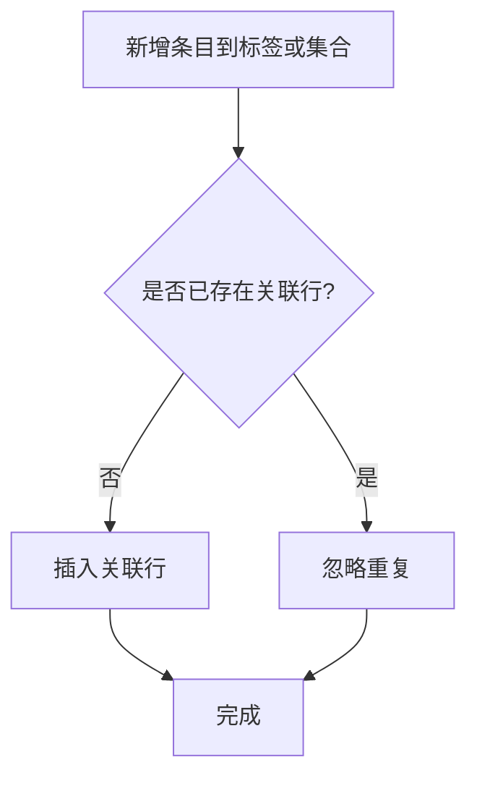
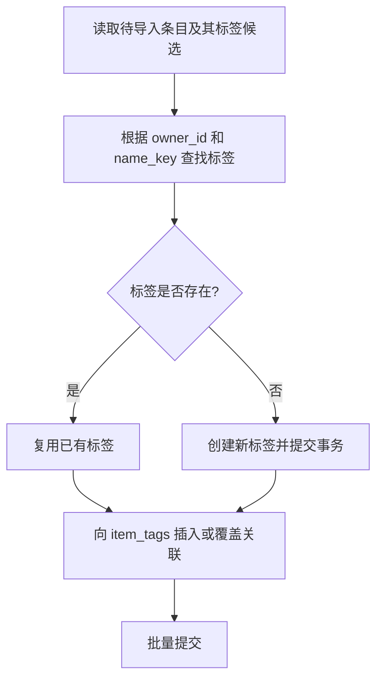
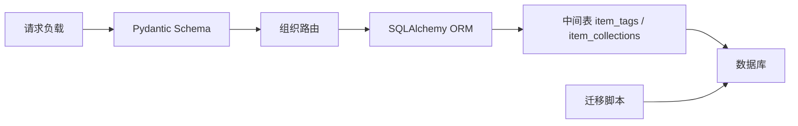

# 组织模型 Tag 与 Collection

<cite>
**本文引用的文件**   
- [models.py](file://src/personal_ai_life_os/models.py)
- [organization.py](file://src/personal_ai_life_os/api/routes/organization.py)
- [schemas.py](file://src/personal_ai_life_os/api/schemas.py)
- [f9a1c4d8e702_add_search_indexes_and_organization.py](file://migrations/versions/f9a1c4d8e702_add_search_indexes_and_organization.py)
- [test_search_organization.py](file://tests/test_search_organization.py)
</cite>

## 目录
1. [引言](#引言)
2. [项目结构中的定位](#项目结构中的定位)
3. [核心数据模型](#核心数据模型)
4. [架构总览](#架构总览)
5. [详细组件分析](#详细组件分析)
6. [多对多关系与中间表设计](#多对多关系与中间表设计)
7. [业务流程分析](#业务流程分析)
8. [依赖关系分析](#依赖关系分析)
9. [性能与索引优化](#性能与索引优化)
10. [大规模数据下的维护策略](#大规模数据下的维护策略)
11. [扩展方向：集合嵌套与按标签筛选](#扩展方向集合嵌套与按标签筛选)
12. [故障排查指南](#故障排查指南)
13. [结论](#结论)

## 引言
本文聚焦 Personal AI Life OS 中的“组织”能力，详细说明两类轻量级内容分类模型：**标签**和**集合**。它们共同构成以 `SourceItem` 为中心的多对多内容组织层：  
- **Tag** 实现扁平化的文本标签分类，支持所有者隔离、名称唯一性校验和可选颜色标记。  
- **Collection** 表示更高语义的集合命名空间，允许在描述字段中存储结构化或富文本配置，便于扩展后续的组织、模板、过滤规则等元信息。

两个模型通过 `item_tags` 和 `item_collections` 两个中间表与 `SourceItem` 建立多对多关系，并在迁移中建立了复合索引以优化按标签或集合反向查找内容的性能。

## 项目结构中的定位
组织模型和相关 API 主要分布在以下三个位置：
- 模型定义：`src/personal_ai_life_os/models.py`
- 路由处理：`src/personal_ai_life_os/api/routes/organization.py`
- API 请求响应结构：`src/personal_ai_life_os/api/schemas.py`
- 数据库迁移：`migrations/versions/f9a1c4d8e702_add_search_indexes_and_organization.py`
- 集成测试：`tests/test_search_organization.py`

**图表来源**
- [models.py:240-340](file://src/personal_ai_life_os/models.py#L240-L340)
- [organization.py:23-60](file://src/personal_ai_life_os/api/routes/organization.py#L23-L60)
- [schemas.py:884-1021](file://src/personal_ai_life_os/api/schemas.py#L884-L1021)
- [f9a1c4d8e702_add_search_indexes_and_organization.py:74-124](file://migrations/versions/f9a1c4d8e702_add_search_indexes_and_organization.py#L74-L124)
- [test_search_organization.py:142-212](file://tests/test_search_organization.py#L142-L212)

**章节来源**
- [models.py:240-340](file://src/personal_ai_life_os/models.py#L240-L340)
- [organization.py:1-40](file://src/personal_ai_life_os/api/routes/organization.py#L1-L40)
- [schemas.py:884-1021](file://src/personal_ai_life_os/api/schemas.py#L884-L1021)
- [f9a1c4d8e702_add_search_indexes_and_organization.py:74-124](file://migrations/versions/f9a1c4d8e702_add_search_indexes_and_organization.py#L74-L124)

## 核心数据模型
### Tag 模型
Tag 是扁平化标签体系的核心实体，主要职责是：
- 标识一个可归属于某个用户的内容标签。
- 通过 `owner_id` 实现用户隔离。
- 通过 `name_key` 提供大小写不敏感且可排序的唯一键。
- 存储可选的十六进制颜色值，用于前端展示。
- 记录创建时间和更新时间。

关键字段与约束包括：
| 字段 | 类型与说明 | 关键特性 |
|---|---|---|
| `id` | 非空 UUID 字符串，主键 | 默认使用 UUID 生成器 |
| `owner_id` | 非空 UUID 字符串，外键指向用户表 | 带索引，级联删除 |
| `name` | 最大长度 80 的用户可读名称 | 由 API 层做空格修剪与存在性校验 |
| `name_key` | 最大长度 200 的小写规范化键 | 唯一约束 `(owner_id, name_key)`；查询和排序使用 |
| `color` | 可选的六位十六进制颜色 | API 层要求大写格式，若传入非法格式会被拒绝 |
| `created_at` | 带时区时间戳 | 创建时填充当前 UTC 时间 |
| `updated_at` | 带时区时间戳 | 修改时自动更新 |

实际建模中还包含两个重要数据库级辅助对象：
- 唯一约束 `uq_tag_owner_name`：保证同一用户下标签名称键唯一。
- 联合索引 `ix_tags_owner_name`：加速按用户 + 名称键的查询。

这些约束与 ORM 映射、API 输入校验共同避免重复标签，并确保标签查询的性能。

**章节来源**
- [models.py:261-284](file://src/personal_ai_life_os/models.py#L261-L284)
- [schemas.py:884-939](file://src/personal_ai_life_os/api/schemas.py#L884-L939)
- [f9a1c4d8e702_add_search_indexes_and_organization.py:74-94](file://migrations/versions/f9a1c4d8e702_add_search_indexes_and_organization.py#L74-L94)

### Collection 模型
Collection 是一个更偏向“内容分组命名空间”的结构，核心职责是：
- 将多个 `SourceItem` 归入一个集合。
- 通过 `owner_id` 实现用户隔离。
- 通过 `name_key` 提供用户内的唯一、稳定、可用于排序的名称键。
- 使用 `description` 文本字段承载富文本式描述或 JSON 配置。虽然 SQL 侧是 `Text` 列，但 Pydantic 限制为最大 1000 字符，适合嵌入短配置、模板、显示标题、排序优先级、业务标识等结构化字段。
- 同样记录创建和更新时间，并按名称键排序返回给前端。

关键字段与约束包括：
| 字段 | 类型与说明 | 关键特性 |
|---|---|---|
| `id` | 非空 UUID 字符串，主键 | 默认 UUID 生成器 |
| `owner_id` | 非空 UUID 字符串，外键指向用户表 | 级联删除 |
| `name` | 最大长度 120 的用户可读名称 | API 层校验非空并可修剪空格 |
| `name_key` | 最大长度 200 的小写规范化键 | 唯一约束 `(owner_id, name_key)` |
| `description` | 可选文本，可承载 JSON 配置或富文本描述 | API 层最多 1000 字符，为空输入会转成 None |
| `created_at` | 创建时间戳 | UTC 当前时间 |
| `updated_at` | 更新时间戳 | 修改时自动刷新 |

与 Tag 类似，Collection 也有：
- 唯一约束 `uq_collection_owner_name`。
- 联合索引 `ix_collections_owner_name`。

由于没有数据库端的 JSON 列级别约束，应用层的字段校验、JSON 解析、以及后续可能的服务层序列化应负责保证 `description` 作为配置的合法性。

**章节来源**
- [models.py:286-307](file://src/personal_ai_life_os/models.py#L286-L307)
- [schemas.py:940-1001](file://src/personal_ai_life_os/api/schemas.py#L940-L1001)
- [f9a1c4d8e702_add_search_indexes_and_organization.py:94-108](file://migrations/versions/f9a1c4d8e702_add_search_indexes_and_organization.py#L94-L108)

## 架构总览
Tag 与 Collection 并不是独立运行于业务之上，而是围绕现有内容模型 `SourceItem` 构建组织层：

- `User` 是资源所有者。
- `Tag` 和 `Collection` 都属于某个 `owner_id`。
- `SourceItem` 可以同时拥有多个标签和多个集合，形成一对多或多对多视图（从 `Tag`/`Collection` 角度看是多对多）。
- `item_tags` 与 `item_collections` 是两个对称的中间表，分别承担多对多映射。

需要特别说明的是，这个组织模型并不表示集合之间的父子嵌套关系，而是一种扁平的集合归类机制。集合嵌套属于扩展设计，见后文。

**图表来源**
- [models.py:178-307](file://src/personal_ai_life_os/models.py#L178-L307)

**章节来源**
- [models.py:240-307](file://src/personal_ai_life_os/models.py#L240-L307)

## 详细组件分析

### ORM 模型与关系定义

- `SourceItem.tags` 和 `SourceItem.collections` 通过 SQLAlchemy 的 `secondary=...` 关系连接中间表。
- `Tag.items` 和 `Collection.items` 则是反向的多对多关系。
- `owner_id` 均带有外键和级联删除，确保用户删除时其拥有的组织和数据保持一致。

**图表来源**
- [models.py:178-307](file://src/personal_ai_life_os/models.py#L178-L307)

**章节来源**
- [models.py:178-307](file://src/personal_ai_life_os/models.py#L178-L307)

### API 路由：组织的增删改查
组织路由暴露了以下能力：
- 列举当前用户的标签与集合。
- 创建标签、集合。
- 更新标签颜色或名称、集合描述或名称。
- 删除标签或集合。
- 获取某个 `SourceItem` 的组织关系。
- 为某个 `SourceItem` 批量设置标签和集合。

**图表来源**
- [organization.py:59-108](file://src/personal_ai_life_os/api/routes/organization.py#L59-L108)
- [organization.py:118-170](file://src/personal_ai_life_os/api/routes/organization.py#L118-L170)
- [organization.py:201-228](file://src/personal_ai_life_os/api/routes/organization.py#L201-L228)
- [schemas.py:884-1021](file://src/personal_ai_life_os/api/schemas.py#L884-L1021)

#### 创建与更新逻辑
- 创建标签时：先根据传入 `name` 计算 `name_key`，存入数据库；如果唯一约束触发，则回滚并提交 409 错误。
- 更新标签时：可选择更新名称、设置颜色或将颜色清空。两者只能二选一，由 Schema 强制。
- 创建集合时：名称规范化后得到 `name_key`；描述可直接作为富文本或结构化 JSON 文本保存。
- 更新集合时：可选择更新名称、替换描述或将描述清空。

#### 批量分配逻辑
批量分配接口接收 `tag_ids` 与 `collection_ids`：
1. 校验列表长度上限（标签最多 100，集合最多 50）。
2. 校验每项都是有效 UUID。
3. 去重校验，防止重复 ID。
4. 通过 SQL 查询确认每个 ID 都存在于当前用户名下。
5. 将所有无效或缺失 ID 的情况统一报错。
6. 若校验通过，直接覆盖该条目的 `tags` 和 `collections` 列表并提交事务。

这意味着批量操作不是增量添加，而是“全量替换”：调用方需要提供最终希望保留的全部组织关系。

**章节来源**
- [organization.py:23-108](file://src/personal_ai_life_os/api/routes/organization.py#L23-L108)
- [organization.py:118-228](file://src/personal_ai_life_os/api/routes/organization.py#L118-L228)
- [schemas.py:884-1021](file://src/personal_ai_life_os/api/schemas.py#L884-L1021)

### Schema 校验与业务约束
标签请求响应体负责：
- 保证名称最小长度为 1、最大 80。
- 移除首尾空格。
- 要求颜色字段符合六位十六进制格式。
- 禁止同时提供颜色和“清除颜色”标志。

集合请求响应体负责：
- 保证名称最小长度为 1、最大 120。
- 描述最大长度 1000。
- 去除空描述。
- 禁止同时提供描述和“清除描述”标志。

组织批量请求负责：
- 限制标签最多 100 个，集合最多 50 个。
- 强制每条 ID 是 UUID。
- 要求标签 ID 和集合 ID 各自去重。

这些校验将常见错误提前拦截在服务层，降低数据库端异常压力。

**章节来源**
- [schemas.py:884-1021](file://src/personal_ai_life_os/api/schemas.py#L884-L1021)

## 多对多关系与中间表设计

### 中间表语义
`item_tags` 和 `item_collections` 是两个纯关联表，不包含额外业务属性。每张表的组合键 `(item_id, tag_id)` 或 `(item_id, collection_id)` 既是主键，也是唯一约束点。这意味着：
- 同一个条目不能重复绑定同一个标签或集合。
- 删除源条目时，对应关联行也会被级联删除。
- 删除标签或集合时，对应关联行也会被级联删除。

**图表来源**
- [models.py:64-77](file://src/personal_ai_life_os/models.py#L64-L77)
- [f9a1c4d8e702_add_search_indexes_and_organization.py:108-124](file://migrations/versions/f9a1c4d8e702_add_search_indexes_and_organization.py#L108-L124)

### 索引与查询路径
- 主键索引：`item_tags(item_id, tag_id)` 和 `item_collections(item_id, collection_id)` 用于快速判断是否存在关联以及快速按条目检索所属标签或集合。
- 业务复合索引：`ix_item_tags_tag_item(tag_id, item_id)` 和 `ix_item_collections_collection_item(collection_id, item_id)` 用于反向查询：例如查询某个标签或集合关联的所有条目。

这两类索引共同覆盖了组织系统最常用的两种查询方向。

**章节来源**
- [models.py:64-77](file://src/personal_ai_life_os/models.py#L64-L77)
- [f9a1c4d8e702_add_search_indexes_and_organization.py:108-124](file://migrations/versions/f9a1c4d8e702_add_search_indexes_and_organization.py#L108-L124)

## 业务流程分析

### 标签自动创建与分配的业务逻辑现状
在当前代码中，“标签自动创建与分配”有两种理解：

1. **API 自动规范化创建标签本身**：用户提交标签名称，系统自动计算 `name_key`，并对非法名称或颜色进行校验与规范化。
2. **导入内容自动打标**：目前仓库中没有看到导入逻辑根据文件名或元数据自动创建 Tag 的代码片段；现有的自动化更多集中在 FTS 触发器同步索引、异步任务框架和业务服务层，而不是本组织模型的自动分配。

因此，当前准确的实现是：
- Tag 创建是显式的 REST 调用。
- 标签名称在写入前先规范化。
- 标签名称冲突由数据库唯一约束捕获，并通过 API 层转换为 409 错误。

如果要实现“自动创建标签”，通常建议的模式是：

虽然这段流程是概念性的，但它能表达推荐实现方式：先在事务内查找再按需创建，然后批量写入多对多关系，最后统一提交以避免部分成功。

**章节来源**
- [organization.py:65-81](file://src/personal_ai_life_os/api/routes/organization.py#L65-L81)
- [schemas.py:884-901](file://src/personal_ai_life_os/api/schemas.py#L884-L901)

### 批量操作的一致性保证
当前的 `update_item_organization` 将多条标签与集合的关系合并为一个 Python 列表赋值，并提交一次 SQLAlchemy 事务。这一设计具备以下特征：
- 同一条目上的所有标签和集合关系更新在一个原子事务中。
- 如果任何一步失败，整个批量分配回滚。
- 校验失败时不会写入数据库。
- 因为目标是设置完整组织列表，所以会清空未被传入 ID 的旧标签和集合。

需要注意的风险：
- 批量校验依赖 SQL 查询的 `IN (...)` 子句；如果传入大量 ID，可能导致 SQL 语句过大，影响性能。
- 校验通过后到提交前，没有其他进程锁住相关条目；高并发场景下仍可能需要幂等设计。
- “全量替换”语义意味着客户端必须缓存并发送最终状态，否则可能误删已存在的标签关系。

**章节来源**
- [organization.py:201-228](file://src/personal_ai_life_os/api/routes/organization.py#L201-L228)
- [schemas.py:1002-1017](file://src/personal_ai_life_os/api/schemas.py#L1002-L1017)

### 级联删除的影响范围
- 用户被删除时，`Tag.owner_id` 和 `Collection.owner_id` 的 `ondelete=CASCADE` 会使相关标签和集合也被删除。
- 标签被删除时，`item_tags.tag_id` 的 `ondelete=CASCADE` 会清理该标签与所有条目之间的关联关系。
- 集合被删除时，`item_collections.collection_id` 的 `ondelete=CASCADE` 会清理该集合与所有条目之间的关联关系。
- 条目被删除时，`item_tags.item_id` 和 `item_collections.item_id` 的 `ondelete=CASCADE` 会清掉该条目的所有标签和集合关联。

因此，级联删除的范围是“所有权链路和映射表”，不会物理删除 `SourceItem` 以外无关的标签或集合。

**章节来源**
- [models.py:64-77](file://src/personal_ai_life_os/models.py#L64-L77)
- [models.py:261-307](file://src/personal_ai_life_os/models.py#L261-L307)
- [f9a1c4d8e702_add_search_indexes_and_organization.py:74-124](file://migrations/versions/f9a1c4d8e702_add_search_indexes_and_organization.py#L74-L124)

## 依赖关系分析
Tag 与 Collection 的依赖链条如下：
- API 层依赖 Pydantic 模式进行请求校验。
- 路由依赖模型进行查询和持久化。
- 模型依赖 SQLAlchemy 的 Table 对象和 Base metadata 定义中间表。
- 迁移脚本定义实际的数据库结构、外键、唯一约束和复合索引。
- 集成测试覆盖创建、绑定、搜索过滤和删除的行为。

**图表来源**
- [schemas.py:884-1021](file://src/personal_ai_life_os/api/schemas.py#L884-L1021)
- [organization.py:23-228](file://src/personal_ai_life_os/api/routes/organization.py#L23-L228)
- [models.py:64-307](file://src/personal_ai_life_os/models.py#L64-L307)
- [f9a1c4d8e702_add_search_indexes_and_organization.py:74-124](file://migrations/versions/f9a1c4d8e702_add_search_indexes_and_organization.py#L74-L124)

**章节来源**
- [schemas.py:884-1021](file://src/personal_ai_life_os/api/schemas.py#L884-L1021)
- [organization.py:23-228](file://src/personal_ai_life_os/api/routes/organization.py#L23-L228)
- [models.py:64-307](file://src/personal_ai_life_os/models.py#L64-L307)
- [f9a1c4d8e702_add_search_indexes_and_organization.py:74-124](file://migrations/versions/f9a1c4d8e702_add_search_indexes_and_organization.py#L74-L124)

## 性能与索引优化

### 索引设计评价
现有设计已经考虑了两个方向：
1. 按 `item_id` 读写多对多关系：由主键索引支持。
2. 按 `tag_id` 或 `collection_id` 反向查条目：由 `ix_item_tags_tag_item` 和 `ix_item_collections_collection_item` 支持。

这对大多数 CRUD 和简单搜索场景足够高效。

### 潜在瓶颈
- 批量校验时使用 `IN (tag_ids)` 查询，当标签或集合数量较多时，SQL 语句变大，可能导致：
  - 网络包增大。
  - 数据库解析和执行成本上升。
  - SQLite 环境下参数过多时存在隐式限制。
- 大量高频的批量重新组织可能反复重建中间表关系，造成临时写放大。

### 优化建议
- 对于超大批量，可以分批处理，例如每次最多 100 个 ID。
- 对高频反向查询可以增加只读副本或预聚合统计。
- 避免在高频路径上加载完整的 `SourceItem.tags` 或 `collections` 列表，必要时使用分页或按需加载。
- 如果未来出现“按标签全文搜索”，可以考虑在 FTS 层补充 tag/collection 名段的映射索引。

**章节来源**
- [models.py:64-77](file://src/personal_ai_life_os/models.py#L64-L77)
- [organization.py:201-228](file://src/personal_ai_life_os/api/routes/organization.py#L201-L228)
- [f9a1c4d8e702_add_search_indexes_and_organization.py:108-124](file://migrations/versions/f9a1c4d8e702_add_search_indexes_and_organization.py#L108-L124)

## 大规模数据下的维护策略

### 数据量增长假设
假设系统有数百万条 `SourceItem`，平均每个条目 2-5 个标签：
- `tags` 和 `collections` 表通常是万级到十万级小表。
- `item_tags` 和 `item_collections` 可能达到千万级行。

### 维护建议
1. **定期分析慢查询日志**：重点监控按标签反向查询、批量更新和删除时的执行计划。
2. **分区策略**：如数据库支持，可按时间或业务域对中间表分区，提高历史数据清理效率。
3. **归档策略**：对于冷数据条目，可将关联关系移至归档库，仅热数据保留在线。
4. **统计信息更新**：PostgreSQL 上确保统计信息更新及时，避免查询计划退化。
5. **锁竞争缓解**：高频更新同一 `SourceItem` 组织关系的场景下，应避免跨会话长事务。
6. **外部队列**：大批量打标建议走后台任务队列，降低请求延迟并提高吞吐。
7. **唯一约束防护**：始终依赖数据库 `UniqueConstraint` 保护数据一致性，不要只依靠应用层去重。

[本节为通用性能与运维建议，不直接分析具体源码，故无章节来源]

## 扩展方向：集合嵌套与按标签筛选

### 按标签搜索的现有示例
当前集成测试展示了用户创建内存、标签和集合后，通过搜索接口传递 `tag_id` 来筛选内容的行为。这体现了标签与搜索能力的衔接方式：标签不仅用于展示和归纳，还会成为筛选条件。

典型调用思路是：
- 先创建内容和标签。
- 将内容绑定到标签。
- 使用搜索接口，带上标签 ID 过滤返回结果。

**章节来源**
- [test_search_organization.py:142-191](file://tests/test_search_organization.py#L142-L191)

### 集合嵌套组织的设计思路
当前 `Collection` 是一级扁平集合，没有父集合字段。如果需要层级嵌套，可考虑以下设计：

| 方案 | 优点 | 缺点 |
|---|---|---|
| 增加 `parent_collection_id` 自引用外键 | 实现简单，查询直观 | 深度递归查询复杂，容易产生循环引用 |
| 使用闭包表 | 查询任意祖先后代效率高 | 维护成本高，需维护祖先映射表 |
| 使用物化路径 | 支持路径展示和顺序控制 | 写入时需要维护路径字段，并发易冲突 |
| 维持扁平 + 业务分组 | 最简实现，扩展成本低 | 深层分类表达能力有限 |

对于大多数个人知识管理场景，扁平集合加上多层级命名或标签组合可能已经足够；真正重度嵌套更适合引入专门的知识图谱或文档树模型。

**章节来源**
- [models.py:286-307](file://src/personal_ai_life_os/models.py#L286-L307)
- [schemas.py:940-1001](file://src/personal_ai_life_os/api/schemas.py#L940-L1001)

## 故障排查指南

### 重复标签错误
现象：创建或更新标签时返回冲突错误。  
原因：同一用户下存在相同 `name_key`。  
排查步骤：
1. 检查请求名称是否包含不可见空格或大小写差异。
2. 检查是否多次调用创建标签但未先去重。
3. 检查数据库中是否存在脏数据导致名称一致但 `name_key` 不一致。

相关位置：
- 标签创建与更新事务及 409 处理。
- 标签名称标准化。

**章节来源**
- [organization.py:65-100](file://src/personal_ai_life_os/api/routes/organization.py#L65-L100)
- [schemas.py:884-901](file://src/personal_ai_life_os/api/schemas.py#L884-L901)

### 重复集合错误
现象：创建或更新集合时报唯一冲突。  
原因：同一用户下存在相同集合名称键。  
排查方式与标签类似，同时检查 `description` 是否为合法字符串或 JSON。

**章节来源**
- [organization.py:123-156](file://src/personal_ai_life_os/api/routes/organization.py#L123-L156)
- [schemas.py:940-967](file://src/personal_ai_life_os/api/schemas.py#L940-L967)

### 批量分配报组织 ID 无效
现象：批量分配标签或集合时返回 422，提示组织 ID 无效。  
原因：
- ID 不是合法 UUID。
- ID 不属于当前用户。
- 存在重复 ID。

排查方式：
1. 检查客户端生成的 ID。
2. 检查是否误传其他租户的数据。
3. 打印批量请求中 `tag_ids` 和 `collection_ids`。

**章节来源**
- [organization.py:201-220](file://src/personal_ai_life_os/api/routes/organization.py#L201-L220)
- [schemas.py:1002-1017](file://src/personal_ai_life_os/api/schemas.py#L1002-L1017)

### 删除后搜索结果消失
现象：删除标签或集合后，之前相关内容不再通过该标签或集合筛选出现。  
原因：关联关系已通过级联删除清理。  
预期行为：这是正常数据一致性结果，除非业务上还需要保留历史标签快照。

**章节来源**
- [models.py:64-77](file://src/personal_ai_life_os/models.py#L64-L77)
- [test_search_organization.py:195-212](file://tests/test_search_organization.py#L195-L212)

## 结论
Tag 与 Collection 构成了 Personal AI Life OS 中最轻量、最直接的内容组织方式：Tag 适合扁平、快速打分的语义标签，Collection 适合稍高层级的内容分组，并通过 `description` 支持未来的扩展。二者均基于用户隔离、名称键唯一性和中间表多对多关系构建，既满足当前需求，又留有可扩展空间。

对于生产环境，建议重点关注：
- 批量接口的幂等性和批大小控制。
- 反向查询的性能和监控。
- 大规模写入的后台任务化与事务边界。
- 对“自动创建标签”“集合嵌套”等业务需求的演进保持 schema 与迁移的可逆性。

[本节为总结，不直接分析具体源码，故无章节来源]