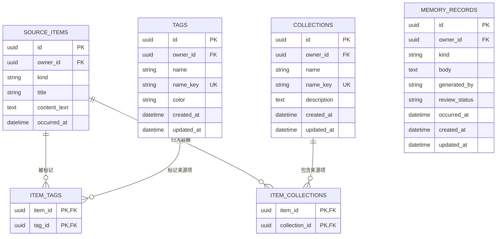
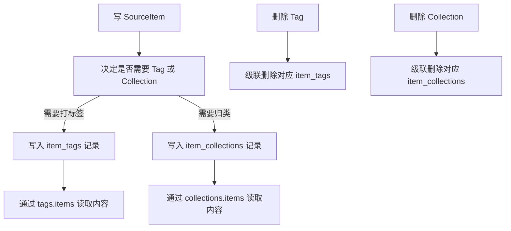
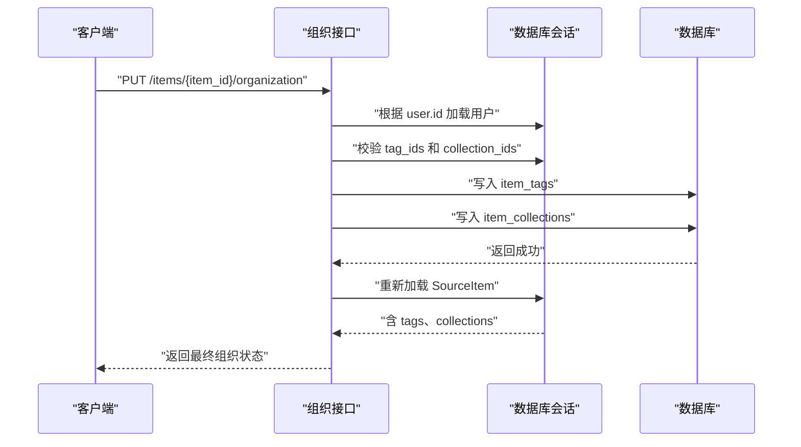
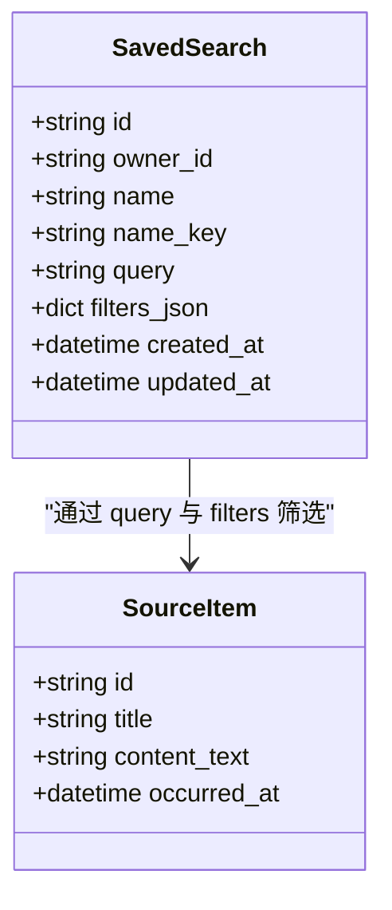
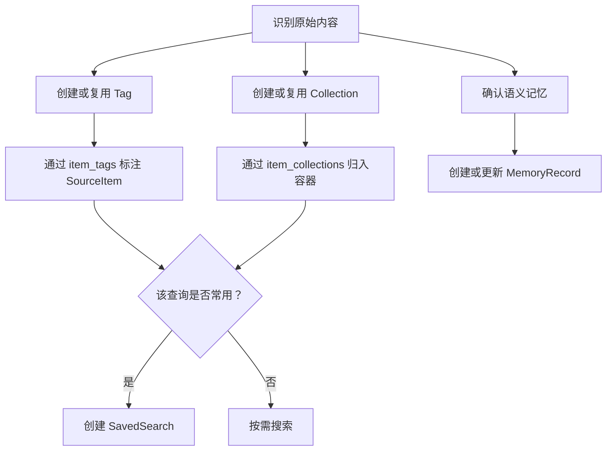

# 组织与内容管理模型

<cite>
**本文引用的文件**
- [models.py](file://src/personal_ai_life_os/models.py)
- [organization.py](file://src/personal_ai_life_os/api/routes/organization.py)
- [saved_searches.py](file://src/personal_ai_life_os/api/routes/saved_searches.py)
- [f9a1c4d8e702_add_search_indexes_and_organization.py](file://migrations/versions/f9a1c4d8e702_add_search_indexes_and_organization.py)
- [test_search_organization.py](file://tests/test_search_organization.py)
</cite>

## 目录
1. [引言](#引言)
2. [数据模型总览](#数据模型总览)
3. [核心组件分析](#核心组件分析)
4. [关联表设计与双向导航](#关联表设计与双向导航)
5. [保存搜索的数据结构](#保存搜索的数据结构)
6. [记忆记录通用笔记系统](#记忆记录通用笔记系统)
7. [依赖关系与完整性约束](#依赖关系与完整性约束)
8. [性能与索引设计](#性能与索引设计)
9. [内容组织最佳实践](#内容组织最佳实践)
10. [常见问题排查](#常见问题排查)
11. [结论](#结论)

## 引言
本文件聚焦 Personal-AI-Life-OS 中与“组织”和“内容管理”相关的数据模型，重点说明 Tag、Collection、SavedSearch、MemoryRecord 以及它们与 SourceItem 的关系。这些能力共同构成了用户内容的标签化、容器化管理、可复用查询和用户自生成笔记体系：内容通过 SourceItem 统一表达，Tag 和 Collection 提供分类维度，SavedSearch 保存结构化查询意图，MemoryRecord 提供独立的用户语义记录。

## 数据模型总览
该系统的组织与内容管理围绕以下实体展开：

| 实体 | 职责 | 关键特性 |
|---|---|---|
| `SourceItem` | 已解析来源项的通用载体 | 多对多关联标签、集合、记忆记录、审查、提醒；支持时间、来源、哈希、版本标记 |
| `Tag` | 扁平分类标签 | 同用户下 `name_key` 唯一；用于给 SourceItem 打标签 |
| `Collection` | 命名组织容器 | 同用户下 `name_key` 唯一；描述可为空；承载批量归类 |
| `item_tags` | SourceItem 与 Tag 的关联表 | 联合主键，支持反向索引 |
| `item_collections` | SourceItem 与 Collection 的关联表 | 联合主键，支持反向索引 |
| `SavedSearch` | 持久化查询 | 名称、查询字符串、JSON 过滤条件，同用户下 `name_key` 唯一 |
| `MemoryRecord` | 用户或 AI 生成的语义记忆 | `kind`、`body`、`generated_by`、`review_status`、可选发生时间 |

图表来源
- [models.py:64-77](file://src/personal_ai_life_os/models.py#L64-L77)
- [models.py:200-360](file://src/personal_ai_life_os/models.py#L200-L360)
- [f9a1c4d8e702_add_search_indexes_and_organization.py:43-144](file://migrations/versions/f9a1c4d8e702_add_search_indexes_and_organization.py#L43-L144)

章节来源
- [models.py:64-77](file://src/personal_ai_life_os/models.py#L64-L77)
- [models.py:200-360](file://src/personal_ai_life_os/models.py#L200-L360)
- [f9a1c4d8e702_add_search_indexes_and_organization.py:43-144](file://migrations/versions/f9a1c4d8e702_add_search_indexes_and_organization.py#L43-L144)

## 核心组件分析

### Tag：轻量分类标签
- 字段含义
  - `id`：全局标识符。
  - `owner_id`：租户隔离，属于当前用户。
  - `name`：人类可读名称。
  - `name_key`：规范化后的唯一键，通常由名称小写处理得到，避免大小写重复。
  - `color`：可选的颜色标识，API 会进行展示层标准化处理。
  - `created_at` / `updated_at`：生命周期时间戳。
  - `items`：通过 `item_tags` 指向所有被贴了该标签的 SourceItem。
- 唯一性约束
  - 在迁移层定义了 `(owner_id, name_key)` 的唯一约束，保证同一用户不能创建两个相同规范化名称的标签。
- API 行为
  - 列表按 `name_key` 排序，确保稳定输出。
  - 创建和更新时会将名称转为小写作为 `name_key`。
  - 更新接口支持清空颜色，体现 `clear_color` 操作语义。

章节来源
- [models.py:261-290](file://src/personal_ai_life_os/models.py#L261-L290)
- [f9a1c4d8e702_add_search_indexes_and_organization.py:68-85](file://migrations/versions/f9a1c4d8e702_add_search_indexes_and_organization.py#L68-L85)
- [organization.py:23-90](file://src/personal_ai_life_os/api/routes/organization.py#L23-L90)
- [organization.py:99-115](file://src/personal_ai_life_os/api/routes/organization.py#L99-L115)
- [test_search_organization.py:164-200](file://tests/test_search_organization.py#L164-L200)

### Collection：带描述的命名容器
- 字段含义
  - `id`：标识符。
  - `owner_id`：用户隔离边界。
  - `name`：显示名称。
  - `name_key`：规范化后唯一键。
  - `description`：描述文本，可为空。
  - `items`：通过 `item_collections` 关联的 SourceItem。
- 唯一性与用途
  - `name_key` 同样参与用户级唯一约束。
  - Collection 更适合把一组主题相关的内容放在一起，是比 Tag 更“容器化”的组织单位。
- API 行为
  - 列表按 `name_key` 排序。
  - 创建和更新时对 `name` 做小写归一化为 `name_key`。

章节来源
- [models.py:291-315](file://src/personal_ai_life_os/models.py#L291-L315)
- [f9a1c4d8e702_add_search_indexes_and_organization.py:87-122](file://migrations/versions/f9a1c4d8e702_add_search_indexes_and_organization.py#L87-L122)
- [organization.py:30-57](file://src/personal_ai_life_os/api/routes/organization.py#L30-L57)
- [organization.py:109-156](file://src/personal_ai_life_os/api/routes/organization.py#L109-L156)

### SavedSearch：持久化查询
- 字段含义
  - `id`：保存条目标识。
  - `owner_id`：所属用户。
  - `name` / `name_key`：便于识别的名称及其规范化键。
  - `query`：用于匹配内容的人类语义查询串。
  - `filters_json`：JSON 形式的结构化过滤条件。
  - `created_at` / `updated_at`：记录生命周期。
- 存储方式
  - 查询主体存在 `query` 列中。
  - 结构化过滤条件（如类型、时间范围、状态、来源等）以 JSON 形式保存在 `filters_json`。
- 唯一性
  - 同用户下 `name_key` 唯一，测试中也验证了大写变体名称会产生冲突。
- API 序列化
  - 读取时将 `filters_json` 反序列化为 `SearchFilters` 模式；写入时将过滤器对象转回 JSON。

章节来源
- [models.py:299-328](file://src/personal_ai_life_os/models.py#L299-L328)
- [f9a1c4d8e702_add_search_indexes_and_organization.py:124-144](file://migrations/versions/f9a1c4d8e702_add_search_indexes_and_organization.py#L124-L144)
- [saved_searches.py:19-92](file://src/personal_ai_life_os/api/routes/saved_searches.py#L19-L92)
- [test_search_organization.py:125-163](file://tests/test_search_organization.py#L125-L163)

### MemoryRecord：通用记忆记录
- 字段含义
  - `kind`：默认为“note”，允许扩展不同语义类型。
  - `body`：主要文本内容，承担笔记正文角色。
  - `generated_by`：表明来源是用户还是生成式模型。
  - `review_status`：记忆确认状态，默认“confirmed”。
  - `occurred_at`：可选的记录发生时间，可用于时间线整理。
  - `source_items`：多对多关联的 SourceItem，表示记忆引用或解释的内容来源。
- 语义定位
  - MemoryRecord 不是单纯保存 SourceItem 的副本，而是对用户确认的“记忆结果”建模：它可以解释一张照片、一段对话片段或一个业务事件。
  - 它与 SourceItem 的多对多关系允许一条记忆关联多个来源项。

章节来源
- [models.py:329-347](file://src/personal_ai_life_os/models.py#L329-L347)
- [models.py:36-43](file://src/personal_ai_life_os/models.py#L36-L43)
- [docs/architecture/data-model.md:8-22](file://docs/architecture/data-model.md#L8-L22)

## 关联表设计与双向导航

### 关联表总体设计
项目使用 SQLAlchemy 的 `Table` 对象显式声明中间关联表，再通过 `relationship(..., secondary=...)` 建立模型间的双向导航：

- `item_tags`
  - 主键：`(item_id, tag_id)`，防止同一内容重复被同一个标签标记。
  - 外键：分别指向 `source_items.id` 和 `tags.id`，删除端采用级联删除。
  - 索引：额外索引 `(tag_id, item_id)`，优化从标签查内容的场景。
- `item_collections`
  - 主键：`(item_id, collection_id)`。
  - 外键：分别指向 `source_items.id` 和 `collections.id`。
  - 索引：额外索引 `(collection_id, item_id)`，优化从容器查内容的场景。

图表来源
- [models.py:64-77](file://src/personal_ai_life_os/models.py#L64-L77)
- [models.py:240-290](file://src/personal_ai_life_os/models.py#L240-L290)
- [models.py:291-315](file://src/personal_ai_life_os/models.py#L291-L315)
- [f9a1c4d8e702_add_search_indexes_and_organization.py:103-144](file://migrations/versions/f9a1c4d8e702_add_search_indexes_and_organization.py#L103-L144)

### 通过 SQLAlchemy relationship 实现双向导航
- SourceItem → Tag/Collection
  - `SourceItem.tags` 和 `SourceItem.collections` 都通过 `secondary` 参数连接到对应关联表，并使用 `back_populates="items"` 指定反向字段。
- Tag → SourceItem
  - `Tag.items` 通过 `secondary=item_tags` 指向所有使用该标签的来源项。
- Collection → SourceItem
  - `Collection.items` 通过 `secondary=item_collections` 指向容器中所有内容。
- 反向字段命名一致性
  - `back_populates="items"` 使双向访问无需编写自定义连接逻辑，例如从 SourceItem 可取得 tags，从 Tag 可取得 items。

章节来源
- [models.py:238-260](file://src/personal_ai_life_os/models.py#L238-L260)
- [models.py:261-290](file://src/personal_ai_life_os/models.py#L261-L290)
- [models.py:291-315](file://src/personal_ai_life_os/models.py#L291-L315)

### 组织操作的数据流

图表来源
- [organization.py:180-227](file://src/personal_ai_life_os/api/routes/organization.py#L180-L227)
- [models.py:238-257](file://src/personal_ai_life_os/models.py#L238-L257)

## 保存搜索的数据结构
SavedSearch 的核心目标是让用户保存常用的搜索结果组合，并在后续直接复用。

| 字段 | 数据类型与用途 |
|---|---|
| `name` | 人类可读的保存标题 |
| `name_key` | 用于同用户唯一性约束，通常为小写化名称 |
| `query` | 查询关键词或表达式，通常用于全文检索 |
| `filters_json` | JSON 中的结构化过滤条件，如类型、时间范围、状态、来源等 |
| `created_at` / `updated_at` | 修改时间线，便于排序和审计 |

示例过滤条件语义（基于测试构造）：
- `types`：搜索结果类型，如 `timeline`、`reminders`、`reviews`。
- `start` / `end`：起止日期范围。
- `status`：目标实体的状态筛选。
- 其他字段可由上层过滤器模型扩展。

图表来源
- [models.py:299-328](file://src/personal_ai_life_os/models.py#L299-L328)
- [saved_searches.py:19-92](file://src/personal_ai_life_os/api/routes/saved_searches.py#L19-L92)
- [test_search_organization.py:125-163](file://tests/test_search_organization.py#L125-L163)

## 记忆记录通用笔记系统
MemoryRecord 是可演化的通用笔记模型，适合表达用户确认过的“有意义信息”。

- 内容类型扩展点
  - `kind`：目前默认值为 `note`，但类型是字符串，可随业务扩展为日记、要点摘要、问题复盘等。
- 用户生成标记
  - `generated_by`：标记是由用户生成还是由 AI 生成。
  - `review_status`：可用于区分草稿、待确认、已确认、废弃等不同状态。
- 与内容源的关系
  - 通过 `memory_record_sources` 与 `source_items` 多对多关联，使“这条记忆解释的是哪些来源项”成为显式数据结构。
- 与其他模型的比较
  - Review 也关联 SourceItem，但 Review 偏向周期性回顾；MemoryRecord 更贴近用户随时确认的独立记忆条目。
  - Reminder 关注后续动作；MemoryRecord 关注语义信息本身。

章节来源
- [models.py:36-43](file://src/personal_ai_life_os/models.py#L36-L43)
- [models.py:329-347](file://src/personal_ai_life_os/models.py#L329-L347)
- [docs/architecture/data-model.md:8-22](file://docs/architecture/data-model.md#L8-L22)

## 依赖关系与完整性约束

### 用户级隔离
Tag、Collection、SavedSearch 均拥有 `owner_id`，并通过外键关联 `users.id`，且设置 `ondelete=CASCADE`。API 层在查询和组织操作中也用 `user.id` 作为额外过滤条件，形成双重隔离。

章节来源
- [models.py:261-328](file://src/personal_ai_life_os/models.py#L261-L328)
- [organization.py:23-57](file://src/personal_ai_life_os/api/routes/organization.py#L23-L57)

### 唯一性约束汇总
| 实体 | 唯一约束 | 目的 |
|---|---|---|
| `tags` | `(owner_id, name_key)` | 同一用户下不允许重复名称 |
| `collections` | `(owner_id, name_key)` | 同一用户下不允许重复容器名 |
| `saved_searches` | `(owner_id, name_key)` | 同一用户下不允许重复保存查询名 |
| `item_tags` | `(item_id, tag_id)` | 同一内容不会被同一标签重复标记 |
| `item_collections` | `(item_id, collection_id)` | 同一内容不会被同一容器重复收录 |
| `SourceItem` | `(owner_id, source_id, external_id, source_sha256)` | 版本去重和导入幂等 |

章节来源
- [models.py:200-215](file://src/personal_ai_life_os/models.py#L200-L215)
- [f9a1c4d8e702_add_search_indexes_and_organization.py:68-144](file://migrations/versions/f9a1c4d8e702_add_search_indexes_and_organization.py#L68-L144)

### 级联删除
- 删除 Tag 会级联删除其 `item_tags` 行。
- 删除 Collection 会级联删除其 `item_collections` 行。
- 删除 SourceItem 会影响与其关联的记忆、审查、提醒及组织关系，具体依赖方向由各自外键定义决定。

章节来源
- [models.py:64-77](file://src/personal_ai_life_os/models.py#L64-L77)
- [models.py:238-257](file://src/personal_ai_life_os/models.py#L238-L257)
- [f9a1c4d8e702_add_search_indexes_and_organization.py:103-144](file://migrations/versions/f9a1c4d8e702_add_search_indexes_and_organization.py#L103-L144)

## 性能与索引设计

### 常用索引
- `ix_item_tags_tag_item`：`(tag_id, item_id)`，加速“根据标签找内容”。
- `ix_item_collections_collection_item`：`(collection_id, item_id)`，加速“根据容器找内容”。
- `ix_tags_owner_id` / `ix_tags_owner_name`：加速按用户查找标签并按名称排序。
- `ix_collections_owner_id` / `ix_collections_owner_name`：加速按用户查找并排序集合。
- `ix_saved_searches_owner_created`：按用户和创建时间排序保存搜索。

章节来源
- [models.py:64-77](file://src/personal_ai_life_os/models.py#L64-L77)
- [models.py:261-328](file://src/personal_ai_life_os/models.py#L261-L328)
- [f9a1c4d8e702_add_search_indexes_and_organization.py:68-144](file://migrations/versions/f9a1c4d8e702_add_search_indexes_and_organization.py#L68-L144)

### 对查询的影响
- 按标签或集合筛选时，复合索引能够减少全表扫描。
- 列表接口使用 `order_by(name_key)`，利用已有索引提高排序稳定性。
- SavedSearch 的过滤条件是 JSON，因此应配合上层查询构建器高效映射到实际 SQL 条件。

## 内容组织最佳实践

### 命名规范
1. **名称与小写键**
   - 使用 `name` 表示展示名，`name_key` 表示规范化键。
   - 创建或更新时，将 `name` 小写后写入 `name_key`，以避免大小写导致的重复。
2. **标签命名建议**
   - 简短明确，比如“研究”“待办”“项目A”。
   - 避免使用特殊符号和空格，保持一致性和可排序性。
3. **集合命名建议**
   - 适合较宽泛的分类，比如“发布说明”“季度复盘”。
   - 描述字段 `description` 用来补充背景，但不代替名称唯一性。
4. **保存搜索命名建议**
   - `name` 应表达查询用途，如“最近港口变更”“待处理提醒”。
   - `name_key` 由系统或小写规范化保证不重复。

章节来源
- [organization.py:65-87](file://src/personal_ai_life_os/api/routes/organization.py#L65-L87)
- [organization.py:120-153](file://src/personal_ai_life_os/api/routes/organization.py#L120-L153)
- [saved_searches.py:54-92](file://src/personal_ai_life_os/api/routes/saved_searches.py#L54-L92)

### 内容打标和归类流程
推荐使用分层组织思路：
1. 先确定 SourceItem 的主题和时间。
2. 使用 Tag 表达细粒度标签，比如“文档”“照片”“问题”。
3. 使用 Collection 表达更大范围的组织，比如“2026 年项目文档”。
4. 如果该内容经常出现在某类搜索中，则创建 SavedSearch 以便复用。
5. 如果用户对 SourceItem 形成了明确的认知结论，再生成 MemoryRecord。

图表来源
- [models.py:238-328](file://src/personal_ai_life_os/models.py#L238-L328)
- [organization.py:180-227](file://src/personal_ai_life_os/api/routes/organization.py#L180-L227)

### 批量操作方法
1. **批量标记和归类**
   - 使用 `/items/{item_id}/organization` 接口，一次性提交 `tag_ids` 和 `collection_ids`。
   - API 会校验 ID 有效性及所属用户，再写入关联表并返回最终状态。
2. **批量查询**
   - 结合 SearchFilters 的 `types`、时间范围、来源等条件，反复执行已保存的 SavedSearch。
3. **批量清理**
   - 删除 Tag 或 Collection 会级联清理关联表；如果需要保留内容只移除组织关系，应谨慎评估级联影响。
4. **批量导出**
   - 账户归档功能中包含 tag/collection 等数据，可作为备份或迁移依据。

章节来源
- [organization.py:180-227](file://src/personal_ai_life_os/api/routes/organization.py#L180-L227)
- [test_search_organization.py:164-200](file://tests/test_search_organization.py#L164-L200)

## 常见问题排查

### 无法重复创建同名标签或集合
- 现象：创建标签或集合时报 409。
- 原因：`name_key` 在同用户下唯一，API 已将名称小写化作为键。
- 处理：
  - 使用另一个名称。
  - 或者先获取现有资源再进行更新。

章节来源
- [f9a1c4d8e702_add_search_indexes_and_organization.py:68-144](file://migrations/versions/f9a1c4d8e702_add_search_indexes_and_organization.py#L68-L144)
- [test_search_organization.py:125-163](file://tests/test_search_organization.py#L125-L163)
- [test_search_organization.py:164-200](file://tests/test_search_organization.py#L164-L200)

### 无法为内容设置标签或集合
- 可能原因：
  - 传入的标签或集合 ID 不存在。
  - 标签或集合不属于当前登录用户。
  - ID 格式不正确。
- 排查方式：
  - 检查 API 返回的 422 或 404 响应。
  - 确认 `tag_ids`、`collection_ids` 是有效的 UUID 列表。
  - 确认组织资源和内容属于同一用户。

章节来源
- [organization.py:201-227](file://src/personal_ai_life_os/api/routes/organization.py#L201-L227)
- [test_search_organization.py:164-200](file://tests/test_search_organization.py#L164-L200)

### 保存搜索查询未生效
- 可能原因：
  - `query` 没有命中内容。
  - `filters_json` 中的类型、时间范围、状态等条件不符合目标数据。
  - 保存查询后未执行搜索接口。
- 建议：
  - 先直接调用搜索接口验证查询和过滤器。
  - 再把相同条件保存到 SavedSearch。

章节来源
- [saved_searches.py:19-92](file://src/personal_ai_life_os/api/routes/saved_searches.py#L19-L92)
- [test_search_organization.py:125-163](file://tests/test_search_organization.py#L125-L163)

### 记忆记录与来源项脱节
- 现象：MemoryRecord 存在，但没有关联任何 SourceItem。
- 解释：这并非错误，因为多对多关系允许为空。
- 处理：
  - 如果需要关联，应通过 memory record 创建或更新流程绑定对应的 source item ID。
  - 如果是 AI 生成的解释，建议在用户确认后关联证据来源项。

章节来源
- [models.py:36-43](file://src/personal_ai_life_os/models.py#L36-L43)
- [models.py:329-347](file://src/personal_ai_life_os/models.py#L329-L347)
- [docs/architecture/data-model.md:8-22](file://docs/architecture/data-model.md#L8-L22)

## 结论
Personal-AI-Life-OS 的组织与内容管理模型以 SourceItem 为核心载体，通过 Tag 和 Collection 提供灵活而可排序的分类体系；通过 `item_tags` 和 `item_collections` 的显式关联表实现多对多关系和双向导航；通过 SavedSearch 持久化常用查询意图；通过 MemoryRecord 承载用户确认过的语义记忆。设计上强调用户级隔离、规范化键唯一性、明确的外键与索引，使得系统在可扩展的同时保持查询稳定和可预测。对于使用者而言，遵循小写键命名、分层标签与集合、先搜索后复用保存查询的实践，能获得更一致的组织和检索体验。