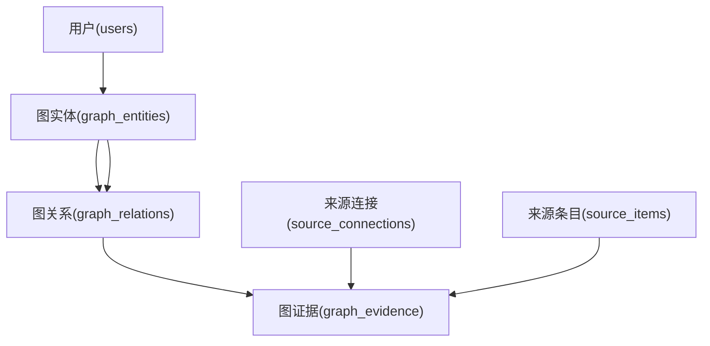
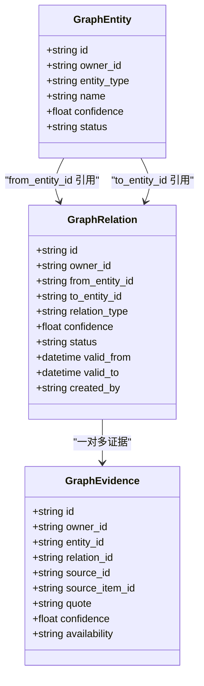
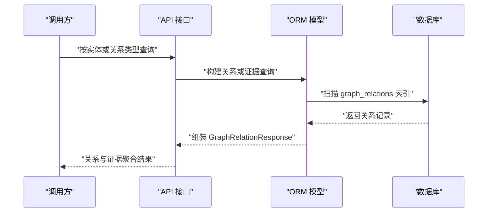
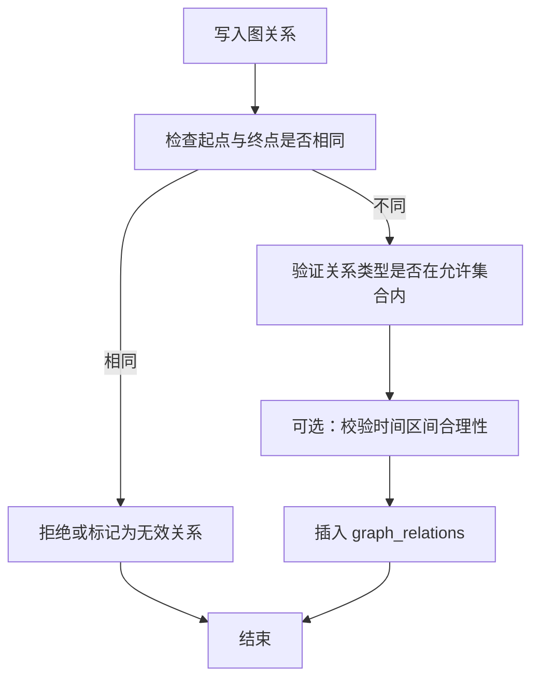
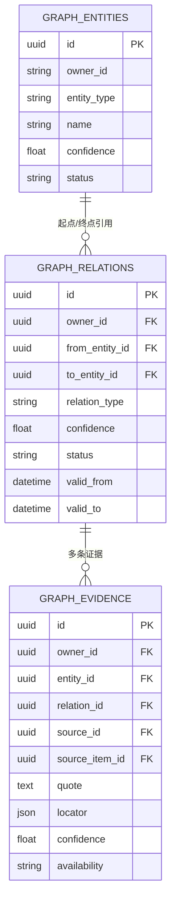

# 图关系 GraphRelation

<cite>
**本文件引用的源码**
- [models.py](file://src/personal_ai_life_os/models.py)
- [schemas.py](file://src/personal_ai_life_os/api/schemas.py)
- [d2f5a8c14e73_add_evidence_graph_tables.py](file://migrations/versions/d2f5a8c14e73_add_evidence_graph_tables.py)
- [test_graph_model.py](file://tests/test_graph_model.py)
- [graph_extraction.py](file://src/personal_ai_life_os/services/graph_extraction.py)
</cite>

## 目录
1. [引言](#引言)
2. [项目结构中的定位](#项目结构中的定位)
3. [核心数据模型](#核心数据模型)
4. [架构总览](#架构总览)
5. [详细字段语义](#详细字段语义)
6. [索引与查询性能](#索引与查询性能)
7. [一致性约束](#一致性约束)
8. [证据关联分析](#证据关联分析)
9. [图谱查询示例](#图谱查询示例)
10. [维护与排错指南](#维护与排错指南)
11. [结论](#结论)

## 引言
GraphRelation（图关系）是 Personal-AI-Life-OS 知识图谱中的“有向边”模型，用于描述两个 `graph_entities`（图实体）之间的结构化关系。该模型支持关系类型、置信度、状态、时间范围以及可追溯证据，从而既支撑图谱查询，也支撑证据审查和质量治理。其直接关联表为 `graph_relations`，并通过外键指向被引用实体的主表 `graph_entities.id`。

## 项目结构中的定位
图关系模型主要位于以下位置：
- ORM 模型定义：`src/personal_ai_life_os/models.py`
- API 响应数据结构：`src/personal_ai_life_os/api/schemas.py`
- 数据库迁移：`migrations/versions/d2f5a8c14e73_add_evidence_graph_tables.py`
- 抽取服务中使用的关系类型集合：`src/personal_ai_life_os/services/graph_extraction.py`
- 单元测试覆盖约束行为：`tests/test_graph_model.py`

**图示来源**
- [models.py:400-520](file://src/personal_ai_life_os/models.py#L400-L520)
- [d2f5a8c14e73_add_evidence_graph_tables.py:50-104](file://migrations/versions/d2f5a8c14e73_add_evidence_graph_tables.py#L50-L104)

**章节来源**
- [models.py:400-520](file://src/personal_ai_life_os/models.py#L400-L520)
- [d2f5a8c14e73_add_evidence_graph_tables.py:50-104](file://migrations/versions/d2f5a8c14e73_add_evidence_graph_tables.py#L50-L104)

## 核心数据模型
`GraphRelation` 表示一条从起点实体指向终点实体的有向边。它具备以下设计目标：
- 使用自引用外键区分关系的起点和终点；
- 用 `relation_type` 统一描述关系的语义类别；
- 用 `confidence` 标注模型或流程生成关系的可信程度；
- 用 `status` 控制关系是否进入审查、合并或活跃状态；
- 用 `valid_from` 和 `valid_to` 表达时效性历史事实；
- 通过 `GraphEvidence` 把原始语料片段与关系绑定。

**图示来源**
- [models.py:400-520](file://src/personal_ai_life_os/models.py#L400-L520)

**章节来源**
- [models.py:438-505](file://src/personal_ai_life_os/models.py#L438-L505)

## 架构总览
图关系在系统中有三类关键角色：
1. **关系建模层**：`GraphRelation` 提供方向性、类型化和时间化的边。
2. **证据支撑层**：`GraphEvidence` 提供原文片段、来源条目、可访问性与额外置信度。
3. **查询与服务层**：API schema 暴露关系与证据的只读视图；抽取服务和审查服务围绕 `status`、`confidence`、`valid_from`/`valid_to` 组织工作流。

**图示来源**
- [schemas.py:456-504](file://src/personal_ai_life_os/api/schemas.py#L456-L504)
- [models.py:438-505](file://src/personal_ai_life_os/models.py#L438-L505)

**章节来源**
- [schemas.py:456-504](file://src/personal_ai_life_os/api/schemas.py#L456-L504)
- [models.py:438-505](file://src/personal_ai_life_os/models.py#L438-L505)

## 详细字段语义
### 方向性：起点与终点
- `from_entity_id`：边的起点实体标识，类型为 UUID 字符串，通过外键指向 `graph_entities.id`。
- `to_entity_id`：边的终点实体标识，同样为 UUID 字符串，指向 `graph_entities.id`。
- 这两个自引用外键共同构成有向边。起点与终点可以属于不同类型，也可以属于同一类型但不同实例。

| 字段 | 类型 | 是否可为空 | 默认值 | 说明 |
|---|---|---|---|---|
| `from_entity_id` | UUID 字符串 | 否 | — | 关系起点实体的主键 |
| `to_entity_id` | UUID 字符串 | 否 | — | 关系终点实体的主键 |

**章节来源**
- [models.py:446-455](file://src/personal_ai_life_os/models.py#L446-L455)

### 关系类型
- `relation_type` 为长度不超过 64 的字符串，例如 `works_at`、`related_to`、`part_of`、`has_goal`、`committed_to` 等由抽取逻辑提供的命名空间中的名称。
- 该字段带有单列索引 `ix_graph_relations_relation_type`，便于按类型过滤和统计。
- 抽取服务还定义了固定关系类型集合，表明这类字段不仅是自由文本，而是具有语义结构的图谱本体概念。

**章节来源**
- [models.py:440-445](file://src/personal_ai_life_os/models.py#L440-L445)
- [graph_extraction.py:52-55](file://src/personal_ai_life_os/services/graph_extraction.py#L52-L55)

### 时效建模：历史关系
- `valid_from` 表示关系开始有效的时刻，可为空。
- `valid_to` 表示关系结束有效的时刻，可为空。
- 两者均为带时区的日期时间字段，适合表达某段时期内两人存在合作关系、某段时间内某人与某个机构存在雇佣关系等。
- 如果只有当前有效关系而不关心历史版本，可保持两端为空；如果关系会随时间变化，则可用起止时间描述生命周期。

| 字段 | 用途 |
|---|---|
| `valid_from` | 关系生效开始时间 |
| `valid_to` | 关系失效或替换截止时间 |

**章节来源**
- [models.py:460-465](file://src/personal_ai_life_os/models.py#L460-L465)

### 置信度与审查状态
- `confidence` 为浮点数，默认值为 `1.0`。低置信度关系通常表示提取结果不够确定，应由审查流程判断、确认或拒绝。
- `status` 为状态字符串，默认值为 `"active"`。结合审查能力时，可将低置信度关系标记为待审、审查中、不通过等状态，再依据业务规则影响查询和展示。
- 低置信度的典型处理流程：
  1. 提取阶段赋予较低 `confidence`；
  2. 将 `status` 置入需要人工或高阶模型判断的状态；
  3. 审查完成后更新 `confidence` 和 `status`；
  4. 最终查询时可过滤掉未激活或低置信度关系。

**章节来源**
- [models.py:455-465](file://src/personal_ai_life_os/models.py#L455-L465)
- [graph_extraction.py:52-55](file://src/personal_ai_life_os/services/graph_extraction.py#L52-L55)

## 索引与查询性能
### 已有索引策略
| 索引名 | 包含字段 | 查询优化目标 |
|---|---|---|
| `ix_graph_relations_owner_id` | `owner_id` | 租户级隔离和多租户效率 |
| `ix_graph_relations_owner_type` | `owner_id` + `relation_type` | 先按租户再按关系类型过滤 |
| `ix_graph_relations_status` | `status` | 按审查状态过滤 |
| `ix_graph_relations_relation_type` | `relation_type` | 按关系类型统计和筛选 |
| `ix_graph_relations_from` | `from_entity_id` | 出边遍历 |
| `ix_graph_relations_to` | `to_entity_id` | 入边遍历 |

上述索引使系统能够高效执行以下查询：
- 查找某实体的全部出边；
- 查找某实体的全部入边；
- 按关系类型统计图结构复杂度；
- 先限定租户范围，再缩小到特定关系类型或状态。

**章节来源**
- [models.py:440-445](file://src/personal_ai_life_os/models.py#L440-L445)
- [d2f5a8c14e73_add_evidence_graph_tables.py:68-75](file://migrations/versions/d2f5a8c14e73_add_evidence_graph_tables.py#L68-L75)

### 双向遍历与图结构分析
由于对 `from_entity_id` 和 `to_entity_id` 分别建立索引，图谱查询不需要全表扫描即可得到：
- 出边：`from_entity_id = 目标实体`
- 入边：`to_entity_id = 目标实体`

如果需要统计某实体的度数（入度加出度），可以组合两次检索结果，再按需要的粒度聚合。若要进一步优化联合查询，可在应用层或数据库视图中基于 `owner_id`、`relation_type` 做预处理。

**章节来源**
- [models.py:440-445](file://src/personal_ai_life_os/models.py#L440-L445)

## 一致性约束
图关系的主要一致性问题有两个方面。

### 实体间不能指向自身
从图建模角度，`from_entity_id` 与 `to_entity_id` 不应指向同一个实体实例，因为关系应该连接不同实体。虽然当前模型代码中未显式定义检查约束强制禁止同节点自环，但业务层面应将其视为约束条件：
- 写入前校验 `from_entity_id ≠ to_entity_id`；
- 批量导入或迁移时需清理自环关系；
- 下游图谱分析前应忽略或标记自环，避免产生无意义的路径。

**图示来源**
- [models.py:446-465](file://src/personal_ai_life_os/models.py#L446-L465)
- [graph_extraction.py:52-55](file://src/personal_ai_life_os/services/graph_extraction.py#L52-L55)

### 关系必须指向存在的实体
`from_entity_id` 和 `to_entity_id` 都是外键，指向 `graph_entities.id`。数据库会在删除或更新时根据 `ondelete="CASCADE"` 进行级联操作，保证不会产生游离的关系边。

**章节来源**
- [models.py:446-455](file://src/personal_ai_life_os/models.py#L446-L455)

## 证据关联分析
`GraphEvidence` 通过 `relation_id` 与 `GraphRelation` 形成多对一关联，每条证据都记录一个具体关系的溯源片段。此外，证据还可以可选地关联到单个实体（`entity_id`），并依赖“至少关联实体或关系之一”的检查约束。

**图示来源**
- [models.py:438-505](file://src/personal_ai_life_os/models.py#L438-L505)
- [d2f5a8c14e73_add_evidence_graph_tables.py:78-104](file://migrations/versions/d2f5a8c14e73_add_evidence_graph_tables.py#L78-L104)

### 证据关键字段
| 字段 | 作用 |
|---|---|
| `relation_id` | 将证据归属到具体图关系 |
| `entity_id` | 可选地指向被证据描述的同级实体 |
| `source_id` | 追踪数据来源连接 |
| `source_item_id` | 精确到来源条目 |
| `quote` | 保存原文片段，作为人类或模型审查的依据 |
| `locator` | JSON 定位信息，便于定位文档位置或资源坐标 |
| `availability` | 标志证据是否仍可获取 |
| `confidence` | 与关系置信度配合，描述证据质量 |

### 至少关联实体或关系的约束
`GraphEvidence` 使用检查约束确保 `entity_id IS NOT NULL OR relation_id IS NOT NULL`。测试明确断言：当既不绑定实体也不绑定关系时，提交会导致完整性错误。因此：
- 单纯描述实体的证据可只填 `entity_id`；
- 支持关系溯源的证据应填写 `relation_id`；
- 同时填写两者可以表达“该证据既支持实体属性，也支持关系推导”；
- 两者都为空时不被接受。

**章节来源**
- [models.py:466-505](file://src/personal_ai_life_os/models.py#L466-L505)
- [test_graph_model.py:142-160](file://tests/test_graph_model.py#L142-L160)

## 图谱查询示例
以下示例适用于关系审计、图结构分析和问答辅助。实际实现可通过 SQLAlchemy 查询或直接 SQL 完成。

### 查找某个实体的所有出边
适用场景：查看某人或某组织的主动关系。

推荐思路：
1. 限定 `owner_id`；
2. 选择 `from_entity_id = 目标实体 id`；
3. 如需时间窗口，增加 `valid_from` 与 `valid_to` 条件；
4. 如需状态过滤，增加 `status` 条件；
5. 关联证据，仅保留可用证据时再加 `graph_evidence.availability = 'active'`。

### 查找某个实体的所有入边
适用场景：查看谁与该实体存在关系，如合作方、所属机构、关联人物。

推荐思路：
1. 限定 `owner_id`；
2. 选择 `to_entity_id = 目标实体 id`；
3. 同上可按时间、状态、证据可用性进一步筛选。

### 按关系类型统计图结构复杂度
适用场景：评估图谱中某一类关系的数量密度，比如 `works_at`、`related_to`、`part_of`、`has_goal`、`committed_to`。

推荐思路：
1. 以 `owner_id` 为租户维度；
2. 按 `relation_type` 分组计数；
3. 可选择只对 `status = 'active'` 的关系计数；
4. 可结合时间范围，观察历史演进；
5. 可叠加证据可用性过滤，衡量高质量关系的数量。

### 低置信度关系审查清单
适用场景：审查模型生成的弱关系。

推荐思路：
1. 选择 `confidence < 审查阈值` 或明确低分数边界；
2. 优先显示 `status` 处于待审状态的记录；
3. 关联 `GraphEvidence.quote` 和 `locator`，方便人工核验；
4. 审查后更新 `confidence` 和 `status`。

注意：上述查询为业务建议，应基于已建立的 `owner_id`、`relation_type`、`status`、`from_entity_id`、`to_entity_id` 及 `graph_evidence` 相关索引进行优化。

**章节来源**
- [models.py:440-505](file://src/personal_ai_life_os/models.py#L440-L505)
- [schemas.py:484-504](file://src/personal_ai_life_os/api/schemas.py#L484-L504)
- [graph_extraction.py:52-55](file://src/personal_ai_life_os/services/graph_extraction.py#L52-L55)

## 维护与排错指南
### 常见问题
1. **证据无法提交：缺少实体或关系目标**
   - 现象：插入 `GraphEvidence` 时出现完整性错误。
   - 原因：`entity_id` 与 `relation_id` 都为空，违反检查约束。
   - 处理：至少设置其中一个目标字段。

2. **关系查询很慢**
   - 可能原因：未限定 `owner_id`，或未按常用方向字段、关系类型过滤。
   - 处理：优先添加 `owner_id`，并结合 `from_entity_id` / `to_entity_id` / `relation_type` / `status`。

3. **历史关系过期但仍参与计算**
   - 可能原因：没有使用 `valid_from` / `valid_to` 过滤当前有效关系。
   - 处理：加入当前时间点与起止时间的比较，或将过时关系标记为不可用状态。

4. **低置信度关系污染图谱质量**
   - 可能原因：直接暴露所有 `confidence` 较低的关系。
   - 处理：结合 `status` 与 `confidence` 进行分层展示；在统计图中优先采用高置信度且状态活跃的边。

5. **关系指向不存在的实体**
   - 数据库外键机制会阻止非法插入或按级联策略删除上游实体；若出现上游实体被删除导致关系消失，应理解 `CASCADE` 语义。

### 推荐维护实践
- 写入图关系前校验方向有效性；
- 对高频查询路径建立组合过滤条件；
- 对重要关系启用证据绑定；
- 使用 `valid_from`/`valid_to` 表达周期性或阶段性关系；
- 将审查后的新置信度和新状态落库；
- 定期统计关系类型分布，发现异常关系类型。

**章节来源**
- [models.py:466-505](file://src/personal_ai_life_os/models.py#L466-L505)
- [test_graph_model.py:142-160](file://tests/test_graph_model.py#L142-L160)

## 结论
GraphRelation 是 Personal-AI-Life-OS 知识图谱的边基元，通过自引用外键表达方向性，通过关系类型和状态字段表达语义与治理阶段，通过时间字段表达历史时效性，并通过 GraphEvidence 提供可回溯的证据链。配合已有的租户隔离索引、双向遍历索引和类型索引，系统能够在多租户环境下高效进行入边与出边查询、关系类型统计和证据辅助审查。在应用层面，开发者应将“起点不等于终点”“至少关联实体或关系”“时效性和审查状态”纳入写入校验和查询过滤逻辑，以维持图谱数据的一致性与可解释性。