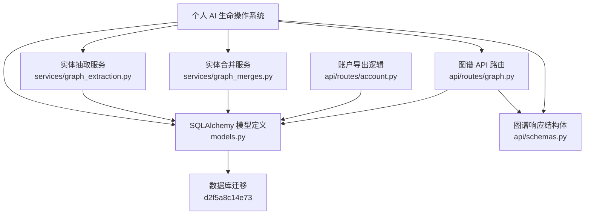
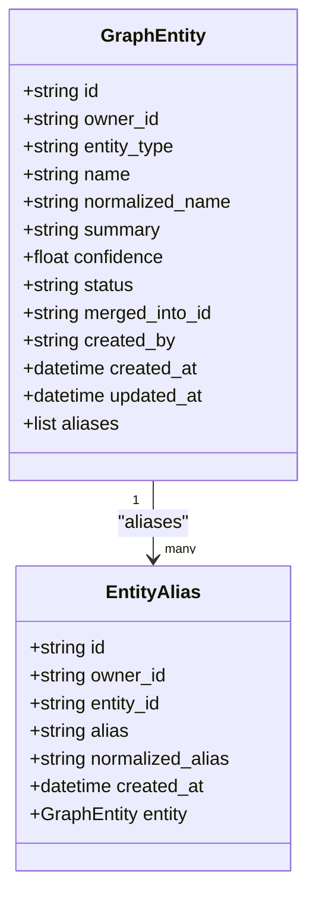
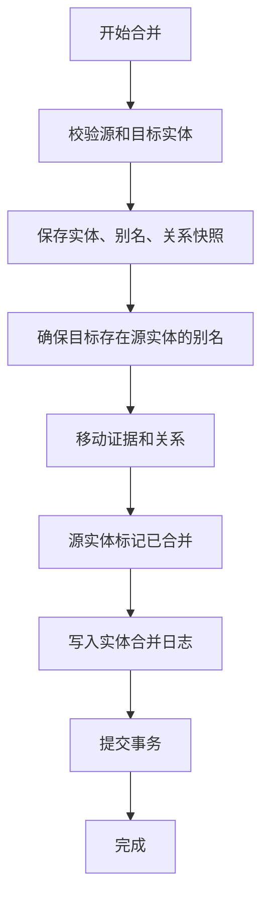
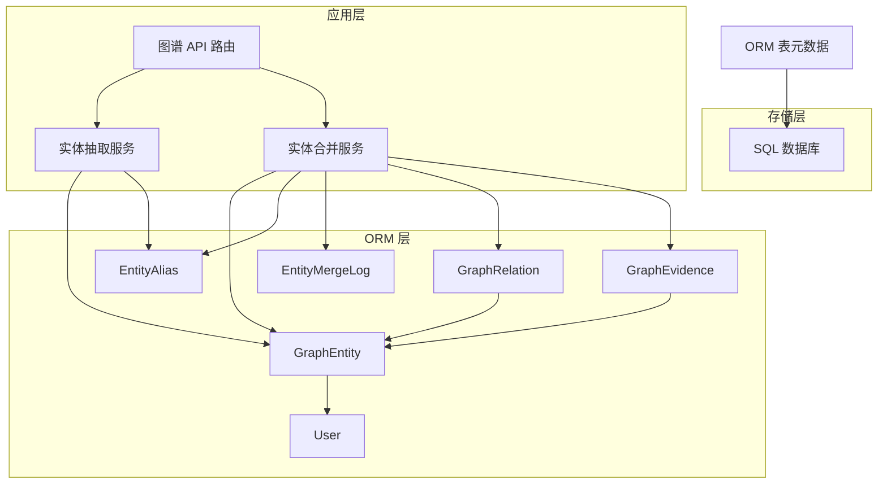
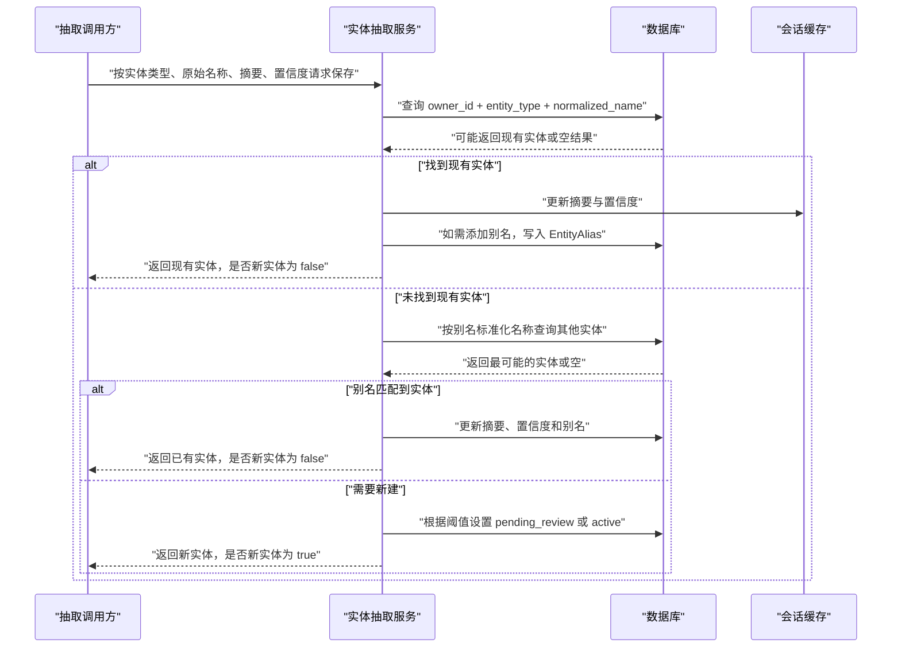
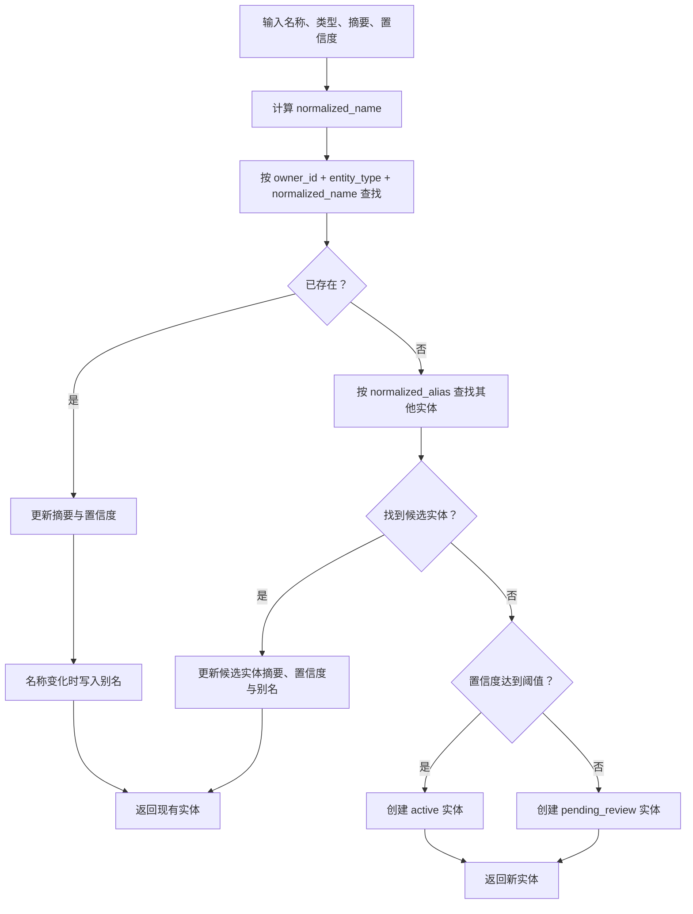
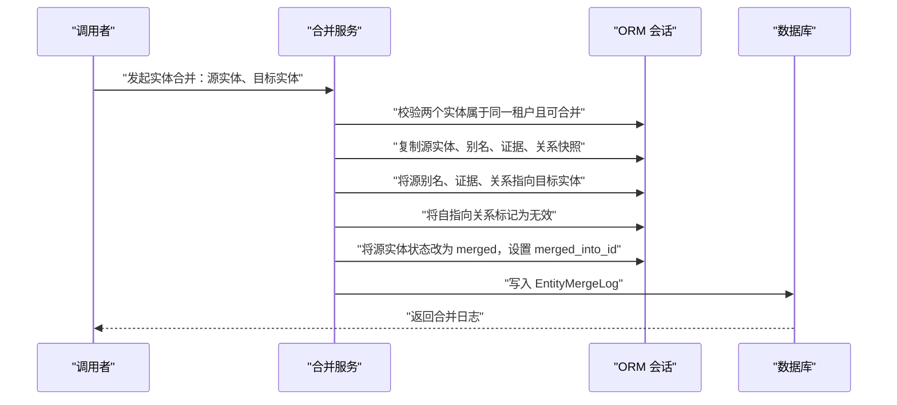
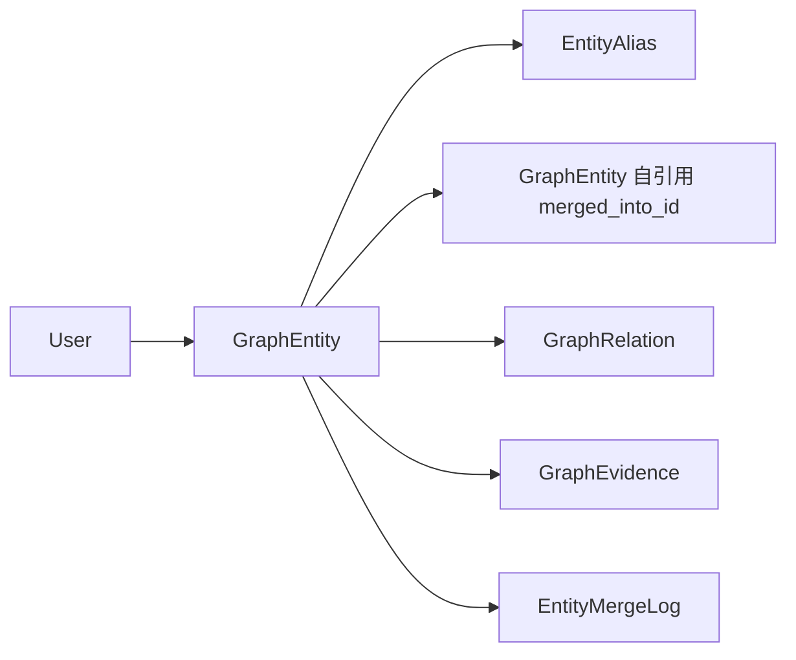

# 图实体 GraphEntity

<cite>
**本文引用文件列表**
- [models.py](file://src/personal_ai_life_os/models.py)
- [graph_extraction.py](file://src/personal_ai_life_os/services/graph_extraction.py)
- [graph_merges.py](file://src/personal_ai_life_os/services/graph_merges.py)
- [graph.py](file://src/personal_ai_life_os/api/routes/graph.py)
- [schemas.py](file://src/personal_ai_life_os/api/schemas.py)
- [d2f5a8c14e73_add_evidence_graph_tables.py](file://migrations/versions/d2f5a8c14e73_add_evidence_graph_tables.py)
- [account.py](file://src/personal_ai_life_os/api/routes/account.py)
</cite>

## 目录
1. [简介](#简介)
2. [项目结构定位](#项目结构定位)
3. [核心数据模型](#核心数据模型)
4. [架构总览](#架构总览)
5. [详细组件分析](#详细组件分析)
6. [依赖关系分析](#依赖关系分析)
7. [持久化与抽取流程](#持久化与抽取流程)
8. [索引与查询优化](#索引与查询优化)
9. [常见操作模式](#常见操作模式)
10. [故障排查](#故障排查)
11. [结论](#结论)

## 简介
`GraphEntity` 是 Personal-AI-Life-OS 中“图谱实体”的根对象，用于承载 AI 从用户来源数据中提取出的概念，例如人物、组织、目标、项目等。它以 `owner_id` 作为租户隔离边界，以 `entity_type` 表示实体类别，同时维护原始名称、规范化名称、摘要描述、置信度评分、生命周期状态以及合并指针。该模型支撑了实体识别、别名归并、证据关联、关系推导、审计回滚、API 查询及图谱问答等功能。

## 项目结构定位
与 `GraphEntity` 直接相关的代码集中在以下位置：

**图示来源**
- [models.py:409-569](file://src/personal_ai_life_os/models.py#L409-L569)
- [graph_extraction.py:348-413](file://src/personal_ai_life_os/services/graph_extraction.py#L348-L413)
- [graph_merges.py:102-200](file://src/personal_ai_life_os/services/graph_merges.py#L102-L200)
- [graph.py:57-83](file://src/personal_ai_life_os/api/routes/graph.py#L57-L83)
- [schemas.py:467-481](file://src/personal_ai_life_os/api/schemas.py#L467-L481)
- [d2f5a8c14e73_add_evidence_graph_tables.py:19-147](file://migrations/versions/d2f5a8c14e73_add_evidence_graph_tables.py#L19-L147)
- [account.py:91-103](file://src/personal_ai_life_os/api/routes/account.py#L91-L103)

**章节来源**
- [models.py:409-569](file://src/personal_ai_life_os/models.py#L409-L569)
- [d2f5a8c14e73_add_evidence_graph_tables.py:19-147](file://migrations/versions/d2f5a8c14e73_add_evidence_graph_tables.py#L19-L147)

## 核心数据模型

### 图实体表结构概览
| 字段 | 类型 | 必填 | 默认值 | 索引或约束 | 职责 |
|---|---|---:|---:|---|---|
| `id` | UUID 字符串 | 是 | `new_id()` | 主键 | 实体全局唯一标识 |
| `owner_id` | UUID 字符串 | 是 | — | 外键至 `users.id`，带普通索引 | 租户/用户隔离 |
| `entity_type` | 长度 64 的字符串 | 是 | — | 普通索引；与 `owner_id` 复合索引 | 实体类别，如人物、目标、组织等 |
| `name` | 长度 500 的字符串 | 是 | — | — | 用户可读原始名称 |
| `normalized_name` | 长度 500 的字符串 | 是 | — | 普通索引；与 `owner_id` 复合索引 | 名称规范化后的匹配键 |
| `summary` | 文本字段 | 否 | 空 | — | AI 生成的摘要描述 |
| `confidence` | 浮点数 | 是 | 1.0 | — | AI 判定实体的置信度评分 |
| `status` | 长度 24 的字符串 | 是 | `active` | 普通索引 | 实体状态机 |
| `merged_into_id` | UUID 字符串 | 否 | 空 | 自引用外键至 `graph_entities.id` | 指向合并后的目标实体 |
| `created_by` | 长度 32 的字符串 | 是 | `model` | — | 创建来源标记 |
| `created_at` | UTC 时间戳 | 是 | 当前 UTC | — | 创建时间 |
| `updated_at` | UTC 时间戳 | 是 | 当前 UTC | — | 更新时间 |

**章节来源**
- [models.py:409-446](file://src/personal_ai_life_os/models.py#L409-L446)
- [d2f5a8c14e73_add_evidence_graph_tables.py:20-47](file://migrations/versions/d2f5a8c14e73_add_evidence_graph_tables.py#L20-L47)

### 状态机语义
当前 `status` 在代码中与以下值相关：

| 状态 | 含义 | 关键行为 |
|---|---|---|
| `active` | 活跃可用 | API 默认返回；可被合并；新置信度不会导致降级 |
| `pending_review` | 待审核 | 由低置信度创建；可用于提升或人工确认 |
| `merged` | 已合并 | 不可再作为源实体被合并；`merged_into_id` 指向目标 |
| 其他业务状态 | 可由上层流程扩展 | 当前代码中主要使用上述三种 |

**章节来源**
- [models.py:425-432](file://src/personal_ai_life_os/models.py#L425-L432)
- [graph_merges.py:24-52](file://src/personal_ai_life_os/services/graph_merges.py#L24-L52)
- [graph_extraction.py:351-413](file://src/personal_ai_life_os/services/graph_extraction.py#L351-L413)

### EntityAlias 一对多别名关系
`EntityAlias` 通过 `entity_id` 外键指向 `GraphEntity.id`，一个实体可以有多个别名记录。

| 字段 | 类型 | 必填 | 默认值 | 索引或约束 | 职责 |
|---|---|---:|---:|---|---|
| `id` | UUID 字符串 | 是 | `new_id()` | 主键 | 别名行标识 |
| `owner_id` | UUID 字符串 | 是 | — | 普通索引；与 `normalized_alias` 复合索引 | 租户隔离 |
| `entity_id` | UUID 字符串 | 是 | — | 外键至 `graph_entities.id`，普通索引 | 归属实体 |
| `alias` | 长度 500 的字符串 | 是 | — | — | 原始别名，如昵称、别称、旧名 |
| `normalized_alias` | 长度 500 的字符串 | 是 | — | 普通索引；与 `owner_id` 复合索引 | 别名规范化匹配键 |
| `created_at` | UTC 时间戳 | 是 | 当前 UTC | — | 别名创建时间 |
| `entity` | ORM 关系 | — | — | `back_populates="aliases"` | 反向访问实体 |

典型用途包括：
- 把不同来源中的“张三”“Zhang San”“张三同学”映射到同一个 `GraphEntity`。
- 保留历史原文名称用于展示和溯源。
- 通过 `normalized_alias` 快速查找别名所属实体。

**图示来源**
- [models.py:409-446](file://src/personal_ai_life_os/models.py#L409-L446)
- [models.py:500-519](file://src/personal_ai_life_os/models.py#L500-L519)

**章节来源**
- [models.py:500-519](file://src/personal_ai_life_os/models.py#L500-L519)
- [d2f5a8c14e73_add_evidence_graph_tables.py:110-127](file://migrations/versions/d2f5a8c14e73_add_evidence_graph_tables.py#L110-L127)

### EntityMergeLog 可撤销合并日志
`EntityMergeLog` 不直接改变实体关系，而是记录一次合并操作的完整快照。这使系统可以执行“恢复”类操作。

| 字段 | 类型 | 必填 | 默认值 | 索引或约束 | 职责 |
|---|---|---:|---:|---|---|
| `id` | UUID 字符串 | 是 | `new_id()` | 主键 | 合并日志主键 |
| `owner_id` | UUID 字符串 | 是 | — | 普通索引；与 `created_at` 复合索引 | 租户隔离 |
| `source_entity_id` | UUID 字符串 | 否 | 空 | 外键至 `graph_entities.id`，删除时置空 | 被合并的源实体 |
| `target_entity_id` | UUID 字符串 | 否 | 空 | 外键至 `graph_entities.id`，删除时置空 | 合并目标实体 |
| `status` | 长度 24 的字符串 | 是 | `active` | — | 合并记录状态 |
| `snapshot` | JSON | 是 | `{}` | — | 合并前源实体、别名、关系和审查项快照 |
| `created_at` | UTC 时间戳 | 是 | 当前 UTC | — | 合并发生时间 |
| `undone_at` | UTC 时间戳 | 否 | 空 | — | 撤销时间，标志已回滚 |

关键设计点：
- 实际实体合并发生在应用层：将源实体 `status` 设为 `merged`，并把 `merged_into_id` 指向目标实体。
- 所有受影响实体、别名、证据、关系和审查项的变更均先写入 `EntityMergeLog.snapshot`。
- `undone_at` 字段支持“已撤销”状态，便于审计与幂等操作检查。
- 外键删除策略为 `SET NULL`，即使目标/源实体被删除，历史合并记录仍然保留。

**图示来源**
- [graph_merges.py:102-200](file://src/personal_ai_life_os/services/graph_merges.py#L102-L200)

**章节来源**
- [models.py:520-569](file://src/personal_ai_life_os/models.py#L520-L569)
- [graph_merges.py:102-200](file://src/personal_ai_life_os/services/graph_merges.py#L102-L200)
- [d2f5a8c14e73_add_evidence_graph_tables.py:129-147](file://migrations/versions/d2f5a8c14e73_add_evidence_graph_tables.py#L129-L147)

## 架构总览

该架构强调三点：
1. `owner_id` 贯穿模型和服务，保证同一数据库中多用户的数据隔离。
2. 实体抽取与合并逻辑都围绕 `GraphEntity`、`EntityAlias`、`EntityMergeLog` 展开，避免业务规则分散。
3. 图谱关系与证据独立于实体，从而允许实体合并后保持完整溯源。

**图示来源**
- [graph_extraction.py:348-413](file://src/personal_ai_life_os/services/graph_extraction.py#L348-L413)
- [graph_merges.py:102-200](file://src/personal_ai_life_os/services/graph_merges.py#L102-L200)
- [models.py:409-569](file://src/personal_ai_life_os/models.py#L409-L569)

## 详细组件分析

### GraphEntity：核心实体字段语义
- `id` 是 UUID 字符串主键，用于稳定标识一个实体。
- `owner_id` 是所有查询的第一道安全边界。
- `entity_type` 区分领域概念，例如人物、目标、承诺、项目、技能等。
- `name` 保留自然语言原始名称，适合前端显示和输出。
- `normalized_name` 是经过空格折叠、大小写折叠处理后的规范化键，主要用于相同实体识别和去重。
- `summary` 可选，存放 AI 对实体的简要概括。
- `confidence` 表示 AI 的判断质量，范围通常为 0–1；未明确上限时使用 Python 浮点比较。
- `status` 控制实体可见性、参与合并的能力和抽取结果状态。
- `merged_into_id` 是自引用外键，指向被合并后的目标实体。

该字段组合使系统能在不破坏历史引用前提下进行增量增强、别名归并与合并归档。

**章节来源**
- [models.py:409-446](file://src/personal_ai_life_os/models.py#L409-L446)
- [d2f5a8c14e73_add_evidence_graph_tables.py:20-47](file://migrations/versions/d2f5a8c14e73_add_evidence_graph_tables.py#L20-L47)

### EntityAlias：别名解析与更新路径
实体抽取流程不会简单忽略同名别名。它优先按 `owner_id + entity_type + normalized_name` 查找已有实体；若命中，则：
- 补充缺失的 `summary`。
- 使用更高置信度覆盖原置信度。
- 仅在原始名称变化时才追加 `EntityAlias`，并以 `normalized_alias` 防止重复别名。

如果精确匹配失败，会再根据 `EntityAlias.normalized_alias` 查找其他实体，并按 `confidence` 降序和 `updated_at` 排序选择最可信候选。

**图示来源**
- [graph_extraction.py:348-413](file://src/personal_ai_life_os/services/graph_extraction.py#L348-L413)

**章节来源**
- [graph_extraction.py:348-413](file://src/personal_ai_life_os/services/graph_extraction.py#L348-L413)

### 实体抽取持久化策略与置信度语义
实体抽取服务的核心决策如下：

**图示来源**
- [graph_extraction.py:348-413](file://src/personal_ai_life_os/services/graph_extraction.py#L348-L413)

置信度的作用：
- 当现有实体已经存在且状态不为待合并或拒绝时，`confidence = max(existing.confidence, confidence)`，体现多次观测中最强判断质量。
- 新建实体时，若置信度低于传入的 `threshold`，状态为 `pending_review`；否则为 `active`。
- 这鼓励后续更强的证据或更高质量 AI 推断能够提升实体成熟度，同时允许低置信度实体进入审核流。

**章节来源**
- [graph_extraction.py:348-413](file://src/personal_ai_life_os/services/graph_extraction.py#L348-L413)

### 命名标准化的重要性
抽取服务内部使用 `_normalize(name)`，而合并服务中的 `_normalize_name(value)` 实现为“折叠空白字符 + 小写化”。这一设计表明：
- 正常输入名称在进入持久层前应先做统一标准化。
- `normalized_name` 与 `normalized_alias` 是匹配键，不是最终展示名称。
- 展示时应优先使用 `name` 或 `EntityAlias.alias`，而不是直接展示规范化键。

**章节来源**
- [graph_extraction.py:348-355](file://src/personal_ai_life_os/services/graph_extraction.py#L348-L355)
- [graph_merges.py:24-29](file://src/personal_ai_life_os/services/graph_merges.py#L24-L29)

### 合并与回滚操作链
合并流程不仅修改 `GraphEntity.merged_into_id`，还会：
- 将源实体的别名移动到目标实体。
- 将证据和关系的端点更新为目标实体。
- 自动消除自指向关系并将其标记为无效。
- 将受影响的审查项标记为替代。
- 把全部变更写入 `EntityMergeLog.snapshot`。

撤销逻辑通过 `EntityMergeLog` 读取快照状态，并将对应合并日志标记为撤销。

**图示来源**
- [graph_merges.py:102-200](file://src/personal_ai_life_os/services/graph_merges.py#L102-L200)

**章节来源**
- [graph_merges.py:102-200](file://src/personal_ai_life_os/services/graph_merges.py#L102-L200)

## 依赖关系分析

要点：
- `GraphEntity` 直接依赖 `User.owner_id` 实现租户隔离。
- `EntityAlias` 反向链接到 `GraphEntity`。
- `GraphRelation` 的 `from_entity_id` 和 `to_entity_id` 均指向 `GraphEntity.id`，并在合并时会被重写。
- `GraphEvidence` 同样可能指向 `GraphEntity.id`。
- `EntityMergeLog` 用 `source_entity_id` 和 `target_entity_id` 保留合并来源与目标。

**图示来源**
- [models.py:409-569](file://src/personal_ai_life_os/models.py#L409-L569)

**章节来源**
- [models.py:409-569](file://src/personal_ai_life_os/models.py#L409-L569)
- [d2f5a8c14e73_add_evidence_graph_tables.py:20-147](file://migrations/versions/d2f5a8c14e73_add_evidence_graph_tables.py#L20-L147)

## 持久化与抽取流程

### 持久化策略总结
| 阶段 | 行为 | 关键影响 |
|---|---|---|
| 名称标准化 | 转换为 `normalized_name` 或 `normalized_alias` | 提升别名和名称匹配的鲁棒性 |
| 精确查找 | 按 `owner_id`、`entity_type`、`normalized_name` 查找 | 同租户同类型同规范名优先复用 |
| 别名匹配 | 按 `normalized_alias` 检索其他实体 | 处理昵称、别称、旧名 |
| 置信度聚合 | 使用较大值更新已有实体 | 反映最高置信度 AI 判断 |
| 状态决策 | 置信度低于阈值则 `pending_review` | 引入人机协同审核通道 |
| 别名追加 | 仅原始名称变化时增加 `EntityAlias` | 避免冗余重复别名 |
| 合并归档 | 设置 `merged_into_id` 并记录日志 | 保持图谱一致性与可审计性 |

**章节来源**
- [graph_extraction.py:348-413](file://src/personal_ai_life_os/services/graph_extraction.py#L348-L413)
- [graph_merges.py:102-200](file://src/personal_ai_life_os/services/graph_merges.py#L102-L200)

### SQLAlchemy ORM 字段定义说明（Python 示例）
由于本项目本身已是 Python SQLAlchemy ORM，以下给出概念性建模说明，而非具体源码粘贴：

- `GraphEntity`：
  - `id`：UUID 字符串主键。
  - `owner_id`：外键关联 `users.id`。
  - `entity_type`：短字符串类型字段，表示实体分类。
  - `name`：原始名称字符串。
  - `normalized_name`：规范化名称字符串。
  - `summary`：可选文本摘要。
  - `confidence`：默认 1.0 的浮点评分。
  - `status`：默认 `active` 的状态字段。
  - `merged_into_id`：可空的自引用外键。
  - `aliases`：一对多关系，指向 `EntityAlias`。

- `EntityAlias`：
  - `entity_id`：外键指向 `GraphEntity.id`。
  - `alias`：原始别名。
  - `normalized_alias`：别名规范化匹配键。
  - `entity`：反向关系属性。

- `EntityMergeLog`：
  - `source_entity_id`：被合并实体 ID。
  - `target_entity_id`：目标实体 ID。
  - `snapshot`：JSON 形式的变更历史。
  - `undone_at`：撤销时间。

上述字段类型、默认值和关系均与仓库实现一致。

**章节来源**
- [models.py:409-569](file://src/personal_ai_life_os/models.py#L409-L569)
- [d2f5a8c14e73_add_evidence_graph_tables.py:20-147](file://migrations/versions/d2f5a8c14e73_add_evidence_graph_tables.py#L20-L147)

### 常见 CRUD 操作模式（概念描述）
- **创建实体**：
  - 调用抽取服务传入 `owner_id`、`entity_type`、`name`、`summary`、`confidence` 和 `threshold`。
  - 系统返回已存在实体或新实体，并附带是否新建的标志。
  - 新实体按阈值决定 `active` 或 `pending_review`。

- **查询实体**：
  - 通常使用 `owner_id` 过滤。
  - 可通过 `entity_type` 过滤领域。
  - 可按 `name` 模糊匹配或按 `normalized_name` 精确匹配。
  - API 层默认限制为 `active` 和 `pending_review`。

- **更新摘要与置信度**：
  - 如果实体已存在，应取新旧置信度的最大值。
  - 只补充缺失摘要，不应无意义覆盖已有摘要。
  - 原始名称变化才追加别名。

- **合并实体**：
  - 禁止将自身合并到自身。
  - 源实体和目标实体均需处于可合并状态。
  - 合并前保存完整快照。
  - 合并后源实体状态变为 `merged`，`merged_into_id` 指向目标。
  - 新增一条 `EntityMergeLog`。

- **撤销合并**：
  - 通过日志 `id` 和 `owner_id` 加载合并记录。
  - 标记合并记录为撤销。
  - 恢复逻辑应依据 `snapshot` 还原受影响关系、别名、证据和审查项。
  - 应避免多次幂等执行造成二次变更。

**章节来源**
- [graph_extraction.py:348-413](file://src/personal_ai_life_os/services/graph_extraction.py#L348-L413)
- [graph_merges.py:102-200](file://src/personal_ai_life_os/services/graph_merges.py#L102-L200)
- [graph.py:57-83](file://src/personal_ai_life_os/api/routes/graph.py#L57-L83)
- [schemas.py:467-481](file://src/personal_ai_life_os/api/schemas.py#L467-L481)

## 索引与查询优化

### 现有索引
| 表 | 索引名称 | 列 | 用途 |
|---|---|---|---|
| `graph_entities` | `ix_graph_entities_owner_type` | `owner_id`, `entity_type` | 按租户+类型统计和列表 |
| `graph_entities` | `ix_graph_entities_owner_name` | `owner_id`, `normalized_name` | 同租户实体唯一性检测与精准查找 |
| `graph_entities` | 单列索引 | `owner_id` | 租户扫描 |
| `graph_entities` | 单列索引 | `entity_type` | 按类型过滤 |
| `graph_entities` | 单列索引 | `normalized_name` | 跨租户全局匹配 |
| `graph_entities` | 单列索引 | `status` | 按状态过滤 |
| `entity_aliases` | `ix_entity_aliases_owner_name` | `owner_id`, `normalized_alias` | 按租户+别名查找 |
| `entity_merge_logs` | `ix_entity_merge_logs_owner_created` | `owner_id`, `created_at` | 租户内按时间列出合并记录 |

**章节来源**
- [models.py:409-415](file://src/personal_ai_life_os/models.py#L409-L415)
- [models.py:500-508](file://src/personal_ai_life_os/models.py#L500-L508)
- [models.py:520-529](file://src/personal_ai_life_os/models.py#L520-L529)
- [d2f5a8c14e73_add_evidence_graph_tables.py:38-47](file://migrations/versions/d2f5a8c14e73_add_evidence_graph_tables.py#L38-L47)
- [d2f5a8c14e73_add_evidence_graph_tables.py:122-147](file://migrations/versions/d2f5a8c14e73_add_evidence_graph_tables.py#L122-L147)

### 推荐查询场景
1. **按租户+实体类型列出实体**  
   使用 `owner_id` + `entity_type`，适合分页展示人物、目标或项目分类列表。

2. **精确实体识别**  
   使用 `owner_id` + `entity_type` + `normalized_name`，这是实体去重的核心查询。

3. **别名归一化查找**  
   使用 `owner_id` + `normalized_alias`，适合别名解析与重复别名检测。

4. **活跃实体搜索**  
   可在 API 中叠加 `status in (active, pending_review)`，降低无效实体带来的 IO。

### 深层自引用 JOIN 的性能陷阱
`merged_into_id` 指向自身表，容易形成多层级合并链，例如 A 被合并进 B，B 又被合并进 C。此时若频繁执行自连接获取“最终存活实体”，可能产生深层递归 JOIN：
- 数据库成本随合并链深度增加而放大。
- 自引用 DELETE/UPDATE 可能触发严格一致性检查。
- 批量查询时容易产生大量大结果集或锁竞争。

建议：
- 尽量直接查询 `merged_into_id IS NULL` 的活跃实体集合，作为“根实体视图”。
- 对已存在的合并链，可考虑物化视图或应用层缓存最终归属实体。
- 读取时优先使用 `EntityMergeLog` 的有序记录进行事件回放，而不是反复 JOIN 自引用字段。
- 不要在热点路径上无条件 `JOIN` 源实体与目标实体；必要时限定 `owner_id`、`status` 和实体类型。
- 合并后若不再需要源实体详情，应避免持续跟随已 `merged` 实体的深层关系链。

[本节为一般性能指导]

## 故障排查

### 常见问题与建议
| 问题 | 可能原因 | 排查方式 | 修复建议 |
|---|---|---|---|
| 同名人物被创建为多个实体 | 未提供正确 `entity_type`，或 `normalized_name` 标准化不一致 | 检查 API 传参和抽取逻辑中的 `_normalize` | 确保名称在进入持久化前标准化；复核 `entity_type` |
| 别名无法命中实体 | `normalized_alias` 与主体 `normalized_name` 不一致或别名未生成 | 查询 `EntityAlias` 的 `normalized_alias` | 复用抽取流程中的别名追加逻辑 |
| 合并后实体仍出现在查询结果 | 查询未过滤 `status != merged` 或未检查 `merged_into_id` | 检查 API 或业务 SQL | 显式排除 `merged` 实体或遵循 API 默认条件 |
| 合并后关系失效 | 合并产生了自指向关系 | 查看合并逻辑中无效关系标记 | 合并后过滤掉 `from_entity_id == to_entity_id` 的关系 |
| 历史证据丢失 | 合并前未复制证据 ID 列表 | 检查 `EntityMergeLog.snapshot.evidence_ids` | 使用快照恢复证据端点 |
| 合并不可撤销 | 合并日志不存在或已被手动清理 | 检查 `owner_id` 和 `created_at` 区间 | 保留合并日志并基于日志撤销，而不是直接改实体表 |

**章节来源**
- [graph_extraction.py:348-413](file://src/personal_ai_life_os/services/graph_extraction.py#L348-L413)
- [graph_merges.py:102-200](file://src/personal_ai_life_os/services/graph_merges.py#L102-L200)
- [d2f5a8c14e73_add_evidence_graph_tables.py:20-147](file://migrations/versions/d2f5a8c14e73_add_evidence_graph_tables.py#L20-L147)

## 结论
`GraphEntity` 模型是整个个人图谱系统的锚点。它的字段设计兼顾了可读性、匹配效率、AI 判断质量和可追溯性：
- `owner_id` 提供了多租户隔离。
- `normalized_name` 和 `EntityAlias.normalized_alias` 提高了同名/别名匹配的准确率。
- `confidence` 体现了 AI 判断质量，并可与其他证据交互升级实体成熟度。
- `status` 支持从低置信度待审核到活跃可用的生命周期。
- `merged_into_id` 与 `EntityMergeLog` 一起实现了可审计、可撤销的实体合并机制。

在生产环境中，建议严格区分“展示名称”和“匹配键”，谨慎对待深层自引用 JOIN，并使用现有复合索引优化租户级查询。合并和撤销应始终经过 `EntityMergeLog`，以保证图谱在 AI 驱动下的动态演化仍然可靠。