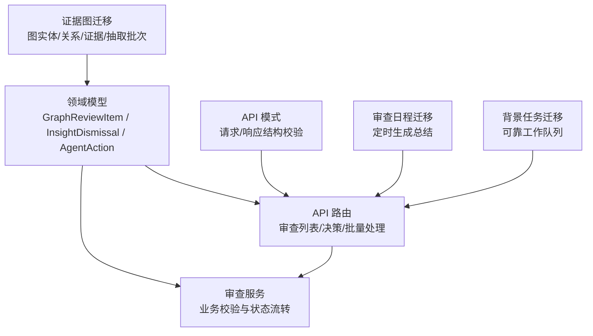
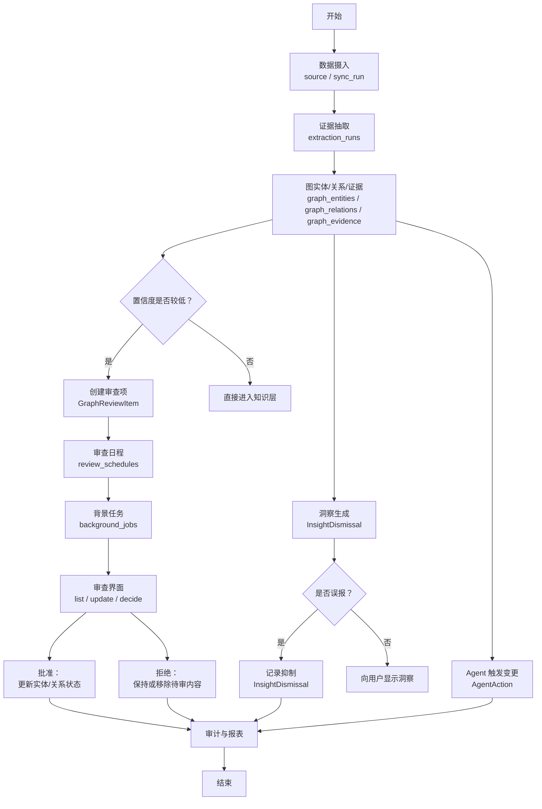
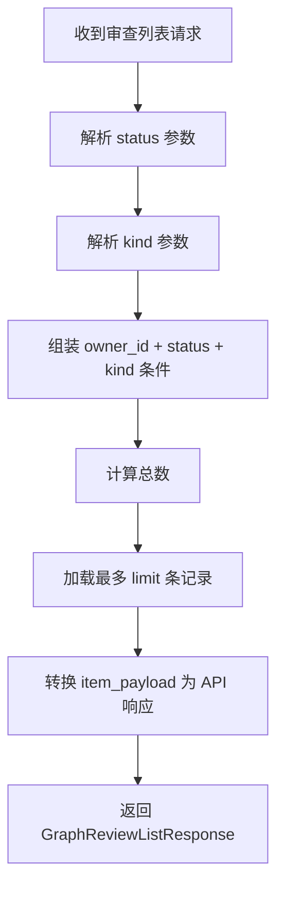
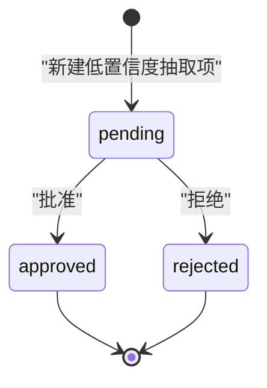
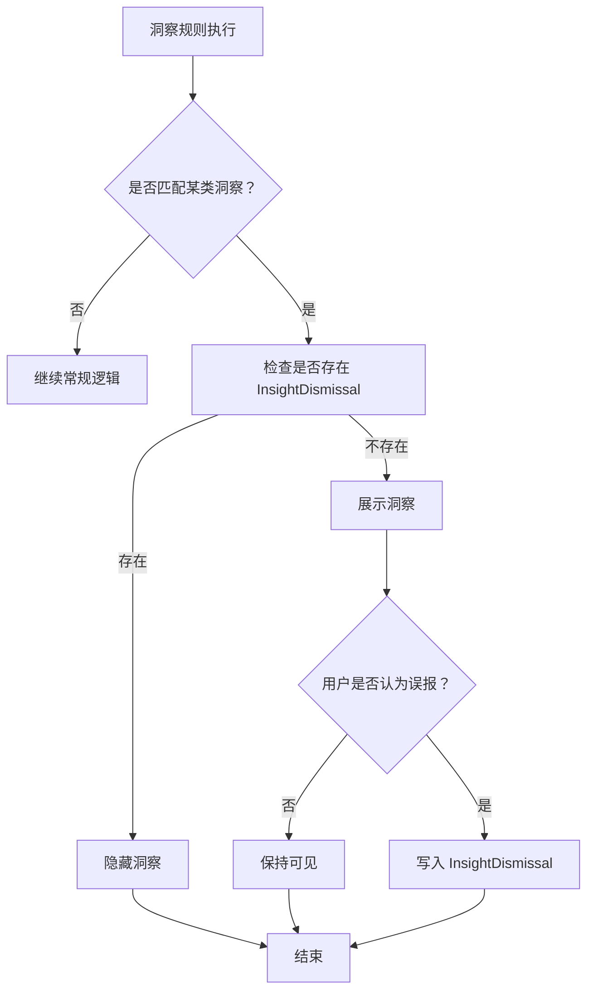
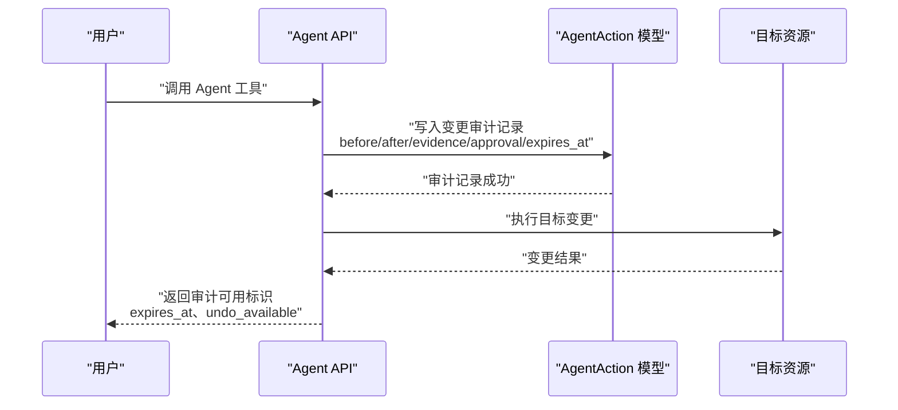
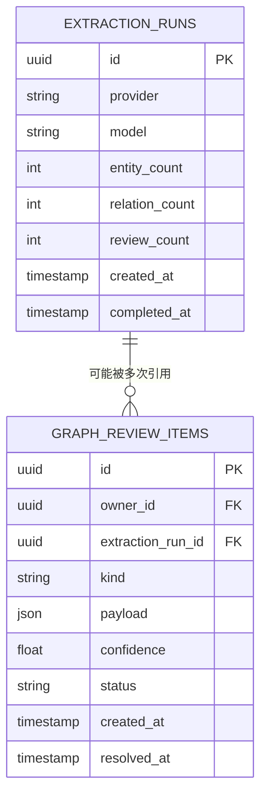
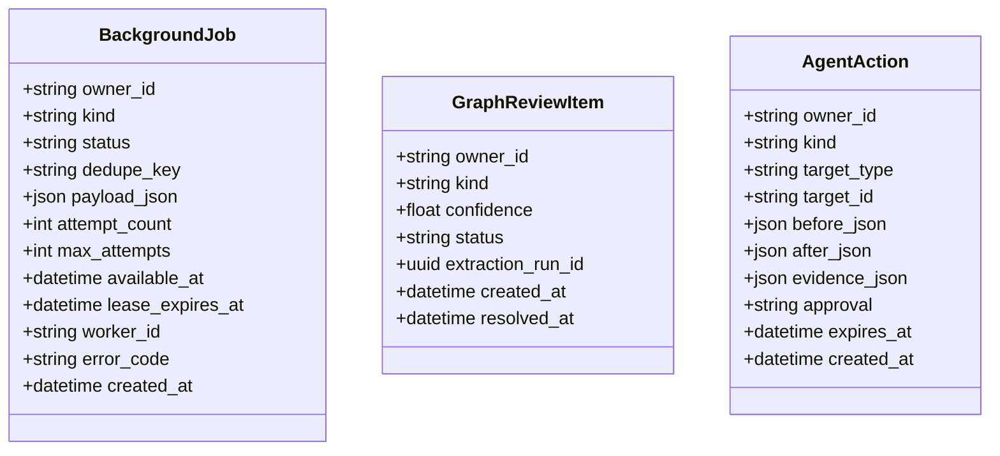
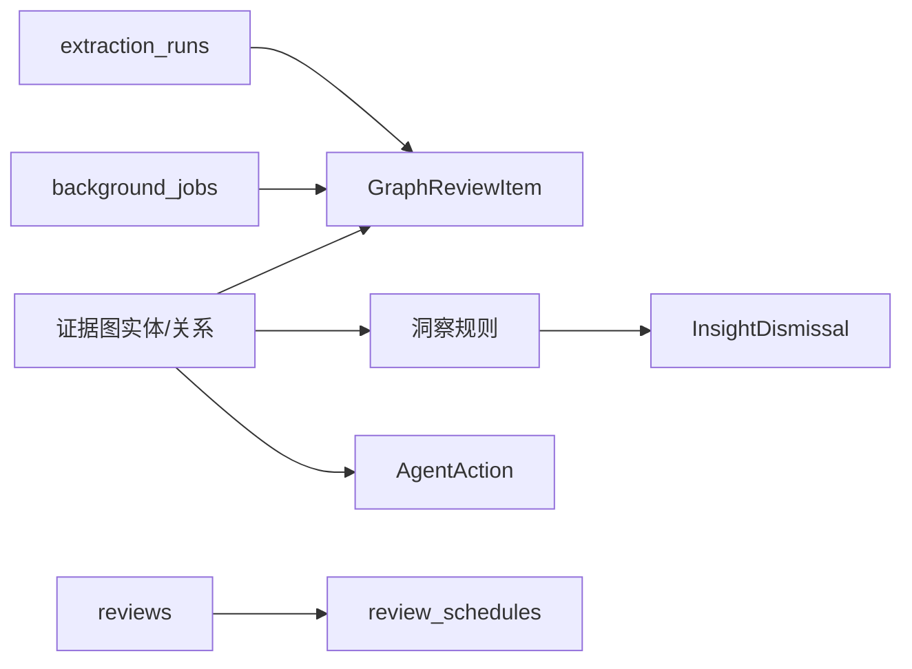

# 图审查项与关联模型

<cite>
**本文引用的文件**
- [models.py](file://src/personal_ai_life_os/models.py)
- [schemas.py](file://src/personal_ai_life_os/api/schemas.py)
- [graph_review service](file://src/personal_ai_life_os/services/graph_review.py)
- [graph_review API 路由](file://src/personal_ai_life_os/api/routes/graph_review.py)
- [证据图迁移文件](file://migrations/versions/d2f5a8c14e73_add_evidence_graph_tables.py)
- [审查日程迁移文件](file://migrations/versions/b7d4f6a1c902_add_review_schedules.py)
- [背景任务表迁移文件](file://migrations/versions/c101bc66b1a3_add_durable_background_jobs.py)
- [审查版本迁移文件](file://migrations/versions/a1b7c9d3e504_add_provider_consent_and_review_versions.py)
- [图数据模型测试](file://tests/test_graph_model.py)
</cite>

## 目录
1. [引言](#引言)
2. [项目结构定位](#项目结构定位)
3. [核心模型总览](#核心模型总览)
4. [架构概览](#架构概览)
5. [详细组件分析](#详细组件分析)
6. [依赖关系分析](#依赖关系分析)
7. [性能与扩展性说明](#性能与扩展性说明)
8. [故障排查指南](#故障排查指南)
9. [结论](#结论)
10. [附录：开发扩展指南](#附录开发扩展指南)

## 引言
本文围绕 Personal-AI-Life-OS 中“证据图”的审查与工作流模型，重点说明三类数据库实体及其在系统中的职责边界：

- `GraphReviewItem`：低置信度抽取结果的人工审查队列。`kind` 描述待审对象类别，`payload` 承载实际对象片段，`confidence` 体现置信度，`status` 控制审批状态流转，`extraction_run_id` 将审查记录追溯到抽取批次。
- `InsightDismissal`：用于抑制特定规则产生的误报洞察。通过 `(owner_id, insight_key)` 去重，`rule` 标识触发规则，`entity_id` 可关联受影响实体。
- `AgentAction`：Agent 触发的可观测变更审计记录。包含前后状态快照、证据集合、自动或人工审批标记以及失效时间。

这些模型与 `reviews`、`review_schedules`、`background_jobs`、`extraction_runs` 等协作，形成“抽取 → 证据 → 审查 → 采纳/拒绝 → 审计”的数据闭环。

## 项目结构定位
与本文相关的代码主要分布在三层：

| 层次 | 路径 | 职责 |
| --- | --- | --- |
| 领域模型层 | `src/personal_ai_life_os/models.py` | 定义持久化实体字段、外键、索引和约束。 |
| API 接口层 | `src/personal_ai_life_os/api/schemas.py`、`src/personal_ai_life_os/api/routes/graph_review.py` | 定义输入校验响应结构，暴露图审查接口。 |
| 服务逻辑层 | `src/personal_ai_life_os/services/graph_review.py` | 实现审查查询、编辑、批准与拒绝等业务校验流程。 |
| 数据库迁移层 | `migrations/versions/*.py` | 定义 `graph_*`、`insight_dismissals`、`agent_actions`、`review_schedules`、`background_jobs` 等表结构。 |
| 测试用例层 | `tests/test_graph_model.py` | 构造抽取运行与审查项，验证审查记录持久化。 |

图示来源
- [models.py:593-705](file://src/personal_ai_life_os/models.py#L593-L705)
- [schemas.py:500-820](file://src/personal_ai_life_os/api/schemas.py#L500-L820)
- [graph_review API 路由:15-129](file://src/personal_ai_life_os/api/routes/graph_review.py#L15-L129)
- [graph_review service:16-200](file://src/personal_ai_life_os/services/graph_review.py#L16-L200)
- [证据图迁移文件:1-200](file://migrations/versions/d2f5a8c14e73_add_evidence_graph_tables.py#L1-L200)
- [审查日程迁移文件:1-47](file://migrations/versions/b7d4f6a1c902_add_review_schedules.py#L1-L47)
- [背景任务表迁移文件:1-75](file://migrations/versions/c101bc66b1a3_add_durable_background_jobs.py#L1-L75)

章节来源
- [models.py:593-705](file://src/personal_ai_life_os/models.py#L593-L705)
- [schemas.py:500-820](file://src/personal_ai_life_os/api/schemas.py#L500-L820)
- [graph_review API 路由:15-129](file://src/personal_ai_life_os/api/routes/graph_review.py#L15-L129)
- [graph_review service:16-200](file://src/personal_ai_life_os/services/graph_review.py#L16-L200)
- [证据图迁移文件:1-200](file://migrations/versions/d2f5a8c14e73_add_evidence_graph_tables.py#L1-L200)
- [审查日程迁移文件:1-47](file://migrations/versions/b7d4f6a1c902_add_review_schedules.py#L1-L47)
- [背景任务表迁移文件:1-75](file://migrations/versions/c101bc66b1a3_add_durable_background_jobs.py#L1-L75)

## 核心模型总览
本节从“字段—含义—作用”角度梳理三类关键模型。

### GraphReviewItem
`GraphReviewItem` 是低置信度图抽取结果的待审单元。关键字段包括：

| 字段 | 类型 | 默认值 | 语义与作用 |
| --- | --- | ---: | --- |
| `id` | UUID | 自动生成 | 审查项主键。 |
| `owner_id` | UUID | 无默认 | 多租户所有权隔离。 |
| `extraction_run_id` | UUID | 可为空 | 外键关联抽取批次，支持按批次查看、统计、回溯。 |
| `kind` | 字符串，长度 16 | 无默认 | 待审对象类别，注释指定 `entity`、`relation`、`merge`、`ontology`。 |
| `payload` | JSON | `{}` | 承载待审对象相关数据；当前服务中已按 `entity`/`relation` 解析并更新对应图节点。 |
| `confidence` | 浮点数 | `0.0` | 抽取置信度，影响优先级排序与报告维度。 |
| `status` | 字符串，长度 24 | `"pending"` | 审查状态：pending 表示未处理；批准或拒绝后进入已解决状态。 |
| `reason` | 字符串，长度 80 | 可为空 | 人工反馈理由，例如低置信度原因、误判说明。 |
| `created_at` | UTC 时间 | 插入时间 | 创建时间，用于分页和倒序展示。 |
| `resolved_at` | UTC 时间 | 可为空 | 已审批时间，用于生命周期统计。 |

数据库层对 `owner_id+status`、`owner_id+created_at` 建立索引，便于按用户筛选待审队列并按时间扫描历史。

章节来源
- [models.py:593-647](file://src/personal_ai_life_os/models.py#L593-L647)
- [证据图迁移文件:150-200](file://migrations/versions/d2f5a8c14e73_add_evidence_graph_tables.py#L150-L200)
- [图数据模型测试:100-145](file://tests/test_graph_model.py#L100-L145)

### InsightDismissal
`InsightDismissal` 表示某用户对某一类洞察规则的抑制行为。关键字段包括：

| 字段 | 类型 | 约束 | 语义与作用 |
| --- | --- | --- | --- |
| `id` | UUID | 主键 | 抑制记录唯一标识。 |
| `owner_id` | UUID | 外键到 `users` | 抑制策略仅在当前用户视角生效。 |
| `insight_key` | 字符串，长度 240 | 与 `owner_id` 构成唯一约束 | 基于洞察键去重，避免同一类洞察被重复屏蔽。 |
| `rule` | 字符串，长度 40 | 普通索引 | 记录触发洞察的规则名，支持按规则汇总误报情况。 |
| `entity_id` | UUID | 可为空，外键到 `graph_entities` | 可选地关联受影响的实体，帮助理解误报范围。 |
| `reason` | 字符串，长度 500 | 可为空 | 记录用户关闭误报的原因。 |
| `created_at` | UTC 时间 | 插入时间 | 抑制行为的创建时间。 |

该表的核心价值是“可控的降噪”：同一个 `(owner_id, insight_key)` 只能存在一条抑制记录，确保系统不会反复提示已被明确忽略的问题。

章节来源
- [models.py:657-676](file://src/personal_ai_life_os/models.py#L657-L676)

### AgentAction
`AgentAction` 记录由 Agent 发起、需要审计的可观测变更。关键字段包括：

| 字段 | 类型 | 默认值 | 语义与作用 |
| --- | --- | ---: | --- |
| `id` | UUID | 自动生成 | 审计事件主键。 |
| `owner_id` | UUID | 无默认 | 审计数据的租户归属。 |
| `kind` | 字符串，长度 40 | 无默认 | 操作种类，例如计划调整、消息发送、知识写入等。 |
| `target_type` | 字符串，长度 40 | `"internal"` | 目标分类，例如 `reminder`、`timeline`、`graph_entity` 等。 |
| `target_id` | 字符串，长度 64 | 可为空 | 被修改的外部或内部资源标识。 |
| `before_json` | JSON | `{}` | 变更前快照。 |
| `after_json` | JSON | `{}` | 变更后快照。 |
| `evidence_json` | JSON 数组 | `[]` | 支撑本次变更的证据片段。 |
| `status` | 字符串，长度 24 | `"active"` | 审计状态，可用于过滤过期、撤销或失败记录。 |
| `approval` | 字符串，长度 24 | `"automatic"` | 审批来源：自动执行或人工审批。 |
| `audit_json` | JSON | `{}` | 额外审计元数据，适合补充上下文。 |
| `expires_at` | UTC 时间 | 必填 | 短期权限、临时副作用或临时授权的自然失效时间。 |
| `created_at` | UTC 时间 | 插入时间 | 审计事件创建时间。 |
| `undone_at` | UTC 时间 | 可为空 | 记录被撤销时的时间。 |

`AgentAction` 不是简单的日志表，而是“带业务语义的审计事实”。它允许系统回答：谁触发了 Agent？改动了什么？依据哪些证据？是否经过审批？是否在有效期之内？

章节来源
- [models.py:677-705](file://src/personal_ai_life_os/models.py#L677-L705)

### 相关接口模型对比
API 层并未直接复用这三个 ORM 模型的原始属性名，而是定义了更稳定的对外结构：

| 内部模型 | 外部响应模型 | 重要差异 |
| --- | --- | --- |
| `GraphReviewItem` | `GraphReviewItemResponse` | 对外返回 `id`、`kind`、`payload`、`confidence`、`status`、`reason`、`extraction_run_id`、时间戳等，由 `item_payload` 转换。 |
| `AgentAction` | `AgentActionResponse` | 对外字段使用 `before`/`after`/`evidence_item_ids`/`audit` 等，但底层模型存储为 `before_json`/`after_json`/`evidence_json`/`audit_json`。 |
| `InsightDismissal` | 结合 `InsightDismissRequest` 与 `InsightResponse` | 外部通过 `insight_key`、`rule`、`entity_id`、`dismissed` 等组合呈现。 |

这种设计将数据库字段细节隐藏在响应转换器之后，减少前端与数据库耦合。

章节来源
- [schemas.py:500-580](file://src/personal_ai_life_os/api/schemas.py#L500-L580)
- [schemas.py:620-720](file://src/personal_ai_life_os/api/schemas.py#L620-L720)

## 架构概览
下图展示了与本文模型相关的主要业务流程如何协作：

图示来源
- [证据图迁移文件:15-200](file://migrations/versions/d2f5a8c14e73_add_evidence_graph_tables.py#L15-L200)
- [审查日程迁移文件:25-47](file://migrations/versions/b7d4f6a1c902_add_review_schedules.py#L25-L47)
- [背景任务表迁移文件:25-75](file://migrations/versions/c101bc66b1a3_add_durable_background_jobs.py#L25-L75)
- [graph_review service:16-200](file://src/personal_ai_life_os/services/graph_review.py#L16-L200)

## 详细组件分析

### GraphReviewItem：低置信度审查队列
`GraphReviewItem` 的职责不是管理完整的企业知识库，而是管理“不确定是否需要信任的抽取产物”。

#### 数据结构与复杂度
- 读取审查队列时使用 `owner_id` 进行严格多租户隔离。
- 支持按 `status`、`kind` 过滤，并按 `created_at` 倒序返回，最后限制条数。
- 时间复杂度主要由 SQL 过滤和排序决定，依赖索引 `ix_graph_review_items_owner_status` 和 `ix_graph_review_items_owner_created`。

图示来源
- [graph_review API 路由:30-60](file://src/personal_ai_life_os/api/routes/graph_review.py#L30-L60)
- [graph_review service:33-47](file://src/personal_ai_life_os/services/graph_review.py#L33-L47)

#### 审查状态流转

该状态机的关键点：

1. `pending` 是初始审查状态，表示人类尚未完成最终判断。
2. 批准后，服务会实际修改目标实体或关系的 `status`，使它们成为活跃知识。
3. 拒绝后，目标不应进入有效知识层；具体实现需确保不会错误激活实体或关系。
4. `resolved_at` 用于区分“刚出现”和“已结束”的审查任务。

章节来源
- [graph_review service:16-200](file://src/personal_ai_life_os/services/graph_review.py#L16-L200)
- [graph_review API 路由:80-129](file://src/personal_ai_life_os/api/routes/graph_review.py#L80-L129)

#### 可编辑范围
服务目前只允许对 `kind` 为 `entity` 或 `relation` 的审查项做局部修正，包括名称、类型、摘要、置信度等。`merge` 与 `ontology` 两类不直接通过 `update_item` 编辑，这是合理的语义边界：合并和本体管理通常另有入口。

若未来新增可编辑的 `kind`，需要在以下位置同步扩展：

1. `services/graph_review.py` 中的 `_validate_*` 和 `update_item`。
2. `api/schemas.py` 中的请求/响应结构。
3. `api/routes/graph_review.py` 中的过滤条件。
4. 前端状态枚举、报表过滤器与导出维度。

章节来源
- [graph_review service:90-170](file://src/personal_ai_life_os/services/graph_review.py#L90-L170)

### InsightDismissal：误报抑制器
`InsightDismissal` 不是审计记录，也不是图节点，它是“用户对规则输出的否定票”。

#### 唯一性与覆盖语义
- `(owner_id, insight_key)` 的唯一约束保证同一用户在每个洞察键上只会存在一个抑制策略。
- `rule` 提供规则级聚合能力，帮助运维或产品分析哪类洞察最常产生误报。
- `entity_id` 为可选关联，适合标注“这个误报影响了哪个实体”，但不强制绑定所有洞察。

#### 典型用途
假设某个洞察规则会频繁把正常商业活动标记为高风险问题，用户可以：

1. 首次看到误报时选择“抑制该洞察”。
2. 系统将 `(owner_id, insight_key)` 写入 `insight_dismissals`。
3. 后续再次命中相同洞察时，不再重复干扰用户。
4. 保留 `rule`、`reason`、`entity_id` 供审计与报表分析。

图示来源
- [models.py:657-676](file://src/personal_ai_life_os/models.py#L657-L676)

章节来源
- [models.py:657-676](file://src/personal_ai_life_os/models.py#L657-L676)

### AgentAction：Agent 变更记录审计
`AgentAction` 是对自动化操作的白盒审计。相比普通日志，它具备更强的结构化约束和业务语义。

#### 前后对比与证据链
- `before_json` 和 `after_json` 提供快照对比，方便回答“这次变更到底改了哪里”。
- `evidence_json` 保存支撑这次动作的证据片段，例如关联的事件、图节点 ID、引用来源。
- `audit_json` 可扩展更多上下文，例如上游调用来源、Agent 工具名、线程 ID。
- `approval="automatic"` 表示自动执行；`approval="manual"` 可表达人工确认后的自动动作，具体取值应在服务端统一限定。

#### 有效期与自动失效
`expires_at` 使某些 Agent 行为可以“短暂有效”。例如：

- 一次临时权限可以在指定时间后被视为过期。
- 某类副作用只应影响今天的时间窗口。
- 安全策略可以主动关闭超过有效期且未续期的操作。

注意：当前模型定义没有内置过期清理任务；过期判定应由查询层、调度层或后台清理任务共同保证，而不是依赖数据库删除这条审计线。

图示来源
- [models.py:677-705](file://src/personal_ai_life_os/models.py#L677-L705)

章节来源
- [models.py:677-705](file://src/personal_ai_life_os/models.py#L677-L705)
- [schemas.py:710-760](file://src/personal_ai_life_os/api/schemas.py#L710-L760)

### 与 reviews、review_schedules、background_jobs 的协作
#### 抽取批次与审查项
`extraction_runs` 记录一次模型抽取任务的元信息，包括提供方、模型、提示词版本、输入输出令牌、成本、延迟、实体/关系数量以及审查数量等。`GraphReviewItem.extraction_run_id` 将其子级审查项关联回批次。

图示来源
- [证据图迁移文件:150-200](file://migrations/versions/d2f5a8c14e73_add_evidence_graph_tables.py#L150-L200)
- [models.py:570-647](file://src/personal_ai_life_os/models.py#L570-L647)

#### 审查日程
`review_schedules` 代表“周期生成用户总结”的计划，包含周几、本地小时分钟、时区、是否启用、上次执行与下次执行时间，并与 `reviews` 通过 `last_review_id` 关联。虽然它直接管理的是“用户总结”，但与证据图的关系是：当抽取产生大量低置信度审查项时，日程系统可以帮助提醒用户集中审阅。

图示来源
- [审查日程迁移文件:25-47](file://migrations/versions/b7d4f6a1c902_add_review_schedules.py#L25-L47)
- [审查版本迁移文件:30-65](file://migrations/versions/a1b7c9d3e504_add_provider_consent_and_review_versions.py#L30-L65)

#### 背景任务
`background_jobs` 是稳定持久化的工作队列，通过 `owner_id + dedupe_key` 去重，支持重试、可用时间、租赁过期、Worker ID、错误码等完整生命周期字段。审查队列、证据生成、图表构建、洞察计算等异步任务都可以落盘。

图示来源
- [背景任务表迁移文件:25-75](file://migrations/versions/c101bc66b1a3_add_durable_background_jobs.py#L25-L75)
- [models.py:593-705](file://src/personal_ai_life_os/models.py#L593-L705)

章节来源
- [证据图迁移文件:150-200](file://migrations/versions/d2f5a8c14e73_add_evidence_graph_tables.py#L150-L200)
- [审查日程迁移文件:25-47](file://migrations/versions/b7d4f6a1c902_add_review_schedules.py#L25-L47)
- [背景任务表迁移文件:25-75](file://migrations/versions/c101bc66b1a3_add_durable_background_jobs.py#L25-L75)

## 依赖关系分析
三个模型并非孤立存在：

| 模型 | 上游依赖 | 下游消费者 |
| --- | --- | --- |
| `GraphReviewItem` | `extraction_runs`、`graph_entities`、`graph_relations` | 审查接口、批处理、报表、可能的背景任务。 |
| `InsightDismissal` | `graph_entities`(可选)、洞察规则系统 | 洞察 API、用户界面、误报分析报表。 |
| `AgentAction` | Agent、插件、工具、审批服务 | 审计界面、合规检查、撤销流程、有效期管理。 |

图示来源
- [models.py:593-705](file://src/personal_ai_life_os/models.py#L593-L705)
- [证据图迁移文件:15-200](file://migrations/versions/d2f5a8c14e73_add_evidence_graph_tables.py#L15-L200)
- [审查日程迁移文件:25-47](file://migrations/versions/b7d4f6a1c902_add_review_schedules.py#L25-L47)
- [背景任务表迁移文件:25-75](file://migrations/versions/c101bc66b1a3_add_durable_background_jobs.py#L25-L75)

## 性能与扩展性说明
### 查询性能
- `GraphReviewItem` 对 `owner_id+status` 和 `owner_id+created_at` 建索引，适合高频的“某人待审队列”。
- `InsightDismissal` 对 `(owner_id, rule)` 建立索引，有利于按规则统计误报。
- `AgentAction` 对 `owner_id+created_at` 和 `owner_id+status` 建索引，适合按用户和时间检索审计事件。

### 写放大
- `GraphReviewItem.payload` 是任意 JSON，容易增长。建议在写入前裁剪无关字段，保留 `entity_id`/`relation_id`、类型、名称摘要及置信度即可。
- `AgentAction.before_json`/`after_json`/`evidence_json` 可能较大，建议为高吞吐 Agent 配置合适的存储配额，或将大附件下沉到对象存储，只保留引用。

### 扩展成本
- 新增审查类别时应同时考虑 UI 枚举、后端校验、导出报表、日志维度、测试用例。
- 不建议用单一 `kind` 表达非常复杂的分层语义；如果新增类别超过 4 个，应考虑引入类型表或分类表以避免字符串过长和难以约束。

[本节为通用性能建议，不直接分析具体代码行]

## 故障排查指南
### 审查项无法找到
- 检查 `item_id` 是否属于当前 `owner_id`。
- 服务层会在找不到条目时抛出带有错误码的自定义异常，接口将其映射为 HTTP 错误。

章节来源
- [graph_review service:49-62](file://src/personal_ai_life_os/services/graph_review.py#L49-L62)

### 审查项已决议
如果请求编辑已非 `pending` 的审查项，应拒绝修改。常见原因是用户多次提交或旧页面刷新。

章节来源
- [graph_review service:99-104](file://src/personal_ai_life_os/services/graph_review.py#L99-L104)

### 实体或关系不存在
`payload` 中的 `entity_id`/`relation_id` 可能在之前合并、拒绝或被删除后失效。此类场景应提示用户重新获取待审队列。

章节来源
- [graph_review service:106-124](file://src/personal_ai_life_os/services/graph_review.py#L106-L124)

### 实体或关系不可批准
服务会校验目标实体的当前状态；若已被合并或拒绝，不应再次批准。

章节来源
- [graph_review service:147-169](file://src/personal_ai_life_os/services/graph_review.py#L147-L169)

### 洞察重复抑制
如果插入 `InsightDismissal` 失败，应优先检查是否已存在相同的 `(owner_id, insight_key)`，而不是简单覆盖。正确做法是先查询再决定是否更新 `reason` 或保持原样。

章节来源
- [models.py:657-668](file://src/personal_ai_life_os/models.py#L657-L668)

### Agent 动作超时未生效
`expires_at` 只是静态时间点，本身不会触发清理。排查时应确认：

1. 查询侧是否按 `expires_at < now()` 过滤。
2. 定时任务或调度层是否实现了过期回收。
3. 业务层是否在使用临时权限前设置了合理过期时间。

章节来源
- [models.py:695-705](file://src/personal_ai_life_os/models.py#L695-L705)

## 结论
`GraphReviewItem`、`InsightDismissal` 与 `AgentAction` 构成了 Personal-AI-Life-OS 中证据图可信工作的三根支柱：

- `GraphReviewItem` 让低置信度的抽取结果进入可控的人工审查流。
- `InsightDismissal` 让用户对反复出现的误报进行精准降噪。
- `AgentAction` 为自动化变更提供可审计、可追踪、可过期的结构化记录。

配合 `extraction_runs`、`review_schedules` 与 `background_jobs`，系统能够形成稳定、可恢复、可追溯的数据闭环：模型生成不一定完全可信，但每一步不确定性、决策、抑制和变更都可被观察、追问和修复。

## 附录：开发扩展指南
### 新增一种 `GraphReviewItem.kind`
如果要新增一种可审查的类别（例如 `relationship_merge`），请按以下步骤同步修改：

1. **领域模型层**
   - 在 `GraphReviewItem.kind` 的注释或校验中添加新枚举值。
   - 如需业务校验，可在 `services/graph_review.py` 中增加对应分支。
   
   参考位置
   - [models.py:593-647](file://src/personal_ai_life_os/models.py#L593-L647)

2. **后端校验逻辑**
   - 在 `update_item` 或新增的处理函数中加入新类别的具体处理。
   - 如果新类别不允许编辑，请显式抛出“不可编辑”的错误码，避免把它误当成普通实体。

   参考位置
   - [graph_review service:90-170](file://src/personal_ai_life_os/services/graph_review.py#L90-L170)

3. **API 模式与路由**
   - 在 `GraphReviewUpdateRequest` 或专用请求模式中声明新类别需要的字段。
   - 在路由层允许按新 `kind` 过滤。

   参考位置
   - [schemas.py:500-540](file://src/personal_ai_life_os/api/schemas.py#L500-L540)
   - [graph_review API 路由:30-45](file://src/personal_ai_life_os/api/routes/graph_review.py#L30-L45)

4. **前端状态枚举**
   - 扩展审查项类型的下拉选项、图标、标签和筛选器。
   - 避免硬编码字符串比较，使用统一的前端枚举。

5. **报表维度**
   - 在统计报表中增加按新类别分组的计数、通过率、平均置信度、平均处理时长等指标。
   - 报表查询应先基于 `owner_id` 隔离，再按 `kind` + `status` 分组。

6. **测试覆盖**
   - 新增单测至少验证：
     - 能查询新 `kind`。
     - 如允许编辑，可修改必要字段。
     - 如不允许编辑，返回明确的错误。
     - 批准或拒绝后，状态与下游实体一致。

   参考示例结构
   - [图数据模型测试:100-145](file://tests/test_graph_model.py#L100-L145)

### 扩展 InsightDismissal 的分析能力
如果需要改进误报分析，可考虑：

- 增加按 `rule` 与时间窗口的误报趋势报表。
- 增加按 `entity_id` 的误报热点实体排行。
- 为用户提供“暂时禁用规则”和“永久抑制洞察键”两个粒度。

章节来源
- [models.py:657-676](file://src/personal_ai_life_os/models.py#L657-L676)

### 扩展 AgentAction 的生命周期
当前模型提供了 `expires_at`，但没有自动清理逻辑。推荐方案：

- 查询审计列表时支持 `expired_before`、`expires_after`。
- 新增独立清理任务，根据 `expires_at` 与状态归档或软删除长期无用记录。
- 对高并发 Agent 动作启用 `kind` + `target_type` + `target_id` 的去重策略，避免重复执行同一步骤。

章节来源
- [models.py:677-705](file://src/personal_ai_life_os/models.py#L677-L705)