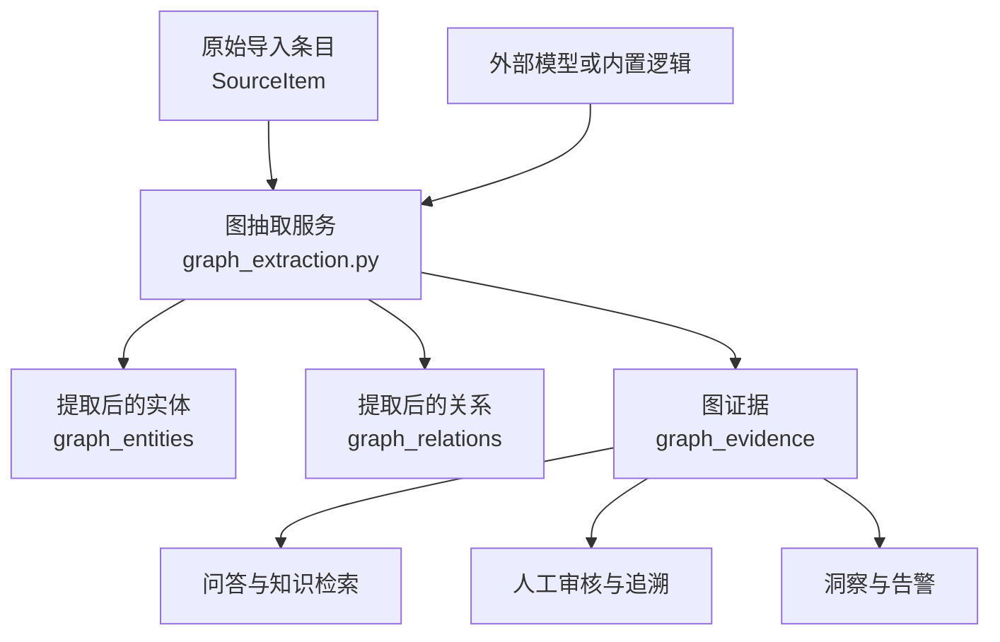
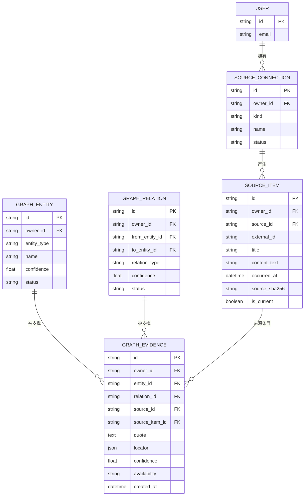
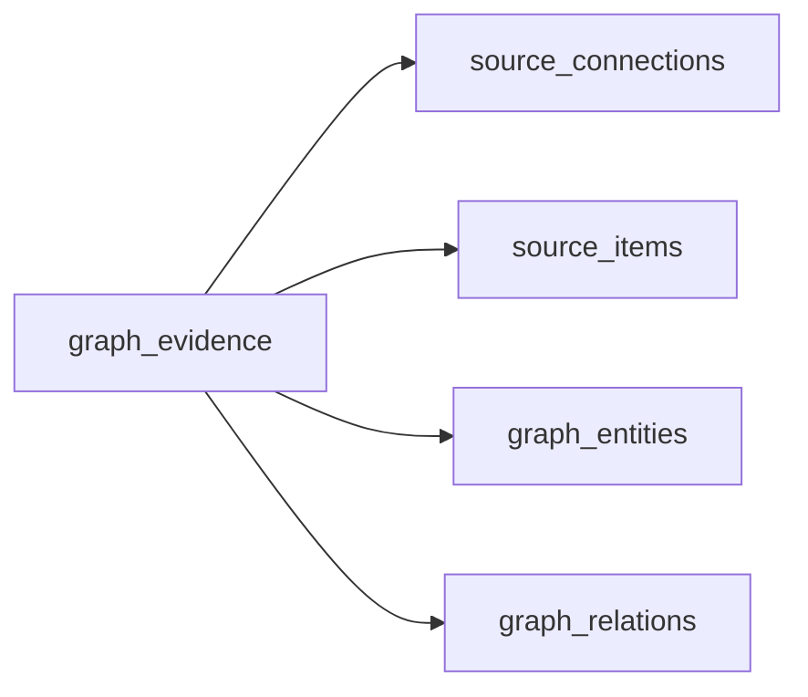
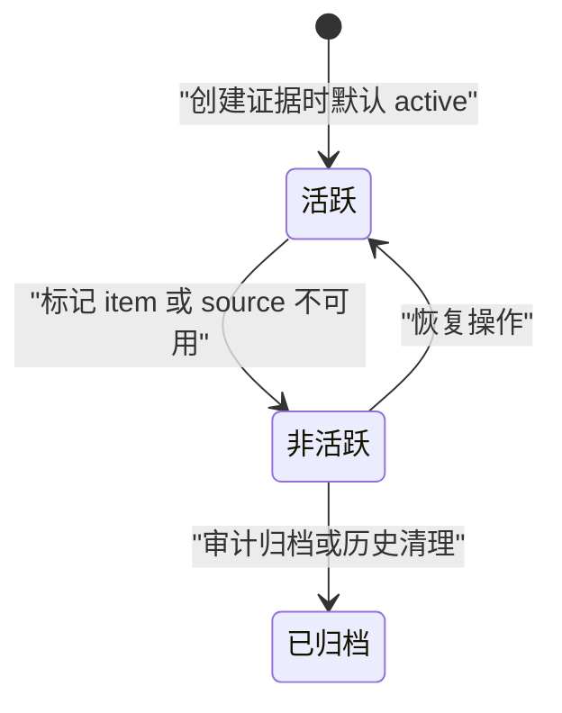
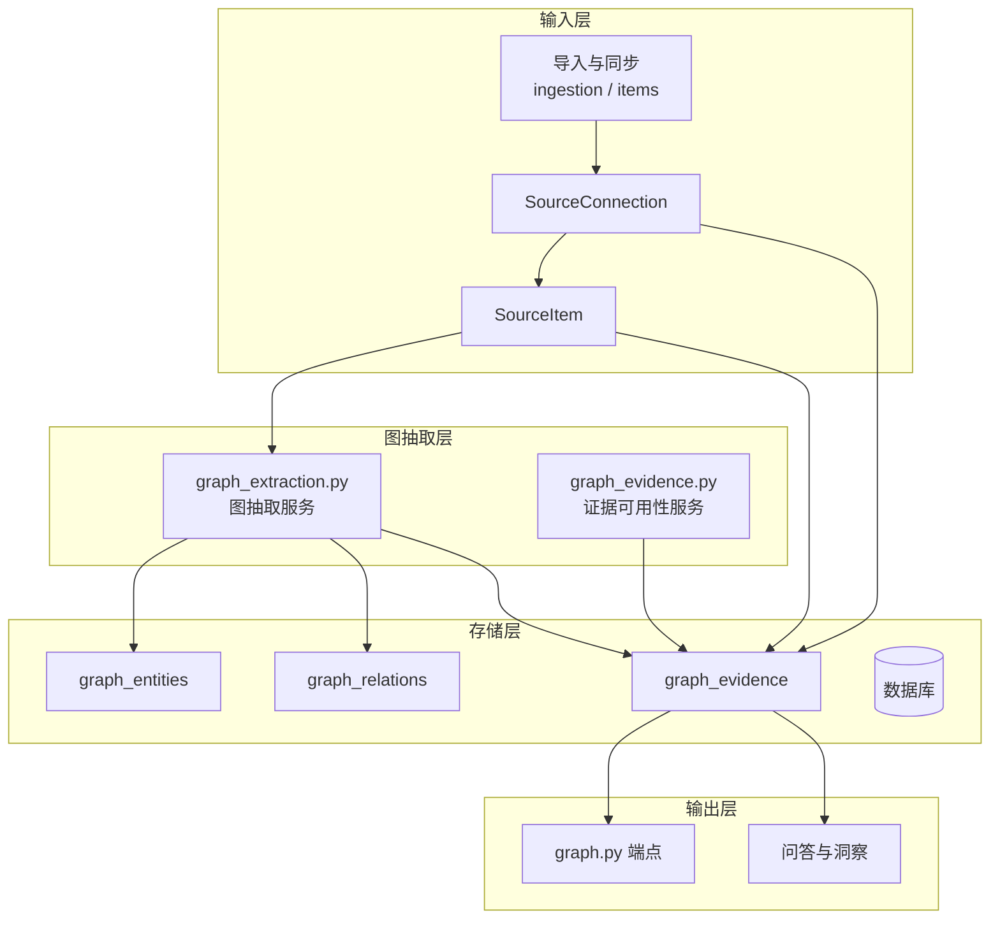
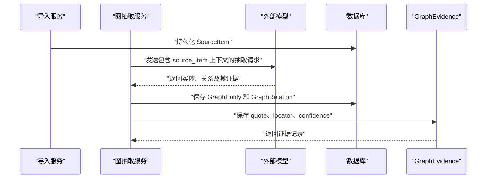
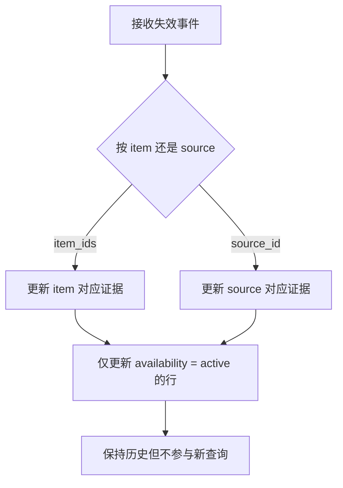
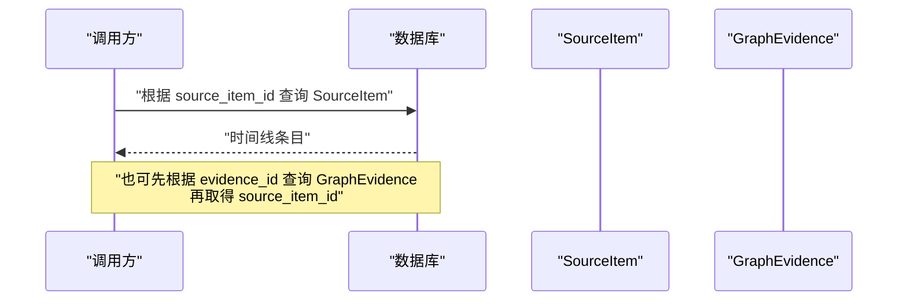
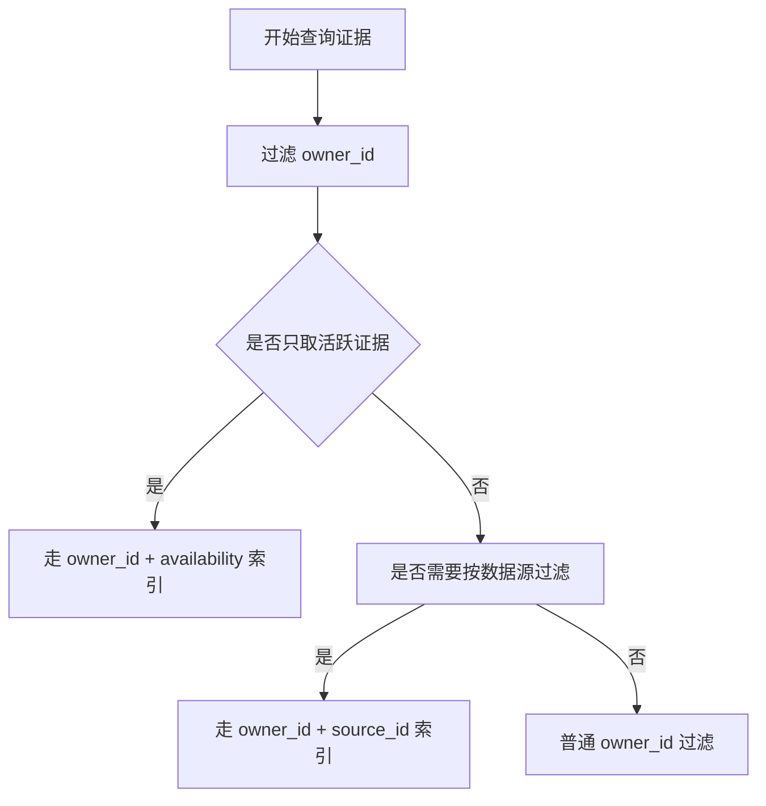

# 图证据 GraphEvidence

<cite>
**本文引用文件**
- [models.py](file://src/personal_ai_life_os/models.py)
- [d2f5a8c14e73_add_evidence_graph_tables.py](file://migrations/versions/d2f5a8c14e73_add_evidence_graph_tables.py)
- [graph_evidence.py](file://src/personal_ai_life_os/services/graph_evidence.py)
- [graph_extraction.py](file://src/personal_ai_life_os/services/graph_extraction.py)
- [graph.py](file://src/personal_ai_life_os/api/routes/graph.py)
- [schemas.py](file://src/personal_ai_life_os/api/schemas.py)
- [test_graph_model.py](file://tests/test_graph_model.py)
</cite>

## 目录
1. [引言](#引言)
2. [项目定位与核心概念](#项目定位与核心概念)
3. [数据模型结构](#数据模型结构)
4. [目标约束与双重来源追踪](#目标约束与双重来源追踪)
5. [可用性状态与生命周期](#可用性状态与生命周期)
6. [架构与组件关系](#架构与组件关系)
7. [关键流程分析](#关键流程分析)
8. [API 写入与查询设计](#api-写入与查询设计)
9. [反查时间线条目](#反查时间线条目)
10. [面向 LLM 的证据上下文窗口](#面向-llm-的证据上下文窗口)
11. [性能建议与索引策略](#性能建议与索引策略)
12. [搜索、审计与人工审查用途](#搜索审计与人工审查用途)
13. [故障排查](#故障排查)
14. [结论](#结论)

## 引言
GraphEvidence 是 Personal-AI-Life-OS 中“图抽取”子系统的基础溯源锚点。它记录从原始输入条目中提取实体或关系时所使用的具体文本片段和定位信息，并明确回答以下问题：该证据支撑哪个实体或关系？它来自哪个数据源连接？它来自哪个具体导入条目？该证据目前是否可用？其置信度如何？

在整体系统中，图抽取过程会把 `source_items` 中的文本转换为 `graph_entities` 和 `graph_relations`，并通过 `graph_evidence` 将每一条抽取结果重新链接回原文片段。这使得后续的知识问答、审核、合并和可解释性展示都能建立在可验证的文本基础之上。

**章节来源**
- [models.py:466-491](file://src/personal_ai_life_os/models.py#L466-L491)
- [d2f5a8c14e73_add_evidence_graph_tables.py:76-101](file://migrations/versions/d2f5a8c14e73_add_evidence_graph_tables.py#L76-L101)

## 项目定位与核心概念
图抽取链路可以概括为：

**图表来源**
- [graph_extraction.py:1-80](file://src/personal_ai_life_os/services/graph_extraction.py#L1-L80)
- [models.py:207-265](file://src/personal_ai_life_os/models.py#L207-L265)
- [models.py:466-491](file://src/personal_ai_life_os/models.py#L466-L491)

图证据不是普通的检索摘要，而是具备以下属性的结构化事实锚点：

| 字段或属性 | 含义 | 用途 |
|---|---|---|
| `id` | 证据主键 | 引用、展示、审计、缓存键 |
| `owner_id` | 拥有者用户标识 | 租户隔离和多账号边界 |
| `entity_id` | 证据支撑的实体标识 | 将证据绑定到节点 |
| `relation_id` | 证据支撑的关系标识 | 将证据绑定到边 |
| `source_id` | 来源连接标识 | 定位数据源系统，如聊天记录、文档、文件夹等 |
| `source_item_id` | 原始导入条目标识 | 精确回查时间线条目 |
| `quote` | 匹配文本片段 | 提供可直接阅读的证据正文 |
| `locator` | 段落、行号、页码等定位信息 | 辅助定位原文位置 |
| `confidence` | 该证据对抽取结果的支撑置信度 | 排序、过滤和低置信度预警 |
| `availability` | 可用性状态 | 控制是否参与抽取、问答、洞察等业务 |
| `created_at` | 创建时间 | 顺序展示和历史回放 |

**章节来源**
- [models.py:466-491](file://src/personal_ai_life_os/models.py#L466-L491)
- [schemas.py:456-464](file://src/personal_ai_life_os/api/schemas.py#L456-L464)

## 数据模型结构
`GraphEvidence` 是一个以所有者为中心的持久化表，直接映射为 SQLAlchemy ORM 类。它的主键是 UUID，所有业务数据都通过外键连接到用户、实体图、关系图和导入数据。

**图表来源**
- [models.py:207-265](file://src/personal_ai_life_os/models.py#L207-L265)
- [models.py:466-491](file://src/personal_ai_life_os/models.py#L466-L491)
- [d2f5a8c14e73_add_evidence_graph_tables.py:13-101](file://migrations/versions/d2f5a8c14e73_add_evidence_graph_tables.py#L13-L101)

### 实体类定义要点
- `GraphEvidence` 使用 `Uuid(as_uuid=False)` 作为主键类型，与项目其他 UUID 字段保持一致。
- 默认值由 `new_id` 生成。
- `created_at` 使用统一的 UTC 时间函数。
- `owner_id` 关联 `users` 表，用于多账号数据隔离。
- `quote` 使用 Text 类型存储完整匹配片段；`locator` 使用 JSON 对象，允许灵活扩展。
- `confidence` 是浮点数，默认为 `1.0`，但测试中也显式使用更低数值。
- `availability` 使用字符串状态控制证据的生命周期，默认值为 `active`。

**章节来源**
- [models.py:466-491](file://src/personal_ai_life_os/models.py#L466-L491)

## 目标约束与双重来源追踪

### 至少一个目标：实体或关系
`GraphEvidence` 必须明确支撑一个图目标。数据库级 CheckConstraint `ck_graph_evidence_target` 保证 `entity_id IS NOT NULL OR relation_id IS NOT NULL`。也就是说，一条证据不能同时为空；它可以只关联实体、只关联关系，或者理论上两个都指向同一个逻辑内容（实践中通常选择其中一个）。

这意味着：
- 如果证据用于证明某个实体存在、名称、摘要或类别，应设置 `entity_id`。
- 如果证据用于说明某两个实体之间的关系，例如 `has_goal`、`part_of`、`evidenced_by` 等，应设置 `relation_id`。
- 测试中专门构造了一条没有目标的证据，期望提交时报完整性错误。

**章节来源**
- [models.py:466-477](file://src/personal_ai_life_os/models.py#L466-L477)
- [d2f5a8c14e73_add_evidence_graph_tables.py:92-101](file://migrations/versions/d2f5a8c14e73_add_evidence_graph_tables.py#L92-L101)
- [test_graph_model.py:128-158](file://tests/test_graph_model.py#L128-L158)

### 来源连接：`source_id`
`source_id` 指向 `source_connections` 表，表示证据来自哪个数据源系统。例如邮件、聊天导出、云盘、本地文件夹等。它是高层数据域标签，可用于：
- 按数据源统计证据数量。
- 批量禁用某个数据源下所有证据。
- 在多源汇总场景下识别不同输入通道。

### 原始条目：`source_item_id`
`source_item_id` 指向 `source_items` 表，表示证据来自哪一条已经解析过的导入条目。这是更细粒度的溯源锚点，适合精确回溯到某一封邮件、某一段对话或某个文档块。结合 `SourceItem` 的 `occurred_at`、`title`、`kind`、`content_text`、`source_locator` 等字段，可以让审计人员看到完整的时间线条目，而不仅是片段引用。

**图表来源**
- [d2f5a8c14e73_add_evidence_graph_tables.py:76-101](file://migrations/versions/d2f5a8c14e73_add_evidence_graph_tables.py#L76-L101)

**章节来源**
- [models.py:207-265](file://src/personal_ai_life_os/models.py#L207-L265)
- [models.py:466-491](file://src/personal_ai_life_os/models.py#L466-L491)
- [d2f5a8c14e73_add_evidence_graph_tables.py:76-101](file://migrations/versions/d2f5a8c14e73_add_evidence_graph_tables.py#L76-L101)

## 可用性状态与生命周期
`availability` 字段标记证据是否处于活跃可用的状态。当前模型没有使用 `deleted_at` 硬删除证据，而是通过更新状态实现软失效。

现有服务方法提供了两类状态变更：

1. `mark_item_evidence_unavailable`：根据一组 `item_ids` 把对应证据的状态由 `active` 更新为目标状态。适用于单条导入条目失效或不可信。
2. `mark_source_evidence_unavailable`：根据 `source_id` 把某个数据源下全部 `active` 证据更新为目标状态。适用于整个数据源被停用、取消授权或需要全局归档。

这种设计有两个重要作用：
- 保留历史证据链，不影响已存在的实体、关系和问答结果的可解释性。
- 快速排除不可信或不再授权的数据，避免继续污染图抽取和问答结果。

**章节来源**
- [models.py:484-491](file://src/personal_ai_life_os/models.py#L484-L491)
- [graph_evidence.py:1-45](file://src/personal_ai_life_os/services/graph_evidence.py#L1-L45)

## 架构与组件关系

**图表来源**
- [graph_extraction.py:1-80](file://src/personal_ai_life_os/services/graph_extraction.py#L1-L80)
- [graph_evidence.py:1-45](file://src/personal_ai_life_os/services/graph_evidence.py#L1-L45)
- [graph.py:1-50](file://src/personal_ai_life_os/api/routes/graph.py#L1-L50)
- [models.py:207-265](file://src/personal_ai_life_os/models.py#L207-L265)
- [models.py:466-491](file://src/personal_ai_life_os/models.py#L466-L491)

### 依赖与解耦
- `GraphEvidence` 对 `SourceConnection` 和 `SourceItem` 是双向溯源：既知道宏观数据源，也知道具体条目。
- 对 `GraphEntity` 和 `GraphRelation` 是可空外键，通过检查约束强制至少选择一个目标。
- `graph_evidence.py` 通过 SQLAlchemy `update` 修改证据状态，不引入新的 ORM 实体。
- `graph.py` 只在读取端展示证据，并把证据列表作为实体和关系的附加视图数据。

**章节来源**
- [graph.py:11-48](file://src/personal_ai_life_os/api/routes/graph.py#L11-L48)
- [graph_evidence.py:1-45](file://src/personal_ai_life_os/services/graph_evidence.py#L1-L45)
- [models.py:466-491](file://src/personal_ai_life_os/models.py#L466-L491)

## 关键流程分析

### 证据写入流程
典型写入路径如下：

实际代码层面：
- `graph_extraction.py` 将 `SourceItem` 的内容切段后传给模型，并要求模型返回带 `item_id` 和 `quote` 的结构化结果。
- `GraphEvidence` 随后被持久化，关联对应的 `source_id`、`source_item_id`、`entity_id` 或 `relation_id`。
- `availability` 初始为 `active`。
- 单元测试验证了完整的实体、关系和证据写入链路，并确认 `availability` 默认值、`source_item_id` 引用关系以及缺失目标的校验行为。

**章节来源**
- [graph_extraction.py:1-80](file://src/personal_ai_life_os/services/graph_extraction.py#L1-L80)
- [test_graph_model.py:41-118](file://tests/test_graph_model.py#L41-L118)
- [test_graph_model.py:128-158](file://tests/test_graph_model.py#L128-L158)

### 证据可用性变更流程

这个流程确保即使数据源不再可用，旧证据仍然保留以供审计和历史推理，同时防止它们再次影响新知识抽取和问题解答。

**章节来源**
- [graph_evidence.py:10-45](file://src/personal_ai_life_os/services/graph_evidence.py#L10-L45)

## API 写入与查询设计

### 查询接口设计
`/api/v1/graph/entities` 和 `/api/v1/graph/relations` 是当前仓库中暴露的主要只读图接口。它们在返回实体或关系时会附带证据列表，内部使用 `_evidence` 函数：

- 支持按 `entity_id` 获取某实体的证据。
- 支持按 `relation_id` 获取某关系的证据。
- 始终限制为当前登录用户的 `owner_id`。
- 最多返回 20 条证据。
- 按 `created_at` 和 `id` 排序。
- 响应中包含 `quote`、`locator`、`confidence`、`availability`、`source_id`、`source_item_id` 和 `created_at`。

注意：当前 `/entities` 和 `/relations` 端点的响应体本身并不直接返回所有证据的全文字段，而是由 `_evidence` 填充到实体或关系的 `evidence` 列表中。若需要面向 LLM 的更大上下文窗口，不应直接依赖分页的 20 条限制。

**章节来源**
- [graph.py:11-48](file://src/personal_ai_life_os/api/routes/graph.py#L11-L48)
- [graph.py:50-135](file://src/personal_ai_life_os/api/routes/graph.py#L50-L135)
- [schemas.py:456-493](file://src/personal_ai_life_os/api/schemas.py#L456-L493)

### API 写入示例（代码示例路径）
由于当前仓库未暴露独立的“创建图证据” REST 端点，写入主要通过图抽取服务完成。参考以下路径：

| 操作 | 参考位置 |
|---|---|
| 构建抽取输入，包含条目 ID、标题、日期和截断文本 | [graph_extraction.py:130-210](file://src/personal_ai_life_os/services/graph_extraction.py#L130-L210) |
| 调用外部模型并解析实体和关系 | [graph_extraction.py:210-360](file://src/personal_ai_life_os/services/graph_extraction.py#L210-L360) |
| 保存实体、关系和证据 | [graph_extraction.py:360-520](file://src/personal_ai_life_os/services/graph_extraction.py#L360-L520) |
| 写入 GraphEvidence 时的必填字段 | [test_graph_model.py:68-78](file://tests/test_graph_model.py#L68-L78) |
| 验证缺少 entity_id 和 relation_id 时必须失败 | [test_graph_model.py:128-158](file://tests/test_graph_model.py#L128-L158) |

如果要在业务代码中自行创建证据对象，最小必要字段包括：
- `owner_id`：当前用户。
- `source_id`：来源连接标识。
- `source_item_id`：原始导入条目标识。
- `entity_id` 或 `relation_id`：二者至少有一个。
- `quote`：匹配的文本片段。
- `locator`：定位信息。
- `confidence`：证据置信度。
- `availability`：默认为 `active`。

API 层面的证据响应对象定义为 `GraphEvidenceResponse`，关键字段包括 `quote`、`confidence`、`availability`、`source_id`、`source_item_id`、`locator` 和 `created_at`。

**章节来源**
- [test_graph_model.py:68-78](file://tests/test_graph_model.py#L68-L78)
- [schemas.py:456-464](file://src/personal_ai_life_os/api/schemas.py#L456-L464)
- [graph.py:11-48](file://src/personal_ai_life_os/api/routes/graph.py#L11-L48)

## 反查时间线条目
`source_item_id` 是连接图证据和时间线条目的关键指针。

典型反查步骤：
1. 从证据中获得 `source_item_id`。
2. 查询 `source_items` 表，筛选条件为 `owner_id` 和 `id`。
3. 读取 `title`、`kind`、`occurred_at`、`source_name`、`source_locator`、`content_text` 等字段以组装完整时间线条目。
4. 如果需要区分同一 `external_id` 的多版本，可进一步看 `is_current`、`sync_run_id`、`source_sha256` 和 `parser_version`。

**章节来源**
- [models.py:207-265](file://src/personal_ai_life_os/models.py#L207-L265)
- [graphs_api.py] 不适用：此处直接分析 `models.py` 与证据引用关系

实际相关 API 响应中还经常附带 `source_name`、`item_title`、`occurred_at` 等字段。这些字段在问答引用的 `QaCitationResponse` 和洞察证据 `InsightEvidenceResponse` 中出现，表明系统在对外暴露证据上下文时倾向于把“谁说了什么”和“何时何地说的”一并返回。

**章节来源**
- [schemas.py:617-627](file://src/personal_ai_life_os/api/schemas.py#L617-L627)
- [schemas.py:709-718](file://src/personal_ai_life_os/api/schemas.py#L709-L718)
- [models.py:207-265](file://src/personal_ai_life_os/models.py#L207-L265)

## 面向 LLM 的证据上下文窗口
图证据最适合用来做“可解释性输入”。典型用法包括：

- 将每条证据拆分为轻量元数据：
  - 证据 ID
  - 证据置信度
  - 来源名称
  - 条目标题和时间
  - `locator`
  - 截断后的 `quote`
- 将多个证据拼接成结构化消息，例如列表形式或 JSON 数组，供 LLM 基于证据生成答案。
- 通过 `availability == 'active'` 过滤出可信且可访问的证据。
- 通过 `entity_id` 或 `relation_id` 限定答案范围，只返回与特定事实有关的证据。
- 对于大证据集，可按 `owner_id` + `source_id` 分批次加载，避免单次上下文过大。

注意事项：
- `quote` 可能较长，拼接前应对长度做上限控制，保留足以判断语义的最短片段。
- `locator` 可作为 LLM 的“定位线索”，但不一定需要在每次提示中完整打印；可将其用于界面高亮。
- 应避免向外部模型传入无关敏感全文；优先使用 `quote` 而非整篇 `SourceItem.content_text`。
- 低 `confidence` 的证据应单独标注，便于人类复核或提示模型降低权重。

## 性能建议与索引策略

### 现有索引
仓库中为 `graph_evidence` 创建了以下索引（迁移文件和 ORM 类共同体现）：

| 索引或约束 | 列 | 用途 |
|---|---|---|
| `ix_graph_evidence_owner_id` | `owner_id` | 按用户基本查询 |
| `ix_graph_evidence_availability` | `availability` | 按可用性过滤 |
| `ix_graph_evidence_owner_source` | `owner_id`, `source_id` | 按用户和数据源扫描证据 |
| `ix_graph_evidence_owner_available` | `owner_id`, `availability` | 快速过滤某用户的可用证据集合 |
| `ck_graph_evidence_target` | 约束 | 强制至少一个图目标 |

### 推荐用法
1. **按数据源扫描证据**  
   使用 `(owner_id, source_id)` 索引，当需要评估某个数据源对图谱的贡献、错误或风险时，可以快速聚合证据数量和置信度分布。

2. **快速获取可用证据集**  
   使用 `(owner_id, availability)` 索引。问答、洞察和自动化提取时应优先读取 `availability == 'active'` 的证据，减少无效历史数据开销。

3. **按实体或关系获取少量证据**  
   当前 `graph.py` 在读取实体或关系时会对证据返回做 20 条分页。若需要更多证据，应使用专用查询并考虑限制总长度或分批加载。

4. **避免全表扫描**  
   不要在没有 `owner_id` 的情况下跨租户扫描证据；所有权过滤应是每类查询的第一条件。

**章节来源**
- [models.py:468-477](file://src/personal_ai_life_os/models.py#L468-L477)
- [d2f5a8c14e73_add_evidence_graph_tables.py:101-108](file://migrations/versions/d2f5a8c14e73_add_evidence_graph_tables.py#L101-L108)

## 搜索、审计与人工审查用途

### 审计用途
图证据使知识图谱具备可追溯性：
- 当模型产出的实体或关系被质疑时，可查看对应证据的原文。
- 可通过 `source_id` 追溯证据最终来源于哪个系统、哪个同步任务。
- 可通过 `source_item_id` 精确定位到时间线上的某条记录。
- `locator` 可配合前端高亮显示段落、行号或页码。
- `availability` 的变更历史可以作为合规审计的一部分，尤其涉及隐私撤回、数据源授权撤销等场景。

### 搜索与问答
在问答场景中，证据可以作为引用的直接来源。问答系统的 `QaCitationResponse` 已经把证据 ID、引用文本、置信度、来源名称、来源条目 ID、条目标题、时间和 `locator` 暴露出来，这符合知识库系统常见的“可验证回答”要求。

### 人工审查
人工审核通常关注：
- 证据是否真实来自原文，而不是模型幻觉。
- `confidence` 是否合理。
- 证据是否对应正确的实体或关系。
- 证据关联的导入条目是否仍有访问权限。
- 是否有低质量证据污染了图谱。

`availability` 的存在让审核流程可以在不破坏历史的前提下进行“暂时停用 — 长期归档 — 必要时恢复”的操作，而不需要物理删除证据。

**章节来源**
- [graph_extraction.py:1-80](file://src/personal_ai_life_os/services/graph_extraction.py#L1-L80)
- [schemas.py:617-627](file://src/personal_ai_life_os/api/schemas.py#L617-L627)
- [graph_evidence.py:10-45](file://src/personal_ai_life_os/services/graph_evidence.py#L10-L45)

## 故障排查

| 现象 | 可能原因 | 处理方法 |
|---|---|---|
| 插入证据时报 `IntegrityError` | `entity_id` 和 `relation_id` 都为空 | 确保至少填写其中一个，并通过检查约束 `ck_graph_evidence_target` |
| 问答无引用 | 证据 `availability` 非活跃 | 检查 `mark_item_evidence_unavailable` 或 `mark_source_evidence_unavailable` 的调用 |
| 数据源下线后仍出现在结果中 | 未对 `active` 证据做过滤 | 查询增加 `availability == 'active'` 条件 |
| 无法定位原文 | `locator` 为空或缺少预期字段 | 补充段落、行号、页码、文件名等定位信息 |
| 单个条目不可信但其他证据正常 | 不应删除全部证据 | 使用 `mark_item_evidence_unavailable` 仅标记受影响条目对应的证据 |
| 整批数据源需要停用 | 需按数据源统一处理 | 使用 `mark_source_evidence_unavailable` 清空数据源下的活跃证据 |
| 实体页面证据太少 | API 限制返回 20 条 | 使用专用后端查询并根据上下文长度分批组合 |

**章节来源**
- [test_graph_model.py:128-158](file://tests/test_graph_model.py#L128-L158)
- [graph.py:11-48](file://src/personal_ai_life_os/api/routes/graph.py#L11-L48)
- [graph_evidence.py:10-45](file://src/personal_ai_life_os/services/graph_evidence.py#L10-L45)

## 结论
GraphEvidence 是 Personal-AI-Life-OS 图抽取子系统中的溯源基石。它以 `entity_id` 与 `relation_id` 的二选一目标约束为基础，通过 `source_id` 和 `source_item_id` 的双重来源追踪，建立从抽取结果回到原始导入条目的完整链条；以 `quote` 和 `locator` 提供人类可阅读的上下文；以 `confidence` 量化支撑强度；以 `availability` 控制证据在业务流程中的可见性和参与性。

正确使用证据的关键在于：
1. 写入时始终绑定至少一个图目标。
2. 始终携带 `source_item_id`，以便反向定位时间线条目。
3. 根据数据来源和信任度维护 `availability`，而不是物理删除证据。
4. 查询时使用 `(owner_id, source_id)` 和 `(owner_id, availability)` 两个复合索引对应的自然条件。
5. 面向 LLM 时把证据拆分为轻量结构化上下文，避免直接把大量全文拼入提示词。

这些设计共同保证了知识图谱不仅“能用”，而且“可解释、可审计、可恢复”。