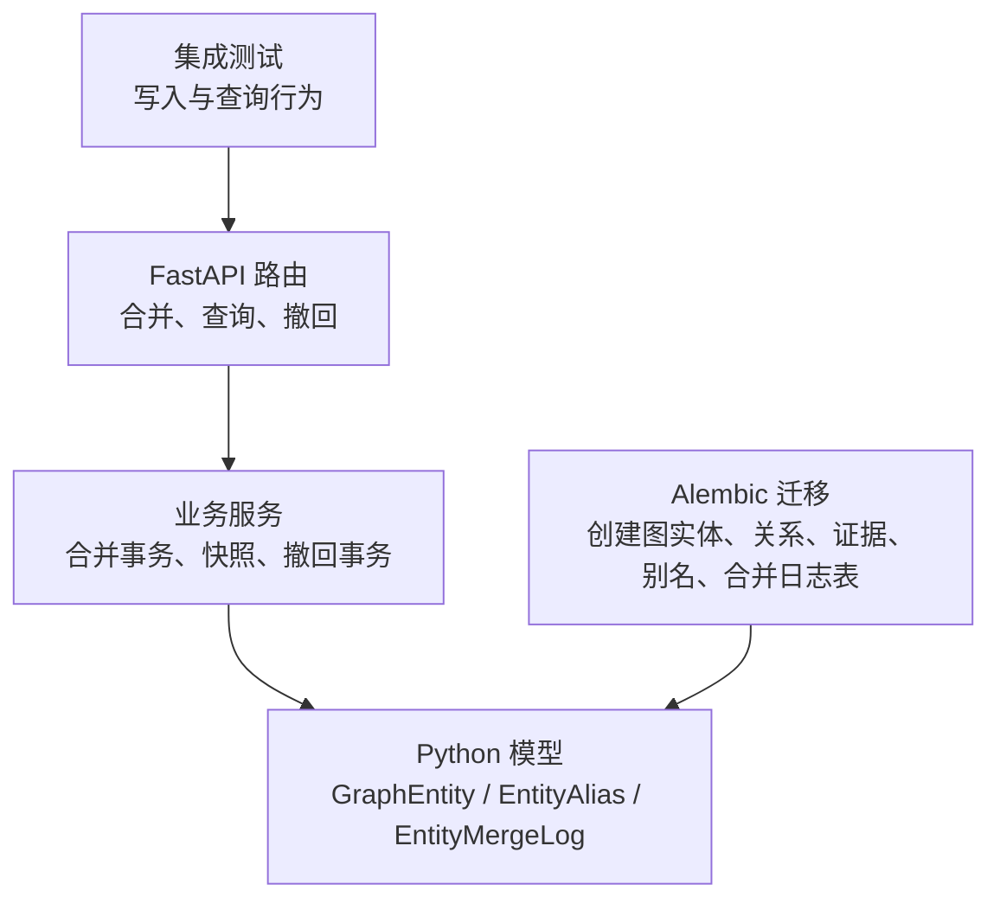
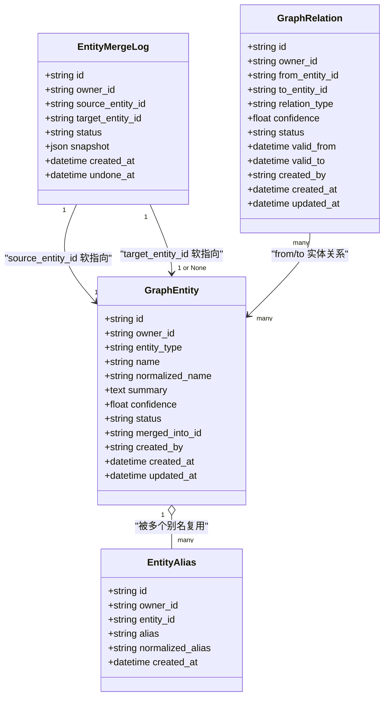
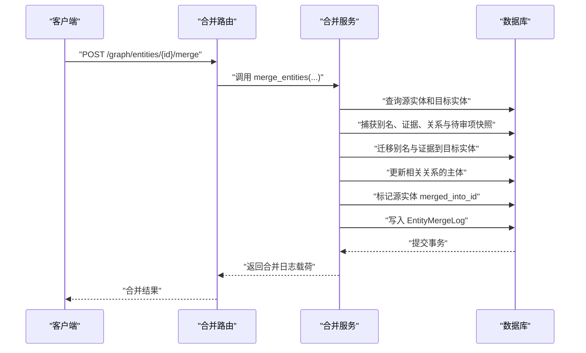
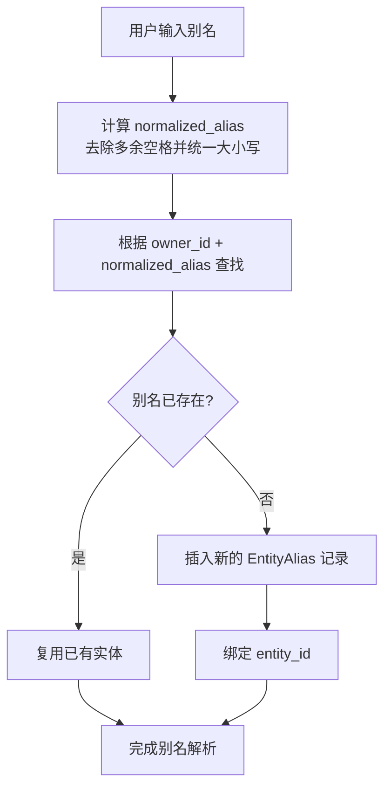
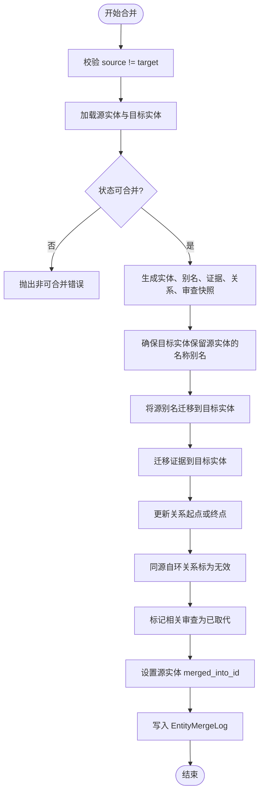
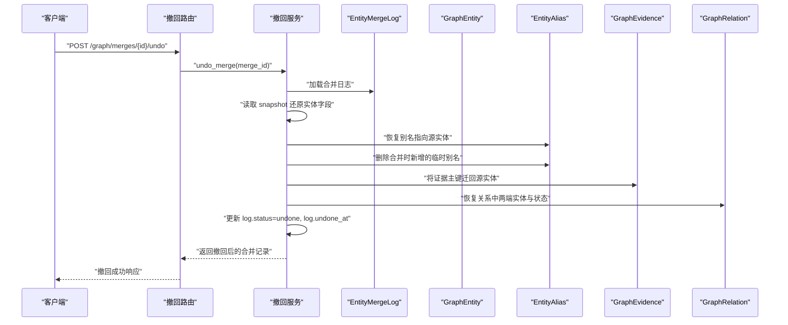
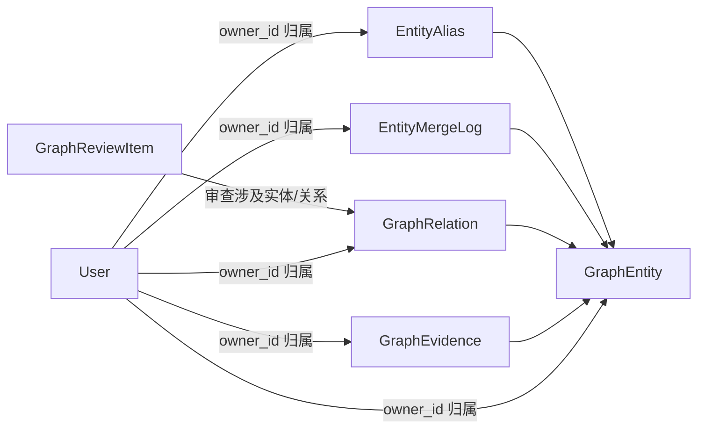
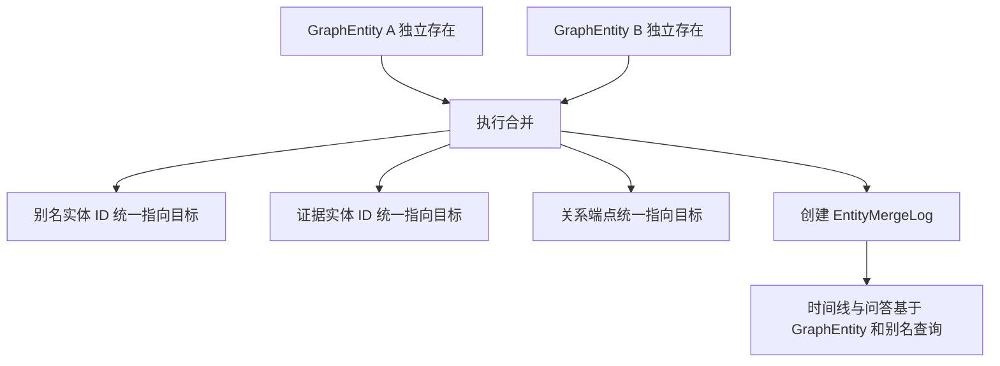

# 实体别名与合并日志

<cite>
**本文引用的文件**   
- [models.py](file://src/personal_ai_life_os/models.py)
- [d2f5a8c14e73_add_evidence_graph_tables.py](file://migrations/versions/d2f5a8c14e73_add_evidence_graph_tables.py)
- [graph_merge.py](file://src/personal_ai_life_os/api/routes/graph_merge.py)
- [graph_merges.py](file://src/personal_ai_life_os/services/graph_merges.py)
- [test_graph_model.py](file://tests/test_graph_model.py)
- [test_graph_extraction.py](file://tests/test_graph_extraction.py)
</cite>

## 目录
1. [引言](#引言)
2. [项目结构与定位](#项目结构与定位)
3. [核心数据模型](#核心数据模型)
4. [系统架构总览](#系统架构总览)
5. [实体别名机制分析](#实体别名机制分析)
6. [实体去重与合并流程](#实体去重与合并流程)
7. [撤回操作与版本链](#撤回操作与版本链)
8. [外键语义设计说明](#外键语义设计说明)
9. [依赖关系分析](#依赖关系分析)
10. [典型用例：统一身份显示](#典型用例统一身份显示)
11. [性能与索引设计](#性能与索引设计)
12. [故障排查与风险规避](#故障排查与风险规避)
13. [结论](#结论)

## 引言
本文聚焦 Personal-AI-Life-OS 证据图谱中的“实体别名”和“实体合并日志”，解释以下关键问题：
- EntityAlias 如何保存用户输入形式的 alias，并通过 normalized_alias 提供规范化匹配能力。
- GraphEntity.merged_into_id 如何实现多个实体对同一逻辑身份的软收敛。
- EntityMergeLog 如何记录 source_entity_id、target_entity_id、status、snapshot、undone_at，构建可审计、可恢复的合并历史。
- 迁移脚本中为什么 merged_into_id 使用 SET NULL，而 entity_aliases.entity_id 使用严格级联删除。
- 用户在时间线和问答结果中看到合并后统一身份时的读取路径。
- 防止循环合并、脏读回滚等注意事项。

## 项目结构与定位
本项目将证据图谱相关的数据结构定义在应用模型层，通过 Alembic 迁移创建数据库表，由 FastAPI 路由暴露手动合并 API，由服务层执行合并与撤回事务逻辑。测试用例验证记录能否正确写入，以及字段约束和行为预期。

图表来源
- [d2f5a8c14e73_add_evidence_graph_tables.py:1-275](file://migrations/versions/d2f5a8c14e73_add_evidence_graph_tables.py#L1-L275)
- [graph_merge.py:1-86](file://src/personal_ai_life_os/api/routes/graph_merge.py#L1-L86)
- [graph_merges.py:1-312](file://src/personal_ai_life_os/services/graph_merges.py#L1-L312)
- [models.py:409-465](file://src/personal_ai_life_os/models.py#L409-L465)
- [test_graph_model.py:1-189](file://tests/test_graph_model.py#L1-L189)

章节来源
- [d2f5a8c14e73_add_evidence_graph_tables.py:1-275](file://migrations/versions/d2f5a8c14e73_add_evidence_graph_tables.py#L1-L275)
- [test_graph_extraction.py:66-105](file://tests/test_graph_extraction.py#L66-L105)

## 核心数据模型
本任务涉及的三条核心表及其 Python ORM 映射如下：
- graph_entities：证据图谱中的实体。包含 id、owner_id、entity_type、name、normalized_name、summary、confidence、status、merged_into_id 等。merged_into_id 自引用表示实体是否已被合并到另一个实体。
- entity_aliases：实体的别名记录。每个别名保存用户输入的 alias 与其规范化形式 normalized_alias，并指向目标 entity_id。
- entity_merge_logs：合并操作的审计日志。记录源实体和目标实体、合并状态、完整快照及撤回时间。

图表来源
- [models.py:409-465](file://src/personal_ai_life_os/models.py#L409-L465)
- [d2f5a8c14e73_add_evidence_graph_tables.py:21-156](file://migrations/versions/d2f5a8c14e73_add_evidence_graph_tables.py#L21-L156)

章节来源
- [models.py:409-465](file://src/personal_ai_life_os/models.py#L409-L465)
- [d2f5a8c14e73_add_evidence_graph_tables.py:21-156](file://migrations/versions/d2f5a8c14e73_add_evidence_graph_tables.py#L21-L156)

## 系统架构总览
实体合并功能通过 REST 接口触发，但实际变更发生在数据库层面；服务层封装了状态校验、快照生成、关联表更新和日志持久化。

图表来源
- [graph_merge.py:24-51](file://src/personal_ai_life_os/api/routes/graph_merge.py#L24-L51)
- [graph_merges.py:139-224](file://src/personal_ai_life_os/services/graph_merges.py#L139-L224)

章节来源
- [graph_merge.py:24-51](file://src/personal_ai_life_os/api/routes/graph_merge.py#L24-L51)
- [graph_merges.py:139-224](file://src/personal_ai_life_os/services/graph_merges.py#L139-L224)

## 实体别名机制分析
EntityAlias 表的职责是为同一个 GraphEntity 保留多个不同写法或用户常用名称。其关键字段包括：
- owner_id：租户/用户边界。
- entity_id：外部键指向 GraphEntity.id。
- alias：原始别名，保留用户输入形态，便于展示与溯源。
- normalized_alias：规范化别名，用于快速查找、模糊匹配或精确匹配。

迁移脚本为 entity_aliases 创建了四类索引：
- 按 owner_id 的普通索引。
- 按 entity_id 的普通索引。
- 按 normalized_alias 的普通索引。
- 按 (owner_id, normalized_alias) 的组合索引。

这个组合索引是关键：它使系统在同一个用户下通过规范化别名快速判断别名是否存在，并支持高效按别名反查实体。迁移脚本没有为 alias 列创建唯一索引，因此允许重复别名存在；唯一性落在 (owner_id, normalized_alias) 上，保证归一化后的别名不重复。

此外，EntityAlias.entity_id 使用了严格外键删除语义：当被别名的实体被删除时，该别名也会被删除，从而避免悬挂别名。

图表来源
- [d2f5a8c14e73_add_evidence_graph_tables.py:110-142](file://migrations/versions/d2f5a8c14e73_add_evidence_graph_tables.py#L110-L142)
- [graph_merges.py:39-43](file://src/personal_ai_life_os/services/graph_merges.py#L39-L43)
- [graph_merges.py:85-138](file://src/personal_ai_life_os/services/graph_merges.py#L85-L138)

章节来源
- [d2f5a8c14e73_add_evidence_graph_tables.py:110-142](file://migrations/versions/d2f5a8c14e73_add_evidence_graph_tables.py#L110-L142)
- [graph_merges.py:39-43](file://src/personal_ai_life_os/services/graph_merges.py#L39-L43)
- [graph_merges.py:85-138](file://src/personal_ai_life_os/services/graph_merges.py#L85-L138)

## 实体去重与合并流程
当两个不同的 GraphEntity 被判定为同一个现实对象时，系统通过“软合并”把它们统一到一个目标实体上。合并流程如下：

1. 校验源实体和目标实体是否相同，拒绝自我合并。
2. 分别加载源实体和目标实体，并确保两者都属于当前所有者。
3. 检查两者的状态是否处于可合并范围（当前实现为 active 或 pending_review）。
4. 生成合并前快照，包括实体信息、别名列表、证据主键、关系记录和待审查条目。
5. 将源实体的主要 name 作为候选别名添加到目标实体；如果目标实体已存在完全相同的规范化别名，则跳过重复创建。
6. 将源实体的所有别名重新指向目标实体。
7. 将来自源实体的证据批量迁移到目标实体。
8. 将与源实体有关的关系更新为目标实体作为起点或终点；若同一条关系两端都变成同一个实体，则该关系被标记为无效。
9. 将与源实体相关的待审查项标记为“已被取代”，避免二次审查。
10. 将源实体的状态改为 merged，并在 GraphEntity.merged_into_id 上设置目标实体 ID。
11. 写入 EntityMergeLog，记录合并前后的关键信息。

图表来源
- [graph_merges.py:139-224](file://src/personal_ai_life_os/services/graph_merges.py#L139-L224)

章节来源
- [graph_merges.py:139-224](file://src/personal_ai_life_os/services/graph_merges.py#L139-L224)

## 撤回操作与版本链
EntityMergeLog 不仅记录合并事件，还支持撤回。撤回时，服务会：

1. 根据 merge_id 加载合并日志。
2. 要求日志存在且状态为 active；已经撤回的记录不能再被撤回。
3. 从 snapshot 中还原源实体原来的 name、entity_type、normalized_name、summary、confidence、status 和 merged_into_id。
4. 将之前迁移到目标实体的别名逐个指回原源实体。
5. 删除合并时额外为目标实体创建的名称别名。
6. 将证据主键对应的证据重新指向原源实体。
7. 恢复关系的起止实体和状态。
8. 恢复相关待审查项的状态。
9. 将合并日志状态设为 undone，并写入 undone_at。

这样形成“活跃合并 -> 撤回 -> 再次合并”的版本链。每个 EntityMergeLog 就是一个可追溯的变更节点。

图表来源
- [graph_merge.py:53-85](file://src/personal_ai_life_os/api/routes/graph_merge.py#L53-L85)
- [graph_merges.py:226-312](file://src/personal_ai_life_os/services/graph_merges.py#L226-L312)

章节来源
- [graph_merge.py:53-85](file://src/personal_ai_life_os/api/routes/graph_merge.py#L53-L85)
- [graph_merges.py:226-312](file://src/personal_ai_life_os/services/graph_merges.py#L226-L312)

## 外键语义设计说明
迁移脚本对外键使用了两种语义：

| 外键 | 目标表 | ondelete 策略 | 目的 |
|---|---|---:|---|
| entity_aliases.entity_id | graph_entities.id | CASCADE | 严格删除语义：删除实体时应同步清理指向它的别名，避免悬挂别名。 |
| graph_relations.from_entity_id | graph_entities.id | CASCADE | 实体删除后，引用该实体的关系应被删除。 |
| graph_relations.to_entity_id | graph_entities.id | CASCADE | 同上。 |
| entity_merge_logs.source_entity_id | graph_entities.id | SET NULL | 合并日志是审计记录，即使源实体被删除，也应保留日志；source_id 允许为空。 |
| entity_merge_logs.target_entity_id | graph_entities.id | SET NULL | 同上；目标实体被删除时不应影响合并日志的持久化。 |
| graph_entities.merged_into_id | graph_entities.id | SET NULL | 软合并指针：源实体被删除不会导致目标实体被递归删除，也允许在数据清理时解除软指向。 |

需要特别注意：虽然 GraphEntity.merged_into_id 在 ORM 映射中也声明了外键并带 SET NULL，但在迁移脚本中并未显式为 merged_into_id 单独增加外键约束行。因此，严格来说该字段具备空值语义和 ORM 关系含义，但数据库级外键约束并不像 entity_aliases.entity_id 那样明确定义。在实际部署环境使用时，建议通过代码层保护和维护图循环一致性，必要时可在后续迁移中补充数据库外键约束。

章节来源
- [d2f5a8c14e73_add_evidence_graph_tables.py:21-156](file://migrations/versions/d2f5a8c14e73_add_evidence_graph_tables.py#L21-L156)
- [models.py:426-428](file://src/personal_ai_life_os/models.py#L426-L428)

## 依赖关系分析

图表来源
- [d2f5a8c14e73_add_evidence_graph_tables.py:21-156](file://migrations/versions/d2f5a8c14e73_add_evidence_graph_tables.py#L21-L156)
- [models.py:409-465](file://src/personal_ai_life_os/models.py#L409-L465)

章节来源
- [d2f5a8c14e73_add_evidence_graph_tables.py:21-156](file://migrations/versions/d2f5a8c14e73_add_evidence_graph_tables.py#L21-L156)
- [models.py:409-465](file://src/personal_ai_life_os/models.py#L409-L465)

## 典型用例：统一身份显示
考虑一个常见场景：用户先分别录入“李华”和“李華”，系统将它们识别为同名人物，随后进行合并。

### 合并前的数据状态
- GraphEntity A：name="李华", normalized_name="李华"
- GraphEntity B：name="李華", normalized_name="李華"
- EntityAlias 可能有 “老李” 指向 A，“小李” 指向 B
- GraphEvidence 和 GraphRelation 分散在两实体上

### 合并后的数据状态
- GraphEntity A 的 status 变为 merged，merged_into_id=B
- EntityAlias 的 alias 仍保留原始形式，只是 entity_id 改指向 B
- GraphEvidence 的 entity_id 统一指向 B
- GraphRelation 的 from/to 端统一使用 B；若出现同实体自环，则关系状态标为无效
- EntityMergeLog 记录 source=A, target=B，snapshot 保存合并前快照，status=active

图表来源
- [graph_merges.py:139-224](file://src/personal_ai_life_os/services/graph_merges.py#L139-L224)
- [test_graph_model.py:41-120](file://tests/test_graph_model.py#L41-L120)

### 显示逻辑建议
- 查询实体时优先使用 GraphEntity，而不是 EntityAlias，以避免重复身份。
- 展示别名时，应从 EntityAlias 中取 alias 字段展示给用户，而不强制显示 normalized_alias。
- 遇到 GraphEntity.merged_into_id 非空时，可将展示标题、摘要等逻辑委托给目标实体，同时标注“曾以其他身份存在”。
- 对于“李华/李華”这类情况，合并后可通过目标实体统一检索，其别名索引仍能匹配多种输入形式。

章节来源
- [graph_merges.py:139-224](file://src/personal_ai_life_os/services/graph_merges.py#L139-L224)
- [test_graph_model.py:41-120](file://tests/test_graph_model.py#L41-L120)

## 性能与索引设计
实体别名查找的性能优势主要来自 (owner_id, normalized_alias) 组合索引。该索引可以：
- 在用户维度内快速判断规范化别名是否已存在。
- 通过别名直接找到对应实体，避免全表扫描。
- 支持对规范化字符串进行精确匹配，也可作为模糊匹配的前过滤步骤。

需要注意：
- alias 列未加唯一索引，允许不同实体在不同上下文中拥有相同用户输入法别名；真正的全局一致性由 owner_id + normalized_alias 控制。
- 如果未来需要支持跨分词或更复杂的本地化模糊搜索，可在应用层使用全文索引或向量索引，但基础精确和近似匹配仍应优先借助 normalized_alias。
- 合并操作会批量更新 EntityAlias、GraphEvidence、GraphRelation 和 GraphReviewItem，因此批量更新的顺序和锁范围会影响并发性能。建议在事务边界内尽量减少长事务。

章节来源
- [d2f5a8c14e73_add_evidence_graph_tables.py:110-142](file://migrations/versions/d2f5a8c14e73_add_evidence_graph_tables.py#L110-L142)
- [graph_merges.py:139-224](file://src/personal_ai_life_os/services/graph_merges.py#L139-L224)

## 故障排查与风险规避
### 常见问题
| 问题 | 可能原因 | 排查要点 |
|---|---|---|
| 合并时报“不是两个实体” | source_entity_id 与 target_entity_id 相同 | 检查前端表单是否正确传递两个不同实体。 |
| 合并时报“实体不可合并” | 实体状态不在 active 或 pending_review | 检查 GraphEntity.status，避免对已合并或拒绝状态的实体继续操作。 |
| 撤回时报“合并记录不存在” | merge_id 错误或归属不一致 | 核对 owner_id 和 merge_id。 |
| 撤回时报“已经撤回” | 日志 status 已是 undone | 合并日志只能撤回一次。 |
| 撤回时报“已合并实体不存在” | 源实体在合并后被删除 | 由于审计日志使用 SET NULL，实体可被删除但仍可查阅日志。 |
| 别名查找不到 | normalized_alias 差异或缓存未刷新 | 检查别名规范化函数是否一致；确认索引可用。 |

### 防止循环合并
合并逻辑目前只禁止 self-merge，但没有全局检测“A 合并到 B，B 合并到 C”或“A 合并到 B，B 又合并回 A”的情况。为避免循环合并：
- 在合并前遍历 GraphEntity.merged_into_id 构成的有向图。
- 判断 target 是否能到达 source，若能访问到 source，则拒绝合并。
- 维护合并树形结构时，限制目标实体不能再被合并到其他实体，或者仅在撤销全部祖先合并后才能改变归属。

### 脏读与回滚
服务层在请求入口处理异常后调用 session.rollback()，然后在正常路径调用 session.commit()。这意味着：
- 单个失败的合并请求不应污染会话状态。
- 若上层框架或依赖注入会话管理未正确隔离请求，仍需确保每次请求使用独立会话上下文。
- EntityMergeLog 的快照本身不是数据库级幂等键；重复发送相同合并请求可能造成日志堆积。应结合业务幂等键或在日志层防重。

章节来源
- [graph_merge.py:24-85](file://src/personal_ai_life_os/api/routes/graph_merge.py#L24-L85)
- [graph_merges.py:31-67](file://src/personal_ai_life_os/services/graph_merges.py#L31-L67)
- [graph_merges.py:226-312](file://src/personal_ai_life_os/services/graph_merges.py#L226-L312)
- [d2f5a8c14e73_add_evidence_graph_tables.py:144-156](file://migrations/versions/d2f5a8c14e73_add_evidence_graph_tables.py#L144-L156)

## 结论
EntityAlias 通过保存用户输入 alias 和规范化 normalized_alias，并结合 (owner_id, normalized_alias) 索引，实现了快速、准确且易于扩展的实体别名匹配。GraphEntity.merged_into_id 提供了轻量级的软合并指针，使得多个物理实体可以共用一个逻辑身份。EntityMergeLog 则把合并过程转化为可审计、可回溯的历史记录；配合 rollback、rollback-safe 的路由处理和快照化的 undo 流程，该系统形成了稳定的合并版本链。

在生产使用中，应：
- 依赖 normalized_alias 做查找与去重匹配。
- 始终通过 GraphEntity 展示统一身份，并从别名表还原用户可见名称。
- 在业务层主动检测合并环，补充必要的幂等键。
- 理解 entity_aliases.entity_id 的严格删除语义与合并日志软引用的审计属性，谨慎处理实体删改。
- 在扩展合并规则时，保持快照结构兼容，避免破坏撤回能力。